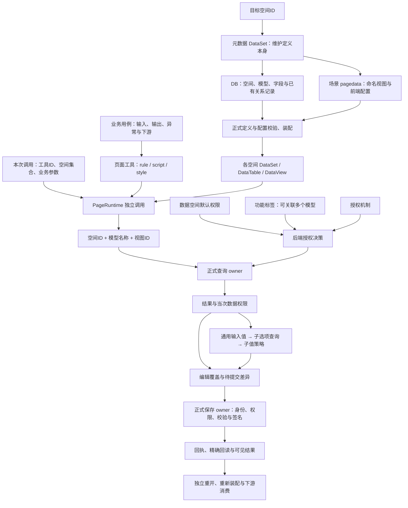
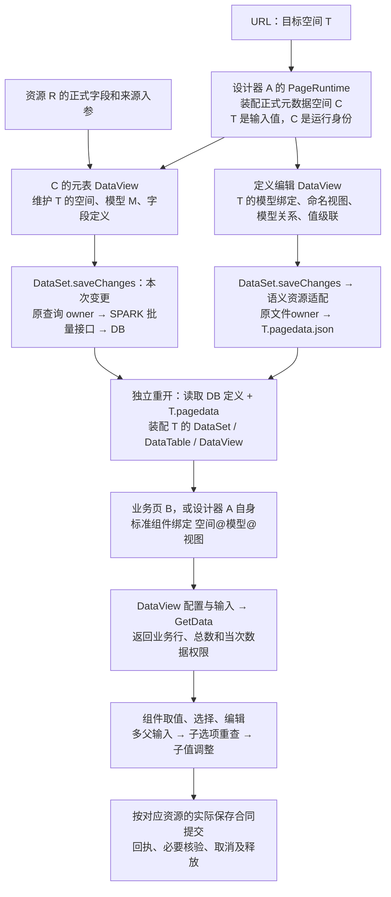
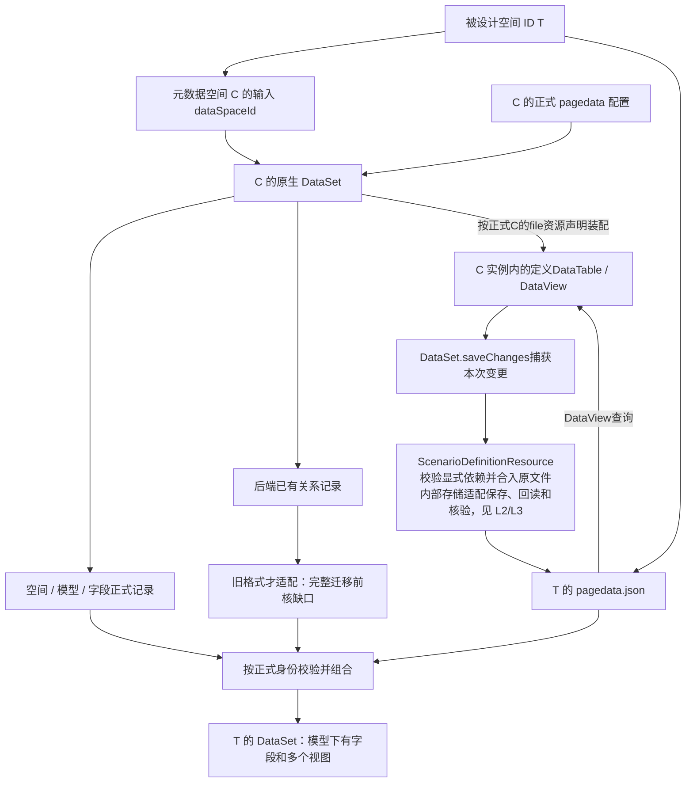

# 数据空间：领域、配置与完整数据链路

版本：2.5.327。源码核对日期：2026-10-19（旧实施方案已撤回；元数据归属在原DataView接纳前校验，按ID维护列及来源入参不再要求整个模型目录加载。定义变更状态与普通保存回执继续复用原SPARK data，完整语义整合及整页验收未完成）。

**后端事实与实施边界**：后端不接本地仓，本地Java源码仅供理解既有接口与排查参考。本文涉及Java类、方法及SQL行为的描述属于该参考版本的源码事实，不代表当前运行服务的部署合同；前端请求/响应夹具只能证明本仓接线，实际服务能力须另有其发布合同或真实接口结果。聚合仍由实际后端通过已有SPARK API执行，本阶段不修改、启动或部署本地Java，不新增未确认的GroupMode等请求协议，不把本地构建或夹具测试称为线上验证。

**无显示投影的查询字段**：正式模型查询在没有fieldProjection时，从DataView.queryColumns取得输出字段；不能把完整DataTable/视图结构columns中的非输出列当作请求输出。正式元数据读取清除工作区显示投影后仍遵循同一规则。非输出列留在原模型结构，显式请求未知或非输出字段仍拒绝；此目录不授予数据权限，查询与提交继续消费原owner的正式上下文。

本文是**数据空间跨包语义的唯一文档入口**。源码决定当前行为；[AGENTS 0.2—0.7](../../AGENTS.md)记录产品方向。包 API 说明方法，指南说明操作，任务研究和历史验收记录不替代本合同。本文将当前实现与未完成项分开记录。历史验收证据曾位于 `notes/evidence/data-space-config-storage/`（**2026-10-21 已从本仓删除**，删前路径见 [manifest](../../notes/research-evidence-deletion-manifest-20261021.json)）；结论以本文与 [删除记录 §2026-10-21 工作区收敛](../../notes/data-space-retirement-ledger.md) 为准，不替代已删除方案或本次线上验证。

**直接查询同样消费视图过滤配置**：DataView.loadFromServer在调用方未显式传filter时使用自身filterExpression；直接加载、派生查询视图、refresh、排序和翻页均由同一SPARK data边界生成过滤参数。显式调用过滤保持原优先级，不改写持久视图配置；动态选项查找仍在既有公共链解析。来源适配及业务页面不再各自补传默认过滤，避免文件资源直接加载时漏掉范围条件。

**设计会话的正式模型读取**：字段目录与模型操作校验向DataSpaceDesignApi.readModel传入本次元数据DataSet。数据层按正式modelBinding.modelName唯一定位元表，在原查询owner上创建独立DataView，读取目标模型、所属columns记录、必要来源主键及来源入参，沿查询接纳边界校验身份、权限和完整性后投影，最后释放查询视图。缺失、释放或身份不匹配的元视图直接拒绝，不回退底层HTTP；原工作区行、编辑、选择和查询配置保持。临时视图不继承工作区输出收窄或查询模式来改变正式结构读取范围。复制API不再要求全空间字段default预先加载；按正式模型逐一读取，仍拒绝任一字段视图的未提交编辑或未决保存，字段可读性由该次正式查询核验。装配元空间前尚无DataSet的引导读取仍由原runtime query承接；该初始化阶段与活动会话数据操作分开，不据此宣称所有历史入口均已统一。

**AppWorks 系统程序来源**：`config/applications/appworks.json`登记D99系统应用、仓内导航JSON及四个系统场景；这些程序定义始终从仓内资源DataView读取，缺文件或资源身份不匹配即失败。其他已由正式元数据确认的数据空间目标继续沿既有`ProjectWorkspace`场景文件DataView/owner读取；四个清单场景不会因为设计器入口而转回远端。动态用户应用仍以正式应用目录、蓝图和场景资源为来源。菜单发布授权仍读取既有`GetNavigationMenus`响应，并由只读语义DataView承接；仓内程序导航声明不代替后台授权或业务数据权限。页面工具三文件及真实DB模型、业务数据仍沿各自正式来源。

**旧设计工具及页面旁路已退出**：仓内旧设计工具的script/rule/style、宿主dataSpaceDesign/dataSpaceLayout能力和`$page`专用查询/暂存/保存/文本草稿方法已删除。现有导航URL仍解析到参考层级内的原生设计页；AppWorks四个系统场景配置已随系统程序一并迁入仓内。脚本使用`getDataSet/resolveView`取得本次实例，数据操作调用DataSet/DataView。文件owner只在资源适配内部执行存储。六类来源的数据合同归数据空间领域，不从页面服务反推；LowcodeDataSpaceViewDesign保留设计会话与原生预览编排，旧open/readModel/stage/save/verify/previewRemote/adopt接口已删除。查询、编辑、取消和保存通过DataView/DataSet；整页验收和仓内写入适配仍未完成。

**2026-10-18执行边界**：用户已要求删除旧方案及其错误实现，原E62及其实施顺序已撤回。本文的对象语义与已核源码事实继续用于判断可复用能力；旧L1—L10执行分解已从正文删除；业务验收边界保留，不作为自动续做方案。当前删除事实见[唯一删除记录](../../notes/data-space-retirement-ledger.md)。

**所属模型身份与目录完整性分别核对**：列定义的读取、普通属性编辑与取消、计算字段新增、来源入参维护，以及按正式模型ID读取的函数候选，使用当前模型查询中的唯一记录核对身份、归属、字段可读性和未决状态；不要求无关模型已加载。字段批次仍核本模型字段的完整集合，输出结构命令继续核其明确依赖。上游关系按配置中的正式模型ID逐个确认端点，缺失端点明确报错，不把未知上游当成空结果；按模型名或物理来源名解析仍要求完整模型目录以核歧义，不能仅凭当前页宣称唯一。普通列保存沿DataSet/DataView回执确认，新增保存及重开由正式DB记录生成DataTable.columns；此调整不改变字段真源、实际请求协议或既有权限守卫。数组结构命令的目录与回读范围仍待单独核定，不能由此段推定所有命令已按需收敛。

**元数据查询的接纳边界**：四类默认目录在原DataView.validateQueryResult中核对本次目标、必要范围过滤和可读的空间归属；modelFields、sourceInputFields、modelInputFields分别核对当前模型、字段类别或上游模型集合。拒绝的结果不替换原行、不发出rowsChanged，失败和重试使用原DataView状态。默认模型列表仍可分页，只有明确请求完整目录的元数据加载命令要求完整读取，普通模型保存不因此补查全目录；三个字段工作区按各自已有完整查询合同读取。上下文可能在合法结果发布后变化，完成阶段仍核对本次调用身份，上游工作区只撤下仍属于旧调用的过期投影，不清除新查询或草稿。加载器不再先发布错误目录再clearAll，目录更新不再重复扫描同一结果；保存回执仍由原SPARK data处理，查询校验不替代保存确认。这些边界已通过本仓查询执行器及传输夹具验证，未代表实际服务验收。

**既有链路说明位于第0章。** [0.1—0.5](#01-本次完整核查的对象与身份)说明身份、数据归属、操作及提交路径；[0.6](#06-旧实施编号已删除)说明旧编号删除；[0.7](#07-完整业务验收边界)规定完整业务结果；[0.8](#08-命令依赖与按需读取的语义边界)给出依赖范围，[0.9](#09-深度复核矛盾反证与可行性边界)保留深度复核证据。

**当前事实摘要**：设计器从正式存储读取元数据空间C，URL目标T作为dataSpaceId输入。概览和工作区按原命名视图查询。C已声明模型绑定、命名视图、原生模型关系、数据级联及DataSpaceLayoutDefinition布局五类可编辑file资源，另有独立只读DataSpaceReferenceLayout参考布局资源。正式存储升级及独立重开结果见历史验收证据目录。ScenarioDefinitionResource提供定义查询与捕获变更保存适配，旧DefinitionDraft及其独立行基线/JSON判定已删除；刷新前直接使用DataView.assertResultReplacementAllowed，变更状态只取原DataView。组件通过这些DataView编辑，普通保存直接调用DataSet.saveChanges，取消用DataView.discardPendingChanges；文件owner在资源适配内部保留冲突、回读及未知结果核验。视图、模型关系及查询级联的布尔字段直接绑定定义视图，临时字符串镜像已删除。布局普通保存、旧图读取及远端预览/采用现走原生数据链；工具改名链已接原生资源，正式C已保存工具资源声明；旧页面查询与原文暂存、保存入口已删除。根级schemaVersion/version/saveChanges分别承载格式、快照版本和提交默认策略；现有值由局部定义提交保留，语义与编辑边界见3.3，不作为三个普通字段另开整文入口。整页仍未完成。

**定义提交的生命周期与范围**：视图、模型关系及级联通过DataView编辑和DataSet.saveChanges提交；三个会话定义暂存入口及其全文件prepare映射已删除。保存捕获本次变更，校验期间后续编辑仍保留，其他未选视图的草稿不参加提交；无变更不创建文件、不上传。资源适配在异步校验后和实际写入前重新核参与视图的存活及身份，关闭或销毁后的候选不能写入。旧格式关系只在已确认完整转换时升级v2；删除坏来源引用的修复保留旧格式及DB来源，并经过正式候选校验。保存后目标运行投影失效，显式loadDefinition或独立重开再装配，普通保存不强制重装整个目标。

**普通列属性与来源入参的提交确认**：字段说明description、脱敏规则Expression、AI操作allowAIAdd，以及来源入参ValueFun的普通修改，经过既有领域校验后调用原DataSet.saveChanges。原查询资源和DataView核对实际回执并接纳本次字段结果，DataSpaceDefinitionSave不再按选中行数另算成功数量；业务层保留目标身份与值的核对，不在成功后强制重查本次编辑所绑定的字段视图。当前视图中的其他编辑覆盖不自动参与提交，派发后的新编辑继续保留，页面区分本次保存与后续待保存修改。字段新增、删除、改名、类型、输出、主键及查询结构等命令仍使用各自的领域核验；未知回执或用户显式核验沿原只读流程处理，不重放写入。独立目录视图仍是自己的查询快照，未加载或已有草稿、在途操作的目录不补查、不覆盖；已经加载且干净的目录按原allPages合同更新，读取失败保留在目录DataView的loadingError/Failed状态，不把已确认写入变成待核验失败；被保存目标的运行定义失效后，显式读取或重开再按正式DB记录装配DataTable.columns。此行为由本仓原请求执行器和HTTP夹具验证，不能据此宣称实际服务已经完成验收。

**定义读取的异步接纳边界**：装配候选在关系定义及画布回读结束后，再核对文件owner、代次、修订、原文和当前编辑状态，才发布运行投影；过期候选释放，等待期间的新定义与编辑保留。关系定义回读与端点发布之间也核同一文件修订，不能把旧端点记为新文件的结果。独立画布读取在最后回读结束后再次核对会话及文件身份，过期或已关闭会话不能返回成功，旧失败也不能清除新代次的画布。旧关系工作区的独立读取另核调用代次及来源快照，失败清理只处理仍由本次调用持有的转换结果；同文件来源更新后的新转换也不能被旧调用清空。

**标准容器的行身份与连续编辑**：表单等容器的行镜像保留非枚举原行引用，身份读取和更新经过同一Vue响应式链；原行更换即使字段值相同，也使字段绑定重新解析。该引用不进入业务序列化，不复制授权或草稿。编辑覆盖对象的重新生成不视为换行；字段异步写入守卫按所属视图、行主键、字段及数据成员变化失效，查询行替换/清除和组件销毁同样使旧写入失效。已绑定行字段缺少当前行时不渲染空控件；非行数据成员和无DataView的本地控件保持原合同，查询及保存授权规则不变。

**正式模型视图的字段引用校验**：LowcodeDataSpaceViewFields统一核查询输出、排序、树身份、显示选择及聚合字段，由原生保存的候选装配与运行装配共用，不再保留历史stage的重复校验路径。排序和树身份须引用正式字段，显示允许已声明的本地计算字段；现存校验也允许聚合本地计算字段，这部分须按2.5.266后端聚合边界迁移，不能据此将前端公式直接传给后端。选择字段继续核实际投影。无效引用在写入前拒绝，原DataView修改保留供纠正或取消。本次不改变后端过滤表达式和值函数规则，不将此校验扩展成普通保存前读取全空间；file资源保持其既有本地查询校验合同。

**参考布局的独立只读资源**：C的DataSpaceReferenceLayout/default绑定file资源reference:layout，调用参数dataSpaceId定位T，输出单条dataSetId/content。content:null表示文件缺失；空文本、损坏文本与有效原文保留区别，由布局领域解析并报错，不在查询层猜测修复。DataSpaceReferenceLayoutResource只在查询适配内部调用SysForm/<T>.json读取owner，DataView统一承接查询、过滤、排序、投影、状态、身份与只读结果；没有保存或来源采用能力。会话readReferenceLayout刷新该正式视图并核对目标、可读性及定义代次，不再直接读文件。旧布局迁入和后续修改提交到DataSpaceLayoutDefinition，不回写参考图。命名视图配置与预览复用同一参数声明和标准组件，不建立业务数组或独立查询器。

**工具文件的原生资源**：正式C已通过定义DataView和DataSet保存ProjectToolCatalog/default与ProjectToolFile/default；原有配置完整保留，不以运行时addTable或直接owner回退掩盖缺失。前者输出当前应用挂载工具及全部发布版本，后者用pageId/fileName/versionId定位单文件，输出稳定fileKey、身份、text及已有本地修改状态。空版本表示工作文件，发布快照及身份字段只读。ProjectToolResource在数据层内部适配蓝图、工作文件、快照读取及单文件提交；查询结果、过滤、投影、编辑、取消与回执由原DataView/DataSet承载。改名命令从正式表派生查询视图，查询用完释放，待提交变更保留在命令DataView；原始/候选原文仅为确认快照。每个文件单独确认，未知回执通过同一保存API核验已应用原文，不重放数据库修改或已应用文件。显式协调仍只迁移已预览的引用，保存期间的外来编辑不纳入原命令。预览只读，不修改发布快照、发布指针或导航。

**同工作区重开的来源刷新**：openDesignSession发现目标文件已有干净缓存时，先完成正式C装配，再经其DataViewDefinition/default的previewSource/adoptSource核对最新目标来源，随后初始化定义视图及按需装配T。原文不变不采用、不增加修订；远端文件缺失由来源适配撤销旧缓存身份，不将旧配置复活。读取期间owner、修订、作用域或本地状态变化均拒绝本次打开并释放新实例，失败不改变原缓存。已有未保存文件草稿保留为显式处理对象；pending/unknown仍由既有查询守卫拒绝新会话交付，保留原提交与原会话核验入口，不能借重开解除未知状态。首次无缓存读取保持原链，重开不先投影旧缓存，也不新增页面刷新器或forceReload旁路。共享工作区组件验收覆盖远端修改/删除；本轮实页验证被浏览器策略阻止，在线验收边界见历史验收证据目录。

**当前状态**：完整参考页及零回归尚未验收。当前先执行用户要求的旧方案及错误实现删除；旧阶段编号、执行顺序与待办不再驱动工作。正文第1—7节展开专题合同，删除事实与验证边界只看[旧方案删除记录](../../notes/data-space-retirement-ledger.md)。

**折叠配置的组件生命周期**：标准RendererSection的可选lazy复用标签页“首次展开才挂载、之后折叠保留”的语义，缺省保持既有立即挂载行为。数据视图的完整请求属性及结果组织属性区显式开启；首次展开以前不创建字段组件，展开后仍沿原dataViewKey绑定与编辑，再折叠不清除草稿。绑定切换继续由标准数据上下文隔离；延迟挂载不建立查询或编辑副本，不改变保存范围。组件测试中的CPU采样与超时记录仅证明测试环境范围，不能据此宣布浏览器性能或整页验收通过。

**视图配置编辑的目录复用**：打开查询、过滤、排序或默认调用值编辑时，先消费原数据链对当前视图字段/来源入参目录的有效性判断。目录有效则直接打开标准编辑器，不因切换工作区进入全区忙碌；缺失、失效或报错仍沿原按需加载及过期守卫处理。页面不缓存另一份目录，不跳过保存校验、DataView编辑或取消。隐藏请求区保留实例的实验未采用，标准JSON编辑器的身份和写入代次守卫保持原样。

**画布工具栏的标准分区**：参考页的选择、新增模型、画布定位/对齐/缩放、输入参数、复制API、删除和保存按原顺序进入RendererGraph.toolbar主区；目录、重开、两类关系及布局取消/核验/远端恢复通过RToolbarProps.tail.children编排。各操作保留本次DataView绑定、选择身份及可用性条件；“保存布局”只提交原布局变更，不扩展为模型或视图全量保存。不将工具栏分区视作整页1:1已完成。

**画布选择工具**：RendererGraph.selectCurrent将当前受控节点/连线重新高亮，无当前元素则清除图中高亮。目标继续由current属性或已绑定DataView当前记录定位，不改变DataView指针、selectedRows、value或业务数据，不触发onSelect/打开详情，不查询或保存。内部绘图与点击后的受控高亮校正共用同一实现；等待期间绑定或当前元素变化、身份不在有效投影内、禁用/不可见、视图或组件销毁均拒绝旧调用。参考设计页已指定节点/边配置面板，选择工具不意味着新增通用图中文字编辑或标签持久化合同。

**文件资源的请求配置与预览**：ScenarioDefinitionResource.queryParameters只为已注册的定义资源声明dataSpaceId（目标数据空间ID）；该值定位被读取文件，消费方DataSet身份不变。视图编辑器用标准FieldJson参数表直接编辑定义DataView的queryContext，保留完整JSON编辑及未声明成员；预览参数表只提供本次覆盖值，通过已有多输入级联进入实际查询DataView，不保存到定义。DataViewLocalQuery.outputTypes同时用于本地执行校验、文件视图编辑器及file/static-data预览候选：Table提供分页列表，SelfRefData读取过滤后的完整集合且不分页，不执行服务器节点查询。服务器Join、HierarchyData、Navigation及tree参数不作为文件资源可选能力；旧配置通过完整JSON保留可修正，执行时明确拒绝，不静默改写。过滤、排序、翻页继续消费同一DataView的参数和配置；数据库等其他资源的查询协议保持原合同。

**显式采用远端的范围与时序**：DataView.previewSource读取绑定资源的远端原文及本地基线版本，不替换rows、权限或草稿；DataView.adoptSource通过同一查询执行器的source适配再次核对来源。视图/绑定、关系、级联及布局入口明确声明discardViews，同源未获准取消的编辑、异步新编辑/撤销、查询或视图集合变化均拒绝采用。原生DataView统一保护实例身份、查询状态及取消范围；ScenarioDefinitionResource内部的文件owner核对修订、原文、格式和存储作用域，成功后才同步取消明确允许的修改并接纳来源。读取失败和核验失败保留草稿，未知提交状态只在采用成功后解除，不重放写入。普通数据库查询未声明source则明确拒绝该操作，不据此推导可写权限。

设计会话previewRemoteViews/adoptViews现为原生来源操作的业务编排：解析视图选择、使旧运行投影失效，按需刷新已加载定义工作区及画布；会话中的编辑签名/事件/取消守卫已删除。结构命令的远端原文核对复用同一DataView.previewSource。采用不装配整个T、不补查未加载布局，不清空数据库输入字段的查询与编辑；不同目标文件的草稿不参加取消。工具改名迁移已接入下述原生资源；历史页面上下文的旧reader/stage入口已删除；底层历史原文接口已删除，整页验收仍未闭合。

**正式模型删除的布局收尾**：删除预览先拒绝已有布局草稿，读取正式DataSpaceLayoutDefinition/default作为布局查询基线。数据库模型、所属字段及直接关系确认删除并回读后，只将该模型坐标和关联待配置边的移除写入布局DataView，通过DataSet.saveChanges提交；普通布局和结构命令共用同一文件资源适配。模型已删除不妨碍清除其坐标，新增/移动坐标仍须校验正式模型身份，布局字段写入继续受原视图合同保护。未知文件结果重入同一DataSet保存能力核验，不重放数据库删除或文件上传；未应用时保留原生变更，下一次显式接续才重试。显式远端恢复复用会话采用入口，先拒绝重新绑定已删除模型/来源关系的文件，再采用及重新计算本次清理；无关远端配置保留，远端文件已删除则不重建。外来布局编辑、文件草稿或目标变化拒绝继续且保留状态。模型改名和数组定义的pagedata收尾见下一段；工具文件的线上实际查询仍未验收；页面上下文reader已删除，不能据此宣称所有结构命令的线上闭环已验收。

**模型改名与数组定义的pagedata收尾**：数据库定义确认后，按配置变化定位正式C的绑定、视图、模型关系及级联资源，从对应DataTable派生命令DataView，仅查询受影响的资源。配置记录按正式主键字段匹配，实际编辑使用查询行的DataView主键，不把无计算主键的配置对象当作查询行。字段修改留在这些DataView，经同一次DataSet.saveChanges提交；成功释放命令视图，未知结果保留并重入同一保存能力核验。查询失败可以接续已确认的数据库结果，不重复改名或字段交换；其他编辑、取消、远端冲突与目标作用域仍单独检查。结构命令采用远端时复用同一范围保护，图投影延后到旧绑定名称完成迁移，避免中间态阻断修复。工具rule/script引用核查及rule静态改名也走正式工具资源视图，存储owner仅在适配内部执行IO；正式C已保存新增声明，线上工具原文查询覆盖仍须按实际挂载数据核定。

同ID注册名及视图变化只校验正式模型、修改视图及其显式依赖，不强制导入未修改的旧数据库关系；实际pagedata格式和关系记录不因此改写。模型ID、来源、其他表属性或关系/级联变化仍走对应完整校验，不能借改名更换资源。绑定与视图同批修改后，资源回执包括派生的只读dataModelName变化，DataView接纳新基线而不生成虚假的待提交修改；该字段仍不可由编辑输入直接写入，后续本地编辑继续按捕获快照保护。

**定义查询与运行装配分离**：原生关系目录消费已查询的定义DataView，不能按T是否已经装配切换到另一视图的行身份。关系保存只提交关系视图，其他视图的待提交修改继续保留；后续只读画布查询不以全部元数据无草稿为前提。文件模型使用已声明资源与columns，不虚构Base_DataModel记录。页面目录由DataTableBindingDefinition的file资源身份建立文件模型及其字段/多个视图层次，命名视图按tableName归属；数据库模型仍核对正式modelId/modelName。无法核定归属的定义继续明示，不能隐去。正式C的六个文件模型及其命名视图由同一目录链归属；fileModels只读视图为画布和概览提供文件模型，编辑继续绑定default，不能通过画布只读投影修改配置。

**文件模型配置与预览**：模型配置由标准FieldJson树直接绑定C@DataTableBindingDefinition@default的configuration；字段工作区用同一标准组件的rows模式与valuePath=["columns"]编辑原字段内的字段列表，按标准子组件呈现名称、标题、类型、主键、必填、允许空值和计算表达式，其他原生配置仍可在模型JSON树中维护。未确认的行编辑只属于标准组件交互，阻止外层关闭、切换及保存；确认后写入同一configuration字段，再由DataView取消或DataSet保存，不伪造字段元模型。JSON路径使用精确对象键/数组下标，缺失或类型错误明确拒绝；写回合并最新原字段，保留路径外成员，同路径变化、绑定/路径切换及失权后的旧事件拒绝。模型下视图复用DataSpaceViewEditor，绑定C@DataViewDefinition@default。修改、取消和提交沿原DataView/DataSet；配置树不是第二份草稿，文件原生columns不写入数据库。文件视图选择必须核对tableName/resourceId及目标身份，不能附带或借用数据库ID。字段/函数目录由声明columns和原生关系提供；预览沿ScenarioDefinitionResource及原装配器消费指定目标参数，禁止从预览提交定义。文件调用参数和预览查询模式按上文资源合同消费，不据此宣称文件资源支持所有SPARK查询模式。

**文件模型删除与取消**：画布删除和模型下入口共用绑定编辑器，预览所属全部视图以及当前文件内的明确引用。原生DataView的pending-delete快照保留工作区和取消/未知结果核验入口，不另存一份删除草稿。取消调用discardPendingChanges；保存只捕获已修改绑定，通过文件资源适配保留未加载/未改模型与资源实际内容，确认回执后刷新只读画布投影。普通文件模型配置、字段编辑和数据库模型结构命令的验收范围分别记录，不将文件删除通过等同整页完成。

**模型字段修改的校验范围**：ScenarioViewConfig.selectTableValidationScope对已有、未换绑的原生file模型配置变更，以及模型和资源身份稳定的原生正式模型columns变更，按该模型全部视图、稳定关系、显式级联、辅助查找和反向消费者校验。columns可与views/api/crudConfig同次修改；其他结构变化不套用该规则。校验投影不作持久化载荷，完整文件未改部分继续保留。原生v2的新增绑定按新模型及真实依赖校验，包含新增后产生查找歧义的反向消费者；可与稳定模型字段编辑共同提交。原生绑定及文件模型纯解除核定配置引用后不装配未修改模型；资源或正式身份换绑、旧格式结构变化及混合删除仍按各自边界执行，尚未消除全部结构命令的全目标校验。被视图引用的字段不可静默删去；失败保留待提交修改，取消回到原查询基线。

**当前范围调整（2026-10-13）**：按用户“暂时不接入数据权限”，本阶段先完成空间、模型、字段、多个DataView、两类关系的配置设计，以及编辑、保存、重开和运行消费。新增/扩展权限接入、功能授权接线及权限专题验收暂缓，不成为本阶段新建设前置；正文中的权限语义继续作为产品合同保留。既有查询、编辑和提交链的权限守卫未改变，不能将暂缓接入记录为权限能力已经实现或已验收。

**独立过滤器字段目录**：参考FilterBuilder本来就是独立组件，本仓沿既有FilterExpressionEditor/FilterValueFunctionDialog和标准绑定入口接入。函数模型目录支持由正式数据owner提供`loadFields`，选择模型及应用表达式时按明确引用取字段；模型候选完整保留，已加载的空目录不补查。公共DataViewFilter统一识别引用并返回用于本次校验的目录，树和JSON使用相同校验；目录失败保留草稿，切换、取消、编辑变化和释放使旧结果失效。不执行值函数、不修改过滤存储格式或保存路径。

**关系工作区字段读取**：`loadRelationDefinitions`对原生v2交付文件定义，不读旧库、不装配T；旧格式沿C的Base_DataModel_Relation/default读取完整来源。DataSpaceDesignApi.decodeRelations复用正式读取的解码规则，LowcodeModelRelationAdapter核正式模型身份、目标范围、全部记录及字段可读性、未提交修改；只接受dataSpaceId输入参数限定的完整空间过滤，无附加条件或filterLookups。已经Loaded的目录可能只是一次窄查询结果，转换前仍经DataView按正式范围重查全部页，rows.length===total本身不证明整个空间来源完整。随后按端点及值函数引用读取必要正式模型字段，转换为原生DataResourceRelation；不读取全字段default，不装配无关命名视图。未绑定或无法转换的来源明确报错，不能升级v2或猜空；文件自身失效来源引用仍保留原文修复入口。文件、来源、模型或作用域在读取/交付期间变化会拒绝，交付失败撤销完整转换来源。relationDefinitionsReady按原生文件、完整运行投影或同文件/来源/代次的成功转换判定；页面据此选择已Loaded的默认关系DataView，不再要求整个T为ready。同一有效工作区重复进入保留刚新增/修改的关系草稿，来源和文件变化后不复用该标记。`loadRelationFields`继续按关系身份提供当前字段及按需值函数目录，数据库沿readModel，file资源使用原生columns；不查询业务行，不从definitionDataSet拼目录。

**多定义资源联合保存**：ScenarioDefinitionResource使用ScenarioDefinitionRecords合并本次DataSet捕获，先处理模型绑定的身份依赖，其余定义合并完成后才构造最终ScenarioViewConfig；视图改名与级联引用、新增模型与布局坐标不按不完整中间状态误拒。候选只存活于一次保存内部，复制捕获数据，不能改写原查询、DataView草稿或文件；静态write仍为立即校验的单域映射。待配置连线只在最终关系端点匹配时消耗，同批布局回执使用最终持久值并按原提交顺序交回，正常/未知回执与保存期间后续编辑沿既有协议。该语义只针对同一文件，不扩展为跨来源事务。

已知定义资源混合提交交给ScenarioViewConfig.selectDefinitionValidationScope。前后均为原生v2时，新增模型以及实际改变的稳定模型字段/视图、关系端点及其值函数引用、全部级联父子/选项端点作为依赖种子，复用同一selectTables遍历并保留相关模型全部视图、关系、级联及正反向辅助过滤查找。解除仍核原配置引用；无引用的绑定及其坐标解除不装配未改模型，不能以同批改关系跳过原删除命令的引用预检。无关失效模型不参与装配；布局/请求策略变更及纯删除关系/级联不单独读取模型。未知资源、真实身份/资源换绑、旧格式与根级策略变化保留完整校验；原单类校验入口及其专属范围不变。校验投影不得作为保存载荷，完整文件未改部分保持，实际依赖/字段错误和失效身份继续拒绝。DataView回执只确认该视图捕获的记录；绑定解除引起的所属视图目录变化沿原DataView重查，未重查的失效记录不能继续提交，不伪造未捕获记录的删除回执。

**原生关系提交校验范围**：`ScenarioViewConfig.selectRelationValidationScope`核同一空间及非关系配置不变，仅允许关系增改删、首次schemaVersion升级及对应待配置连线的消耗。原生格式只校验增改关系；首次旧转原生必须先确认完整来源，再校验全部转换后关系。两者均保留父子及GetRefData/GetGroupData/GetExpData等明确引用模型，使用临时default核正式字段，不装配未改命名视图、无关关系或级联；无变化、原生纯删除或完整空来源转换不读取无关模型。根属性顺序不构成结构变化，实际模型/视图/布局等变化仍拒绝。校验投影不写入文件；原完整模型、视图、布局和未改配置保留。DataSet捕获DataView变更，经ScenarioDefinitionResource与内部文件owner完成校验、冲突、保存、回读及原视图接纳；未知结果仍由相同DataSet入口核验。未完成来源转换的旧引用修复及其他结构命令仍按各自完整校验边界；原生稳定模型混合提交按上述联合保存规则处理。

**级联字段与提交的独立范围**：级联工作区查询C中DataViewCascadeDefinition，打开时不装配完整T，也不查询全部Base_DataModel_Field/default。LowcodeDataSpaceDesignSession.loadCascadeFields按配置表键和命名视图核定正式模型或file资源身份，复用单模型读取及原生字段投影；并发端点共用模型读取，过期作用域、销毁或投影变化拒绝结果。候选进入已有DataViewFieldOption，标准字段组件绑定其派生DataView，通过模型/视图父值过滤；候选更新后调用DataSet.refreshFieldCascade刷新注册的查询实例，不能只刷新选项模板。有效复合主键、计算字段不作为可写目标，其他只读字段仍可作为父值。控件端点投影和候选属于临时运行DataView，不新增持久定义或权限授予。

字段目录异步返回后、写入候选之前须再次核对同一视图快照和文件身份；候选刷新返回后仍核对。已过期的目录不能先写入旧选项再报错，其他端点已读候选不受该失败清理影响。

单类DataViewCascadeDefinition提交由ScenarioViewConfig.selectCascadeValidationScope核对同一空间及其他配置未变，提取新增/修改级联的所有父端点、目标/选项端点、相连级联及辅助过滤查找依赖；沿原装配器核定字段、查询和级联合同。纯删除或无变化不重读模型。未改模型关系不参与本次校验，也不触发旧格式转换；临时v2空关系只隔离校验职责，不能作为存储载荷。ScenarioDefinitionResource仍捕获DataView变更、保留完整原文件中未改表/视图/关系/布局及未加载记录，经同一DataSet保存确认回执。混合定义资源或结构命令不套用此单类范围；保存后运行投影仍失效，独立重开/预览继续由正式文件装配。

**命名视图字段目录**：`LowcodeDataSpaceDesignSession.loadViewFields`核定当前模型身份、文件绑定和DataViewDefinition草稿：数据库模型沿正式readModel读取资源字段，file模型从声明columns生成原生DataTable/DataView。`LowcodeDataSpaceViewFields`与运行装配器共用输出列、选择字段和投影校验，交回已有DataViewFieldOption和字段级联；不查询业务行，不复制模型定义或建立第二份编辑草稿。目录只缓存当前视图，模型、投影、会话和文件变化使旧结果失效；普通查询参数编辑不卸载正在编辑的过滤器。提交状态代次用于写入守卫，不构成字段目录身份；原文未变的保存回执不使有效字段读取过期。视图暂存范围见下述合同，保存、冲突处理及独立重开责任不变。

**命名视图及预览的值函数目录**：`loadViewFilterContext`按冻结参考节点请求设置的语义，读取当前模型及稳定模型关系声明的上游。数据库候选使用正式`modelName`，file候选使用原生`tableName`；关联字段使用上游`模型名称.字段名`，不将模型关系推导为输入级联。原生关系从文件读取，旧格式仅补读旧关系元数据。函数目录和`loadViewFields`共用按资源身份快照校验的字段读取，正式模型按已有输出合同筛选，文件资源保留原字段语义；不查询业务行或装配完整目标，异步完成后再次核对文件、视图、模型及会话身份。配置页面仍以原`r-filter-expression`绑定定义DataView的`filterExpression`，合并原输入参数目录，目录失败明示并保留常量编辑。模型及命名视图预览通过`loadPreviewFilterContext`复用同一目录流程：当前字段取本次DataView.queryColumns，只按上游模型读取字段；没有文件绑定的正式模型预览仍可提供自身目录。预览关闭、文件或会话变化使在途目录失效。预览通过原`RendererFilter.filterFunctionContext`传入模型和mapped/direct语义下的输入参数，应用与取消仍由标准过滤器和DataView执行；临时条件不写入设计配置。目录失败明确显示诊断，常量及已知参数仍可使用。候选可用不证明任意值函数都能在后端过滤执行，GetRefData执行位置的限制仍保留。

**查询字段与完整模型列分开**：`DataTable.columns`保留全部正式列；`DataView.columns`表达当前显示投影与本地计算列；只读`DataView.queryColumns`由当前查询执行器派生其实际接受的字段。正式来源复用绑定模型的resolveOutputFields，数组复用原查询接受的字段集合，未提供专门目录的资源沿用原普通列；排除框架主键和本地计算列。命名视图未选作输出的可查询字段仍可出现，非输出正式字段不因此变成可查询字段。目录不持久化、不发请求、不授予权限，并保留身份、作用域和销毁守卫。预览参数候选和查询预检共用此合同；字段不合法时在修改queryConfig、查询上下文或清空结果前拒绝。模型结构和原生模型关系仍按完整columns校验。

**视图提交校验范围**：`ScenarioViewConfig.selectViewValidationScope`先确认同一场景、已有模型未删除或改绑、其字段及其他非视图配置不变，再由新增绑定和发生视图增删改的模型起算显式依赖。保留涉及模型的全部视图，递归包含级联端点、辅助过滤视图及其反向消费者；必要引用缺失或歧义仍拒绝，包括新增同名模型绑定造成的查找歧义。稳定模型关系未修改时不牵入其连通模型，也不读取旧库关系。只给验证器的临时配置使用原生格式及空模型关系；原完整文件的版本、关系、布局、未修改模型与视图保留。DataSet捕获定义DataView变更后，资源适配执行候选校验、身份/修订/生命周期检查、内部文件提交和回执接纳；临时实例始终释放，配置写入使旧目标投影失效。未选视图的修改不参加本次提交；无变化不装配。新增命名视图通过DataView.addRow，首次提交按模型身份建立绑定及必要default；候选失败保留可取消的新增行，不注册文件；完整结构编辑继续按对应结构合同校验。已删除会话createView/stageView，不能再把它们的接管/暂存时序当作原生提交合同。

## 0. 先沿完整用例读链路

**预览生命周期与宿主状态**：模型及命名预览共用原设计会话的元数据变更订阅，按各自既有输入守卫判定失效；会话关闭显式释放交付的预览，不能依赖DataView销毁后已移除的事件。文件、定义草稿、查询身份或会话失效后，原PageRuntime及DataView销毁，已经交给标准组件的旧DataView也不能继续查询。LowcodeDataSpaceQueryPreview.onDispose通知宿主撤下原运行上下文、结果与查询控件并提示关闭重开；宿主卸载取消订阅。装配中的目录迟到结果不得恢复已失效的预览。该通知不保存数据、不扩大预览权限，也不改变元数据草稿和文件提交范围。

**原路径目录到设计器**：`features/data-platform/data-set-management/ui/data-set-list-page.vue`从导航的`blueprintScenarioId`读取正式场景文件，经`loadLowcodeRuntimeScenario`装配目录DataSet；URL查询参数不替代目录场景身份。标准表格及过滤区绑定`空间@Base_DataSet@catalog`，应用选项绑定`catalogApps`，创建人关联查询使用`catalogUsers`；过滤、排序、分页和选择由同一DataView承载。目录业务校验通过运行实例的`validateQueryResult`在结果接纳前核对总数、身份及必要关联，原查询owner和权限上下文不改绑，过期校验结果不接纳。创建人仍以用户ROWID关联、ID作为权限主键，隐藏/脱敏/歧义分别处理，不覆盖原字段。设计、复制API、查询绑定在标准表格`actions → RToolbarProps`中按行提供；渲染行镜像按绑定视图主键定位原查询行，失效的原行回调不能作用于新结果。设计只传目标`scenarioId=T`与返回路径，不修改导航URL。

**目录新增、编辑和取消**：标准弹窗内的RendererForm绑定原`catalog/currentRow`，字段没有第二份表单数据；所属应用选项仍绑定原DataView。原视图必须声明staged提交；新增由原查询准备行身份，Type固定为datasource，用户只填Name、description、sysid，创建人/时间由服务返回。编辑只允许Name/description；新增、行和字段授权继续消费原查询，名称及描述长度、必填和应用候选按领域语义校验。取消丢弃当前行未提交状态；保存只对该行调用DataSet.saveChanges并核实际回执，再重查目录。保存结果未知时不重放写入，也不把取消当服务端回滚；显式放弃本地修改后只重查核验，已确认写入但回读失败同样保持待核验状态。查询、目标或应用身份变化拒绝旧提交。参考删除只移除Base_DataSet，未证实所属定义级联；非空空间删除范围尚待裁决，原生入口未迁入此缺陷，旧四文件目录也尚未完成退役。

**目录绑定查询和调用资料**：绑定查询从目录正式Base_NavigationInfo派生结果及祖先视图，分别按当前空间conid及所属应用SysId过滤，保留原视图范围并由SPARK data读取完整集合；首屏不查询导航。标准表格绑定派生结果，功能路径从祖先视图按prowid呈现；空绑定不查询祖先，缺失、循环、归属不符、字段不可读或查询失败均拒绝完整结果，失败/关闭释放派生视图。切换、关闭或销毁后的在途结果不回填旧界面。复制API复用设计会话的正式模型资料生成，所需字段通过元数据DataView按此命令加载，会话始终释放；它不是另一个请求文本拼装器。以上离线用例不替代真实目录配置、线上保存及整页1:1视觉验收。

本合同负责语义、归属和实际控制路径；[实施台账](../../notes/data-space-retirement-ledger.md)负责固定任务编号、进度、缺口及证据。两者分别维护，不再把数轮实施日志当产品设计。

**页面数据操作边界**：业务页通过 spark-data API 查询、编辑、消费权限和提交，组件按`数据空间ID@模型名称@视图名称`绑定同一 DataView。请求及持久化适配归数据层既有责任方；页面保留业务流程与校验，不复制通用数据逻辑。原生数据空间设计页现已提供同一元数据 DataSet 的 PageRuntime，模型和字段表单使用完整绑定。通用解析器同时校验空间身份、正式模型名称和视图；不会忽略 scope 或回退到内部表别名。已有带`#`的三段配置仍可读取，新键输出不带`#`。

**标准表单提交边界**：`RendererForm`及过滤字段宿主`RendererFieldScope`取消浏览器原生form提交，避免单输入框按Enter触发整页GET导航、丢失空间参数和当前草稿。显式submit监听器仍执行，字段键盘、输入及失焦事件不被拦截；容器不会把Enter自动解释为保存、查询或提交编辑。保存和查询继续通过既有DataView动作执行，JSON参数编辑及取消仍使用同一视图草稿。

**模型字段、输入与数组工作区**：模型字段及上游输入表由标准`RendererTable.maxHeight=520`控制滚动，来源入参表为240，不再叠加外层滚动。数组名称/描述使用标准文本输入的maxlength=100/200，表头列头/描述同样为100/200；文本数据单元格为200，原生数字/布尔字段保持各自控件。长度配置只限制输入，不截断既有数据，也不代替领域校验。表头按列头/描述/排序/主键的子组件组织，宽度为180/180/120/90，数据区高度460、表头区400。标准`FieldNumber.step`及`controlsPosition`在普通和区间两端共用同一绑定及写入链，省略时沿底层默认；本页排序和分组标记使用min=0、step=1、右侧增减按钮。Group仍为分组标记，不照搬参考页不准确的“分组顺序”。编辑/取消、表头确认、保存及独立重开继续消费原DataView和原提交链；这些控件与离线链验证不等同线上或整页视觉验收。

**视图配置的表单与按需呈现**：完整属性区每组共用一个绑定DataViewDefinition/currentRow的标准表单，字段子组件按各自field消费原生值和编辑覆盖；不为每个字段建立独立表单上下文。默认折叠的完整属性区及旧模型请求对照区使用标准分区lazy，首次展开才挂载，后续收起保留已创建内容。FieldSelect的下拉选项在展开时挂载、关闭后释放，标题直接消费当前选项源并严格匹配原值类型；候选消失时显示原值，不借旧控件缓存保留已失效标题，也不自动改写字段。tabs仍消费同一值和选项。旧请求对照仍只读消费Base_DataModel，不能将其原值合入当前DataView请求设置。编辑、取消、保存和文件结果核验继续沿同一原生链。

**演进目标：业务 Vue 配套 TS 长期趋近于零。** 数据行为优先通过 spark-data 的配置和 API 表达：DataTable 描述模型与资源，DataView 持有查询配置及运行状态，DataSet 组织关系、级联和提交。标准组件承担通用交互并直接消费绑定视图，PageRuntime 承担实例装配和释放，既有适配责任方承担请求与持久边界。页面逐步只描述布局、配置、绑定和必要的业务命令；可声明的业务规则进入正式配置，专有领域操作保持领域归属。

每个页面用例都同时验收公共能力复用和被替代代码的删除：通用查询/过滤/排序/分页、值与选择、编辑/取消、校验/权限、保存/回执及过期请求处理不再由页面逐份实现。已有能力直接复用，实际业务暴露的通用缺口补回所属公共层；以消除重复状态、算法和手工接线衡量收敛，不以移动文件或增加包装层计作完成。此项是长期设计方向，当前页面的剩余配套逻辑仍按实施台账逐项闭合。

**页面结构由子组件表达**：本仓不另建页面“列”模型。标准字段子组件绑定字段，根据父容器是表格、表单或详情选择渲染形态；`DataTable.columns`/`DataView.columns`属于数据字段元信息。`autoColumns`开启且无显式children时，表格生成绑定field/label的r-text子组件，表单/详情按基础值类型生成文本、数字、开关和日期子组件，继续经过原字段上下文及权限链；复杂、枚举和未知类型自动模式只展示，编辑须显式配置子组件。显式children优先，模型类型不强制替换业务控件。公共字段readonly仅收紧已有写许可，原写入守卫也拒绝写入；底层表格列是组件内部实现。

**尚未闭合**：其他设计编辑区仍有直接传入 DataView 的接线，层次筛选及部分配置流程仍由页面编排；这些不能当作完整配置驱动已实现。元数据空间身份与 URL 目标参数继续分开。具体历史偏离见[核查记录](../../notes/research-data-space-data-chain.md#既有设计与实际实现的偏离2026-10-10)，当前删除事实见唯一删除记录。



图中是完整用例应贯穿的职责链，不表示每一段已实现。参数声明、调用输入及显式来源映射已有独立链路；原生设计页已接单目标入口、层次查看、参数声明、命名视图请求配置及来源入参维护，完整定义编辑、真正系统值的来源执行与整页验收仍有缺口，见第 8 节及台账。数据库定义提交、场景文件提交、工具文件提交和业务数据提交有不同结果，不能合成一个“保存成功”。

| 环节 | 输入、前置条件 | 输出及接收者 | 异常后必须保留的事实 |
| --- | --- | --- | --- |
| 调用 | 明确工具、空间集合与业务目标/参数 | 实例身份及独立 DataSet，交绑定与脚本 | 缺失/重复参数拒绝；旧调用的草稿和权限不能转移 |
| 定义维护 | 元空间身份不变，目标ID作输入；可选择自身 | DB记录和文件草稿，交各自持久owner | 缺失、损坏、无权、失配分别呈现；不覆盖不明状态 |
| 装配 | 正式记录及同空间文件 | 校验后的模型、字段、命名视图、显式级联 | 失效引用不是空定义；设计会话提供definitionDiagnostics，普通运行拒绝不完整装配并释放实例 |
| 查询 | 模型绑定、参数、过滤、投影、排序、分页 | 去凭据的结果及 DataView 权限接口，交组件/值绑定 | 空结果与失败/未完整读取分开；旧响应不得发布 |
| 值级联 | 多父值快照、明确子选项视图和子值策略 | 当前绑定的选项与允许的编辑值，交下游级联/保存 | 值不可用、取消、失权和过期分别处理；不隐式选首项 |
| 编辑与提交 | 原查询身份、权限、基线与实际delta | 原owner核验回执，再由查询/组件消费 | 未提交、明确失败、部分成功、未知、回读失败分别记录 |
| 重开与释放 | 相同目标和新的工作区/调用实例 | 从正式持久来源恢复，并验证下游 | 旧实例销毁；不能靠原内存对象证明持久成功 |

一个用例应同时说明“谁提供输入、怎样验证、改什么、谁接收结果、失败后在哪里继续”。逐项实施依赖这条链，不能以某个类型可序列化或测试数量代替业务闭合。

### 0.1 本次完整核查的对象与身份

核查范围是**数据空间设计页的全部数据去向**，含其运行所消费的元数据空间、被设计空间、资源定义、字段、模型请求配置、命名视图、两类关系、布局、查询预览、配置保存和业务运行消费者。源码能说明控制路径；线上存量正确性、所有来源的实际输出和完整页面等价性仍须行为验收。

| 身份 | 提供者与用途 | 不可混淆的对象 |
| --- | --- | --- |
| 设计器页面 A | 系统页面入口及参考目录下的Vue；布局和命令触发 | 页面ID不充当元数据空间或目标空间身份 |
| 元数据空间 C | `DATA_SPACE_DESIGN_FORM_KEY`对应AppWorks清单登记的仓内程序配置；A运行时DataSet仍由正式SPARK data模型装配 | 不用URL目标覆盖C.scenarioId；程序源缺失报错，不回退远端 |
| 被设计空间 T | URL唯一`scenarioId`，写入C视图的`queryContext.dataSpaceId` | T可以等于C，表示设计器维护自身定义；不是额外一种空间 |
| 目标模型 M | T下`Base_DataModel.rowid`及注册名`Name` | `MetaName`是来源名；读取API返回的FormalModel.metaName表示模型注册名，须看所在类型 |
| 来源资源 R | 类型、资源目录rowid、数据库/提供者身份等联合确定 | 资源名不代替M注册名，来源字段ID不代替模型字段ID |
| 配置表键 K、视图 V | T的pagedata中K绑定M，V是K下视图名称 | Vue用`T@M注册名@V`；不能用K或资源名碰撞解析 |
| 本次调用输入 P | 页面调用按空间传值，或预览输入控件提供值 | 参数声明、参数值、来源参数映射、过滤表达式是四层不同数据 |

**进入页面的实际顺序**：URL校验T → `openLowcodeDataSpaceDesignSession(T)` → 从AppWorks清单登记的仓内C场景读取pagedata → `loadScenarioDataSet(C)`读取C绑定的正式模型定义并装配 → C的空间/模型default视图按T查询并唯一核实目标 → 会话通过原ScenarioDefinitionResource及ProjectWorkspace owner读取T的正式场景文件 → PageRuntime装载同一个C → 页面先显示概览 → `loadGraphRelations()`将可确认端点装入关系表的只读graph视图供标准画布消费，首屏不装配T。四个清单场景仅仓内来源；其他T须先经Base_DataSet正式DataView唯一确认，再沿既有场景文件owner读取。命名视图通过`loadViewFields()`读取所绑定的正式模型并投影字段，不以完整T为前置；级联工作区通过`loadCascadeFields()`按模型/视图读取候选，旧格式关系转换通过loadRelationDefinitions读取完整来源及其模型依赖；布局重建只消费模型与关系端点，不读取字段或装配T。目标没有pagedata仍可查看正式记录；程序自身配置缺失则不能正常启动设计器。

源码：[入口与装配](../../src/lowcode/data-space/lowcode-data-space-runtime.ts)、[设计会话](../../src/lowcode/data-space/view-design/lowcode-data-space-view-design.ts)、[页面load](../../src/views/features/data-platform/data-set-management/design/ui/data-set-design-page.vue)。**首屏与完整编辑分别读取**：C的绑定模型定义仍在概览前装配；T的概览和画布不再要求完整目标装配。完整编辑工作区目前仍可能装配全部T，不能宣称所有定义已经按模型读取。

### 0.2 每类数据从哪里来、存到哪里、谁消费

| 数据 | 正式来源及范围 | 编辑/运行承载 | 持久结果及下游 |
| --- | --- | --- | --- |
| 空间说明、参数声明 | DB `Base_DataSet`，rowid=T | C中同名DataTable的视图；参数声明是该行inputParams | 更新该记录；T的正式模型装配、参数校验、调用说明继续消费 |
| 模型定义 | DB `Base_DataModel`，dataSetId=T | default维护目录和模型属性；操作接口在绑定定义视图中维护 | 模型Name/来源留DB；pagedata用modelBinding引用正式身份并承载DataTable.api/crudConfig，旧DB操作/请求字段保留 |
| 模型列定义与来源入参 | DB `Base_DataModel_Field`，dataSetId=T且dataModelId=M | modelFields统一维护模型列定义，sourceInputFields维护来源入参 | DB完整模型字段经装配成为T.DataTable.columns，输出由DataView投影选择；入参另成为来源映射，不建立第二份前端字段定义 |
| 来源目录与来源字段 | 表、数据库视图、字典、接口、JSON、逻辑视图的正式资源定义 | C的sourceCandidates/sourceDetails；字典定义由字典专题DataSet读取 | 本页读取资源策划模型字段，不修改源表结构、字典条目或接口业务数据 |
| 后端旧关系记录 | DB `Base_DataModel_Relation`，dataSetId=T | 旧记录查询；关系适配器按身份与完整条件转换 | 保留旧记录。不是本仓resourceRelations的存储同义词 |
| 模型下命名DataView | T.pagedata `tables[K].views[V]` | C中正式file资源的DataViewDefinition记录；属性来自本仓ViewMetadata | DataSet提交定义变更至T文件；独立运行时按保存配置装配多个视图，普通保存不强制重装T；不新增Java元表 |
| 本仓模型关系 | T.pagedata的原生resourceRelations；旧格式只作显式识别/转换来源 | DataResourceRelationDefinition；端点是T内DataTable，条件是完整filterExpression | 原生格式声明后只消费原生集合；空集合表示确实无关系，不复活旧关系 |
| 数据值级联 | T.pagedata `viewCascades` | DataViewCascadeDefinition；query/field两种显式定义 | DataSet级联执行器消费父值、重查子视图、按策略处理子值；不改模型关系 |
| 模型位置、画布呈现 | T.pagedata.layout；无原生布局时按合同读取参考SysForm图 | 正式DataSpaceLayoutDefinition视图；节点/边是只读图形投影，RendererGraph绑定消费 | 保存布局文件配置；坐标不生成关系、权限或业务数据 |
| 参考布局原文 | 旧SysForm/<T>.json文件 | C的DataSpaceReferenceLayout/default只读DataView；输入dataSpaceId，输出dataSetId/content | 原文只读；经领域解析后，确认的迁入及修改由原生布局视图提交到T.pagedata |
| 工具依赖清单 | 当前应用正式蓝图 | C声明ProjectToolCatalog/default只读视图；输出pageId/versions | 按真实工具身份去重；不扫描未挂载工具或原生Vue代码 |
| 工具原文 | 工作rule/script/style与显式发布快照 | C声明ProjectToolFile/default及派生命令视图；查询参数pageId/fileName/versionId | 工作text差异走DataSet；发布只读；原owner只在ProjectToolResource内部核冲突与回读。正式C部署状态见历史验收证据目录 |
| 配置原文 | 场景文件存储中的T.pagedata | ScenarioViewFile内部ScenarioViewData的DataView.text | 原文件owner冲突检查→写入→回读；不会把C/T运行rows写入pagedata |
| 参数控件、导航、候选项、迁移预览 | 从已读取定义派生或本次输入 | C或独立预览DataSet的static-data表/视图 | 本次实例状态；只有明确确认的领域值写回其正式定义 |
| 查询预览结果 | T的正式模型请求或数组items | 独立PageRuntime与T的DataView；含本次查询权限 | 只显示本次业务查询，不反写模型定义或命名视图配置 |
| 业务页查询与修改 | 已保存T的模型绑定、视图配置和后端数据资源 | 业务页独立DataSet/DataView | 通过对应查询/保存owner写实际业务资源，不写设计元表 |

**字段链不能倒置**：选资源R → 读取R的字段/来源入参 → 建立M及其字段正式记录 → 设置输出、别名、值函数等模型语义 → 装配时取正式输出字段形成columns → 页面绑定时建立/复用V。普通资源字段不是页面“添加字段”造出来的；参考“添加计算字段”和数组表头是独立用例。分页查询返回的业务行也不是字段定义。

四类文件定义表由仓内8D1场景配置装配：DataTableBindingDefinition（tables中除views外的表配置）、DataViewDefinition、DataResourceRelationDefinition、DataViewCascadeDefinition；布局另外声明DataSpaceLayoutDefinition（pagedata:layout），每个目标空间对应一条记录，字段分别承载modelPositions、tablePositions、unboundNodes、unboundEdges。它们使用file资源身份，绝不伪造后端modelBinding。T来自查询输入，C保持运行身份；字段、资源ID及命名视图由C声明。导航和候选仍是派生数据；ViewControls/RelationControls仅承载新建命令输入及修复文本等局部交互，不再存布尔定义副本。旧结构命令仍属待收敛差距。

**文件资源由正式C声明，经原生数据链消费；完整自描述验收仍开放。** `ScenarioViewConfig.tables`可显式声明`resourceType: 'file'`、`resourceId`、原生列定义及多个命名视图，与后端`modelBinding`互斥；仍禁止运行rows、框架计算列声明和文件表的api/crudConfig旁路。后端绑定表继续只允许字段约束及本地计算列，不能复制正式字段。`loadScenarioDataSet`仅按实际modelBinding读取后端模型，文件表必须通过`fileExecutors`按配置表键注入既有DataView查询owner；缺失在读取前拒绝。Assembler保留文件资源、列、视图、关系和级联，通过`bindQueryExecutor`接入同一查询/编辑/保存链；配置不授予权限、不提供任意文件读取，也不自动生成保存能力。文件资源标识是owner解释的稳定身份，不意味着自行拼接文件路径。

正式C已通过一次DataSet提交新增四类资源及其视图，原有配置逐项保持；独立正式运行装配和设计会话重新查询同一来源。文件适配只合并DataView捕获的新增、修改、删除，未加载记录保留。已有ScenarioViewData承接末端原文IO；它不再是普通定义编辑的业务提交入口。AI与DevSystem已改为正式定义DataSet；原工作区历史恢复直写及宿主对应网关已删除。DevSystem选中节点不读取完整定义，仅进入数据规划或实际预览时查询相应配置，普通保存不加载未读视图。其他结构命令仍须按各自业务语义核定依赖范围。

文件定义的可编辑结构、查询投影和临时交互状态也须区分：持久定义的模型/字段/视图策划应可由正式配置装配；候选列表和导航可以是有明确来源的派生数据，不能为追求“全进配置”把运行结果持久化。哪些派生适配仍需代码、其输入输出及生命周期，由相应资源合同明确。源码：[场景配置校验](../../packages/spark-project-model/src/scenario/scenario-view-config.ts)、[正式装配入口](../../src/lowcode/data-space/lowcode-data-space-runtime.ts)、[已存在的文件资源适配](../../packages/spark-project-model/src/scenario/scenario-view-data.ts)。

### 0.3 数据资源到模型字段的完整入口

| 资源 | 列表身份与字段来源 | 输出与限制 |
| --- | --- | --- |
| 数据库表 | View_TblList；按所选资源rowid查Base_TblField.tblid | 名称、类型、标题、主键等转为M的字段；数据库身份不能只凭同名表猜测 |
| 数据库视图 | View_ViewList；同样按资源ID查Base_TblField | 读模型字段；不能据查询成功假定可按普通表写入 |
| 字典 | _Base_DictType；再按ID由字典专题读已保存设计 | val/txt/exVal_1…exVal_4六个业务字段，加rowid/ordIdx；标题与val类型来自字典设计，不缩成value/label二元组 |
| 接口 | Base_DataServiceInterface；Base_TblField + _Base_ParamList.pid | 输出字段与type=inputParams分别生成；ProviderID/来源ID与名称共同核定 |
| JSON | Base_JsonData；采用正式节点合同 | id/pid/name/type/haschild/value；资源节点与普通任意对象、数据库字段不同 |
| 逻辑视图 | Base_DataViewList；Base_TblField + _Base_ParamList.pid | 嵌套资源设计文件另外控制主从查询，不等于前端DataView定义 |
| 数组 | 本页数组设计；字段记录与Base_DataModel.items | 显式维护表头和items；运行用DataViewArrayQuery，不将数组当数据库表请求 |

当前来源选择器已经用命名视图查询；列表选择的值来自该视图选中主键集合，确认要求唯一选中，再精确读取资源详情。Reader把这些来源变成待建模型与字段的不可变策划结果；只有创建/同步命令确认后才提交数据库。来源消失、身份重复、字段不完整、类型未知、权限不足、预览后来源改变均须拒绝，不能补假字段。

同步来源应保留匹配字段身份及用户定义，对新增、删除、改名和引用影响分别列出；不能把未读取字段当作来源已删除。参考仓先saveModel、后syncModelFields的两次写入以及基于页面数组的差异比较，不构成本仓必须复制的实现。参考源码保留计算字段的逻辑可以说明其业务意图，不证明每条存量记录都正确。

参考`mergeSourceFieldsWithExisting`对同名字段直接保留旧记录，不会核定来源字段类型或主键标记变化；这不能作为自动迁移正确的证据。本仓保留相应来源合同检查。用户明确修改非物理来源模型的主键时，由原模型/字段DataView共同跟踪声明、标记及必要输出变更，经同一DataSet批次提交。`LowcodeDataSpacePrimaryKey.prepare`从原视图派生查询，仅读取T中的M和该M的`type=dataModel`字段，将原视图过滤与空间/模型/用途约束以AND组合；不读全空间再本地筛选，也不把inputParams混入主键定义。返回范围外记录、缺失或重复身份、基线/权限变化均拒绝，预检期间原查询输入或过滤变化使计划失效，派生视图在成功及失败后释放。modelFields工作区可在字段default未加载时完成该流程；原default调用保持兼容。来源字段类型和主键身份不兼容的替换仍未开放自动迁移。

当前来源同步从C的`modelInputFields`派生`sourceSync:<模型ID>`，以目标空间及单个模型ID查询该模型全部所属字段，包含来源入参与派生字段。预览与无删除的新增提交不要求字段/关系default加载；查询权限、草稿和回执属于本次独立视图。回读沿DataView原配置执行，不再传入只有空间条件的临时filter覆盖模型范围。来源模板的其他工作区输入变化不影响本次视图，实际查询范围变化仍拒绝操作。同一模型各视图的行和权限相互独立，页面保存成功后沿既有重开流程刷新。

来源替换及数据列新增、移除都通过同一完整候选模型和命名视图检查，不限于类型或主键变化。`projectModel`核正式输出/主键，`resolveFields`核全部模型列；非输出来源列也不能与正式列别名或本地计算列冲突。原输出名Set和只检查新增输出名的保存分支已删除，来源输入参数仍单独按参数合同校验。旧模型投影只在固定视图投影迁移或删除引用核对时解析；无这些操作的有效来源修复不要求旧来源先可装配。候选模型仍须满足当前唯一有效主键合同，不将复合键定义的写入成功视为运行支持；无法迁移时保留原声明、映射及配置。

已有同名来源字段的类型/主键差异通过`confirmFieldContract`逐项确认，标准Checkbox绑定选择DataView；未确认不能提交，取消和重新预览清除确认。只更新必要的FieldType、IsPKey及新主键的IsOutput，保留字段ID、名称、别名和值函数等其它配置。已有PrimaryKeyFields明确指向旧来源键时，同批迁移到新来源键；不唯一或无法解释的声明拒绝。最终模型由DataSpaceDesignApi.projectModel校验，再用LowcodeDataSpaceViewFields检查该模型命名视图的投影、选择、树/查询字段和聚合；不查询业务行或全空间字段。数据库表的来源主键只作为正式目录输入，不执行DDL。原DataView/DataSet批次负责保存、权限、回读和未知结果核验，重开后命名视图沿正式模型恢复。同一候选模型/命名视图检查同时承接同步和显式来源替换，数据字段类型/主键差异可逐项确认，新键可明确引入，无实际引用的旧键可明确移除。不透明来源表达式、自定义端点及来源入参类型转换仍须先核定，不能自动迁移。

来源同步及替换的合同变化按最终字段集合校验主键，包括来源新增字段。候选新增字段的临时标识只用于结构校验，不写入数据库或pagedata；实际新增身份由原DataView.addRow分配，保存及回读使用该身份。新增主键强制参与输出；原PrimaryKeyFields能唯一对应旧主键时才形成明确迁移，与字段增改删在同一数据库批次提交。被移除字段的ID不转给新字段，保留字段的ID、别名及其它配置不变。结构命令的primaryKeyReplacement只表示已完整校验且同批提交的所属模型主键声明；过滤、树、视图投影、值函数及关系等实际引用仍须处理，不能由此豁免或自动删除。普通字段删除没有该上下文，原保护保持有效。

模型已注册但尚无数据字段（包括新增部分成功后的显式恢复）时，原字段合同为null，不能假装旧模型可正常装配。同步仍须校验补齐后的完整候选；已有明确但无效的主键声明拒绝，不自动纠正。若旧配置已固定不存在的字段投影则保留并报错。来源变化导致旧定义无法按最新物理主键装配时，删除检查对照本次读取的正式元数据与原合同，再检查依赖，不把新来源定义当作旧字段真相。

固定`fieldProjection`先按原正式字段校验，再按相同字段ID将type、primaryKey调整为候选正式合同；空类型沿现有投影合同取string。预览用标准表格绑定DataView，显示受影响模型、视图、字段及前后值。其他投影成员、查询配置和其他模型配置保留；输出名或身份不一致、候选视图不成立均拒绝。数据库派发前重新核对本地/远端文件基线及原生草稿；数据库确认并回读后，复用模型改名/数组定义的协调器，修改正式定义DataView中的对应记录，经DataSet.saveChanges提交文件。文件失败保留configuration状态，继续核验先回读数据库，再接续原文件提交，不重放数据库。未知文件确认未应用时保留原生变更，本次核验不补写，下一次显式接续才重试；远端异文、外来草稿和失效作用域不被覆盖。不承诺跨来源事务。视图编辑器只上报自身草稿，页面单独保护共享文件及来源操作，避免将来源文件未决状态误认为另一编辑器草稿而禁用恢复；全部确认后沿原页面生命周期独立重开。

同步新增的`type=inputParams`与来源替换共用取值配置校验及标准FieldValueFunction绑定，必须明确选择已保存的空间参数或JSON常量；不得直接保存空ValueFun后让默认mapped查询失败。已有同名入参的原取值文本保持不变，不自动迁移SystemData或从同名空间参数猜映射。配置随本次字段增删批次提交，新入参保持IsOutput=0；提交前复核新增权限、来源及参数目录，未知回执沿原操作核验，不重放。取消清除本次选择，重新预览重新核对来源。类型/主键不兼容时差异行展示旧值和来源值，不能同时显示“保留全部配置”冒充可提交。此闭环的标准页面测试覆盖接口和逻辑视图，独立重开使用DataSpaceDesignApi正式读取入参、装配命名DataView，并核验查询、排序及翻页的出站值；这些仍为HTTP夹具证据，不代表实际服务验收。

来源替换/同步的回执丢失或回读不一致，仍由原操作核验正式记录；显式“接受当前正式结果”不代表原提交完整成功，也不补写或重试。采用差异前先核对全部受影响的已加载字段和关系消费者无草稿、无在途查询，再使旧结果失效；本次已回读的操作视图保留，未加载视图及无关模型范围不补查。同步没有回读的关系视图也不能误当成已更新。已有模型的来源组件沿正常保存后的同一重开入口释放旧会话，重新查询字段/来源入参并按正式配置恢复命名视图；不能只关闭核验框后继续使用捕获旧来源身份的编辑器。来源创建的部分结果采用只结束本次未知提交，不触发created或自动绑定/保存未配置节点。模型已建但字段缺失时，用户可取消未配置布局草稿，进入该正式模型并从来源同步补齐字段；模型未建时可显式发起新创建，使用新身份；孤立字段保留原归属，不自动重挂或删除。模型/字段全部核验成功后才沿原创建成功入口绑定位置、连线及保存布局；布局未知回执独立核验，不重放数据库新增。此恢复链已由标准页面和原DataSet/DataView夹具验证，实际服务及整页视觉尚未验收。

兼容来源替换保留`type=dataModel`且`FieldType=计算字段`的正式记录、输出别名及配置；计算字段不作为来源字段参与映射。取值仍交由原FieldMigration统一核验：常量、参数及未配置值保持原文，本模型GetTableField引用按显式字段映射迁移，修改仍进入同一DataSet批次。新来源与计算字段同名、未知用途或无法解析的值函数继续拒绝，不能把保留记录当成任意公式已可执行。参考替换重建字段的实现不作为删除本仓派生定义的依据。跨资源类型切换须满足下述视图查询及目标来源值函数合同；主键/字段类型合同变化仍需独立迁移方案，未恢复为无条件替换。

**来源替换的明确选择**：旧来源普通非主键字段消失时，可映射到兼容字段或明确选择移除该定义；不默认删除，计算字段和主键不提供此快捷移除。取消选择/重新预览不产生写入。新增来源入参须明确配置空间参数引用或JSON常量，与已有入参编辑共用SourceInputEdit的参数目录和ValueFun校验，不能把SystemData或同名参数猜成映射；已有原文未编辑则保留。参数声明不可读时不提供引用候选，常量独立校验；提交前重新核对引用有效性。新入参保持`type=inputParams`、`IsOutput=0`。

标准组件FieldCheckbox和FieldValueFunction绑定同一元数据DataSet内的操作选择视图，参数候选也用完整DataView键提供；选择投影不成为第二个正式保存入口。确认时由来源owner捕获模型变化、字段映射、新增和选中删除，沿原DataSet单批次提交；命名视图、模型/关系/值函数依赖以及实际删除权限仍能阻止派发。未知回执和部分结果使用原逐项回读核验，不重放写入、不把字段仍存在认作完整成功。保存成功沿原重开入口重新读取来源入参和字段。当前证据是本仓正式DataSet管线及标准组件测试，非实际服务验收。

同步及替换删除复用模型命令依赖读取：派发前从C派生modelsourceRemoval视图，读取正式模型目录、非空ValueFun候选、其所属/显式引用模型字段及旧关系。依赖模型使用已有editing身份隔离成只读查询视图，来源替换暂存自己的模型修改不会误报依赖变化；真正的编辑行和预期差异仍由来源owner检查。字段引用和输出引用检查消费这组实际DataView，不能隐式退回未加载default。模型、字段、关系范围与原文件版本共同锁定至派发；查询失败、引用不透明或新引用出现均保留差异预览并拒绝提交。来源替换使用sourceReplace视图，读取当前模型及持有Filter的模型字段，以区分限定引用和含点的本地字段；旧关系按命令另行读取，不要求default预载。同步/替换的实际增改删仍在各自操作视图沿原DataSet提交，依赖视图不复制草稿或权限。计算字段删除及数组复合结构命令也消费同一按需依赖查询；其余结构入口仍须逐项核定；功能体系按L6独立核定，不能把来源链接通等同整组完成。

源码：[来源Reader](../../src/lowcode/data-space/model-source/lowcode-data-space-model-source-reader.ts)、[来源目录](../../src/lowcode/data-space/model-source/lowcode-data-space-source-catalog.ts)、[字典字段合同](../../packages/spark-lowcode-api/src/platform/resources/dictionary/dictionary-schema.ts)。参考对应 `apps/appworks/src/data/api/data-set/design/data-space-design.ts` 的buildInitialFields/buildBoundSourceNextFields及原页面handleConfirmAddSource。

**空间输入参数提交后的核验**：原DataSet接纳提交回执后，参数声明仍须按相同目标精确回读。核验通过原DataView.createQueryView在同一DataTable下复用查询配置及执行器，消费该次查询自己的身份和字段权限；成功或失败均释放临时视图。不再刷新持有编辑的原视图，后续草稿继续由原DataView跟踪，取消只撤后续修改。请求次数仍为一次写入和一次精确回读，不扫描模型、字段或关系。明确失败、未知结果和回读失败保留恢复状态；用户明确处理草稿后，原reload只读刷新原视图，不重放提交。

### 0.4 逐项操作：输入、实际链路、提交范围与未闭合段

此表覆盖本页主要入口，不把“有按钮/有方法”算作通过。每行均须最终验收**读取→修改/取消→提交回执→独立重开→下游使用**；涉及结构变更还须核实真实引用。

| 操作 | 输入与实际读取/编辑 | 写入和消费结果 | 当前断点或验收边界 |
| --- | --- | --- | --- |
| 打开/切换目标 | 单T；C的空间、模型default；T文件与定义投影 | 无写入；标准组件绑定同一C | 旧目标草稿/未知提交阻止切换；目标结构仍较粗粒度装配 |
| 修改空间输入参数 | Base_DataSet(T).inputParams；声明引用检查 | 指定记录更新、回读；下次调用/来源映射消费声明 | 定义投影失效时检查不完整；不能据参数声明自动猜调用值 |
| 选择来源、新增模型 | 来源候选值→详情/字段→注册名；ModelCreate暂存模型，按新模型ID建立字段查询视图并暂存字段 | DataSet一次提交明确新增记录，再回读新模型字段 | 模型目录用于校验注册名；字段/关系default无需预载。字段查询模板的其他工作区输入变化不使新增失效，本次新模型查询身份、权限及未决回执仍独立校验 |
| 更新/替换来源 | 当前M、来源R、原字段、差异/映射、受影响引用 | 指定模型/字段及必要旧关系改动经DataSet提交 | SourceEdit沿C派生命令字段/关系视图，同步删除另读实际引用；未加载default不作为空目录，其他视图草稿保护保留 |
| 模型属性 / 所属视图请求设置 | 当前模型行维护模型属性；当前DataViewDefinition维护queryConfig、过滤及排序分页 | 两者均经原DataView/DataSet提交；资源适配分别执行DB批次或文件存储，新实例与命名预览消费已保存配置 | 旧DB请求值只读保留；请求编辑按需读取已有目标定义投影，范围装配仍有未闭合项 |
| 模型列普通编辑 | 按T+M读取modelFields；编辑说明/ValueFun/输出别名、Expression/allowAIAdd等列属性 | 原字段视图提交指定行/字段；完整列身份与输出选择分别核验 | 普通ValueFun/AsName已有局部验证；规则ID及AI标记不推导运行权限；结构引用不能外推，跨模型引用按对象读取未闭合 |
| 添加计算字段/维护数组表头 | 明确计算字段命令，或数组表头设计 | 模型字段记录；数组还涉及items与主键迁移 | 与资源字段引入不同；新增/改名/删除依赖仍需单独核定 |
| 输出选择、主键变更 | 当前M字段和视图投影的实际引用 | 字段输出标志及模型主键；新装配及写入身份使用 | 不是单纯勾选UI；取消、复合键、来源变化和权限须整体验收 |
| 来源输入参数 | sourceInputFields：T+M+inputParams；来源正式参数 | 保存ValueFun；请求适配求值后形成来源inputParams | GetInputParam与常量已有明确链；旧SystemData不能自动转换，其他函数不假定可执行 |
| 模型输入参数目录 | resourceRelations定位上游模型，modelInputFields按其ID集合查询 | 只读候选；帮助配置引用 | 关系用于定位候选，不执行SQL join或自动创建级联；未加载不表示不存在 |
| 数据处理：DataTable操作接口与策略 | 标准FieldJson绑定DataTableBindingDefinition.configuration；list/create/update/delete及crudConfig | DataView编辑/取消，DataSet限定当前定义视图提交pagedata；装配后正式请求适配消费 | 同模型多个DataView共享表接口；旧目标模型名只读保留，不当作URL或继续创建目标副本 |
| 模型改名 | M旧/新注册名；模型/字段/关系/文件和工具绑定引用 | 数据库改动及文件/工具更新分别确认 | 独立注册名命令按C派生视图读取依赖，字段default不补全；数组复合结构命令另核。多存储步骤非原子，不能吞掉部分完成 |
| 删除模型/计算字段 | 指定ID及归属、实际反向引用、删除权限 | 明确删除集；文件绑定/关系/级联按领域合同处理 | 模型及计算字段删除按命令读取依赖；计算字段从实际绑定视图取得身份。功能明细未接同等检查，不能称完整恢复 |
| 创建/编辑/移除命名视图 | 正式M绑定、ViewMetadata、所属K/V | DataViewDefinition→T.pagedata→新T.DataTable.views | 字段候选只读取所属正式模型；新增绑定或视图暂存只校验改动模型与显式视图依赖；保存/核验不重复装配 |
| 旧关系识别与原生关系编辑 | 先判格式；旧记录精确解析端点/条件；编辑完整原生属性 | DataResourceRelationDefinition→T.resourceRelations | 不反写成受限旧结构；转换诊断不是可忽略记录；删除不从旧库复活 |
| 多父值级联配置 | 父值绑定、子查询/选项视图、缺值及子值策略 | DataViewCascadeDefinition→T.viewCascades | 无自动模型关系推导；设计器自己的控件级联仍有代码装配，不代表全配置化 |
| 移动节点/连线/布局恢复 | 标准Graph绑定节点/关系视图；坐标或端点事件 | 坐标写layout；连线只建关系草稿，另配条件保存 | 旧图只是布局来源，不以旧边覆盖原生关系；布局保存仍受会话刷新影响 |
| 待配置节点/连线、缺失布局重建 | 局部节点/边；重建重读空间/模型及实际格式的关系端点，文件模型消费同一绑定视图 | 未配置节点只存layout；选择资源后才建M；重建确认通过布局DataView与DataSet保存 | 临时图元素不是模型/关系；重建不读取字段或装配T，确认前同范围核对及远端冲突保护保留 |
| 模型查询预览 | 正式M的独立临时default，允许的当前查询草稿、输入值 | DataView.queryConfig/context→正式查询；结果只属预览 | 不叠加命名V条件；结构草稿不能伪装后端已保存模型；关闭不写入 |
| 命名视图查询预览 | T文件中的K/V与独立T实例；预览参数控件 | 同一视图过滤/排序/分页/树配置执行 | 原生v2及旧格式均按模型依赖范围装配；旧格式先完整读取正式关系以确定依赖。进入命名视图工作区不要求完整目标投影；预览覆盖不写文件 |
| 复制API说明 | T、全部正式模型身份、已绑定V | 返回空间ID/模型注册名/主键/完整视图键；只读 | 当前有完整目录检查与逐模型读取；说明输出不证明CRUD目标可执行 |
| 取消/重试/核验/离开 | 本次DataView草稿、文件revision、请求scope和提交状态 | 取消未提交变化；未知提交走核验；销毁独立实例 | 取消不能当作服务端回滚；文件已写而刷新失败不能标成“未写” |

相关命令真源集中于 [ModelSource目录](../../src/lowcode/data-space/model-source)、[输入参数](../../src/lowcode/data-space/input-parameters)、[设计会话](../../src/lowcode/data-space/view-design/lowcode-data-space-view-design.ts)；页面只应触发这些必要领域命令，公共编辑/查询/保存状态由spark-data承接。各命令现有全目录守卫是**待纠正实现**，不是本表认可的业务前置。

### 0.5 从设计到运行，以及两条提交路径



图中命名视图、模型绑定、两类关系及布局已由正式C配置装配，通过DataView编辑、DataSet.saveChanges提交；结构命令的读取范围与完整实页验收仍须按各自业务语义核定。数据库与文件是存储边界，所有业务数据操作的入口只有SPARK data；T=C时也使用同一机制。

**装配读的是定义，查询读的是数据，两者须分开。** `loadScenarioDataSet`根据pagedata的modelBinding批量读正式模型定义；Assembler核身份、输出字段、允许的本地扩展、视图与关系，调用原生DataSet构造并绑定查询owner。此时没有执行这些模型的业务行查询。因此DataSet.fromJson仍有构造意义，不能因为DB持久化而删除；也不能反过来将完整DataSet序列化作第二真源。

**正式查询**：DataView持有过滤、排序、分页、树、queryConfig与queryContext → DataSpaceRuntimeApi把输出字段名还原为正式来源字段、解析来源入参 → DataSpaceQueryResource → 缺省`/api/DataOperation/GetData`。原始结果及权限归原查询上下文，组件通过DataView消费。SelfRef完整集合不分页；普通分页/allPages要求正确总数和完整性。Table/Join/SelfRefData/HierarchyData/Navigation是输出语义，七种TreeApi查询配置是另一维度，声明存在不等于正式后端全接通。详见3.2。

**普通DB保存**：组件写DataView编辑覆盖 → 必要领域校验 → DataSet捕获本次改动 → 原查询上下文核模型、目标、字段和权限 → 缺省`/api/DataOperation/BatchTableOperateRequestByCRUD` → 接纳回执。DataTable.api是请求端点配置，crudConfig是行为配置；Base_DataModel.addApi/updateApi/deleteApi却是操作目标模型名，不能因名字相近串成同一合同。单批次是否整体原子不能由“批量”二字推断。

**保存后的定义状态**：DB变更使目标运行投影失效，文件配置及已确认记录仍保留。设计会话的`definitionStatus`从现有文件、投影、在途读取和真实错误推导`absent / unloaded / loading / ready / failed`；`unloaded`不能当作装配失败或空定义，旧DataSet仍销毁并拒绝访问。画布端点由文件modelBinding与当前可读正式模型身份匹配，坐标与未配置节点来自文件layout。模型输入参数不要求先恢复整个T：原生v2直接按文件关系定位，旧格式按需读取元关系视图并解析绑定端点，再由modelInputFields查询上游字段；已有有效运行关系仍可复用。未装配、装配失败及保存失效不阻止该只读目录，已有模型或关系变化使输入目录失效时撤下旧身份和结果；新增尚未接入关系的模型只使目标投影失效，保留其他工作区的输入视图。命名视图字段区通过loadViewFields只读取所属正式模型并使用原生DataTable投影；普通保存不自动恢复整个目标，C自身首次装配及完整编辑工作区依赖范围仍属L8。结构命令回读在布局身份协调前不重设旧基线，防止新模型已经落库而待配置节点无法替换。

**文件保存**：组件写C中定义DataView → DataSet捕获改动 → ScenarioDefinitionResource校验原查询身份及配置依赖 → ScenarioDefinitionRecords映射本次delta → 原文件owner冲突检查、写入和精确回读 → 原DataView接纳回执。存储仍整文件写入，未加载和未修改配置保留，不伪造局部JSON接口。可选属性清除由文件资源显式声明undefinedChanges=clear，数据库默认undefined语义不变。保存过程中产生的新编辑保留；未知结果再次调用原DataSet保存时先核验原提交，不能夹带新批次或盲目重写。会话旧公开stage入口已删除；结构命令按对应定义DataView记录变更并通过DataSet提交。AI pageDesign已改用工作区正式定义DataSet，按需查询和编辑目标T的定义视图，交付从DataSet提交；DevSystem通过ScenarioDefinitionDocument将文本差异与撤销写回同一组定义DataView；历史恢复核对后也由DataSet提交，来源快照由DataViewSource内部适配。见L3。

**视图编辑器消费保存回执**：已有视图的属性修改由DataSet.saveChanges接纳返回行及新的查询基线，页面不再为显示已确认结果重新查询视图定义、模型绑定及fileModels。响应丢失后的核验仍调用同一保存API，确认原提交后消费同一回执，不重复上传。新增/删除或模型绑定变化可能影响隐式默认视图和绑定投影，保留结构刷新；参与视图有后续未提交编辑时不刷新覆盖。这一分支依据原生保存计数及绑定视图的变更状态，不增加业务草稿、文件保存入口或查询算法。

**远端配置接纳**：previewRemoteViews调用定义DataView.previewSource展示原文；adoptViews将明确允许取消的定义视图交DataView.adoptSource。原生视图守卫保护查询身份、视图集合与期间编辑，资源适配内部核对原文、修订及文件作用域，失败保留草稿。成功后会话刷新定义编辑视图、已加载的相关投影及画布端点，释放旧目标运行投影，不装配完整T、不补查未加载布局。远端不存在时撤下原文件和定义记录，状态为absent；数据库参数编辑保留。文件接纳与后续画布读取分别确认，后者失败不回滚已接纳文件；结构命令可延后画布刷新，避免旧名称的中间态阻断迁移。

**统一API不等于一个混合提交。** C的文件定义与数据库元记录均由DataView/DataSet消费和提交。文件资源适配内部复用ScenarioViewFile/ScenarioViewData，不向页面提供另一套保存协议。DataView.saveQueryViews要求同一DataSet和场景，先捕获并预检全批，再按原查询owner串行提交，各组独立接纳回执；有scenarioId的DataSet.saveChanges拒绝transaction模式。同一个文件的已注册定义资源可以合批；不同目标文件或DB/file混合owner拒绝合成一次事务，各自记录真实结果。

**级联**：父DataView的字段值/选中主键数组 → 捕获全部输入值 → 按显式规则查询子选项视图 → 确认输入仍相同且权限有效 → 按配置保留/清空子字段值 → 子值改变继续下游。指针只影响取值，不能成为“当前行关系”；DataView.value历史字符串持久格式与这个原生值链分开。过滤器控制立即查询或等待确认，不在业务页面另写watch查询器。

**取消和失败**：未提交草稿可丢弃；发送前失败保留可改草稿；派发后未知/部分完成/回读失败保留核验身份与状态，不自动重发。作用域或目标改变后旧请求不能继续发布结果、写入或沿用权限。新实例从正式DB和文件重开成功，且下游按完整键消费正确，才证明该用例的持久闭环；原对象仍显示不能充当重开证据。

源码：[Assembler](../../src/lowcode/data-space/lowcode-data-space-assembler.ts)、[RuntimeApi](../../packages/spark-lowcode-api/src/platform/data-space/runtime/data-space-runtime-api.ts)、[工作区合批](../../src/lowcode/data-space/model-source/save/data-space-definition-save.ts)、[文件数据视图](../../packages/spark-project-model/src/scenario/scenario-view-data.ts)、[文件提交](../../packages/spark-project-model/src/project/project-workspace.ts)、[独立预览](../../src/lowcode/data-space/view-design/preview/lowcode-data-space-query-preview.ts)。

### 0.6 旧实施编号已删除

旧L1—L10实施分解已从产品合同正文删除。当前源码与产品语义分别见0.1—0.5及第1—9节；删除清单与验证见[唯一删除记录](../../notes/data-space-retirement-ledger.md)。旧文件只保留可恢复快照，不再作为实施入口。

### 0.7 完整业务验收边界

以下描述完整数据空间设计页面所需的业务结果，不是当前删除工作的实施方案或自动恢复条件。第2项是其中一项验收用例，不能单独代替整页交付；历史测试和旧编号不证明当前行为已经满足。

1. **真实启动基线**：C从正式文件装配，URL只给T；字段/旧关系目录保持Idle。当前M按模型读取；无关模型、未加载目录和无关草稿不成为普通修改前提。
2. **一个资源模型纵向闭环**：选择R → 字段带回 → M及字段保存 → 按输出装配columns → 创建/绑定V → 标准组件完整键查询 → 普通编辑/取消/提交 → 独立重开。测试直接记录实际请求范围、变更集和下游结果，不能先填满default视图。
3. **结构命令逐项扩展**：来源同步、输出/主键变化、改名、删除各自列出精确依赖和受影响记录；更新原owner，不再为每个按钮加一套查询、快照和保存逻辑。功能配置引用与历史孤立记录分开处置。
4. **文件域闭环**：视图、原生关系、级联和布局通过定义DataView编辑、DataSet提交，文件owner在资源适配内部保存；普通配置无需装配无关模型。保存后的新实例消费相同配置；本次实例的失效、刷新和已提交状态明确。
5. **设计器自身闭环**：以T=C维护A需要的模型、字段、视图和级联；保存后独立打开A由正式C驱动。列明仍由TS声明的输入/投影及其必要原因，不能以“DataSet里有表”代替自描述验收。
6. **业务下游及异常**：输出模式、来源入参、操作目标、模型关系/多父级联、当次数据权限、未保存取消、部分/未知提交、目标切换逐项验证。源资源不支持的行为明确诊断；无Java修改的约束继续有效。
7. **聚合与组件绑定的贯穿证据**：聚合值函数经命名视图配置保存、独立重开及正式GetData请求验证；仅加载一页明细或清空本地明细后，后端统计仍按同一正式过滤范围取得。单行计算另行验证，不能用前端`$sum`或拉全明细证明业务统计正确。组件编辑须由真实标准组件按完整空间/正式模型/视图键触发并进入原DataView级联和保存，不以直接改草稿替代绑定验证。传输夹具只证明本仓接线，不证明实际服务已执行或线上整页已验收。

公共能力变动仍按源码/JSDoc → 正式编译生成ClassModel → 查目录/概要/指南 → 标准组件与绑定 → 行为验收执行。modelFields绑定及各工作区的已验范围须核对对应测试的实际覆盖；离线行为通过不代替正式C配置、线上独立重开及下游消费验收，不再沿用早期“整个绑定尚未验收”的断点。

### 0.8 命令依赖与按需读取的语义边界

本节保留字段语义与依赖范围的判定依据，不表示生产代码已经满足。一个命令的准备、查询、编辑、提交、回读、取消和释放须具有一致语义。读取集合由业务需要决定；提交集合只包含本次变化。跨模型反向引用检查与本模型字段读取不是同一个问题。

#### 字段语义必须先分清

| 实际存储成员 | 语义及依赖 | 不应执行的错误检查 |
| --- | --- | --- |
| Base_DataModel_Field.Expression | 脱敏规则ID，空串表示未指定；由规则候选DataView核定 | 当作代码/模型表达式，因非空而阻断不相关模型或字段删除 |
| Base_DataModel_Field.ValueFun | 序列化值函数；按Type及该函数真实成员识别模型、字段或参数引用 | 全文搜模型名、把常量和系统取值都当成模型依赖 |
| Base_DataModel.Filter/JoinFilter | 正式过滤树；字段和值函数的解析上下文由所属模型/关系决定 | 在未确定端点/模型身份时凭字段同名绑定 |
| Base_DataModel.parentField/hasChildField/PrimaryKeyFields | 所属模型内的正式字段引用 | 为检查一个本模型字段先读全部模型的普通字段 |
| pagedata.columns.computeExpression | 本地计算字段表达式；不是数据库Expression列 | 将本地表达式语义套到脱敏规则ID上 |
| resourceRelations.filterExpression | 模型端点及完整过滤条件 | 等同旧表关系、SQL连接字段对或前端值级联 |
| viewCascades的绑定成员 | 明确DataView与值来源；完整输入驱动子视图 | 通过后端depType或同名字段自动推导 |

现有三个结构引用检查器还存在规则不一致：ModelRemoveReferences未识别GetUserMasterId，FieldRemoveReferences与ModelRenameReferences却将其视为不含本模型字段引用。参考FilterValueFunctionDialog以注册模型提供GetRefData两项字段候选；本地Java的ParamUtils.convertToJoinTable则直接把RefTableName用作物理资源名。本仓字段输出目录已按此执行位置改为同库资源名及正式来源字段，操作输入映射仍显式保留原模型引用合同，不能互换。模型注册名变化、删除元模型、删除计算字段或改数组表头都不改变物理表列；ModelRenameReferences、ModelRemoveReferences及FieldRemoveReferences逐字保留type=dataModel字段输出中的GetRefData，不把物理名称碰撞当作注册模型/元字段依赖，也不生成该ValueFun写入。字段种类不可读仍拒绝猜测；输入映射、模型过滤及原生配置仍按各自模型引用合同检查或迁移，不能把上述边界泛化为所有GetRefData都跳过。模型Name、原文件及工具绑定继续经既有流程处理，删除读取范围和旁接配置清理仍有未闭合项。不同查询模式的执行仍待分别核定，不能将本次修正推广为全部引用已对齐。未知扩展保持原文并说明真实未决引用，不能扩大成任何其他模型都不可编辑的全局条件。

源码：[字段属性语义](../../src/lowcode/data-space/model-source/lowcode-data-space-field-edit.ts)、[模型删除引用](../../src/lowcode/data-space/model-source/removal/lowcode-data-space-model-remove-references.ts)、[字段结构引用](../../src/lowcode/data-space/model-source/removal/lowcode-data-space-field-remove-references.ts)、[模型改名引用](../../src/lowcode/data-space/model-source/rename/lowcode-data-space-model-rename-references.ts)。

#### 各命令的最小读取与提交集合

下表中的查询条件是待配置的语义，不能由页面临时拼第二套请求。由C中相应命名视图表达范围，命令通过spark-data提供输入；需要隔离的临时查询可从同表配置派生，但不复制行、权限或草稿，也不保存运行态视图。

| 命令 | 真正需要读取 | 变更与提交 | 回读及生命周期 |
| --- | --- | --- | --- |
| 普通模型属性 | T下当前M；修改属性及其明确字段引用 | 当前M指定字段；说明变化不触碰字段/关系 | 原回执接纳；仅在需核验时按M读，不因其他模型草稿刷新目录 |
| 新建来源模型 | 所选R详情与字段；T的注册名唯一性；模型和字段各自当前新增授权 | 模型新增得到稳定ID后，字段按新M归属暂存；一次DataSet明确views/ids提交 | 按新M及所属字段核验；默认字段目录保持Idle。取消只撤销本次暂存；未知提交保留身份，不重放 |
| 普通字段编辑 | T+M下所选字段和本次函数引用；GetTableField只需本模型 | 已绑定字段DataView的实际patch | 当前模型范围回读；未打开default不补查，已打开视图不能覆盖无关草稿 |
| 来源同步/替换 | 当前M的全部**所属字段**，含dataModel/inputParams；R的新定义；仅对实际删除/改名/输出变化检查引用 | 确认差异后提交新增/变化/明确删除记录，不把未返回当删除 | 按M及受影响记录回读；候选、差异、权限、未知提交属同一操作生命周期 |
| 前端输出/主键结构变化 | M的输出/主键定义；T文件中实际使用该输出的视图/关系/级联 | 明确受影响字段/模型属性；必要文件调整分开确认 | DB结果和文件结果分别核定，不能用自动重装配冒充回读 |
| 改名/删除模型或字段 | 目标及所属字段；直接关系；参数化查询的反向引用候选；T文件、正式工具绑定及功能配置的真实引用 | 精确变更/删除清单；保留不相关记录和共享操作目标 | 分来源记录结果；不可核定的具体引用说明位置；不是要求所有default预载 |
| 来源入参与DataTable数据处理配置 | 来源入参沿sourceInputFields；API策略沿DataTableBindingDefinition的当前模型查询视图 | 来源入参提交变化行；表API配置提交捕获的文件定义变更 | 不读目标字段目录；普通保存不补全目录，其他模型/视图和旧DB操作字段保留 |
| 命名视图/原生关系/级联 | T文件及所改定义的模型端点、字段、视图引用 | 更新同一个ScenarioViewFile；模型/字段仍留DB | 文件精确回读后标记受影响投影；下一消费按需读取，不立即重装配整个T |

**所属字段的范围不能过窄。** modelFields维护type=dataModel的全部模型列定义，包含未输出字段；sourceInputFields维护inputParams。二者语义不同，不能把任一子集当成“模型全部字段”用于来源同步或删除。应声明覆盖该命令所需类型的视图，或明确组合同模型多个互不重叠视图；不要回退全空间default。

**反向引用不能假装只在目标模型内。** 已知RefTableName、GroupTableName、工具完整绑定等可以指向其他模型；检查结构变更时，沿T→模型分层查询含引用的属性并解析实际成员，再只读取被引用字段。现有API没有已证实的完整反向引用索引；不能只用contains(模型名)筛选JSON，否则转义文本可能漏检，也不能只依赖已打开视图的内存行。需要跨模型核查的是引用定义，不能借此把所有普通字段、业务数据或全部运行结构作为全局前置。未证明候选查询完整前，不宣称改名/删除的依赖范围已经收敛；普通属性保存不受此阻断。

#### 已有能力的可行性证据

- `DataView.createQueryView`已经复制同表定义/查询配置并绑定同一个查询owner，不复制行、选择、编辑或授权结果，释放用DataTable.destroyView；无需新增查询框架。
- 分析探针用正式DataSpaceRuntimeApi及HTTP夹具验证：default字段目录保持Idle → 派生T+新M范围 → 空结果返回自身新增授权 → 本视图暂存字段 → 丢弃；无DB或文件写入请求。空行集不等于没有表级新增权限，但必须真正执行本视图查询，不能复制另一个视图的授权。
- 当时同一探针对照验证脱敏规则ID误判：空Expression通过；无关模型的Expression=MASK_RULE_1时，符合产品语义的“不应抛错”断言失败。该历史反例已在2.5.146按脱敏规则ID语义修复；当前验收见历史模型工作区记录，不再以原失败描述现状。
- 结果为3项中2通过、1预期缺陷失败；仅证明上述公共能力及错误守卫，**不证明线上新模型创建、批量提交或完整页面通过**。历史证据：`chain-dependency-probe` 探针与 log（原 `notes/evidence/data-space-config-storage/` 已删除，见 [删除记录](../../notes/data-space-retirement-ledger.md)）。

旧方案的推进顺序已撤回。上述依赖语义只用于核对实际操作：局部用例通过不能代替完整自描述、操作目标消费及整页验收，也不能成为继续堆叠旧实现的依据。

#### 定义资源接入的可复用能力与必须补齐的合同

已按生成后的ClassModel完成目录、概要、指南查询，并反查实现。**JSON标准组件负责结构交互，DataView/DataSet统一承载定义与数据的查询、编辑、取消和提交，文件owner在资源适配内部执行存储**；组件不直连文件owner，不建立第二份可编辑定义。

| 已有能力 | 能复用的部分 | 不能据此宣称已有的部分 |
| --- | --- | --- |
| spark-json-document | JSON解析、Schema校验、树变更、平铺往返 | 不提供把任意JSON路径自动映射成可查询/可保存DataTable的资源适配 |
| 标准r-json | 绑定原字段；tree/text/table/rows/properties/form模式；native/text值格式；确认、取消和权限链 | properties呈现Schema顶层成员表，form呈现类型化对象、嵌套对象及items枚举的标量数组多选；标量枚举可由x-control=radio呈现单选组，保留原值类型与未配置状态。rows的局部DataView是行编辑缓冲，不是独立持久模型，不能把整页换成原文编辑器冒充参考页恢复 |
| TableSemanticMetadata / TableMetadata | 原生resourceType、resourceId、可选modelBinding、columns及至少一个default视图 | 场景文件校验和装配并未接受全部原生形状；开放键名不等于已经注册来源、正确加载和保存 |
| DataView.bindQueryExecutor / saveQueryViews | 明确资源身份、原查询基线、编辑变更和回执；一个运行视图绑定一个owner | 三张不同DataTable如果使用相同资源身份会与DataSet的唯一性检查冲突；不能只标file并共同指向同一resourceId就宣称可批量保存 |
| ScenarioViewFile / ScenarioViewData | 同一文件的原文、revision、历史、已提交基线、未知回执核验及原文件保存 | 原文件DataView属于T，元数据视图属于C；不能把T当作C的运行身份，也不能创建第二个文件owner保存同一目标 |

定义资源接入须核定：①C中的正式模型配置与字段结构；②逻辑资源身份与T文件的映射；③查询参数定位T、M、V；④同一文件上不同定义投影的捕获变更经DataSet交给资源适配；⑤file模型按原生tableName/resourceId进入目录与视图绑定，不要求伪造dataModelId；⑥保存C后设计器独立重开消费C。前五项已有定义资源、装配器和模型目录实现，具体当前边界见0.2、4节；完整自描述及线上消费仍需独立验收，不能只凭配置类型可解析宣称交付。

显式file配置与fileExecutors已由正式装配链消费，ScenarioDefinitionRecords声明定义资源身份及记录映射，ScenarioDefinitionResource执行查询、变更校验和存储适配；C通过pagedata声明绑定、视图、模型关系、级联和布局等模型。字段/视图配置不存运行rows、权限凭据或目标T的调用值，临时候选和导航投影不落作正式定义。不增加Java表、第二份数据库元数据、任意文件读取器或页面私有保存器；实际部署及未验收项须核对各自历史证据和当前源码，不能恢复“运行时临时造定义表”的旧方案。

源码：[JSON专题入口](../../packages/spark-json-document/src/index.ts)、[JSON标准字段合同](../../packages/spark-component/src/components/fields/data-components/text/FieldJson/FieldJson.props.ts)、[原生表合同](../../packages/spark-data/src/types.ts)、[场景文件owner](../../packages/spark-project-model/src/scenario/scenario-view-file.ts)。历史查询证据：`classmodel-definition-resource-query.json`（原 evidence 目录已删除，见 [删除记录](../../notes/data-space-retirement-ledger.md)）。工具返回成功只证明能查询；TableSemanticMetadata指南将开放字符串联合展开为字符串方法对象，实际DTS仍是TableResourceType，不能按该展示结果生成对象值。该投影缺陷单独登记，不能用手改产物纠正。

原生值的树编辑以固定`value`节点承载对象、数组和标量，包裹结构不参与存储。公共`JsonTreePolicy.canAddChild`按实际父容器控制新增，子项/同级变更与显示行使用同一策略；默认允许新增，`isProtected`仍只表达不可删除。FieldJson的native模式及值函数JSON参数禁止根新增、value同级新增和value删除/改名，value自身类型及内部增删改继续由原字段/函数校验接纳。普通JSON文档和规则树不受该包裹边界限制；被策略拒绝的操作保持原树且不发出虚假变更，原字段完整性校验仍保留。

### 0.9 深度复核：矛盾、反证与可行性边界

本节只记录当前判定边界。修复前的反例与探针原文曾位于 `e62-retire-owner-review-history.txt`（原 evidence 目录已删除，见 [删除记录](../../notes/data-space-retirement-ledger.md)），不再把已删除prepare算法、未接通直接保存或旧停止顺序描述为现状。旧实施编号已删除；下表只用于核对当前源码，不能从历史失败记录恢复旧入口。

| 核查项 | 当前链路与验收边界 |
| --- | --- |
| 局部加载与变更提交 | 定义资源由正式C声明并装配，DataView记录新增/修改/显式删除，ScenarioDefinitionResource合并捕获变更并保留未加载部分；不能从当前行集合的差集推断删除 |
| 保存与运行投影 | 普通定义保存走DataSet.saveChanges，按变更域选择校验范围；回执不强制重装整个T。临时校验实例必须释放，配置写入成功与后续预览失败分别报告 |
| 编辑覆盖与待提交 | 校验前后变更可能由编辑覆盖转入待提交集合；失败保留可纠正/取消的原DataView变更，不能只检查一种状态便宣称修改已丢失 |
| 定义值与运行值 | 定义记录中的queryContext、page/pageSize是可持久的设计配置；定义视图自己的查询上下文、分页与运行rows不因此写入T |
| 文件模型及自描述 | ScenarioViewConfig与正式C已有file资源承接，模型绑定、字段、多个视图及两类关系经原生定义链维护。根级配置按3.3分别保留或经明确转换维护，不推导普通编辑入口；配置保存与独立重开不替代整页自描述验收 |
| 资源与事务 | DB、pagedata、工具文件分别确认真实结果；同一文件的定义资源共享内部存储协调但保留各自逻辑身份，不伪造跨来源事务 |
| 命令依赖 | 普通保存只提交变更。改名/删除按已证实的反向引用和具体命令读取依赖；未加载不等于不存在，不能靠全目录预载掩盖命令边界 |
| 字段及权限语义 | Expression作为脱敏规则ID保留，不能当字段表达式；ValueFun/过滤/computeExpression分别按实际合同检查。功能标签与DataView分离，本阶段不新增权限接线 |
| 来源能力 | 可查询不等于可写，条件和值函数可存储/透传不等于执行成功；按实际资源、查询模式、返回结构及提交协议验收，不复制页面执行器 |

级联旧记录允许没有cascadeId。定义查询的临时definitionKey必须结合原查询、文件修订和记录身份定位；新增/重排/删除及重开后仍须可定位，不能把数组下标当跨修订稳定ID。视图绑定键和关系relationId各按自己的正式身份处理。

源码：[定义资源与提交适配](../../packages/spark-project-model/src/scenario/scenario-definition-resource.ts)、[配置记录映射](../../packages/spark-project-model/src/scenario/scenario-definition-records.ts)、[配置及校验范围](../../packages/spark-project-model/src/scenario/scenario-view-config.ts)、[DataSet提交](../../packages/spark-data/src/dataset.ts)、[设计会话](../../src/lowcode/data-space/view-design/lowcode-data-space-view-design.ts)。历史探针通过只说明当时观察得到复现，不能证明当前整页验收完成。

## 1. 立意与领域归属

数据空间是前后端数据交换中心：向上承接页面用例和前端数据结构，向下组织后端资源，旁接功能标签与授权配置。功能体系由数据空间默认权限、功能标签和授权机制组成；一个功能标签可以对应多个模型的数据权限控制，它与DataView是不同领域对象。DataView负责查询、编辑、值、状态及权限结果的消费，不是功能标签，也不负责推导授权。配置驱动和公共运行逻辑共同支持“业务语义 → 数据空间合同 → 页面绑定 → 必要业务编排 → 持久结果及下游验收”的开发流程。

```text
DataSet：一个数据空间的运行实例
├─ DataTable：一个模型的绑定与定义
│  ├─ columns：完整正式模型字段 + 允许的前端扩展
│  └─ views：多个命名 DataView
│     └─ 各自的查询、结果、指针、选择、分页、编辑与权限消费
├─ resourceRelations：模型之间的完整过滤表达式
└─ viewCascades：显式配置的值依赖
   ├─ query：输入值 → 目标视图查询约束
   └─ field：多个输入值 → 子选项查询 → 子字段值处理
```

DataView 属于模型；同模型的多个视图共用正式定义，不共享编辑和查询结果。`DataTable.rows` 对静态数据承担本地来源职责，不能视为正式模型所有命名视图的公共结果缓存。设计记录与对应运行对象不是同一份状态。

**接入顺序：先核本仓对象合同，再映射参考语义，最后接数据与页面。** [1.2](#12-本仓对象合同接入前的判定依据)核定原生结构与正式场景的边界，[1.3](#13-参考数据按语义接入的落点)逐项说明参考数据的归属。元模型与前端模型合并为一个DataTable；请求设置属于该DataTable下的DataView。不能按参考页分区新造领域对象，也不能先写转换函数再倒推本仓合同。

模型工作区已合并，列说明、输出及脱敏/AI配置共用modelFields的查询、编辑覆盖和提交；独立“前端模型”字段视图及专用分支已从本仓源码与配置移除。模型编辑owner的旧请求属性与写入口也已删除，持久请求设置归DataViewDefinition；旧DB值保留为只读参考及正式模型预览初值，不自动迁入或覆盖命名视图。已有DB模型/字段与pagedata配置仍各守持久化边界，不复制真源或自动删除旧记录。元数据空间未声明脱敏规则资源时，保留已有规则ID并禁用规则选择，其他列属性可继续编辑。AppWorks四个程序场景配置以仓内清单为准；正式DB元数据和其他业务目标场景仍由对应SPARK data资源读取，二者不相互回退或覆盖。

**旧整空间快照协议已退役。** DataSpaceDesignApi原read/prepareMutation、DataSpaceFrontendModel实体及配套快照/命令类型没有生产消费者，已连同整空间直发GetData、全物理目录合并及独立字段映射删除。正式readSpaceDefinition/readModel/readModelBatch/readRelations仍供运行装配读取，projectModel、字段/关系及入参纯解析继续复用；正式列只沿原装配链进入DataTable.columns。模型、字段及配置编辑由元数据DataView持有，通过DataSet提交，不以旧快照作为第二份草稿或保存协议。后端资源类型和旧关系记录合同仍由存储适配消费，未删除DB记录；应用级关系依赖字典读取和暂缓的权限设计接口分别保留原职责。

**字段与视图是模型下的两个分支。** 领域归属为`空间 → 模型 → 字段 / 视图`；Vue标准组件通过`dataViewKey = 空间ID@模型名称@视图名称`定位本次实例的DataView。字段子组件在该视图上下文中按字段属性读写所属模型的字段。按需加载先解析空间、模型、命名视图，再执行该视图配置的查询；字段定义检查与组件数据交互沿同一归属链衔接。

页面工具只有 `rule.json / script.js / style.css`；`pagedata.json` 属于共享场景。一次 PageRuntime 调用可以持多个独立场景 DataSet。数据空间设计页的业务输入则只应是一个目标空间 ID；这与运行底座的多场景能力不冲突。

**设计器与业务页采用同一条设计、装配、消费链。** 设计器 A 配置请假申请 B 的数据空间 C，B 的 Vue 通过 spark-data 装配 C，由标准组件绑定其中的 DataView；设计器 A 配置自身的数据空间 C，A 的 Vue 也通过同一链路装配、消费 C。A、B 是页面，C 是各例中相应页面的数据空间配置。运行实例不是另一份设计。设计器自身使用的 C 承载元模型及其视图；正在编辑哪个目标空间，由 C 的输入参数指定，不能用目标 ID 替换 C 的身份。

**自身配置保存与运行消费的边界**：目标参数等于C时，原生DataSpaceViewEditor仍绑定C的DataViewDefinition，通过标准字段编辑定义记录，再由DataSet提交C的场景文件；正式模型视图与文件定义视图自身的配置均沿此链。保存不会原地替换当前运行DataView的配置，已有实例继续持有装配时的配置及状态；释放并重开后，loadLowcodeDataSpaceMetadata从场景存储重新读取C，再由loadScenarioDataSet装配新实例。该实例服务其他目标时，scenarioId和请求FormKey仍为C，dataSpaceId输入与范围过滤转为所选目标。未知写入结果通过同一提交链核验，不重复写入。此链已有使用仓内C配置样本、原生编辑器、真实装配及存储适配的隔离测试；不代表当前线上C内容已复核，也不等于设计器整页视觉已验收。

**页面的设计生成顺序**：先把业务输入输出、模型、字段和资源策划到DataTable，再生成Vue或rule.json的布局与操作；在绑定模型时按页面消费需要创建或复用DataView，最后按实际交互确定显式数据级联。DataTable的控件类型属于AI设计提示，不是强制选型合同；选定组件后须遵循其真实ClassModel合同。此设计顺序与运行时先装配DataSet再解析绑定的加载顺序不同，也不取消活动DataTable的默认视图约束。当前AI助手直接按此流程交付页面，具体核对方式见[组件开发指南](../guides/COMPONENT_DEVELOPMENT.md#ai-生成页面的合同链路)。

### 1.1 DataView 的业务语义与状态边界

**DataView 是 UI 与后台数据交互的接触面，是所属模型面向一次数据消费的有状态视图：以 `rows` 行数组承载数据，把查询、当前行、选择、值、编辑、变更、权限消费和提交统一组织起来。** 页面需要列表、表单、树或候选项时，标准组件绑定它，并按数据成员及字段消费。`rows` 就是这里的数组；数组这一存储形态不能成为页面另建数据交互逻辑的理由。源码的 `class DataView implements DataSource` 没有 `extends`；`DataSource` 是消费成员的类型合同，不是承担运行行为的基类。

归属仍为 `DataSet → DataTable → DataView`：DataSet 承担空间身份、关系、级联及保存协调；DataTable 承担模型身份、资源、字段和共享请求配置；DataView 承担该模型在本次消费中的配置及状态。组件通过 `空间ID@模型名称@视图名称` 定位视图，再选择 `dataMember` 和字段，三者不能混为一个参数。同一视图的多个组件消费同一状态；同一模型的不同视图各有结果和编辑状态，不能假定一个视图编辑后其他视图自动同步。`DataTable.rows` 当前用于本地静态来源，与 `DataView.rows` 的职责不同。

#### 1.1.1 行、指针、选择、值与变更

| 成员或概念 | 业务含义 | 不能据此推断 |
| --- | --- | --- |
| `rows` | 此视图当前持有的行数组；查询结果进入这里，暂存增删改也可改变它 | 不一定是模型全部记录，不包含尚未应用的字段编辑覆盖，也不是不可变服务端基线；分页时 `rows.length` 不等于 `total` |
| `currentRow` | 当前处理对象的指针；有主键按键定位，无主键只指向本次结果原行 | 不是单独的数据副本，也不是级联关系的父端点 |
| `selectedRows` | 当前明确选中的行集合，按选择身份解析 | 不以当前行补足空选择；单选模式的同步是显式选择行为 |
| 通用输入值 | 字段绑定取当前指针定位的字段值，含编辑覆盖并检查读取权限；列表绑定取 `getSelectedValues()` 的原生值数组 | 有主键时数组取主键，无主键须显式 `valueField`，且不因此获得写入身份；不能取父选项行猜值 |
| `DataView.value` | 按 `valueField` / 主键及 `selectionDelimiter` 序列化的选中值字符串，保留既有兼容语义 | 它与绑定层 `DataMember.Value` 的原生字段值/选择数组不同，不能用于替代通用值级联 |
| `editingRows` / 编辑覆盖 | 用户尚未应用的字段修改；`getEditingRow` 读取原行叠加修改后的值，`editingRows` 只列出存在覆盖的行 | 不是全量显示行，不是已持久化结果；直接读 `rows` 可能仍是修改前字段值 |
| 待提交变更 | 已暂存的新增、修改、删除及其原始依据，由 DataView 跟踪 | 不能以当前 `rows` 与未完整加载的目录作全量比较，推导未加载记录的删除 |

#### 1.1.2 从输入到结果、从编辑到持久化

| 环节 | 输入与前提 | 状态变化、输出与消费者 |
| --- | --- | --- |
| 装配与绑定 | 正式模型/字段、视图配置、空间输入及资源适配 | 建立所属 DataTable 的 DataView；组件获得视图，尚未查询不能当作查询成功但为空 |
| 查询 | 视图输入参数、过滤、排序、分页、查询模式/树参数，以及实际资源能力 | 查询链发布本次 `rows`、`total`、权限和状态；组件展示、值绑定及显式级联消费。`Idle / Preparing / Loading / Loaded / Failed` 有不同含义 |
| 选择与级联 | 组件修改指针或选择，值绑定解析最终输入值 | 一个或多个父值变化使子选项视图重查；按显式策略处理子值并继续下游，详见第6节。指针变化不等于输入值一定变化 |
| 编辑 | 本次可写的行身份和字段，用户输入新值 | `updateEditingValue` 记录编辑覆盖，组件读取覆盖后的值；没有因此发出持久化请求 |
| 应用与提交 | 明确的目标视图/行、编辑覆盖、待提交差异及当次权限 | 正式查询视图将覆盖应用成暂存变更，再由原查询/保存责任方提交并核验回执；`DataSet.saveChanges` 默认应用覆盖，`DataView.saveChanges` 只保存已形成的差异，详见5.3 |
| 取消 | 明确取消编辑覆盖，还是取消已暂存的变更 | `discardEditingRows` 只撤销覆盖；`discardPendingChanges` 当前要求原查询 owner 和基线，才能恢复暂存增删改。两者都不撤销已完成的服务端写入 |
| 切换与释放 | 视图/空间绑定改变、组件及页面退出 | 解除绑定和订阅、处理未提交修改、使旧请求失效并释放实例；不得把旧结果的权限借给新目标 |

以设计器编辑一个模型的名称为例：**模型列表绑定元模型的某个 DataView → 该视图 `rows` 提供模型记录 → 选定记录确定指针 → 标准字段组件记录名称的编辑覆盖 → 用户取消则丢弃覆盖，用户保存则通过 DataSet 应用并提交本次变更 → 核验真实回执 → 独立重开确认持久结果。** 若改的是注册名，还须执行已有领域改名命令的引用处理，DataView 的通用字段编辑不能替代该业务规则。模型的字段列表和命名视图定义分别绑定相应元模型视图；目标模型运行时的业务 DataView 是另一层消费对象，不能混用两层的行身份与权限。

#### 1.1.3 配置、运行状态与当前能力边界

- `DataRow` 的权限语义消费当次后端结果：`e` 可写、`r` 必填、`h` 隐藏、`m` 脱敏、`d` 删除、`c` 新增子项，表级新增另取 `allowAdd`。`r/c` 按后端分支可省略，读写两个通道独立。数据和权限一起登记到原查询上下文，DataView 发布业务行并提供 `fieldAccess` 及动作状态接口；公开 `rows` 剥离系统权限和签名，页面不能补写它们取得授权。保存继续使用原行身份、权限和凭据，详见[权限合同](PERMISSION_SYSTEM.md)。
- 命名视图分组携带所属正式模型身份，直接进入该模型的视图工作区；命名视图预览只要求空间/模型概览已读取，未加载的字段/旧关系 default 不作前置。首屏延迟装配及DB保存后的旧设计投影缺失也不作前置，预览按已保存文件重新读取正式模型并独立装配；不调用loadDefinition恢复整空间。已有设计投影仍核对其未被直接修改。正式字段、模型绑定及运行权限仍由原装配与查询 owner 核定，未保存元数据、失效作用域和文件版本守卫仍生效。原生v2和旧格式预览均按第5节的模型依赖范围装配，旧格式先确认完整关系来源；命名视图工作区字段目录独立读取。L8中混合模型增删/换绑及其他完整结构命令继续开放。
- 过滤、排序、分页、投影、树、查询模式、选择和编辑方式按正式视图合同配置；查询结果、指针、选中行、编辑覆盖、待提交差异和查询授权是运行状态。查询参数 `queryContext` 与私有结果权限上下文也不是同一个对象。
- `queryConfig` 整体赋值会使旧查询结果失效，但不会自行查询；远端视图的 `setFilter / setSort / setPage / setPageSize` 则沿公共刷新链执行。不能把某次请求上的临时参数当作后续查询都会保留的配置，具体见5.2。
- 当前无查询适配的同步本地过滤分支中，`setPage / setSort` 只改配置，不执行本地分页/排序算法；正式静态资源可由已有 `DataViewArrayQuery` 适配承接。接口同名不代表所有资源已具备同等能力，不能据此回到页面补一套算法。
- 正式 `bindQueryExecutor` 视图的增删改先暂存，由原 owner 保存；未绑定该 owner 的 CRUD 视图才依据 `commitMode` 与已配置的操作 API 判断是否立即提交。仅有本地 `rows` 不会自动获得持久化能力，读取成功也不等于资源可写。
- 查询失败可能保留旧行供展示，但旧行不可继续写；有未处理修改时重新查询或替换查询配置会被守卫拒绝。保存无变更、失败、部分成功及结果未知分别处理，不能把请求结束解释成完成保存。
- `readSnapshot` 提供经过字段读取权限处理的结果快照；`toJson / fromJson` 用于配置及允许的本地初始行序列化/重建，不是保存业务修改。`toJson` 对远端或绑定查询 owner 的结果输出空 `rows`，不输出选择、编辑覆盖和查询权限；`fromJson` 不自行取得请求 owner 或服务端授权。正式 pagedata 仍按自身合同保存配置，不能直接灌入所有序列化成员。
- 树是视图数据的结构化消费与查询能力；业务聚合由后端按正式过滤和授权范围执行，结果继续由DataView承载。正式远程视图的旧aggregateResult/selectionAggregateResult已停止本地计算并报告aggregateError；完整后端迁移仍未完成。纯本地来源维持原行集合计算语义，不称为服务端完整统计。页面不因树、数组或聚合另建一份业务数据真源。

本节核对入口：[DataView](../../packages/spark-data/src/data-view.ts)、[DataTable](../../packages/spark-data/src/data-table.ts)、[数据成员与值解析](../../packages/spark-data/src/core/data-view-key.ts)、[DataSet保存](../../packages/spark-data/src/dataset.ts)。这些是当前实现事实及使用边界，不表示设计器所有工作区已经沿此链完成迁移。

### 1.2 本仓对象合同：接入前的判定依据

本节先列源码中的对象职责，再说明正式场景施加的约束。**领域归属、TypeScript类型、文件存储格式不是同一层**：正式模型的来源映射、字段规则由原数据层适配持有，并非每项都有同名的DataTable/DataColumn属性。接入不能为“属性齐全”复制整份DB元数据，亦不能因原生类型没有该属性而丢弃原规则。

| 对象 | 身份及归属 | 输入、配置与输出 | 操作及边界 |
| --- | --- | --- | --- |
| `DataSet`（class） | 一次空间运行实例；正式`scenarioId`只读；`tables`按内部表键索引 | 接受装配后的模型/视图、`resourceRelations`、`viewCascades`、保存策略和布局；拥有多个DataTable | 组织关系、订阅、显式值级联及`saveChanges`协调，销毁释放视图。构造/fromJson不查询DB，不保存空间定义；换正式空间须重新装配 |
| `DataTable`（class） | 属于DataSet；`tableName`为内部键；正式`modelBinding={modelId,modelName}`只读 | 资源类型/身份、`columns`、`views`、`api`、`crudConfig`、可选`businessCategory`；共享校验器及通用CrudService | 管结构、视图与共享请求能力；查询结果及编辑交给DataView。构造创建default；新增视图不等于已绑定正式查询owner，也不等于已保存定义 |
| `DataColumn`（type） | 所属DataTable字段，以`name`定位；不是带IO的class | 字段值类型、标题、主键/默认值、校验、可选本地`computeExpression`；完整正式字段按已核Name/AsName装配 | 为校验、计算和标准字段子组件提供定义，不是页面列配置，不自行读写。字段标题/类型不能另抄成第二真源；字段可写不能靠列属性授予 |
| `DataView`（class） | 所属DataTable下`viewId`；完整页面绑定为`空间ID@正式模型名称@viewId` | ViewMetadata配置见3.1；独立持有`rows`、total、指针/选择、编辑覆盖、暂存变更、请求状态及私有查询上下文 | 查询、过滤、排序、翻页、树、值、编辑、权限消费与保存经该实例；组件共享同一绑定的状态。不同视图不自动共享结果/草稿。详见1.1 |
| `DataRow`（type） | DataView持有的一条记录；写入身份由原查询及正式主键确定 | 字段值记录；原始响应可携带`lingma_sys_params/key`，公开行不暴露这两项；前端计算值仍是运行值 | 没有自己的query/save方法；必须通过DataView编辑和提交。普通对象或行数组不能重建原查询基线、授权及签名；无键只读结果不得伪造主键获得写权限 |
| `DataSource`（type） | DataView实现的UI消费合同，无运行基类 | rows、columns、指针/选择、值、页信息和聚合结果等成员 | `DataView implements DataSource`，不是继承数组，也不是另一数据仓库；组件通过绑定取得这些成员，不在页面重建同套状态 |
| `DataResourceRelation`（type） | DataSet内两个DataTable端点及关系身份 | 完整`filterExpression`、来源追踪及声明属性；条件字段属于子表，值函数可引用父表 | 表达稳定模型关系，供关系匹配/计算和提交排序等消费者使用；不自动生成DataView级联。`cascadeDelete/Update`声明不证明已执行级联写入 |
| `DataViewCascade`（union） | DataSet内显式视图依赖 | query类绑定父值到子查询；field类由多个父值、选项视图、目标字段及值策略组成 | 消费通用值，重查目标并按配置约束子值；指针只参与取值，不作关系端点。与模型关系分别配置，运行数据不写入关系定义 |

**结构最低约束**：正式配置与DataTable.toJson都要求`views.default`存在，命名视图是同一模型的其他消费方式。当前公开`destroyView('default')`仍能删除默认视图，直到toJson才报错；因此“每张活动表必有default”是配置和产品要求，不能宣称所有低层结构API已经强制保证。不得把这个实现缺口当成设计器允许删除最后一个视图的依据。

**字段定义的层次**：通用DataColumn可表达默认值和空值等属性；正式ScenarioViewConfig对已有输出字段只允许追加required、长度/数值、pattern等前端校验，不允许覆盖正式name/type/label/主键。独立本地计算字段才可声明type、label、computeExpression，并不得与任何正式字段重名或进入远端查询/提交。框架`isComputed`（如`_pk`）与用户`computeExpression`不同；前者不序列化，后者作为允许的本地定义保存。参考字段的`Expression`是脱敏规则ID，不是本地计算表达式，`allowAIAdd`也不是数据写权限。

**完整模型结构与视图输出分离**：modelFields中的dataModel字段由DataSpaceDesignApi.resolveFields按正式Name/AsName解析为完整DataTable.columns，非输出字段仍属于模型结构；同名等价记录只在派生结构中合并，语义冲突拒绝装配，原DB记录不变。未配置投影的正式DataView沿createFieldProjection派生IsOutput选择，显式命名投影优先；全不输出保留非空的output:false投影，不能因空数组退回全部模型列。动态绑定视图限于该DataTable已有列，createQueryView复用原生投影。设计器模型关系目录读取完整结构；视图字段、选择和树依赖仍核正式输出。正式服务当前查询及写入适配仍只接受已核输出字段；模型列存在不代表服务返回该值或允许编辑。原SPARK data查询/编辑/保存及权限守卫保持不变。默认投影只用于运行装配及只读候选，不自动写入pagedata；原生toJson是运行结构序列化，不构成重复持久化模型的依据。

**完整模型列的保存校验**：字段改名、别名修改、暂存新增、独立新增及数组结构变更均按完整列身份校验，非输出列不能占用其他正式列、本地计算列或保留字段名。原生resourceRelations引用模型列，单纯关闭输出不删除该关系；列改名（含清空别名回退正式Name）或删除仍检查引用。视图查询、计算及级联继续按输出依赖保护，后端关系记录保持其原合同；不因原生结构完整而放宽服务查询或写入。结构候选复用resolveFields，普通说明修改不因此核全依赖或要求修复历史字段冲突。所有拒绝发生在原DataSet提交前，草稿仍可取消。

**模型工作区的原生计算字段配置**：展开“本地计算字段”后，DataSpaceTableConfiguration按正式模型身份查询元空间DataTableBindingDefinition的所属绑定记录，标准r-json通过configuration.columns原位路径编辑名称、标题、类型与computeExpression，并允许按计算顺序重排。未配置columns时，只有明确点击配置才在原DataView暂存空集合；打开不写入。正式字段校验记录及未显示属性保留，公式与任何正式字段不得重名。行编辑取消由标准JSON组件处理，整个配置取消由绑定DataView处理，模型顶部保存沿DataSet.saveChanges提交pagedata资源；缺少绑定时可显式创建，保存恢复default视图。API与字段配置共用此组件的查询、编辑、保存及回读流程，原DataSpaceDataProcess组件删除。两个配置区域分别维护各自原查询草稿，不同时跨数据库及文件提交；已有草稿期间其他区域保持交互保护。保存后的查询恢复当前绑定行；未编辑的工作区在其他绑定视图保存完成后重读，未确认行编辑与草稿不被刷新覆盖。回读失败明确保留“保存已确认、工作区回读未完成”状态，重试只查数据，不重放写入。重新装配后同一DataTable的多个DataView消费原生计算定义，计算上下文ctx遵循既有单行计算合同；子表聚合的现存前端实现须按下述后端执行边界迁移；本地定义不写为Base_DataModel_Field记录，也不自动转换已有ValueFun。命名视图预览沿保存的绑定配置计算本地字段；模型顶部的正式模型预览保持其独立合同，不叠加该绑定配置，不能将后者的结果视为已验证本地计算。语法编译、名称冲突及正式配置引用由原候选装配校验，运行期未知变量等错误仍按原计算引擎处理，不宣称已进行完整静态依赖分析。

**稳定模型的字段配置保存范围**：在前后配置均为原生v2、模型与资源身份不变时，columns及同次views/api/crudConfig编辑沿selectTableValidationScope校验该DataTable全部命名视图，并沿已有原生关系、级联和辅助过滤依赖读取相关模型；包含反向依赖消费者，无关模型不成为保存前置。字段仍被视图引用时拒绝提交，原修改可纠正或取消；原生新增绑定使用同一依赖校验；纯解除绑定先核文件引用。换绑、旧格式及混合删除等结构变化继续按各自边界核定，不能把此规则扩大为跳过依赖。投影只供校验，DataSet.saveChanges仍保存完整文件中的捕获修改，保留无关配置。回执未知沿同一保存链核验，不重放已应用文件；独立重开后多个视图继续消费本地计算定义与正式查询权限。

2026-10-18实际服务验收在隔离T通过标准字段配置保存单行表达式`txt + " / " + val`，独立重开后default和Verification_20261018均显示4个正确组合值；第二视图服务响应只含原9正式字段，计算后界面为10字段。随后沿同一DataSet删除测试列并保存、重开，恢复4行/9字段；文件唯一残留差异为原先省略的columns变成空数组，其他解析配置相同。此次两次文件提交均确认回读，没有数据库写入，不证明跨行聚合或整个参考页完成。历史浏览器证据：`native-column-browser-20261018.json`（原 evidence 目录已删除，见 [删除记录](../../notes/data-space-retirement-ledger.md)）。


**聚合执行边界**：DataColumn单行计算可继续在前端处理已返回值；跨行/跨模型业务统计必须由后端按正式查询范围、过滤及授权执行，再装入DataView。不得把分页行、尚未全加载的子表或前端选择缓存当成完整统计集合，也不得靠浏览器拉全来补救。ComputedColumnAggregateResolver与AggregateDelegate均按原查询owner的localAggregates能力核边界；只在允许本地计算的来源执行原算法，完整后端迁移仍未完成。aggregateResult及selectionAggregateResult的真实数据范围、过滤和选择身份须在迁移时明确，未接通前不能标成全量统计。$list/$join、复杂父子关系表达式与任意JS公式尚无已证明的等价后端接法，不能静默转换、回退本地或删除原配置。

**子表公式的运行诊断**：实际调用$sum/$count/$avg/$min/$max/$list/$join时，父视图或被引用子视图不允许本地聚合就明确停算，既不把未加载当空集合，也不对已加载分页行求业务统计。原ComputedColumnDelegate记录computedAggregateError及computedColumnError(field)，该字段不产生值或计算可读凭据；表达式try/catch不能吞掉此边界后发布0等回退值。函数别名、注释及组合公式仍由同一调用入口核对，普通字符串中的函数名称不误判。本行计算、纯本地数组、原查询权限与明细编辑取消保留。标准容器、显示和字段支持组件呈现独立配置诊断；不将错误写入业务字段、扩大权限或显示数字默认0。DataTable字段配置变化按原DataView重算后通知消费者，修正公式后旧诊断与旧值一同更新。设计器说明停算边界，取消或其他配置保存均保留原公式，显式调整再保存重开才改变行为；仍未将旧公式自动转换成服务端协议。

**旧视图汇总的停止执行与恢复**：DataViewQueryExecutor.localAggregates=false表示该来源不能由当前页或选择缓存计算业务汇总；正式DataSpaceRuntimeApi声明false，静态数组使用原DataViewArrayQuery，纯本地及其他未禁止本地汇总的来源保持原行为。DataView保留aggregates配置，但不向AggregateDelegate交付禁止的配置；aggregateError只读给出DATA_VIEW_REMOTE_AGGREGATE诊断。读取aggregateResult/selectionAggregateResult明确抛错，成员诊断返回value-unavailable，不能用0、空对象或缓存旧值冒充统计结果。普通查询、编辑、取消及原数据权限不因此失败；fieldProjection的后端聚合继续将正式响应装入DataView.rows，并不自动填充旧summary成员。运行改配置、派生查询视图和辅助查询均保留来源边界；显式处理旧配置后诊断解除，重新装配仍按原配置重新判定。

标准数据容器元信息栏在停算时显示独立诊断，即使隐藏普通行数栏也不吞掉该错误；不渲染两个汇总结果。form/detail及布局的汇总上下文为空且不回退当前明细，布局显示同一诊断；显式汇总成员的显示/字段组件呈现诊断，数值字段不把错误变成0。程序直接读取汇总API仍须处理明确异常。设计器只读呈现原配置与停算说明，显式移除可取消；普通其他配置编辑和保存保留旧配置，独立重开仍停算。这是阻止错误业务结果的边界修复，不是B18—B22完整后端等价迁移，子表公式也未因此迁移完成。

停止的子表结果会沿后续计算字段传播诊断，以该字段为目标的本地视图汇总也明确拒绝，不能以默认值再次产出0。字段配置重算通过原行更新事件同步已挂载消费者。标准form/detail及布局的现有行镜像保留不可序列化的原对象引用，嵌套镜像继续传递该引用，清空或切换时更新；字段和显示组件由原对象消费计算读取状态，不凭相同主键推断身份，不复制权限或新增数据缓存。普通Vue输入对象保持响应式，普通同主键副本仍不具有原行计算可读凭据。

**命名视图的后端安全聚合**：聚合属于ValueFun，沿原parseDataSpaceValueFunction及后端值函数执行链承接；DataSpaceQueryAggregation只校验GetData请求覆盖的适用范围，不是另一套值函数解析器或执行器。DataView.fieldProjection的valueFunction允许Sum/Count/Avg/Min/Max，或GetGroupData加SUM/COUNT/AVERAGE/MIN/MAX；group为非负整数分组标记。设计候选和实际请求共用DataSpaceQueryAggregation校验函数与字段身份，派发时规范为后端GetGroupData值函数；不允许任意表达式、新输出别名、跨表Field或附加未承接属性。配置通过定义DataView编辑、DataSet.saveChanges保存到pagedata，重开由原装配链恢复。请求继续沿正式GetData携带过滤、排序、分页、场景与查询权限，返回统计装入原DataView，不读取兄弟列表行、不修改模型永久ValueFun。只接入数据库表/数据库视图的Table与叶节点Join；显式聚合/分组遇到树查询、树组织依赖或其他资源在派发前拒绝，后端引用/计算字段尚不支持请求级聚合。混合输出必须分组或聚合；无分组的普通字段不自动补成分组，任意已有值函数也不能冒充聚合。结构校验不证明某数据库字段可执行某SQL函数，真实数据类型及SQL执行仍由后端判定。单独{Name}/GetGroupData路径不携带同一场景/过滤合同，不用于替换正式GetData链。当前请求响应夹具与定义文件保存重开测试已覆盖上述接线；尚无本轮真实后端SQL及浏览器验收，不表示旧聚合算法迁移完成。

**标准聚合值函数编辑**：共享函数目录将GetGroupData呈现为“聚合”，默认只提供MAX、MIN、AVERAGE、SUM、COUNT五个ValType；不再生成GroupTableName/GroupField或提供JOINSTR。Sum/Count/Avg/Min/Max五个后端简写使用同一目录。标准r-value-function确认后写回绑定的原DataView，字段保存复用该目录校验，不为合法聚合读取引用模型/字段全目录。旧跨表声明及未承接属性保留原文、明确拒绝确认，不自动删属性或猜测转换；引用识别和删除/改名检查继续识别历史显式引用。Field在本地参考后端类中存在，其GetData聚合实现使用所属正式FieldParam.Name，编辑器不承诺自由跨字段聚合；命名视图请求继续按前述安全覆盖检查。目录可由实际来源提供扩展，但目录出现函数不证明它能在过滤、字段输出、关系或每一种资源中执行。

**命名视图的查询输出编辑**：数据视图工作区通过标准FieldJson对象行及字段子组件编辑fieldProjection的output、group和valueFunction，正式字段身份、名称、类型及模型定义保持不变。没有投影时，明确点击“配置查询输出”才按当前模型的正式输出字段创建原定义DataView草稿；读取复用loadViewFields的身份与过期检查，模板由getViewOutputProjection返回副本，不读取业务行、不创建第二份编辑状态。值函数候选由DataSpaceQueryAggregation.editorContext按同一安全聚合合同提供；完整JSON入口保留，保存仍执行原字段与资源能力校验。取消调用原DataView，保存调用DataSet，独立重开后同一命名视图向GetData发出聚合配置；兄弟视图与DB字段不随之修改。旧aggregates不再作为可编辑的新配置入口；已有值只读保留，用户显式移除仍可取消，不能把这一步当作旧核心聚合算法或其下游绑定已迁移。

**表达式与值函数的统一方向（待实现）**：按2026-10-15用户建议，考虑把值函数作为表达式的函数调用节点。表达式描述常量、字段引用、函数调用及运算组合；值函数提供有参数和返回值的取值能力，聚合是其中一类。函数定义还须明确参数/返回类型、允许使用位置、输入数据范围和执行位置，不能仅按名称共用一份可执行清单。组合含聚合时由后端在正式查询范围内处理，例如SUM(金额)/COUNT(订单)须核分组、过滤、空集合和除零语义；选中值统计还须传正式选择身份，不能读取浏览器缓存代算。该方向不新增一套查询/保存入口：配置仍由DataView维护、DataSet提交，执行仍走同一SPARK data查询链。

当前前端源码与本地后端参考的可核事实是：DataViewFilter的条件value已经承载Type值函数对象；bindInputParams、引用识别及函数校验只处理其直接函数，并非任意嵌套表达式求值。JSON可保留嵌套对象不等于会执行嵌套调用。DataViewFilterLocal只执行常量和当前行字段子集；单行computeExpression是JS编译；Java GetExpData.Exp返回字符串，ParamUtils按字段SQL表达式消费，不是前端JS或通用递归函数执行器。不能把这三种现存格式直接互换。下一步沿旧聚合消费者所需的表达式核定调用节点与后端执行合同，保留原文和明确不支持诊断；在有实际迁移及保存重开、执行证据前，不宣称完成统一表达式架构。

**正式字段的脱敏规则与计算输出**：`DataSpaceDesignApi.formalField`只按非空`ValueFun`标识`computed`；`Expression`/`expression`是脱敏规则ID，保留原文，不据此拒绝主键装配或普通字段保存。`DataSpaceQueryContext.prepareSaveRow`仍拒绝真正计算输出，并将获准提交的输出别名映射为正式Name、附回原查询签名。`isFieldReadOnly`按正式输出别名提供同一模型结构约束：既有行的fieldAccess保留后端read/required并将派生字段写入收紧为只读，DataView新增行也消费该约束；可选能力缺省不增加限制，false不授予权限，不把派生输出混成框架isComputed。普通字段继续按当次后端e名单呈现写许可，h/m不撤销e；规则ID本身不授予权限。标准组件复用fieldAccess限制交互，不在页面另写判断。正式读取、DataView编辑/取消/保存及实际回执由HTTP夹具验证，派生输出在标准FieldText的既有/新增行均由组件测试验证；底层`editRowById`仍是候选变更入口，不能把它返回true当作授权，保存owner与后端继续独立核验。拒绝回执不清除待提交修改。本项没有对线上业务数据写入，不证明线上聚合执行或全部脱敏策略已验收。

**请求合同分四层，接入不能合并**：

| 层次 | 本仓成员/责任方 | 区分依据 |
| --- | --- | --- |
| 模型资源与端点 | DataTable的modelBinding、resourceType/resourceId、api/crudConfig及正式模型适配 | api决定操作端点，crudConfig决定执行策略；正式场景只允许3.2的受限配置。参考addApi/updateApi/deleteApi存目标模型名称，不是这里的HTTP URL |
| 视图查询方案 | queryConfig、filterExpression、sortExpression、page/pageSize、fieldProjection | 输出模式、选取字段、读取范围及查询策略持续用于后续请求；有配置不证明该资源支持。正式投影只能选择已定义输出，不能重写其别名、类型或计算定义 |
| 输入声明、映射、值 | DB空间inputParams；正式模型sourceInputBindings；本次DataView.queryContext | 三者分开。DataSetMetadata没有通用inputParams成员；空间参数不是任意复制进DataSet的属性。调用/级联经已有注入与来源映射链提供本次值 |
| 单次执行与结果 | QueryParams → 查询owner → DataViewQueryResult → DataView.rows | QueryParams可覆盖本次请求，不自动成为持久方案。结果除rows/total还带身份、字段/操作权限能力和私有保存基线；不能只接rows就宣称正式查询链接通 |

**查询排序优先级**：DataView.sortExpression的数组顺序表示从高到低的优先级；SPARK查询适配把它编码为从字段数递减到1的正数Order，匹配后端按Order降序执行的合同。方向与优先级分别表达，不能把数组下标直接当Order。所选命名视图的排序随其配置保存、装配，并持续用于过滤和分页请求；正式输出别名在运行适配映射为模型字段Name。模型字段旧Order/OrderType的落库不代表已进入某个命名视图，不能静默把旧值复制到全部视图。

**正式模型分组与视图覆盖**：DB字段`Group`是正式模型的缺省分组定义；后端只按正整数是否大于0决定参与分组，不按数值排列优先级，也不等同DataView的本地aggregates。视图未声明正整数group时，运行owner按正式字段Name保留模型分组依赖，包括未被视图选中的分组维度；正式IsOutput=false不因此开放输出。视图声明任一正整数group时，按后端合同整组替换本次查询的缺省分组，不修改DB。全为0表示未声明本次分组覆盖，不能用它清除模型的缺省分组。视图/单次投影可覆盖本次分组和安全聚合，仍不得改写正式输出别名或任意计算定义。模型无效非整数Group在派发前报错，非正整数不参与；新视图group必须是非负整数。

设计器的模型字段表与字段详情将`Group`标为“分组标记”，说明0不参与、正整数参与，数值大小不表示排序。保留既有整数及保存校验，不把存量正数强制改为1；其编辑仍绑定原元字段DataView，静态说明由标准DisplayText展示。

模型`ValueFun`继续由后端正式定义承接；视图只覆盖本次允许的安全聚合，不保存回模型。数据库表/数据库视图的Table、Join查询在没有树参数时，若本次视图声明安全聚合、有效分组或所选输出含模型GetGroupData，查询owner不隐式补入来源主键，结果沿原上下文只读。没有请求覆盖时保留已有模型计算行为，不自动转换其定义；其他资源及树/导航查询不据此认定具有聚合支持。

后端`primaryKeyField`仍用于核对来源模型身份，不保证汇总行具有该记录键。查询上下文以`resultPrimaryKey`提供本次结果身份，汇总为空字符串；DataView在接纳结果时切换有效主键，指针、选择和字段读取沿既有无主键结果链消费精确原行权限，禁止新增、修改、删除和保存，不伪造`_pk`。模型与视图持久化主键保持原值；失败查询保留原结果身份，普通结果重新查询后恢复对应主键。这是运行结果合同，不新增pagedata配置。Table/Join分组及整体聚合的投影、分页过滤和只读行为已有查询响应夹具验证。线上Table按Type分组、对Name计数已返回三组1098/96/3，第一页与第二页请求均保留同一输出及分组、不补来源主键；临时字段和文件配置已恢复并独立重开核对。无主键不等于不能选择：本次原行引用仍可组成只读选择集合，组件值另按显式valueField读取；不能因结果无写入身份就隐藏选择入口或生成假主键。

**Join叶节点的请求合同**：DataSpaceQueryTable查询当前正式模型时，仅对Join显式发送`ChildTables:[]`。后端权威模型合并不补该请求成员，而convertToTable的子表转换直接遍历集合；省略会造成已观测的500。此空集合表示当前没有请求子表，不从本仓稳定模型关系推导SQL子表，也不改变其他输出模式。线上普通叶节点Join已返回目标空间记录，临时清除预览过滤后返回总数1197，分页继续使用同一DataView的Join/过滤/排序配置。嵌套Join和线上Join聚合仍未验收。预览输入条数的早期显示差异经完整输入事件及原生键盘对照未证实为DataView故障，未新增字段状态或修改取值链；具体诊断过程留在历史验收证据。

当前`Table`输出不能将普通字段上的任意值函数等同于返回标量：`ParamUtils.convertFieldToField`对非聚合、非计算字段的函数结果按列引用构造查询。字符串常量实测被当成列名并报SQL错误；过滤条件中的常量与输出字段中的常量是不同执行位置，不能互相证明支持。编辑器能配置并保存函数，仅证明配置链，输出执行仍须按查询类型验证。

**视图排序编辑**：原生设计页的排序工作区使用标准`r-json mode=rows valueFormat=native`，绑定所选DataViewDefinition的sortExpression；字段和方向由r-select子组件编辑，字段候选沿所属正式模型的输出与原生视图投影提供。优先级直接由数组次序表达，通过可选`reorderable`上移/下移，不另存Order或页面草稿数组。行确认写回原字段编辑域，未确认行阻止完成编辑及切换JSON；放弃恢复原定义，最终通过DataSet.saveChanges提交所属定义DataView的变更；文件owner仅在资源适配内部执行存储。既有JSON树可编辑同一字段；字段目录失效时由loadViewFields只读取所属模型并投影；视图提交按改动模型和显式依赖校验；其他结构命令范围仍见L2/L8，不将目录或校验投影等同完整运行装配。

标准JSON行编辑的reorderable默认关闭，重排保留未声明成员和原生类型，受原字段权限、异步写入及生命周期守卫约束；拒绝时不修改原数组。公共字段绑定守卫同时核对行对象和主键，表单原地更新行镜像也使旧异步操作失效，不能把旧行编辑写入新行。

`queryConfig.tree`是**服务端节点查询**的keyField、parentField、nodeId、hasChildrenField、mode；`treeConfig`是**本地结果树组织**的idField、parentIdField、rootParentValue等。根父值不等于本次查询节点；父方向查询不能拿根标记充当nodeId。当前queryConfig.tree要求非空字符串nodeId，mode只接受child/parent；参考selfType=all并无同名直接映射。`OutputType=SelfRefData`和显式tree查询均按不分页消费，但“全部节点”“直接子级”“祖先/同级”仍须各证其请求和结果，不以UI候选名推定等价。

**变更与保存合同**：字段编辑先写DataView编辑覆盖，applyEditingRows后成为待提交差异。DataView.saveChanges只提交已形成的差异；DataSet.saveChanges默认先应用覆盖，只处理有变化的视图/指定行，普通保存不补查未加载目录。同一正式空间、同一查询owner可一次批量提交；同模型不同视图不能重复提交同一行。未加载记录不参加删除推断，跨数据库和文件不承诺事务。读取、失败后的权限、取消和未知回执边界见1.1及5.3。

**对象序列化与正式持久化**：DataSet.fromJson仍是装配步骤，输入是合并后的原生结构；DataSet.toJson不是保存定义或数据的命令。正式链为`DB空间/模型/字段 + ScenarioViewConfig(pagedata) → LowcodeDataSpaceAssembler → DataSet.fromJson → bindModelView → DataView查询/编辑/提交`。正式文件以内部表键关联modelBinding，仅配置允许的视图、校验扩展、关系、级联等；不接收通用ViewMetadata的rows/tableName/viewId，不抄入DB模型字段或运行权限。静态rows属于通用本地数据合同；正式数组资源当前读取DB模型items，由DataViewArrayQuery承接查询，不因此获得数据库业务写权限。

**正式模型绑定的请求身份**：DataSpaceRuntimeApi.bindModelView在既有DataTable模型登记中捕获当前请求scope，查询前及同表再次绑定时校验该身份；同表派生视图、切换后才新增的视图均沿用原模型登记。应用或登录身份代次变化后，旧正式模型投影不能用新身份查询，即使切回同名应用也须重新装配DataTable。新装配实例仍通过原运行owner查询；没有正式模型投影的显式runtime.query及通用查询调用保持按当次身份发起的既有合同。普通访问令牌续期不改变身份代次。该检查不生成或放宽数据权限；原查询上下文继续校验返回结果、编辑和提交身份。DataView.refresh的查询失败由requestState及loadingError呈现，不将Promise完成当作查询成功。

源码定位（均为本次核对版本）：[DataSet](../../packages/spark-data/src/dataset.ts)390/481/761/1424/1896/1931；[DataTable](../../packages/spark-data/src/data-table.ts)42/158/288/308/439/465；[类型定义](../../packages/spark-data/src/types.ts)58/164/473/620/802/881/901/1011/1079；[DataView](../../packages/spark-data/src/data-view.ts)148/165/278/349/1720/2443；[查询配置](../../packages/spark-data/src/query/data-view-query.ts)17/39；[正式配置](../../packages/spark-project-model/src/scenario/scenario-view-config.ts)42/116/300；[装配器](../../src/lowcode/data-space/lowcode-data-space-assembler.ts)30/86/143/203；[运行适配](../../packages/spark-lowcode-api/src/platform/data-space/runtime/data-space-runtime-api.ts)87/144/207。成员完整列表继续由源码与正式生成的ClassModel提供，本表不建立第二套类型声明。

DataSet.schemaVersion缺省为2；triggerAutoLoad遍历所有表的视图，仅请求已启用且处于Idle状态的视图。级联通过统一值绑定读取字段值或选中主键数组；当前指针只参与字段值定位，不构成另一种级联关系。DataSet.version用于快照提交/恢复，本身不提供后端数据写入的乐观锁。源码声明与ClassModel必须表达这些实际语义，生成验证记录见历史验收证据目录。

### 1.3 参考数据按语义接入的落点

以下建立在1.2已核对象合同上，区分“已经存在的承接”和“仍需实现的接入”。参考master的UI和存量记录只提供原始语义证据，不证明原实现已完整执行。模型工作区已合并，请求设置现归入所选DataView；旧请求自动转换原型已撤回，没有自动迁移DB旧值，不能把本表视为完整迁移完成。

| 参考数据/操作 | 本仓承接与持久来源 | 接入时必须核定的语义与缺口 |
| --- | --- | --- |
| 空间记录、空间输入参数 | DB空间定义装配DataSet身份；调用值进入视图queryContext | 设计器C身份保持不变，被设计T只是dataSpaceId输入。参数声明、运行值和来源映射分别维护，不将T替换C.scenarioId |
| 元模型及前端模型、来源选择 | DB模型与字段 → 一个DataTable及columns；正式绑定/命名视图引用在pagedata | Name是注册名、MetaName是来源名；DataColumn.name用规范输出名。已合并字段工作区；领域归属统一不代表模型raw全部属性均已进入原生成员 |
| 描述、字段类型、别名、输出、脱敏/AI标志 | 同一Base_DataModel_Field记录及原字段owner | 正式输出名/type/label/主键进入columns；规则ID/AI标志留正式模型合同，不改成computeExpression/写权限。视图fieldProjection只选已有正式输出 |
| 主业务/业务标志 | 正式模型语义及资源适配；业务分类另为DataTable.businessCategory | 不因参考页放在请求区就变视图属性；本仓businessCategory当前从文件读取，不自动将IsBusinessMain映射为master或推导模型关系 |
| Filter及值函数 | 目标DataView.filterExpression，持久化于其pagedata视图 | 原DB Filter按SPARK wire树解析，经DataViewFilterCodec转原生树并核规范字段名；不是JSON.parse后直接赋值。旧DB原文和已有命名视图配置不能静默覆盖 |
| OutputType、查询投影、排序/分页 | 目标视图queryConfig、fieldProjection、sortExpression、page/pageSize | 命名视图当前不自动继承旧模型Filter/OutputType。旧值迁入哪个视图、已有配置如何处理须明确；不能继续在模型表单保存一份、预览临时转换另一份 |
| parentField、hasChildField、selfType、topValue | 分别核服务端queryConfig.tree和本地treeConfig | 与字段身份、方向、实际节点值一起验证；all/child/parent和根标记不能机械逐字段转名。尚无覆盖全部旧模式的自动转换合同 |
| 模型来源入参与预览输入 | 正式sourceInputBindings + 视图queryContext；显式输入级联 | GetInputParam/常量/系统值不能混同，字段输出与来源入参分别建模。预览后的过滤/排序/翻页应继续消费同一配置和值，不临时拼请求 |
| cacheType、RequestComplete | DB旧值只读保留；原生完成函数由DataView.onRequestComplete配置 | 参考源码未发现结果缓存或完成事件分发。原生完成配置经pagedata保存、装配和页面生命周期消费，见下文；不自动执行旧文本。原生queryConfig.cacheType由下述SPARK data缓存链消费，旧DB值不自动迁移；在途复用与结果缓存分别处理 |
| addApi/updateApi/deleteApi及操作字段ValueFun | 本仓数据处理配置为DataTable.api及crudConfig；旧记录属待判定的参考操作语义 | 原值保留，标准配置页不再编辑或创建目标模型。不能把目标Name填入HTTP URL；旧ValueFun仍随正式字段保留，由字段工作区按其实际用途维护，不宣称已具备跨目标执行能力 |
| 后端模型关系 | 判别原生/旧格式，旧记录按身份与完整过滤表达式适配为resourceRelations | 旧depType不定义本仓输入级联；完整迁移后文件为原生关系集合，保留DB旧记录。规则及未闭合段见6.1 |
| 输入变化、选项变化及选中值约束 | 显式viewCascades；值绑定、DataView及公共级联执行 | 由真实页面交互策划多父值依赖，不从模型关系或父选项行自动推导；兼容既有DataView.value字符串持久格式 |
| 查询数据、预览、编辑/取消、保存 | DataView.rows及原查询上下文；DataSet/DataView API | 参考页面临时数组仅是旧实现状态，本仓组件绑定视图。两条持久边界、权限与独立重开分别验证，不复制页面查询、草稿及提交器 |

**参考调用的已证实缺口**：master的`use-data-set-design-node-panel.ts`维护五类输出、三类selfType与缓存/完成事件；但其`getDataModelPreview`实际只转交filter/inputParams/page/outputType并返回result.rows，虽计算previewFields却未提交，也未转交本页树参数。因此“参考控件已经有值”不能证明它们已在预览生效。本仓须按实际请求和结果接通原业务目的，不复制这个断链。参考证据路径为`packages/ui/domain/metadata/src/features/data-platform/data-set-management/design/ui/node-panel/use-data-set-design-node-panel.ts`207/320/1008/2129及`packages/data/metadata/src/api/data-set/design/preview.ts`75（master c52ea6af）。

**缓存与完成配置的核查边界**：冻结master对cacheType提供页面/浏览器/不设置选项；RequestComplete的可证实合同是文本配置：默认空字符串，节点输入框maxlength=50，读取兼容大小写，保存trim后写Base_DataModel.RequestComplete，复制模型和关系时保留。源码没有把该文本解析为函数名、脚本体或动作配置；50只是该输入框约束，不是已证明的后端长度约束。

**RequestComplete完整源码链与断点**：参考节点handleSaveMetaAndRequest→saveDataModel→正式模型记录的读写链存在；handleQueryPreview→getDataModelPreview→公共query→queryScenarioResource→toProtocolQueryOptions→DataSpaceModelApi.query/queryFresh→resource.queryPlan→协议查询返回值的消费链没有读取此配置，也没有完成处理器分发。设计快照normalizeModel只投影身份、来源、业务标志和CRUD目标，同样未交付RequestComplete。冻结参考与当前参考的TS/Vue/JS检索均为22处声明/读写/复制命中；本地Java仅实体JsonProperty与字段声明2处命中，只作参考，不能推出部署服务行为。隔离执行参考原函数的两种预览查询（假查询、不联网）证明RequestComplete属性读取次数为0，出站仅filter/inputParams/page/outputType，返回行正常交回。历史证据：`e62-request-complete-trace-evidence.json`（原 evidence 目录已删除，见 [删除记录](../../notes/data-space-retirement-ledger.md)），不能扩大为线上或所有外部消费者已验。

本仓readModel在raw中保留RequestComplete原值；旧DB字符串只读核对，不自动解释成脚本或函数名。原生完成配置为所属DataView的`onRequestComplete`：页面`script.js`函数标识符，省略或空字符串禁用，脚本体/调用表达式/属性路径被拒绝。ScenarioViewConfig与DataView共用DataViewQuery.parseCompletionHandler校验；标准FieldText绑定DataViewDefinition字段，经DataSet.saveChanges和pagedata资源适配保存，独立重开装配到原生视图。引导C已声明该字段；若正式C尚无字段，页面提示更新配置，不伪造本地列或假称线上已迁移。

DataView在实际查询成功接纳结果、计算字段和自动指针后发`requestCompleted`；覆盖loadFromServer、loadTreeNested及requestData的本地查询，刷新/过滤/排序/翻页复用原查询入口。失败、过期响应、初始灌入、普通行编辑不触发；不能用所有Loaded状态变化替代完成事件。createQueryView是辅助查询，默认不继承页面完成函数，需消费者显式配置。通用DataSet.onAnyViewChange桥接新事件，动态视图和释放沿同一订阅机制。

SparkPageRenderer在页面脚本编译后、初始化与自动加载前，在原有DataSet订阅中消费事件，按`空间@正式模型名@视图`定位，复用callFunc调用本次页面函数。函数接收一个`{view, dataViewKey, signal}`对象；signal属于该页面运行，切换、重载及卸载时作废。未找到函数、同步抛错和异步拒绝走现有script-function诊断，查询结果保持成功，不等待处理函数完成才宣称查询完成。异步脚本须遵循signal和页面现有失效保护；不承诺中断任意JS副作用。原生Vue消费者可订阅同一requestCompleted；设计器查询预览没有被设计页面的脚本作用域，不执行其完成函数。正式保存/重开及页面消费由隔离链测试覆盖，线上/视觉仍未验；历史证据见 `e62-request-complete-verification.json`（原 evidence 目录已删除，见 [删除记录](../../notes/data-space-retirement-ledger.md)）。

**原生结果缓存（2026-10-15用户确认范围）**：queryConfig.cacheType取none/page/browser，省略等同none。page仅同一运行DataSet，页面释放时删除；browser为同一运行owner在当前浏览器JavaScript会话内跨页面复用，刷新浏览器或关闭即丢失，退出/登录身份/应用变化立即清除，不使用localStorage、sessionStorage或IndexedDB。旧Base_DataModel.cacheType只读保留，不自动覆盖命名视图。

标准FieldJson绑定DataViewDefinition.queryConfig，经DataSet.saveChanges写pagedata，独立重开装配后由DataView配置驱动。spark-data的DataViewQueryCache统一管理有界内存结果（每个作用域最多128项，最近使用淘汰）；SPARK查询适配器在同模型写入等待之后，以scope、场景/正式模型、视图、正式模型定义、查询端点/超时以及最终过滤/排序/分页/参数/输出/树参数构成键。失败不缓存，完成模型与树字段校验后才缓存；缓存保留原查询上下文，不复制原始权限或重建授权。装入每个DataView时仍复制行，编辑状态独立，完成事件仍按接纳结果触发。

显式DataView.refresh/requestRefresh清除结果后查询；分页、排序、过滤按完整键重新查询，可命中已有结果。保存派发前与结束（包括失败、部分或未知结果）清空当前owner结果，覆盖跨模型关系的影响；旧在途响应不能重新填回已清除缓存。清除不撤销其它视图正在编辑的原上下文，原提交归属与权限守卫继续判定；缓存不自动追踪其它客户端写入，显式刷新获取最新结果。

当前执行支持DataSpaceRuntimeApi实际查询链，包括各GetData输出模式；直接owner.query仍默认不缓存。其他执行器、通用URL CRUD或独立loadTreeNested尚未接入缓存协议时，启用缓存明确报DATA_VIEW_QUERY_CACHE_UNSUPPORTED，不假装生效；静态本地数据沿原本地读取。文件资源编辑器不提供结果缓存选项。这是本组能力边界，不代表其它来源或整页已验收。

**自洽接入的验收顺序**：选一个正式模型，先核DB字段如何形成其DataTable/columns，再核模型下目标DataView的配置来源；组件通过完整键绑定，执行查询→行/字段权限→编辑/取消→按变化提交→独立重开。设计器的定义也是C视图内的记录；配置T后装配T消费。文件定义表由正式C的file资源配置装配；DefinitionDraft只核对已有DataView及其基线，缺失时拒绝临时造表。定义查询、编辑、取消与保存沿DataView/DataSet执行，存储适配在数据层内部承接。工具资源内容查询及整页自描述的在线验收仍见L3，不将离线链路通过当作实页已验。此用例验证自洽链路，不能以新增转换按钮替代，也不能代替0.7规定的完整阶段验收。

## 2. 身份与唯一事实来源

### 2.1 身份不能互换

| 名称 | 语义与来源 |
| --- | --- |
| scenarioId | 正式空间身份；装配后的 DataSet.scenarioId 只读 |
| pageId / instanceId | 工具定义 / 一次运行调用；不充当被设计空间身份 |
| modelBinding.modelId | 正式模型记录 ID |
| modelBinding.modelName | 正式模型注册查询名，即后端记录 `Name` |
| DataSpaceDesignApi.readModel 返回值的 metaName | 正式模型 DTO 的注册查询名，同上；不是原记录 `MetaName` |
| 原模型记录 MetaName / DTO sourceName | 底层来源名，与注册查询名分开 |
| tableName / viewId | 当前场景的稳定表名 / 该模型下的命名视图键 |
| field.name / canonicalName | 正式请求字段名 / 前端输出名（按正式 AsName 映射） |
| queryContext | 视图查询的业务输入参数；**不是**授权凭据上下文 |
| 私有 DataSpaceQueryContext | 正式查询的原结果、身份、权限、保存基线与作用域 |

页面组件通过 `scenarioId@modelName@viewId` 定位视图，三段分别是数据空间 ID、模型名称、视图 ID。PageRuntime 限定本次声明的空间，复用 spark-data 解析器核对 DataSet.scenarioId，再按 `modelBinding.modelName` 查找唯一正式模型及其命名视图；未绑定后端的原生本地模型使用自身 `tableName`。配置表键与正式模型名称可以不同，页面绑定不按已绑定模型的表别名猜测；模型名称重名明确报错。PageRuntime 中局部 `modelName@viewId` 需要明确 mainScenarioId，不选“第一个空间”；直接对给定 DataSet 使用底层局部键时仍按内部 tableName 定位。DataSet 内部关系和级联继续使用配置表键。正式主键来自模型合同；`_pk` 是前端定位字段，不是后端保存主键。

定义提交时，`ScenarioDefinitionRecords` 在原资源合并后核对新增或改绑的模型：同一正式模型ID只对应一个DataTable，公开模型名称不能与其他正式模型或文件模型重名；不同用途由该表的多个DataView表达。校验只使用本次文件候选与原文件，不补查全空间业务数据。设计器不再为已有模型提供新增绑定选项。历史重复配置仍可读取并显式解除，未改绑的其他属性编辑不自动迁移它；完整绑定消费仍拒绝歧义，不退回首表。此保护覆盖DataSet提交与原定义文档编辑，不将历史配置已经可读当作可正确运行。

### 2.2 持久与运行责任表

| 内容 | 唯一持久来源 / owner | 运行消费 |
| --- | --- | --- |
| 空间、模型、输出字段 | 后端正式记录；DataSpaceDesignApi 读取，写入走获授权的正式 query/save | 装配为 DataSet / DataTable / columns |
| 空间参数声明、模型来源入参映射 | Base_DataSet.inputParams / Base_DataModel_Field 中 type=inputParams 的记录；仍归数据库正式 query/save | 声明、实参、来源映射是三个对象；当前映射消费断点见 5.1 参数链，不把入参记录装成输出列 |
| 后端已有关系记录 | Base_DataModel_Relation；只代表其既有后端合同 | 当前适配器转换可绑定部分，不等于完整原生关系的持久化 |
| 本仓模型关系 resourceRelations | 无来源的完整原生关系及数据库来源的前端扩展由 pagedata 保存；已有DB定义不复制 | ScenarioViewConfig.resolveResourceRelations 合并当次来源，装配后交原生消费者；详见 6.1 |
| 模型绑定、命名视图、前端校验与计算扩展、级联、布局 | AppWorks清单中的四个系统程序场景从仓内登记文件读取；其他已由正式元数据核实的设计目标沿执行应用的`SysForm/<scenarioId>/pagedata.json`读取。定义DataView编辑、DataSet提交，动态场景的ScenarioDefinitionResource在数据层内部复用文件owner及ProjectWorkspace | ScenarioViewConfig 校验后与正式模型合成；仓内程序场景目前只读，缺少仓内写入适配器时明确失败 |
| 页面结构、事件、样式 | PageTool 的三个文件及其文件 owner | PageRuntime materialize 后由渲染器消费 |
| 结果、选择、编辑覆盖、dirty/stale | 不作为设计定义持久化；归各 DataView 实例 | 公共查询、编辑、选择及保存机制 |
| 查询权限和保存凭据 | 当次正式响应及私有查询上下文 | DataView 字段访问和动作状态接口 |
| 功能标签和授权配置 | 正式标签、明细、授权记录及 PermissionDesignApi | 维护配置与消费实际权限分开，前端不从配置推导授权 |

完整 DataSet 的目标持久化方案是 **数据库表 + pagedata.json**。视图、模型关系和输入级联已有元数据编辑入口。`DataSet.toJson()` 是原生结构快照能力，包含装配后的模型信息；它不是场景文件保存协议。不得将其整份写入 pagedata，复制数据库真源或运行 rows。当前方案不要求修改 Java。

关系画布统一使用标准 `RendererGraph`（`r-graph`）：`dataViewKey/dataMember` 绑定节点，`edgeDataViewKey/edgeDataMember` 绑定关系；标题和端点消费当次字段读取权限，事件返回原始主键。`toolbar` 复用 `RToolbarProps` 及标准子组件，上下文默认继承节点视图，关系动作可明确绑定关系视图；`wrap: true` 允许工具栏换行，缺省仍为单行。内部 `GraphCanvas` 不公开导出，不作为业务注册组件；原生Vue与四文件配置使用同一标准入口，不接业务 `nodes/edges` 数组。当前设计器使用原生Vue，已退出的旧四文件设计页不作为并行活动入口。

原生设计页以画布为工作区，单击选择，双击模型或关系打开标准 `RendererDialog`；层次导航保留模型下的字段与命名视图。弹窗保持元空间 `Base_DataSet` 视图上下文，子编辑区显式绑定所属定义视图，避免新增、删除或回读期间因外层视图切换重建编辑实例。有草稿、在途操作或未决回执时禁止关闭，仍沿原编辑器取消或核验；参数入口直接打开独立参数窗口。此工作区恢复不代表参考页数据处理、数组等全部分支已经迁移。

当前整页恢复以参考原生页面1:1为验收口径，使用本仓标准组件、DataView及数据权限链。主工作台已恢复参考标题、说明、主业务表、模型与关系统计、来源分类和三类节点图例，默认全幅画布；模型层次目录由工具栏展开。`DataSpaceWorkbench`在元数据DataSet内提供只读摘要视图，核对目标查询、完整结果与字段可读性后投影，`RendererDetail`消费完整视图键；摘要不参与正式保存，刷新比较业务字段以避免自身事件循环。模型面板及其余弹窗仍有布局与操作差距，不能将工作台恢复等同于整页完成。

对照参考master的模型窗口，元模型的绑定来源由标准DisplayText分别绑定元数据视图的DbName、MetaName及Type；重复数据库名和空类型按展示条件省略对应标点，数据读取与脱敏继续由组件消费原DataView权限。普通模型窗口不再混入原始定义详情或模型删除区；模型删除从画布选中项入口进入原删除预览/核验owner，取消、未知结果、行已消失及文件恢复入口仍保留。

模型工作区顶部统一“预览/保存”。字段、输出、脱敏规则、AI操作、描述、主键及业务标志可同时编辑；模型/字段原owner提供预检、应用、提交前检查及精确回读阶段，`DataSpaceDefinitionSave`在同一元数据实例和模型范围调用一次`DataSet.saveChanges`，不会拼HTTP或保存场景文件。所有阶段预检通过后才应用；派发前任一草稿/权限/身份变化拒绝提交。未知或不完整回执保留原owner未决状态，只能显式核验，不自动重放。主键迁移仍走原主键校验；数据处理区直接以定义DataView编辑和DataSet保存API策略，独立提交pagedata。顶部不能在字段窗口未结束或未决时退回仅保存模型。数据视图工作区使用自己的保存和查询预览入口，请求配置写入其pagedata，不与此DB批次合成一次事务。

标准`RendererTabs.toolbarPlacement='header'`将标准工具栏与页签置于同一头部，默认`outside`保留原布局。`RendererSection`复用`LayoutDataContextProps/useLayoutDataContext`，接受完整视图键与数据成员，切换视图重建消费上下文，指针改变保留子组件，默认不查询。顶层仅保留“1 模型 / 2 数据处理 / 数据视图”；数据视图内按当前模型选择命名视图，配置分为“请求设置”和“结果组织与编辑”，标准字段、JSON及过滤组件绑定同一DataViewDefinition记录。请求分组维护投影、queryContext、queryConfig、过滤、排序、页码/条数与autoLoad；服务端树参数仍在queryConfig.tree，本地树组织在treeConfig。存在未处理草稿时禁止换视图；进入分组时只有唯一default才自动定位，否则明确选择。旧DB请求值在折叠区按原权限只读显示，不覆盖已有视图；请求完成使用原生onRequestComplete配置，旧DB文本不自动执行；缓存通过queryConfig.cacheType显式配置，按上述来源支持边界运行，旧模型值不自动迁移。

请求设置直接呈现“视图查询参数（输出类型、过滤）／自引用参数／结果读取”，其他请求属性及完整JSON编辑折叠保留。各查询分区使用同一`queryConfig`字段的Schema子集，修改合并回所选定义行，保留未展示成员，不补默认值；过滤绑定该行`filterExpression`。过滤入口按参考页显示表达式摘要，点击由标准组件打开独立“过滤设置”弹窗。编辑未结束时保护保存、预览、切换和新增/删除视图，允许继续编辑同视图的其他查询属性；应用写回原字段，取消只丢弃过滤编辑器草稿，放弃未暂存编辑则经原DataView撤销并重建过滤编辑器。常用分区不改变查询/保存owner，缓存和完成事件分别沿上述原生配置合同运行，未支持的来源不展示为有效能力。

模型区的“模型输入参数”是上游模型的字段目录，不是空间参数声明，也不是本模型来源入参。`loadModelInputFields`与字段值函数目录共用`LowcodeDataSpaceFieldValue.readAncestorModelIds`：原生v2从已校验ScenarioViewConfig的完整`resourceRelations`收集端点；旧格式可复用有效装配结果，无投影时只读取元关系DataView，经LowcodeModelRelationAdapter.endpoints映射正式模型ID与绑定表名，再由ScenarioViewConfig.resolveResourceRelationEndpoints合并文件来源扩展及原生补充。端点目录与完整关系共用身份匹配、冲突及来源扩展规则；目录不携带伪造filterExpression，不代表正式字段别名已转换或关系可运行。旧filter语法仍经DataViewFilterCodec校验，完整表达式与字段转换继续由原装配链负责，旧库记录与文件不被改写。端点经正式modelBinding及元模型读取权限核定身份，循环去重并排除当前模型，不执行SQL join或关系表达式，不自动创建级联。显式v2空关系不查旧关系表；缺少原生关系成员的旧格式不能视为空关系。元字段表modelInputFields视图的范围过滤保存在pagedata，queryContext提供目标空间ID、当前模型ID及上游模型ID数组；标准Table及只读字段子组件消费该视图和当次数据权限。与参考getModelFields一致，目录包括上游的来源入参字段，不擅自限定type=dataModel。根模型清空原列表且不发送无范围字段查询；关系/字段查询失败、身份不可读、来源引用未唯一匹配或非法语法明确诊断，文件、会话、模型范围变化使旧异步结果失效。该目录只读，不产生定义草稿或保存请求。

字段编辑及计算字段新建的独立值函数组件由会话提供当前目标定义，上游候选统一由FieldValue解析；旧格式仅投影已校验元关系端点，不在各编辑器自行遍历`Base_DataModel_Relation`。模型/数据库资源名称先依据正式模型及连接身份的读取权限提供；字段未加载、所属范围失配或不可读时，保留可读名称，字段候选为空并返回诊断。模型工作区直接消费`modelInputFields`，核当前模型、目标空间、完整查询和字段读取权限，再选取dataModel字段回填候选；来源入参仍保留在只读输入目录。已声明工作区范围后不得用default全目录绕过范围或读取限制；原独立目录消费者只复用此前已读取的正式字段，不触发补扫。候选内容更新沿页面已有DataView变更通知传递给标准组件，打开的窗口、选定资源与未确认草稿保留；确认/保存引用仍重新核正式字段，名称可选不代表字段可用。显式v2空原生关系不再引入旧关系候选；v1完整运行关系仍由原装配边界转换；目录查询仅复用同一端点映射与配置合并规则，不构造可执行关系。当前面板的模型输入参数区也需要同一上游字段集合，故复用一次工作区范围查询，不因选择引用资源再发重复请求；尚未提供单个引用资源的独立查询模式，也不证明GetRefData在所有查询模式中的后端执行。

数据视图的`queryContext`编辑维护默认调用值，按`queryConfig.sourceInputMode`显示参数目录：缺省/mapped读取空间声明，direct读取当前模型正式来源参数。`LowcodeDataSpaceFieldValue.readQueryParameters`集中提供只读成员Schema及诊断，校验来源范围、完整性和字段读取权限；编辑器与预览共用该目录，不修改空间声明或来源ValueFun。标准`r-json mode=properties`直接绑定定义视图的queryContext字段，保留原生值和未列出的成员；完整JSON入口消费同一字段。保存写入目标pagedata，取消恢复原定义，运行调用覆盖不回写设计默认值。direct目录按需沿原`loadSourceInputFields`加载，不以全目标装配作为本项编辑前提。命名视图的参数模式仅决定取值方式，direct仍保留绑定该视图的标准过滤器。

上述默认调用值与来源参数方式直接呈现在请求工作区的“调用参数”分区。目录未就绪时显示诊断并允许显式加载；不猜测字段、不将不可读目录当成空目录覆盖原值。完整JSON编辑仍绑定同一字段；切换参数方式只改变呈现目录和运行取值方式，已有默认值原样保留。移除默认调用值只移除当前视图的queryContext，不取消其他请求草稿。常规字段编辑不修改来源ValueFun、空间参数声明或数据库记录；文件保存及未知结果核验通过DataSet.saveChanges，独立重开沿元数据DataView与原装配链，文件owner只在资源适配内部承担存储。

标准`r-json mode=properties`只保留尚未change确认的输入文本。Schema对象重建但内容未变时保留输入；Schema实际内容变化（含嵌套原位修改）、原字段值或只读状态变化时重置。绑定和查询结果切换继续由外层FieldJson的身份/代次守卫处理。修改同一视图的其他配置不清除参数输入，确认后写回原DataView编辑域；取消、保存和重开仍走同一数据链，不新增页面参数草稿或提交入口。

标准`r-json mode=form`的单选、多选候选浮层按需挂载，关闭后由底层控件释放；不为关闭的候选持续保留定位计算。未打开下拉时，选中标题直接从同一Schema的枚举定义按原生值严格匹配，未知值保留原显示，不依赖已挂载选项的缓存。候选、标题及原生字符串/数字/布尔值仍共用一份定义；选择、取消、绑定切换和保存沿原FieldJson/DataView链，不增加选中状态副本。

过滤编辑器的`GetInputParam`候选与调用参数表共用所选DataView的上述目录；查询时先按该视图的有效context解析过滤参数，再进行来源参数映射。direct目录未加载或不可读时不沿用mapped候选，切换方式不改写已有过滤原文。一个DataTable下的多个DataView各自持有queryConfig、queryContext和filterExpression；选择另一视图时按其配置重新提供候选，保存只修改被编辑的视图，模型与正式字段仍共享。

标准过滤编辑器默认沿参考 FilterBuilder/FilterGroupEditor 的递归 AND/OR 分组编辑，嵌套组在自身工具栏删除，空组可继续添加条件。辅助 JSON 入口直接复用仓内 JsonTreeEditor，文本修复复用 SparkJsonEditor；两者编辑同一原生表达式，切换不另建查询或保存状态。非法文本保留在文本界面，不能切到树后被空对象替换；应用仍由 DataViewFilter 校验整棵表达式，再经原定义视图写回。取消不改已应用配置，JSON 树节点输入同样受未应用草稿保护；这些编辑模式不是新的 DataView，也不改变参考 wire 格式与本仓树之间的既有 Codec 边界。

**别名的设计与运行边界**：AsName属于正式模型的设计配置，后端按该配置返回数据。前端运行时以返回的字段名读取、绑定和编辑，查询接收链不按Name/AsName再次重命名、补键或复制一份转换后的数据。DataTable.columns描述正式输出字段；设计器核查名称、别名及输出冲突，不等于在运行时处理别名。查询封包补入排序依赖时只携带来源Name及排序属性，不自动合成AsName=Name：后端会把请求AsName作为返回前的显式重命名，这会覆盖已保存的模型输出名。MODEL/REQUEST两种输出模式均遵守该边界，查询、过滤和翻页保持一致。底层协议仍能表达显式请求别名；正式绑定DataView不以此重定义模型输出。当前批量CRUD与GetData是不同字段协议：BasicFunServiceImpl.operateRows按物理字段读写，并把Added/Changed原请求行作为回执；DataSpaceQueryContext.prepareSaveRow与canonicalReceiptRow仅在SPARK数据接口适配内部转换提交与回执字段。该转换不作用于查询接收，不由页面、组件或DataView再执行。源码核对证明当前仓库合同，线上部署版本未另作核验。

请求字段选择维护`queryConfig.fields`，候选是当前模型的正式可查询输出名，排除前端计算字段和内部_pk。标准JSON对象表单按`items.oneOf/enum`呈现多选，直接写原queryConfig字段；显示标题与存储字段名分开。省略fields沿用原视图输出，显式空数组由DataViewQuery拒绝，移除配置恢复缺省；通用表单不替领域校验。查询适配器把规范输出名映射回正式Name并补齐身份/树依赖字段，别名仍由正式模型定义，不在请求中重定义AsName。取消、文件保存重开、排序及翻页继续沿同一视图。原生fieldProjection表达稳定投影，filterLookups表达辅助筛选，两者不并入此字段列表；参考过滤编辑器的字段候选也不是filterLookups。

接口/逻辑视图的模型区绑定`Base_DataModel_Field@sourceInputFields`，pagedata限定目标空间、模型及`type=inputParams`；四个标准字段子组件显示名称、描述、类型并编辑ValueFun。标准`FieldValueFunction`在表格中复用独立单元格上下文，支持原文输入及设置弹窗，不移动当前行；弹窗打开/关闭、绑定变化、失权和释放经`onDialogVisibleChange`通知宿主。旧原文在显式编辑前保持；来源入参仍按已确认合同只保存GetInputParam/JSON常量，不能自动把SystemData改为同名参数。

模型、元模型字段及多条来源入参的原owner提供保存阶段，顶部共享保存通过DataSpaceDefinitionSave完整预检后调用一次原DataSet。元字段与来源入参属于同一正式模型的不同视图，以不重叠主键保证合批；各视图完整回读并核对实际值，目录随后从原查询刷新。未修改的只读入参不阻止其他修改；变化行必须满足当次字段权限。取消只丢弃本批未提交草稿，结果未知或未完整回读先核验且不重放。主键变更可与工作区字段同批提交；原PrimaryKey预检核最新正式基线和权限，候选主键仍受pagedata投影及输出引用约束。此原生请求表格与目录单行入参入口复用同一owner，不另建提交器。


标准`RendererGraph`的`nodeCaptionField`按字段权限显示类别，`nodeCaptionOptions`将可读原值严格匹配为显示文字及类别色；无匹配保留原文，不转换隐藏/脱敏字段。补充节点来源可覆盖自己的选项，省略继承、空数组保持原文。`nodeBadgeRules`按顺序匹配可读字段的精确标量值后显示徽标与色调；无命中时，仅在规则引用字段全部存在且可读的情况下使用显式`nodeDefaultBadge`，色调取类别选项或info。数据空间画布与概览共用来源显示映射，主业务优先于业务模型，普通节点显示“普通模型”；文件和待配置来源不借用不存在的业务标志。原Type、DataView行身份、选择、连线和布局保存不受显示转换影响。标题与描述的完整提示同样只使用已授权文本。节点尺寸与冻结参考页均为232×120。`viewportControls`默认开启放大、缩小和适应画布，仅改变本次视口，不修改模型坐标或产生布局草稿。

模型弹窗默认进入本仓合并后的“1 模型”，在同一工作区组织注册名、来源、计算字段新增、字段列表与批量输出；请求设置归入“数据视图”并独立保存为所选命名视图配置；模型属性及来源映射与字段走DB批次。字段列表使用标准RendererTable和字段子组件，按原页限制列表高度，已提供系统字段/排序分组显示开关、字段编辑入口和逐行输出勾选。元模型区的值函数行内控件、计算字段暂存新建及数组窗口已接入同一标准组件与数据链；预览及其余未闭合分支仍见实施台账，不把当前工作区称为原页完整实现。

数组窗口区分三个身份：未配置画布节点新建数组、独立新增数组、编辑已有数组。前两者由ModelCreate建立正式模型及所属字段；取消只丢弃局部输入，不能覆盖当前选中的数据库模型。已有数组的items/名称/描述绑定正式模型DataView，表头来自工作区modelFields；普通items/描述/表头标题与顺序的提交只核当前定义及当次权限，不要求字段或关系全目录，不读取未改变的场景文件。保留全部旧字段及主键的非主键表头新增，同样只查询当前模型字段；还须核对T中该模型的绑定、输出名与本地计算列的冲突、显式字段投影，以及远端配置是否变化。新增正式字段和items改动由原DataSet批次提交，不重写未改变的pagedata；既有命名视图重新装配后按自身投影消费新字段。改名、删字段及主键变更继续沿结构命令和原文件owner检查引用，未完成按需读取的部分见L1。跨视图引用按正式表与记录ID定位所属查询，命名视图不能借目录权限写入，回读也不能将同一字段的两个视图副本当成两份定义。未知回执只核验不重放；模型/字段、场景与工具文件分别确认结果。

保留模型/字段名称的数组主键切换或清除，由当前M的字段及T关联配置核验，保存与回读不要求字段/关系default，也不扫描未变化的工具绑定。模型PrimaryKeyFields与各字段IsPKey在原DB批次中同步；新主键必须非空且唯一，并开启IsOutput。已有场景fieldProjection按正式字段ID同步primaryKey，投影中的新主键同时开启output；未列入投影的普通字段不自动加入。文件内容实际改变才交原owner保存，文件无变化时保留原文。默认选择使用新主键；显式valueField仍决定DataView.value字符串，getSelectedValues继续返回选中主键原生值。DB回读不一致时不继续保存文件；文件回执未知时核验既有结果，不重复提交DB。字段改名/删除的反向引用及目标定义全量重装配问题仍未由此解决。

“2 数据处理”按本仓DataTable语义维护操作端点api与调用策略crudConfig。标准FieldJson以类型化Schema直接编辑DataTableBindingDefinition.configuration，不复制配置草稿；选择操作仅切换呈现，同一绑定的各操作仍在同一记录中。既有绑定按正式模型ID和名称定位；未绑定模型可显式新建绑定，资源适配补default视图，不再创建后端目标模型/字段副本。缺省接口保持省略；当前正式模型适配允许list/create/update/delete及timeout、retryCount=0、validateData=true，非法端点/身份头/不支持策略由FormalTableRequestConfig统一拒绝。所有命名视图共享DataTable接口，请求条件、分页等继续属于各DataView。

FieldJson的form模式将输入中、非法JSON及嵌套成员待写回状态通过原onEditingChange向宿主报告。数据处理在此期间阻止操作选择、离开页签、模型/URL切换及保存，当前输入仍可纠正；成员“取消输入”仅撤销尚未被原字段接纳的文本，已接纳的配置继续由原DataView取消或保存。兄弟成员写回不清除其他未确认文本，原目标成员变化、绑定切换、失权及释放继续使对应旧编辑失效。此输入文本是标准控件解析前的短期交互状态，不是业务JSON草稿或持久真源；完整配置仍只有DataTableBindingDefinition.configuration。

properties参数表同样通过原onEditingChange报告未确认输入和等待写回，保持非JSON文本按字符串处理的既有合同；超出有效JSON值范围或原字段拒绝时保留输入，允许单项取消，兄弟参数接纳不清除该输入。FieldJson监听原DataView的editingDiscarded：取消当前行或全部行时释放未确认输入，取消其他行不影响当前输入。命名视图按编辑器身份汇总请求分组、调用参数和输出/排序行状态，未确认期间阻止切换编辑模式、进入另一完整编辑项、完成及保存；纠正后的数据仍只写回原DataViewDefinition，并沿原DataSet提交。

FieldJson的tree/text/table模式也通过同一onEditingChange报告内容输入、等待原字段接纳及被拒内容。JsonTreeEditor的键名/字符串输入和SparkJsonEditor内容区域的延迟通知属于控件交互状态，搜索/筛选不算数据编辑；等待原字段回调时锁定后续输入，拒绝后保留编辑器内容及错误供纠正。明确“取消输入”释放当前编辑器、恢复原字段当前值，鼠标取消不先失焦触发change；已接纳字段变化仍由DataView取消。旧异步结果不写入新绑定，也不清除新上下文的输入状态。原生JSON继续校验value包装，text格式保留原字符串合同；此机制不新增业务副本或持久化入口，独立使用内部编辑器的其他宿主仍须按自身合同接纳通知。

DataSpaceTableConfiguration的requests区经DataView.discardPendingChanges取消，经DataSet.saveChanges限定当前模型绑定查询视图保存；未知回执再次调用同一保存API，由资源适配核验原提交，不重复写入。查询只返回当前绑定，未修改的模型配置、其他命名视图和DB旧目标记录保留。ScenarioViewConfig在模型及根配置不变、仅修改api/crudConfig时使用FormalTableRequestConfig校验，不装配模型或读取字段、关系；同时修改视图时，仍按变更模型及视图的显式依赖校验，结构和资源换绑继续执行对应结构校验。原getDataProcess/LowcodeDataSpaceDataProcess及模型来源选择器的processModelId分支已删除；本地引导配置及当前消费者不再使用processModels/processFields/frontModelFields。正式元空间C的这三个旧视图定义已沿原DataView/DataSet移除，完整文件回读仅有这三处删除，所属模型、columns及其他配置保留；具体远程范围与证据见唯一删除记录，不能据此推断其他应用也已同步。参考crudTargets只有定义投影及本地Java未解释旧目标的核对结果保留为历史事实，不再作为开发另一套数据处理执行器的计划。

模型列工作区使用同一元数据DataSet的`Base_DataModel_Field@modelFields`，按目标空间、模型ID及type=dataModel查询全部列定义，不因IsOutput=0排除编辑。标准表格子组件统一维护说明、输出、Expression与allowAIAdd；规则候选绑定元空间已有的`Base_Desensitization_Rule@default`，规则ID存Expression，AI操作存数值0/1。LowcodeDataSpaceFieldEdit沿同一DataView编辑覆盖、原DataSet批量提交并范围回读；其他字段视图对同一正式字段有编辑或待提交变更时拒绝提交，并在应用编辑后的请求派发前复核。其他记录的独立草稿保留，不构成该字段的提交冲突。已有失效规则保持原值，显式修改须选当前可读规则或清空；未决回执仅核验不重放。规则及AI标记属于列定义配置，不能据此在前端推导运行数据权限。对应业务测试沿统一列工作区执行，线上验证与请求/响应夹具证据分别记入台账。

脱敏规则按参考页直接显示逐行选择控件；标准`r-select showCellControl`复用原DataView和单元格行身份，不依赖当前行指针。默认仍是文本呈现或显式双击编辑；`cellReadonly`只增加逐行交互限制，不能扩大数据权限。隐藏字段不显示控件，脱敏字段只显示可读投影，清空选择写入空字符串。绑定切换、数据重载或失去写权限后，等待中的旧交互不得写入；组件不保存或生成另一份行草稿。

`nodePositions`、`edgePaths` 仅提供布局，不能更改关系端点或数据权限。`onNodeMove` 返回节点中心坐标及受影响折线的原始关系主键和路径，交由原布局owner接受或丢弃；查询、绑定、成员和布局配置变化后拒绝旧拖动。视图决定可读对象，缺少保存坐标的对象临时排列且仍可查看；旧四文件布局只对已存坐标节点开放拖动，不把临时位置自动写回。四文件原布局文件的额外属性、路径、取消及精确回读继续由既有owner维护，不能把旧文件格式当作原生DataSet关系。

原生设计页的画布坐标按 `layout.modelPositions[正式模型ID]` 保存，不要求先建立目标表绑定或命名视图。标准 `RendererGraph` 消费节点/关系DataView，只对显式draggableKeys发出坐标事件。DataSpaceLayoutEdit取得正式C@DataSpaceLayoutDefinition@default，目标T通过dataSpaceId输入；坐标、待配置节点和连线直接进入该视图的编辑覆盖，图形节点/边视图只有只读投影，没有第二份可保存草稿。取消调用discardPendingChanges，保存只提交该视图的DataSet.saveChanges；ScenarioDefinitionResource内部合并原文件及核验回执。布局保存消费现有模型身份查询，不补查字段、关系或重装配整个T；旧stageLayoutDefinition、stageLegacyTablePositions及依赖完整运行DataSet的坐标merge已删除；新布局操作不再有另一条文件暂存入口。

布局重建只根据完整可读的模型身份和关系端点计算坐标，预览报告模型/关系数，不为字段计数查询字段目录。旧格式或缺文件时读取正式旧关系端点；原生格式只读取已声明关系的graph视图，旧库关系不参与。混合旧格式保留旧端点及显式原生端点。确认前按相同来源重读、核对文件原文和已捕获依赖；字段不可读、字段孤立或目标业务运行装配失败不构成布局前置，模型身份、关系端点或作用域不可确认仍拒绝。重建与普通拖动共用布局DataView及DataSet保存/未知核验，取消预览不生成草稿，未知结果不重放上传。

布局资源不允许新增或删除它的唯一配置记录，可修改或清除各可选域。文件不存在时查询返回目标ID和未配置字段；首次真正提交才创建schemaVersion=2、tables为空的配置，其他已保存定义保持。其他配置保存改变布局后，画布等待提交确认，再沿同一布局DataView重新查询；未确认状态不提前查询或覆盖草稿。

旧 `layout.tablePositions[tableName]` 继续读取：没有模型坐标且模型唯一绑定时，设计画布使用旧表位置；多个旧位置不猜选其一，由用户拖动明确指定模型位置。保存该模型的新坐标时移除它对应的旧表位置，其他坐标、视图和关系保留。解除表绑定保留正式模型坐标。未提交坐标可以取消；未知回执重入同一DataSet保存入口先核验：confirmed接纳原回执，not-applied抛出SCENARIO_DEFINITION_NOT_APPLIED并保留原生变更，只有再次显式保存才重试。冲突原文预览/远端采用由previewRemoteViews/adoptViews编排，实际沿DataView.previewSource/adoptSource执行，采用远端针对整个共享配置，取消范围由同源视图明确指定。缺文件期间若其他人创建文件，拒绝覆盖并保留本地布局，可取消后重开。旧 `SysForm/<id>.json` 图文件保持独立；旧图坐标仅在没有原生layout时读取，核对正式模型ID而不要求先建运行视图；编辑后由原生布局DataView保存为modelPositions，已有原生布局优先。旧图边路径与扩展不迁移、不重写旧文件。

标准 `RendererGraph` 的 `connectableKeys` 显式开放连线端点，`onConnect` 返回两端原始 DataView 主键；内部绘图身份独立编码，不改变业务身份。原生设计页核实当前查询、唯一模型绑定与草稿状态后，通过 `DataResourceRelationDefinition` 的 DataView 新增本地关系草稿，并打开既有关系编辑器。完整过滤表达式由使用者配置，保存走关系DataView的DataSet.saveChanges及原存储适配精确回读；连线本身不推导过滤、SQL JOIN、输入级联，也不写数据库。两端已有唯一关系时打开该定义，多条时要求从列表明确选择；数据库来源关系继续遵守原结构只读边界。取消只删除本地新草稿，未知提交只核验，不重放写入。

**正式字段值函数的执行验收边界（2026-10-18）**：字段DataView可校验、保存及回读ValueFun，不等同于每类来源查询都执行该函数。隔离字典模型的既有计算字段保存GetConstValue并独立重开后，原命名视图GetData仍返回4行空字符串；标准表格与原始响应一致。请求按正式字段名投影，不能靠追加任意请求ValueFun覆盖后端模型定义；更不能复制到本地computeExpression制造第二份计算合同。只读后端参考中普通字典查询把计算字段投影为空，工作流另有计算步骤，这仅为定位线索，不证明服务部署版本或缓存状态。该来源/字段/函数组合的实际执行缺口保留，不能扩大为所有函数或来源均不支持。测试值随后经原DataSet清空，既有字段保留；证据与待核实项见[唯一删除记录](../../notes/data-space-retirement-ledger.md)。

## 3. pagedata 与原生结构的边界

正式文件由 [ScenarioViewConfig](../../packages/spark-project-model/src/scenario/scenario-view-config.ts) 校验。根允许 `scenarioId / tables / resourceRelations / viewCascades / schemaVersion / version / saveChanges / layout`；saveChanges 只允许 `mode: perView`。表允许 `modelBinding / businessCategory / columns / views / api / crudConfig`。

`resourceRelations` 先按配置来源识别：显式 schemaVersion≥2 且声明 resourceRelations 时，为本仓完整关系集合，空数组表示无关系；旧格式才读取数据库关系并合并旧来源扩展。转换保存后 sourceRelationId 只用于追踪，不能限制原生结构编辑或触发旧关系恢复。格式与持久边界见 6.1。

`columns` 不是数据库字段副本：已有字段只允许配置本地校验；新前端计算列用 `name / type / label / computeExpression`，不能覆盖正式字段、主键或系统列。投影也不能改写正式身份、类型、主键或来源表达式。装配器按正式模型再次核验字段引用，文件形状合法不等于模型引用合法。

最小结构示意（ID 与字段均为占位符，必须替换成正式记录）：

```json
{
  "scenarioId": "TARGET_SPACE_ID",
  "tables": {
    "Orders": {
      "modelBinding": { "modelId": "FORMAL_MODEL_ID", "modelName": "RegisteredOrders" },
      "views": {
        "default": { "autoLoad": false },
        "grid": { "page": 1, "pageSize": 20, "autoLoad": false }
      }
    }
  },
  "viewCascades": []
}
```

views 的键提供 viewId；正式文件不保存 view 内的 `tableName / viewId / rows`。原生 ViewMetadata 还承载这些装配字段，不能把全部 ViewMetadata 属性复制成场景配置。

正式视图的 15 项顶层属性由 ScenarioViewConfig 内的唯一属性表定义；文件解析与设计器的编辑、清除操作共用该表，设计器通过 `isViewProperty` 判定。`clear` 只属于本次编辑命令，不持久化为视图属性；同一属性不能同时赋值和清除。属性名合法后，仍须校验内容和正式字段引用，不能据此跳过模型装配。

### 3.1 DataView 配置完整清单

**分页参数**统一指查询页码和每页条数：DataView使用`page / pageSize`，SPARK请求适配为现有协议字段`PageParam: { index, size }`。`index`从1开始，`size`为每页条数。界面、指南和业务说明使用“分页参数”；提及协议字段时写作“分页参数（`PageParam`）”。页面工具的调用参数及`queryContext`有各自的业务输入语义。当前保留后端协议键，不增加同义字段或第二套分页配置。

| 配置 | 语义与限制 |
| --- | --- |
| fieldProjection | 正式输出字段投影；不能制造正式字段或改写来源身份 |
| queryContext | JSON 查询入参；由请求管线捕获，所需参数缺失明确失败 |
| filterExpression | 不可变 DataViewFilterTree；与显式查询级联约束按 AND 组合 |
| sortExpression | 字段和方向；正式场景不能用本地计算列作远端排序 |
| page / pageSize | 分页参数：页码 / 每页条数；运行总数和结果不存入定义 |
| autoLoad | 该命名视图是否参与 DataSet 自动加载，不限 default 视图 |
| autoCurrentFirst / autoSelectFirst | 普通视图加载后的指针/选择策略；DataView 当前默认均为 true，选项临时查询明确关闭。字段级联本身不默选首项 |
| valueField / labelField | 选项值与显示字段；值字段与正式主键语义分开 |
| selectionDelimiter | 现有 DataView.value 的选中值字符串协议，默认逗号；空字符串表示单选模式 |
| commitMode | 编辑提交策略；不代替权限检查和保存 owner |
| aggregates | 现存视图本地聚合配置，按2.5.266待迁移到后端查询执行；不得以当前加载行充当完整统计 |
| treeConfig | 以下八项；配置与远端树请求能力分别核验 |

| treeConfig 字段 | 职责 |
| --- | --- |
| idField | 节点身份字段 |
| parentIdField | 父节点引用字段 |
| textField | 显示文本；允许本地计算文本，不能据此产生远端字段 |
| depthLimit | 树处理深度配置 |
| lazy | 懒加载配置，本身不注册端点 |
| treeMode | `flat / nested` 数据形态 |
| serverPaginationMode | `root / flat` 服务端分页语义 |
| filterMode | `include-ancestors / node-only` 筛选语义 |

正式查询会补齐主键及实际需要的树结构字段，校验返回字段可读。结构依赖同时来自渲染treeConfig和本次查询捕获的tree.keyField/parentField；没有树容器的命名视图仍须查询这些字段。字段投影及请求参数统一从模型输出名映射到正式字段Name，返回缺失、隐藏或脱敏的结构字段不得用于构树。显式 `tree` 查询参数编码为 SPARK `SelfRefData`；也允许仅配置 `outputType: 'SelfRefData'`，例如JSON来源读取完整节点集合。具体来源所需输入由正式执行合同决定，通用解析器不强加数据库节点参数；显式tree仍完整校验keyField/parentField/nodeId及方向，不能与其他outputType冲突。仅设置渲染treeConfig不会自动推断nodeId或查询模式。TreeManager 的 path/subtree/move 等通用端点没有因此全部接通到正式 SPARK owner。见[树指南](../guides/TREE_CAPABILITY.md)。

**SelfRef不分页**：child/parent按所选方向返回该次节点集合，JSON等来源可直接返回完整节点集合；两者正式请求都不含PageParam，也不循环取页。DataView保持同一过滤、排序和查询配置。结果可以是节点数组或Items/Count；数组无需后端Count，total为返回节点数，countReported仍如实保留。超出maxRows（缺省50000）或明确报告的total与行数不一致时拒绝发布。这些完整性检查按SelfRefData输出语义执行，不以是否传tree参数判断。该限制不替代后端结果上限，也不将直接子节点误称为全部后代。普通分页仍要求后端总数及完整分页合同。DataViewQuery.isPaginated统一判定容器分页：SelfRef及allPages完整集合不显示分页器，切回普通查询恢复；showPagination=false仍可进一步隐藏。

### 3.2 DataTable.api 与 DataTable.crudConfig

两个属性当前公开签名保留；语义分别是**请求操作的端点映射**与**请求/提交行为配置**。它们不各自构成一条保存通道。

**查询默认值由DataView统一生成，与来源适配无关。** `loadFromServer`和`requestData/refresh`共用同一默认参数实现：视图身份、分页、排序、过滤取当前视图配置，正式执行器/投影/调用参数仍按原合同交给来源适配。DataTable.api直连GET/POST也消费这些视图配置，不要求页面复制分页和排序；端点pagination仅映射参数名。显式请求参数只覆盖本次调用，未提供的成员沿用当前配置；同表命名视图及派生查询视图分别持有自己的状态。该统一不改变各资源支持的输出模式、权限、提交或后端分页含义。

**查询迁移按业务输入和结果结构对应，不按端点数量对应。** 参考仓Table、Join、SelfRefData、HierarchyData、Navigation与本仓更细的查询操作存在语义对应；参考业务层对节点、方向、层级和导航的细化，应归入DataView配置及spark-data公共能力，经现有正式GetData执行。七个TreeApi声明不意味着增加七个后端URL，也不意味着五种输出已经完整接通。

**Navigation须沿逻辑视图资源的内部配置核定，不能只看外层查询枚举。** 参考`StructuredConfig/LogicViewDesign.ts`中，逻辑视图目录为Base_DataViewList，资源设计是递归TableDesign数组；节点含Type/MetaName/DbId、Fields、inputParams、Filter、JoinFilter、PrimaryKeyFields/ForeignKeyFields、OutputType及ChildTables。设计经logicalViews.readDesign/writeDesign读写，后端ViewDataService按目录名称定位viewdatapath下的JSON文件；这是后端逻辑视图资源定义，不是本仓命名DataView或pagedata的第二份配置。输入参数另由正式参数记录维护。

当前Java的逻辑视图执行链为GetData的Type=视图 → getViewData → 读取资源文件 → getBottomLevelData。Navigation/HierarchyData取自文件内资源节点OutputType；mergeTableParams合并输入参数并解析条件参数，不复制外层OutputType。因此DataView.queryConfig.outputType仅表示本次请求意图，不能据此宣称已覆盖逻辑视图内部模式。Navigation保留ChildTables并将子结果按子表Name挂在父记录下；HierarchyData将子结果合入Items。该路径最终复用数据库多表查询分支；其他内部来源能否形成相同结果须各自核验。

不能把“Navigation仅允许逻辑视图”写成当前执行事实：BasicFunService的数据库表/数据库视图GetTableData也有Navigation/HierarchyData分支，带ChildTables时可进入相同嵌套组装。是否完整配置、正式权限及输出/分页是否成立仍需真实用例验证。参考数据空间预览的五项模式候选未按来源区分；逻辑视图设计序列化保留节点OutputType，但当前该页Vue/TS没有显式编辑入口，新节点缺省Table，属于恢复业务时须核的缺口。当前本仓的统一候选目录也不证明每种来源均支持每个模式，不先按来源名称建立未经验证的白名单。

已核分页边界：逻辑视图无分页时Count是完整结果数；分页分支只取到判断下一页所需的记录，PageResult以hasNextPage和本页长度构造。数据库Navigation直接返回数组。两者不能未经验证就套用“Count为全量总数”的普通分页或allPages收集合同。2026-10-10只读实测正式sys_edit模型：已存资源根及子节点为Table，返回合并字段的平面记录；每页1条时第1页Count=1、第2页Count=0，两页hasNextPage=false，primaryKeyField=null，记录不含行权限凭据。此样本证明逻辑视图正式查询通道及该回包形状，不证明Navigation主从绑定或可写权限。历史完整证据：`logical-view-live-review.json`（原 evidence 目录已删除，见 [删除记录](../../notes/data-space-retirement-ledger.md)）。

**主从表一次输出的后端实现已经存在，本仓尚未完成对应消费。** 一次输出指一个调用返回主记录及其从表集合，后端内部仍可先查主表、递归查询子表；不表示一条SQL，也不自动表示根集合无分页。BasicFunServiceImpl的GetNavigationOrHierarchyData/fetchChildData/processTableData已承担查询和组装，前端接入应复用该结果。逻辑视图也可输出其他形态，不能把所有logical-view来源固定解释成主从嵌套。

当前本仓已接的范围是：Type=视图映射logical-view、正式模型/字段装配、来源参数映射及同一GetData查询通道。DataSpaceQueryTable把回包解析成一个模型的rows/total，DataSpaceQueryContext登记该模型的查询身份与权限，DataView.ingestQueryResult将这些行写入当前视图。嵌套数组可作为行内值保留，但这不等于已建立从表视图的绑定、身份及权限上下文；现有逻辑视图入参测试仅返回平面id记录，不证明主从一次输出已接通。来源设计维护、主从结果消费、根分页完整性和标准组件绑定仍是待闭合段。后续依实际资源输出合同接入spark-data，不在业务Vue重查子表拼装，不从后端ChildTables自动推导本仓稳定模型关系或输入级联。

**JSON文档已有独立管理责任方。** 本仓[JSON文档包](../../packages/spark-json-document/API.md)负责解析、序列化、Schema、对象树及平铺往返和节点编辑，JsonTreeEditor已经复用该包。其编辑树使用稳定UUID和parentId/segment/order，包含根类型；它不是后端节点身份，不能直接覆盖正式JSON节点的id/pid。DataSet/DataView负责正式模型查询、结果、绑定和数据权限，不再复制JSON文档编辑引擎。

标准`r-json`的默认`tree`模式复用`JsonTreeEditor → spark-json-document`，既用于绑定字段编辑，也用于`dataMember=rows`的只读结果展示。字段写回仍经原DataView编辑域与过期事件保护；结果仍先经DataView.readSnapshot的可读投影，再进入专题树，不把查询权限凭据交给编辑器。`text/table`继续使用SparkJsonEditor，`mode=rows`继续按标准字段子组件编辑JSON数组；这几种呈现不产生新的查询或保存通道。JsonTreeEditor是内部专题编辑器，业务页面应通过具备完整绑定合同的r-json消费，不能手传业务结果数组另行接线。

`form`的枚举数组多选保留字符串、数字和布尔值类型，不拼字符串、不因候选更新丢弃已有未列出值；对象或null等不适于多选的原值保持JSON编辑。打开表单不填入默认值，未知成员保留；数组清空与移除可选成员分别写回[]与删除该属性，取消及失权/绑定切换继续由原字段守卫处理。

`r-json.mode=form`按Schema的properties、title/description、基本type、enum或oneOf内的const/title呈现固定成员表单，嵌套对象递归编辑，复杂值保留JSON文本输入。每次修改合并回原字段，不创建局部数据表或保存通道；未声明成员、不匹配原值及null/false/0/空字符串保持原样，打开不应用default。可选成员由显式“移除配置”删除，required成员不提供移除；领域有效性仍由原配置解析器确认，此模式不声称执行完整JSON Schema校验。数据空间设计的queryConfig复用此标准模式：输出类型和树方向取DataViewQuery候选，树字段取当前模型正式输出；查询树与本地treeConfig分开，JSON树入口可继续编辑复杂配置。表单和JSON树切换消费同一DataViewDefinition，保存/取消均走DataSet/DataView。

`r-json.valueFormat`显式区分DataView字段的存储格式：默认`text`保留原文，`native`将专题编辑结果转换为原生对象、数组或JSON标量写回同一字段。编辑器的modelValue及事件仍是JSON文本。原生tree模式内部使用固定value节点支持标量，包装不落入字段；根及数组索引不允许重命名，未使用native时保持专题默认策略。`emptyValue`仅为缺失字段提供初始显示，不在打开时写入，不覆盖显式null、false、0或空字符串；非法编辑保留原数据并显示错误。切换字段、行、格式或释放组件后，旧事件不能写回。DataView重新装载行集合时，即使主键未变也释放旧编辑器并重新捕获写入守卫；普通编辑覆盖变化不因此重新创建编辑器。

级联清空值和查询条件值使用同一`r-json valueFormat=native`，绑定既有局部输入DataView中的JSON值字段，不在页面把文本再解析成另一份值。清空值仍需显式应用才写原定义的valuePolicy，取消保留原策略；查询条件通过标量校验后写原inputBindings/when，非法对象或数组保留为未应用输入并阻止保存，显式撤销恢复定义。清空值遵守既有标量/null/原生值数组合同，selection-string仍只接受字符串或null；条件值只接受字符串、有限数字、布尔或null。局部输入不进入pagedata，正式定义仍沿原场景文件owner保存与回读。取消新增级联后不再将已移除定义行设为当前行。

用户指出“JS对象转成树”并要求查看参考仓JSON数据后，已沿参考`JsonDataManager.readContent/writeContent → ArrayToJson/TransformJsonToArray → jsonDocuments.readTree/writeTree`核到正式节点结构`id/pid/name/type/haschild/value`；id为属性路径/数组下标路径，值类型另由type描述。参考转换器对null、带点/括号键及空根容器存在未完整处理的边界，不能作为本仓新转换算法照搬。当前Java的JSON来源分支`JsonDataServiceImpl.getJsonData`在SelfRefData时返回完整节点Items/Count，其他输出尝试还原JSON对象；并不使用数据库节点查询的nodeid/parentField。本仓已用正式查询夹具验证节点集合经DataView、treeConfig及标准树消费，保留路径身份与false/0/null；此证据不覆盖线上写入或全部JSON根形态。

JSON来源与OutputType是两个维度，以上事实不将`Join`改名为JSON。Java同名`OutputType=Join`的数据库分支当前经GetJoinTableData/pageJoinQuerys返回PageResult；参考通用`previewJsonValue → JsonTreeEditor`展示适用于多种输出，也不能据此证明Join等于原生节点树或nested远端接口。各输出的完整消费与保存仍逐段验收。

`DataTable.api` 的类型是 `CrudApi = TreeApi & {...}`。其中 TreeApi 声明七个查询端点，另有移动写端点 `move`；普通记录查询还有 `list` 和 `retrieve`，所以全部查询端点不能统称只有七个。这与数据来源类型、SPARK OutputType 是不同维度。以下是当前声明与通用远端调用的对应关系，不表示正式 SPARK 场景已全部接通：

| TreeApi 查询配置 | 业务含义 | 当前通用远端消费 |
| --- | --- | --- |
| node | 单节点详情 | 有声明，未找到远端调用实现；getNode 是本地缓存读取 |
| children | 直接子节点 | DataView.loadTreeChildren → TreeManager.fetchChildren |
| path | 节点祖先 ID 链 | DataView.loadTreePath → TreeManager.fetchPath |
| subtree | 沿目标路径补齐缺失区间，可包含目标直接子节点 | DataView.expandTreeToNode → TreeManager.expandToNode |
| search | 平铺搜索，匹配节点及路径 ID | 有声明，未找到远端调用实现；searchNodes 是本地搜索 |
| nested | 嵌套层级树 | DataView.loadTreeNested → TreeManager.fetchNested |
| nestedSearch | 搜索匹配节点及祖先路径 | DataView.searchTreeNested → TreeManager.fetchNestedSearch |

每项按 `HttpEndpoint` 声明 `url/method/headers/params/pathParams/baseURL`；注释中的 `/tree/...` 只是端点用途示意，不是已注册的固定平台 URL。当前 TreeManager 实际消费 URL 模板、method 和 headers，查询输入由各方法提供；未合入 endpoint.params，也未消费 endpoint.baseURL/pathParams，且 PATCH 分支实际调用 http.post。这些是声明与执行差距，不能把配置能通过 TypeScript 检查当作运行生效。源码见 [TreeApi/CrudApi](../../packages/spark-data/src/types.ts)、[DataView](../../packages/spark-data/src/data-view.ts) 和 [TreeManager](../../packages/spark-data/src/node-tree/tree-manager.ts)。

| 范围 | api | crudConfig |
| --- | --- | --- |
| 通用 spark-data | CrudApi 提供 list/create/update/delete 及其他独立端点；CrudService 使用共享 HTTP client | 含校验、转换、重试等通用能力，须匹配独立后端合同 |
| 正式场景 pagedata | 仅 list/create/update/delete；端点仅 url/method/headers/params；同源根路径、POST，禁止模板和身份凭据覆盖 | 仅 timeout 正安全整数、retryCount=0、validateData=true |

正式缺省查询是 `/api/DataOperation/GetData`，保存是 `/api/DataOperation/BatchTableOperateRequestByCRUD`。绑定后仍由 DataSpaceRuntimeApi 读取配置、封包、核作用域和接受回执；不回退到通用逐行 CRUD。一次批次中实际参与的新增、更新、删除端点及 timeout 必须一致，否则发送前拒绝，不能拆成多个请求假装一次成功。

配置不能覆盖场景、模型、当前应用或原查询凭据。文件解析与运行请求共用 [FormalTableRequestConfig](../../packages/spark-data/src/core/formal-table-request-config.ts) 校验并捕获纯配置；文件仍保存原文，运行使用独立的规范化快照。默认平台端点、批次端点冲突和作用域请求头保护仍由 [DataSpaceRequestConfig](../../packages/spark-lowcode-api/src/platform/data-space/runtime/protocol/data-space-request-config.ts) 负责。

正式字段修改别名或输出标记时，已校验的端点、静态请求头/JSON参数和超时策略不构成字段引用依赖；参数内的同名文本也不自动解释为字段取值。字段维护保留原请求配置，继续检查实际列、视图、关系、级联和计算表达式引用。非法模板、转换回调等仍由同一FormalTableRequestConfig拒绝，不能因允许修改字段而扩展请求合同。

### 3.3 根级格式、快照版本与提交策略

这三项均可随pagedata装配为DataSet，但不是同类业务字段。定义资源按本次变化保留未修改的根属性；没有普通编辑入口，不等于三个待补表单。参考master的节点/画布配置没有对应操作，其图格式version也不是DataSet.version。

| 根属性 | 当前执行语义 | 设计器维护边界 |
| --- | --- | --- |
| schemaVersion | 原生DataSet缺省为2；正式文件还须显式声明resourceRelations且版本≥2，才停止读取旧DB关系 | 已有旧文件保留格式；完整关系转换经ScenarioDefinitionRecords确认后升级。不能用数字输入框跳过转换或丢弃未读取关系 |
| version | 透传给DataSet，commitSnapshot/restoreSnapshot维护数据集快照版本 | 普通定义提交保留此值；不是DB写入乐观锁，也不是ScenarioViewFile.revision。文件冲突由存储适配核对，不以手改此值解除冲突 |
| saveChanges | 原生默认策略是perView；正式ScenarioViewConfig仅允许省略、空配置或mode: perView，有场景身份的DataSet拒绝transaction | 当前正式场景没有可选择的第二种策略；继续按有变更的视图提交，各来源确认真实结果，不为固定策略增加编辑资源 |

源码依据：[格式校验](../../packages/spark-project-model/src/scenario/scenario-view-config.ts)、[定义变更映射](../../packages/spark-project-model/src/scenario/scenario-definition-records.ts)、[DataSet快照与保存](../../packages/spark-data/src/dataset.ts)。今后若增加可执行的场景策略或版本业务，须先明确操作语义及原生资源接入；不能恢复整文件业务读写入口。

## 4. “数据空间的数据空间”：对数据空间定义本身建模

这里描述的是元模型：用本仓 DataSet/DataTable/DataView 的建模体系，把空间、模型、字段、视图定义、模型关系和级联关系作为可维护的数据。传入的数据空间 ID 选择一份定义，也可以选择元数据空间自身。下面沿第0.1节使用C/T解释加载身份与参数，不表示必须存在两个不同空间，更不能用两份 DataSet 投影替代元模型的完整性。

C 是维护设计元数据的空间，T 是被设计空间。传入 T 后，C 的 `scenarioId` 不变，`dataSpaceId=T` 是 C 的查询输入，参数说明为“数据空间 ID”。原生设计页现有 URL `scenarioId` 定位目标 T，宿主将它传给元数据输入 `dataSpaceId`；正式记录的归属字段仍叫 `dataSetId`。工具页面 ID 只定位页面。



当前 [loadLowcodeDataSpaceMetadata](../../src/lowcode/data-space/lowcode-data-space-runtime.ts) 从AppWorks应用清单读取本地C场景配置，再通过正式DataView装配其声明的元数据模型。目标T的pagedata仍由同一`ScenarioDefinitionResource`调用`ProjectWorkspace`正式owner读取；只有Base_DataSet的default已按T过滤并核实唯一可读后，才开始读取T文件。四个系统程序场景的仓内源缺失即报错，不能读远端补救；其他应用和业务目标继续走各自正式来源。向四个元表的视图注入dataSpaceId=T后，概览先查询Base_DataSet和Base_DataModel的default；旧格式画布再查询后端旧关系default，原生v2从文件读取关系端点；字段由工作区按需读取，具体查询视图与命令范围见第0.4、0.6节。不是只装配四张表，也不是首屏完整查询四张表。[LowcodeDataSpaceMetadata](../../src/lowcode/data-space/lowcode-data-space-metadata.ts)仅对本次查询的default核范围、完整性和归属；空间记录必须唯一，其余返回记录须属于T，未读取、失败与空结果分别处理。

元数据 default 视图在实际查询前核对必要目标约束：Base_DataSet 的 rowid，其余三元表的 dataSetId，必须经 eq 引用 GetInputParam(dataSpaceId)。沿原 DataView 过滤树核定 AND 中存在该约束、OR 的每个分支均受该约束限制；不改写或暗加过滤。只检查本次将查询的视图，未请求目录不提前读取；查询结果继续校验正式归属与数据权限。这是设计器元配置的读取合同，不是通用数据授权推导，也不是保存前提。

四个DB元表用于查询记录的DataView，与模型下的DataView定义是两个层次。当前没有第五张后端DataView元表；正式C以file资源声明DataViewDefinition，身份为dataSetId、tableName、viewId，绑定正式模型时另带dataModelId/dataModelName。属性按仓内ViewMetadata及ScenarioViewConfig维护，复杂值保留原生结构。文件资源只保存自身声明，不复制DB模型字段，不伪造modelBinding。

通过该表default DataView查询、增改删及取消，通过DataSet.saveChanges提交。ScenarioDefinitionResource使用ScenarioDefinitionRecords映射本次变更，校验改动模型及显式视图依赖，再经原文件owner保存和回读。缺文件时查询为空，无变更保存不创建文件；首次真正提交且校验通过才创建。新绑定须明确正式模型身份。原视图的查询基线用于取消，不先清除标记再依赖重新查询。会话旧视图定义暂存和prepare映射已删除。

同一metadataDataSet还按仓内8D1配置装配DataResourceRelationDefinition：呈现原生关系，或经过已核实来源转换的完整关系。dataSetId定位T，definitionKey定位当前查询中的记录，不落文件；relationId是原生关系身份。DataView维护端点、完整条件及声明属性，DataSet提交时完成显式v2转换，保留旧数据库记录。来源不完整拒绝转换；转换后或关系改名后的连续保存保留原查询行身份，不能因文件序列化键变化丢失第二次修改。

同一关系表的`graph`命名视图只呈现当前文件、正式模型身份和元关系查询共同确认的端点，与default完整编辑记录使用相同行键。旧记录的完整过滤语法仍校验，但不为画线查询字段或伪造条件；graph为只读、不可提交的投影。进入完整编辑后使用default视图，保留完整过滤表达式及声明属性，新增/修改/删除通过DataSet提交到文件资源适配。原生v2不读取旧关系；权限、范围、文件版本变化或旧响应过期时不得继续展示旧端点。

原生关系通过DataSet.saveChanges提交；只装配增改关系端点及明确引用模型供校验，删除或无变化无需读取资源。首次旧格式转换校验全部转换关系及其依赖模型，已查询但未转换的来源不能视作空集合。未完成转换时，只允许删除文件自身旧来源引用以修复定义，保留旧格式和其他原文定义，正式候选校验通过才保存；不允许借此新增、改写或删除完整原生关系。修复后的重开仍读取DB来源，随后显式编辑再完整转换为v2，DB原记录不变。取消通过DataView.discardPendingChanges；graph是配置声明的只读查询投影，正式回执后经相同DataView查询刷新，不直接replaceRows。旧关系定义暂存及prepare映射已删除。

DataViewCascadeDefinition按仓内8D1配置维护query和field两种完整定义，复杂属性保留原生parents/optionsView/valuePolicy/filterBindings/inputBindings。DataSet提交本次delta，definitionKey只作为会话行身份，不落文件；删除前序记录后，剩余记录身份保持，下一次提交无需先重查。取消走DataView原查询基线，旧级联定义暂存及prepare映射已删除。Base_DataModel_Relation不替代级联配置，也不自动生成级联。

三类文件定义的普通编辑态由原DataView持有，DefinitionDraft核对已装配定义视图的查询基线和编辑快照，保护刷新时的未提交修改；它不映射定义、不执行文件IO。ScenarioDefinitionResource承接DataView查询及metadataDataSet.saveChanges提交，取消沿discardPendingChanges。目标definitionDataSet是可丢弃的装配结果，保存会使旧投影失效，下个工作区按需重新装配，不为保持旧投影而整空间重装配。会话旧定义暂存及prepare重复映射已经删除，结构命令和剩余装配依赖分别按第0.4、0.6节核定，不能恢复另一套保存入口。

组件通过DataView公共字段入口编辑配置草稿：仅显式static-data、staged且不存在正式modelBinding、查询owner/结果或API/CRUD配置时，非主键、非计算字段可本地编辑。普通只读候选视图仍不可写；正式模型仍消费原查询授权，不因staged或static-data放行。该分支没有远端保存身份，不提供业务表提交授权。

生成合同边界：正式生成后的LowcodeDataSpaceDesignSession模型已包含definitionDataSet、definitionDiagnostics等访问器属性；旧暂存接口的指南不能继续使用。生成页面仍按当前ClassModel目录、概要和指南确认实际公共面，不能把这两项已覆盖推广为全部合同已验收，也不能手改生成JSON。

### 4.1 设计操作的输入、输出和异常

**当前普通定义编辑入口为原生DataView/DataSet API。** 会话stageDefinition/createView/stageView/saveViews/verifyViews已删除；模型绑定/字段覆盖通过DataTableBindingDefinition维护，视图属性通过DataViewDefinition维护，模型关系通过DataResourceRelationDefinition维护，均由DataSet提交捕获的变更。previewRemoteViews/adoptViews通过DataView.previewSource/adoptSource执行来源操作，会话只编排定义投影及工作区刷新；具体存储核验在原查询执行器的资源适配内。历史页面上下文旧reader已随旧工具退场；LowcodeDataSpaceViewDesign已移除旧原文读写接口；新页面及持久化验收均调用同一原生数据链。

普通视图、模型关系和级联的取消直接调用所绑定DataView的discardPendingChanges；会话三个取消入口、对应metadata包装以及DefinitionDraft.discard已删除。页面仍在操作时核定会话身份；视图编辑器明确取消视图与绑定两类修改，关系和级联编辑器只取消自身。查询基线、待提交变更和忙碌保护由DataView维护，DefinitionDraft仅保留工作区刷新所需的查询/回执快照及未追踪修改检查。取消不重查、不写文件、不接纳远端变化。AI pageDesign已沿loadScenarioDefinitions取得正式C，编辑/取消由定义DataView承接，Delivery按T提交已修改定义视图；DevSystem文本、撤销、历史恢复及预览已改为共享定义视图，新增完整读取与外部编辑失效保护；线上及整页证据仍未完成，不能宣称全仓数据处理SSOT已验收。

| 操作 | 输入与前置条件 | 输出 / 后续消费者 | 失败或取消 |
| --- | --- | --- | --- |
| DataView.refresh / updateEditingValue / addRow / removeRow / discardPendingChanges | 已由C正式声明并装配的定义资源、T查询输入和原查询身份 | 查询、编辑及取消统一由原DataView承载；取消恢复基线，不重查或重建另一份草稿 | 错身份、过期作用域或在途操作拒绝；保留原记录与未提交修改 |
| DataSet.saveChanges（当前普通定义保存/未知核验入口） | 选定定义视图的本次变更，原查询基线与配置校验 | 资源适配合入原文件，内部存储owner确认回读，再交原DataView接纳；未修改/未加载记录与其他视图草稿保留 | 真实冲突拒绝；未知结果重入相同入口先核验、不盲目重放；请求期间新修改继续保留 |
| openDesignSession(T) | 有效目标ID、当前应用作用域；原生页传deferDefinition=true | C的概览查询结果与T文件所属的定义编辑记录；目标definitionDataSet在loadDefinition成功后可用，默认完整会话会在返回前调用 | T文件缺失可保留元数据会话；文件解析失败导致开会话失败；目标装配失败可保留会话、原文及definitionError，不自动覆盖 |
| loadGraphRelations | 当前T文件、完整可读空间/模型概览；仅旧格式查询旧关系视图 | 关系表只读graph命名视图的端点；不装配T或补造过滤条件 | 不可读身份、错范围、语法错误或异步文件变化拒绝显示；旧响应不覆盖新文件，完整编辑仍由default承接 |
| readApiInfo | 当前完整可读的空间/模型/字段元数据，无未决修改；正式readModel逐项确认身份和输出主键 | 可复制的DataSetId与DataModels常量，含正式模型ID/注册名/类型/主键及已有命名视图完整绑定键；缺文件时视图键为空 | 读取失败、权限/身份/文件版本变化或失效绑定则拒绝；无键模型保留空主键，不猜rowid，不复制业务行或授权凭据；原生标准按钮仅在成功后写剪贴板，失败可显式重试 |
| DataView.addRow（新增命名视图） | 明确目标空间、模型ID/名称、表绑定名和视图名称；已查询的DataViewDefinition | 新增行由DataView跟踪；DataSet提交时核正式模型和显式依赖，生成必要绑定及default，独立重开恢复命名视图 | 新增后取消不建文件；校验失败保留行，scope/视图失效或远端已创建拒写，候选销毁；未保存不改运行配置 |
| removeModelBinding | 原文件全文、绑定表名及正式模型ID/Name或文件resourceId | 校验配置引用后在DataTableBindingDefinition执行removeRow，文件在DataSet.saveChanges之前不变 | 身份/原文失配、其他定义草稿、关系或级联悬空拒绝；不删除数据库元记录 |
| previewRemoteViews / adoptViews | 绑定正式文件定义DataView；已展示原文、本地基线版本及明确允许取消的视图 | 经DataView.previewSource/adoptSource再读核验并接纳完整文件，再刷新定义工作区与画布；T完整运行投影保持未加载，无文件则absent | 原文/版本变化、未获准取消的草稿、异步修改/查询、身份或释放均在替换前拒绝；其他目标及DB编辑保留，采用不写远端。后续画布读取失败不撤销已接纳文件 |
| preview | 候选配置、当前目标和查询条件 | 独立 T DataSet 的实际查询投影，按字段读取权限输出 | 未完成查询不当空结果；结束后销毁临时实例 |
| 元数据记录保存 | C 的原查询上下文、允许修改的正式字段 | 数据库回执及精确回读 | 与文件保存分开确认，不假定跨来源事务 |

首次创建与已有视图修改均使用定义DataView及DataSet.saveChanges。正式模型和字段引用由资源适配的候选装配统一校验，校验用实例不交付为完整运行投影。成功回执确认提交字段，后续编辑保留；保存后按需装配或独立重开。未知写入重入相同保存API核验，不重新装配、不重放上传。回执由原DataView消费，不再保留会话接纳回调或底层原文保存入口。

文件保存有写前原文比较和写后回读，但后端没有由此获得 CAS 或跨文件事务。成功还需以相同 T 重开并验证下游装配。定义投影不是第二个可直接修改的真源。

### 4.2 原生设计页的当前消费边界

设计层次首屏展开空间及模型目录，模型下的字段/视图和未归类记录在展开对应分支后渲染。选中定义时原生树配置展开当前分支及祖先；子编辑器刷新层次数据后仍按相同选择恢复可见路径。此处仅控制组件挂载，不改变元数据查询范围、完整性校验、DataView权限或保存链路。

`features/data-platform/data-set-management/design/ui/data-set-design-page.vue` 保留参考仓业务相对目录和入口文件名，通过对应的 app 系统页路径接入；已有 `/data-space-design` URL 加载同一实际文件。目录页仍使用原蓝图 URL `/features/data-platform/data-set-management/ui/data-set-list-page`，其源文件同路径位于 `src/views/`。页面注册绑定代码入口，不修改后端蓝图或导航记录；参考设计页也可被其他页面内嵌调用，不据此推定存在独立蓝图记录。设计页只接受一个有效目标 ID，即 URL 的 `scenarioId` 参数，拒绝同时提供 dataSpaceId 或 additionalScenarioIds；缺少、重复或非法参数不发起元数据读取。宿主调用 `openLowcodeDataSpaceDesignSession` 封装元空间身份，不先加载目标空间的业务 PageRuntime。缺 pagedata 或目标装配失败时，已读正式元数据及参数仍可查看和维护。

宿主把该会话已有的 metadataDataSet 装入系统页 PageRuntime 并提供 PAGE_RUNTIME，不再查询或复制一份元数据。模型和字段表单以该 DataSet.scenarioId、正式模型名称及本次已查询视图组成完整绑定，字段编辑、权限与 DataSet.saveChanges 仍消费同一实例。系统页重新打开须先经会话脏状态检查，再释放原运行实例和会话、建立新会话；PageRuntime.reload 对系统页在销毁前明确拒绝，防止单独重载数据集破坏文件草稿与业务会话。

首次打开并行读取元数据DataSet和T文件，区分两种模式：默认完整会话在文件分支预装配T，首次refresh只消费一次与文件owner、revision和原文一致的候选；原生页显式传deferDefinition=true，文件分支不装配T，refresh只重建文件定义编辑记录，先交付C概览与T文件，再由页面绑定PageRuntime、显示概览并调用loadGraphRelations。C自身的模型定义仍在概览前装配；T完整装配延至具体编辑工作区或结构操作，见L1/L2/L8，不能将首屏收窄宣称为所有定义已按模型懒加载。

相同身份、参数的在途查询由DataSpaceQueryCache合并；owner直接查询默认不跨次缓存，DataView显式配置的结果缓存按上文范围消费；会话loadDefinition合并在途装配并复用当前成功结果。默认模式的预装配候选若因文件owner、revision或原文变化而失效，须销毁并按当前文件装配。显式refresh不传deferDefinition时仍调用loadDefinition。原生定义提交按变更域选取校验范围，校验用临时DataSet在成功、拒绝或生命周期失效时释放，不替换目标运行实例；保存成功后按需loadDefinition或独立重开。无变更提交不试装配、不写入、不销毁现有投影。校验期间产生的后续编辑保留，回执只接纳已捕获部分；文件实例/原文失配或scope、视图生命周期失效时拒写。原生关系增改按端点及明确引用模型校验，删除或无变化不装配；旧格式只能在来源完整转换后保存为本仓结构，旧数据库记录不被修改。会话与设计责任方均不再暴露旧原文暂存、保存或核验入口。文件缺失、解析失败和目标装配失败分别处理，不复用旧运行权限或改变C/T身份。

正式输出主键由同一DataSpaceDesignApi读取链解析：数据库表核物理来源主键；非数据库来源优先核显式PrimaryKeyFields，未填写时核字段IsPKey的唯一声明，并输出该字段的canonicalName。无任何主键声明才交付空主键；无效显式声明、多个字段主键、未输出/计算/租户主键及别名冲突都拒绝，不猜rowid。单读及批读均核返回定义的读取权限。复制API消费这份正式合同，其完整视图键使用scenarioId@modelName@viewId，不使用文件中的表别名；同一模型多张绑定表产生歧义时拒绝导出。

`loadScenarioDataSet` 将该文件的正式模型注册名集合交给 `DataSpaceDesignApi.readModelBatch`。同一空间内一次完整分页读取选定模型，再按已验证模型ID集合一次完整分页读取输出字段定义；名称集合排序去重，历史重复绑定装配时仍复用正式定义，各DataView状态仍独立；完整键消费拒绝歧义，定义提交不再允许新增冲突。模型集合缺失、重复、越域，定义字段不可读/脱敏，字段归属或分页不完整时拒绝；不忽略坏记录。批量和单模型读取共用来源主键、输出投影、接口/逻辑视图来源入参逻辑。数据库表来源按本次模型的(dbid,tblname)精确组合过滤，多个组合用OR连接，同一来源只读一次；再按已核来源ID集合读取完整字段并分别核唯一非租户主键。不同库同名表不会合并，不查询组合外的目录。来源或字段缺失、重复身份、越域、分页不完整及当前scope失效均拒绝；来源主键查询与模型字段读取并行，失败排空后才返回。空绑定不发模型查询，不同空间不混批；后续调用重新读取正式结果，没有新增完成结果缓存。既有 `readModels` 仍用于发现整个空间目录并逐个核验，未改为读取物理全目录。运行业务查询继续通过各命名DataView和原query owner获得当次权限。

页面从同一 metadataDataSet 组织空间、模型及其字段/命名视图；原生关系、数据库来源关系、数据级联独立呈现。详情子组件绑定元表字段，由父容器提供数据上下文并消费正式 DataView.fieldAccess，不绕过隐藏/脱敏。不能定位到可读身份或所属模型的记录给出未归类诊断，不静默当作空定义；诊断不泄露不可读归属值。模型注册名、字段身份变更和数据库来源关系结构的直接编辑入口仍未接齐，不能把原生关系文件编辑当作这些能力已经完成。

未归类记录在独立的“未归类定义”分支按定义域逐条定位，继续读取原 DataView 的记录和字段权限。界面区分记录身份不可读或无效、模型归属不可读或无效、所属模型未出现在当前可读列表；最后一种情况不能据此判断模型已删除或没有权限。查询序号仅作为本次查看入口，不成为正式记录身份或写入目标；这些入口只读，不自动重挂、删除或开放来源入参编辑。重开从新查询结果重新组织，查看入口同样受当前草稿切换保护。树标签限制在可见点击区域，完整名称保留在标题提示及详情中。

输入参数复用已有 DataSpaceParametersEditor，修改仍保存在 Base_DataSet 原 DataView 编辑域；页面只保留用于冲突比较的基线。保存走 getInputParameters().save 并在精确回读确认后提示成功。未知/回读失败不重提，使用者明确放弃本地修改后执行 reload 核验。引用诊断来自同一会话 inspectInputParameters，不另写解析器或自动改引用。

`DataSpaceViewEditor` 在当前正式模型下编辑 `DataViewDefinition` 原 DataView，按元表列及 ScenarioViewConfig 的公共属性判定呈现配置。复杂值由标准`r-json valueFormat=native`按完整视图键和字段绑定，过滤由标准`r-filter-expression`绑定；页面不再自行包装、解析或转写JSON编辑结果。布尔值、数组、数值和字符串保留原类型。缺省与显式 false/空值分别处理，移除配置才恢复运行缺省。过滤候选来自已装配视图的输出列；新视图未暂存时使用所属模型列，装配失败明确诊断，不伪造空候选。正式模型投影不能借编辑器改写正式字段身份。

普通视图属性通过 RendererForm 绑定原定义 DataView，FieldNumber、FieldText、FieldSelect、FieldCheckbox 按字段消费编辑覆盖；显示/取值字段选择器直接消费公共字段级联。布尔字段直接写入boolean；未配置时显示独立标记，挂载不补值，“移除配置”写入原视图的undefined，文件适配在提交时清除该属性。取消恢复同一查询基线，不用字符串表或双向监听转写。新建输入通过同一元数据DataSet中生命周期限定的配置视图承接；模型绑定候选通过公共级联消费，局部输入不序列化到目标文件，卸载时释放。表单 disabled 与原查询字段可写性共同限制交互和写值，锁定只进一步限制操作，不改变 DataView 的数据权限；文件提交待核验时不能继续改定义，会话失效后停止渲染被销毁的视图。

取值字段和显示字段候选由同一元数据 DataSet 的 `DataViewFieldOption` 本地配置表提供；表名、视图名两个输入驱动公共字段级联，失效引用保留并提示。`LowcodeDataSpaceViewFields.selectionColumns` 将投影及本地计算输出、正式查询自动补齐的主键和树依赖合成候选；树依赖与查询共用 `DataSpaceRuntimeApi.resolveTreeFields`。普通未输出模型字段不因此成为可选字段，候选存在不表示业务查询已授权读取。候选表及设计器自己的级联仅属运行实例，不写入目标 pagedata；目标视图通过DataSet提交到语义资源适配，由其内部文件owner保存并独立重开。

已有绑定、缺文件首建、新模型首个视图均通过DataView.addRow/updateEditingValue/removeRow跟踪，DataSet.saveChanges提交。新绑定须明确正式模型ID与注册名；file资源不伪造这些身份。解除绑定记录DataTableBindingDefinition的显式删除，保存时移除所属视图及绑定位置，不删除DB模型/字段；关系或级联悬空拒绝。取消使用原查询基线，无需重新查询。后续查询刷新仍走DataView.refresh；完整字段校验由资源适配调用原装配能力执行。

**原生绑定的首次保存**：数据处理区由DataTableBindingDefinition创建明确modelId/modelName的绑定，文件适配补default；同次命名视图仍由DataViewDefinition提交。原生v2候选按新增模型的全部视图及关系、级联、辅助查找依赖装配，包含反向查找消费者；重复注册名导致既有完整视图键无法唯一定位时拒绝。未改失效模型保留但不阻断本次建立绑定；取消新增恢复原查询基线，不写文件或DB。保存/回读和未知回执核验继续沿DataSet，独立重开及命名预览消费正式保存配置，不用整空间可装配作为本模型可配置的前提。

解除整个模型绑定通过 `removeModelBinding` 执行：先展示绑定名及全部命名视图，确认后由removeRow记录待删除，再由原保存按钮调用DataSet.saveChanges提交。只移除精确匹配的 `tables[tableName]` 和该表的 `layout.tablePositions`，同模型其他绑定及数据库模型、字段、关系保持；最后一个绑定解除后允许空 `tables`，正式模型仍能重新绑定。文件模型删除和数据库解除绑定使用同一原生DataView；原文、资源ID或正式模型身份须一致。文件模型纯删除，以及前后均为原生v2的正式绑定纯解除，只核文件配置引用，不装配无关模型；其引用路径由ScenarioViewConfig.getTableRemovalReferences提供，ScenarioDefinitionRecords保存时再次核定。必须与原文件精确删除对应，夹带其他字段/身份/资源变更不能借用此免装配边界；旧格式正式绑定保留原校验。模型关系、查询/字段级联、辅助选项视图、过滤或字段投影值函数及待配置连线仍引用目标时拒绝，保留原草稿；不透明脚本及其他页面引用需另行调整，不宣称完成跨页面引用迁移。确认期间保护页面切换，异步校验期间原文或作用域变化则拒绝旧操作。绑定候选更新通过原选项 DataView 和公共级联刷新，不继续展示已解除项，也不自动选择其他绑定。取消预览无文件写入；已暂存草稿、未知提交和独立重开沿原恢复、核验及装配链处理。

这里已接通视图定义编辑和原文件持久链；字段候选随配置变化的完整级联体验、其他定义维护及旧入口切换仍在整页实施范围。控件能编辑原生属性不等于完整设计流程已验收。

命名视图的查询预览由`session.openPreview`核当前目标、空间/模型概览、文件身份与未提交修改后，沿既有装配器创建独立DataSet及PageRuntime。原生v2配置经`ScenarioViewConfig.selectModelScope(tableName)`保留所选模型、原生关系连接的模型（含关系值函数明确引用的第三表）、查询/多父字段级联端点及辅助过滤绑定的同空间模型，循环展开这些依赖并保留各模型全部视图。辅助过滤按完整键中的正式模型名称唯一定位，不退回表别名；这是保守的模型范围，不是最小单视图范围。旧格式由公共loadScenarioDataSet接收modelScope表键，先沿原readRelations读取完整旧关系。LowcodeModelRelationAdapter.scopeDependencies使用正式模型ID、模型名和原关系资源限定名，描述端点及GetTableField限定名、GetRefData、GetGroupData、GetExpData的模型引用；常量内容不作为引用。ScenarioViewConfig.selectModelScope复用同一依赖展开，核对来源扩展ID及端点唯一性，再读取必要模型详情。原适配器继续完成字段转换；相关转换诊断阻止预览并释放实例，不以省略坏关系交付不完整运行结果。未提供已确认依赖的旧格式配置仍返回完整范围；明确空旧关系与尚未读取有区别，版本2但未声明原生关系所有权的配置也不能补成空原生关系。无范围参数的完整运行装配保持原链。投影不携带设计布局、不修改文件、不作为整文件保存载荷；原文件版本和身份守卫仍由原owner核定。旧格式关系转换通过loadRelationDefinitions读取完整来源及引用模型；首屏、命名视图字段、级联与关系工作区均不以完整T为前置。显式loadDefinition仍用于完整运行装配，其余结构命令按各自合同核对依赖。

标准组件按`scenarioId@modelName@viewId`绑定实际视图，不复制结果行或权限。调用参数为JSON对象，保留数组、数值和布尔类型，叠加视图原配置参数；每次显式查询清除该预览上次的结果和选择，再由DataView.refresh执行原依赖、过滤及请求。参数提供值，过滤仍取配置，不因参数名存在就自动增加条件。

查询模式、服务器节点参数及读取范围统一归属`ViewMetadata.queryConfig`（outputType、tree、allPages、maxRows、fields），前端自动查询策略由同配置的autoQuery承接。`DataViewQuery`是配置校验入口，DataView持有不可变快照，`refresh() → requestData → 查询适配器`与标准过滤、排序、翻页始终消费同一配置；父依赖使用各自视图配置。空对象恢复默认，显式false保留；配置随视图定义写入pagedata并重开装配，不含查询结果或权限。服务器节点参数与树呈现treeConfig分别表达，不互相猜测。修改配置使旧结果不可写、迟到请求失效；未保存修改须先明确处理。 fields是非空、不重复的正式输出字段名列表，复制冻结并随配置重开；不是重定义字段身份的fieldProjection。SPARK适配器继续映射正式名称、补齐主键及树依赖，配置展开不得覆盖解析后的字段投影。预览切换查询模式保留既有fields范围。

预览的调用参数、查询模式、服务器树参数、“完整集合”开关与上限通过标准字段组件绑定同一局部输入DataView，并显式配置query级联的inputBindings。多个父字段值共同驱动结果视图查询；DataViewQuery校验后原子应用queryContext、queryConfig和pageSize，不保存到目标场景。页面不再逐字段解析并组装查询；查询按钮只刷新同一DataView。数据预览窗口使用92%宽度、4vh顶部位置，条件区、输出JSON、结果表分区呈现；模式和结果选择以标准单选组件绑定，调用参数及细化树/分页设置放入折叠区域，完整集合上限仅在开关开启时显示。正式模型预览默认每次10条，命名视图保留其配置；结果表按同一视图翻页。模式候选由DataViewQuery.outputTypes统一提供，命名视图配置与预览输入复用该目录；目录不是协议白名单，未知存量模式仍保留。模型预览以可读的正式OutputType为初值，空值明确选择Table；命名视图沿用自身queryConfig，已有tree未显式指定模式时按SelfRefData显示。服务器树字段候选通过选项DataView绑定正式字段，排除计算输出及内部_pk；treeModes统一查询方向候选，不从前端treeConfig推导服务器查询。

结果JSON由标准`r-json dataMember=rows`绑定原DataView，只读使用`DataView.readSnapshot()`；隐藏字段不输出，脱敏字段输出掩码，排除内部_pk与查询凭据，返回独立可读数据而非编辑草稿。查询链已使结果失效、正在加载或失败时不展示旧JSON；绑定切换及释放复用标准订阅。`includeQueryInfo`默认false仅显示rows，true增加fields/total/page/pageSize，切换只影响呈现，不查询或持久化。它与`r-json mode=rows`维护JSON字符串字段内的数组是不同用途；原字段编辑合同保留。参考仓queryModel实际只返回rows，本仓“完整结果”明确为DataView结果信息，不伪造HTTP原包。`r-filter.expressionDisplay=inline`复用完整表达式草稿、校验及DataView.executeFilter，取消恢复已应用条件，显式应用继续查询；默认dialog行为保持。接口/逻辑视图模型的来源参数测试表已通过r-json properties模式绑定同一输入对象，具体语义见下文；来源参数测试值与空间调用参数分别解释。

JSON来源且未配置显式queryConfig.tree时，预览不显示或绑定数据库节点查询输入，SelfRefData直接读取完整节点集合；已有显式tree配置继续呈现并保留原绑定，不静默删除存量配置。该判断只决定输入呈现，查询、过滤排序、完整性及权限仍由同一DataView公共链执行；不在预览中另做JSON转换或结果树真源。

输入值改变默认自动触发级联；条件关闭时保留父输入草稿，查询时撤销对应目标配置，因此非树模式移除旧tree，关闭完整集合移除maxRows。输入尚不完整或非法时不修改活动配置、不发正式查询，并使旧请求失效；预览隐藏旧结果且保留可修正的输入。查询失败允许重试，关闭释放全部订阅。标准容器通过DataViewQuery消费同一queryConfig决定分页，无页面模式副本；标准过滤、排序及适用时的翻页持续使用该配置。普通模式的完整读取由SPARK查询责任方逐页验证总数与页长度，全部成功后一次发布；超限、缺页和总数变化报错，不展示部分集合。每次请求条数范围1—1000，完整集合上限默认50000。SelfRef始终不分页，预览隐藏分页/完整分页收集输入并保留其草稿；切回普通模式恢复设置。SelfRef child真实节点、过滤排序及切回Table已有在线证据；parent等其他模式的完整线上行为仍须独立验收。

**来源类型与输出方式是两个维度。** 正式模型Type/本仓DataTable.resourceType描述来源：数据库表、数据库视图、字典、接口、JSON、文件、逻辑视图；本地static-data另属前端本地数据。OutputType描述输出方式，当前常用候选为Table、Join、SelfRefData、HierarchyData、Navigation，不是全部来源的查询合同白名单。各来源能执行哪些输出方式、是否分页及其返回结构须沿正式执行分支确认，不能一概套用普通分页。当前本地Java GetData含六类来源分支，“文件”仅有声明未有执行分支；此源码事实不等于线上部署验证。该缺口不通过修改Java或前端伪造成功补齐。

**资源专题的通用结构是原理、方案设计、数据维护。** 原理核资源语义和完整链路；程序员在独立设计界面维护配置，用户在独立数据界面消费已保存配置。两者的查询、编辑、规则和权限均由数据空间承载，保存范围分别限定，不建立前端角色。数据页不能顺带修改方案；设计页不包含业务条目录入。具体步骤与验收见[专题通用模板](../guides/resource-topic-template.md)。

**外部API专题按三段合同推进，当前实现服务商基础定义、公共参数、公共头部与令牌前缀方案的本地/HTTP边界维护。** 原路径`features/integration/api-management/ui/api-management-page.vue`由本仓注册表承接，请求方案在原`api-config-page.vue`承接，导航URL不变；完整鉴权、接口定义和真实调用尚未完成。

| 层次 | 本专题合同与当前边界 |
| --- | --- |
| 原理 | 服务商`Base_InterfaceProvider`以rowid定位，Name/BaseURL为基础配置；updateuser引用`Base_UserInfo.ROWID`，用户模型主键仍为ID。正式模型字段保留，目录查询仅投影显示字段，不读取凭据。参考后续配置涉及提供商头部、公共参数、账号、接口定义、输入参数和输出字段，不能把API响应直接当作可写表 |
| 方案设计 | 三页均经标准入口`loadLowcodeRuntimeScenario`读取各场景唯一的SysForm pagedata装配，不再有专题装配器或业务owner。导航场景：default为目录，definition经查询级联取目录选中行，create以空结果取得新增许可。配置场景446B5D94A71587E9BD4D325A4DF5F6F8与接口场景EC84BD89BDBDF46B1FE5132DD53836E5以`scenarioInputs.providerId`限定范围。必填、首尾空白、唯一、创建后不可改、候选引用、值函数、删除许可、归属默认值、当前行锁定均声明在pagedata列/视图上，由spark-data保存链执行；页面只调用addRow/removeRow/saveChanges({views})/discardAndReload |
| 数据维护 | 将以已保存接口方案身份及本次调用参数为输入，结果供模型/页面消费；当前未提供接口调用页。Java的GetApiData按模型查询，与callApi/Body、FormData等注册接口调用分别核定，不能混用。Base_InterfaceProvider_Account保存账号值，接口的AccountName是所用账号引用；账号值须独立维护，不与公共参数方案同屏或同次保存。配置页不读取账号记录、不发起接口调用 |

公共参数方案的原理以Java `DataInterfaceServiceImpl.getProviderData/GetApiPublicParamData/constructHeaders`及参考接口页的公共参数指定操作为据：公共头部值函数按paramName引用参数，参数以interfaceId定位服务商下的接口，执行后从结果对象按outputfield取值。`access_token`与`access_token_expire`参与令牌/过期处理，TokenPrefix影响令牌前缀。参考JWT表单将loginApiName、TokenField等保存为记录ID，但本次查到的运行链并不据此取值；这些旧记录保留，不能用其表单保存证明鉴权已生效，也不自动转换成公共参数。

| 公共参数正式字段 | 标题/用途 | 保存与消费 |
| --- | --- | --- |
| rowid、providerId | 参数身份、提供商ID | 输入providerId固定查询范围；不允许跨服务商移动 |
| paramName | 参数名称，值函数引用键 | 新增时校验非空与当前可读集合内重名；已有名称重命名及删除须先补完整引用核验，当前不开放 |
| desc | 参数描述 | 标准字段组件编辑，仅提交方案视图 |
| interfaceId | 接口ID（选择器标题“取值接口”） | 服务商rowid值 → 正式接口选项DataView；保存前核接口归属与可读性 |
| outputfield | 输出字段 | interfaceId值 → 字段选项DataView，值为Base_TblField.enname；不保存字段记录rowid |
| interfaceName、accessPath | 接口名称、访问地址 | 保留既有显示字段；新增或切换接口时，按当前权限从正式接口同步Name/LinkUrl，身份真源仍是interfaceId |

字段名称、类型及标题来自配置场景的正式模型；视图、列规则与显式值级联位于配置场景的正式SysForm pagedata（经数据空间设计器保存）；interfaceId列以`optionsView.fill`同步interfaceName/accessPath。两条级联均retain：上游改变后旧值保留并提示；绑定修改必须通过对应候选校验。页面没有选项数组或watch查询。异步校验期间草稿变化时拒绝本次提交，保留新编辑供重新校验。配置不保存账号、实际响应或新增权限模型；当前HTTP边界保存/新实例回读证据不替代线上持久化及下游真实调用验收。

公共头部方案的约束声明在配置场景pagedata的列规则上（proId不可改、paramName必填、type须匹配使用范围字典模型、paramValue按值函数校验）。`Base_InterfaceProvider_Headers`的rowid为记录身份，proId固定归属，paramName为头部名称，paramValue保存取值规则文本，type为使用范围。标准组件直接绑定头部default视图；`Base_InterfaceProvider@authentication`单独编辑TokenPrefix，`Base_Interface_PublicParam@references`只查询已保存参数作为引用候选。头部、前缀与公共参数分别调用DataSet.saveChanges指定视图，不夹带另一视图草稿；头部删除消费当次删除权限，保存前仍可取消。未知回执须显式重读，不自动重放。

使用范围来自配置场景内的“接口公共头部信息使用类型”字典模型（val/txt），以完整视图键消费，不在页面固定枚举；字典来源查询回执不报告主键时，以正式模型主键为准。当前Java源码中all作用于全部接口，auth作用于需要认证的非取令牌接口，其余值作用于非取令牌接口；这属于后端执行语义，前端只维护定义。值函数输出Map时可展开为多个头部，单值按paramName写入；普通文本由后端原样处理。修改后的函数按spark-data合同及当前可读参数候选校验，未知旧函数、旧类型及文本在未修改时保留。TokenPrefix直接拼接，首尾空白具有语义，不做trim。配置保存不证明真实鉴权或外部调用成功。

标准字段`r-value-function`通过`RValueFunctionProps`声明JSON字符串值、函数上下文及公共参数候选的完整视图键；复用原FilterValueFunctionDialog和统一字段读写/权限/事件链，确认才写回原DataView编辑域，取消、绑定切换、失权与失效确认不得写回，不执行函数。表格和详情使用同一字段呈现，业务页不维护第二份函数草稿或提交器。公开声明经正式ClassModel生成器编译，目录、概要、指南可查询；当前行为和浏览器证据见历史验收证据目录。

装配前提：配置空间的正式接口模型须输出ProviderID和LinkUrl，分别供视图范围过滤及显示信息同步使用。此次线上核实两字段原IsOutput=0，已通过既有元数据DataView和字段设计owner批量改为1并回读；不是页面补造字段或扩大数据权限。证据见历史验收证据目录。正式模型、选项数据和浏览器操作分别验收；无输出字段候选时保留空状态，不能猜字段或允许伪造引用。

服务商基础信息只接受Name/BaseURL变更及本次新增身份，名称和基础URL的新值要求非空文本并去首尾空白；不强加原合同没有的绝对URL要求。原字段数据权限继续生效，未修改历史字段不自动补写。新增先查询目标取得新增许可，碰到已有身份拒绝覆盖。修改人无法从可读选项视图解析时保留原标识并提示；不把姓名回写为原ID。服务商删除尚未恢复：参考目录仅删除主记录，后续须验证接口、参数等依赖及部分成功语义。

标准弹窗`RDialogProps.closeDisabled`为布尔值，省略/false保持可关闭。true阻止关闭按钮、遮罩、Esc以及组件close/toggle与插槽close；外部modelValue=false仍可明确释放。服务商设计按草稿/在途/待核回执锁定关闭，明确取消后销毁本次弹窗，再次进入重新查询；锁定是生命周期保护，不产生数据权限。对应目录、基础定义保存/新实例回读、权限与未知回执的证据和剩余入口见历史验收证据目录。

**字典专题保留六个业务输出及各自标题。** `DictionarySchema`统一定义下表映射；定义记录中的val/txt是标题，条目记录中的同名字段是实际值。rowid、typeid、ordIdx分别承担身份、归属和顺序，不替代业务输出。

| 条目输出字段 | 字典定义中的标题字段 | 标题为空时的呈现 |
| --- | --- | --- |
| val | val | 编码 |
| txt | txt | 显示文本 |
| exVal_1 | secondValue | 第二文本 |
| exVal_2 | thirdValue | 第三文本 |
| exVal_3 | fourthvalue | 第四文本 |
| exVal_4 | fiveValue | 第五文本 |

标题配置与条目数据分别存于既有`_Base_DictType`、`_Base_DictData`正式模型。`LowcodeDictionary`装配已有字典场景及其pagedata，`DictionaryWorkspace`组织范围、校验与明确的保存命令。目录保留正式导航身份，在同一对话框宿主中分别打开设计或数据工作区；一次只挂载一种。原路径dictionary-setting仅编辑设计；独立dictionary-data-page通过唯一dictionaryId prop接收目标，读取已保存标题并绑定条目DataView，不提供配置编辑，也不从隐藏子页URL推导导航身份。两个工作区各有运行实例，复用相同DataSet合同，子工作区的pending/busy反馈给宿主关闭保护。数据操作复用标准表格toolbar及原条目视图，表格字段读取所属视图的编辑覆盖，隐藏/脱敏按原查询权限处理，取消恢复原值。空标题不删除扩展字段或存量值；历史空标题/类型不阻止无关编辑，新建与被修改字段仍校验，改编码类型时核所有已读取条目的编码。

新建字典设计或显式修改功能描述时，`DictionarySchema.validateDefinition`要求functiondesc为非空文本；未修改的历史空描述不阻止标题或条目维护，不自动补写描述。目录通过标准表格toolbar组织新增、设计、独立数据维护和刷新，按钮继承原目录DataView；新增声明permAction=create，业务禁用条件不能覆盖查询的新增拒绝。设计实例仍独立读取并校验其正式保存权限，目录可进入不等于允许提交。

模型来源选择仍由元数据空间的目录视图定位字典，再通过字典专题完整定义视图读取标题；当前元空间字典目录未声明四个扩展标题，不能凭空给该模型添加输出。来源策划使用同一六字段映射，保留原有rowid/ordIdx，核对身份、名称、标题可读性与请求范围；空标题可用默认说明，不可读或缺失字段明确拒绝，临时DataSet完成后释放。标题用于新建/替换来源时的字段策划，修改字典标题不会自动改写已保存业务模型的字段描述。

字典来源的val类型同时消费已保存且可读的dictionaryType：原值严格等于字符串`1`时策划为本仓数值类型double，其余沿后端GetDictData的字符分支为varchar；空值不改写成新设计。txt与四个扩展输出仍是varchar，ordIdx保留int及原排序声明。缺失、隐藏或脱敏的编码类型不能猜测，来源策划明确拒绝。此规则用于新建或显式替换来源，不自动迁移已保存业务模型字段。后端查询返回的数值、字符编码以及旧异常字符串均原样进入DataView，前端不再转换；通用选择保留原生值，DataView.value继续按selectionDelimiter序列化。Java GetDictData对数值型旧非法编码可能保留字符串，该源码事实不等于线上样本已验。

条目新增/修改编码及设计变更需要校验编码时，DictionaryWorkspace要求定义的dictionaryType存在且当次可读；失败保留草稿且不派发保存。不涉及编码的扩展文本修改不增加此读取前提，仍由原字段权限和独立保存范围控制。维护页保留编码的存储原文，不能用数值控件强制转换字符型前导零或科学计数法文本。

字典页面的异步操作状态绑定发起时的dictionaryId与本次实例代次。目标切换后重置当前界面的busy与错误，旧操作不能再发布成功、覆盖错误、解锁新操作或改变新目标的关闭保护。普通在途提交、草稿及未知回执仍通过原system-page dirty source阻止主动关闭/作用域切换；身份撤销或强制卸载释放原DataSet，不把已发请求当作服务器回滚。迟到查询不得继续派发旧实例后续读取；未知保存结果经DataView原捕获核验，删除批次保持条目先于定义的顺序，禁止向新目标转移或自动重放。部分生效或核验读取失败保留捕获与草稿；全部确认后仍保留晚编辑，权威未生效保留草稿供随后显式保存或取消。普通取消仅在无未知提交时丢弃当前修改；明确业务拒绝、提交前置校验失败及已确认删除后的回读失败不冒充未知提交。初始装配、正式查询和正式保存分别验收；跨实例恢复能力仍须独立核定。

字典目录将正式字典、分类和用户模型装配为各自DataTable/DataView。当前应用是显式本地输入，通过查询级联限制目录范围；用户筛选、重置、排序、分页及刷新继续沿原视图执行，不移除应用约束。分类和创建人用标准选项组件呈现，原记录保留ID。创建人引用用户ROWID，不能用用户主键ID替代；当前可读目录不能解析时提示并保留原标识，不猜姓名或自动修复数据。创建人筛选使用标准文本子组件：姓名片段匹配全部可读用户，再以ROWID集合过滤字典，保留原createuser字段。

辅助名称筛选由`DataView.queryConfig.filterLookups`配置field、完整sourceViewKey、matchField和valueField。公共查询链将目标field的contains条件转换为辅助视图匹配值集合的in条件，其他操作符仍按原值执行；AND/OR结构及视图原过滤保留，只转换本次执行副本。queryOptionRows合并来源过滤和附加条件，完整取值并核字段权限，不改变来源视图可见行、选择或查询授权；隐藏、脱敏、查询失败和不完整结果均阻止目标查询。无匹配使用显式恒假条件，不构造魔法ID。过滤、排序、翻页和刷新每次解析，旧响应不发出过期目标查询；本地静态数据也通过同一异步编排。配置随ViewMetadata/pagedata保存重开，不写入SPARK请求参数。当前仅支持同一DataSet内一级查找，来源不得是自身、含其他lookup或查询级联依赖，不能绕过依赖扩大范围。无效引用明确失败；自动改名迁移及独立图形配置编辑尚未实现。

标准字段的选项Rows要求值字段与标题字段均可读且未脱敏，并剔除其他不可读字段；临时字段级联结果仍由loadOptionRows核验。分类树的`TreeConfig.rootParentValue`显式指定根父值，接受字符串或有限数字，保留0和空字符串；省略沿用null/undefined根，不将无关孤立节点当根，不改原记录或远端树查询参数。按钮的显式dataViewKey复用统一解析，动作和权限共同定位目标视图；错误完整键不能借用父视图。刷新动作直接调用DataView.refresh，由视图决定数据来源，不再依据DataTable.api.list排除已绑定正式查询owner的视图。

saveDesign只通过DataSet.saveChanges提交定义，saveData只提交条目；发现另一类编辑时拒绝混合提交，新建设计须先保存才能维护数据。删除资源是独立设计命令，先取得完整条目及每条删除权限，按条目→定义调用DataView.saveQueryViews，不声称跨表事务。未知回执必须重读核验。当前已验证正式只读、标准组件草稿/取消与真实页面经HTTP边界的保存/重开、取消和干净目标切换；线上写入、原目录筛选/辅助标签完整对齐、外部API与逻辑视图专题仍未完成，见历史验收证据目录。

字典新增入口通过标准按钮permAction=create消费条目DataView原查询许可。RButtonProps正式声明permAction及disabled，业务disabled=false不能覆盖组件算出的权限禁用。删除当前条目与整资源分别复用DictionaryWorkspace.canRemoveEntry(id)、canRemoveDefinition，由实际目标及完整性决定呈现与执行；整资源核全部条目，不能借选中行权限替代。本实例新增草稿允许取消，不借用服务器删除权限。保存命令继续核全部修改，不伪装成单行edit动作。

查询时机通过标准过滤器`RFilterProps.autoQuery`控制，值类型为布尔，省略沿用绑定视图的queryConfig.autoQuery，视图未配置时立即查询。显式false在当前绑定期间写入原视图，公共查询级联使旧结果/在途请求失效但不自动派发，显式refresh读取全部最新父值；常用筛选面板保留原筛选输入草稿，点击查询才应用。true及缺省按原公共自动链执行，不新增页面查询器。完整表达式编辑器的“应用”、查询按钮、翻页与排序属于显式操作，仍执行查询。组件切换绑定或卸载时，仅当该属性仍为本组件设置的值才恢复先前值，保留其他查询配置。预览在首次结果之前挂载同一标准过滤器，filter.autoQuery透传其属性，结果表不再重复挂第二个过滤器；配置不保存到被设计空间。

模型查询预览由`session.openModelPreview`核对正式模型ID、注册名、所属空间及身份读取权限；不要求已有命名视图绑定。沿同一装配器创建仅供本次预览的DataTable/default DataView，临时ScenarioViewFile对象不注册到工作区、不保存。模型预览查询正式模型，不叠加已保存命名视图的过滤与级联；命名视图预览则按选定配置运行。缺少共享文件、空绑定或文件中其他模型引用无法装配时，仍可独立查询可读的正式模型；损坏JSON继续明确报错，不覆盖原文。

模型预览页面通过`LowcodeDataSpaceModelEdit.readPreview`从当次元数据视图只读已保存的Filter、OutputType、parentField、hasChildField、selfType、topValue，核配置读取权限及目标绑定；这些属性不能再经模型编辑owner创建草稿或保存。过滤沿正式编解码进入原结果DataView.filterExpression，名称/别名按当前正式输出唯一映射；无法确认的引用报错，不把隐藏或损坏过滤当成空条件。输出初值和树输入写入原局部输入DataView；keyField取目标视图正式主键，child初值取topValue，parent初值为空，等待输入目标节点。查询及后续过滤、排序、翻页仍通过公共级联应用同一queryConfig；树输入不完整时不发请求，保留输入供修正。模型预览仅Table呈现并应用allPages，其他模式保留该输入偏好但不带入查询；命名视图保持已有读取范围合同。读取初值不新增HTTP查询、不修改定义和ValueFun。

结果表按当前DataView输出字段生成标准r-text子组件，仅呈现类型不包含对象/数组/JSON/object/array的字段，标题沿字段label，值和权限仍由标准绑定读取；没有第二套页面列或结果数组。复杂输出继续保留在同一DataView的JSON专题树。没有可展示字段时明确提示。

模型预览中的请求调整由其输入DataView和结果DataView持有，关闭释放这些临时值，不保存模型记录或共享pagedata。`capturePreview`固定已存请求初值及模型基线；会话监测元数据编辑、查询及提交状态，模型定义产生草稿、已存初值变化、读取失效或会话释放后销毁旧预览，标准组件不能继续直接查询旧实例。模型身份、来源、字段结构、其他定义草稿或未知提交状态仍受保护。持久请求设置通过所属命名视图编辑；命名视图预览也不接纳模型记录草稿。

字段草稿查询不能仅靠前端装配定义实现：参考页面虽构造fields，其preview.ts的queryModel只传查询options，未发送该字段集合；后端BasicFunServiceImpl.mergeFields按已保存模型字段白名单合并请求，忽略未知Name，一般ValueFun不可覆盖。当前不修改Java，存在字段定义草稿时明确拒绝模型预览，不把查询已保存定义的结果宣称为草稿结果。可支持的既有字段投影、排序及聚合与无法执行的新建/普通值函数修改须继续逐项核定；本段不代表完整字段草稿预览已实现。

预览的参数编辑是独立运行空间内的局部DataView，不进入元数据或pagedata。关闭、文件变化及作用域失效释放输入、选项及结果实例，迟到结果不可显示。分页继续使用标准容器和DataView；预览没有保存操作。临时默认视图不能当作已持久化的视图定义；其他参考页面差距及整页验收继续开放。原始响应中的凭据和未获读取权限的数据不作为预览展示能力照搬。

来源测试与空间调用的入参语义不同。`DataView.queryConfig.sourceInputMode`省略或为`mapped`时沿保存的来源映射求值；显式`direct`时，正式接口或逻辑视图按来源参数名从`queryContext`读取全部测试值，不执行保存的ValueFun。缺参、非JSON值、不适用的模型类型和缺少正式绑定均拒绝；测试值保留原生类型，不更改定义或授权。该配置由DataView在刷新、排序、翻页时持续传递，SPARK适配器消费后不发送到GetData协议。

接口/逻辑视图的模型预览使用“名称/描述/类型/测试值”表，目录复用`readQueryParameters('direct')`，名称不可读或重复时拒绝，说明和类型不绕过字段读取权限。标准`r-json mode=properties`绑定独立输入DataView的context字段，change提交时将JSON值或去除首尾空白的文本写回该对象，公共级联再解码为queryContext。成员类型注解不强制转换测试值；不修改正式ValueFun，不新增页面请求通道。来源独立测试初值为空并显式direct；命名视图保留自身sourceInputMode，mapped显示空间声明，direct显示来源参数。命名预览初始覆盖对象为{}，原query级联按各视图默认值合并本次覆盖，未填参数仍沿用其已保存的queryContext，不能把目标默认值复制成所有依赖视图的共同覆盖。翻页、排序继续使用同一配置；关闭释放本次输入与结果。模型预览的autoQuery依据标准过滤器属性写入本次DataView，false须显式查询，缺省立即响应已提交的父值变化。

`r-json properties`以JSON Schema.properties固定可编辑成员，内部呈现名称/description/类型/值，`x-typeLabel`只显示外部类型注解，valueLabel定制值标题。未声明成员保留，不增加或删除定义，不产生参数行数据副本；对象解析与值校验复用spark-json-document。字符串值若会被再次解析成数字、布尔、数组等则带JSON引号显示，保持类型；非法JSON文本仍作为字符串，非有限数字明确拒绝。专题asJsonValue保留自有特殊键并拒绝非有限数，避免普通对象赋值丢键或字符串化变null。绑定切换、失权和取消仍由原标准字段/DataView处理。该局部恢复不代表整个参考预览或整页已完成验收。

`DataSpaceRelationEditor` 在原生关系节点编辑同一元数据 DataSet 的 `DataResourceRelationDefinition` 视图。父、子模型选择使用当前场景的 DataTable 配置键；子模型提供条件字段候选，父模型提供 GetTableField 候选，参数候选来自目标空间的可读正式声明。完整过滤树和值函数由公共 FilterExpressionEditor 维护。改变端点保留原条件；原生关系条件字段必须属于子端，GetTableField 必须引用父端，保存前由 Assembler 校验，不用物理表名或 SQL 别名推断。其他函数保留其各自引用合同，保存和重开不代表每个函数均可在本地求值。

关系窗口沿参考使用“节点关系设置”标题，关系标识由绑定字段维护，不再重复作为弹窗及正文标题；宿主也不在关系编辑器下另列原始“定义详情”。关系条件按参考独立FilterBuilder的box摘要交互，由`RendererFilterExpression`直接绑定该定义视图的filterExpression；点击摘要打开条件树/JSON/值函数窗口，取消不改原定义，应用直接进入原DataView编辑覆盖，不再要求页面的第二次“完成本项”。`onEditingChange`保护保存、端点修改及工作区切换，组件接受应用或取消后解除锁定。正常条件不额外平铺JSON；字段目录不可用或原表达式不可解析时才显示“修复关系表达式”，复用FieldJson保留原文、拒绝无效JSON及已释放编辑器事件。修复应用成功后退出修复输入，通过绑定DataView记录修改，经DataSet和定义资源适配完成校验、保存及回执确认；不以JSON修复绕过字段引用校验，也不新增查询或持久化通道。

关系工作区通过`loadRelationDefinitions`读取完整旧来源并按端点/值函数依赖转换，原生v2直接消费文件；两种格式均不追加C.Base_DataModel_Field.default查询或完整T装配。字段候选沿loadRelationFields读取正式绑定模型。来源读取失败、不可读、不完整、未绑定或转换失败必须明示并拒绝升级，不能将来源子集当完整关系。文件自身坏来源引用可按原修复流程处理；未提交草稿和异步身份变化继续拒绝刷新。具体完整性、保存范围及独立重开合同见本章开头的关系工作区和提交校验范围。

关系标识、名称、端点和布尔结构声明通过 RendererForm/字段组件绑定原定义视图；两个端点各自的选项视图由当前 dataSetId 输入经公共字段级联过滤，不复制选项数组或自动选择。编辑中失效的引用保留并诊断，正式文件解析仍拒绝不存在的端点。级联更新/删除声明通过FieldCheckbox写入boolean，未配置与显式false分别保留；移除配置和取消均作用于原定义DataView，没有第二份布尔状态。新建输入及修复文本仍由同一元数据DataSet的局部交互视图承接；局部表及级联在卸载时释放，不持久化。旧关系转成本仓结构后与其他原生关系使用相同编辑、校验和文件保存入口，来源标识不再锁住结构。

公共容器的行上下文解析订阅 DataView 事件：当前指针、选中集合、结果行、汇总、配置、编辑或清空变化使缓存重新解析，直接 dataSource 与 dataViewKey 两种绑定均适用。切换定义对象后字段读取、编辑目标和数据权限随当前对象更新，不能保留上一行的值或授权；容器仍沿原有数据源优先级和成员路径解析，不自行复制权限或强制选择行。

增改删沿原定义DataView → DataSet.saveChanges → ScenarioDefinitionResource按变更依赖校验（首次旧格式转换校验全部转换关系的依赖）→ 存储回读 → 原DataView接纳回执；同一查询行身份在显式转换、改名及连续保存后保持。编辑及删除本仓关系不写回或删除旧数据库记录。取消调用discardPendingChanges恢复原查询基线，不重查、不保留另一份文件编辑草稿；文件冲突须展示远端再明确采用，未知提交沿同一DataSet入口核验、不重放。关系弹窗、草稿、在途及待核验状态参与系统页切换和关闭保护。画布删除关系复用此入口；模型删除继续走其正式元数据DataView与领域命令，不因文件配置可编辑而取得数据库删除权限。关系定义只有上述原生提交链，不保留历史暂存或直接owner保存入口。

`DataSpaceCascadeEditor` 在数据级联节点维护同一元数据 DataSet 的 `DataViewCascadeDefinition`。字段级联逐项编辑子字段、子选项视图、多个父输入及参数名、原生值或选中值字符串格式、retain/clear/retain-valid 策略和带类型的清空值；省略父输入字段使用原生选择值数组。查询级联维护父/子视图、多个过滤取值、查询配置输入、启用条件和 autoLoad。过滤可选择按值类型自动判断或eq/in/contains，空值策略区分未配置、false和true。inputBindings的目标从`DataViewQueryCascadeInputs.targets`共用目录取得，维护源字段、目标、原生/JSON格式、空值策略及可选的单个输入条件；整条query的when另以全部满足的条件集合表达。同一父视图可提供多个输入，多个父视图用多条级联作用于同一子视图，各目标属性仍只允许一个来源。既有缺省 kind/cascadeId 不自动补写，种类不隐式转换；历史无名称查询级联以两端视图显示，保存身份保持原形。

级联编辑组件使用 `RendererForm.dataViewKey` 完整键绑定同一元数据DataSet的DataView，继承式字段通过 `field` 读取字段并写入编辑覆盖；端点编辑器的 `FieldText/FieldSelect` 同时显式使用 `dataViewKey / dataMember=currentRow / dataField` 绑定该输入视图，不手传modelValue或从查询结果复制候选数组。原生字段直接绑定DataViewCascadeDefinition；嵌套端点及查询输入属性由 `DataSpaceBindingEditor` 按定义视图、行键和端点路径投影为本地配置DataView，编辑事件写回原定义草稿。模型、视图、源字段及条件字段选项由配置的公共字段级联交给FieldSelect消费；父输入参数也绑定端点视图。新增输入和复杂策略的临时编辑同样绑定本地视图，经业务校验再应用到定义。

标准字段的独立值绑定由 `SparkFieldSemanticProps` 声明，共享字段上下文执行：完整键经PageRuntime定位，缺省继承容器视图，显式键失效不退回父源。dataMember缺省currentRow，dataField优先于field；currentRow及带字段的value成员按同一视图的指针、编辑覆盖和字段权限读写，其他数据成员只读。选项级联复用这一绑定上下文，不捕获另一份父容器数据源。显式绑定不借用祖先unrestricted字段策略，隐藏/脱敏字段不向编辑控件暴露原值；textStorageField按自身字段权限写回，取消change不写主值或标签。有效change先写入编辑覆盖再发出update事件，绑定、行指针或字段切换及释放后，旧异步回调不能写入新目标；旧视图订阅同时解除。该能力已由标准文本/选择字段及设计页端点验证，不代替全部组件、全部页面验收。

条件比较值按JSON标量输入以保留字符串、数字、布尔和null的区别，不接受数组/对象。未完成或非法文本只留在局部输入视图，阻止保存、切换及会导致条件下标移动的删除；可明确撤销本项未应用输入或放弃所有未暂存编辑，不能默默改成字符串或清空已存条件。删除最后一个可选输入/条件恢复为省略属性，filterBindings仍保留必需数组。格式/目标组合、引用、重复目标和依赖图继续由原配置校验及装配器检查；编辑器不另造执行或保存逻辑。

查询级联的autoLoad通过标准FieldCheckbox直接绑定DataViewCascadeDefinition，保持boolean值；未配置标记说明默认加载，打开编辑器不补写默认值。移除配置写入同一视图的undefined，保存后重开恢复默认行为；显式false继续关闭自动加载。CascadeControls不再保存autoLoad字符串镜像，策略模式、条件及修复文本的复合编辑仍按各自配置结构处理。

候选取自目标场景绑定及已装配视图列，子值目标排除主键和计算列；改变上游保留失效下游引用并提示，由正式校验阻止无效保存。端点同步只比较业务字段，避免框架_pk造成反复替换。临时表、级联及异步结果随组件生命周期释放，原会话已销毁时不再重建数据链接，不进入目标文件或成为业务授权依据。保存沿原定义DataView → DataSet.saveChanges → ScenarioDefinitionResource配置/引用/依赖校验 → 精确回读 → 原DataView接纳。未命名级联不强造cascadeId，连续保存和取消仍保留查询身份；冲突比较忽略对象属性顺序，保留数组顺序与值差异。未知提交沿同一API核验，取消通过discardPendingChanges恢复原查询基线；采用远端前展示并核修订。级联定义、远端采用与布局均经原生数据链；旧暂存及原文保存入口已删除，整页验收保持开放。

`DataSpaceSourceInputEditor` 在接口或逻辑视图的 `type=inputParams` 字段节点维护 `ValueFun`。`session.getSourceInput(fieldId)` 返回 `LowcodeDataSpaceSourceInputEdit`，它编排原元表DataView的编辑、提交及完整字段回读；default用于目录单行入口，sourceInputFields用于模型工作区多行批次；正式模型、目标归属、查询状态和当前数据权限都须有效，只提交 ValueFun。旧 SystemData 原文保留到使用者明确选择 GetInputParam 或常量、确认草稿并保存。参数候选只来自同一目标的可读且已持久声明；声明尚有草稿或不可读时不提供参数引用，独立常量仍可维护。保存前再次核验唯一声明，不能用未保存声明证明引用成立。

来源入参的保存顺序为原视图 `applyEditingRows` → `DataSet.saveChanges` 指定唯一行 → 核唯一回执 → 按目标空间完整回读字段集合并比较提交值。其他字段草稿存在时拒绝覆盖回读；未提交、未知和回读失败保留不同状态，明确放弃当前行本地修改后可重新核验，绝不重放保存。派发写入即使旧目标装配失效，重开从正式记录重建映射供新查询消费。值函数弹窗未确认、原编辑域脏状态、在途与待核验状态均参与定义切换和实例关闭保护；元表自身的查询视图与被设计模型的视图仍是两个层次。

`DataSpaceFieldEditor` 在归属已确认的 `type=dataModel` 字段节点，用 RendererForm 和字段组件直接绑定 Base_DataModel_Field 原 DataView。`session.getFieldEdit(fieldId)` 的 `LowcodeDataSpaceFieldEdit` 编排 description、FieldType、AsName、IsOutput、ValueFun、OrderType、Order、Group，并允许非主键计算字段修改Name；普通来源字段Name、模型来源和主键身份不在此流程变更。只校验实际修改属性，未改动的旧排序值、缺省、值函数与表达式不归一化。说明要求文本，排序方向为未指定/ascending/descending，排序顺序和分组标记要求非负安全整数；AsName留空恢复正式Name，IsOutput显式编辑为0/1，挂载不将缺省或旧字符串格式自动转换。

FieldType维护普通非主键字段的类型声明，保存后新实例按正式定义构建columns，不改物理表或转换已有业务值。类型须为无首尾空白及控制字符的非空文本；计算字段/引用字段的种类转换与正式主键类型不经此入口修改。提交前同批重读正式模型核原始类型和实际主键，按同一远端pagedata检查所属视图fieldProjection固定类型；冲突给出准确位置并保留草稿，不自动改文件。正式字段的columns配置本就不能覆盖类型；不另建类型副本。FieldType属于可编辑基线，固定身份继续保护ID、归属、普通来源Name和IsPKey；保存、未知回执核验和后续编辑共用原回读链。外部页面/脚本以及任意规则对类型的业务兼容性仍须调用方核查，不宣称完成自动迁移或全来源服务端类型执行验收。

计算字段Name通过同一标准字段绑定原编辑覆盖，保留记录ID和计算种类；名称非空、无首尾空白/控制字符、不占用_pk，并按同批最终正式名称核唯一性。显式AsName保留时输出名不变；别名留空时，输出名随新Name变化，继续由原输出检查保护视图、关系和级联引用。正式名称变化额外复用`LowcodeDataSpaceFieldRemoveReferences.validate`的rename模式，核模型配置、数据库关系及全部字段的值函数，包括计算字段自己的取值定义；引用只解析正式dataModel字段，不把同名来源参数当字段。常量和参数原文保持；有未处理依赖、歧义或不透明表达式时给出位置并保留草稿，不自动改写其他记录/文件。派发前重核名称基线、权限与远端文件；重读的同模型完整字段集合还须与本次引用检查的原值一致，新增字段或取值定义变化先重新核验。保存后精确回读，未知结果只核验不重放。该检查不是跨所有记录的服务端事务锁；外部消费者仍须核查，不据此宣称完整字段引用自动迁移。

ValueFun原文FieldText绑定同一字段视图，结构化编辑器通过`stageValueFunction`显式写回同一编辑覆盖；原文损坏可以修复，关闭弹窗不等于提交，弹窗未结束时页面保持脏状态保护。`LowcodeDataSpaceFieldValue`按本次函数语义从可读的空间声明、当前模型字段及已读取的上游构建引用目录，不要求全字段/关系目录预先完整：参数Name/name兼容但重名及冲突拒绝；GetInputParam不与SystemData按同名互换。字段输出GetRefData的引用表目录使用物理MetaName，其他模型引用目录使用注册Name，字段使用正式Name；后端字段ValueFun的GetTableField与原生关系的父端语义不同，提供可确认的本模型不带限定名字段，不将祖先模型注册名拼成SQL限定名。引用数据/分组的模型候选保留当前模型和正式关系祖先。无法确认的候选带诊断，独立常量仍可修订；未知函数保留原文、额外属性并仅做结构校验，不把前端编辑目录宣称为后端执行白名单。

ValueFun变更保存前重读正式字段原文并保护真实主键，继续复用当次权限、远端配置一致性、原单行提交和精确回读。普通数据库字段的现有Java `ParamUtils.convertFieldToField` 将非聚合值函数结果作为字符串字段表达式，明确的非文本JSON常量不能沿此路径执行，因此提交前拒绝且保留草稿，不自动把布尔/数组改成字符串；引用/计算字段及其他来源有各自执行路径，不能从配置保存成功推出执行成功。null和未修改原文不擅自转换。字段函数保存在数据库；目标DataView按正式模型Name和字段Name发起原查询，不复制ValueFun至pagedata投影，也不在前端冒充执行。所有函数、全部来源的服务端执行验收仍待完成。

输出变更在应用原生编辑覆盖前，由会话重新读取正式模型并核字段ID、Name、原输出、实际来源主键及场景文件远端原文。`LowcodeDataSpaceFieldOutput` 拒绝关闭正式主键、输出重名、占用原生_pk及主键输出冲突；输出名移除时检查本空间视图列、选择/树/排序/聚合/过滤和值函数、原生关系、两类级联及模型hasChildField引用，错误包含配置位置。数据库模型关系使用正式字段名，输出改名不改写它的记录，重开时适配器重新投影为新输出名；关闭输出时须核其正式关系引用。本地computeExpression的人工核查限于该模型全部绑定及resourceRelations中能直接聚合它的父模型；其他模型的普通行内表达式不构成阻断。旧格式还会继承数据库关系，因此含`$`的表达式保守保留聚合依赖核查，不因目录未加载就当作无关系，也不为此补查全目录。该检查按可读取范围判断，尚不解析JavaScript精确依赖；范围内不透明表达式须先显式处理。其他未完整读取、不可读或损坏的真实依赖仍拒绝提交。此检查不扫描全部外部工具页面/脚本，不宣称自动迁移所有消费者；正式字段保存只写数据库，场景文件不随之修改。没有视图文件的空间可维护未被引用字段，不自动创建配置文件。

字段提交前后均核原查询、目标归属、所属模型与字段身份和当次字段权限。选择模型下的字段组可连续编辑多个正式数据字段；组件仍通过同一Base_DataModel_Field DataView的指针和编辑覆盖取值，切换字段保留其他字段草稿，单字段节点沿用同一编辑器。`LowcodeDataSpaceFieldEdit.saveBatch`校验同视图、同模型的字段集合，只应用有变化的行并调用一次原DataSet保存；单字段save也委托该链。批量输出名称按最终配置检查唯一性，旧输出引用仍逐字段核对，不通过逐行保存制造中间配置。涉及输出或值函数时，同批正式模型和远端pagedata各读取一次。

元模型与字段组使用Base_DataModel_Field的`modelFields`命名视图，pagedata配置按dataSpaceId、modelId与type=dataModel过滤并读取完整集合；`default`继续保留全空间定义目录。表格与编辑表单绑定同一完整视图键，字段选择使用标准可取消事件，值函数窗口或未决提交期间不改变编辑身份。`session.getFieldEdit(fieldId, viewId)`明确查询身份，不回退到目录权限。普通字段保存后先精确回读modelFields；default尚未加载时不补查，有编辑、待提交变更或在途操作时保留原查询快照及草稿，已加载且可刷新的目录才从原查询刷新。其他字段视图仅在同一正式字段有编辑或待提交变更时构成冲突，提交派发前再次核对；无关记录的新增、修改、删除与编辑覆盖均不被该次保存、取消或未知结果回读改动。保留中的目录快照可能尚未反映本次保存，需之后显式查询刷新，不由业务代码合并行或权限。同一提交视图仍遵守完整回读不得覆盖范围外草稿的保护。模型注册名变更后重新取得会话字段流程，不能沿用旧身份快照。退出模型工作区释放无草稿的计算字段输入表，保留待核验流程。

元模型工作区以标准Section组织节点名称/绑定源、显示开关和来源/输出操作，字段工具栏在同一信息区下方。节点名称使用原改名输入视图，以可读正式Name为基线；改动后产生待处理状态，取消或确认回读后重新取正式名称。绑定源直接消费原模型DataView。改名引用预览和来源替换/同步预览按需打开标准Dialog，错误及未决提交的核验动作留在对应窗口内；不以弹窗关闭撤销已派发请求。空模型、字段加载及新建期间保持原创建实例，避免入口重排卸载本地草稿。分组表头、值函数单元格和数组等整页剩余项仍由实施台账追踪。

元模型的“显示系统字段”和“显示排序分组”默认关闭，按参考工作区只改变表格呈现。开关使用元数据DataSet内独立本地控件视图及标准复选框，变化不生成正式定义草稿或请求，卸载释放。系统字段按可读的Name去首尾空白、不区分大小写识别；不可读名称不参与分类。标准表格`rowClassName`回调只返回附加样式并与选择样式合并，查询过滤仍走原DataView过滤合同；不截取、替换正式行，不清选择或编辑覆盖。modelFields通过`selectionDelimiter: ""`配置单字段选择，避免隐藏行参与界面全选。当前系统字段被隐藏时，其编辑身份和草稿继续保留并提示，可通过“编辑字段”继续维护；排序分组只切换标准子组件，不清除已有值。全部输出/输出反转和批量保存继续覆盖本模型全部字段，包含列表隐藏字段。正式回读过渡期的字段身份校验在组件错误边界内执行，不借旧权限继续编辑，也不让校验异常逃逸Vue计算属性的依赖刷新。

字段子组件可用布尔属性`editOnDblclick`启用表格单元格编辑，缺省关闭；仍使用该组件原有form输入控件、类型转换、事件和DataView编辑覆盖。表格模式明确定位所属视图的当前行，不能继承外层模型窗口的行；表格未接受该行、字段不可写或隐藏时不能进入输入。失焦、Enter或Escape结束输入，不自动保存或放弃草稿；行/视图/字段绑定变化或变为只读时退出，原异步写入守卫继续校验。当前实现按原始行身份核对，树形表格生成的投影行尚未验收，不宣称树形行内编辑已覆盖。

标准`r-checkbox`在表格中逐行呈现复选框，内部单元格宿主把原DataView及原始行身份交给原字段绑定；不借用外层窗口行或当前选择指针，不复制行草稿。完整绑定必须匹配同一视图且行仍属于原结果集，视图切换、行替换、失权或卸载后旧异步事件不得写入。隐藏字段不渲染控件，脱敏字段只显示正式脱敏文本；只读行显示禁用控件。`trueValue/falseValue`显式映射持久字段值，缺省保持boolean；表格控件不把父字段的标量modelValue/value或Vue布尔默认值当作每行数据。`cellReadonly(row)`只收紧表格单元格写入，不能扩大数据权限。数据空间字段输出配置使用1/0映射，原字段owner将元定义主键的输出标为只读，保存仍重读正式模型及真实来源主键并检查引用。原始行归属校验尚不覆盖树投影行，不把保守禁用宣称为树编辑已实现。

元模型描述、别名、排序方向、排序顺序和分组标记使用上述标准能力；名称和类型仍通过各自正式定义合同维护。详细属性在420px标准RendererDialog打开，绑定同一modelFields视图，六项依次为名称、描述、字段类型、规范别名、输出字段、正式主键；标签68px、描述四行200字、文本100字。正式主键按模型来源与当次数据权限编辑，复选框选中会在原编辑域自动输出；确认检查唯一主键并同步原模型声明，保存复用原主键迁移预检。原DataView的`createEditingCheckpoint`捕获本次字段范围的编辑覆盖，取消/关闭恢复打开前值，保留其他字段和先前草稿；确定验证后保留编辑，顶部统一保存。稳定待新增行也支持检查点，取消编辑不撤销新增；原行、查询或待提交状态变化后拒绝恢复。窗口打开时禁止切换字段身份。正式计算字段删除仍消费原删除权限和依赖预览；待新增字段的删除仅丢弃其原DataView待新增状态，不调用后端删除。

“全部输出/输出反转”通过`LowcodeDataSpaceFieldEdit.stageOutputBatch`暂存同一模型字段的原DataView编辑覆盖，标准按钮使用完整dataViewKey。当前编辑值参与计算，正式readModel确认的主键始终保持输出，不以可编辑的IsPKey标志代替来源主键。操作前统一检查身份、原值可读及所有实际变化字段的写权限；未知旧格式不转换成布尔值，未改变的字段不要求写权限。异步读取期间草稿、查询或权限变化时拒绝套用旧计算。取消放弃本批字段的未提交修改；连续反转回到正式值时没有输出草稿，其他字段属性的草稿仍保留，提示按实际待保存状态显示。输出引用校验仍在原saveBatch中执行，不能以批量入口绕过已保存视图、关系和级联的引用。

完整回执后统一回读字段集合并逐行逐属性比较。范围外字段草稿、失效身份和晚响应不被回读覆盖；未知或回读失败保留各字段的会话级待核验状态，`reloadBatch`只在明确处理本地差异后重新查询，不重复写入。取消清除本模型所选范围的本地编辑；关闭及重新打开仍受未决状态保护。提交使旧目标投影失效，重开后从正式定义恢复字段说明与输出；场景文件不随字段保存改写。未归类记录只读，来源入参继续走其独立语义入口。其他类型新增、完整取值配置、身份迁移和外部消费者完整验收仍是整页待完成能力，不能把此配置入口当成全部字段维护。

计算字段删除由`session.getFieldRemove(fieldId)`维护，使用原字段DataView的当次删除权限。仅支持正式`type=dataModel`、`FieldType=计算字段`且非正式主键的定义；不删除物理字段。预览与提交前按命令读取模型身份及明确的引用依赖，检查已保存视图/关系/级联及值函数引用，未输出字段也检查来源引用。不透明配置、未解析或歧义引用须先处理；外部页面和脚本仍需调用方核查，不宣称自动扫描全项目消费者。取消预览不写入，配置引用检查不改写原定义或场景文件。

删除确认仅调用`FieldRemove.stage → 原绑定DataView.removeRow`，以原视图pendingDelete快照保存身份，不发写请求。取消预览无修改；取消暂存用原视图discardPendingChanges还原记录，保留其他字段草稿。删除取代本行尚未应用的编辑。依赖视图只读取引用，不能成为删除草稿真源。模型顶部通过ModelEdit/FieldEdit和FieldRemove.prepareSave组合DataSpaceDefinitionSave；同视图的不重叠增改删ID合并为一个DataSet.saveChanges目标，重复ID拒绝。独立字段批次使用同一协调器，旧FieldRemove独立拼请求及核回执实现已删除。同模型可在删除前后新增、修改或改名；字段与输出检查使用待删除快照核正式基线，最终候选排除待删行，并检查原工作区新增行及编辑覆盖的实际引用。未加载记录不参与删除，其他查询的未决状态继续保护。

提交严格匹配新增、修改和删除回执，按原模型范围回读；删除后缺少记录仍须已有成功回执才算确认。原行离开rows后待删及未决流程仍保留，缺回执、回读失败或记录仍存在都不自动重发；原绑定视图查询失败也可单独重试读取。差异结果可显式采用，但不把原请求标成成功。删除暂存后编辑指针落到仍存在的字段；保存使旧目标装配失效，独立重开从正式定义恢复。未决状态保护页面切换和关闭。

计算字段新增由`session.getFieldCreate(modelId, viewId)`提供`LowcodeDataSpaceFieldCreate`。元模型工作区指定`modelFields`，空字段模型也可进入；该视图在元数据pagedata中明确`commitMode: staged`。420px“添加计算字段”窗口按参考仅显示名称与描述，标签68px、描述四行；名称和描述在确认时去首尾空白，其他默认定义保留在输入DataView。已删除额外类型、别名、输出和主键控件。组件绑定同一元数据DataSet中的局部输入视图，确认前是唯一输入草稿。`stage()`通过原modelFields.addRow分配身份并暂存，清空输入视图，不写数据库或文件。可以连续新建、编辑新增行、同时保留原字段与模型草稿；不复制列表。工作区按正式空间、模型和字段用途检查其他视图草稿：当前模型的数据字段结构变更仍阻断新增，其他模型草稿保留；来源入参按type=inputParams识别，不以sourceInputFields视图名称作例外。待删除字段从原DataView的删除快照核归属，身份或快照不可确认时拒绝，不把已从rows移出的记录当作不存在。顶部提交新增时再次检查，防止弹窗确认后出现的同模型结构冲突漏过保存。新增行消费本次查询的新增权限，既有行继续消费原行/字段权限。名称必须非空；AsName允许空串并原样持久化，设计配置的有效输出名依正式模型合同取AsName或Name，用于输出唯一性及引用检查，不用于改写查询返回行。暂存、统一保存和独立新增按同一语义检查冲突，详细字段编辑也可清空别名。新增默认FieldType为计算字段、IsPKey为0、IsOutput为1、AsName与ValueFun为空；不占用_pk，名称与别名100字、描述200字；显式别名仍拒绝首尾空白及控制字符，ValueFun仍由原合同校验。

顶部保存使用原FieldEdit/ModelEdit和DataSpaceDefinitionSave，对同一modelFields的新增、修改与显式待删除做一次DataSet批量提交。验证完整正式定义、当前模型与查询身份、同批最终名称/输出唯一性、原输出引用、已保存本地计算列和远端pagedata一致性；原生待新增行不再被误判为缺页。仅应用实际编辑覆盖，新增即使没有额外覆盖也进入批次。取消输入不影响先前草稿，整批放弃使用原DataView撤销。保存严格核新增/修改/删除回执，沿提交视图的模型范围回读，比较新增完整定义及修改属性；旧目标投影失效。字段及来源入参共用目录刷新规则：default未加载时不补查，有编辑、待提交变更或在途操作时保留原快照；只有已加载且可刷新的目录才沿原DataView查询。来源入参同一记录的跨视图冲突在编辑、应用及请求派发前检查，不等写入后再因目录草稿报错。新增字段、原字段修改、模型配置与来源入参仍可组合为一次原DataSet保存，未改记录和其他模型草稿不参加提交。未知结果不重发，回读未见新增时仍保留会话核验身份，显式放弃并重读后可接受其缺失，不能宣称原创建成功。正式主键与普通字段同批迁移沿统一模型工作区预检和提交；新增计算字段固定IsPKey=0，不承担主键迁移。

字段值函数的清除由显式提交`ValueFun=""`表达；正式解析中空串及数据库`null`均表示未配置，因此确认保存时允许该空串回读为`null`，并保留正式返回值。该等价仅用于此字段的显式清除，不包含缺项、空白文本、0、false或其他字段；非空值继续精确比较，身份和字段可读性照常核验。缺回执或回读失败继续保留未决状态，不能因为最后值为空便推定提交成功或重复写入。

字段树目录的独立创建仍使用默认`viewId=default`及显式`save()`，提交单条后精确回读；该API不被工作区“确定”调用。其输入冻结，期望值只用于回执和回读；暂存失败仅撤销本次未被外来修改的新行。派发后不能取消或自动重放，回读差异可显式接受但不宣称原创建成功。新目标实例仍从数据库定义装配字段，场景文件不随此操作保存，页面生命周期同时保护未提交和未决创建状态。所有来源的函数执行、正式主键编辑及整页1:1验收仍需逐项完成。

`DataSpaceModelEditor` 当前只呈现 Base_DataModel 的 description、IsBusiness、IsBusinessMain及PrimaryKeyFields；注册名、来源名及来源身份不在该属性区修改。模型属性经`session.getModelEdit(modelId)`提交变更、核唯一回执并精确回读，派发即使旧目标投影失效。该owner的编辑成员仅含模型属性和数组items，已删除Filter、RequestComplete、OutputType、parentField、hasChildField、selfType、topValue、cacheType的编辑描述、选项和校验分支；stage拒绝这些属性，直接向模型DataView注入编辑覆盖后也不能通过该owner提交。命名视图的请求配置归DataSpaceViewEditor；旧DB值按权限只读核对，正常模型保存按delta保留它们，不自动覆盖视图或删除存量。模型配置与同节点视图编辑互斥，弹窗和待核验状态继续保护关闭。

同一入口的`PrimaryKeyFields`维护一个正式字段Name或显式空值。数据库表的有效主键仍由来源目录确认，此处只读，不执行DDL；其他来源修改声明时，同步本模型全部必要`IsPKey`标记和被选字段的`IsOutput`。标准选择器绑定原模型视图，候选DataView受空间ID及模型ID两个父输入级联约束，失效引用保留并提示，不选首项。字段ID、来源名及AsName保持；重新装配时主键使用规范化输出名。空值且全部标记清零表示无主键只读，不猜rowid。

主键保存通过原元数据DataView独立查询完整最新记录及权限，复用`DataSpaceDesignApi.projectModel`的正式投影与输出校验，不要求旧的错误主键定义先装配成功。计算值、租户字段、重复或冲突输出不能成为主键；新旧查询上下文、定义及草稿变化在派发前拒绝。旧`fieldProjection.primaryKey`与拟定主键不符时报告准确配置位置，不自动覆盖pagedata。原DataSet一次批量提交模型声明及相关字段标记，逐视图核回执、完整回读后比较；不宣称跨表事务。未知回执、部分写入或回读失败只显式核验，保留其他编辑器的草稿且不重放写入。正式投影只验证定义合同，不证明业务值全局唯一或来源已支持该键写入；运行查询仍核对服务端主键、结果及权限。涉及来源替换的主键身份迁移仍独立处理。

普通模型属性由RendererForm绑定原Base_DataModel/default，标准字段组件经该视图的当前指针及编辑覆盖读写。模型主键的选项视图位于同一元数据DataSet，只投影当前模型唯一可读的正式字段Name，不作为定义真源或持久数据；旧父字段候选API仍可读取，但页面的服务器树配置现在归所选DataView。公共字段级联以空间ID和模型ID为输入，重新查询候选；retain保留失效引用并提示，不自动清空或选首项。候选源改变时通过选项DataView的replaceRows/configure失效查询，不能仅赋值DataTable.rows后期待组件刷新。组件卸载只释放自己的候选表和级联。未知枚举、null和未设置保留原值，业务标志显式选择使用数字0/1，挂载不生成修改。

模型注册名可由独立的`session.getModelRename(modelId)`流程维护，数组窗口则在原定义批次中复用其引用解析和文件保存阶段。独立流程的标准字段绑定同一元数据DataSet下的局部输入视图，标准列表展示准确变更；预览不改正式记录。改名保持模型ID、MetaName、内部DataTable键及DataView名称，核对本空间唯一注册名，逐字段核正式权限，处理Name、CRUD目标及模型/字段/关系中能够明确解析的结构化引用。常量内容、参数名称、完整含点字段名和关系来源限定名保留；不透明表达式含旧注册名时拒绝猜测改写。

`LowcodeDataSpaceModelRenameTools`从当前应用远端蓝图定位正式cfg工具，完整读取rule与script工作文件；读取失败、脏工具或含旧名的未解析脚本阻止预览。标准组件、选项、图边、容器工具栏/过滤/尾部及链式动作的静态完整视图键进入同一变更列表，沿spark-data解析空间、模型、视图，兼容旧#前缀并输出新完整键。其他空间、内部表键、普通文本和业务payload不替换。正式业务kind与交付表面分别处理，复用projectNodeDeliveryKind识别原生Vue，不能仅因kind=page就加载工具文件。原生Vue、未挂载工具、其他应用及动态构造引用不在此清单覆盖范围，界面明确提示；没有扫描结果不证明这些消费者无引用。

蓝图已声明的VersionId沿原PageFileReader读取发布快照；工作区网关统一调用readLowcodePageFile，与运行页面复用相同解析规则。历史整数版本作用于三个文件，命名指针按rule/script/style分别定位；指针无效或缺少所请求文件的版本时，在请求前拒绝，不回退工作文件。快照缺失继续报告原读取错误，不污染工作文件缓存；受影响的发布绑定或旧名脚本必须先处理，阻止数据库改名，不能只修工作副本后破坏发布消费。与目标空间无关的快照保留，不改快照原文、发布指针、蓝图或导航URL。工具清单包含同工具的全部挂载版本，指针变化要求重新预览；没有自动版本发布能力，不宣称发布依赖迁移已完成。

确认后先锁定改名操作，核对工具清单、文件基线与本地草稿，再经原DataSet批量提交预览中的变更记录，完整回读原目标空间，逐项比较并检查新出现的旧名引用；结果未知不重放数据库写入。数据库一致后，所属modelBinding差异经定义DataView/DataSet提交；工具规则差异经ProjectToolFile命令视图和同一DataSet.saveChanges逐个提交，存储owner仅在各资源适配内部核验原文回读。工具保存不会切换活动页面，正在写入的文件与既有页面保存入口互斥；丢回执再次读取目标原文，已应用的文件不重复写入。显式接续按当前远端只更新已预览的旧引用并保留其他属性，新的旧名引用或清单变化保持未完成。没有后端CAS，不承诺跨来源事务或原子并发。

场景文件冲突后的显式接续重新读取远端，只更新同一模型且名称仍为原名/新名的绑定，保留其他远端配置；冲突身份不覆盖。数据库不同结果可明确采用当前正式状态结束，但不补写、不表示原改名成功。退出节点释放空局部视图，未决操作由会话保留并保护关闭。此闭环不代表跨页面动态脚本引用或线上改名写入已验收。

历史模型请求值继续保留在数据库，页面已改为只读核对；新请求设置编辑所选DataView的场景文件配置，不互相复制。过滤编辑器提供本视图字段与空间参数候选及公共值函数；跨模型候选及其他配置域完整消费仍按台账逐项验收。保存往返不单独证明后端已按每项树/缓存配置执行；后端执行和页面完整消费仍需对应端到端验收。

来源查询使用本次元数据DataSet的正式模型视图：六类来源目录和字段、参数目录共八个现有模型，pagedata只引用modelBinding并配置default/sourceCandidates/sourceDetails，不复制数据库字段。装配时由已有owner批读正式模型并绑定查询；打开设计页先查询空间与模型两个default视图，字段和后端关系保持未加载，来源视图按需查询。候选视图承接分页、过滤和限定输出，精确视图按allPages完整读取；reader通过DataView.refresh/fieldAccess消费结果，不直接调用runtime.query或访问权限上下文。新增、来源替换与四文件宿主均传入同一本次元数据实例。

当前元模型JSON/逻辑视图未提供description输出，描述筛选明确报错；参数模型parzdtype未输出时沿用既有varchar缺省，已声明但脱敏/隐藏时仍拒绝。来源选择后重读核对身份与内容，候选查询不授权新增。来源列表已直接绑定正式来源模型下的独立候选DataView，过滤和分页沿同一视图执行；下文的字段预览、迁移输入局部视图不承载来源列表副本。业务编排是否继续收敛仍须按实际消费者核验，不等于整页已完全配置驱动。

模型集合节点的 `DataSpaceModelSource` 通过 `session.getModelCreate()` 复用六类正式来源reader。候选查询、精确预览与再次prepare分开；按完整可读的当前模型集合给出不重名的建议，使用者可在首次创建前经 `setName` 指定业务注册名，MetaName仍保留正式来源名。注册名输入绑定同一元数据DataSet的局部DataView，候选与校验归原创建流程；空白、首尾空白、包含@、以#开头及重名保留在草稿中并报告nameError，不静默加后缀或改变来源。来源名不适合直接注册时，仍可预览并另取合法注册名。创建由原Base_DataModel和Base_DataModel_Field视图分配主键并暂存，来源重读后和派发前重核注册名、新增权限与候选，指定本次ID保存、逐视图检查回执、完整精确回读后更新层次。来源变化要求重新预览，名称占用变化可修复原名称草稿；在途及未决状态不能改名。配置DataView仍是模型创建之后的独立文件保存，绑定使用已保存的模型ID和注册名。

新增流程复用`modelInputFields`的查询定义创建`createModel:<新模型ID>`，其当前查询值属于其他工作区，不作为新增命令的生命周期身份。派生视图显式设置本次目标空间、modelId及modelIds，先查询取得自己的新增授权，再暂存字段；不会继承原工作区的行或权限。模板被替换、目标模型目录变更、本次派生查询范围变化或会话失效仍拒绝提交；只有模板工作区的输入变化不影响本次命令。新增派发不清空其他工作区的输入视图，旧目标投影仍失效。取消未派发新增只清理原流程拥有的行，未决回执仍核验、不重放。

来源选择器以类型、名称、说明、数据库名称及弹窗开关为父输入，显式query级联驱动正式来源模型下的独立候选DataView。类型与开关控制查询启用，各有效筛选值按AND组合；空筛选省略，类型不支持的筛选保留父草稿但不参与该类型查询。输入变化重置分页并重查，过滤、排序及标准分页均从同一视图执行。RendererTable直接绑定候选视图，不经过owner候选快照、局部results表或页面手工分页。候选配置显式声明valueField为rowid、labelField为对应来源名称；选中模型就是列表组件的值。确认要求当次查询Loaded且恰有一个可读选择值，使用同一选择集合中的原始行，再交原owner按来源身份精确重读和预览，不通过currentRow另取对象。

`DataView.createQueryView`在同一DataTable下复制配置和查询执行能力，保留正式模型及字段投影；行、选择、编辑和查询权限分别独立取得。释放时销毁临时命名视图及级联，不删除正式模型或原视图。无主键查询以本次原始行对象维护只读指针和选择集合；标准组件在权限读取及选择写回边界去除Vue代理，不能复制行或猜测rowid为写入主键。`DataView.getSelectedValues()`、`DataMember.Value`及标准表格`getValue()`共用原生选择值：有主键取主键数组，无主键仅按显式valueField取值，普通标量保留类型。单选同样返回数组，未选返回空数组；重查、清空与释放使旧选择失效。设置选择不隐式改当前行，清空选择即无组件值，保留的指针不能充当值。单选点击可同步指针与选择，autoCurrentFirst与autoSelectFirst分别决定自动行为。

`DataView.value`仍是兼容持久化的字符串，按valueField及selectionDelimiter序列化；不将普通逗号字符串当成原生多值。无主键字符串回填只匹配本次可读原始行，重复值导致身份不唯一时明确拒绝；无主键选择不会产生写入身份或扩大写权限。

标准表格在无主键行的选中样式和复选框回显中去除Vue代理，按同一DataView原行引用比较，不复制选中记录。组件在查询完成后才挂载时，也立即从DataView回显已有选择；同步期间原生复选框事件不得反向清空数据层选择。未配置valueField时仍可维护本次只读选择集合，但读取组件值必须明确报缺少值字段；不能拿当前行、序号或旧查询行充当值。结果重新查询后按DataView既有选择配置重建，旧引用不再有效。

字段预览与迁移选择仍由`DataSpaceSourceControls`提供局部展示和输入视图。字段映射选项使用来源身份及原字段身份的公共多输入级联，失效值retain保留并提示；选择后交原owner重新评估。相同内容的重复同步不发布rowsChanged，避免反馈循环；临时表不成为正式定义、权限或提交真源。新增/来源替换owner保留精确重读、差异核验、部分成功和未知回执处理，候选检索不再属于owner状态。

新增未知或部分成功保留操作记录，显式核验只放弃本操作未改变的本地副本，不覆盖其他草稿，也不再次新增。回读按每条预期记录报告一致、未读取、身份不唯一、不可读或值不同；只有完整一致才确认成功。使用者可明确接受刚读取的正式结果结束未决流程，该动作不补写、不删除，也不代表原新增完整成功。预览、在途和待核验状态均保护页面关闭；取消预览不等于回滚已发送的请求。原生新增不自动保存旧画布布局或pagedata，已有模型来源替换及注册名修改仍需独立处理字段和引用。

正式模型删除由`session.getModelRemove(modelId)`编排，范围是当前模型、其dataModelId所属字段（含来源入参）及端点涉及它的数据库关系。预览不写入；现有场景文件绑定须先显式解除并保存，其他模型的结构化调用引用及不能核验的表达式须先处理。共享资源策略按资源关联，CRUD目标是独立注册模型，不凭引用自动删除；物理资源、未归类字段和其他模型保留。外部页面或脚本的不透明引用不在当前空间自动检查范围内。

确认删除及跨模型配置更新的数据库部分复用`DataSet.saveChanges → DataView.saveQueryViews → DataSpaceRuntimeApi.save → DataSpaceRequest.save`：同场景、同查询owner的模型组一次POST到`/api/DataOperation/BatchTableOperateRequestByCRUD`，数组项为`{TableName, CrudModel:{Added,Changed,Deleted}}`。逐视图回执核验不表示逐表发请求。pagedata的布局清理及模型改名/数组定义收尾也从正式定义DataView经DataSet.saveChanges提交，由文件资源适配内部复用原文件owner；两类持久结果分别确认，不承诺跨来源事务。删除须同时具备完整回执及正式回读一致；无回执时空结果只能说明未读取到记录。数据库未决时仅重新查询，不重放删除，也不清理布局；明确采用当前结果可结束操作，但不宣称原删除完整成功。模型行本地消失后，核验与关闭保护仍有效。

模型注册名、模型删除、计算字段删除、数组结构修改与来源同步删除引用共用[命令依赖读取](../../src/lowcode/data-space/model-source/lowcode-data-space-model-dependencies.ts)：从C的modelInputFields派生所属字段查询，从正式字段default派生非空ValueFun候选查询，从正式关系default派生关系查询。读取范围包含目标M、持有Filter/JoinFilter/ValueFun的模型、值函数显式引用模型和字段限定名候选模型、关系过滤父子模型及JoinFilter的PId；含点本地字段先按所属模型消歧。物理输出GetRefData不当作注册模型引用，常量内部对象不递归猜测。候选与字段均保留本次查询权限，字段default无需加载。查询上下文和过滤配置改变、其他视图草稿或请求在途均拒绝覆盖。模型改名/删除在预览后、派发前重新读取并比较同一依赖集合；正式数据有变化须重新预览。回读保留原查询范围以发现删除/改写后的记录；变更使相关已读兄弟视图失效，不复制行或权限。来源同步在正式暂存前完成依赖读取并锁定检查结果，变更仍提交sourceSync视图。计算字段删除从发起组件实际绑定的字段视图取得身份，预览、派发前重核及删除回读使用命令视图；取消不因default未加载而判定字段已消失。数组复合结构命令使用独立模型查询保留原模型编辑覆盖，读取反向引用后合并同一记录的差异，仍由原DataSet批次提交；临时依赖视图在无草稿关闭时释放。表头确认只校验本地结构，保存前必须通过正式引用和文件检查。改名后的文件回读不装配完整T；数组保存/核验结束和计算字段删除结束由页面新会话重开。此项不表示独立功能体系或整页已完成。

普通字段配置仍由原绑定视图保存。关闭输出从正式关系配置派生独立查询，检查真实关系引用；计算字段改名复用ModelDependencies读取显式引用，允许保留本次模型和指定字段的编辑覆盖，不豁免其他草稿、未决删除或在途请求。原字段定义与正式readModel、文件版本、查询身份和权限共同校验，依赖视图不复制编辑记录或承担写入。同批新增和旧字段修改在实际绑定字段视图里检查，区分本次新增与已有正式字段；不能把未加载default当作模型没有字段。提交、回执和正式回读继续由原DataSet/字段owner执行，未修改的目录不为普通保存补载。此处只陈述已核路径；跨来源写入、原生/旧关系的其他结构命令按各自合同核定。

删除回读同时核对原清单与当前命令结果中的从属字段、关系。派发前新增依赖会阻止写入；派发后才出现的从属记录不加入原写入清单，而是列为“新增从属记录仍存在”；操作保持readback/different，核验后可明确采用当前结果，保留这些记录与布局，不补删。每次回读重新核归属字段可读性，并使此前完成标志和核验列表失效；归属不可读时不推断记录是否从属于目标，也不发布不完整核验结果。已读取的未归属字段从原命名DataView定位，工作台保留其查询身份与数据权限展示诊断，不因default失效而丢失，也不补扫目录。布局恢复期间再次出现从属记录同样返回数据库未决流程，不能沿用此前已确认的状态。布局收尾检查实际命令视图，文件刷新延迟装配T；模型删除入口直接打开删除工作区。注册名保存或核验完成后页面重开新会话，旧模型编辑身份随原会话释放。

删除预览记录文件基线、目标模型坐标及关联待配置边，并通过DataSpaceLayoutDefinition读取布局。已有布局草稿时先拒绝删除预览。数据库删除确认并回读后，以布局DataView修改坐标及待配置边，再由DataSet.saveChanges提交；文件owner只在资源适配内部持久化及核验。无文件或无关联布局不创建、不写入，其他模型坐标、旧表布局与视图配置保持不变。文件阶段失败保留`configuration`状态，页面明确显示数据库已确认、布局待处理；未知回执重入同一DataSet核验，确认未应用时保留原生修改且本次不补发写入，下一次显式接续才重试。显式远端恢复先拒绝重新引用已删除模型的配置，再采用原文并重新计算目标布局修改；远端已删除文件不重建。外来布局编辑、文件草稿及失效作用域拒绝接续；每次接续仍回读数据库并检查模型/从属定义是否重新出现。两阶段独立确认，不承诺跨来源原子性；文件结果未知不能被当作数据库删除失败而重放。

在模型节点，同一 `DataSpaceModelSource` 经 `session.getModelSourceEdit(modelId)` 提供来源替换。预览允许显式把已有数据字段映射到同用途的来源字段，类型/主键差异逐项确认并检查候选模型及命名视图；来源入参映射仍要求相同类型及主键合同，不猜测取值转换。正式字段ID、输出名及原配置保留，必要时把原Name写入AsName以维持原生列名。来源入参改名只改Name，旧ValueFun原文保留，不自动把SystemData迁移为GetInputParam。额外数据字段可逐项选择引入并输出；未被映射的来源主键必须明确引入，来源已消失的普通字段可选择移除，主键声明及真实引用仍按候选合同核验，不自动同步或删除旧字段。同一来源不能分配给多个记录，新增输出不能与已有输出或已读取场景的本地计算列冲突。

“从来源更新字段”是该owner的独立同步操作：按现有类型、名称及数据库/提供方/资源ID完整定位当前来源，不回退其他同名来源。预览经标准展示DataView列出差异；合同未变化的同用途同名字段保留完整原记录，计算字段与其他用途保留，新增输出字段及来源入参沿来源定义引入，已消失的普通字段进入删除清单。数据类型名称的大小写差异不视为类型迁移，保留存储原文；真实类型/主键变化按第0章逐项确认并校验关联命名视图。同步前核对本模型字段、命名视图草稿、当前数据权限、场景文件及本次删除涉及的正式引用。addApi/updateApi/deleteApi/items等尚不能完整核验的配置存在时拒绝同步删除，不猜测其引用。

同步的新增、修改、删除通过原DataView暂存，由DataSet.saveChanges按明确ID批量提交；不改变模型来源，只提交预览确认的字段及必要模型主键声明。字段合同变化所需的pagedata投影修改按第0章分来源协调，其余配置不变。数据库新增、修改、删除分别核回执并完整回读；未知或部分结果只核验，不重放，逐个删除ID报告仍存在或删除已确认。无改动取消不写入，暂存失败仅恢复本次未改变的草稿。计算字段独立删除期间不重查模型字段工作区；确认或显式接受回读结果后重建会话并回到原模型，未决状态仍保留原核验入口。此闭环不表示整页、其余来源迁移或线上写入验收已完成。

模型自身的`parentField`和`PrimaryKeyFields`引用来源字段Name。显式映射时按原字段身份同时更新这两项；来源主键改名保持字段ID和主键属性，不等同改变主键身份。迁移解析器能保留字段列表的顺序及空白，但来源命令仍须通过正式模型的唯一主键校验，不能据此提交当前运行不支持的复合来源键。预览显示每项原值与拟提交值，引用缺失、重复或非文本时保留原值并诊断。`hasChildField`是结果中是否有子节点的输出名称，`topValue`是树根值；两者不随来源字段改名。原生DataView的主键、树字段和输出列继续使用保留的规范化输出名，不把DB自引用字段写入pagedata。

来源替换不再统一要求相同Type；正式来源reader返回的类别须与模型Type一致，原数据字段的类型/主键差异须明确确认并通过共同合同检查。缺失字段须明确映射或选择移除，新增入参须配置取值；重复、未知用途和不透明模型表达式继续诊断。本模型数据字段的ValueFun经正式解析后，GetConstValue、GetInputParam和SystemData可按不依赖来源字段的定义原样保留；常量内部对象不解释成字段引用，参数名不因字段同名而改写，SystemData不自动转为GetInputParam。无效取值定义或尚未核清引用合同的本模型函数继续保留并诊断。其他模型的本地ValueFun不因本次物理来源字段变化而重新解释或迁移；跨模型Filter仍按明确引用单独检查。Expression是脱敏规则ID，来源映射保留其原值，不将它作为来源引用、不修改或据此阻断；规则有效性由显式规则编辑链校验。此判断只确定来源替换是否需要迁移定义，不执行函数，也不产生额外写权限。

类型切换在原场景文件的身份、修订与远端原文锁内逐一检查本模型的命名视图，不装配整个目标空间、不读取全字段目录。`DataSpaceRuntimeApi.validateResourceQuery`由设计预检和实际查询共用：direct来源入参仅接口/逻辑视图；显式视图聚合或分组仅数据库表/数据库视图的Table/Join且无查询树或结果树配置。只有参与本次输出的投影进入该判定。不同原生资源类型之间若存在显式`api`端点，则必须先确认该端点的新来源合同，不能猜测沿用；`crudConfig`中的超时、零重试和开启校验策略保持有效，不因策略存在而拒绝。保留字段ValueFun按目标来源类型检查，不能把数据库字段计算定义原样带入未支持的来源。检查缺失或配置冲突在派发前拒绝；原模型ID/Name、保留字段ID及输出别名不变；pagedata只按已确认的命名视图合同变化提交，来源变更仍由原DataSet批次提交，部分或未知结果沿原核验流程处理。六类兼容结构的夹具已覆盖独立重开和正式运行查询，实际服务的资源可查询/可写能力仍需接口证据，不能从该校验推定。

`LowcodeDataSpaceFieldMigration`还维护数据库表和数据库视图中字段ValueFun的本模型引用：GetTableField.Field须唯一匹配所属模型正式字段Name，按原身份一次应用全部映射。函数未变化时保留原文本；变化时只更新Field并保留扩展属性。输出别名、物理限定名和SQL别名不用于推断来源绑定；接口、JSON、字典、逻辑视图的字段执行入口不同，尚不能沿用此自动迁移。其他模型中已明确的本地字段引用保持不变。此合同针对后端字段取值定义，不改变原生模型关系中GetTableField引用父表的语义。

来源替换中的映射、引入、移除动作返回Promise，完成候选模型及命名视图检查后才交付下一次预览。映射变化清除该字段的旧确认，取消或目标作用域变化使迟到结果失效；检查失败保留明确诊断，不能凭一次确认绕过。标准页面绑定原选择DataView，等待期间锁定操作，释放后不再同步旧结果；保存成功或核验完成仍沿原入口独立重开。兼容且不改变原生视图合同的映射不增加文件提交。

来源替换预览逐项显示字段取值定义的原文和拟提交值。同一字段的Name、必要AsName、FieldType、IsPKey、IsOutput和ValueFun合并为一次修改，逐项核当次写权限；异步暂存期间出现的新字段草稿不得覆盖。保存结果未知时只核验，部分保存会报告具体字段ID及ValueFun差异，不用成功回执代替精确回读。

正式回读确认后，仅使实际受字段/关系变化影响的已加载兄弟视图失效，未加载default保持Idle，不通过业务数组回填行或权限。字段工作区在来源等命令锁定期间推迟目录变化触发的重读，解锁后按当前身份读取；已确认保存的页面重开因此不会被自身的后台读取误判为未提交草稿。真实编辑、在途提交与未知结果仍由原DataView/会话守卫保护。新会话必须从正式来源重建并释放旧编辑身份，不能仅显示旧内存中更新的字段数作为重开证据。

数据库模型Filter可按正式字段Name和模型注册Name迁移明确的字段引用，保留过滤组、操作符、常量/参数/系统值和扩展属性；依赖模型变更分别核当次数据权限、保存和回读。这个来源字段迁移器不定义前端值函数目录：尚未接通的函数引用迁移保留原文并诊断，不表示该函数不可配置或不存在。后端JoinFilter、ForeignKeyFields、PId、JoinType保留原有配置，未核清独立迁移合同前拒绝有影响的来源替换，不自动推成前端关系。来源同步和替换共用已有字段合同、新键引入、无引用原键移除及固定投影协调，见第0章；未核定引用和来源入参类型转换不自动迁移。注册名修改与正式模型删除见前述独立流程，不能把当前兼容切换及显式映射能力当成完整来源维护已交付。

正式DB关系的来源字段引用由`LowcodeDataSpaceRelationMigration`按关系端点模型ID与已确认字段映射生成变更；注册名、端点和输出别名不变。迁移前后均通过正式过滤解析器校验，在原wire树的条件字段、GetTableField、GetRefData和GetGroupData结构化引用位置修改，保留逻辑组、运算符、常量和扩展属性；多个字段同时映射，不串行文本替换。GetInputParam/SystemData参数名不作为字段名改写，GetConstValue内部对象不再解释为函数。新来源名若与其他字段的保留别名造成引用歧义，提交前诊断；GetExpData等不透明表达式保留原文并报告未具备迁移合同。页面预览展示每条关系的原文和拟提交结果，没有引用变化的关系保持原始文本且不要求写权限。该链维护DB原定义，不反向投影原生关系、不复制到pagedata，也不改变前端级联。

确认替换前再次读取来源和原模型/字段/关系视图，核基线、目标、各修改字段及表级新增权限。涉及字段时，通过定义DataView.previewSource核对远端pagedata与当前基线，并保护暂存期间的配置版本；原文件owner仅在来源适配内部读取。提交仅包含变化的来源身份、模型自身字段引用、显式字段映射及ValueFun引用、选择新增的字段和预览中的关系filter；原DataSet负责查询签名及逐视图回执，不假设不同元表原子成功。暂存完毕后如出现新的编辑覆盖，停止派发并保留草稿。正式回执后重新读取并比较设计合同，逐一核对新增ID和值、模型字段引用及关系表达式；服务端updateuser/updatetime不作为业务合同比较。未知或部分结果不重放；仅显式放弃本操作未被其他编辑改变的delta后核验，保留其他草稿。页面预览取消不写入，成功后以新会话重新打开，避免沿用旧来源身份的编辑owner。

系统页实例用 useSystemPageDirtySource 登记原 owner 的只读释放条件；标签关闭、单页模式及主动应用切换检查草稿/在途/待核验状态。实例池不保存业务数据或权限。强制退出与身份撤销仍释放实例；页面卸载销毁会话，迟到的打开结果也销毁，不让不同 URL 调用互用编辑或权限。浏览器离开保护不能替代正式保存回执。

#### 工作区与标准组件补充合同

**字段定位遵循空间→模型→字段。** 字段值函数的本模型引用从明确绑定的modelFields读取，使用同一视图的编辑覆盖及数据权限；不先合并全空间default字段目录，不以其他模型的草稿或坏字段阻断当前引用。实际值函数校验按函数成员定位：GetTableField检查本模型字段，GetInputParam/GetObjectArray检查空间参数，字段输出GetRefData按物理资源和同库正式字段检查，操作输入GetRefData沿其模型引用合同检查；GetGroupData及五种聚合简写按同一函数目录检查参数，不再要求不存在的引用分组模型。GetExpData目前仍检查旧refTableName声明，不解析表达式内部语义；该旧编辑声明与当前Java仅有Exp成员不一致，须沿实际执行位置核定后迁移，不能将它当成已接通的通用表达式。未知扩展及常量保持原合同。编辑候选中的已读取上游模型不作为本模型引用的前置条件；未加载的目标不能推断为不存在。

普通字段ValueFun/AsName修改的保存已使用发起编辑的字段DataView，保留该模型、字段及文件配置的并发/权限校验；不再要求全字段和关系目录先加载，未打开的字段目录也不在保存后补查。已打开且无草稿/在途操作的目录才从原查询刷新，其他目录保留。模型工作区计算字段新增已使用modelFields；独立default新增、删除、改名等结构命令和其他工作区的依赖仍按实际路径核定，不能将本次引用及普通保存修正称为整页分层加载已经完成。

字段保存回读时，ValueFun、OrderType与AsName的显式空字符串和数据库返回的null均表示未配置；仅在这三个字段提交空字符串时接受该等价。缺项、不可读、空白字符串、非空值、类型不符和其他字段仍按原严格核验，未知回执仅回读、不重放写入。线上已复现OrderType及AsName清空成功落库但回读误拒；同一字段owner现已修正，并由default/modelFields及失败恢复测试验证，未扩大为通用空值归一化。

普通模型配置保存已去掉整表完整读取及其他模型草稿阻断：`LowcodeDataSpaceModelEdit` 只核当前目标记录、编辑字段与查询身份，提交指定模型行并接纳 `DataSet.saveChanges` 回执；不再自动全量回读模型表。其他模型的编辑覆盖和暂存变更原样保留，字段未加载不阻止修改说明等独立属性。提交未知时仍通过原显式核验入口恢复，不重放写入；主键迁移涉及的字段标记核验保留其专有业务边界。其他字段、布局、结构变更责任方尚未逐项收敛，不把这个局部实现外推为整页已支持按需加载。

**普通画布按正式模型视图呈现**：旧addApi/updateApi/deleteApi记录的操作目标不是模型可见性合同，不据此将其他正式模型隐藏；互相引用也不移除画布节点。设计页直接绑定当前Base_DataModel视图，原标准画布继续核节点身份、字段读取权限和关系端点。旧字段原值、模型目录、关系及布局保持，不因移除错误隐藏逻辑而删除记录或宣称操作目标执行已恢复。RendererGraph的通用hiddenNodeKeys能力保留，本页不再由旧操作目标推导它。

标准`r-graph.hiddenNodeKeys`是与坐标、徽标同层的布局呈现属性，缺省不隐藏，保留字符串/数字主键类型；不替代DataView过滤、不改变查询或选中值、不删除记录或布局。仅对本次身份可读且唯一的节点生效，其关联边不画；另一端不存在、歧义或不可读时仍诊断。隐藏集合变化使旧点击、拖动和连线事件失效，恢复呈现继续使用原视图和坐标。

**标准画布区分视口与布局操作**：`RendererGraphApi.center`只平移并保留缩放，`fitView/zoomIn/zoomOut`只改变当前视口。全图使用已授权节点投影及标准节点尺寸计算边界，避免布局更新重建节点后、尚未完成测量时沿用旧视口。`arrange`按当前横/纵坐标稳定排序及画布宽度调用`GraphLayout.grid`，仅在全部可见节点均获显式拖动许可且投影无诊断时发送一次`onArrange`。事件保留节点/边原始主键，给出新坐标及已有显式边路径的重排建议；owner同步接受或取消，组件不修改节点/关系DataView。隐藏节点及其路径不参与对齐；绑定失效或释放不接受操作。页面工具栏仍用标准r-button子组件，未另建操作配置体系。

数据空间页由`DataSpaceLayoutEdit.arrange`整批核对当前布局身份与有限坐标，再更新同一布局DataView编辑覆盖；复用原取消、文件保存、冲突及回读流程，不写模型/字段数据库记录，不补查字段或关系目录。对齐不等于缺失布局重建，也不自动持久化；普通拖动和对齐共用编辑入口。业务数据权限继续由原绑定视图消费，布局可编辑不能推导模型可写。

**参考已有布局只读恢复，原生布局优先**：pagedata未声明layout时，设计会话查询C的DataSpaceReferenceLayout/default获取目标原文，布局领域核对版本、唯一节点身份和有限坐标，并确认节点属于当前概览中可读的正式模型。标准图消费只读坐标投影，不要求模型已有运行视图绑定，不将旧图边转换成原生关系。打开不产生草稿或写入；首次显式保存前经同一DataView重读并精确核对参考原文，确认的坐标及本次移动写入DataSpaceLayoutDefinition，经DataSet.saveChanges提交到pagedata，保留其他配置，旧图文件不改写。

pagedata一旦声明layout即成为本次布局来源，包括显式空布局；移除最后一条待配置连线后不能复活旧图。只有尚未声明原生布局时才回读参考文件；参考文件已存在但无节点也不能冒充文件缺失。读取失败、损坏、节点身份不匹配、定义变化或释放时拒绝布局操作，元数据仍可浏览；取消恢复原坐标，采用远端后重新核定来源。重建前和确认前复核未被原生布局接管的参考文件确实不存在，不能用重建覆盖已有参考布局。未知保存回执沿原核验通道，不重放。

**缺失布局通过只读预览后显式重建**：原生布局没有模型/旧表坐标、未配置节点或连线，且不存在仍有效的参考布局来源时，原页面提供预览、确认与取消。预览沿当前元数据DataView重读空间、模型及实际关系端点，不读取字段全目录或装配整个T。原生格式从正式关系graph视图取端点，不读旧库关系；旧格式核后端端点，混合配置保留其显式原生端点。目标归属、身份读取权限及端点完整性仍须成立；预览包括全部正式模型及文件模型。来源端点仅用于坐标，不借重建写成原生关系或数据级联。

标准`GraphLayout.positions`按有向关系计算层次，同层保留模型顺序，环按参考回退；只计算中心坐标，不查询或保存。确认前再次重读正式定义、核对预览快照及远端文件原文，DataSpaceLayoutEdit将坐标写入DataSpaceLayoutDefinition视图，经DataSet.saveChanges提交；数据库模型使用`layout.modelPositions`，文件模型使用`layout.tablePositions`。已有视图、关系、级联和其他配置保持；缺文件时由定义资源适配按本次变更创建必要配置。不假设数据库与文件事务。取消使用原DataView放弃未提交变更；定义变化、远端冲突、失权、释放和过期预览拒绝；未知保存结果重入同一DataSet保存能力核验，不重放写入。已有布局不得以重建覆盖，原元数据维护仍可使用。

**关系修复和条件值复用 JSON 专题**：关系表达式无法提供有效字段目录时，以标准 `r-json mode=text` 绑定原局部控制 DataView 的修复原文；完整过滤树中的单条件 JSON 值由同一专题内部的 `SparkJsonEditor mode=text` 编辑。两处均保留非法原文和原生值类型，由 `DataViewFilter` 在应用时执行领域校验，不自动修复、不直接保存正式关系。关系修复成功后写回原定义DataView，经DataSet.saveChanges及ScenarioDefinitionResource提交；取消由该DataView.discardPendingChanges恢复查询基线。条件身份、编辑模式、可写状态、分组或组件生命周期改变后，旧编辑器事件不得覆盖新草稿。校验提示保留到下一次验证或重置，避免文本编辑器失焦通知在点击前移动“应用”入口。

**空间输入参数绑定原字段**：输入参数设置窗口由RendererForm建立编辑上下文，FieldJson rows直接绑定C@Base_DataSet@default的currentRow.inputParams。rowEditMode=inline恢复参考页的直接输入：名称、描述、主业务参数始终通过标准子字段编辑，顶部仅新增/删除，底部统一取消/确定，不再增加逐行确认步骤。标准子字段的minWidth、width、valueAlign分别表达220/260最小宽度及120居中布尔字段，maxHeight=460按内容收缩。页面的参数数组/change写回桥及ParameterControls临时表已删除。组件内部局部DataView承载交互投影，输入经原字段接纳后进入其编辑覆盖；未改变输入保留原文。快速输入按序处理，原值回传保留焦点和选择；等待期间外层确定禁用，外层取消撤销原字段覆盖并释放编辑器，确定仍走原DataSet提交和精确回读，未知回执不自动重放。

标准FieldJson的可选rowAdapter提供纯read/write/canEdit：读取只产生显示投影，write只转换当前确认行或inline输入所在行，其余原对象在删除、重排和保存时保持。默认row模式继续显式行确认并在失败时保留草稿，inline模式失败保留原值，可重新输入。换绑定、重新查询、失权或适配切换使旧事件失效；等待回调期间原JSON字段或valuePath指向的值被外部替换时拒绝旧写入，路径外成员变更仍按最新原值合并。参数领域负责旧Name/name、Description/description、布尔及ID兼容，通用组件不推导业务身份。原ID属性和未知成员保留；无ID项仅在实际修改被接纳后分配安全ID，后续输入沿用同一ID，未修改项不分配；取消撤销该编辑覆盖。无法安全生成ID时禁止新增和无ID行编辑，已有ID行仍可编辑。内部定位无需业务ID或加密随机数，内部标识不写入原字段。查询身份失效时页面停止展示无法授权的字段，提交错误继续明确呈现。此操作恢复的离线验证不替代线上及参考页1:1视觉验收。

标准`r-text.showCellControl`缺省false，保持文本及双击编辑；true通过现有FieldTableCellScope直接呈现逐行输入，绑定原DataView对应单元格，不移动指针行。`cellReadonly`只能收窄已有写权限。隐藏、脱敏、编辑撤销、异步修改期间的绑定切换和查询重载均沿原公共字段链处理。

**模型工作区的来源入参与字段结构变更**：同一模型的sourceInputFields和modelFields保有各自原DataView，来源参数ValueFun、模型属性及字段新增/修改/删除可进入一次原DataSet批量提交。字段删除依赖检查允许这个工作区已经确认身份的来源入参草稿，不把它误判为其他消费者的冲突；来源参数仍只允许其原合同内的GetInputParam或JSON常量，未知结果、身份/查询改变、其他模型或其他视图的草稿仍拦截。已有旧函数原文未修改时保留，不因删除字段而迁移。新增、删除、编辑覆盖及权限均由原视图维护；允许保留草稿不表示自动把它加入提交范围，也不允许覆盖它。取消字段删除只撤销本次删除，保留来源入参编辑。组合保存的回执丢失或回读失败沿现有工作区核验入口处理，先显式处理本批已暂存的字段变化，再回读原字段及来源入参视图，最后核验删除；不重新写入，未读到字段也不能替代缺失的删除回执。普通保存不加载空间字段/关系default目录，结构删除只读取该命令的明确依赖。

**字段值函数与当前模型工作区同源**：明确绑定`modelFields`时，本模型引用从该DataView的当前字段定义读取，包括待新增字段和名称编辑覆盖；独立default目录不混入工作区草稿。引用按正式Name定位，不按输出别名猜测，核当前空间/模型、所需字段、身份、可读及新增权限。已读取上游可以补充候选，但其目录未加载或无关模型有草稿，不应阻断本模型GetTableField及独立常量。实际跨模型引用仍须读取对应对象，当前尚未形成完整的按模型加载入口，不能将缺少候选解释为字段不存在。值函数原文经原模型/字段批次保存并独立回读，不另建保存通道，也不代表已验证后端计算字段递归求值。

**字段输出的引用数据按资源身份编辑**：FieldValue的`field-output`使用位置只为GetRefData覆盖现有函数目录的候选：RefTableName保存MetaName物理来源名，字段保存正式Name，输出别名和计算字段不作物理字段。同库判断遵循已读连接信息的DbName优先、否则DbId规则；身份不可读或无法证明同库时诊断，不猜跨库连接。相同来源的多个注册模型合并已读取字段，不因别的模型目录尚未加载而强制补查；其他数据库同名来源不能贡献字段。候选显示注册名与来源名，保存仅写用户确认的原ValueFun文本，经原DataView/DataSet提交、回读、重开。存量注册名引用不自动转换；修改其他字段属性不顺带写ValueFun。`operation-input`目录类型仍属历史值函数能力；原操作目标工作区已退出，不作为当前数据处理入口，也不外推其运行支持。DataSpaceDesignApi.resolveTableResource只需sourceType/sourceName，由同一资源类型解析承担转换；无伪造模型、另建查询或保存通道。可编辑与可保存不证明Table/Join支持引用输出展开，查询模式限制仍见0.9。

标准字段分组的`children`读取当前props，异步更新的子组件配置持续传到表格单元格；未提供子组件时仍按原默认行为处理。值函数单元格“设置”不冒泡触发行指针切换；`r-value-function`在目标绑定、行、字段、原值、写权限或选项视图键变化时关闭旧会话。同一候选DataView回填或functionContext更新保留窗口及各函数草稿，旧确认回调失效，确认仍按最新目录校验。候选移除只使原参数不可确认，不自动清空。公共useFieldOptions复用DataView事件桥订阅候选行、配置、读取权限和数据成员变化，切换与卸载释放订阅；不依赖业务页面重建组件或复制候选数组。页面只显示原目录诊断，配置及编辑状态沿标准组件与原DataView。

**完整过滤JSON复用既有专题**：FilterExpressionEditor以递归条件树为主要界面，辅助JSON入口使用JsonTreeEditor，可切换SparkJsonEditor文本模式保留原始草稿，包括非法JSON；应用及切回条件树仍由DataViewFilter校验，取消不写入定义。只读、关闭、模式切换、重置及释放后的旧编辑事件不得回写新草稿。SparkJsonEditor在失焦时通过既有编辑器公共validate排空延迟文本通知，保证外部应用动作读取最新输入；不自动修复JSON。过滤校验提示保留到下一次验证，避免失焦通知移除提示、移动按钮而丢失点击。业务页面仍经标准r-filter-expression绑定DataView，保存沿原模型owner；内部JSON编辑器不另建数据或保存链。

**查询字段目录与原表达式分开处理**：FilterExpressionEditorDraft从传入columns建立条件字段目录，排除isComputed框架列（如_pk）及computeExpression本地计算列；条件树和JSON应用复用同一目录校验。旧配置中的失效字段原文仍可查看、修正或取消，不能静默删除或把_pk猜成物理主键。LowcodeDataSpaceAssembler在DataSet装配后按实际计算列集合校验视图的过滤、排序和树身份字段，覆盖装配时注入的_pk；不合法的候选在绑定查询执行器前拒绝并释放DataSet。正式查询继续使用模型输出规范名，来源字段名与输出别名不同时不能混用。该校验不改写模型关系的父字段值函数或运行数据。

**过滤编辑交互接入参考仓**：标准FilterExpressionGroup采用参考FilterGroupEditor的分组工具栏、条件行和响应式布局；字段显示DataColumn.label，条件身份仍保存name，运算符显示中文。常量按字段类型呈现文本、数字、布尔、日期/日期时间；in/not-in用多值输入，已有值不隐式转型，新录入的数字字段标签转换为数字。函数条件显示摘要并可更换函数或显式改为常量，参数编辑复用同一函数目录并按参考ValueFunctionDialog呈现标签页。未知函数、无效JSON、null和与字段类型不符的原值保留，不因控件类型改变而重写；高级JSON仍由既有专题承接。参考仓切换字段重置值/自动换运算符、默认首字段及丢弃无效节点的行为不迁入；本仓保留草稿并明确校验。应用/取消继续原DataViewFilter及绑定视图写回，Codec、数据权限、文件保存链没有另设实现。

**窗口行为与只读浏览**：过滤和值函数窗口复用标准弹窗层的内部FullscreenDialog，默认支持独立手动全屏、视口宽度小于等于900px自动全屏及关闭后复位；切换尺寸不改草稿，释放时移除resize监听。标准r-filter-expression复用FilterExpressionEditorProps的placeholder/title/clearable/dialogWidth/autoFullscreenBelow合同，默认空摘要“空”、标题“过滤设置”、清空入口开启、宽980px、自动全屏阈值900；undefined按默认处理，显式空字符串/false/0保留。clearable只控制快捷清空入口，不能作为权限或条件必填规则；过滤窗口配置不影响独立值函数窗口。r-dialog通过DialogFullscreenOptions复用同一能力，默认不开手动入口或自动阈值，原显隐、数据上下文、关闭守卫与事件继续生效。标准过滤组件在字段可见但不可写时允许打开只读条件树/JSON，隐藏或脱敏字段不显示定义；只读不通知待提交编辑，也不清空或应用。显式disabled仍锁定入口和写动作，但运行查询的临时禁用保留未应用草稿及失败诊断；不能把它误当成权限撤销。真正的绑定、查询权限失效继续使旧回调失效，业务readonly只能收窄权限。

值函数窗口的参数控件及保存动作捕获本次打开和函数类型；切换类型、关闭重开、原值替换、候选上下文变化及卸载后，旧回调失效。引用表选择同时更新两类字段选项；原值不被自动清空，失效引用通过原DataViewFilter校验提示修正。字段候选事件与保存动作分别核定版本，合法参数选择后紧接保存不被误拒。草稿仍仅用于独立弹窗的确认/取消，不执行函数、不另建持久化。模型字段ValueFun、原生模型关系、DataView查询过滤的执行位置不同，不能因编辑目录相同就认定求值语义相同。

**数据视图请求设置消费独立过滤组件**：参考FilterBuilder、FilterGroupEditor和ValueFunctionDialog分别由已有FilterExpressionEditor、FilterExpressionGroup、FilterValueFunctionDialog承接，通过标准`r-filter-expression`注册入口复用。`display=dialog`显示摘要并打开独立弹窗；`displayMode=inline`只控制摘要为行内文本，不能与`display=inline`直接展开编辑区混同。原生请求区使用前两项组合，高级配置工作区仍可选择直接展开。应用经原DataView字段权限写入编辑域，DataSet.saveChanges提交定义DataView，文件owner仅在资源适配内部确认存储回执。`onEditingChange`区分未应用草稿/打开的编辑弹窗与已写回的定义；取消、接受应用、绑定或权限失效、释放均结束原编辑状态，旧实例回调不能写入新目标。页面据此保护保存、预览和关闭；同视图其他属性编辑不丢弃过滤草稿。空间参数候选由LowcodeDataSpaceFieldValue读取当前正式空间的已保存参数，验证加载状态、范围、可读权限、名称及唯一性；异常显示诊断并清空候选，常量编辑仍可用。参数声明不因视图过滤草稿失效，也不从系统数据名称推测。模型DB提交使目标投影失效后，打开视图过滤编辑器通过loadViewFields读取当前模型字段并按原生视图投影；暂存候选按改动视图与显式依赖校验，L2/L8的其他范围问题继续开放。

模型预览session在返回独立DataView前，按原模型编辑责任方读取并映射Filter及OutputType，失败释放实例；直接API调用与Vue消费同一初始配置。真实首屏只需空间、模型及已绑定的当前模型字段工作区，不要求Base_DataModel_Field/default或Base_DataModel_Relation/default预载。临时PreviewModel明确使用v2空原生关系，仅装配该正式模型，不导入目标文件的关系或改写其格式；命名视图仍按所选模型及显式依赖装配。GetData的权威模型合并不会代请求补入模型过滤，不能依赖后端隐式继承。预览输入随后通过公共级联修改该DataView配置，分页和排序沿用；树节点等尚待输入的参数继续由预览输入视图补全，未把不完整参数当作可执行树配置。字段工作区切换、清空、重查或草稿变化使旧模型预览失效；函数目录按自身实际关系依赖加载，失败保留诊断而不阻塞已成立的模型查询。关闭不保存定义。

模型字段工作区的标题、输出收窄与排序草稿可直接预览：原字段owner核对当前查询、模型归属、正式基线及修改字段的读写权限，设计会话将快照配置为独立预览DataView的`fieldProjection`与`sortExpression`。干净且完整的正式字段与当前工作区草稿复用同一配置链，取消后恢复正式排序；未加载或无可用正式列的目录仍交原装配校验，不为预览补查全空间。排序只使用正Order及有效方向，Order较大者优先，0不启用排序；请求编码仍由原数据链完成。正式输出身份和主键保持，查询、过滤及翻页沿用同一配置；标题由标准字段子组件呈现。从命名视图切回模型或数据处理工作区后，模型预览按当前模型身份打开，不因选中记录仍是视图而隐藏弹窗；关闭继续释放预览并保留原工作区草稿，取消恢复正式值；输入、权限、查询上下文或生命周期变化使旧预览失效。预览不保存数据库或pagedata，命名视图的排序仍由自身配置决定，不在此隐式复制模型排序。

上述排序支持仍有未闭合组合：取消字段输出时，当前模型预览将该字段排除出排序配置，DataView查询捕获也只接受本次输出字段排序；底层wire能编码非输出排序依赖，并不证明上层及服务已支持。2026-10-18隔离字典模型实测：ordIdx正式升序，草稿改为降序并取消输出，原GetData请求省略该字段，服务仍按正式升序生成ORDER BY，因SELECT DISTINCT未输出ordIdx而返回MySQL3065。原预览可见错误提示，取消恢复原字段与排序；该组合未修复，不能扩大字段输出或在浏览器重排代替服务执行。参考Java的REQUEST输出收窄按请求字段是否出现处理，请求IsOutput=false是否能兼顾排序与省略返回仍须实际验证，不凭编码夹具推断。

这个入口只使用当前正式查询支持的配置，不把字段结构草稿冒充已注册模型。未发布字段开启输出、新增/删除、改名、类型、主键、值函数与分组草稿，以及其他字段视图的未处理修改，仍明确拒绝；完整结构草稿预览尚未闭合。参考页虽然收集字段草稿，其查询适配器未实际发送这些字段，不能据此假定后端已支持。

**数据处理工作区的标准交互**：操作单选绑定局部输入DataView，端点和策略表单绑定原生定义DataView的currentRow；外层模型指针不能替代配置行身份。切换操作保留同一配置草稿，保存/取消、模型及URL切换守卫均消费原生视图状态。查询失败可重读；关闭后释放本工作区查询视图及局部输入视图，不删除共享默认视图。旧目标配置只读折叠显示；无来源选择器、目标字段副本或另一个业务保存入口。

绑定定位通过该工作区DataView按正式模型ID查询；仅确认没有已有绑定时，再查询默认表键是否被占用，不影响已存在的合法别名。不得从共享绑定目录的当前页推断完整结果。`DataTableBindingDefinition.dataModelId/dataModelName`由文件中原`modelBinding`派生，已有记录的身份列只读，保存仍只写原`configuration`，不复制身份到文件顶层。返回的绑定ID、模型名和读取权限必须与当前模型相符；别名继续作为内部表键，不替代注册名。共享目录未加载或分页不触发全目录补查，也不成为再次创建已有绑定的理由。

**值函数的JSON参数使用已有专题**：FilterValueFunctionDialog内部的json参数复用JsonTreeEditor及spark-json-document，通过原生文档事件更新函数草稿，不再维护普通textarea的JSON解析链。文档的value成员承载原生标量、对象或数组，包装成员不能改名/删除；嵌套内容沿专题策略编辑。空白参数显示初始null供编辑，但不因此生成已配置值，必填检查仍区分缺失与明确null。草稿只在确认通过DataViewFilter领域校验后交给外层标准字段写回原DataView，取消不写回，不创建另一套查询或保存通道。

**模型目录与画布的新增入口**：两处“新增模型”调用同一布局节点创建能力；目录入口创建节点后立即进入其配置，画布入口先放置节点。两者都通过待配置节点的来源选择/数组操作及原ModelCreate确认正式身份，再替换布局节点并独立保存位置。模型集合目录不再直接承载来源创建器。取消来源选择只关闭来源交互，保留用户新增的布局节点；关闭节点设置不撤销布局，明确取消布局才恢复原节点集合。已有模型工作区的“添加数组”仍是参考页的独立新增操作，不强制替换当前模型。

**待配置画布连线**：`DataSet.layout.unboundEdges`按局部连线ID保存`source/target`节点身份，端点为当前空间可读的正式模型ID、文件绑定DataView主键或`unboundNodes`局部ID；不包含过滤条件、不参与模型查询或输入级联。正式DataSpaceLayoutDefinition视图持有变更，局部边DataView只读投影，标准`r-graph.additionalEdgeDataViewKey`绑定补充关系视图，消费同一端点字段、显式身份映射和当次读取权限；主/补充视图中重复关系身份均不绘制。画布绑定版本变化时先恢复节点、再恢复连线，旧拖动或点击不能作用到新上下文。重复拖线复用原布局边，删除或取消不写数据库；布局保存经DataSet.saveChanges到文件资源适配，文件owner保留冲突及回读责任。节点正式新增回读后，所属布局连线同步替换端点ID，文件失败不能重放数据库新增。

双击待配置连线可定位两端模型设置；两端具备唯一原生表绑定且布局已保存后，进入原关系编辑器。关系ID与端点保持原连线身份，用户明确设置完整过滤表达式；关系暂存经相同身份/端点校验，在同一份pagedata中添加原生关系并移除对应布局边。取消关系编辑保留原布局边，未决文件回执沿原核验入口处理。删除未配置节点同时移除所属布局边；正式模型删除在数据库回读确认后，由原删除收尾清理其布局位置与所属临时边，保留其他节点和边。数据库与场景文件仍是两个持久边界，不伪造跨来源事务。

**计算字段编辑**：参考“编辑计算字段”窗口仅修改名称与描述；本仓420px标准弹窗同样只呈现两项，标准字段直接绑定原modelFields视图。原六项设置中的类型、别名、输出和主键不再出现在计算字段弹窗；输出别名、输出标志及值函数继续通过原字段表格维护，计算字段的种类和主键限制保持。确认时FieldEdit先把本次名称/描述候选去首尾空白，经完整原权限、状态、长度与合法值校验后才写回同一DataView编辑覆盖；失败保留原输入，不留下部分规范化。确定不发请求，顶部模型保存统一提交；待新增和既有计算字段共用这一流程。普通来源字段六项设置仍是本仓模型合同的扩展，不称为参考计算字段窗口，来源主键和普通字段类型的规则保持。既有计算字段删除已恢复为原绑定视图暂存，顶部保存合并同批新增、修改、删除；引用、取消、未知回执及独立重开通过原SPARK data链处理。新增计算字段删除仍撤销本地新增，不发后端删除。参见本节删除合同及历史验收范围，整页线上和视觉尚未验收。

**字段合同的局部取消**：`DataView.createEditingCheckpoint(id, fields)`记录指定行/字段的原编辑覆盖。恢复只撤销该范围的本次修改，保留打开前及范围外草稿；所有值恢复后才发出字段变化事件，选择指针不变。检查点不保存、不授权、不进入pagedata；查询身份、原行或待提交状态变化后拒绝恢复，不能撤销已应用或已派发写入。元模型字段弹窗绑定原modelFields视图，取消及关闭恢复检查点，确定经原FieldEdit校验并保留编辑，顶部统一保存负责提交。标准弹窗的appendToBody保持原数据上下文，destroyOnClose只释放内容、不替业务取消；标准文本maxlength只限制表单输入，不截断既有值。普通来源字段设置窗口可在本次数据权限允许时维护正式主键：计算字段编辑窗口不呈现此项，引用字段不能选中，数据库表主键保持来源目录控制；同一模型只允许一个主键，选中同时输出。确认同步原模型PrimaryKeyFields草稿，窗口内取消同时恢复字段标记和自动输出；模型工作区统一提交声明、标记、普通字段和待新增计算字段。独立字段保存不能绕过模型声明，旧独立模型主键入口继续复用同一预检。

**来源窗口的标准绑定**：来源类型以`r-select.presentation=tabs`呈现，继续消费同一字段值、选项、权限与取消事件，不建立页签值副本。标准字段的`header`是标准组件区域，可绑定独立输入DataView；字段`children`仍表达分组字段，两者不产生第二套列或过滤模型。来源名称/描述/库名写入原search视图，经显式多输入级联查询六个正式候选视图；打开窗口或切类型清空筛选，选择失效和分页仍由DataView处理。`r-table.maxHeight/pagination`只控制呈现，`r-text.emptyText`只替代可读空值的显示，不改字段值、隐藏或脱敏结果。数据库表和数据库视图在元空间pagedata配置本地计算字段`databaseDisplay`（`DbName || dbid || '-'`），标准r-text绑定该字段，库名筛选仍绑定正式DbName。表达式短路读取均经过原DataView权限，任一实际读取的字段隐藏或脱敏时不展示计算结果；计算结果不进入远端查询字段、编辑或提交。待配置节点的来源确定沿原ModelCreate完成精确准备、校验、单批新增及回读后替换节点，布局再独立保存；数据库未决进入原核验，不重放。参考handleConfirmAddSource直接保存模型并同步字段，本仓保留字段与引用差异确认及精确回读，防止覆盖已有输出合同；这是一项明确的完整性保护差异。模型目录已复用同一待配置节点入口，其余节点/字段弹窗细节仍待对照，不将本段视为整页1:1验收。

**文件模型画布归属**：正式C的DataTableBindingDefinition声明只读resourceType查询字段，fileModels命名视图配置resourceType=file过滤表达式，直接供标准画布绑定。default视图继续承载模型配置编辑；fileModels是同一资源的只读查询，不是另一份草稿。文件节点采用真实绑定视图主键（仓内当前复合主键规则），选中/双击定位所属模型工作区，概览计入文件模型；不为文件资源补造Base_DataModel记录。坐标写原生layout.tablePositions[tableName]，数据库模型位置仍用modelPositions[modelId]。原生关系持久化端点仍是表名，画布显式映射到节点键，文件节点参与连线、对齐及重建。文件连线打开关系工作区不装配整个T，保存仅校验关系涉及的模型。待配置连线转正式关系时核对两端真实模型身份；不同空间的键不得混用。文件模型删除进入同一绑定编辑器，核定引用后以原生DataView记录删除、取消并通过DataSet保存；不进入数据库模型删除命令。专题字段编辑继续登记为差距。

**待配置画布节点**：新增模型先创建元空间局部DataView中的未配置节点，不创建正式模型/字段；标准`r-graph.additionalNodeSources`声明多个补充节点视图，沿同一权限、选择、坐标及过期事件处理链呈现。补充节点分别消费rows、字段读取权限和当前行，显示字段可按来源声明，缺省继承主节点配置；来源切换及移除释放原事件桥，旧手势不作用到新视图。不同节点视图的主键须唯一，冲突节点不参与显示、连线或拖动。`DataSet.layout.unboundNodes`只保存局部ID对应的label/x/y，不承载模型定义或业务数据，写入DataSpaceLayoutDefinition视图，经DataSet.saveChanges提交及ScenarioDefinitionResource校验、存储；重开恢复，取消通过该视图恢复原查询基线。双击待配置节点选择来源或添加数组，正式新增仍走ModelCreate的原模型/字段批次和回读；确认后替换为正式模型ID并保留位置，再单独保存布局。文件失败不重放数据库新增，核验入口保留；未配置节点删除只改布局，正式模型删除仍走其原依赖与权限链。节点设置的其余参考细节仍须整页对照验收。

**元模型字段表的参考布局**：输出信息和排序分组复用标准字段组件的`children`，由表格宿主渲染两级表头，不维护业务列配置。字段`minWidth`按数值像素显式经过标准字段上下文传到表格，未指定固定`width`时可伸缩；字段类型和输出标志保持参考固定宽度。值函数单元格使用`r-value-function`绑定原字段DataView，每行独立取值、编辑并消费权限，不移动当前行指针；原文修改与设置弹窗确认都只写编辑覆盖，统一保存仍由元数据会话执行。弹窗期间保护关闭/切换，取消不写回，正式字段保存后独立重开读取同一记录。该布局恢复不代表整个设计页已完成1:1验收。

**数组模型的定义与数据维护**：设计页“编辑数组”绑定正式`Base_DataModel@default`的`items`字段，表头取同模型的正式字段定义；标准`r-json mode=rows`按`children`字段子组件提供逐行新增、编辑、删除、保存和取消。组件内的局部DataView仅承载未确认行编辑，确认后写回原字段编辑域，正式提交仍走元数据DataSet与原查询权限。原字段值若先于写入确认回传，监听器已接纳的新视图及选择保留，确认回调不再重复重建；未发生回传时仍恢复原字段基线。JSON文档层负责解析，内部行标识不落入业务JSON，未声明属性及原生值类型保留；无变化确认不重写原文，坏JSON不变成空数组，换绑定/失权后旧行编辑失效。“添加数组”使用元空间内临时输入视图维护名称、描述、数据及表头；正式新增复用ModelCreate的模型/字段同批保存与逐项回执核验，不转换现有数据库来源。

**已有数组表头**：新建和已有数组共用标准表头窗口。表头按稳定身份迁移JSON成员，改名交换同时处理，未绑定成员不得被覆盖；已有字段保留rowid、类型、别名、输出、取值和其他未改配置。确认表头将字段名称、标题、顺序及主键直接写入原Base_DataModel_Field DataView的编辑覆盖，字段增删由同一视图的原生变更追踪承接；原模型items及PrimaryKeyFields仍在Base_DataModel DataView。ArrayEdit不再持有可编辑表头副本，headers只投影原字段视图，取消由原DataView.discardPendingChanges恢复；无变化的空值和数字字符串保留原值。窄窗口等待异步确认完成后关闭，失败保留输入。保存预检失败不重写尚未应用的编辑，应用后失败仅恢复本次已应用且未被后续编辑改变的目标。取消不写数据库；最终由ArrayEdit预检原查询权限、最新正式基线、场景配置及引用，通过原DataSet定义批次提交模型与字段增改删，逐动作核回执并精确回读。主键声明与字段标记同批处理，普通数据保存不暗中修复旧主键冲突。未知提交不重放；缺少删除回执时，未读到记录也不能确认删除成功，差异保留供显式接受。字段改名同步数据库中的明确结构化引用，以及下述pagedata和静态工具绑定；不透明表达式、自定义请求和未确认字段归属仍明确阻断，不能宣称任意配置均可自动迁移。字段删除仍按依赖检查处理，不自动清除其他引用。

数组结构提交和未知结果核验中的模型目录回读沿用原DataView配置的筛选、分页及查询身份，ArrayEdit不以整个空间的显式过滤覆盖它。当前字段工作区继续按所属模型与完整字段范围读取，原权限及结果接纳守卫不变。受筛选的目标模型不因回读扩大目录而被另一模型替换；此保证不等于自动解决并发重排、目标不再满足筛选或记录被删除的情形，这些仍须保留实际结果并明确处理。

**数组字段改名的场景及工具配置**：按正式字段ID生成原输出名到最终输出名的同时映射，显式输出别名未变时保持绑定。所属视图的取值/显示、排序、树、查询字段、查找过滤、聚合输入及字段投影按各自合同迁移；原生模型关系的完整过滤表达式和两类显式级联同步更新。内部表键、视图名、聚合输出键、查询节点值、输入参数名、常量及无关模型保持。字段投影核对正式字段身份后更新来源名、输出名及主键；后端关系适配记录仍按原数据库链处理。配置变换不保存。原数据库批次精确回读成功后，绑定、视图、模型关系及级联的差异写入正式定义DataView，由同一次DataSet.saveChanges提交pagedata；文件资源适配内部复用ScenarioViewFile。静态工具rule/script检查及rule迁移由ProjectToolCatalog/ProjectToolFile原生查询视图及DataSet提交承接；脚本仍只查引用不自动替换。两类文件与数据库不是跨来源事务。

工具范围限于当前蓝图中可解析的正式工具文件。静态完整视图绑定及其继承的字段引用沿标准组件上下文迁移，显式跨空间绑定独立处理；工具中的JSON编辑器子组件绑定文档内部属性，不继承外层模型字段身份，文档属性名保持。脚本、发布快照、无完整定位的字段及未确认语义的特殊字段属性不能猜测替换。数组字段名称交换只从捕获的原文生成一次候选；丢文件回执核对原文或候选，不再次交换，不重放数据库写入。远端出现其他修改或本地工具新增草稿时保留待处理状态，不覆盖；没有将未挂载工具或原生Vue宣称为已扫描。

**数组字段改名的数据库引用**：FieldRemoveReferences使用同一正式字段解析分别做删除检查和改名差异生成。字段改名按rowid同时映射，树字段、模型过滤、字段ValueFun和正式关系filter共同进入原ArrayEdit批次；关系来源限定名依据其端点ID解析，保持原限定名，不把它替换成模型注册名。GetConstValue内部内容、参数、扩展属性和未变原文保留；不透明表达式或歧义引用不猜测改写。注册名同时改变时，原模型改名解析器在同批字段候选上生成后续差异，合并相同属性，避免名称交换串改。每个实际变更仍核原查询与最新写权限，异步预检后重核引用；字段改名回读除逐项结果还核正式定义集合，发现并发变化时保留待核验，不从仍合法的交换后名称猜测引用意图。新增字段分别按原新增回执和明确输入核验，不能借本地新增记录取得正式读取授权。

**数组窗口注册名**：标准名称字段绑定原模型DataView的Name，可与description、items及表头一起确认。ArrayEdit复用ModelRenameReferences解析注册名和结构化引用，合并同一记录的修改后交原DataSet一次保存；模型ID、MetaName、内部表键、视图名及常量内容不变。异步预检后重核完整引用集合和文件基线，数据库回读时检查并发新增的旧名称引用。只有正式数据一致，才通过正式定义DataView及DataSet.saveChanges更新场景绑定；静态工具引用通过ProjectToolCatalog/ProjectToolFile查询，获准修改的工作文件由命令DataView记录text变更并交DataSet.saveChanges，文件owner仅在资源适配内部执行IO。文件失败保留configuration状态，未知pagedata或工具文件结果重入原DataSet保存能力核验，已确认结果不重复写入。查询失败可重试回读，未知数据库批次不重放，部分成功不自动补写。取消仅放弃本次未提交输入；独立重开和原命名视图消费使用更新后的注册名。文件引用覆盖范围与下述正式模型改名流程相同，跨来源保存不是事务。整页交互仍有未完成项。

**正式数组的运行消费**：`数组`映射为原生`static-data`，装配器读取正式模型的`items`文本并按正式输出字段及别名投影；非法JSON、非对象数组或重复/空主键明确失败。DataViewArrayQuery为每个命名视图提供只读查询快照，复用过滤表达式、输入参数、排序、分页、完整集合及选项查询合同；无主键数组仍可读取，SelfRef按完整集合消费，服务器节点和关联查询不在本地模拟。所有读取持续检查原执行域，查询结果不授予数据库写权限。定义数据的维护仍回到原元模型查询，命名视图保存到pagedata，运行行不写入pagedata；两种保存分别确认，不假定跨来源事务。

待配置连线进入关系编辑时先等待工作区读取完成，再创建关系草稿，并重新核对当前会话与选中对象，避免异步busy状态阻断后续编辑。

## 5. 正式运行：装配、查询、编辑、保存

### 5.1 装配

1. ProjectWorkspace 按明确 scenarioId 读取 ScenarioViewFile；ScenarioViewConfig 验证文本。
2. `loadScenarioDataSet` 读取正式空间及绑定模型；仅在`usesNativeResourceRelations=false`时读取后端旧关系。该判定要求schemaVersion≥2且显式声明resourceRelations才使用文件原生关系，显式空集合也不回读旧关系。不从菜单或物理目录猜业务字段。
3. LowcodeDataSpaceAssembler 对照 modelId、注册查询名、输出字段和主键；合并允许的前端校验/计算扩展与命名视图。
4. 非原生格式由LowcodeModelRelationAdapter单向翻译可绑定的后端关系；原生格式直接消费文件resourceRelations。后端关系适配不构成本仓原生关系的配置保存合同。viewCascades **只取显式配置，不由模型关系自动生成**。
5. 创建 DataSet，设置共享 client，为命名视图绑定正式 query/save owner；装配失败销毁已建实例。
6. PageRuntime 验证每个返回空间的身份与代次，把该空间的调用输入合入已装配视图的 queryContext，再保存独立场景 Map，向渲染器和 `$page` 提供同一实例。加载失败释放成功的兄弟场景；旧 generation 和 dispose 后的迟到结果失效。

#### 调用实参按空间隔离

PageRuntimeOptions 的可选 `scenarioInputs` 为“空间 ID → JSON 参数对象”。PageRuntime.call 保存深复制、深冻结快照；所有键须属于明确声明的 scenarioIds，不隐式选择主场景。每个已装配视图以 `{...配置的 queryContext, ...该空间调用实参}` 初始化，显式调用值优先，未覆盖配置保留。各视图分别深复制，局部修改不传播；reload 重新使用原调用快照。快照不写入 pagedata，也不是空间参数声明或授权凭据。

PageRuntimePool 从 URL 的单个 `scenarioInputs` JSON 参数传入同一合同，例如解码后 `{"META":{"dataSpaceId":"TARGET"},"LOOKUP":{"filterId":0}}`。META/LOOKUP 须由 scenarioId 或 additionalScenarioIds 显式声明；dataSpaceId 不替换 META 的身份。其他 URL query 继续只是路由上下文，不隐式传给每个空间。重复参数、损坏 JSON、非参数对象、未声明空间和非 JSON 程序调用值在装配前拒绝。

空串、0、false、null 和数组保留类型，不做字符串拆分或真假值兜底。渲染器在 runtime.load 之后才触发自动查询，因此首次自动查询可读取这些输入；显式 query 的 context 仍按现有查询合同覆盖本次视图上下文。该机制初始化本次装配的视图，未建立运行后新增视图的空间级参数存储。

#### 参数声明、调用值与来源映射的完整链

| 对象 / 环节 | 正式来源与输入 | 当前处理及输出 |
| --- | --- | --- |
| 空间参数声明 | Base_DataSet.inputParams 的 JSON 数组，记录含 rowid、Name、Description、IsBusParam | DesignApi 的目录快照投影为 parameterId/name/description/business；普通 readSpaceDefinition 只读空间身份和名称，不自动读声明 |
| 声明编辑与取消 | session.metadataDataSet 的 Base_DataSet@default.inputParams，目标由 dataSpaceId 过滤 | 原生页面通过当前DataView的updateEditingValue记录目标行的inputParams；取消调用discardPendingChanges，关闭受未决状态保护。没有另一个宿主声明编辑入口，声明不复制到pagedata |
| 声明提交与回读 | getInputParameters() 取得同一视图的LowcodeDataSpaceInputParameterEdit | 复用DataSpaceDesignApi校验声明，沿DataView应用编辑并由DataSet.saveChanges仅提交当前目标；回读确认rowid与inputParams。未知提交只回读，不自动重放；缺目标pagedata仍可维护 |
| 本次实际值 | PageRuntime.call.scenarioInputs[scenarioId] 或视图显式 queryContext | 保留 JSON 类型并按空间/视图隔离，捕获后成为 GetData.Table[].inputParams 的 Name/Value；不回写声明 |
| 视图条件取值 | 当前过滤中的 GetInputParam(ParamName) | 从捕获的 queryContext 取值，转换为 GetConstValue；缺失或非 JSON 值在发请求前失败 |
| 模型来源入参定义 | 来源接口/逻辑视图的 _Base_ParamList，经 source reader 建成 Base_DataModel_Field 的 type=inputParams 记录 | Name 是来源参数名，ValueFun 是取值表达式；记录归属 dataSetId/dataModelId。通过sourceInputFields等正式字段视图编辑ValueFun，沿DataSet提交；不将它放入pagedata或当作输出字段 |
| 来源映射的运行消费 | readModel 对接口/逻辑视图另外完整读取 type=inputParams，校验记录归属、可读性与名称唯一 | sourceInputBindings 随正式模型绑定视图；executeQuery 默认由 DataSpaceSourceInput 从捕获输入执行 GetInputParam / GetConstValue，形成实际 Name/Value。空配置、缺参、非JSON及无执行合同的函数明确报错；显式sourceInputMode=direct则按来源名称读取完整测试值，不执行保存的函数、不改变定义 |

例如声明和调用使用 `customer`，来源参数叫 `customer_id`，保存 `customer_id ← GetInputParam(customer)` 后，当前请求会产生 `Name=customer_id` 及其原生值，同时保留其他业务参数供后端模型过滤消费。全部映射均从原调用快照求值，再覆盖同名出站项，不按映射顺序连锁改值。映射是正式模型定义，视图的值仍独立；没有来源映射记录时保留原透传行为。来源输入不进入 columns，也不复制到 pagedata。原缺口复现保留为历史E17；当前读入、求值和保存后新owner消费见台账DS-08.2a / E18。

2026-10-09 只读核对的本地 Java 源码中，PermissionUtil 的模型装配同样只读 dataModel 字段并初始化空 inputParams；GetData 保留请求侧入参，接口执行器消费其 Name/Value。因此不能假定后端会补做上述映射。此结论是本地源码证据，不证明线上正在运行同一版本；当前约束仍是不修改 Java。

历史本仓页面将空间自定义参数放在来源入参编辑器的 systemParams 候选中；参考仓还把这些名称的 GetInputParam 转为 SystemData。本地 Java 的 SystemData 处理内置系统值，未知名称返回 null；同名不能证明旧记录的本意。用户确认采用显式迁移：读取保留旧原文，使用者选择“空间参数”（GetInputParam）并明确选择已声明的参数后，才形成 ValueFun 编辑草稿。取消、只读、声明/对象切换和过期弹窗回调不改原文；确认草稿后仍须经原 DataView 保存及精确回读。原文在正式记录中保留到成功提交替换，不另建备份表或自动改库。

来源参数、字段详情与非工作区计算字段新增均使用标准`FieldValueFunction`，通过完整`数据空间ID@模型名称@视图名称`、currentRow及ValueFun字段读写原DataView编辑域；主字段表仍使用同一标准子组件。页面专用值函数包装器及modelValue/change手工接线已删除，领域保存校验保留。来源参数编辑上下文只开放GetInputParam与GetConstValue，空间声明提供候选；没有声明时不提供空间参数，不预填同名引用。旧SystemData原文仍可查看、取消或明确替换，不能按同名参数自动迁移；来源执行仍拒绝未接通的系统值（SPARK_SOURCE_INPUT），普通字段与后端过滤不受来源专用范围限制。迁移编辑、正式保存回读、独立重开及请求消费分别有传输边界证据，不代表线上数据已经迁移。

标准字段的清空、确认和取消复用原DataView及权限链。JSON常量须显式设置，区分未设置与0/false/null/空字符串；损坏或未知函数原文保留并提示，不自动改写为常量。每次打开形成新的确认代次，取消后重开、身份/声明/权限变化或卸载会阻止旧回调写入。`DataViewFilter.editorContext`保留显式函数覆盖和禁用声明，重复规范化不重新放开函数；标准字段确认还核对当前可用目录，通用过滤树允许常量不等于当前编辑器允许配置该函数。

本地后端核查（E24）进一步区分了执行域：SystemData.getValue 读取服务端 RequestContext、部门/流程/表单记录或服务端时钟；GetApiData 和逻辑视图的来源入参合并只读 FieldParam.Value。接口提供商自身的配置表达式、CallProcedure 的入参可调用值函数，但它们不是 Base_DataModel_Field 来源映射的执行入口。当前不修改 Java，也不以客户端用户信息、浏览器时钟或同名调用值伪造系统值；该来源能力保留为未接通合同，现有拒绝行为仍是明确限制。此核查不证明线上部署与本地 Java 相同。

现有声明没有 required/type/default 合同。不能按 business 推断必填、权限或默认值；来源 FieldType 也不等同空间参数类型。声明保存回读、调用值传递、来源映射消费和新实例重开是四个验收点，任何一个通过都不代表整条参数链完成。

`LowcodeDataSpaceDesignSession.refresh()` 刷新场景文件及定义投影，不重新查询数据库元数据，也不提交或丢弃其编辑态。声明须由原视图显式回读或由新会话重新加载。HTTP 失败可能发生在数据库写入之后；现有提交不会自动重试，调用方先处理保留的本地变更，再回读核实，不能把本地丢弃解释为服务器回滚。

元数据视图保留声明原文，包括未知属性、空白和损坏文本；解释声明的职责归 DataSpaceDesignApi.readInputParameters / prepareInputParameters，内部统一由 DataSpaceInputParameters 执行。原生页面从同一元数据视图取得声明，提交编排复用该校验；不再提供旧工具宿主编辑入口，也不在组件包复制解析器。读取返回独立副本；编辑只规范化已改或新增项，未触碰旧项和未知属性保留，无语义变化时调用方保留原始字节。真实变更后的非空名称须唯一，新增/变更项的身份与名称须有效；不会因仅打开旧声明而自动修复历史内容。损坏声明可读取原文，但不能未经修复直接通过编辑校验。

DataView.fieldAccess 提供当前读写权限；声明编排在暂存和提交时核可读、可写、目标、原文版本及加载状态，拒绝其他字段混入声明保存。应用编辑后再次核宿主作用域、当前权限和提交内容，才调用原 DataSet.saveChanges。编辑期间查询上下文被冻结比较，当前元数据会话包含dataSpaceId；精确回读仍核同一正式模型、同一DataView及唯一目标行，最终凭据来自正式查询。底层 DataSet 不代替声明领域校验，也不按 E 列表静默裁剪候选字段；服务端继续独立验权。隐藏与可写各自消费，不能将 h 当作撤销 E。

LowcodeDataSpaceInputParameterEdit 只持有流程状态，草稿真源仍是 DataView。状态为 idle、pending、unsubmitted（进入保存 owner 前失败）、unknown（调用保存后无法确认）及 readback（已确认回执但回读未完成或未一致）。onReceipt仅通知正式回执已确认；当前原生页面等待save完成精确回读后才关闭参数弹窗并提示成功，失败保留编辑与核验入口。非 idle 状态不能直接重提。reload 必须显式决定是否放弃本地变更，随后只查询、不重放写入；若调用方提供刷新回调，必须取得同一视图的新查询结果并再次核对身份与可读性，不能用空回调冒充回读。回读失败继续保留核验状态，不宣称服务器回滚。

声明改名不会自动改写来源 ValueFun 或 queryContext。`session.inspectInputParameters()` 读取同一元数据 DataSet 的当前编辑覆盖，检查来源入参 ValueFun、命名视图 filterExpression 和已装配模型关系 filterExpression 中直接使用的 GetInputParam。结果包含正式模型ID、记录/定义键、表达式位置、参数原名、当前是否声明、是否被本次声明编辑移除，以及各命名视图的 queryContext 是否配置有效值；不返回参数值。常量内部同形 JSON、SystemData 都不解释成参数引用。已保存改名后新会话仍呈现原引用，但不再标记为本次编辑移除。

诊断中的 `complete` 只表示上述三类配置的读取和解析覆盖完整，不表示参数未来一定有值、所有表达式都能在前端执行或整个页面已经验收。运行 GetInputParam 以当次调用值为准，未声明和未传值不是同一错误；静态诊断不阻止声明保存，也不改写引用。正式元表检查原查询权限、完整性及目标归属；文件所属定义是本地配置草稿，按其身份和归属检查，不伪造数据库查询权限。旧格式的隐藏、损坏、归属不明或未投影关系使检查不完整；完整原生格式只检查当前定义，已保留但不参与运行的旧关系不再造成缺口。文件投影失效须刷新，装配缺口明确报告。关系中的参数引用出现不代表本地匹配器已支持该函数。

底层持久链、共享校验/暂存、公共提交/恢复和上述引用诊断分别见 DS-08.3 / E20—E23，均为真实前端 owner 和 HTTP 夹具验证，没有线上写入。诊断已由原生系统页参数区消费（4.2）；尚未读取的后端内部表达式及页面脚本不属于这次扫描范围。

### 5.2 查询

```text
DataView.requestData / refresh（调度及显式查询级联）
  → loadFromServer（执行查询，也可直接调用）
  → 绑定的 DataSpaceRuntimeApi
  → 捕获作用域、模型、端点、参数、投影、过滤、排序、分页和显式树请求
  → SPARK 查询 / 完整分页检查
  → 私有 DataSpaceQueryContext + 去凭据的消费行
  → 当前代次的 DataView.rows / total / 状态
```

直接 loadFromServer 不等于 requestData 的父依赖调度。调用方须核对结果状态，不能将 Promise 返回等同于有效加载。`GetInputParam` 从捕获的 queryContext 解析为常量；所需参数缺失拒绝请求。原 rows/total 用于完整分页检查，不能先自行过滤再验证数量。

`DataView.requestRefresh()`沿原`refresh → requestData`查询链执行，返回本次结果。存在编辑覆盖、暂存变更、查询或提交时，合并为一次待刷新请求；取消/保存修改或在途操作结束后执行，不覆盖后续编辑。`refreshPending`只表示等待中的运行状态，不进入pagedata或原生序列化。配置改变立即取消待请求；执行前核对视图、模型与输入身份，销毁时释放监听。等待父视图属于原查询过程，不以其正常请求编号推进取消刷新；实际响应仍由原查询代次守卫接纳。查询失败记录到`requestState/loadingError`，不自动重试。延期登记返回success=true不等于已查询成功，调用方须结合`refreshPending`和请求状态呈现。

同作用域、场景和模型的相同在途查询可以合并；完成结果仅在显式配置后按运行owner与页面/浏览器会话范围缓存。原上下文保存在 owner 内，业务行剥离权限凭据。场景、租户或应用改变后不能借旧上下文继续保存。

### 5.3 编辑与提交

**跨来源提交仍由公共数据链编排。** DataView.saveQueryViews先捕获并校验同一DataSet实例的全部变更、查询身份、字段及重复记录，再按绑定的查询owner分组串行提交。同owner保持一个批次；不同owner分别验证并接纳真实回执，顺序沿DataSet选中目标的遍历顺序，不约定数据库或文件优先。后组失败/未知时停止后续派发、保留未确认变更并抛出原错误；已确认组保持已接纳状态和无错误标记，不宣称回滚或整批成功。后续同一DataSet保存只处理剩余变化，文件未知结果由原适配核验，不重放已确认数据库写入。所有组派发前已捕获本次变化，等待期间的新编辑留在原DataView供下一次保存；各来源没有跨源事务保证。离线贯穿证据覆盖两种提交顺序和独立重开，实际服务与整页验收另行记录。

捕获同时包括DataTable.api和crudConfig：端点及嵌套请求数据形成独立快照，扁平CRUD策略复制属性并保留转换函数引用。等待其他来源期间替换或修改配置仅影响下次提交，不能用旧行配新请求配置。公共保存抛错时没有分来源返回协议；失败组和未派发组均保留脏数据与本次错误，单凭mutatingError无法判断是否已派发。文件结果未知由文件owner状态及核验入口表达；业务复合命令依各自已确认阶段接续。通用三来源测试只能证明派发顺序及数据状态，不能据此宣称整页已区分全部部分成功状态。

查询owner可通过`hasUnconfirmedSave(context)`明确报告所持有的原提交上下文；没有该能力的来源不从一般异常推断未知。DataView仅为这类未确认请求保留原身份、配置与变更捕获，并以`hasUnconfirmedSave`暴露只读状态。DataSet恢复轮仅选择这些原提交，调用同一owner回读核验，不先应用期间的新编辑、不派发其他视图；核验回执经原接纳逻辑重建保存基线，新编辑保留至下一次显式保存。取消本地变更不取消未知写入；只要原捕获仍待核验，恢复入口及dirty投影仍保留。ScenarioDefinitionResource按原上下文集合区分原提交与其他被拒草稿，不将同来源任意查询都标记为原提交。明确采用刚预览的远端来源仍沿原adoptSource合同执行。

工作区刷新及采用远端后的分步重读，同样受原DataView覆盖守卫约束。定义查询、编辑覆盖和已接纳基线由原DataView持有，不再设置单独的定义草稿层，也不在重读前自动取消编辑；即使前一个定义已完成查询，下一个定义新产生的编辑覆盖或暂存也必须保留并拒绝覆盖。明确取消由原DataView或adoptSource在用户确认范围内执行，后续重读不能扩大取消范围。失败后原修改仍可显式保存或取消，再继续刷新。

模型工作区的模型、字段和来源入参联合核验先调用各自owner的prepareReload/prepareReloadBatch，在任何异步回读前同步处理本次明确放弃的差异，再依次执行返回的只读动作。原reload入口复用同一准备及执行逻辑；准备后的新编辑由原DataView覆盖守卫拒绝，不在后续await之后重新决定取消范围。来源替换与数组的重复核验还须检查原目标的编辑覆盖，即使第一次核验已清除旧暂存状态，也不能借原提交身份取消后来产生的新编辑。空间参数原提交回读确认后仍有修改时，页面保留参数窗口和未保存提示，下一次显式保存才提交后续修改。以上为本仓离线验证行为，不代表实际服务验收。

用户恢复入口按实际操作组织：模型改名对数据库未知、配置未确认分别提示，未知期间禁用重复提交、取消与关闭，核验后接续配置并独立重开；DevSystem将输入错误与保存错误分开，场景保存失败可再次经原DataSet核验。“全部保存”报告已确认工具文件和失败阶段，忙碌期间不重复发起；未派发的场景草稿仍能独立保存或撤销。三文件工作区在原ProjectWorkspace内保存不可变的未确认提交，重试先回读：原提交一致则只确认，不一致且仍为原基线则报告未应用并等待显式重试，其他原文保留冲突。新的工具文本不被核验覆盖，明确重新加载才采用远端。原生视图、关系、级联及布局入口按剩余视图变更提示待存；布局确认收尾不执行取消，保留后续坐标及可继续保存的已确认基线。以上由组件与来源夹具离线验证，不证明实际服务与视觉已验收。

**加载与保存分别按需执行。** 用户明确要求分层异步加载、按 spark-data API“改什么存什么”。加载围绕当前工作区的 DataView 需求进行；普通保存不先加载全部依赖。现有 `DataSet.saveChanges()` 默认选择有变更的视图，也可用 `views` 和 `ids` 限定提交目标；编辑覆盖、暂存新增/修改/删除由同一数据层处理，SPARK 请求 owner 依据原查询基线生成字段差异。未加载及无变更视图不需查询、不参与写入；未返回的记录不形成删除命令。保存校验作用于本次变更及其身份、数据权限，不能由页面另写全量比较或全量重读作为前置条件。数据库变更与pagedata配置均从DataSet提交，资源适配分别执行实际存储；文件写入保留原文中的未修改配置，不要求加载其全部运行数据。

**设计器的数据库与文件定义提交由spark-data承接。** 数据库记录及pagedata的绑定、视图、原生关系、级联、布局分别在元数据DataView内编辑，由DataSet捕获本次变更并接纳回执。ScenarioDefinitionResource合并文件定义变更、校验后，在内部调用ProjectWorkspace.saveScenarioViews；后者复用ScenarioViewFile/ScenarioViewData执行原文提交、冲突比较及精确回读。内部原文视图不是页面的第二个编辑入口，未知提交仍沿原DataSet保存链核验。历史快照、已确认原文和不可变配置投影各有用途，不成为第二份可编辑定义。AI场景定义入口已从正式DataSet贯通至此资源适配；DevSystem完整文本通过ScenarioDefinitionDocument映射定义行差异，撤销、历史恢复和预览消费同一DataSet；DataViewSource可选历史合同复用既有内部存储。离线检查通过不替代实际服务与整页验收，见4节及L3。

内部ScenarioViewData的DataTable声明file/pagedata.json资源，由bindQueryExecutor接入原文存储；元数据定义表分别声明pagedata:tables/views/resourceRelations/viewCascades/layout资源。资源身份须与所属表一致，并与正式modelBinding互斥，不能把内部文件名替代所有定义表的资源身份。首次绑定可接纳同一执行器已读取的结果，不为登记保存基线重读文件；不伪造后端元模型或业务权限，正式模型仍消费原查询授权。数据库与文件分别确认结果，不承诺跨来源事务。文件持久化接口仍按文件写原文，“改什么存什么”意味着无改动不写、保留未修改配置，不表示后端新增了JSON字段补丁接口。

编辑覆盖、已应用的待提交差异、已确认的服务端基线分别存在。`updateEditingValue` 改编辑域；`DataView.saveChanges` 保存已形成的差异，**不自动应用编辑域**。需连同编辑域保存时使用 `DataSet.saveChanges`（默认先应用），或明确应用编辑后再保存视图。

设计器视图定义、模型配置和文件画布保存后，结构变化影响的目录通过原DataView.requestRefresh更新；只修改属性且回执已完整接纳时不额外查询。关联视图仍有后续修改时，待刷新由DataView承接，不由页面跳过后丢弃。视图目录与模型配置工作区明确区分“提交已确认”和“目录回读失败”，提供只重查的标准组件入口；确认写入后不能因回读失败再次重放提交。refresh及结果替换入口同时拒绝未保存修改和来源明确保留的未确认提交；即使已discard本地草稿，clearAll/resetState也不能清除原查询，级联输入失败不能使原核验身份失效。requestRefresh继续合并延期，待原提交核验及剩余修改处理后只执行一次；明确preview/adopt仍由原来源复核并清除未知后允许刷新。其他视图不因同模型自动共享结果或接纳未捕获的删除回执。

DataSet 先校验选择、身份和正式场景约束，再应用选定编辑、收集差异。同一DataTable的多个视图可在一次提交中保存不同记录，各自保留原查询上下文、权限与回执；同一记录跨视图重复提交或模型身份冲突在应用草稿前拒绝，DataView及请求层再次按正式主键核验。同一owner的模型合批，不同owner分组接纳。通用 transaction 模式不属于正式场景合同。

保存链为 `DataSet / DataView → 原查询上下文 → DataSpaceRuntimeApi.save → maplist → 回执校验 → 新基线`。正式主键、模型名、请求字段名、原凭据与允许字段由既有 owner 核对。新增使用正式主键/GUID 规则，不自造 max+1 或时间戳；本地计算列和 `_pk` 不提交。

回执匹配模型、操作数量、行身份及返回字段，并保留提交期间新产生的本地编辑。无变更、明确失败、部分成功、结果未知、回读失败须分开。HTTP 200 不单独证明完成，批次不承诺服务端原子事务。见[保存指南](../guides/SAVE_DATASET_ACTION.md)。

## 6. 两类关系与值级联

### 6.1 模型关系 resourceRelations

模型关系表达稳定结构，真源是完整 filterExpression：保留操作符、AND/OR 和受支持的值函数，不限制为外键式字段相等。运行选择和输入变化不修改关系定义，也不从模型关系推导页面级联。

本仓前端用**过滤表达式和值函数**表达这层语义。公开过滤条件是`{field, operator, value}`，组合条件是`{logic, filters}`；`value`可携带`{Type, ...参数}`值函数。模型关系中条件字段属于子表，`GetTableField.Field`引用父表字段；常量、参数、引用数据等保留各自函数语义，不能一律当成另一表的列，更不能缩成SQL JOIN或外键字段对。正式模型注册名`Name`、来源名`MetaName`、后端SQL别名`ShortName`是不同身份，不能互作查询绑定候选。

链路是：配置完整表达式与值函数 → 按来源分别保存 → 装配时解析DataTable/字段引用 → 由实际消费者求值或转交远程查询。`DataViewFilter`负责公开树的解析和校验；`DataViewFilterLocal`及关系匹配器只执行当前支持的本地子集；spark-data的`DataViewFilterCodec`统一转换后端wire树并保留值函数，API与系统编辑器复用同一实现。`r-filter-expression`绑定定义视图的字段，通过原编辑域写回模型、视图或关系的过滤定义；运行过滤仍由`r-filter`调用`DataView.executeFilter`。可编辑、可存储、可在某执行域求值须分别判断；不能为没有本地实现的函数伪造结果，也不能把本地支持子集当作全局白名单。后端旧Join属性不参与原生关系结构定义。

定义编辑的候选由`DataViewFilter.editorContext`合并内置系统参数和调用方候选，统一值函数目录；直接向`validate`传显式空候选仍表示没有可用选择。GetUserMasterId目录仅提供部门分支，旧角色分类载荷可原样读取但拒绝编辑应用，不建立前端角色权限。标准过滤组件在查询、行替换、清空或配置变化时使旧编辑事件失效，即使新行主键及字段值相同也不能复用旧事件。当前原生设计页的模型、视图及关系过滤入口使用`r-filter-expression`绑定；保存仍须校验实际提交值，不依赖页面保存的UI校验票据。旧`DataSpaceFilterEditor`及其变更、校验桥已删除。

旧四文件工具及其 `RelationCreateInput / RelationCreateOptions` 后端关系写入链已删除。当前原生设计页通过 DataResourceRelationDefinition 编辑，沿 DataSet.saveChanges 提交文件资源；旧后端记录继续保留供读取和转换，不能把旧关系字段、Join或后端依赖类型恢复为本仓新建关系合同。

原生 DataResourceRelation 包含 `relationId / sourceRelationId / relationName / parentTable / childTable / filterExpression / cascadeUpdate / cascadeDelete`；其中 sourceRelationId 只追踪外部来源。端点引用本仓 DataTable，不能直接等同后端模型 ID、注册名或来源名。cascadeUpdate/cascadeDelete 为声明属性，不据此承诺前端已执行级联写入。

旧格式才读取 Base_DataModel_Relation，再按模型身份转换关系。适配器用来源 ID 与 DataTable 端点合成 relationId，翻译完整过滤树并带入 cascadeDelete。未绑定端点不进入旧配置的运行子集；已绑定关系转换失败产生 diagnostics。设计会话通过 definitionDiagnostics 提供当次诊断；从旧格式迁移为完整原生集合时，还须核对正式元表每条可读关系都已转换，不能丢弃未绑定来源。普通页面的 loadLowcodeRuntimeScenario 遇到非空诊断则抛出 SCENARIO_ASSEMBLY_INCOMPLETE 并销毁候选 DataSet；PageRuntime 清理同次其他空间，修复后可重试。

ScenarioViewConfig 依据仓内既有 schemaVersion 判断配置：显式版本≥2 且自有 resourceRelations 属性表示完整原生关系集合；其余为旧读取格式。resolveResourceRelations 只在旧格式合并来源，不能仅凭单条 sourceRelationId 判断关系归属：

| 文件项 | 必填 | 可选 | 真源与删除边界 |
| --- | --- | --- | --- |
| v2完整原生关系 | relationId、parentTable、childTable、filterExpression | sourceRelationId、relationName、cascadeUpdate、cascadeDelete | 完整集合归文件；sourceRelationId仅追踪来源，增删改均经原文件owner |
| 旧文件独立原生项 | relationId、parentTable、childTable、filterExpression | relationName、cascadeUpdate、cascadeDelete | 读取时与旧来源合并；完整迁移后进入v2集合 |
| 旧文件数据库来源扩展 | sourceRelationId、parentTable、childTable | relationName、cascadeUpdate | 仅旧读取/修复合同，三元引用须唯一匹配；完整转换后保存全部原生属性，不再维持只读扩展 |

v2 的显式空数组表示没有运行关系，删除后重开不能从旧库复活；运行装配不再请求旧关系，也不解析后来损坏的旧关系。旧格式缺省或空数组仍保留旧来源，便于显式迁移前无损读取。任何格式均不自动删除旧数据库记录。重复身份、非法端点及不可解析的完整条件明确拒绝；原生端点必须是已绑定 DataTable，装配器校验过滤条件及值函数中的明确字段引用，带来源追踪的关系同样校验。不解析不透明表达式，不用编辑器目录封禁扩展函数。

元数据关系定义视图通过DataSet.saveChanges提交；文件资源适配对旧格式执行完整转换检查，对原生增改只按关系端点和明确引用模型校验，删除/无变化不装配资源。文件owner在适配内部保存并精确回读，新会话按已保存的来源判定装配。旧文件来源未查询或无法转换时不能自动标记已迁移；正式来源完整确认为空时，允许修复文件自身条件后显式保存为原生结构。关系持久化测试与业务使用相同原生提交链，设计会话的旧定义暂存、重复映射及公开原文编辑/提交接口已删除；资源适配内部的原文存储能力保留。兼容读取旧引用不等于继续用旧引用格式保存：修改后写入完整原生关系，独立重开不再随旧DB关系变化。数组字段改名、输出依赖及参数检查消费完整条件，不能因来源标识跳过；旧数据库记录独立保留、不双写。运行DataSet的关系CRUD与元数据定义DataView的持久化职责不同，不能将前者当成已保存文件。表达式可保存不等于任意值函数都可在前端执行，级联声明不证明已执行级联写入。

### 6.2 查询级联 kind=query

显式 parentTable/parentViewId → childTable/childViewId 定位输入和目标，filterBindings 指定目标字段。指定 sourceField 时取字段值；不指定时取DataView.getSelectedValues()的原生选择数组。缺省按标量eq、数组in解析，可显式指定eq/in/contains；contains只接受文本。omitEmpty仅省略空文本或null，空数组仍是有效的in空选择；不可用输入与空数组不同。各绑定及目标既有过滤按AND组合，父值变化将子视图回到第一页，分页本身不改父值。

query级联的可选`when`为同一父视图的字段等值条件数组，所有条件满足才查询；条件失效时清空旧结果/选择并使迟到响应失效。条件字段同样走通用值权限链，改名同步引用、删除受保护。该条件控制整条查询，与下述单个inputBinding的when分层，均可经pagedata保存和重开。

同一query级联的`inputBindings`将父值映射到queryContext、pageSize或queryConfig的明确属性路径；多个父视图可共同驱动同一子视图，但同一目标属性不能重复定义。`format: json`仅显式解码调用参数文本，`omitEmpty`将空文本/null视为撤销；`when`按同一父视图的字段值启停映射，不清空父草稿。全部有效输入经同一值权限链和DataViewQuery校验后一起应用，未绑定配置（如fields）保留。queryContext叠加原默认参数，撤销旧覆盖；过滤、排序、翻页时输入未变化不重置页码或覆盖分页操作。autoLoad=false的配置输入变化只使结果失效，待请求时应用；原过滤级联的手动查询语义保留。pagedata、DataSet装配及元数据定义表保留该结构，字段改名同步引用、删除受引用保护；运行值不落盘。

当前行只是值绑定中的指针。执行层重读并比较最终值，不能把“当前行改变”定义成一类业务关系，更不能从父选项行猜字段值。

### 6.3 字段级联 kind=field

完整配置包括 `cascadeId / tableName / viewId / targetField / parents / optionsView / valueFormat / valuePolicy`。parents 支持多个输入，各自指定 tableName、viewId、可选 field 和参数名；optionsView 定位选项定义，查询使用完整输入集合。

流程为：输入值变化 → 查询子选项 → 按 valuePolicy 约束子字段 → 子值实际变化后继续下游。retain 保留，clear 清为配置 clearValue，retain-valid 保留有效值并按配置处理失效值；无“自动选首项”策略。初始化先记录输入基线，不把挂载当输入变化。

选项查询创建隔离临时视图，不覆盖选项定义视图的 rows。运行按绑定目标隔离状态；输入快照、编辑代次、查询代次和权限共同阻止旧响应回写。子值写入需要当前目标编辑域和字段写权限；缺输入、加载失败、取消编辑、无权写入须保留可辨认状态，不能默默扩大权限或改值。

### 6.4 原生值与字符串兼容

| 使用位置 | 值合同 |
| --- | --- |
| 字段输入 | 字段值本身，保留类型 |
| tablegrid 列表选择输入 | 选中行主键值数组；无主键只读查询按显式valueField取值。单选仍为数组，标量保留类型，不取当前行替代选择 |
| DataView.value | 现有 valueField + selectionDelimiter 选中值字符串接口，兼容保留 |
| valueFormat=native | 原生标量/数组比较，不拆普通字符串 |
| valueFormat=selection-string | 显式使用选项视图序列化规则处理已有持久化字符串 |

原生值绑定不是 DataView.value 字符串接口的别名。绑定层定位指针/选择/编辑值，级联层处理依赖和异步，保存边界处理持久格式。不能把普通逗号字符串拆成数组，也不能强迫原接口改存数组。

## 7. 权限、计算与生命周期

前端只有数据权限。admin 是登录身份，不是放行规则。表新增、行操作、字段读写/必填与树子新增分别消费当次正式结果；业务条件只能收窄权限。功能标签与授权配置要保留，页面不能从标签、用户名或授权对象类型自行推导权限。

fieldAccess 与动作状态是页面入口；原始 token 不公开给页面另建规则。隐藏/脱敏与可写分开；E 约束写字段，R 只在可写字段内成为必填，c 独立约束新增子行。当前 missingAuthPolicy 默认 allow 是底层响应兼容策略；没有有效查询上下文仍被 DataView 拒绝，两者不能混同。算法唯一说明见[权限体系](PERMISSION_SYSTEM.md)。

配置计算列与正式字段分开。正式模型的配置计算列读取前核权限，隐藏/脱敏输入不能通过计算重新泄露；配置编译错误拒绝，普通局部模式可跳过坏列；运行错误使该列无有效输出。现存子表聚合按模型关系读取default视图，多关系不能隐式挑选；这是2.5.266已否定并待迁移的前端执行方式，不能继续作为新业务聚合方案。见[表达式指南](../guides/CONDITION_EXPRESSION.md)。

**待迁移的现存实现**：显式配置聚合表达式的视图由ComputedColumnDelegate订阅关系子表default视图的结果、清空和请求状态变化，复用recomputeColumns重算；父子查询完成顺序不应留下旧汇总，重算仍核当次字段读取权限。同表其他命名视图及选中变化不被当作该子结果，订阅在重新编译和销毁时释放。这里只读取已加载数据，不发起子表查询、不将模型关系变成输入级联，也不承诺全库统计。

dirty 保护结果与配置替换；失败/stale 阻止继续用不可信基线编辑。取消编辑只处理本地状态，不撤销已发送请求。DataSet、临时查询、设计投影和 PageRuntime 各有销毁责任；工具重用不能导致数据、CSS 和编辑状态跨实例共享。DataSet的变更/加载订阅按视图实例登记；DataView.destroy立即释放该视图的订阅闭包，删除临时表不重绑其他视图。同名视图重新创建时独立订阅，整体替换定义后订阅新结构；未挂表的原生视图也可安全销毁。

设计页在建立页面投影前记录本次设计会话返回的元数据表实例。整页目录、概览与工作区失效只消费这些表的变更，包括其随后创建的命名视图；局部表头、来源选择输入及只读投影不回灌整页revision，由各自标准组件绑定更新。业务确认、取消、保存等流程仍显式通知所属工作区。不按资源类型排除静态数据，不改变DataSet事件合同或正式查询/保存；重新打开时重建实例归属并取消旧订阅。

## 8. 当前覆盖与待收敛项

| 领域 | 当前源码事实 | 不得宣称 |
| --- | --- | --- |
| 元数据设计 | 仓内8D1程序配置装配元DataSet；数据库元记录及绑定/视图/关系/级联/布局等文件定义资源由所属DataView承载，T的运行定义按需投影 | 运行时动态建文件草稿表仍是当前实现、已新增后端元表，或完整页面已完成 |
| 工具调用与绑定 | URL可声明多个场景；主场景局部绑定可随调用变化；按模型名称定位；显示订阅DataView变化；原生设计页消费单目标ID | 多空间具名参数设计/预览入口、远端旧别名迁移及完整设计页全部完成 |
| 原生设计页 | 参考工作台及原目录下的模型来源、字段、DataTable API、命名视图请求、两类关系和布局工作区；普通编辑/取消/提交走元DataView/DataSet，工具栏复用标准Graph | 请求配置仍归模型、旧数据处理owner仍是页面入口，或全部工作区、1:1视觉和线上持久化已完成验收 |
| 参数 | 元数据入口注入 dataSpaceId；页面调用 scenarioInputs 按空间初始化视图 queryContext，再进入正式查询 | 所有后端参数声明已自动导入 DataSet，或声明维护、来源映射、通用校验全部完成 |
| 模型关系 | 先识别格式，旧关系完整转换后按本仓结构编辑保存；v2运行只消费原生集合，删除不复活，保留旧记录与转换诊断 | 后端关系就是本仓结构，或所有值函数/级联声明均能执行；关系闭环不替代设计器自消费配置和整页验收 |
| 值级联 | query/field 显式配置、原生值与选项回写 | 模型关系自动生成联动，或每个设计器 UI 已完成公共级联接入 |
| 树 | 八项配置、结构字段投影、显式树查询编码 | path/subtree/move 等远程方法全部接通 SPARK |
| 多资源 | 正式模型区分 table/view/dictionary/interface/json/file；经模型查询 | 物理资源目录为每类来源提供等价设计与写入闭环 |
| 标签和授权配置 | PermissionDesignApi 保留服务端配置事实与未知 granttype 诊断，不派生前端角色；prepareMutation 仅准备变更 | prepare 就是持久化，或设计配置可直接授予运行数据权限 |
| 通用兼容输入 | DataSet.fromJson 原始对象转换、关系字段映射转换仍有入口 | 旧合同已删除，或这些格式就是正式 pagedata |
| 配置校验 | 正式表请求配置由 FormalTableRequestConfig 统一解析；正式视图的文件、编辑与 clear 属性判定共用 ScenarioViewConfig | 所有实现层 SSOT 已收敛，或顶层属性合法就代表字段引用与装配合法 |

差距须按实际调用方处理；不能改文档就宣称代码完成。历史记录只证明记录时点与范围，不作为当前配置范例。

## 9. 源码与验收入口

| 主题 | 主实现 | 验证入口 |
| --- | --- | --- |
| 原生结构 | [types](../../packages/spark-data/src/types.ts)、[DataSet](../../packages/spark-data/src/dataset.ts)、[DataTable](../../packages/spark-data/src/data-table.ts)、[DataView](../../packages/spark-data/src/data-view.ts) | [spark-data 测试](../../packages/spark-data/src/tests) |
| 文件与装配 | [ScenarioViewConfig](../../packages/spark-project-model/src/scenario/scenario-view-config.ts)、[ScenarioViewFile](../../packages/spark-project-model/src/scenario/scenario-view-file.ts)、[Assembler](../../src/lowcode/data-space/lowcode-data-space-assembler.ts) | [宿主运行测试](../../tests/runtime/auth-nav/lowcode-data-space-runtime.test.ts) |
| 元数据与会话 | [Runtime loader](../../src/lowcode/data-space/lowcode-data-space-runtime.ts)、[ViewDesign](../../src/lowcode/data-space/view-design/lowcode-data-space-view-design.ts) | [会话测试](../../tests/runtime/auth-nav/data-space/view-design/lowcode-data-space-view-design.test.ts)、[元数据测试](../../tests/runtime/auth-nav/data-space/metadata) |
| 原生设计页 | [DataSpaceDesignPage](../../src/views/features/data-platform/data-set-management/design/ui/data-set-design-page.vue)、[系统页实例池](../../packages/spark-app/src/router/system-page-identity/system-page-identity-pool.ts) | [页面测试](../../tests/runtime/page/design/native/data-space-design-page.test.ts)、[关闭保护](../../tests/runtime/page/runtime/system-page-dirty.test.ts) |
| 正式 query/save | [RuntimeApi](../../packages/spark-lowcode-api/src/platform/data-space/runtime/data-space-runtime-api.ts)、[QueryContext](../../packages/spark-lowcode-api/src/platform/data-space/runtime/query/data-space-query-context.ts) | [平台查询保存测试](../../packages/spark-lowcode-api/src/platform/data-space/runtime/tests) |
| 关系与级联 | [关系适配](../../src/lowcode/data-space/lowcode-model-relation-adapter.ts)、[关系定义](../../packages/spark-data/src/resource-relation/resource-relation-definition.ts)、[Cascade](../../packages/spark-data/src/strategies/cascade) | [关系测试](../../tests/runtime/auth-nav/data-space/lowcode-model-relation-adapter.test.ts)、[持久化测试](../../tests/runtime/auth-nav/data-space/metadata/lowcode-data-space-relation-persistence.test.ts)、[字段级联测试](../../packages/spark-data/src/tests/dataset/field-cascade.test.ts) |
| 页面生命周期与实参 | [PageRuntime](../../packages/spark-project-model/src/page/runtime-page.ts)、[调用实例池](../../packages/spark-app/src/router/page-runtime-pool.ts) | [项目模型测试](../../packages/spark-project-model/tests)、[多空间输入出站验证](../../tests/runtime/page/runtime/page-scenario-inputs.test.ts) |

验收按“用例输入 → 正式查询/权限 → 草稿 → 回执和精确回读 → 重开 → 下游消费”取证。至少覆盖单 T 范围隔离、多视图隔离、多父级联及旧响应、字符串兼容、树投影、无写权限、文件缺失/损坏、保存未知和作用域切换。测试位置不表示本次文档整理重新完成了在线验收或证明零回归。

维护时先改行为 owner 和测试，再更新本文。API、教程和 AI 指南引用主合同，不另写一份相反的模型关系、级联、权限或持久化规则。
