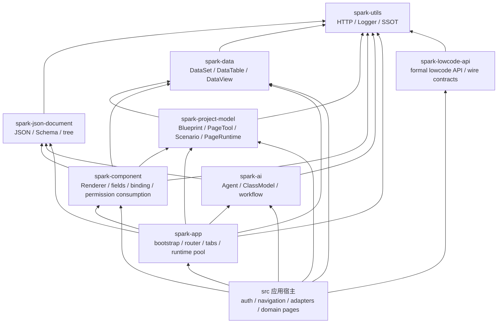
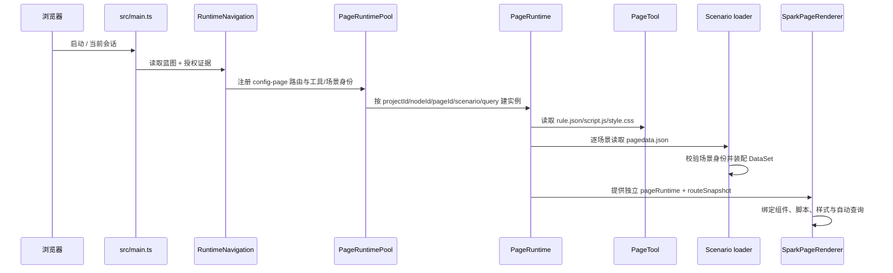
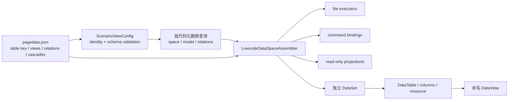
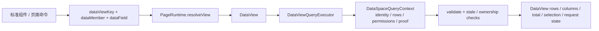
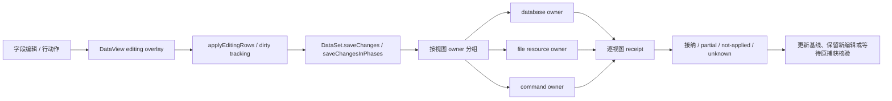

# 项目架构与数据链路审计

> 源码核对日期：2026-11-19。本文只记录能从当前源码、测试和正式合同核对的架构事实。旧台账中的历史缺口只有在当前源码仍可复现时才视为现状。

## 1. 结论

SPARK AppWorks 已形成一条较完整的前端闭环：

```text
授权导航
  -> DynamicRouter / PageRuntimePool
  -> PageRuntime（一次调用）
  -> PageTool（rule / script / style）
  -> ScenarioViewConfig（pagedata.json）
  -> DataSet -> DataTable -> DataView
  -> 标准组件 / 页面脚本
  -> 原查询 owner / 文件 owner / 命令 owner
  -> 回执接纳、unknown 核验、精确取消
```

当前架构的核心价值不是“把页面写成配置”，而是：

1. **身份明确**：应用、导航节点、工具、场景、模型、视图、运行实例分别定位。
2. **数据单链**：页面和标准组件只消费 DataView，不应新增第二套查询、权限或保存体系。
3. **来源可适配**：数据库、文件、命令和只读投影接入同一 `DataSet/DataTable/DataView` 链。
4. **运行隔离**：一次页面调用持有独立 `PageRuntime`、独立 DataSet 与独立脚本/样式作用域。
5. **失败可解释**：查询失败、明确未应用、结果未知、回读失败、部分成功按不同状态处理。

最大断点不在基础数据结构，而在**跨来源终态与正式服务证据**：

- 数据库保存 owner 无法可靠获得所有原请求的权威终态时，unknown 必须保留，不能自动重发。
- 工具、场景、数据库记录和业务数据分别持久化，不存在跨来源事务。
- 本地测试能证明控制路径，不能替代正式菜单、文件读取、权限回包与持久结果。

## 2. 项目分层与责任

### 2.1 分层图



### 2.2 包职责

| 层 | 主要职责 | 禁止越界 |
|---|---|---|
| `spark-utils` | HTTP、日志、环境无关类型、导航/权限/蓝图字面量 SSOT | 不承载 DataView 或业务页面语义 |
| `spark-json-document` | JSON 值、路径、Schema、树编辑 | 不做页面查询、权限或保存 |
| `spark-data` | DataSet/DataTable/DataView、关系/级联、编辑/取消/保存、权限快照 | 不依赖页面、Vue 或特定业务模型 |
| `spark-project-model` | 蓝图、PageTool、ScenarioViewConfig、PageRuntime | 不持有运行 DataSet 数据真源 |
| `spark-component` | 组件注册、容器/字段、SparkPageRenderer、绑定和权限消费 | 不自行查询、保存或复制权限凭据 |
| `spark-app` | 启动、DynamicRouter、RuntimeNavigation、标签页、插件 | 不解释具体业务模型 |
| `spark-lowcode-api` | lowcode 平台请求、wire 合同、DataSpaceRuntimeApi | 不编排页面 UI |
| `src/lowcode` | 应用请求身份、系统/用户场景装配、资源 owner、命令绑定 | 只连接正式 owner，不另建数据链 |
| `src/views` | 页面语义、布局、必要业务编排 | 不拼 HTTP、权限表、草稿或第二保存器 |
| `spark-ai` | Agent、ClassModel、工具循环、Agent Workflow | 不替代源码/真实服务事实 |

## 3. 身份模型

身份不得因名称相同而互换。

| 身份 | 典型来源 | 作用 |
|---|---|---|
| 企业 / 应用 `projectId` | 会话与应用选择 | 请求 scope、目录与资源归属 |
| 导航节点 `nodeId` | RuntimeNavigation | 唯一运行菜单节点 |
| 工具 `pageId` | 蓝图工具目标 | `rule/script/style` 的工具身份 |
| 场景 `scenarioId` | 导航参数、pagedata root | 数据空间 ID / DataSet 身份 |
| 内部表键 `tableName` | pagedata `tables` key | 场景内部 DataTable key |
| 正式模型名 `modelName` | `modelBinding.modelName` | 页面绑定与正式模型解析 |
| 视图 `viewId` | pagedata `views` | DataView 命名身份 |
| 运行实例 `instanceId` | PageRuntime | 单次调用生命周期 |
| 数据行主键 | 原查询上下文 | 行编辑、权限和保存范围 |
| 文件快照版本 | 历史文件名 / 发布元数据 | 发布与恢复，不是导航节点身份 |

页面完整绑定为：

```text
scenarioId@modelName@viewId
```

只有明确声明 `mainScenarioId` 时，才允许局部：

```text
modelName@viewId
```

导航不应携带文件缓存版本。文件版本由读取适配独立比较，发布指针仅用于设计/发布和历史快照。

## 4. 页面运行链



### 4.1 PageRuntimePool

实例键包括：

- `projectId`
- `nodeId`
- `pageId`
- `blueprintScenarioId`
- 规范化 query
- hash

同键复用实例；工具、场景或身份改变时不借用旧实例。非程序化页面每次加载与宿主命令调用前还会重核导航绑定。

### 4.2 运行文件读取

工具三文件分别通过 `ProjectToolFile` DataView 读取，运行时再从返回文本装入 PageTool。场景 `pagedata.json` 通过场景文件 gateway 读取。

当前缓存策略：

1. 每个文件始终先请求 `lastModifiedTime`。
2. 当前企业/用户/应用范围内版本相同则使用缓存文本。
3. 版本改变则读取正文并立即更新该文件缓存。
4. 四个文件互不等待；任一请求最终失败，本次页面装配失败。
5. 运行身份失效时，迟到响应不得写缓存。

这不是四文件原子快照。它是**逐文件校验 + 本次完整装配**。

### 4.3 文件缓存的风险边界

`lastModifiedTime` 当前作为版本号；它不是内容哈希，也不是服务端条件读取 token。如果两个不同版本共享同一毫秒时间戳，缓存无法发现内容变化。正式服务提供文件 ETag/内容 hash 前，该风险只能通过后端合同强化或只读对比解决。

## 5. 场景与正式模型装配



关键规则：

- pagedata 持有场景内表键、正式模型绑定、命名视图、资源关系、视图级联和查询配置。
- 正式模型字段、主键、资源身份来自数据库元数据；pagedata 不能替换模型真源。
- file / command / logical-view 必须有宿主显式 owner 或 projection binding，缺失即装配失败。
- 原生 `resourceRelations` 以 pagedata 为准；旧后端关系转换只属于兼容路径。
- 模型关系描述稳定结构；`viewCascades` 描述运行期值/选项联动，二者不得自动互推。
- `DataSet.toJson()` 只帮助理解结构，不构成数据空间持久化合同。

## 6. 查询链



查询 owner 返回的不只是行：

- 查询身份与本次参数
- 正式行键
- 字段级读写、动作权限、必填/隐藏/脱敏事实
- 分页、排序、树、聚合等结果特征
- 保存所需的私有上下文与回执接纳能力

DataView 在发布结果前核对：

- 请求 scope 与运行实例代次
- 目标视图与结果身份
- 分页/主键/权限响应是否完整
- 旧请求是否被新查询、编辑或实例销毁替代

## 7. 写入链



### 7.1 普通保存

`DataSet.saveChanges()`：

1. 解析本次目标视图。
2. 做查询/字段/引用预检。
3. 应用编辑覆盖到 dirty tracking。
4. 由 `DataView.saveQueryViews` 按 owner 执行。
5. 接纳逐视图回执，更新正式基线。

### 7.2 分阶段保存

`saveChangesInPhases()` 只提供**顺序与停止语义**，不提供跨来源事务。前阶段完成后才进入下一阶段；任一阶段失败或 dirty/unknown 未解除时停止。

### 7.3 unknown 结果

数据库 owner 无权威原请求终态时，`DataSpaceRuntimeApi.save` 会将原 batch 标记为 unconfirmed 并抛出不可重放错误。后续调用：

- 只允许沿原 owner 核验原捕获；
- 不自动重发；
- 不把“当前查询查不到”推断为未生效；
- 原捕获之外的新编辑不混入恢复；
- 文件 owner 仍须沿各自 attempt/capture 核验。

### 7.4 取消

- 未应用编辑覆盖：`discardEditingRows`
- 已暂存脏行：`discardPendingChanges`
- unknown 提交：只核验原 owner；明确放弃核验不等于撤销服务端写入
- 刷新：存在编辑、pending 或 unknown 时拒绝覆盖当前状态

## 8. 当前已纠正的历史缺口

以下旧结论不再作为现状：

| 旧说法 | 当前源码事实 |
|---|---|
| FieldCheckTag 没有 `dataViewKey` | 由 `SparkFieldSemanticProps` 继承标准字段合同，读写走 `useBasicFieldState` |
| FieldMention 直接写宿主行 | 正文与 `writebackField` 经 `handleControlledChange/writeField` 走同一字段权限链 |
| DisplayPagination 不消费 DataView | 支持显式/继承 DataView，读取 total/page/pageSize，并调用 `setPage/setPageSize` |
| 运行导航携带文件 VersionId | 导航只携带 project/page/scenario；文件版本由读取适配独立比较 |
| package 测试必须依赖 dist | `spark-app` Vitest 已将 workspace 包 alias 到源码，构建产物不是测试依赖 |
| consumer ledger 会扫描 dist | 生成器已排除 `dist/node_modules/target/.git`，构建前后输出稳定 |
| 前端存在角色授权模型 | 当前 `src` 无 `roles` / `SUPER_ADMIN` / `isLowcodePlatformAdministrator` |

## 9. 当前断点清单

| 优先级 | 断点 | 当前源码事实 | 风险 | 解除条件 |
|---|---|---|---|---|
| 已关闭（源码/fixture） | 普通 CRUD 原请求无权威终态 | save capture 固定正式主键、字段与 digest；unknown 仅按原 key exact readback，确认后接纳，不能证明时保留 unknown；不会重发 | 源码层已闭环，但服务侧仍无 durable request terminal | 保留精确回读；真实 service write、丢回执与重开仍按页面逐项验收 |
| 部分实服验证 | 正式导航与授权菜单 | 表和视图管理已由真实授权菜单进入并冷重开返回 33 条；SmartBid 11 个 `/bid/` 节点是 plan/vue 目标且缺 VersionId | 前端通过不代表全部业务节点 READY | SmartBid 服务发布 cfg/manifest 或原生页实现；每节点取得 READY 后逐个冷开 |
| P1 | 混合 owner 分阶段恢复 | `saveChangesInPhases` 有顺序保护，无跨来源事务；数据库、pagedata、工具、业务数据分别确认 | partial 后续可能误重放或误报整体失败 | 每阶段固定原视图集合和 receipt；unknown 只核原捕获；UI 显示逐阶段结果 |
| 已关闭（源码/fixture） | 四文件逐文件缓存无原子集 | publication manifest 固定 rule/script/style/pagedata snapshot 与 SHA-256；PageRuntime 只在整组 proof 通过后物化 | 实服 SmartBid 尚无发布 manifest | 服务节点指向该 manifest 后由真实冷开验收 |
| P1 | 时间戳版本碰撞 | `readRuntimeFile` 以修改时间判定命中，不是内容 hash | 同毫秒不同内容可能命中旧缓存 | 后端返回 ETag/hash，或相同时间时强制正文读取 |
| P1 | 系统场景/动态场景双来源 | 仓内系统场景与动态应用场景读取路径不同，但共享装配器 | 装配语义一致性依赖宿主适配 | 保持单一 `loadScenarioDataSet`，为系统/动态来源建立契约测试 |
| P1 | 设计、运行、预览仍是不同生命周期 | 正式运行读已保存文件；预览可由临时定义装配；设计器持有额外草稿 owner | 预览结果、已保存结果与工作草稿可能混淆 | 每次结果携带 source revision / generation / saved-or-preview 标记 |
| 已关闭 | `PageContentLoader` 公共旁路 | 全仓无生产/包外消费者，正式读取由 PageRuntimePool publication proof 链承接 | 已删除类、专属缓存测试与文档；PageFileReadCommand/PageFileReader 保留在 page-file 真源 | 回归类型检查与运行路由测试 |
| P2 | immediate CRUD 面仍保留在包内 | `batchCreateRecords`/`importData` 等存在，`src` 未发现直接消费 | 未来业务可能绕过 DataSet 变更/回执链 | 只允许工具/迁移 API 明确调用；正式业务新增先走 DataView/DataSet |
| P2 | 服务专项闭环仍缺 | 逻辑视图 SaveView、部分设计 URL、物理预览身份、聚合迁移、PDF/审批/SmartBid 部分页面 | 测试 mock 不能证明服务能力 | 按资源逐个取得正式请求、真实回执、精确回读和下游消费 |

## 10. 建议方案

### 10.1 先做基础合同，不先改页面

1. **原请求终态合同**
   - 为数据库与命令 owner 增加统一 requestKey/terminal API。
   - 收敛 `accepted / applied / not-applied / unknown` 四态。
   - unknown 恢复只接受与原 requestKey、context、ids 匹配的结果。

2. **四文件读取合同**
   - 每个文件返回 `ETag/hash + text + sourceRevision`。
   - 缓存键继续包含 enterprise/user/application/path/file。
   - 页面调用记录四文件的组成版本；但不把导航变成版本存储器。

3. **混合来源提交合同**
   - 统一 phase receipt 结构。
   - 每阶段保留视图集合、执行顺序、原回执、后续变更。
   - UI 只暴露当前可做动作：重核、放弃草稿、继续下一阶段。

### 10.2 再做页面样板

选择一个完整页面验证：

```text
授权菜单进入
-> 三文件/场景读取
-> 正式 DataView 查询
-> 标准组件绑定
-> 一次业务操作
-> 原回执或 unknown
-> 独立实例重开
-> 下游视图精确读回
```

验收同时确认：

- 当前文件版本集合
- 正式 query context
- 字段权限与操作权限
- 目标行主键
- 提交结果
- 冷重开
- 下游读取

### 10.3 最后收敛旧面

1. `PageContentLoader` 已确认无生产/包外消费者并移除；后续只允许 PageRuntimePool 消费 PageFileReader。
2. 若无，先标 deprecate、下个主版本删除。
3. 限制 `immediate` / batch CRUD 只在明确命令或工具域使用。
4. 统一所有标准组件的 `dataViewKey/dataMember/dataField` ClassModel 与运行消费。
5. 删除不再成立的旧文档断点，避免历史台账反向证明当前状态。

## 11. 推荐实施顺序

```text
Phase A  服务终态与四文件读取合同
   -> Phase B  原捕获恢复与分阶段回执统一
   -> Phase C  一个正式页面端到端样板
   -> Phase D  标准组件/页面旁路清理
   -> Phase E  其他 20 包逐页迁移
   -> Phase F  正式浏览器实服与下游回读
```

## 12. 验收矩阵

| 用例 | 必须证明 |
|---|---|
| 授权菜单进入 | 后端菜单含 nodeId；工具/场景身份与导航投影一致 |
| 四文件读取 | 每文件版本、内容来源和运行实例记录清晰 |
| 场景装配 | modelId/modelName 唯一，字段/关系/视图完整 |
| 读取 | 当前 query context、分页/排序/树/权限结果正确 |
| 编辑 | editing overlay、dirty、取消、切换目标隔离 |
| 保存确认 | 明确 receipt 与原 request 对齐；逐 owner 结果可解释 |
| unknown | 旧结果只读核验，不重发；后续编辑不污染原捕获 |
| 重开 | 新实例读取同一正式目标与已保存结果 |
| 下游消费 | 另一 DataView/页面按主键读取相同业务结果 |
| 失败 | 超时/拒绝/部分成功/回读失败分别保留状态与可用动作 |

## 13. 当前结论

项目底座的核心方向已经成立：

- 运行实例隔离清楚；
- DataSet/DataView 是统一数据接触面；
- 四文件与场景配置分层已明确；
- 标准组件的数据链已显著补齐；
- unknown、部分成功和跨来源阶段已经有公共保护。

下一阶段真正需要解决的不是再建一套框架，而是：

1. 补齐原请求权威终态；
2. 让文件/场景集合版本可证明；
3. 用一个完整授权页面闭环证明正式服务；
4. 再推广到其余页面和专题。
