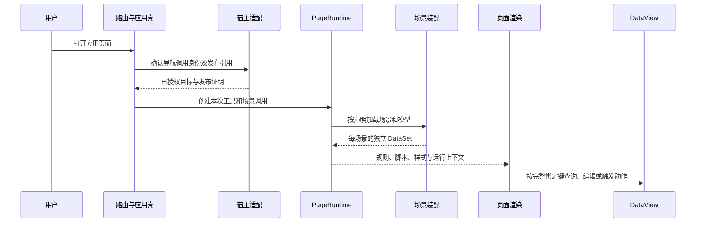

# SPARK AppWorks 五层架构、开发与验收指南

> 最近一次范围核对使用 2026-11-28 的 `main` / `3df22f628` 及当时的主仓工作树，保留各阶段原有工程与实服证据。部署状态以正式服务证据为准。

**先用五层架构确定业务归属，再按开发 100 步组织交付，最后沿六个运行检查点验收。** 五层定义治理与交付责任，100 步安排开发先后，运行检查点用于定位一次真实操作的首个失败环节。

## 1. 五层架构与业务归属

开始一项工作时，先确认治理关系由谁维护、当前人在什么执行域使用它，以及交付后从哪里回读。五层沿用根规约中的治理目标。运行权限取决于当前登录人在当次执行域中的正式入口、查询及服务结果。

| 五层架构 | 该层交付的事实 | 防止跨层出错 |
| --- | --- | --- |
| 1. 平台应用管理委派 | 哪个企业受托管理哪个平台应用。初始逐应用委派给领码科技，并由部署或服务责任方独立回读 | 委派、所有权、使用授权与个人权限各按自己的正式关系判断。应用进入受托域前核对有效委派 |
| 2. 应用使用授权与跨企业申请 | 哪个企业可以使用哪个应用，及直授、申请、审批、初始化、撤销等状态 | 申请方与审核方在独立会话按同一正式请求键回读。可使用的终态由租户目录、个人业务导航与正式数据查询共同证明 |
| 3. 企业内部管理与受托平台管理 | 当前人在企业内部事务及受托应用中各有哪些正式管理入口 | 内部与受托域可共用工作区壳，各用独立名单、DataView、提交和回读。受托入口要求有效委派及个人正式许可。跨应用共享和维度单独验证归属及范围 |
| 4. 应用设计 | 指定项目的蓝图、功能、数据空间与页面工具引用 | 用真实 `projectId` 及正式引用完成设计。设计入口和发布权限各有合同，业务数据能力由本次正式查询决定 |
| 5. 页面交付 | 应用设计下的页面工具、共享场景配置及一次有效运行调用 | 分别验证导航入口、发布版本与当次数据权限。写入通过原 owner 取得分项回执，再按正式键独立重开 |

开发 100 步主要展开第 4、5 层的设计与交付细节。涉及跨企业、内部管理或受托应用时，在 **1–20 步入口盘点**核对所需的第 1–3 层合同，在 **99–100 步验收**按原执行域回读。普通页面按实际依赖核验对应关系。现有 `PageScope` 使用 `public / platform / enterprise / app`，治理关系各自验证，沿现有作用域执行。

治理目标及当前证据边界见 [根规约第 7 节](../../AGENTS.md)、[实施台账](../../notes/data-space-retirement-ledger.md)。

## 2. 系统边界与包职责

### 2.1 宿主与外部服务

AppWorks 是基于 Vue 的配置设计与运行平台。系统原生页、蓝图分发的配置页和 AI 设计工作区共用一个前端宿主。浏览器通过同源 `/api` 请求外部 SPARK，项目模型、组件和数据执行内核随前端交付。外部服务承担资源持久化、用户授权、查询执行及写入判定。宿主在会话和环境内组合这些能力。

生产代理属于部署环境。开发代理读取 `LOWCODE_GATEWAY_URL`，缺失即拒绝启动。Vite 的代理还对事件流响应处理缓冲及缓存相关头。

入口：[src/main.ts](../../src/main.ts)、[vite.config.ts](../../vite.config.ts)、[服务契约说明](../../backend-api-contracts/README.md)。

### 2.2 Monorepo 依赖方向

以下是各包 manifest 声明的直接工作区运行依赖。外部依赖与构建开发依赖另见各 manifest。

| 包 | 直接工作区依赖 | 责任 |
| --- | --- | --- |
| [spark-utils](../../packages/spark-utils/package.json) | 无 | 公共原语、共享字面量、请求与日志等基础能力 |
| [spark-json-document](../../packages/spark-json-document/package.json) | utils | JSON 文档、Schema 与树结构 |
| [spark-data](../../packages/spark-data/package.json) | utils | DataSet、DataTable、DataView、查询执行与保存 |
| [spark-project-model](../../packages/spark-project-model/package.json) | data、utils | 蓝图、设计会话、工具与场景文件、运行实例 |
| [spark-component](../../packages/spark-component/package.json) | data、json-document、project-model、utils | 规则渲染、容器和字段、数据绑定、标准动作 |
| [spark-ai](../../packages/spark-ai/package.json) | data、json-document、utils | Agent、Workflow 和 ClassModel |
| [spark-app](../../packages/spark-app/package.json) | ai、component、data、json-document、project-model、utils | 应用启动、路由、导航、页面实例调度与壳层 |
| [vite-plugin-spark-catalog](../../packages/vite-plugin-spark-catalog/package.json) | 无 | 构建期扫描及目录生成 |

`src/main.ts` 是组合入口。业务页在 `src/views/`，宿主级业务编排在 `src/services/`，SPARK 会话、wire 适配、资源执行和场景装配在 `src/platform-adapters/`。仓根 `backend-api-contracts/` 定义端点、字段与枚举。通用包通过注入能力保持与宿主的边界。组件包依赖数据和项目模型，AI 内核由应用壳与宿主按需接入。

公共包通过 manifest 的 `exports` 明确入口。AI 包有根、`./agent`、`./class-model` 三个公开入口。组件包有根和 `./runtime`。公共入口变化同时影响类型解析、Vite/Vitest alias 与 import smoke。共享依赖版本由 workspace catalog 管理。

### 2.3 依赖方向怎样进入工程门禁

当前构建和架构检查分担不同职责。架构扫描检查依赖声明、公共入口、包间相对路径、无框架包的直接引入和运行依赖方向。依赖目录门禁检查声明与共享版本归属。旧检查只核声明时，隔离夹具中的新依赖可能绕过分层或形成循环。主仓补齐下列检查，并通过实际命令的 26 项回归。工作区 8 包、17 条直接运行依赖无环。 [隔离对照与主仓清点](../../notes/data-space-retirement-ledger.md#workspace-architecture-gate-coverage-20261125)

| 已实施的检查 | 验收对照 |
| --- | --- |
| 宿主与通用包通过公开入口连接 | 拒绝宿主直读包源码、通用包直读宿主。允许宿主经包入口注入能力，允许包内相对引用 |
| 跨包子路径由包 manifest 明确公开 | 允许 `spark-component/runtime` 等已声明子路径，拒绝工作区包未声明的源码及内部路径 |
| 工作区运行依赖保持单向 | 拒绝两包或多包循环，拒绝组件运行时依赖 AI 内核。保留组件包现有开发依赖及应用壳自身的 AI 接入 |

改动实际导入链时，同时走根类型检查、架构门禁与相关消费者测试。根类型解析负责类型可解析性，架构门禁负责依赖方向和公共入口，运行入口负责数据、权限和回执的实际消费。

### 2.4 架构优势、代价与改进责任

| 架构取舍 | 优势 | 代价与当前缺口 | 责任与处置 |
| --- | --- | --- | --- |
| 纯前端与外部 SPARK 服务 | 宿主可独立构建，业务行、权限和服务结果由正式平台提供 | 隔离工程通过后仍需验证真实服务版本、当前人授权、回执和回读 | 平台适配核正式请求域和 wire 合同，部署与服务责任方提供实服证据。 [系统边界](#host-and-spark-service) |
| 蓝图、导航和运行实例各有正式身份 | 同一工具或场景可复用，导航授权和页面实例分别定位 | 跨域选择、异步刷新和恢复的顺序会影响实际落点与查询权限 | 应用壳由同一守卫处理启动、切域和恢复，每次重开核新的实例与授权节点。 [导航回归](../../notes/data-space-retirement-ledger.md#application-navigation-entry-ownership-20261125) |
| DataTable 定义契约，DataView 持有查询与编辑 | 模型、正式接口和当次权限可沿同一 DataSet 追溯 | 多文件、多视图提交会出现明确失败、部分成功和结果未知 | `spark-data` 保存原批次和原查询 owner，逐项核回执与正式键。设计器明确呈现元数据和 Plan 各自的结果。 [保存与恢复](../../notes/data-space-retirement-ledger.md#save-batch-selection-dispatch-20261125) |
| 工具三文件与共享场景分开交付 | 标准组件、命名视图和场景可复用，页面变更可以独立对照 | 缺失绑定或语法错误会在重开时暴露。发布版 Plan 原件和条件切换仍依赖正式存储合同 | 页面交付先校验本次声明、脚本语法和视图，再创建快照。已发布版本经原指针和独立实例回读。 [发布合同与待核事项](../../notes/data-space-retirement-ledger.md#dataset-publication-file-contract-20261125) |
| 通用包、宿主适配和 AI 内核分工 | 依赖可按公开入口复用，ClassModel 按源代码声明生成 | 隐式跨层引用、循环依赖和陈旧声明会使同一变更在不同消费者处表现不同 | 架构门禁检查导入与运行依赖，公共声明经正式生成和实际消费者验证。 [依赖门禁](#workspace-dependency-verification) |

## 3. 开发顺序与页面交付

### 3.1 将开发 100 步落实为八个阶段

历史《DataSet 包与 AI 页面设计 100 步流程》按数据事实、模型、关系、页面消费、按需视图、联动和交付递进。用原步骤编号核对覆盖范围，把相邻步骤合并成可直接评审的产出。开发阶段回答“先确定什么”，运行责任点回答“上线后在哪里核验和定位”。

| 原步骤 | 当前开发阶段 | 产出与防错检查 | 对应运行责任点 |
| --- | --- | --- | --- |
| 1–20 | 明确任务与盘点现场 | 写清业务输入、操作和可验输出。核对现有蓝图节点、工具、场景、配置与权限边界。迁移时记录原页面入口、联动和取消路径 | 1 会话、2 导航、3 页面调用 |
| 21–40 | 先立正式模型 | 明确业务对象、资源身份、必要字段、正式行键和读写合同。DataTable 持有资源、模型、API 与 CRUD 策略。UI 布局在数据合同明确后选型 | 4 数据装配、6 写入 |
| 41–50 | 核对稳定关系 | 用 `resourceRelations` 表达稳定关系及完整过滤表达式，核双方模型、字段、值的来源及业务含义 | 4 数据装配 |
| 51–70、89–90 | 规划页面消费并查询 ClassModel | 定义列表、详情、表单、选择器等实际消费点和所需成员。在选定标准组件和生成规则前，查目录、声明关系、属性和事件指南 | 5 组件与交互 |
| 71–80 | 按真实消费配置命名视图 | 列表和详情刻意共享当前行时共享视图。选择器如需独立分页、筛选或选择则使用独立命名视图。用正式模型名核对完整绑定键 | 4 数据查询、5 组件与交互 |
| 81–88 | 声明并验证值级联 | 写清输入值、目标视图、空值与切换策略。用 `viewCascades` 声明实际联动，验证晚到的旧结果和子值处理 | 4 数据查询、5 组件与交互 |
| 91–98 | 交付工具结构、行为与样式 | 工具三文件与共享场景配置分别归属各自 owner。核对规则与视图成员、字段、事件及样式，业务行为优先复用标准动作 | 3 页面调用、5 组件与交互 |
| 99–100 | 预览并核正式交付 | 预览确认结构和交互。正式交付确认授权入口、实际资产和查询，涉及提交时再验证分项回执、按原键回读及独立重开 | 按实际操作覆盖适用责任点 |

**历史用法按当前合同解释。** 原流程的 `tableRelations` 和 `viewDependencies` 对应的意图，由当前的稳定关系与显式值级联分别表达。新绑定使用 `scenarioId@modelName@viewId`，仅在显式主场景允许省略场景。正式写入依据原查询行键与 owner 的保存合同。历史工具名、`#` 绑定写法、默认视图自动联动以及序列化结果均只作历史阅读参考。原步数用于查漏，同一完整业务阶段可一次核验。

历史来源可用 `git show 4d51fe935891155c4c3927cf8646b3921a5ce821:docs/ai/dataset-page-design-ai-flow-100-steps-zh.md` 读取。当前用法见 [组件开发指南](../guides/COMPONENT_DEVELOPMENT.md)、[数据空间主合同](DATAFLOW_ARCHITECTURE.md)。

### 3.2 AI、ClassModel 与两类工作流

**ClassModel。** 公共模型与组件源码声明、JSDoc 为源。正式生成过程产出可读目录、声明分片和 Schema，供 Agent 发现、校验并调用标准能力。工具首先发现模型，再读取成员、输入输出和约束。变更生成面时要验证 manifest、有关分片及实际消费者。

**Agent Workflow。** `spark-ai` 提供 Agent、工具执行和 Workflow 内核。宿主按项目策划、页面设计、SmartBid 等业务提供 binding、上下文和已注册动作。页面设计与项目策划启动前，经当前应用工作流目录 DataView 读取并校验正式定义。必须对账仓内设计、部署文件的正式身份和宿主运行引用。Agent 的执行结果经过相应 DataView 或正式文件及命令 owner 并取得确认后，进入业务持久结果链。 [Agent 文件与读取实证](../../notes/data-space-retirement-ledger.md#d849-workbench-agent-file-and-instance-20261125)

**平台业务流程。** 流程设计、待办和办理属于外部 SPARK 的工作流主题。页面通过宿主适配器装配查询、候选项和办理命令。办理准备由监控场景的正式对象视图核实例键、模型键和业务行键，监控列表负责可展开到同一实例多行的展示。工作台也按实例键查询，选项与提交分别核对原步骤、唯一实例、模型和当次可读业务行。选人以本次办理正式候选及允许扩选的原人员目录为准。隔离验证已覆盖错键、重复及失效查询。实服还需确认表单来源键、操作回执、正式流程状态和调用方独立重开。 [审批运行与组织投影实证](../../notes/data-space-retirement-ledger.md#d99-approval-workbench-source-key-20261125)

**SmartBid 切片。** 启动入口接线包含正式页面调用和编写工作区准备。SmartBid 操作模块通过宿主解析项目范围、运行模型及动作 owner。进入页面、读取固定内容基线、形成草稿、正式采用与后续回读是不同的验收点，应各自绑定正式场景、模型与行键。

Page18 的派发槽在首次异步前固定完整命令，工具实参与原命令的规范值一致时才进入 DataView。原命令已确认后发生工具回传中断时，页面可读取原回执并看到独立的回传错误。实服交付仍需按同一试次核实参、原返回和轮次回传，并在独立重开后核业务结果。 [Page18 隔离对照](../../notes/data-space-retirement-ledger.md#smartbid-page18-input-owner-evidence-20261125)

Page18 的隔离对照覆盖同轮重复工具、回传中断后再次触发及并发受理。当前同轮重复调用复用该笔执行，摘要计算期间的第二派发被拒绝。跨轮与独立实例按原试次键及正式服务原结果查询验收。 [Page18 同请求对照](../../notes/data-space-retirement-ledger.md#smartbid-page18-original-request-continuity-20261125)

制件链在候选读取前固定修订、输出选项和原请求，再绑定已核内容根。Page12 登记、Page13 冻结与 Page15 问题登记的标准动作在收到原业务回执后显示确认。当前样本来自实际页面和命令 DataView 的隔离对照，正式制件参数、登记证据和独立重开按各业务节点继续验收。 [制件与跨页对照](../../notes/data-space-retirement-ledger.md#smartbid-production-request-and-registration-20261125)

Page05 的验收需要同时覆盖场景、宿主和原件。补齐资料历史及原登记视图可以使页面物化，生产分派还需接入已授权资料选择。原登记读取能确认历史版本和出处，原件预览另需按该版本的附件身份和摘要读取实际文件。 [Page05 分阶段证据](../../notes/data-space-retirement-ledger.md#d849-page05-authority-host-and-original-20261125)

**SmartBid 原草稿绑定。** Page11 宿主按指定草稿键定位，仓内工作规则的表单和取消仍跟随视图当前行。同作者有两份草稿时，隔离环境复现原保存查指定草稿、取消清到另一份草稿的本地编辑。该入口须按原键查询，并让正文与回执共享已确认的本次目标。回查并行时，每笔结果需保有各自的查询证据和生命周期。 [原回执并发对照](../../notes/data-space-retirement-ledger.md#d849-page11-original-save-concurrency-20261125) [草稿错行对照](../../notes/data-space-retirement-ledger.md#d849-page11-original-draft-row-20261125)

**SmartBid 项目交接。** Page08 工作版项目回查按钮在当前启动分派无对应宿主。显式提供正确宿主和正式视图后，回读结果含项目与阶段，个人草稿选择和 Page11 跳转仍需接通。 [项目交接对照](../../notes/data-space-retirement-ledger.md#d849-page08-page11-authoring-handoff-20261125)

入口：[AI Workflow 合同](../../packages/spark-ai/docs/business-factory-workflow-zh-cn.md)、[宿主 Agent 工作流绑定](../../src/services/ai/agent-workflow-bindings.ts)、[页面设计绑定](../../src/services/page-design/page-design-agent-workflow-binding.ts)、[平台 Flow 适配目录](../../src/platform-adapters/resources/system/workflow/manage/)、[SmartBid 操作模块](../../src/services/smart-bid/operation/agent-module/)。

## 4. 六个运行检查点与源码链路

### 4.1 一次操作的检查顺序

按一次操作的生命周期组织排障。开发期把能确定的错误提前检出，运行时由原责任方检查身份与结果。六个责任点是现有调用链上的验收位置。只读页走到读取完成，原生系统页按本地登记及宿主运行入口进入。

| 阶段 | 责任点 | 进入下一步的依据 | 失败时的处理 |
| --- | --- | --- | --- |
| 进入 | 1. 会话与执行域 | 当前登录人、租户与应用或目录域在此次操作内有效 | 切域或会话失效后由原调用检查并丢弃迟到结果 |
| 进入 | 2. 授权与导航 | 该执行域中当前人的正式入口与蓝图候选节点匹配 | 分别定位无入口、蓝图缺节点或授权查询失败 |
| 读取 | 3. 发布与页面调用 | 配置页通过发布校验，PageRuntime 解析本次场景和输入 | 在版本不一致、资产缺损或调用声明不合法处停止本次装载 |
| 读取 | 4. 数据装配与查询 | 正式模型装配到 DataTable，命名 DataView 获得本次查询结果 | 分别呈现绑定错误、查询失败、无权及正常零行 |
| 提交 | 5. 组件与业务交互 | 标准组件从原 DataView 消费当前字段和动作能力，业务编排形成可提交的变更 | 拦住无许可的操作，保全与其他操作无关的编辑 |
| 提交 | 6. 写入与确认 | 原 owner 接纳本次目标与变化，返回分项回执，并按正式键核验实际消费 | 按项处理已生效、明确未生效、未决及回读失败 |

### 4.2 启动、会话与导航

1. `src/main.ts` 提供应用配置、认证上下文、系统页加载、发布文件读取及场景装配，调用 `SparkApp.start()`。宿主从 Lowcode 会话解析当前用户。启动上下文的用户壳信息与业务权限具有独立来源。
2. `system-navigation.ts` 将 `vue-pages.json` 投影为系统入口。路由守卫使用 public 登记及应用 scope 区分登录前、目录和应用入口。
3. `/platform` 对应目录执行域，`homepage` 是宿主使用的目录作用域标识。具体应用由 `/apps/{projectId}/{pagePath}` 寻址。请求的租户来自认证会话，目录请求按无应用语义处理。
4. `readLowcodeRuntimeNavigation` 读取应用蓝图与当前用户的导航授权，`assembleLowcodeRuntimeNavigation` 按节点身份组装导航。蓝图描述设计候选，授权读取提供用户的正式入口。路由从 RuntimeNavigation 派生，隐藏伴随页仍有自己的节点和调用边界。
5. 守卫处理直链和切域。进入应用需要激活对应执行项目后取得该域导航。页面、场景和文件异步读取应持续核对其捕获的执行上下文。

会话续期可以延续当前登录和执行域。宿主在续期后准备原请求，并在传输适配器前同步复核派发归属。业务请求核对认证和应用代次，显式续期只核对所属认证。收到 HTTP 401 时，宿主依据本次派发配置关联的登录、令牌和应用判断是否清除会话。 [认证归属与隔离验证](../../notes/data-space-retirement-ledger.md#platform-session-generation-20261125)

无应用系统页在装配时固定登录身份和应用选择代次。切入应用再返回目录，原 DataView 与原装配仍处于失效状态。新页面实例按当前代次重新查询，目录请求仍省略 `X-AppId`。应用选择器的发现读取沿其原认证范围和目标检查运行。 [目录执行域与发现入口](../../notes/data-space-retirement-ledger.md#catalog-runtime-application-generation-20261125)

**当前证据边界**。宿主以 `hasLowcodeSession` 启用平台菜单，系统菜单来自本地登记。个人平台管理授权和部署委派需要正式服务证明。

入口：[main.ts](../../src/main.ts)、[应用 scope](../../src/services/application-scope.ts)、[路由守卫](../../src/services/project/navigation/project-navigation-guard.ts)、[系统菜单登记](../../config/navigation/vue-pages.json)、[Lowcode 运行适配](../../src/platform-adapters/lowcode-runtime.ts)、[路由合同](platform-application-routing.md)。

### 4.3 应用、页面与数据身份

| 对象/标识 | 所有者或用途 |
| --- | --- |
| 当前登录人、租户 | 平台认证会话，请求身份 |
| `projectId` | 目标应用及执行域 |
| `ProjectBlueprint` | 项目设计聚合与编辑会话的根 |
| `nodeId` | 正式蓝图节点，编排导航和业务能力 |
| `pageId` | 可复用的 PageTool，持有规则、脚本、样式 |
| `scenarioId` | 场景配置及数据空间装配身份 |
| `modelId/modelName` | 正式模型标识及模型名 |
| 场景内部 table key | DataSet 内部表定位 |
| `viewId` | 同模型的命名数据视图 |
| `instanceId` | 一次运行调用，包含工具、多个场景及输入 |
| 正式查询行键 | 原查询中定位业务行与写入授权的依据 |

蓝图节点索引、树投影和编辑状态各有持有者。ProjectWorkspace 编排蓝图、工具、场景及引用的 IO。设计器操作的目标空间 ID 与承载设计器的元数据场景身份相互独立。URL 参数提供寻址信息。数据读取仍由场景和正式模型身份装配，组件绑定统一采用 `scenarioId@modelName@viewId`，仅在显式主场景中使用省略写法。

入口：[项目蓝图](../../packages/spark-project-model/src/project/project-blueprint.ts)、[项目工作区](../../packages/spark-project-model/src/project/project-workspace.ts)、[模型层级](../../packages/spark-project-model/src/MODEL-HIERARCHY.md)。

### 4.4 从导航和发布到页面实例

- **工具资产**。PageTool 只持 `rule.json`、`script.js`、`style.css`。规则包含组件树、绑定和事件。脚本编排必要差异。样式按实例隔离。共享 `pagedata.json` 由场景持有，描述模型、视图、关系和级联。
- **文件目标**。应用作用域内，工作文件、目录条目和发布快照通过同一正式文件表独立装配。运行视图按原工具、basename 和版本区分。相同目标复用原视图及其查询基线，发布快照仍按原指针和正式回读核定。 [文件目标隔离实证](../../notes/data-space-retirement-ledger.md#d849-project-tool-file-view-targets-20261125)
- **发布**。`PageRuntimePool` 承接配置页调度，`resolveLowcodePageNavigationReceipt` 核对正式授权节点、蓝图发布指针和工具文件证明。第一版 manifest 内嵌发布时的 pagedata，第二版当前记录独立 Dataset Plan 的文件名和摘要，运行装配时读取工作 Plan。场景装配后，`PageRuntime.materialize()` 逐个解析规则声明的视图绑定。原发布独立重开还需核对存储端当前能读到发布时的原字节。 [版本、待核日志与冷读](../../notes/data-space-retirement-ledger.md#dataset-publication-file-contract-20261125)
- **写入前的发布门禁**。新增发布用本次捕获的规则、脚本和场景做静态检查与物化。标准组件、普通事件、续接和确认分支的视图由同一遍历核验。脚本复用渲染器的编译逻辑，顶层语句与初始化由正式运行实例执行。声明结果视图的宿主命令在派发前核原目标，接纳迟到结果时复核原实例和视图。 [绑定与命令证据](../../notes/data-space-retirement-ledger.md#page-publication-standard-bindings-20261125) [脚本证据](../../notes/data-space-retirement-ledger.md#publication-script-preflight-20261125)
- **原场景快照恢复**。已保存的工作文件改变时，先按原调用和原场景 DataView 的版本回读未决快照。核验一致后由下一次独立操作发布当前工作稿。原文件缺失、字节不符或无法解析时保留待核记录。 [版本与恢复证据](../../notes/data-space-retirement-ledger.md#dataset-publication-file-contract-20261125)
- **调用输入**。路由解析主场景、附加场景及场景输入，拒绝重复场景、主场景冲突及输入引用未声明场景。PageRuntime 对输入和源进行快照，支持明确声明的延迟场景装配。代际检查约束重载、释放及迟到结果。
- **生命周期**。设计、预览、发布有独立运行模式。预览采用工作定义时，其结果属于该次预览。原生 Vue 系统页由宿主提供运行上下文。正式配置页由 SparkPageRenderer 将规则映射为标准组件，在本实例绑定数据和动作。
- **启动查询**。初始化成功后，渲染器启动非按需场景的自动查询与自动选择。按需场景装配后即可绑定，但原调用方负责发出查询。已确认独立的 PDF 目录读取由宿主负责。 [初始化与按需边界](../../notes/data-space-retirement-ledger.md#page-runtime-initialization-readiness-20261125)
- **共享场景**。同一场景或同一工具可由多个正式节点调用。每次调用持有自己的 DataSet、DataTable 和 DataView。验收应同时保留两个调用，关闭其中一个后验证另一个继续有效，并按原发布指针重开前者。 [真实发布实例对照](../../notes/data-space-retirement-ledger.md#d849-workbench-agent-file-and-instance-20261125)
- **系统页与伴随页**。正式节点的蓝图场景、伴随页明确登记的运行场景及显式伙伴空间各有用途。流程待办借用监控导航身份，并使用独立工作台场景。共享宿主在查询前核对主场景。报表和流程模型的同路径备用节点需继续核对正式场景、规则和保存合同。 [现行源码与六组验收](../../notes/data-space-retirement-ledger.md#system-page-companion-scenario-20261125)
- **组件消费**。容器通过 `dataViewKey` 与 `dataMember` 定位视图及数据成员，字段组件以 `dataField` 获取当前字段值、可读性、编辑性与必填状态。标准动作经声明调用对应视图，业务页只组织具体业务输入和输出。

入口：[PageRuntimePool](../../packages/spark-app/src/router/page-runtime-pool.ts)、[PageRuntime](../../packages/spark-project-model/src/page/runtime-page.ts)、[发布版本](../../packages/spark-project-model/src/page/page-tool-publication-version.ts)、[渲染器](../../packages/spark-component/src/page/renderer/SparkPageRenderer.vue)、[系统场景登记](../../config/pages/system-scenarios.json)。

工具文件工作区关闭后，可为原草稿或未决回执保留 DataSet。接管时复核认证、工作区和当前租约，核验结束后只能安装一个持有者。文件请求捕获本次租约，迟到的读取在数据投影前拒绝。旧工作区已派发的写入由接手方按原目标独立核验，保留后续编辑。工具创建接管后按原文件阶段续办，补偿只有当前租约能决定。 [隔离结果](../../notes/data-space-retirement-ledger.md#project-tool-file-workspace-lease-20261125)

### 4.5 SPARK Data 装配和查询

| 层 | 持有的信息 | 工作 |
| --- | --- | --- |
| DataSet | 场景结构、表集合、关系与级联声明 | 组织多表运行、订阅、保存编排与释放 |
| DataTable | columns、resource、model、api、crudConfig、模型级约束 | 提供各命名视图的执行契约 |
| DataView | 查询参数、结果、焦点和选择、编辑及运行状态 | 通过本视图 owner 执行查询、编辑与提交 |
| 服务适配 | 当前会话 scope、字段转换和传输 | 按正式资源合同完成执行 |

`loadScenarioDataSet` 汇集场景配置、正式数据空间及模型元数据，进入 `LowcodeDataSpaceAssembler`。装配器以已校验的 ScenarioViewConfig、空间身份及模型定义构造表和视图，根据资源与模型为视图绑定执行器。仓内系统场景与动态应用场景在配置读取处分流，在场景装配处收敛。数据库、文件、命令与只读投影各有各的执行和结果语义。

独立 Dataset Plan 验收依次校验原文件的结构和摘要、与当前正式登记的模型和字段对账，以及实际调用视图能否装配。正式注册名用 `Base_DataModel.Name`，物理来源名用 `MetaName`。修复旧 Plan 时，每个失败须定位到原模型或字段，先核对正式元数据再重建候选。 [领码账本 Plan 对账](../../notes/data-space-retirement-ledger.md#d99-code-receipt-plan-metadata-reconciliation-20261125)

旧发布独立重开同时依赖该版本的场景原文和正式模型字段。当前 Plan 装配要求覆盖模型全部正式输出，后来新增的未用输出也会令原 Plan 无法装配。发布方案验收须分别证明配置改版后的原文恢复、正式字段演进的引用边界和本次查询授权，清单容量按实际序列化及服务回读核对。 [发布清单与字段反例](../../notes/data-space-retirement-ledger.md#d849-publication-scenario-proof-20261125)

查询时，视图将过滤、排序、分页等运行输入交给 DataTable 的绑定链，原查询 owner 管理结果身份、正式行键和权限基线。分页结果、服务端聚合、只读投影分别以其实际合同消费。跨行、跨模型汇总由实际过滤和授权下的后端执行提供。

只读服务直接返回某一页时，SPARK Data 保留该页的正式主键、顺序和服务总数，同时按本次 DataView 的字段投影接纳结果。验收第二页及后续页时，须核对排除字段既不出现在结果行里，也没有可读证明。显式字段清单继续优先，组件直接消费原 DataView。 [只读分页投影证据](../../notes/data-space-retirement-ledger.md#d99-added-entry-query-contract-20261125)

来源入参验收要走到原 DataView 真正派发查询。正式模型登记、设计 JSON 可读和来源参数已命名，各自只证明其所在环节。正常映射由 SPARK Data 执行正式调用输入和 JSON 常量。旧 `SystemData` 如代表业务输入，须确认提供该输入的正式调用入口，再从元数据 owner 明确迁移；如代表系统值，应由服务按真实执行上下文求值。缺取值配置或现有能力不支持时维持明确失败，记录是否已到达服务。 [逻辑视图下游与来源入参实证](../../notes/data-space-retirement-ledger.md#d99-logic-view-consumer-contract-20261125)

外部接口的参数定义须沿原键核对维护视图、数据空间正式字段投影和逻辑视图映射。正式投影缺类型时保留未知，补齐需回正式模型与 `DataView` 配置。测试调用和重置输出由命令 owner 在派发前核验当前接口的参数查询归属和完整性。只有正式查询确认零行时才接受空参数，未读、失败、在途、陈旧或不完整均拒绝派发。 [接口配置和调用前置实证](../../notes/data-space-retirement-ledger.md#d99-registered-interface-input-proof-20261125)

同一系统页同时登记在企业目录和应用内时，验收需分别从两种正式入口验证实际派发的文件、命令和数据请求。场景元数据可能已用目录作用域，文件 owner 仍可能要求当前应用。无应用文件能力的服务范围、读写限制及切域失效须独立核对。 [文件管理执行域实证](../../notes/data-space-retirement-ledger.md#d99-json-and-file-readback-20261125)

物理表和视图的预览验收须同时核对正式来源、请求执行域、服务端字段投影及分页行键。一页无重复只能验证该页内的键，联合键分量可能在下一页重复。缺少稳定行键证明时，记录定位和按键动作应关闭，已授权的分页内容仍可按只读投影显示。 [物理预览实服与跨页反例](../../notes/data-space-retirement-ledger.md#d99-physical-preview-20261125)

`resourceRelations` 表达稳定模型关系和完整的过滤表达式。 `viewCascades` 表达视图间的查询或字段值联动。选择主键集合或原生字段值得到级联输入，当前行是读取位置。保留 `DataView.value` 的序列化合同。切换快速输入时，用当前代际接纳结果，避免晚到的旧查询覆盖新查询。

入口：[DataSet](../../packages/spark-data/src/dataset.ts)、[DataTable](../../packages/spark-data/src/data-table.ts)、[DataView](../../packages/spark-data/src/data-view.ts)、[场景运行](../../src/platform-adapters/data-space/lowcode-data-space-runtime.ts)、[场景装配器](../../src/platform-adapters/data-space/lowcode-data-space-assembler.ts)、[正式查询目录](../../packages/spark-data/src/query/formal-owner/)。

### 4.6 权限、提交与结果恢复

**权限沿原查询传递。** queryContext 对应当前人、当前执行域与本次正式查询。表级能力、行级能力、列读取和列写入分别消费。字段隐藏、脱敏、只读和必填各有语义，`R` 表示必填。新增、删除、树子项新增等动作按各自许可处理。组件可根据业务条件进一步限制交互。保存时重新核定原行、实际修改字段和动作，服务端承担最终判定。原查询凭据和正式基线留在 owner 内部。

脱敏规则维护要分别验证配置管理、持久引用和服务实际执行。同一个规则键可能被数据模型字段、物理字段、Excel 配置及布局引用。规则行的删除许可仅覆盖该行操作，删除安全需要服务检查完整引用及并发变化。样例计算说明维护界面如何解释规则，运行与导出须各自验证正式结果及规则缺失时的保护行为。 [脱敏规则与消费者实证](../../notes/data-space-retirement-ledger.md#d99-desensitization-consumer-references-20261125)

**保存沿捕获的修改派发。** 页面完成编辑后调用 SPARK Data 的保存入口。`prepareSaveJournal()` 记录原视图、选中行和保存选项，`DataView` 派发前捕获实际变化和原查询身份。提交期间出现的后续编辑独立保留。`saveChangesInPhases()` 按明确阶段编排，数据库、文件和命令分别确认，部分成功逐项呈现。

现有 DataSet 保存日志已能暴露待核批次及 `currentRecoverableAction`。页面用这些结果驱动恢复入口。业务命令仅在其正式合同支持时采用对应核验方式。

| 已取得的证据 | 页面可提供的动作 |
| --- | --- |
| 本地草稿，尚未派发 | 继续编辑或取消本次未提交的变更 |
| 服务明确未应用，且原草稿仍匹配 | 处理原草稿。后续产生的编辑按其自己的状态保留 |
| 已派发，结果未知 | 使用本次批次的 `verifySaveJournal()` 或对应 owner 核验原结果。证据不足时保留未决 |
| 部分目标已确认 | 显示逐项目标状态。先解决在前阶段的未决或明确未应用项，满足原计划条件后继续其余阶段 |
| 写入已确认，独立回读失败 | 保留写入确认，提供按正式键重新读取 |
| 独立回读完成 | 对照原回执与正式键，确认下游消费 |

确认未派发需要该项操作自己的传输证据。工作文本上传记录目标表单是否进入传输。隔离对照中，续期拒绝时目标表单零派发，日志记为未应用，草稿可编辑和撤销。目标表单已派发且回执丢失时，日志保持未决，按原文件键回读确认且只上传一次。服务接纳后回读被拒绝，同样保留原提交供核验。 [文件保存对照](../../notes/data-space-retirement-ledger.md#platform-session-generation-20261125)

每次保存由发起的 DataSet 批次及阶段持有。DataView 提供原查询 owner 的实际派发和回执接纳证据。首个来源失败后，尚未到达的来源继续待派发。处理原失败后，后续来源按原范围继续，已确认阶段的后来草稿留在编辑层。 [双文件批次与恢复证据](../../notes/data-space-retirement-ledger.md#project-tool-file-batch-journal-receipt-20261125)

原选中范围可能包含未修改行，原回执核验按实际派发捕获定位。等待引用检查或字段回填期间，原行范围保持稳定。可核验的原失败保留首次诊断，回读失败后可经原入口重试。验收同时核对实际下发次数、按原键回读及后续草稿的归属。 [选择和续办对照](../../notes/data-space-retirement-ledger.md#save-batch-selection-dispatch-20261125)

可保存的查询按 DataView 实例持有正式结果和原行凭据。两个实例即使查询参数相同，也分别取得基线。结构只读结果可按现有缓存配置复用。运行 owner 在派发前检查同一执行域、模型和正式行的原未确认保存，同一记录须回到原实例核验，其他记录按各自的正式基线提交。 [跨实例查询和保存证据](../../notes/data-space-retirement-ledger.md#formal-query-save-ownership-20261125)

原保存批次的身份须跨多次核验保持稳定。报表删除离线对照中，数据库已经完成删除，一次精确回读故障仍会令后续核验发出零次读取。验收需覆盖首次核验失败、服务恢复、原键重读及独立重开，全程只允许一笔原始写入。 [报表核验重试证据](../../notes/data-space-retirement-ledger.md#report-save-journal-retry-20261125)

标准记录组件与业务工作区消费同一次 DataSet 结算。字典工作区先比对原捕获，再把已检查的视图交还原 DataSet 核验。第一次读取故障保留原批次，原服务恢复后逐项更新日志，范围外的定义保存继续待核。验收覆盖重试前后的批次身份、后续编辑，以及相同记录和相同值的新提交。 [公共恢复消费者对照](../../notes/data-space-retirement-ledger.md#shared-save-recovery-capture-20261125)

**生成的运行定义有独立保存结果。** 数据空间参数通过正式数据库行回执和精确回读确认。设计会话再经原 FileResource 发布 Runtime Dataset Plan。正式元数据仍有草稿时，Plan 显示待发布。Plan 明确未写时可继续生成及提交，原文件结果未知时先按同一捕获核验。后续确认的元数据可产生下一次发布，仍按各自文件结果结算。独立运行实例读取同键文件并核对实际查询使用的参数。 [数据空间工作台及运行证据](../../notes/data-space-retirement-ledger.md#data-space-plan-follow-up-recovery-20261125)

保存回执只能结算发起它的批次和阶段。并发离线对照中，后一笔成功可提前关闭前一笔，前一笔迟到的失败又可关闭更新的批次。数据空间设计器在元数据正式确认后通过同一 DataSet 写入独立 Plan，验收要同时证明在途批次隔离和已确认后续任务正常提交、各自回读。 [并发与 Plan 发布对照](../../notes/data-space-retirement-ledger.md#save-journal-concurrent-settlement-20261125)

数据空间输入参数确认后还需核对独立运行 Plan。当前参数核验可从数据库丢失回执恢复并完成发布。若数据库已确认而 Plan 上传失败或丢失回执，参数核验会先结束，文件可能仍旧或仍待核验。验收应逐项确认元数据和 Plan，并分别演练明确未写后的文件续办以及未知后的只读核验。 [设计会话恢复链对照](../../notes/data-space-retirement-ledger.md#data-space-plan-follow-up-recovery-20261125)

原实例释放后的恢复依赖服务是否能按正式请求或目标提供权威证据。DataSet 日志在原实例内支持恢复，刷新浏览器后的持久查证需要部署侧正式合同。跨数据库、文件和命令按各自回执确认。

入口：[权限主合同](PERMISSION_SYSTEM.md)、[queryContext](../../packages/spark-data/src/query/formal-owner/query-context.ts)、[行权限](../../packages/spark-data/src/query/formal-owner/row-permission.ts)、[保存守卫](../../packages/spark-data/src/query/formal-owner/save-guard.ts)、[保存结果](../../packages/spark-data/src/query/formal-owner/save-result.ts)、[DataSet 保存编排](../../packages/spark-data/src/dataset.ts#L1631)。

## 5. 验证与推广

### 5.1 在合适环节检出错误

| 检查位置 | 应确认的事 | 现有入口 |
| --- | --- | --- |
| 策划与配置 | 先写业务输入、正式目标、可验输出，再选标准组件和场景视图。对仓内已知的键、组件属性和声明关系，用实际解析器或已有用例验证 | 场景装配用例、ClassModel、`verify:page-thin` 的页面职责规则。当前 `verify:pages-config` 检查特征夹具目录，覆盖范围按脚本认定 |
| 运行入口 | 核对当前域、正式入口、发布引用及本实例绑定。异步响应只有在原执行上下文仍有效时才能应用 | ProjectNavigationGuard、PageRuntimePool、PageRuntime、场景装配器 |
| 正式服务 | 证实指定人在指定域内能查询或提交。写入结束后，用独立实例按正式键重开，核验下游消费 | 正式查询、原 owner 分项回执、必要的服务权威终态及精确回读 |

开发排障优先保留现有错误发生的位置和可公开的定位信息，按需使用应用、节点、实例、场景、视图或提交批次标识。面向使用者的提示说明失败环节和可执行的下一步。原查询凭据及业务数据按原 owner 和授权边界处理。

**仓内登记检查。** `verify:pages-config` 核历史样本目录和必需文件存在性。`verify:page-design` 使用实际 Vue 登记、仓内文件 DataView 和场景解析检查源文件与配置，再按流程和公开场景消费者核正式模型及命名视图。带 `__SCENARIO__` 的场景还需核文件归属，替换出的场景 ID 本身无法证明模型归属。动态发布仍须核发布证明、授权导航和新实例消费。 [隔离证据与覆盖范围](../../notes/data-space-retirement-ledger.md#repository-page-config-gate-coverage-20261125)

### 5.2 工程构建与验证证据

根 manifest 声明 Node `^22.22.2 || ^24.15.0 || >=26.0.0`，锁定包管理器 `pnpm@11.8.0`。workspace catalog 中 Vue 为 3.5.38、TypeScript 为 ~6.0.3、Vite 为 ^8.0.16、Vitest 为 ^4.1.9。Element Plus 和 VXE Table 由宿主插件接入。构建确定包产物及前端产物，应用运行依赖部署转发同源 API。

| 入口命令 | 覆盖范围 |
| --- | --- |
| `pnpm run verify` | 类型、Lint 与规则门禁 |
| `pnpm run verify:rules` | 架构边界、依赖、页面、AI、文档、模型生成面、wire 一致性与页面职责等规则 |
| `pnpm run verify:page-design` | 仓内页面登记、场景文件、正式视图消费者与页面设计离线固定用例 |
| `pnpm run test:run` | 根 Vitest 收集的测试 |
| `pnpm run test:all` | 根测试与工作区包测试 |
| `pnpm run generate:class-model-surface` | 正式生成 ClassModel 面 |
| `pnpm run build` | 先 build:packages，再 build:fe |
| `pnpm run verify:dist` | 包构建、类型、Lint 和规则门禁 |

文档和源码核查可证明责任边界、调用点和协议形状。夹具能验证被覆盖的确定性行为。已部署联验须记录执行人和作用域、正式入口、查询目标、修改对象、回执、独立重开与下游消费。入口未走到、请求结果未知或回读失败时，证据应停在实际完成的步骤。

入口：[根 manifest](../../package.json)、[workspace catalog](../../pnpm-workspace.yaml)、[测试知识](../../knowledge/testing.md)、[服务契约](../../backend-api-contracts/README.md)。

### 5.3 从一个业务切片验证再推广

1. **先验证一个有实际风险的完整业务切片。** 建议从报表目录的“绑定模型”操作入手。按 1–50 步核报表头与目标版本的正式身份和写入目标，按 51–98 步核报表目录、版本和候选选择的实际数据消费，按 99–100 步核分项回执和独立重开。沿报表模型弹窗 可追到同批报表头及版本两个视图，沿报表保存入口 可核原批次恢复。首轮覆盖正式读取、两项目标确认、独立重开，以及部分成功、回执丢失和已确认后读失败的反例。回执丢失可先用夹具核对派发次数和核验行为。正式服务仍需走自己的授权、回执与回读链。
2. **再将确定性检查前移。** 用现有发布、场景装配与导航用例覆盖缺正式入口的直链、切域晚到、错版发布、视图缺失和正常空查询。只有同一问题在多个消费者出现并可稳定复现，才评估在其所属公共层收敛检查。
3. **最后按同一责任点扩展到其他资源。** 文件和命令分别取得适用的正式回执、回读和恢复合同。契约未明的环节记录责任方与缺失证据，验收停在已完成的步骤。涉及迁移的进度回填现有台账。

每批验收记录使用同一条路径描述“谁在何域 → 进入哪个节点 → 装载何版本与视图 → 原查询及目标 → 分项回执 → 重开结果”。评估是否降低出错时，记录同一组反例中**首个失败点是否正确、失败是否被显示为正常结果、核验是否引发重复派发、已确认项是否能独立回读**。上线前后有可比较样本时，再比较定位到责任层所需时间。

源码与现有用例入口：[报表模型弹窗](../../src/views/features/integration/report/ui/report-model-dialog.vue)、[报表保存](../../src/views/features/integration/report/ui/report-save.ts)、[报表管理用例](../../tests/runtime/application/report/report-management-page.test.ts)、[导航守卫用例](../../tests/runtime/auth-nav/navigation/project-navigation-guard.test.ts)、[发布用例](../../tests/runtime/auth-nav/publication/lowcode-page-publication.test.ts)、[场景装配用例](../../tests/runtime/auth-nav/data-space/lowcode-scenario-assembly.test.ts)、[保存模式用例](../../packages/spark-data/src/tests/crud/commit-mode.test.ts)。

### 5.4 当前证据边界与待核事项

| 主题 | 当前仓内依据 | 正式验收要核清的事项 |
| --- | --- | --- |
| 个人平台入口 | 登录态和本地菜单投影可核对 | 无应用目录的个人授权决定、拒绝与直链 |
| 委派、跨企业授权和共享 | 根规约给出目标，实施台账记录阶段 | 部署初始委派、双会话精确回读、共享边界以及撤销生效 |
| 应用使用授权状态机 | 前端把初始化状态作为审批输入，与所核参考服务分支不一致。已有关系复用、撤销后重申及直授回读的终态也有缺口 | 用同一正式申请键确认批准操作、状态条件与原回执。申请、审核、直授和模块分别独立回读，实际可用性验目录、个人导航和数据。 [隔离及参考证据](../../notes/data-space-retirement-ledger.md#governance-app-auth-operation-contract-20261125) |
| 可运行父页与子导航 | 父页和已授权子页分别保留各自页面目标，菜单层级组织入口。配置页与原生页的真实路由和独立实例已通过主仓隔离回归 | 部署后验父子原直链、当前人授权与独立重开。SmartBid 的 Page11、Page13 与各自子入口共同验收。 [隔离证据](../../notes/data-space-retirement-ledger.md#authorized-parent-route-with-child-20261125) |
| 应用切换与失败恢复 | 壳动作、页签、目录和直接路由由同一守卫处理。运行中恢复来源实例或进入正式目录。启动先注册公开路由，再由同一守卫装配浏览器原始地址，失败时保留原请求以供重试。固定版回归已通过 | 部署后核实际授权、查询域与独立实例。 [入口与恢复方案](../../notes/data-space-retirement-ledger.md#application-navigation-entry-ownership-20261125) |
| 无应用目录的旧实例 | 目录场景和正式 DataView 共用应用代次。隔离回归覆盖旧装配、旧查询、在途保存及返回目录后重开。应用发现读取通过已选应用中的正式目录对照 | 部署后以当前登录人验入口授权、拒绝、切域和新实例查询。 [目录执行域对照](../../notes/data-space-retirement-ledger.md#catalog-runtime-application-generation-20261125) |
| 应用运行地址编辑 | 取得原主表回执后按正式应用键回读 `WebUrl`。负责人同批修改部分失败时保留原地址，续办负责人后核地址，再继续门户提交。隔离回归已覆盖读失败、换域和同笔续办 | 实服核读写授权、正式回执、独立重开和新门户消费。运行地址唯一范围与条件提交由正式服务合同确认。 [应用地址](../../notes/data-space-retirement-ledger.md#application-manager-web-url-edit-20261126) |
| 配置页完整发布 | 留存的 D849 样本中，17 个授权节点获得发布回执，16 个物化成功。当前主仓在写入前拦截两种场景来源下缺失的标准视图，命令派发和原场景快照恢复也已有隔离回归 | 第二版固定原 Plan 字节后，核冷读、授权范围及实际下游消费。 [绑定对照](../../notes/data-space-retirement-ledger.md#page-publication-standard-bindings-20261125) [发布证据](../../notes/data-space-retirement-ledger.md#d849-publication-scenario-proof-20261125) |
| PDF 历史与任务回执 | 资源适配已验证分页总数与当页行数、当页任务与请求键唯一、结果及恢复的已处理数与文件明细一致。实际页面已在隔离环境验证错误回执和原入口消费 | 待核正式服务跨页、跨实例的请求与任务映射，并以原文件、逐条规则明细、按原请求独立重开和下游业务消费完成验收。 [隔离证据](../../notes/data-space-retirement-ledger.md#pdf-history-result-proof-20261125) |
| 六个新增入口的查询合同 | 参考小程序候选只取首批结果，概览只接微信阶段。参考日志列表与链路共用结果区。主仓只读 DataView 在接纳服务分页时保留原字段投影、主键和总数 | 小程序按正式键和当前输入使用服务分页，概览逐提供方核阶段和权限。日志查询、链路与队列分别验许可、完整性及字段。 [查询对照](../../notes/data-space-retirement-ledger.md#d99-added-entry-query-contract-20261125) |
| 发布脚本与初始化 | 新增快照前已复用渲染器的编译逻辑，语法错误在首个写入前返回。可编译脚本在运行时仍可能初始化失败 | 独立重开核本次初始化输入、自动查询和动作就绪。 [脚本发布与重开](../../notes/data-space-retirement-ledger.md#publication-script-preflight-20261125) [PDF 与输入对照](../../notes/data-space-retirement-ledger.md#page-runtime-initialization-readiness-20261125) |
| 文件读取与缓存 | 工作文件按服务端版本复用原文。正式重开按当前执行域读取发布清单和工具快照的原字节，再校验该组指针及摘要。主仓定向覆盖会话变化、文件拒绝与缺失 | 正式部署继续核新实例权限、保留页签再次访问、原 Plan 路径和已发布版本保留。 [正式重开缓存对照](../../notes/data-space-retirement-ledger.md#publication-reopen-file-cache-20261125) |
| 工具清单与目录条目 | 工作清单和目录条目各有视图，沿同一正式文件键协调保存。挂载页删除前核清单草稿和待核状态。解绑回读或续办读取见有共享引用时，保留剩余工具文件，并按原批次结算已派发清理 | 继续核覆盖全部引用与并发新挂载的服务条件，以及跨工作区原回执和版本保留。 [清单绑定](../../notes/data-space-retirement-ledger.md#publication-manifest-view-binding-20261125) [共享引用](../../notes/data-space-retirement-ledger.md#project-tool-file-lifecycle-ownership-20261125) |
| 新工具的工作文件归属 | 工作台按原 DataSet、应用和工具捕获本次新建文件的正式键和未决批次。蓝图创建或绑定明确未成功时，以本次已确认的文件和当前匹配内容决定可补偿的范围；过程中出现的其它文件继续由其原所有方持有 | 以独立工作区核同名文件竞态、原新增回执及条件删除。若另一个工作区同名替换且内容相同，仍需正式文件实例身份和删除条件。 [新建与补偿的实际工作台回归](../../notes/data-space-retirement-ledger.md#project-tool-file-lifecycle-ownership-20261125) |
| 工具快照的原尝试 | 在同一 DataSet 内，手动存档与发布按正式文件键从编号分配前占用到原尝试结算。蓝图解绑与目录清理检查本次工作文件是否仍有待提交或待核的快照。同一认证工作区重开可保留原编号 | 独立会话和浏览器的原尝试定位、同编号冲突及按原版本保留依赖正式服务。 [隔离证据](../../notes/data-space-retirement-ledger.md#project-tool-history-attempt-ownership-20261125) |
| 发布 Plan 的不可变文件 | 参考 V1 同名检查与写入分离。参考 V2 冲突可另名保存，回执格式与当前前端校验有差异。隔离对照还发现上传已接纳后回读失败可能失去工作文件核验入口 | 明确部署目录、原名冲突、ACK、保留及按原版本冷读的合同。工作文件和快照按实际写入阶段保留原尝试。 [存储与回执对照](../../notes/data-space-retirement-ledger.md#publication-file-storage-and-receipt-20261125) |
| 发布 Plan 的查询行为 | 两版均能解析原命名视图。现行生成器保留选中主键数组，拒绝 v1 无法表达的文本操作符、查询输入及手动级联。初始过滤、自动加载和默认请求字段仍有差异 | 独立表达常驻范围、初始过滤、触发方式、可用列及默认请求列。按实际运行权限比较重开请求和 DataView 结果。 [隔离证据](../../notes/data-space-retirement-ledger.md#publication-plan-query-parity-20261125) |
| 发布与场景设计草稿 | 新写快照前和发布指针派发前核当前工作区的原定义，挡住本次发布期间新增草稿及已知工作来源的保存变更 | 正式绑定已保存来源与 Plan 版本，验证跨工作区变更、条件发布及旧版本独立重开。 [工作台对照](../../notes/data-space-retirement-ledger.md#publication-plan-query-parity-20261125) |
| 旧发布的字段绑定 | 固定发布文件和指针后，无显式投影的第一版可读出同名替换字段。显式投影能保护原字段且允许增加闲置输出。第二版 Plan 会因增加闲置输出拒绝重开 | 以正式模型及字段 ID 确定原依赖，核服务端接受的原字段投影。缺旧投影时找原版本证据或批准重发。原绑定失效、查询无行和当前权限隐藏各自按合同呈现。 [24 次重开对照](../../notes/data-space-retirement-ledger.md#publication-field-projection-evolution-20261125) |
| 模型字段结构变更 | 工作场景引用会拦截字段变化。引用只在发布快照时，隔离环境下改字段或删除仍派发元数据批次。模型注册名改名已有发布工具预检查 | 在模型责任层核完整正式发布依赖，由服务对字段更新与发布切换做条件提交。用双会话和按原指针冷开验证。 [模型字段写入对照](../../notes/data-space-retirement-ledger.md#publication-model-field-write-20261125) |
| 发布后的模型来源变更 | 三种发布方式会随现行模型更换来源。保留别名但改底层列时，第一版可重开，第二版拒绝。保留实例仍可能请求原列 | 明确旧发布的来源跟随合同和来源版本证明。以部署查询、保留实例刷新、独立冷开核来源、字段和当次权限。 [写入与重开对照](../../notes/data-space-retirement-ledger.md#publication-model-source-evolution-20261125) |
| 发布指针的并发和原结果 | 明确拒绝可结束该笔待核，工作台复用已确认快照。独立重开凭本次保存回执来源续办，缺来源的旧日志保留待核。原回执未知时，同值回读不触发发布确认 | 服务端原子比较正式基线，回执按原请求键查终态。独立验明确拒绝、已确认后被替代、原请求无回执与当前指针对照。 [指针对照](../../notes/data-space-retirement-ledger.md#publication-pointer-concurrency-20261125) |
| 独立页面的查询与保存 | 同参可保存查询各取原基线，同键未决按原实例与原捕获核验。报表消费者隔离回归覆盖冲突与原笔核验 | 用真实服务获得各实例的正式查询、原请求回执和精确行键，逐项核并发保存、请求次数、日志与独立重开。 [跨实例保存对照](../../notes/data-space-retirement-ledger.md#formal-query-save-ownership-20261125) |
| 发布重开与入口撤销 | 隔离环境关闭后重开会重新查蓝图和授权。同 URL 复用仍持原清单，许可在文件加载过程中变更时也可能完成原装配 | 核发布指针的采样时点、权威授权失效与保留页签再次进入，分别验同版本文件、当前授权、脏态及实际查询。 [读取及撤销对照](../../notes/data-space-retirement-ledger.md#publication-reopen-authorization-lifecycle-20261125) |
| 数据写入与恢复 | 有原捕获、逐项回执、精确回读及阶段恢复路径 | 服务持久请求终态、丢回执、部分成功、刷新后的恢复 |
| SmartBid 草稿保存和版本比较 | 原回执单独确认原版本，当前正式查询用已保存版本和规范内容比较。本地编辑单独保留，缺可读版本时只返回原回执 | 按原请求独立取得权威回执，按原版本读取正文，再核下游实际制件。 [Page11 对照](../../notes/data-space-retirement-ledger.md#d849-page11-draft-version-readback-20261125) |
| SmartBid 原试次交接与回读 | Page18 原派发宿主可核对本次留下的实参与已确认回执。独立重开显示待正式来源复核，保留试次线索并暂停返工准备 | 服务提供当前人可读的原试次资源及正式键，独立会话精确核原实参、命令回执和下游返工。 [Page18 对照](../../notes/data-space-retirement-ledger.md#smartbid-page18-original-request-continuity-20261125) |
| 迁移业务包 | 台账记录局部源码和历史烟测 | 各包按正式资源、授权、回执、重开逐个验收 |
| 第 14、18 包新增入口 | 申请管理、模板目录、视频号渠道和我的小程序已登记。实际加载器按 D99 应用、正式节点、主场景、路径及模型集合校验来源，并从 FileResource DataView 读取独立工作 Dataset Plan。四个入口均有各自的留存只读证据 | 四页继续核当前授权、命名视图、适用动作及下游消费。渠道概览须取得正式模型与阶段投影，日志查看须取得场景及日志、链路、队列的授权查询身份。 [逐页证据与责任](../../notes/data-space-retirement-ledger.md#d99-added-entry-reference-20261125) [工作 Plan 装配](../../src/platform-adapters/data-space/lowcode-data-space-runtime.ts#L254) |

台账记录各子方案的当前阻断及 20 包完整交付条件。参考仓的 152 个测试套件与 2 份支持文件均已映射，仍待补验的断言写入对应项。部署结论沿用对应证据的环境、身份、版本和范围。 [当前实施入口](../../notes/data-space-retirement-ledger.md#appworks-current-implementation-review-20261125) [20 包验收表](../../notes/data-space-retirement-ledger.md#appworks-20-package-acceptance) [参考测试映射](../../notes/data-space-retirement-ledger.md#reference-test-mapping-20261126) [现有架构审计](project-architecture-audit.md)

### 5.5 按问题找代码

| 问题 | 从哪里开始 | 沿哪个边界读下去 |
| --- | --- | --- |
| 为什么进不了页面 | 应用 scope → 路由守卫 | 当前会话 → 授权节点 → 动态路由 → 发布证明 |
| 页面开了但数据不对 | PageRuntime 的调用声明 | 场景身份 → DataTable 模型 → 命名 DataView → 查询结果 |
| 字段或按钮异常 | 标准组件数据绑定 | 原 queryContext → 字段读写 → 行动作 → 后端判定 |
| 保存提示与实际记录不一致 | DataSet 的保存结果 | 原捕获 → 逐项回执 → 正式键精确回读 |
| 设计保存后运行页没更新 | ProjectWorkspace 与资产 IO | 持久文件 → 发布指针 → 整组证明 → 独立重开 |
| AI 产物没有进入业务流程 | 宿主 workflow binding | ClassModel 能力 → 本次场景 → 正式 owner → 回执与消费 |

专题入口见 [架构文档索引](README.md)。
