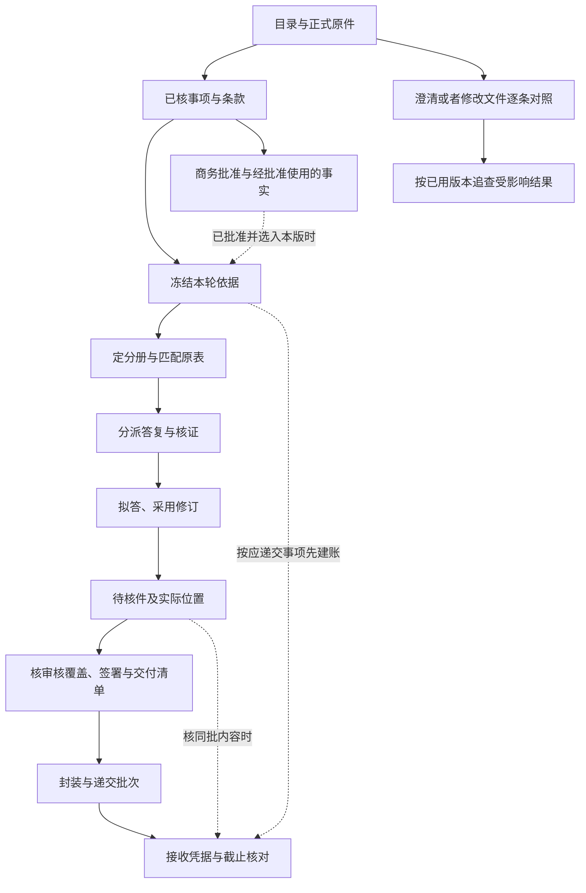

# 投标文件编制与递交业务规格

适用于投标文件编制、报价、交付及 AI 动作的设计和验收。平台职责与阶段边界见[完整解决方案](./overall-solution.md)。

[术语与内容结构](#名词) · [注册模型的输入、输出和验证](#model-registry) · [61 个动作的编号](#bid-action-sequence) · [递交与报价核验](#bid-amendment-acceptance) · [验收依据与原始资料](#acceptance-sources)

| 当前工作 | 从何处开工 | 下一份应取得的记录 |
|---|---|---|
| 人工编段、绑定两册报价 | 按任务书的[人工编制六步](./phase-one-taskbook.md#manual-edit-loop)办理，存储与合并查[修订规则](#bid-revisions)。 | 已采用修订、分册制作记录、实件与批准数据的对应。 |
| 接入 AI 按句改写 | 查[ClassModel](#bid-classmodel)、[逐次调用](#bid-ai-io)，再按动作 38、39 预演与采用。 | 实发输入、原返回、字段验证及所选片段的采用记录。 |
| 封装、递交及回执反查 | 从[九项递交核验](#bid-amendment-acceptance)找本次问题，按动作定位上下游。 | 各义务的实件、原操作、接收及截止效力凭据。 |
| 实现入口与验收 | 从[蓝图交接](./layered-delivery-plan.md#blueprint-delivery)到[动作实现标准](#bid-action-implementation)，再核[已有代码](#bid-implementation-handoff)及[操作接口](#bid-interfaces)。 | 返回结果、实际持久化状态及异常接手记录。 |

本文件01–61表示业务动作；节点和任务见配套文件。文中负责人、审核人等表示责任归属，不表示每一步必须由人点击；授权AI可执行其职责范围，统一按[记录、审计与纠正](#bid-decision-audit)留据。

## 名词

### 内容

| 短名 | 成熟产品中的对象 | 含义 |
|---|---|---|
| 平铺树 | DOM 规定父子关系、同级顺序及前序遍历 | 本方案以邻接表保存这套顺序，每行的 `parentId` 指向父节点，`index` 决定同级位置。[DOM 树的定义](https://dom.spec.whatwg.org/#trees) |
| `type` | 业务语义结构；通用块级模型 | 内部统一节点类型；文件标签和原生对象仅在导入、导出边界转换 |
| `class` | CSS 的 class；Word 样式及其 `basedOn` | 版式和编写规则写在文档模板里 |
| `value` | 可见文本 | 人读的那一段 |
| `data` | Word 内容控件绑定的数据；Mustache 的上下文 | 机器比对、引用、合计的规范值 |
| `{{名字}}` | Mustache 占位符；Word 的域和内容控件 | 正文引用数据的唯一写法 |
| 文档模板 | Word 模板加一份 CSS 样式表 | 类、版式、分册规则合在一份配置里 |
| 内容表达式 | ProseMirror 的 content expression | 父子是否合法只认这一份 |

### 版本

| 短名 | 成熟产品中的对象 | 含义 |
|---|---|---|
| 修订 | Git 的一次提交 | 只追加。当前头相当于 `HEAD` |
| 候选、采纳 | 内容系统里的草稿和已发布 | 模型和导入只产生候选。采纳后才成为头 |
| 节点哈希 | Git blob | 这一行的内容 |
| 子树哈希 | Git tree | 这一行加上按顺序排列的子树 |
| 有效哈希 | 带依赖的构建哈希 | 树哈希加上引用解析后的结果。审核绑它 |
| 三方合并 | Git 的三方合并 | 基线、当前头、候选 |
| 发布指针 | 发行通道。npm 的 dist-tag | 平台、企业、项目各指向一个已发布版本 |
| 锁 | npm 的 `package-lock` | 一次运行或一次交付用过的版本闭包。重放只读锁 |

### 生成

| 短名 | 成熟产品中的对象 | 含义 |
|---|---|---|
| 配方 | LangChain、Dify 的提示词变量，加上检索产品里的上下文预算 | 有哪些变量、从哪来、上限、强弱。不含提示词正文 |
| 槽位 | 上面的一个输入变量 | 提示词里只写变量名 |
| 提示词 | 系统提示词和用户提示词 | 只能引用配方里声明过的槽位 |
| 上下文清单 | 一次推理冻结下来的输入。LlamaIndex 的 source nodes | 可重建待发内容，实发内容由执行端另行回读 |
| 工艺路线 | BPMN 的流程；ISA-88 的程序 | 一棵工序平铺树。根的 `type` 是 `route` |
| 工序 | BPMN 的活动或子流程；ISA-88 的单元程序、操作、阶段 | 树上的一行。`type` 是结构分类，`class` 是业务分类，嵌套用 `parentId` |
| 工位 | BPMN 的泳道；制造执行里的工位 | 标准岗位。`class` 是给编排模型看的分类，`capability` 才是执行能力 |
| 能力 | BPMN 的服务任务类型 | 方案中的七类职责为检索、编写、校验、审查、摘要、抽取、确认。运行时函数按适用职责编排 |
| 模型档位 | 模型部署配置 | 供应商、模型名、参数。密钥只留引用 |
| 问题清单 | 静态检查的诊断。评审意见 | 编号V1–V14。审查建议只记提示；授权AI的业务核定另留原决定 |
| 规则集 | 按来源登记的校验规则 | 招标约束引用本次投标有效原文。企业可另设内部放行标准，分别记录两种结论 |
| 校验 | CI 里必须通过的检查 | 确定性规则 |

### 依据、资源、呈现

| 短名 | 成熟产品中的对象 | 含义 |
|---|---|---|
| 事实 | 主数据 | 金额、工期、日期、身份。正文只写 `{{名字}}` |
| 要求 | 招标条款拆成的需求条目 | 评分、资格、符合性、否决、格式 |
| 谱系 | 需求的稳定编号 | 换基线时编号不变，正文不跟着改写 |
| 基线 | 配置管理中的基线 | 冻结选定的事实与要求版本、来源，以及按范围直接选用的递交记录 |
| 响应 | 投标人对具体要求的实际答复 | 可以是实际填报数值、承诺、方案说明或指定证明。原件要求说明偏离时，再登记相应结论 |
| 招标记录 | 文档抽取得到的一条结构化结果 | 未确认的只在解析台上 |
| 资源 | 企业内容库里的一条受控资料 | 用途分为证据、参考、模板、规则 |
| 业务模型 | 可查询的业务对象定义 | 从主题目录查模型关系、属性及动作输入输出，在绑定实例上办理。产品经 SPARK API 访问获准资源，执行复用统一模型宿主。 |
| 知识四层 | 目录、业务指南、卡片与原文 | 按问题找到相应材料，正式依据追到原件版本和具体位置 |
| 历史项目 | 业绩库、案例库 | 项目记录和旧投标文件供借鉴。业绩证明才是证据 |
| 素材包 | 这一次写作确认过的引用包 | 留在当次运行，不进正文树 |
| 项目记忆 | 已采纳章节抽出的数字和偏离 | 后写章节按类查询，涉及本次承诺回到经批准使用的事实和原答复核验 |
| 计算表 | 由公式得出的正文表 | 展开后是表头和行。招标人规定递交的原生计价文件另按指定格式交件和核查 |
| 过程成果 | 构建中间产物 | 交给下一步时带类型和哈希 |
| D、S、B、R、O | 源数据、样式、绑定、中间表示、输出文件 | R 是中立呈现输入；O 由导出适配生成，不写回内容树 |
| 交付清单 | 一次构建的产物清单 | 修订、锁、文件哈希、保真说明 |
| 门禁 | 交付前必须通过的检查 | 不过则不能交付 |
| 暗标 | 匿名投标 | 该册不出现身份 |
| 分册 | 按本标段文件组织的内容单元 | 商务和技术可以合册，报价可以另装一个信封。记录各册进入哪个递交包、哪个环节可以读取 |

**三套类的使用位置**

| 配置对象 | 所做决定 |
|---|---|
| 文档模板上的类 | 决定内容的版式和章节角色。 |
| 工序的 `class` | 标明解析、大纲、编写或审查等活动。 |
| 工位的 `class` | 限定编排模型可将该岗位放在哪类工序下。 |

**定义出处**

- 内容结构依据见第 1.0 节。占位符与提示词变量分别参照 [Mustache](https://mustache.github.io/mustache.5.html) 和 [LangChain 的 Prompt templates](https://python.langchain.com/docs/concepts/prompt_templates/)。
- 流程、活动、子流程和泳道参照 [BPMN 2.0](https://www.omg.org/spec/BPMN/2.0/About-BPMN/)。工序的程序、单元程序、操作和阶段参照 [ISA-88](https://www.isa.org/standards-and-publications/isa-standards/isa-88-standards)。

---

<a id="bid-content-tree"></a>

## 1. 一棵投标内容树

**建树与采用**

- 动作 20 确定企业、轮次、标段及投标主体。每个编制项目建一棵树，根复用 `ContentProject.projectId`。
- 每册为根下的一个 `document`，章节、段落和表格归所属册。修订固定当时内容及册序，项目只维护一个已采用的修订头。
- 分册是项目树的逻辑组成，不是独立文件或独立内容头。多个来源文件可供同一册取材，一份来源也可供多册引用；编辑始终定位树内节点。
- 首份内容获采用前可登记项目范围，头留空。AI、人工和导入均向指定修订、指定位置提议变更，动作 39 采用后才进入当前头。

**定位与独立义务**

- 子节点按 `parentId` 找父，同级按 `index` 排序。前序遍历给出阅读顺序，`heading` 生成大纲。
- 原件、批准、模板、签署、包和回执保存在各自业务记录，按修订、节点或独立义务引用。
- 独立平台栏或附件直接关联项目根及作答分工。项目可仅有这些义务，尚无正文时根下允许为空。

`type` 标识业务语义结构。逻辑册、章、段、表格和字段引用与文件格式无关；内容树及内部业务函数不接文件格式、扩展名或原生排版对象。

只有导入、导出边界处理文件格式。导入将原件转换为内容节点及来源引用；导出接固定修订和呈现输入，选择输出格式并交付产物。

人工和AI编辑统一使用多行纯文本。编辑段落的`value`或指定句段；换行保留在文字中，不自动拆节点、识别标题列表或生成富文本。结构变更、事实绑定及样式配置分别走对应动作。

```
本次投标编制项目（唯一根）
├─ document 商务册
│   ├─ toc
│   └─ chapter
│       ├─ heading
│       └─ table             报价字段及其引用
└─ document 技术册
    └─ chapter.response.schedule
        ├─ heading
        └─ paragraph.promise 承诺总工期为 {{工期}}
```

### 1.0 业务语义与结构约束

节点类型由投标内容的业务含义决定。逻辑册、章、标题、段落、列表、表格、图及字段引用先形成统一模型，不取各文件格式的交集。

父子和顺序只校验这一份内容表达式：

```
项目根    = document*
document  = toc? chapter+
chapter   = heading block*
block     = paragraph | list | table | figure | quote | raw | chapter
list      = item+
item      = (paragraph | list | table)+
figure    = image caption?
quote     = paragraph+

toc, heading, paragraph, image, caption, table, raw 没有子节点
```

- 标题级别由 `chapter` 的嵌套深度决定，最多六级；不保存文件中的标题标签或段落对象。
- 正文 `{{名字}}` 只引用业务字段，不是文件中的域对象；具体表示交导出适配器。
- `header`、`rows` 和 `item` 保存表头、格子和条目正文；编号、分页及布局属于呈现配置。
- 目录节点记录业务目录要求，目录项由标题派生，不另存目标文件的目录对象。

未纳入合同的构造不得按原文件标签直接建节点。含义待核的原文经导入边界登记来源，按 `raw` 待核；新增业务语义须先扩展内容合同。

通用结构设计参考 [Pandoc 的块与行内](https://pandoc.org/using-the-pandoc-api.html)及 [ProseMirror 内容表达式](https://prosemirror.net/docs/guide/#schema.content_expressions)。文件标准与标签的映射仅见[导出边界](#bid-export-mapping)。

### 1.1 节点版本

```
ContentNodeVersion          // 只插入
  hash        // SHA-256(JCS(NFC({id, parentId, index, type, class, value, data})))
  nodeId
  parentId    // document 指向所属项目根的 projectId；其余节点指向册内父节点
  index
  type        // 下表
  class       // 字符串数组。去重后按码点排序再取哈希
  value       // NFC。容器为空串
  data        // 对象。容器为 {}。对象键按下述 JCS 规则序列化
```

哈希输入的`id`取本记录`nodeId`；工序节点取其`id`。它是逻辑节点身份，不取版本摘要或物理记录号。

本方案先对哈希载荷的字符串及键作NFC，拒绝归一后重名键；`class`归一后去重并按码点排序。随后按[JCS](https://www.rfc-editor.org/rfc/rfc8785.html#section-3.2.3)递归序列化，取UTF-8字节计算SHA-256。

JCS对象键按UTF-16码元排序，其余数组保留业务次序；JCS自身不作NFC。片段摘要仍按原串，实件摘要仍按原字节，不套用内容归一。

原摘要按原合同回查，禁止静默重算覆盖。内容与配置负责人交同版算法及正反样例；制作、合并和AI输入负责人复用，摘要不一致停对应验证并查原载荷。

**V2 结构检查**

- 从该修订项目根遍历，每个 `document` 的父须为该根。其余节点各有一个合法父，恰好归属一册。
- 节点标识在项目内唯一且与根区分。发现环、孤点或跨项目父引用即拦截。同级 `index` 从 0 连续且唯一，根下顺序即该版册序。
- 同一 `id` 的 `type` 终身固定。写入 `data` 的数字用字符串表示。

| type | 业务含义 | 父 | 子 | value | data |
|---|---|---|---|---|---|
| `document` | 一册 | 所属项目根 | `toc`、`chapter` | 空 | 空 |
| `toc` | 目录。条目由标题生成，不入库 | `document` | 无 | 空 | 空 |
| `chapter` | 标题所辖的一块 | `document`、`chapter` | `index` 0 恰好一个 `heading`；其余为 `paragraph`、`list`、`table`、`figure`、`quote`、`raw`、子 `chapter` | 空 | 空 |
| `heading` | 标题。级别等于所在 `chapter` 的嵌套深度，1 到 6 | `chapter` | 无 | 标题 | 引用 |
| `paragraph` | 段落 | `chapter`、`item`、`quote` | 无 | 段落 | 引用 |
| `list` | 列表。类 `ordered` 表示编号，否则是项目符号 | `chapter`、`item` | `item` | 空 | 空 |
| `item` | 列表项 | `list` | `paragraph`、`list`、`table` | 空 | 空 |
| `table` | 表头加内容 | `chapter`、`item` | 无 | 空 | `header`、`rows` |
| `figure` | 图 | `chapter` | 一个 `image`，可选其后的 `caption` | 空 | 空 |
| `image` | 图像引用 | `figure` | 无 | 恰好一个 `{{名字}}` | 一条 `resource` |
| `caption` | 题注 | `figure` | 无 | 图注 | 引用 |
| `quote` | 引文 | `chapter` | `paragraph` | 空 | 空 |
| `raw` | 导入后含义或处理方式仍待核明的原文块。不可交付 | `chapter` | 无 | 原文 | 空。类只能是 `legacy` |

**导入与交付检查**

- 内部只接受上表语义类型。导入适配先判原内容的业务含义，不以原文件标签或排版属性充当节点类型。
- 可等价表达的转入正文。要求指定原式的按原件填报，原件材料按条款并入分册或独立递交，含义待核的保留为 `raw`。
- 每册至多一个 `toc`，有则在首位。编辑与采纳均核内容表达式；导入超过六级的标题按 8.2 处理。

具体文件标签及原生排版映射归[导出适配](#bid-export-mapping)，不参与节点类型、字段绑定或修订逻辑。

`table.data`：

| 键 | 约束 |
|---|---|
| `header` | 普通表非空，名字规范化后互异。计算表占位按下文留空 |
| `rows` | 每行长度等于表头。格子为 `{value, data}` |

**单元格及计算表**

| 类型 | 写入和展开规则 |
|---|---|
| 数据格 | `value` 恰为 `{{表头名}}`；`data` 只含同名键。 |
| 词句格 | `data` 为 `{}`，文字中无业务数字。同一列只用一种格，列宽、对齐由模板决定。 |
| 计算表 | 类带 `generatorKey`，`header` 和 `rows` 为空数组；只在呈现时展开，保留节点原值。 |
| 输出 | 统一交付表头、数据格及来源；目标文件结构由导出适配生成。 |

### 1.2 引用

**占位符校验**

- `value` 中以 `{{名字}}` 引用数据。名字长度 1–64 字，排除花括号、控制符及首尾空白。
- 每个占位名须在 `data` 中有同名键，每个键须在 `value` 出现。表格的键写在表头上。

| data.type | 字段 | 规范值所在 |
|---|---|---|
| `fact` | `factId` | 事实键。版本在该修订的 `baselineId`，不在节点里 |
| `number` | `number`、`unit` | 十进制字符串。无指数、无千分位 |
| `date` | `date` | `YYYY-MM-DD` |
| `bool` | `bool` | 布尔值 `true` 或 `false`，空值另记缺项 |
| `page` | `nodeId` | 页码在分页结果 |
| `xref` | `nodeId`、`show` | `title` 或 `number` |
| `resource` | `resourceVersionId` | 资源版本 |
| `sensitive` | `ownerRef`、`field` | 原受控对象及字段。人员引用Person身份；修订固定字段版和显示策略，获准构建时解引用 |

业务数字写在字面里，V14 拒绝。非业务数字未归类时，由分类函数或授权AI判定并留据；必需类型仍不明时停相关字段。

**事实取版**

- `factId` 固定事实键。正文、封面、页眉页脚、V3 与 `displayHash` 均从本修订的 `baselineId` 取该键版本。
- 基线缺键、缺必填值或文本仍为空占位时拦截该项交付。零值和 false 按字段类型及填写规则核验，不能用真假值判断缺项。
- 换基线保留节点哈希，变更事实影响引用节点、依赖它的计算表及相关祖先。原空值、类型和出处按[调用值对证](#bid-call-value-boundary)保留。

### 1.3 文档模板上的类

**模板类的字段**

| 用途 | 字段和决定 |
|---|---|
| 身份、范围与继承 | 以 `name`、`elements`、`basedOn`、`exclusiveGroup` 定义模板类。节点保留标准 `type`，按类选择版式和规则。 |
| 章节角色与指引 | `role` 仅用于 `chapter`，取 `RESPONSE` 或 `GENERAL`。编写指南由 `guideKey` 指定。 |
| 呈现和交付 | `generatorKey` 只用于 `table`，`deliverable` 指示可否交付，`style` 定义样式。 |

**继承规则**

- `basedOn` 指向另一类，先采用父类版式，再由本类覆盖。规则沿用 Word 样式继承与 CSS 层叠语义。
- `role`、`guideKey`、`generatorKey`、`deliverable` 仅在本类显式定义时生效。

`response` 与 `general` 互斥。带 `guideKey` 的类互斥。`legacy` 只用于 `raw`，`deliverable` 为假，项目不能改成可交付。

原 `sectionKind` 的别名、上级、指南、知识目录、工艺、规则集、评分项匹配提示，写在类定义和目录节点上。生成、质检、评估仍按这个类选取。

版式令牌用 pt、mm、em、倍数。规则按 `type`、类、层级、表头名、分册匹配。层级由嵌套深度推出。

```css
chapter.schedule > heading { font-size: 14pt; }
paragraph.promise { font-size: 12pt; }
table.form-duration col.日历天 { width: 30mm; }
```

选择器只引用逻辑类型和类。通用呈现配置与节点分开；文件原生样式只在导出适配中生成，不回写内容树。

**分册模板取值**

- `anonymous` 控制匿名，`allowPrice` 控制价格披露，`deliveryFormats` 首项为规范格式。
- 编号和页面方案取 `numbering`、`pageMaster`。封面、页眉页脚槽位指向事实键，目录深度取 `toc` 的类，条目不入库。
- `wordBudget` 只用于建议字数。模板未设该项时不计算建议字数。

---

<a id="bid-revisions"></a>

## 2. 存储、哈希与版本

### 2.1 表

以下是逻辑存储合同，不是新增物理表清单。一棵内容树可由多条版本记录承载；整树清单、节点与事实引用须按同一修订重组。

`ContentTree={projectId,nodes}`是独立的语义内容值，不要求阶段、基线或呈现配置。

`contentHash`只标识该内容；采用仍用固定完整修订依据的`rootHash`，不能用内容相同推定修订可用。

实际落位先按[资源绑定核验](#bid-resource-binding)对应现有注册、字段及约束，不按对象个数建表或另建业务服务。

```
ContentProject
  projectId
  headRevisionId
  stageRefs[]                   // 引用20的范围决定或57的事项，不复制其原记录
  activeBaselineId
  schemaVersion

ContentRevision                 // 只插入。状态只前进
  id
  projectId
  rootHash
  parentRevisionIds             // 首候选和首个已采用修订为空数组；普通提交一个，合并两个
  basisRevisionId               // 空项目的首候选及首个采用可为空，按 2.3 办理
  baselineId                    // 首版固定请求所选版本；普通修订继承父修订，换版另办
  stageRef                      // 与本次目标及baselineId的阶段一致
  snapshotHash                  // 可按此键读取完整不可变清单，见下文
  templateRefs                  // 各逻辑册 {documentId, key, version, hash}，不包含文件格式
  source                        // HUMAN / MODEL / IMPORT / RESOURCE / MIGRATION / MERGE
  status                        // CANDIDATE / ADOPTED / REJECTED / SUPERSEDED
  targetScope                  // 同版目标合同：项目根、节点或独立作答分工，见2.3
  generationRunId
  authorId
  classification                // LOCAL / REWRITE。仅模型候选
  createdAt

RevisionSnapshot                // 只插入，可共享相同清单与节点版本
  projectId, stageRef, baselineId, templateRefs  // projectId 为树根，册序由本版根下 document.index 得出
  nodes[]                       // {nodeId, nodeHash}，按 nodeId 排序
  requirementPins[], responseAssignments[], responses[] // 固定章内挂接、作答分工、响应及其规定落点
  qualificationReviews[]        // 按本标段、条款及被核主体记录。固定成员与角色、条款版本、核验时点或期间、材料版本及其落点、责任册、结论和复核人
  sensitiveRefs[]                // {contentOwner,path,ownerRef,field,fieldVersion,displayPolicyRef}；contentOwner定位节点或独立响应，受控值单独保存

ContentProjection               // 当前头的索引，可从该头的快照重建
  projectId, nodeId
  parentId, order, depth, type
  documentNodeId                // 所属 document
  nodeHash, subtreeHash, effectiveHash
  title                         // 从 heading 的 value 解析后抄出
  resolvedText                  // 普通值展开，敏感字段仅保留脱敏占位

ContentRefIndex                 // 可重建
  projectId, revisionId, fromOwner // NODE节点或RESPONSE分工及响应版；历史索引按原快照重建
  toKind                        // node / fact / requirement / resource
  toId, toVersion, refKind

NodeWorkState                   // 可变，不参与哈希
  nodeId, projectId
  owner
  status                        // NOT_STARTED / DRAFTING / CONFIRMED
  suggestedChars
  scoreVersion
  instruction

WorkingDraft
  draftId, draftVersion          // 草稿身份及服务端保存版本；不等于正式修订
  userId, projectId, targetScope // 节点编辑与独立作答共用目标合同
  baseRevisionId                // 空项目首次草稿可为空
  baselineId                    // 空基准时固定所选版本；已有基准时与该修订一致
  draft                         // {nodes:[], responseChanges:[]}；仅改独立作答时nodes为空
  lastSaveRequestKey, requestDigest // 最新保存索引；原请求结果留原办理记录
  updatedAt

Approval
  id, projectId, nodeId?         // 章节或册审核绑定节点。整标审核绑定项目及其责任事项
  scope                         // SECTION / DOCUMENT / PROJECT
  effectiveHash, revisionId
  approverId, note, createdAt     // 实际批准执行者，不默认人类
  actorKind, authorityRef, decisionTraceRef // 人或AI、授权及本次判定记录

ContentAdoption
  id, projectId
  candidateRevisionId, mergeRevisionId
  requestKey, requestDigest     // 原请求键及请求内容摘要，随成功采用原子保存
  previewRef                    // 本次实际采用的不可变预演，固定所选范围和依据检查项
  commitCheckRef                // 当次实核及原子提交凭据；新成功必有，历史缺失另记待核
  adoptedNodeIds
  adoptedOriginRefs             // 固定原owner、句段或字段、原文摘要及合并修订落点；AI文字关联原试次
  adoptedAssignmentRefs         // 本次采用的独立作答分工及响应版本
  adoptedReviewRefs             // 所选项在预演头上的复核决定及依据版本，也含独立附件核验
  acknowledgedStaleInputs
  waivedClaims
  overriddenChecks
  reason, actorId, createdAt
  actorKind, authorityRef, decisionTraceRef // 实际采用者及授权；审计记录另引本采用，不改原记录

ContentOrigin                   // 扩展原内容来源记录，不另建独立作答来源库
  projectId, contentHash        // 固定节点版或响应版摘要
  firstRevisionId
  revisionId, owner, span?      // owner为片段合同的NODE或RESPONSE；已删除片段在新版无落点
  editRef, parentSpanRefs[]     // 采用或编辑记录及经办人；按同版owner指向原修订的节点或响应片段
  resourceVersionId             // 资源插入或生成时引用的固定版本
  runId, sourceAlias, fragmentRef // 生成片段在原试次的取材出处，节点版本可对应多条
  adoptedSpan, callRef, verifiedResultRef // AI 文字在采用版本内的位置，以及产生它的调用和字段验证引用
```

**候选、片段与来源**

| 办理情形 | 登记及判定 |
|---|---|
| 待处理或部分采纳 | 候选保持 `CANDIDATE`。按实写片段记 `adoptedOriginRefs` 和 `adoptedReviewRefs`，`adoptedNodeIds` 汇总所在节点。 |
| 整节点或后续编辑 | 整节点按完整范围登记。后续修订逐片段标保留、改写、新增或删除；合并注明所采父版本，未改片段回查父修订。 |
| 继承来源 | 编辑记录能唯一对应两端才能继承。同文、同位置或同一 `nodeHash` 仍须核采用决定。旧记录不足，由编制人取当时编辑及采用凭据，无法定位则待核。 |
| 再次采纳或结束 | 再次采纳先按最新头重做合并。用户关闭、子树已覆盖、目标已离开当前头时，候选改为 `SUPERSEDED`。 |
| 草稿目标已移除 | 标为“目标已移除”，交编制人核新节点或作答分工；旧草稿不自动挪到相邻位置。 |

| 候选范围的处置 | 保存与恢复规则 |
|---|---|
| 部分拒绝 | 保存候选版本、所拒范围、理由、处理人、请求键及摘要。已有采用记录继续可查，其余尚未处理的范围可重新选择、预演。 |
| 采用与拒绝并发 | 两种操作在同一原子提交中核所选范围仍未处理，再记录决定；采用同时核头并写修订。重叠范围已有决定时返回原记录，暂停新处置。 |
| 重复或重新起草 | 同键同请求回原结果，同键异内容拒绝。若要重做已拒绝的内容，另建候选并引用原决定，按新候选复核。 |
| 汇总状态 | 尚有待处理范围时保持 `CANDIDATE`。全部拒绝记 `REJECTED`，含已采用且已全部处理记 `ADOPTED`。已失去目标或停止处理的按 `SUPERSEDED` 留据。 |

**读取、续编与回收**

| 任务 | 处理规则 |
|---|---|
| 读历史 | 按 `revisionId` 取 `snapshotHash`，读取基线、模板、节点版本、挂接、响应及资格核验。清单核身份、完整性和 `rootHash`。 |
| 还原树 | 按 `parentId/index` 恢复前序，候选与部分采纳保留各自基准与快照，由同一项目根定位。头索引只加速当前头读取。 |
| 读旧快照 | 以空父表示分册且另存册序的，先按旧规则核原哈希，按原项目和原册序只读展示整树。历史签署、实发件仍关联原快照。 |
| 旧快照续编 | 基于原修订另建新修订，保留册和节点身份，补明确根及同级序号。册序或归属无法核实，暂停转换，交编制负责人。 |
| 回收内容 | 从保留修订、活动候选、审核、交付清单标记全部可达版本，只清除孤立内容。 |

<a id="bid-run-cancel"></a>

**取消与迟回**

一个运行最多一个有效候选。取消状态判定与候选登记须在同一原子提交中裁决；租约到期、停止观察或取消请求本身均不移动头。

| 原试次查得的事实 | 运行负责人交什么、谁接 |
|---|---|
| 取消已生效，候选尚未登记 | 停后续派发及候选登记；迟回只归原试次。输入与验证负责人保存允许留存的实发、返回及已办范围。 |
| 候选已登记 | 保留原候选及处置；运行取消不自动撤销候选。有权人另关闭全部尚未处理范围，按 2.1 记 SUPERSEDED；已采用部分保留，再送审另起候选。 |
| 停止候选处理与采用交错 | 有权人的停止决定与采用按 2.1 原子核范围。停止先成立则拦采用；采用先成立则保留原修订，编制人另办修订。 |
| 已发起业务操作或结果未知 | 运行负责人交原调用与可得业务操作号。签署交 46、递交或撤回交 52 查原操作；取消不会撤销已办事实，也不授权重办。 |

取消回执缺失时，由运行负责人查原试次及处置记录，暂停该试次的新派发；候选有停止处理申请未决时，另暂停其采用。查不到不能断言未执行，也不能抹去后续已采用修订。

### 2.2 哈希

节点哈希不含 `childHashes`。移动节点只产生该节点和被改序号的兄弟的新版本。

```
rootHash = H(
  项目根标识、按 nodeId 排序的 nodeHash,  // 分册的父与序号已在节点哈希中
  factTableHash,          // 该修订 baselineId 上的事实版本，按 key
  requirementPinHash,     // 按章、谱系、版本排序的挂接
  responseSetHash         // 作答分工、规定落点及响应记录
)
```

完整修订快照包含stageRef与baselineId；即使正文哈希相同，跨阶段也不得沿用原放行。snapshotHash及采用、制作均核这一对应。

模板哈希在修订的 `templateRefs` 上，不在 `nodeHash` 里。只改版式时保留内容节点哈希，按新配置重建呈现；中间表示变化时 `irHash` 随之变化。

```
subtreeHash(节点) = H(nodeHash, 按 index 的子 subtreeHash)

displayHash =
  fact       → H(该修订基线中该键的 value, unit, sourceIds, promiseTerms)
  number     → H(number, unit)
  date / bool → H(规范值)
  sensitive  → 受控字段版本与显示策略摘要
  resource   → 固定资源版本、文件摘要与使用方式
  xref       → H(目标标题或派生编号)
  page       → 不计入

effectiveHash = H(
  subtreeHash,
  子树内引用的 displayHash（按 nodeId、出现序）,
  本范围实际使用的事实版本、原核定或批准、数据及规则版本（按事实键归集；报价含商务批准、计价书与计价规则）,
  子树内挂接及其在本基线的解析状态、该版要求内容哈希,
  本范围负责的作答分工、规定落点及响应摘要（要求版本、已核承诺及动作、结论、说明、例外与证据版本）,
  本节点及子树负责的资格核验摘要（按核验项身份排序，含独立附件），
  适用内容规则摘要（章节角色、可交付性、分册限制），
  子树内计算表输入摘要
)
```

**事实依赖与审核失效**

- 本范围实际引用的事实、原核定、批准或规则换版，即使值、单位及显示串均相同，相关节点与祖先的 `effectiveHash` 也会变化；工期、人选与其他承诺同样核验。
- 授权审核人按变动范围另记判断。旧审核仍绑定原修订；旧记录缺依赖版本时，沿用前从原核定、批准和制作记录补齐。摘要不变仍须核[本次使用](#bid-source-use)。
- 仅本册显示变化且内容依赖有效，可以沿用内容审核。新件另按[两册总报价核验](#bid-two-volume-price)打开实际落点。

**审核摘要的范围**

| 对象 | 纳入摘要或重新核查的条件 |
|---|---|
| 资格与附件 | 核本标段、实际成员与角色、要求版本、规定时点或期间、证明路径、固定件摘要、逻辑落点和结论。独立附件登记责任册及实际递交位置。 |
| 换件与跨册 | 换件改变责任册的 `effectiveHash`。两册采用同件，各算一次；仅在其他标段库中可见的材料不计入。 |
| 整标平台项 | 由项目审核覆盖，摘要含分工、规定栏及获批待填值。审核人签认所审版本摘要。实际保存或提交的观察值随后关联原修订。 |
| 成件与排版 | 排版页码、制成文件的复核按产生阶段另记。仅字号或页边距改变，按第 8 节重新排版并核页数。 |
| 内容与递交规则 | 挂接、响应、内容规则或计算输入可能使审核失效。`rootHash` 描述内容，`snapshotHash` 参与界定完整修订。 |
| 只改递交要求 | 即使正文哈希相同，也须按新基线重建递交清单。 |

**交叉引用与生效时间**

- 允许双向链接。取目标标题须先解析其引用；两标题互取标题形成环，V8 列路径，改用编号或独立标题。
- 审核绑定 `effectiveHash`。采纳事实保留已有修订及审核；新修订实际用到变更版本才影响相应引用，其他失效条件按上式核查。

已采纳修订按企业档案期限保留。拒绝的候选和过期草稿默认 90 天，之后删除不再被保留修订引用的节点版本。不可变指不原地修改。

### 2.3 提交与合并

<a id="bid-content-target"></a>

**统一内容目标**

`targetScope={schemaVersion:2, projectId, targets:[]}`，目标非空且不重叠。

每项以`kind`区分PROJECT、NODE、RESPONSE，校验器核真实归属和本次可写范围。

| 目标 | 业务身份及适用范围 |
|---|---|
| PROJECT | 当前项目根；首稿或明确整项目调整使用。权限仍逐实际变更核，选根不扩大操作权。 |
| NODE | `nodeId`及其声明的节点或子树范围，须在固定基准快照中；新增节点在本次结构差异中明确。 |
| RESPONSE | `assignmentId`及基准中的`responseId`。首次答复明确尚无该版，候选分配新响应身份；不能借空值覆盖已有答复。 |

独立作答直接用项目根、分工及响应版，不建虚假册章。批次、草稿、输入清单、函数、候选、预演和采用均传同版目标，展示名称不参与配对。

正文与相关响应一并改时在同一范围列明；同一修订一次采用，可只含响应变更。目标变化回34核分工、37核含义、38重新预演，不能沿旧坐标写另一栏。

节点来源和独立响应来源共用`ContentOrigin`。引用索引覆盖两种`fromOwner`，23据原修订追影响；索引缺失先从快照重建，不能据空索引判无影响。

合同升级由内容与AI通用层负责人同版交接，旧记录按原合同只读回查；续编须有据转换后另建修订，缺分工或版本交原作答人补证。

节点10交目标、片段及响应结构，17据此编译注册方法合同，18–20核实参、返回和来源。绑定仍是旧签名时停02，不截掉独立目标后调用节点方法。

查原操作仍用原请求、摘要及合同，不能因升级重放旧写入；续编另开当前合同的新请求。原请求恢复与新候选采用分别留据。


<a id="bid-initial-revision"></a>

**空项目的首次建稿**

| 步骤 | 对象与版本 | 接收条件 |
|---|---|---|
| 登记草稿 | 项目已由动作 20 建立，头为空。草稿 `baseRevisionId=null`，明确所选 `baselineId` 及拟建的册、章、节点标识。 | 编制人按已核分工定位本项目拟建范围，基线未选定则先补依据。 |
| 提首候选 | `propose` 传 `basisRevisionId=null` 和所选 `baselineId`。首候选父集合为空，快照固定本次基线、模板和节点。 | 将项目根的空树作为基准与当前稿，核拟建节点、独立义务及引用合法性。 |
| 首次生成 | 输入记录负责人用 `RevisionSnapshot` 格式冻结首稿的项目、所选基线、模板、分工及拟建节点。批次记其 `inputSnapshotHash`，基准为空。 | 装配从该快照取材，目标为快照中的项目根或拟建节点。首稿快照供本批输入，采用后才进入当前头。 |
| 采用 | 首个已采用修订的父集合为空，采用记录关联首候选。原子核当前头仍为空，再提交快照、采用记录和新头。 | 并发已有新头时退动作 38，以新头重建候选再比对，原候选保留其来源；只有首次空头允许空基准。 |
| 后续修订 | 有已采用修订后，基准与父修订按本节正常规则填写。基线继承该修订，换版另走显式操作。 | 普通提交额外传 `baselineId` 时须与基准一致，禁止借首版参数静默换版。 |

首次编写及查询所需依据读首稿输入快照；已有修订时读该修订快照。两者均按固定 `baselineId` 取值，实际交付须再指定已采用且获准的修订。

```
propose(projectId, basisRevisionId, targetScope, nodes, source, runId?, qualificationChanges?, responseChanges?, baselineId?)
  → validate     第 4 节。人、模型、导入、资源插入都走
  → materialize  CANDIDATE
  → review       差异、合并预演、输入过期（模型候选）
  → adopt        人或授权AI作出采用决定并留据；保存草稿本身不代采用动作
  → merge        在当前头合并，可选整节点，也可仅选其中的句段或字段
  → recheck      在合并后的整份快照上检查结构、引用、受影响挂接和全部适用的采纳关卡
  → commit       原子提交快照、含原请求身份的采纳记录及实核凭据、本版片段来源、头指针和当前投影
                 同次核 expectedHead、预演 basisChecks 及采用权；失配退 37/38，按变化范围重核后再提交
```

**比较输入**

- B为基准，O为当前头，T为候选。节点按`id、nodeHash`比差异；独立响应按同一`assignmentId`配三版，再核响应身份和载荷摘要。
- 响应载荷含条款、statement/data、落点、承诺、证明及核定引用；下表的“改内容”同样适用。原响应版只读，采用实际差异后追加响应版，不能整笔复制旧候选覆盖当前绑定。
- 基线、报价批准及分册模板分别有版本。节点哈希相同时仍须核实所选项的实际依赖。

| B→O | B→T | 结果 |
|---|---|---|
| 未变 | 改了 | 将 T 中已选且通过当前复核的差异合入 O |
| 改了 | 未变 | 取 O |
| 改了 | 也改，结果与 O 的节点哈希相同 | 保留当前值。主张采用该候选时，另核所选来源及适用依据 |
| 改了 | 也改，结果与 O 的节点哈希不同 | 冲突 |
| 改了内容 | 删除 | 冲突 |
| 未变 | 删除仍被引用的节点 | 冲突，列出引用方 |
| 移至父节点 P | 移至另一父节点 Q | 冲突 |
| 移动 | 改内容 | 两者都生效 |
| 重排同一父节点的孩子 | 排成另一顺序 | 冲突 |
| 重排孩子 | 插入节点，或 O、T 的两种操作对调 | 先重排，再按插入位置放入 |
| 在位置 P 插入节点 | 在同一位置插入另一节点 | 都保留。人的节点在前，其余按 id。不算冲突，差异里标出 |

**按句段或字段采纳**

| 动作 | 输入、产出及停点 |
|---|---|
| 指定片段 | 审阅与采纳共用 `selectedParts`。以[片段定位合同](#bid-text-span)交候选版、节点内位置、所选原文摘要及相应字段引用。 |
| 38 比对与预演 | 回读候选版本原文，在 `expectedHead` 唯一定位目标，预演写入后的完整句意。原句、位置或指代有歧义，编制人重比，响应复核人核句意。 |
| 固定预演 | 登记候选、预演头、原句、目标、核准差异及复核引用；按[采用依据检查](#bid-stage-late)固定目标阶段、基线和依据检查项。 |
| 39 提交采用 | 仅将通过预演的差异写入当前节点。需要变更绑定、基线或模板时，另办相应变更。 |

| 选取对象 | 定位与写入校验 | 失败后交接 |
|---|---|---|
| 普通文字 | 以候选修订、节点、稳定片段引用定位已保存原文，再核原文摘要。预演固定当前头上的目标位置和完整改后句意。 | 同段有重复句而位置不唯一时，38 交编制人重选；原文摘要相同仍须有唯一目标。 |
| 占位与字段 | `{{名字}}` 按完整字段引用定位，与当前节点 `data` 对应。选中普通文字时只写核准的文字差异。 | 截取半个占位、带入旧金额或暗改绑定时，暂停该选择，交编制人核字段范围。 |
| 候选与当前稿 | 预演记录同时引用所选候选版本与 `expectedHead`，记双方片段及核准差异。 | 候选重建、目标删除或头变化，原预演退出本次采用，38 重新定位并核准。 |
| 采用与追溯 | 39 保存原候选片段、所用验证及合并修订落点。后续人工再改时按实际保留范围继承来源。 | 原调用、验证或编辑对应缺失，由相应记录持有人补证，受影响片段保持待核。 |


<a id="bid-text-span"></a>

**片段定位合同（V2）**

`selectedParts`、预演落点及来源记录的 `span、adoptedSpan` 共用此嵌入合同，不另建句子表。引用只在固定修订内稳定。

原件页栏和 `fragmentRef` 沿原来源定位，不混用内容坐标；跨修订的内容引用须重新核对。

本合同定位已有文本。首次建稿、新节点或首个独立响应按新增差异预演，不伪造原文坐标；39成功后登记实际对象和文字落点。

| 字段或边界 | 确定规则 |
|---|---|
| 版本与对象 | `schemaVersion=2`，必填`projectId、revisionId、owner`，从指定快照回读。 |
| `owner` | NODE含`nodeId`；RESPONSE含`assignmentId、responseId`。对象类型不得混用。 |
| `path` | JSON Pointer定位所属对象字符串。节点用`/value`或`/data/rows/{行}/{列}/value`；独立响应用`/statement`。表行列从0起。 |
| 可写位置 | 只开放同版合同声明的正文、单元格或独立答复文字。路径须指已有字符串；禁止任意属性、事实绑定、计算展开值及模板呈现文本。 |
| `start、end、unit` | `unit="utf16"`；起止为安全整数，按从 0 起的左闭右开区间截取已存字符串。普通选取满足 `0≤start<end≤length`。 |
| 字符边界 | 原串须为合法 Unicode，起止不得切开代理对。不能从屏幕字数、UTF-8 字节数或渲染后的金额长度直接算位置。 |
| `textDigest` | 对所选原始字符串按 UTF-8 编码计算 SHA-256。核对前不去空白、不改换行、不做 Unicode 归一。 |
| 原文与目标 | `sourceRef` 必须属于外层候选版；已有文本的 `targetRef` 必须属于 `expectedHead`。重复文字凭完整位置区分，摘要不能代替位置。 |
| 变更类别 | `operation` 为 replace、insert 或 delete。替换两端非空；插入来源非空、目标零宽；删除目标非空且不传文字来源。 |
| 占位与绑定 | 涉及占位时必须包含完整占位符，并核该处的 `data` 和当前 `factId`。文字采用不修改绑定，带旧实值或半个占位仍拦截。 |

路径语法采用 [RFC 6901](https://datatracker.ietf.org/doc/html/rfc6901#section-4)。V2保留UTF-16坐标，与 [ECMAScript 字符串](https://tc39.es/ecma262/2025/#sec-ecmascript-language-types-string-type)一致；这是本合同选择，不是 JSON Pointer 的字符偏移规则。

| 编辑与传递 | 必须验证的结果 |
|---|---|
| 编辑器与 AI 输入 | 编辑器把显示选择映回固定版原串，再交引用和原文。AI 返回的路径、坐标和摘要均由 38 回核；映射不明停该片段。 |
| 插入与删除 | 空选择不表示整段。插入须由预演明确位置；删除须对应候选明示的删除差异及核准目标，不伪造候选原句。 |
| 同次多个变更 | 所有目标坐标都相对同一预演头。先核不重叠，再同时应用差异；同点插入须先确认顺序并合为一项。 |
| 换版与重排 | 头、对象版、分工落点或表行次序变化，38重新定位。禁止按旧索引、同文或同金额自动对应另一节点或响应。 |
| 采用与来源 | 39按实际节点或响应版重算落点，原引用和新引用分别保存。前方插删后，后方AI来源坐标随新修订重算。 |
| 旧引用升级 | V1节点引用按原合同回查，有原证才转换为V2并重出预演。缺版本、单位或依据时补证；不能用当前文字推造历史坐标。 |


**合并范围与冲突**

- 分开比较位置与载荷，显式列出修改和删除范围。局部请求省略的兄弟保留，删除子树须检查全部入向引用。
- 部分采纳核祖先、挂接、响应、锚点及资格核验。必须同时改的结构或核验项进入同一预演并一并核准。
- 同一核验项的成员、规则版本、证据组合与结论成组采用。一人换证、一人改结论时，先据合并后的材料重新核验。
- 不能组成合法子树，或新头已改用另一基线且依赖对不齐，返回冲突。

<a id="bid-adoption-recovery"></a>

**39 采用回执遗失：先查原结果，再核现在能否使用**

| 时点 | 经办人或编制负责人采取的动作 |
|---|---|
| 发出前 | 经办端保存项目、候选版、请求键及请求摘要，包含预演引用、头、所选范围和复核决定；后续换版不改这份请求。 |
| 恢复查询 | 以原项目、候选版、请求键及摘要只读查原办理结果，核原预演、实际提交凭据和合并修订。原写权限失效时仍按现行读权限查。 |
| 核到原结果 | 已证成功、已证未生效、结果未知分别返回。当前头另读；现在同文、同额或已删句均不能判原采用，查回不移动头。 |
| 原结果不明 | 在办、空查询、超时、匹配不唯一均留待核。编制负责人接原请求，节点03协助查记录；受影响范围停再次采用及放行。 |

**原结果查询与提交凭据**

查询响应复用原请求结果，不新增业务状态表。字段固定请求身份及摘要、`effect`、`resultEvidenceRef`、查询时点和缺项。

成功另交`adoptionRef`，实际采用版由原记录提供。返回校验按`effect`核必需字段和原凭据，不能用当前头补齐缺项。

| `effect` | 必需证明及后续动作 |
|---|---|
| `COMMITTED` | 权威凭据证明原请求的采用、修订及头曾同次生效。提交校验缺证另列依据待核，不把已发生的采用改报未执行。 |
| `NOT_COMMITTED` | 按[统一恢复合同](#bid-operation-recovery)证明原请求已终结、未写入且原执行者不能迟后生效。查询不到或预演过期不足以判定。 |
| `UNKNOWN` | 未取得上述证明。交缺项、接手人和下一查询时点；原请求涉及范围保持待核，不换键重办。 |

仅有孤立修订、候选或本地日志不能确认采用成功。已见局部写入据实登记，正式采用仍记`UNKNOWN`，交内容及平台负责人核清，不能重放或补偿删除。

`resultEvidenceRef`指原办理结果凭据；未知可缺省并列缺项。`commitCheckRef`定位提交点的实核记录，二者可引用同一凭据，不重复建账。

新成功须与采用及修订同次保存实核记录。历史缺项另记待核，不自动生成一份“校验通过”记录。

终结未生效只留原请求结果，不建正式采用记录；未知是本次查询观察，不覆盖原终态。原预演和提交凭据随引用它的采用及实件留存，改头或关闭候选不清除。

| 提交凭据固定项 | 出具与复核要求 |
|---|---|
| 请求与实际写入 | 节点10固定原请求摘要、`previewRef`、提交前后头、采用及合并修订引用。所写阶段、基线和快照从该修订核对。 |
| 预期与实核依据 | 保留预演的`basisChecks`及提交时逐项实核的作用域版本和原记录引用；不能仅回显客户端传入的预期值。 |
| 提交或拒绝结论 | 留原子提交或终结未生效的权威凭据、所拦条件及范围。记录属于原采用动作，节点03只协助恢复，不代判业务结果。 |

恢复补证另留补取时间与出处，不回填成提交时已留证。后人新批准或当前预演不能补作旧提交依据；查回原成功也不代表当前仍可放行。

**勘误与采用先后：登记顺序和业务效力分开核**

| 核到的事实 | 处理、停点与接手 |
|---|---|
| 相关勘误已纳入作用域版本，原提交仍用旧预演 | 原请求应终结未生效；据拒绝凭据退37、38。若反查确有写入，保留写入事实，按下一行办，不伪造失败记录。 |
| 已写入，但实核缺证、版本失配或与登记记录相斥 | 43记同一问题，编制负责人暂停相关放行；分析人核14、23，内容及平台负责人核提交保证，44分别复验。 |
| 勘误登记在成功提交之后 | 保留原成功及当时已核版本；14另核正式发布、生效和适用范围，23查当前稿及已制件。晚登记不证明勘误晚生效。 |
| 时间相同或先后无法证明 | 用原提交实核版本与原责任域的登记关联判先后，不按回执到达、页面时间或跨域版本号大小排序。缺关联仍待核。 |

分析人先核正式原文，商务及资格负责人按[跨阶段复用](#bid-stage-late)重核受影响事实和批准，再交37、38。新规则需重算或改写才重调相关函数；06的原调用验证作为历史保留。

恢复原采用或补取凭据属于只读查询，不重新派发39，也不重复调用生成函数。原调用、当次验证和后续业务复核分别留版本。

**当前头已被他人修改**

编制人从原`mergeRevisionId`逐步追后续采用与片段编辑，再读当前头。保留、改写、删除和独立重录分别核。

当前已有完整勘误修订时，可直接交44、45核覆盖，不重复采用同一修正。未受影响的原验证和批准仍按本次用途核可沿用范围。

当前改稿不能消除原问题。44分别注明原采用事实、受影响历史件及当前目标是否已整改；当前已修复只解除有据覆盖的阻断。缺编辑关系由编制人补，缺原办理凭据由原记录出具人补。

**重复请求与首次写入**

- 同键同请求已成功，返回原采用记录；同键异内容拒绝。首次写入同次核采用权、有效预演、`expectedHead`、`basisChecks`及范围未处理，任一不符整次不写。
- 已终结未生效的同键请求只回原结论。确证原请求已结束且不会迟后写入，才由38在新头和当前依据重比，有权人核准后以新键提交。

编辑先写`WorkingDraft`；保存或离开节点、独立作答页均只留草稿。正式内容须经38预演及39采用，授权AI可连续办理，保存不自动移动头。

**模型候选的合并方式**

- 章节配方按保留原节点id比例分类，默认阈值0.5；只决定比较方式，不扩大写入范围。独立答复按指定响应及文字差异比较，不套章节重写阈值。
- 整章采纳核全章依赖。只取一句，由动作 38 分别定位候选原句与当前章节落点，预演局部差异；定位不清暂停该句。
- 原段落批注改挂到 `chapter`，标为已过时。

**导入识别失败**

- 导入或粘贴产生 `source=IMPORT` 候选。识别失败的块存 `raw`，类为 `legacy`，原文留 `value`。保留其余可识别内容，阻断所在章节。
- 经办人核原后可提交注明出处的正文修订。原件允许或要求以原件举证时，登记认可载体、整件或指定页、所证事项及装入位置。
- 在待核文件中核清原件和落点，再采纳移除占位的修订并关联附件。旧修订保留原块及理由。按 8.3 核实际附件，缺页、错件或仅删占位均不销项。

---

## 3. 依据

### 3.1 事实

```
FactVersion
  id, key, version          // key 在项目内唯一。只插入
  kind                      // IDENTITY PERSON DURATION PRICE PROMISE OTHER
  value                     // 文本、十进制、日期或 personId。空串为占位
  unit, sourceIds, claimId     // 来源、证明与原批准各留版本引用，不由登记事实新造批准
  scopeRef                    // 原20的企业、主体、项目、标段轮次及阶段范围
  decisionRefs[], dependencyRefs[] // 适用的原核定或批准、原数据及规则版本；无批准要求的事实只核来源
  promiseTerms               // 承诺适用时记录履约方、对象、期间、触发、动作、时限、例外及费用归属
  sourceRecord              // 投影来源 {runId, type, ordinal, recordVersion, recordHash}；人工无解析来源可空
  status                    // CANDIDATE ADOPTED REJECTED；表示原登记，不表示今后任何用途都有效
```

**事实键如何取值**

| 事项 | 记录与检查 |
|---|---|
| 承诺口径 | 一个键表达一个确定口径。写明履约人、动作、触发条件、起算点、时限、例外和费用承担人。响应、诊断、到场各关联批准及原句。 |
| 期限和出处 | 原件未写明的起算点或例外单列。可比口径明确后再算期限；招标上限入要求，本方批准值入事实，一并保存单位、范围与出处。 |
| 候选入口 | 抽取、约束推导、人工及投标主体提供的值均先形成候选。有约束无事实时生成空事实候选（原 C-28），人员受控信息按字段保存。 |
| 值与核定 | 文本空串仅作待填占位。缺省、null、空串、零值分别保留，不相互补齐。转为 ADOPTED 前须核字段类型、出处及适用批准；缺项交原出具人，其他编制可继续。 |

<a id="bid-source-use"></a>

**原版本与本次使用分开核**

事实、材料、承诺和批准均保留原记录；本次使用结论引用原责任域，不另建批准库。金额相同、正文未改或原状态为ADOPTED，均不能证明当前仍可用。

| 核验对象 | 输入、结果及接手 |
|---|---|
| 事实身份 | 30核事实键、原范围、口径和来源。同一口径换版沿原键；不同主体或用途不能仅凭同名同值共用。允许跨阶段沿用须有覆盖依据。 |
| 原决定 | 有业务批准要求的取原有权决定及范围；其他事实取已核来源。报价由29核，用人和其他承诺由原责任方核，不给普通原文事实增加商务审批。 |
| 本次用途 | 31接目标修订、用途及规定时点，交原值、版本和可用／受限／待核结论。`useCheckRef`引用原核验、依赖及作用域版，缺项退30和原出具人。 |
| 两种时间 | 分别记核验时间、实际使用时点和条款要求的证明时点或期间。证明“截止时有效”与授权“本次可发送”分别判断，不能一律用当前日期代替。 |
| 使用前重核 | 读取、AI派发、采用、制作放行、签署及递交按各自动作核所需条件。检查版未变但许可到期仍失效；本次核验不能当永久通行证。 |
| 已成历史 | 后到撤销或纠错按生效范围追查。补到当时已有效的原决定可补证；事后新授权不当然补足原办理资格。原值和已办事实保留，当前受限另记。 |

使用核验固定`checkedAt、useAt、requiredPeriod`及原有效期，按适用原规则取值。无需期间限制的保留依据，不编造统一有效期。

现时写入的`useAt`由权威执行端取实际时点，不能信任AI或页面回填旧时间。历史查询明确所问时点并查原事件，不产生新的办理许可。

正式写入由原能力同次核依赖版本和适用时限；`basisChecks`或`useCheckRef`只带版本仍不足。确切执行时点或该保证不明，停相应放行，原查询与准备可继续。

只撤使用许可不改历史事实版、模板或内容哈希。新值、来源核定或原批准换版才另交30、22选版；23追到实际引用，独立未受影响部分凭核验沿用。

**报价与关键承诺归谁确认**

| 环节 | 商务经办人及编制人的检查 |
|---|---|
| 选取批准 | 按投标主体、标段、币种及计价口径取批准报价，记外部业务单号、版本、批准依据及要求原文。 |
| 确定数值口径 | 总价、单价、费率、折扣率分别核单位、基数、含税口径及精度。只要求费率的，仅在准许披露处填批准费率。限价、预算和本方报价分记。 |
| 区分阶段 | 各栏实填原值、评委拟修正值、已确认修正价、评审采用值、评分政策扣除价及合同价，各关联来源和适用阶段。 |
| 定位报价 | 多目录查到同值也须核模型及实例。分轮报价另记轮次、需求版本、授权和送达。编制人负责引用及一致性检查。 |
| 变更批准 | 来源未决定，事实保持待决。报价或承诺改变，先取新批准再换入基线，逐章核投标函、报价表、承诺与审批。 |

**已标价工程量清单**

- 商务负责人将批准报价配到招标清单与编制说明的具体版本。区分规定金额、固定费率、费率下限及企业自行报价项。
- 逐项注明单位、取费基数、应扣项目及精度；核分项、小计、专业工程汇总、投标函与平台独立栏。转列合计须查实际参与的求和。
- 暂列金额、零值、空栏和遗漏各按该项目填写规则核查。

**跨标段范围**

- 技术负责人核工作内容、地点、合同归属、相邻标段交接和工期节点。商务负责人用本标图纸、清单及正式澄清或修改核计价范围。
- 清单与范围说明冲突，保留两处出处，按文件解释顺序或正式澄清办理。只投一标也须交代接口，同时投两标则核两份方案漏项、重复承诺。

**保证金与担保**

- 财务按本项目选项核金额、币种、付款或出函主体、受益人、标段、期限及认可形式。转账依原文取划付或到账凭据。
- 保函核最终出具的函和规定的生效、平台关联或原件送达条件。申请、保费支付、出函和递交分别登记实际进展。
- 免交保留项目选项；条件减免核资格、凭据和实交金额。投标担保与成交后履约担保分别移交，财务跟踪退还、解保或其他处置。

**披露、填写与签署**

- 依原件逐册、逐信封或指定区域核身份披露、报价披露及签章。暗标排除可识别身份的内容；需填数和仅引用报价信封的栏分别办理。
- 编制负责人按项目要求选模板，上传模块名和册名仅用于定位。评审方评分栏、开标记录及中标通知书注明制作方和阶段。
- 投标人须交空表或回填指定栏位时，记录本项目明文依据。

### 3.2 要求与基线

```
Requirement
  lineageId                 // 跨基线不变
  version
  kind                      // SCORING QUALIFICATION COMPLIANCE REJECTION FORMAT
  text, score
  sourceSpan                    // 主条款在原件中的位置
  supportingSpans[]             // 适用条件、资料表、证明选项及格式的原文位置与作用
  sourceRecord              // {runId, type, ordinal, recordVersion, recordHash}
  parseQuality              // LOCATED / TEXT_ONLY / UNUSABLE
  checks[]                  // {kind, params}
  constraint                // {factKey, op, value, unit}，可空
  applicability             // 适用标段及册、作答方式、允许总括的范围及例外、核验方法和原文依据
  status
```

**逐条核定要求**

- 登记原文、适用对象、条件及例外。可机检的按参数校验，资格、否决或必须格式无法机检的交指定审核人。
- 逐项记“符合／不符合／待核验／不适用”、证据位置、理由及版本。必需项未核、不符合或不适用缺可复核依据，阻断交付。

**换版清单匹配**

- 逐版关联项目、包、清单行，区分采购人预填和供应商报价栏，注明名称、现有设备、拟供规格、预估或结算数量、限价或实际报价。
- 换名、拆行或重排时留新旧定位和匹配依据。同号多候选先补单位、范围及表注，不能唯一对应则停止。
- 原清单与报价空表均有更正，两处分别查证。只改期限的版本留存期限差异。[成都办公耗材报价](#source-16)

**拆分义务**

- 最低条件、必填栏和加分办法可以同句规定。分析人按可独立判定的结论分行，共用原条号和事实来源。
- 逐行写主体、标段、触发条件、投标时应递交内容与证据及后果。中标后履行的，核投标时是否须承诺，登记履行阶段和责任人。
- 缺件后果无明文，保留出处与疑问，由责任人核原或按项目程序澄清。

**评分与必填栏**

- 记录是否必填、是否申报、可用材料和计分口径。不申报可选加分时，明定必填栏仍须如实填写。
- 申报时按实际承诺、待交证明、门槛、计分单位、封顶及重复计分限制核可支持分值。主观项由评审方裁定。
- 企业记录已覆盖要点和材料缺口；内部估分和正式评审结果各留出处。

`check.kind`：`PAGE_LIMIT`、`WORD_LIMIT`、`MUST_INCLUDE`、`ANONYMOUS`、`FORMAT`。

**证明组合与放置位置**

- 同一审查项跨章时保留主条号及各处原文，注明各处决定的条件、行业、证明和格式。区分全部须交、择一和有条件提交。
- 另记放置位置为强制或建议。按项目选项及本方情形选择分支，只判断该分支缺项；多分支可选但尚未选定，整项待核。

**同一业绩支撑多个要求**

- 企业资格、拟派人员资格及评分分别列申报主体、历史项目、角色、时间和规定证明组合。共用合同或公告引用同一材料。
- 逐件注明已证事实和欠缺的指定材料。要求公告网页截图时，核所指历史项目并从待交件打开截图；合同、网址、附件目录各按能证明的内容登记。

**联合体资格与人员复用**

| 核查对象 | 资格负责人逐项决定 |
|---|---|
| 本轮联合体 | 核是否接受联合体、成员上限、牵头人、协议分工、签署及各方责任。拆出各方都须满足、指定一方、任一方独立或允许共同满足的条件。 |
| 单项合同业绩 | 同一合格项目须证明金额、性质、验收时间等全部要件。历史联合体业绩还核申报企业实做部分及本轮认可的证明。 |
| 资质和人员 | 同工种成员资质认定、不相容投标身份、人员兼报限制保留条号。核要求是否在申报时已须不同、实际在岗、可到岗时间及承诺能否并行。 |
| 归属与结论 | 分别判断业绩能否复用、岗位能否兼报、能否同时履约。分别留存业绩所属单位、经理派出单位、报表生成方及递交责任人。 |

**资格预审与后审**

- 适用《招标投标法实施条例》且接受联合体资格预审时，预审申请前组成联合体，保留成员组合、申请标段及预审结果。
- 未过预审的申请人无该次投标资格。预审后增减或更换成员导致其投标无效，编制负责人停止按原资格放行。[实施条例第十九、三十六、三十七条](https://xzfg.moj.gov.cn/mobile/law/detail?LawID=339)
- 后审按本轮有效文件核成员、实际分工、授权和材料。成员、人员或分工有变，先判能否变更，再核资质、签署、报价、所涉标段和已交批次。


<a id="bid-stage-scope"></a>

**各阶段固定范围，同一项目保留一棵树**

`stageRef`是本轮业务阶段的稳定引用。初始资格申请、正式投标等阶段由20按原文件及19的阶段决定登记；正式后续来件沿57的事项链提供引用。两者不得重复登记同一阶段。

| 阶段交接 | 谁交、谁接及放行条件 |
|---|---|
| 机会与参与决定 | 08、10–16可先核公开信息，19记录参加、附条件准备或退出。20只开放决定允许的工作，不以尚不存在的正式投标结果阻断原件核读。 |
| 资格申请与正式投标 | 适用资格预审时，按申请阶段的22、24编制并办理；58核正式预审结果。正式投标另核阶段范围及原文规定的资格条件，不用“申请已收”代替通过。 |
| 阶段前置缺证 | 20可登记筹备范围，原件读取、试算和草稿按许可继续；依赖资格结果的正式放行暂停，交资格及结果跟踪人补证。后审项目不虚设预审前置。 |
| 后续答复 | 57交原通知与阶段引用，22选本阶段依据；仅解释、修正确认及获准新报价按各自范围办理。缺原包不妨碍收件计时，涉及原包的答复仍停在证据核实。 |
| 退出、撤回与重新采购 | 19的退出决定交51办理所需撤回、52–54核外部事实；结果未知仍跟踪。新采购轮次回08、19、20，旧轮实件、担保及未决交59续办。 |
| 质疑、投诉等争议 | 企业主张和正式处理决定分开留原件。项目负责人经原任务记录交有权经办或法务，注明期限及渠道；57接正式后续通知、58核处理范围，不凭主张改写中标或截止状态。 |

申请、投标、答复的基线各固定`stageRef`；制作和递交指令显式引用阶段、修订及范围。项目仍只有一个采用头，阶段切换不另建内容树或自动改头。

`activeBaselineId`只表示已选指针，不能推导阶段。与目标阶段不符时须显式选版并经38、39处理；不能把最新基线配给旧阶段候选。

未列入本阶段的历史册件只按原修订及制作记录回读，不随当前基线重新制件。跨阶段复用文字或证明须明确选入、核用途和当前要求；旧批准不自动成为新阶段批准。


<a id="bid-stage-late"></a>

**跨阶段迟回：复用文字，重核本次用途**

旧结果只登记原试次，保留原阶段、输入及06验证；同一节点、同文或同额均不改变归属。正式投标阶段不得直接采用预审候选。先固定20、22的正式投标范围和基线，再办理下列交接。

| 对象 | 可沿用内容与本轮核验 | 停点及接手 |
|---|---|---|
| 独立措辞 | 如“我方对所提交材料的真实性负责”，37核当前主体、材料范围、邻句及义务。通过后可选入当前阶段新候选。 | 来源或指代不清停37，作答人补证；仅复用原文不必再调AI。 |
| 字段及事实性文字 | 占位按本次绑定和31取值；人员、期限、总价、“已通过预审”等逐项核事实版及来源。旧数字不能随句写回。 | 事实依据不齐退30；预审结论缺证交58跟踪人，20保留允许的筹备范围。 |
| 证明与批准 | 原证明可按原版重核用途、时效及当前资格条件。旧批准只有原范围已覆盖正式投标且承诺、口径仍适用时才可引用。 | 阶段不覆盖或含义已变，资格交35、商务交28–30、材料准用交17。当前复核不扩张原批准。 |
| 需重算或重写 | 勘误改变计价、义务或资格条件，23定位受影响项；计算与批准重核。需AI重新求解的片段再经01–06另记试次。 | 未变项凭原依赖和本轮适用结论沿用；范围未判清停相关37、39或放行，由分析及业务负责人补核。 |

**新候选接旧来源**

36、37交选中原句及当前阶段复核，38以当前头和本次正式投标基线形成新候选。若头尚未换入该基线，先显式办理换版，或在同一预演中明确核准成组变更，不能暗换依赖。

`selectedParts.sourceRef`定位新候选片段；`parentSpanRefs`回指旧候选原位，作为取用来源，保留原`callRef`及`verifiedResultRef`。

39采用新候选，`adoptedReviewRefs`记录当前阶段复核。

人工组装新候选不把AI片段改记为纯人工，也不把原试次改记为正式投标生成。当前采用引用旧句不等于旧候选在预审阶段已采用；旧候选按原范围处置，被引用的来源随成果留存。

**采用依据检查：头未变也要核新来件**

预演除`expectedHead`外固定目标`stageRef`、`baselineId`，并增加`basisChecks[]`。每项只引用原责任域。

检查项格式为`{owner, scopeRef, scopeVersion, recordRefs[]}`。

`scopeVersion`由原责任域提供，覆盖本次引用的原件、纠错、范围、选版、授权及批准所在作用域，含跨阶段来源；新增记录或状态变化也使其变更。

登记与对应作用域版本同次生效，恢复时不得复用旧版本标识。原版本与登记关联须可查；无法证明这一保证时，采用检查仍待验，不能靠异步刷新清单补足。

`recordRefs`定位本轮影响判定和复核，不能只列旧记录而漏掉新增勘误。检查项齐全但版本能力缺失仍不能通过正式采用验收。

| 时点 | 校验及交接 |
|---|---|
| 38固定预演 | 分析人交已知正式来件和解析纠错清单，23交相关性结论；编制人固定上述检查项。影响未明先停相关预演。 |
| 39首次写入 | 同次核头、依据检查项和本次使用时限，采用权须有效。勘误新到、范围待判或准用到期，即使头和节点哈希未变，也不写入。 |
| 检查项变化 | 相关项回37重核，必要时先交21、22、30换版；38重出预演。已证无关可保留原业务结论，仍按新检查项重出预演引用。 |
| 平台保证未证实 | 内容开发人与原责任域交同次校验及写入保证。只有浏览器先查后写时，正式采用能力仍待验，不能登记为已具备。 |

检查项是预演内的引用，不另建原件、授权或版本台账。与采用并发的勘误、丢回执及后续改头，统一按[原采用恢复](#bid-adoption-recovery)核先后及影响，原采用事实不撤销重放。

**资格条件正式变更**

- 资格负责人对照旧文、新文及沿用条件，记替代位置、适用标段和时间。按已选路径核原人、原承诺与已交实件内的证明。
- 各项判为“原件足证，按新规重判”“待补证”“已证实不符，需变更人选或承诺”或“适用性待澄清”。
- 沿人名、岗位、证书、引用表格和附件查实际上传分册，逐处列处置、责任人、期限与复核依据。沿用批准说明理由，新结论独立留存。

**候选要求与挂接**

- 投影先形成`CANDIDATE`，由人或授权AI执行采用后转`ADOPTED`，保留实际决定及依据。挂接只指向已采纳版本。
- 挂接格式为 `{chapterId, lineageId, version}`，写入内容修订，保持所指要求的采纳状态。

**评分和符合性落点**

- 先纳本标条款清单，再把需撰文的答复挂至责任章节，须填表或交独立证明的定位到实栏或附件。响应章无挂接不能交付。
- 可选加分不申报，编制负责人记选择及原文依据并保留评分清单项。资格、单份投标否决及格式要求采纳后入基线，核原文指定位置。

```
Baseline                        // 只插入
  id, projectId, stageRef        // 本版适用阶段
  factVersions[]                // 已采纳的事实版本
  requirementVersions[]         // 已采纳的要求版本
  tenderRecords[]               // 已确认来源和直接选用的组成、递交记录的并集，固定完整sourceRecord；同一记录身份只选一版
  compositionRecords[]          // 已确认且选用的分册组成、必备章节与附件，保留原件定位和适用范围
  submissionRecords[]           // 按册或全项目直接选定的递交记录，固定原件版本、定位和内容摘要
  createdAt
```


<a id="bid-source-record-version"></a>

**解析记录的版本引用**

`sourceRecord`及基线来源条目统一引用`{runId, type, ordinal, recordVersion, recordHash}`。

这是16出具的核定记录版，与原件字节版及要求版本分别记录。

同一记录身份在一版基线中只选一个核定版；比较旧版时另留证据引用。更正不覆盖旧确认、事实、要求或基线，先区分两种来源。

| 更正来源 | 出具与采用 |
|---|---|
| 正式原文勘误 | 11留新来件及发布依据，14核替代范围，15、16交新解析及核定版；21、30核受影响项，22选本阶段基线。 |
| 本方解析或录入纠错 | 原正式文件及字节摘要不变，16另出核定版，留原位、差异及纠错人。不得虚构新发布文件或正式勘误；受影响项仍交21、30、22。 |

仅来源核定版改变而含义未变，可引用经本轮复核仍适用的批准；同额不证明同版，也不免查原批准的阶段范围。原材料无变化不要求重复上传。

受影响事实回30核来源，涉及报价或承诺由原商务责任人复核批准；要求回21核定，再由22选版。

15–16交核定记录，21及事实采用保留完整来源引用，22冻结，31、37、42沿原引用回读。只剩运行号和序号的旧记录标待补证，不自动查询最新记录补齐。


**基线冻结**

| 选取记录 | 冻结条件 |
|---|---|
| 事实和要求 | 每个事实键、每条要求谱系各选一个已采纳版本。并存冲突先选定或排除并记理由；引用的已确认来源自动加入 `tenderRecords`。 |
| 跨章来源 | 适用条件、行业、证明选项和格式页随同一要求冻结，各处可回查原件版本与位置。 |
| 文件组成 | 负责人从已确认组成选本册必备项目，记入 `compositionRecords` 及 `tenderRecords`。交付时按固定清单逐件核验。 |
| 独立递交记录 | 按原件与正式澄清或修改选定份数、介质、签章、时间和地点的有效版本，指派分册或全项目。冲突未裁定，禁止冻结。 |
| 未识别递交条款 | 保存替代、撤回及来源；没有可识别条款时记录已查范围、实际核定者及依据，漏解析不能作为免交依据。 |

**条款选一版，字段逐项核源**

- 每条款选一个要求版本，逐字段登记原件、位置、替换旧值、确认既有答复或继续沿用的关系。注明正式发布时间、取得时间和核验时间。
- 复盘只用当时已得材料。前文或附件未得，列待核字段。费率、章节终点、水工转列和交件可分别取源。[古雷 A2 工伤保险费](#source-14)

**读取与激活**

- 激活只移动 `activeBaselineId`。首版可取项目指针，普通编辑及模板修订继承基准修订；模型或导入候选固定起点。
- 采用合并按当前头的基线核差异。既有正文须显式执行“换上当前基线”才切换依据；编写、检索、交付读目标修订的 `baselineId`。
- 没有基线时 `tender_query` 返回空。正式交付前须建立基线。

**换上当前基线**

- 另建一次修订，将 `baselineId` 设为当时项目指针，节点哈希不变。
- 事实表变化使 `rootHash` 改变，相关引用的 `effectiveHash` 改变，对应审核失效。

**原文冲突与澄清**

- 已收正式文件不足以定适用条件，登记澄清事项、影响范围、负责人及最迟决定时点。通常适用的正式答复或修改按发布范围归各标段。
- 评标委员会对单份投标文件的询问按 8.3 归该投标人评审往来。无法满足强制条件，保留不符合结论，交责任人决策。

**跨版谱系与挂接处置**

| 条件 | 系统处理或核验动作 |
|---|---|
| 第一条基线 | 无旧谱系，直接按本轮确认要求建立。 |
| 后续激活 | 每条新要求须配旧谱系或确认是新谱系。每条旧谱系须有新版本、确认保留或删除。未完成则返回 `LINEAGE_UNRESOLVED`。 |
| 核对挂接 | 按原文位置哈希和语句哈希匹配。按谱系查挂接：同谱系换版记“依据已变更”，明确撤回记“条款已删除”。 |
| 版本未选入 | 缺替代或撤回决定时记“依据未入基线”。允许生成带待处理项的新修订，依次列受影响章节。 |
| 后续放行 | 采纳新挂接、形成新正式响应或交付前，按目标基线通过 V8。 |

**删除条款**

- 该章标“依据已变更（条款已删除）”，阻断交付。同一修订撤销旧挂接及关联响应。
- 确需保留旧叙述时，注明保留理由，重核章节角色、其他挂接及覆盖范围。

`TEXT_ONLY` 的要求在交付清单的限制里注明无页码出处。

### 3.3 响应

```
Response                      // 每个响应版不可变，修改另记新id；分工身份沿用
  id, assignmentId, chapterId? // 归属本次投标作答分工。章内响应另记该章，独立栏直接关联规定落点
  lineageId, version        // 取修订基线中该分工的要求版本。章内响应同时核该章挂接
  deviation                 // 原件要求或允许判偏离时填写 NONE、POSITIVE 或 NEGATIVE，其余留空
  statement                 // 独立答复的文字与占位；章内实际正文从anchorNodeId回读，不另存可编辑副本
  data                      // 独立答复的占位绑定，沿用1.2；批准字段用factId，版本从本修订基线取
  anchorNodeId?             // 章内答复须位于本章。独立附件、原表或平台栏从作答分工定位
  answerLocation            // 逻辑落点及所据原文。每个须另行实际填报的落点分别留答复，制成的文件或平台观察值按 8.3 关联
  promiseRefs[]             // 涉及承诺时，绑定本方经批准使用的事实的版本及本句所答动作
  revisionId                  // 首次记录该响应版的修订；后续快照可固定引用原id，不修改原记录
  reviewedBy, reviewedAt        // 实际的人或授权AI核定者；另引用其授权和决定记录
  evidenceRefs[]                // 声明需要证明时，引用 V4 已核对的证据版本
```

**确定本标段选项**

- 经办人结合勾选项、前附表与正式澄清，留存已选、未选、附条件的原件位置。
- 通用正文、示范表与项目选项冲突，按文件指定的适用顺序解释；仍无法判定时登记待澄清。

<a id="bid-qualification-path"></a>

**资格核验项**

| 操作 | 证据及判断 |
|---|---|
| 区分身份 | 以标段、要求谱系、被核主体和申报事项区分。成员申报两个岗位，分别关联该岗的人和证书。 |
| 固定证明 | 记项目、包、材料主体、要求版、成员或人员、证明路径及原依据。已有材料记版本；本轮待制声明先记逻辑落点，成件后补实际位置。 |
| 声明型路径 | 仅原文允许时，35核声明所据事实及准用，36–39编制采用；42、45另核实际声明及适用签署。原文要求证件、或兼要声明与证件时，17仍须交齐对应材料。 |
| 核实际落点 | 复核人打开正文、表格或独立附件，核实填报和签署并登记判断。独立附件直接核件，无须编造正文或技术偏离。 |
| 变更后复核 | 换证明、主体、适用条款或实际填报内容，新修订该项待复核；旧修订保留原判断。 |

**总括声明覆盖多项**

- 内部逐项核，对外依原件作答。允许总括声明时，各项引用同一已填或勾选处，记允许覆盖的表注、范围、例外及各项核对人。
- 每项登记分工。章内答复挂责任章，共用声明指向同一版册、表、选项或原文。复核人能从声明反查所覆盖条款。
- 勾选、范围或例外有变，沿引用复核受影响项。某表的简化规则只用于该表，逐条填报、单独举证和另交方案各按原要求。履行能力未核则待判定。

**正式响应的放行**

- 按 8.3 从基线及适用分册查每条必答要求，在正文、表格、附件或指定平台栏定位实际答复和证据。纯评分项按 3.2 核申报与证明。
- 偏离栏留空须区分无需判偏离或缺判定依据。编制时核拟交答复，制件及递交时另读规定落点实填值。每条正式响应留实际核定者、依据及当时答复；授权AI可核定，后续审计发现错误再纠正。
- 材料名、章节进度、模型推断只作线索。`REJECTION` 的 `NEGATIVE` 阻断交付。V4 标需举证声明，复核人逐件核实，漏抽的证明照常列清单。

**内部自查与对外偏离**

- 自查从基线逐行关联响应、核验及证据；无答复仍留“待答复／待判定”。对外按本项目原表列项、总括选项、例外及留白规则制表，打开实件核勾选。
- 150天满足“不超过180天”的数值约束。是否属正偏离，仍须依条款定义由人或授权AI核定；数值比较不代业务判断。

**独立答复的修订与反查**

独立平台栏的`statement/data`、落点、承诺和证据引用一并固定在修订`responses[]`，参加`responseSetHash`。原始文本不可用当前栏值覆盖。

36交拟答和字段绑定，37核指定条款、口径及所选文字，38、39按[统一目标](#bid-content-target)提交新响应版及来源；只改一句不带回旧绑定、旧承诺或其他栏。

仅有平台栏时，34直接接24及20，不等待32建册；正式响应仍核37。39回执丢失按原请求查实际响应版，再沿后续修订判当前保留片段。

独立栏由31读固定事实版，按24或适用33确认的字段类型、单位、精度和长度展开`statement/data`。复用字段解析与显示能力，不创建虚假分册模板。

派发输入固定修订、响应版、字段映射及规则版、规范值、拟填值和原批准引用。只变显示形式不改事实；格式不能容纳原值或文字时退原编制人，不能截断或改价。

45核该修订及映射的拟填值，51记录实际请求字段。42取得同次保存或提交观察后，反查这一输入、响应版、事实批准和实际采用的AI片段；缺提交态不报已实填。

仅供拟稿的响应未形成渠道记录；即使拟填值与屏幕值相同，未有同批操作对应仍由对账人补证，不凭最新显示值反推原递交。

**候选输出**

- 正文输出`{value,data,responses}`，表格输出`{header,rows,responses}`。
- 独立作答交`{responseChanges}`及目标分工，不伪造节点；39写入所选新响应版。
- 响应只可指已采纳要求。指向未采纳要求，记 `BLOCK`，不写 `candidateRevisionId`。

### 3.4 招标记录

**招标记录入口**

- 首次建基线或收到澄清、修改，分析人按项目文件目录读指定原件和待核记录，与旧基线逐项比对。
- 经确认、采纳、选入基线后，写作方才可用 `tender_query` 读取。缺附件或替代待决，列受影响范围与领取责任人。

**解析运行与记录类别**

- `TenderParseRun` 按锁文件执行，按运行保存记录，同一项目同类型的旧记录继续保留。
- 要求类包括评分、资格、符合性、格式、单份投标或响应否决、采购包终止或重新采购，以及评标办法。
- 原件与业务类包括文件组成、格式表、递交要求、项目信息、关键日期、甲方、代理、保证金和合同条款。

**解析记录确认**

| 检查点 | 处理规则 |
|---|---|
| 固定源 | 固定采购项目、轮次、适用标段、原件版本、字节摘要及解析规则。投标决策前核过的公开文件按来源版本引用到后续编制项目。 |
| 原件定位 | `sourceSpan` 指向本版可重开的页、段、表或文本区间。澄清或修改保留其与原版的替代关系。 |
| 记录字段 | 保留 `runId`、`type`、`ordinal`、`payload`、`sourceSpan`、`parseQuality`、`confirmStatus`。 |
| 记录版本 | `recordVersion`、`recordHash`固定核定版；下游保存[完整来源引用](#bid-source-record-version)。 |
| 确认状态 | `UNCONFIRMED`、`CONFIRMED`、`REJECTED` 分别表示未确认、已确认和拒绝。确认留实际的人或AI、授权、时间、原位及勘误值；审计纠错另留新记录。 |
| 确认提交 | 16同次核预期记录版、摘要、当前核定权及请求键，留核定后记录版与原结果。序号相同而候选已变则冲突，交分析负责人重核；丢回执查原请求，不重办。 |
| 质量与可见性 | `UNUSABLE` 记录须补出处或重解析，该状态的运行不能确认。`TEXT_ONLY` 须能定位固定版文本；未确认仅解析工作台可见。 |
| 正式查询 | `tender_query` 只返回所据输入快照的 `baselineId` 中记录。既有修订用其快照，首次建稿用该批冻结的首稿快照。 |

**项目文件目录**

- 分析人以指定发布渠道的公告、历次通知及已领取附件核目录，记核对时间、适用时点，保存当时冻结版本。历史复核仅用当时可取得的材料。
- 渠道已列新文件却缺正文，先列可能影响范围，取到逐项判定。检索空集仅说明本次未找到材料。

**从原件正查、从待交件反查**

- 分析人逐标列正文、前附表、评标办法、格式、附件与正式澄清或修改。按目录、表行、脚注及“详见附件”逐处核对。
- 每个相关位置应能追到已纳入或合并的要求、递交事项、有据不适用或待核项。未得附件、模糊表页或截断条文注明影响、责任人和处置。
- 正式出件前编制负责人从原件抽回条款，再从待交件倒查。列已核范围和缺口，优先核可能影响资格、实质响应、强制格式和递交的未决处。

`projectionRule` 把已确认记录变成候选，不直接改头：

| 记录 | 候选 | 呈现 |
|---|---|---|
| 项目信息、甲方、代理、日期 | 按原件确认主体和日期的用途，再形成事实候选 | 封面、投标函和页眉引用各自适用的值 |
| 投标保证金 | 首先确认本标段是否要求或有条件减免。金额、认可形式、办理与交件期限均属招标条件 | 财务经办人另取本次付款或出函的实际凭据。按所选方式关联到账、核验或原件签收记录，再对照应递交事项 |
| 评分项 | `SCORING` 要求候选，保留分值、证明条件及与最低要求的关联 | 评分索引列出适用项及申报选择。已申报项定位到实际答复或证明，需要撰写的内容再分配章节 |
| 资格条件 | `QUALIFICATION` 要求候选 | 采纳后进入基线。资格对照表；证书附件。不强制挂到某一章 |
| 符合性 | `COMPLIANCE` 要求候选 | 需撰文的落到责任章节，需填表或提交专用文件的落到实际填报栏或文件。偏离表和自查表按适用义务核对 |
| 单份投标或响应无效 | 原件明定的无效条件形成 `REJECTION` 候选，保留成立所需事实、判断主体及时点。 | 采纳后入基线供交付检查，可独立于章节。 |
| 裁决前须听取说明 | 先将启动询问和听取说明的条件记入评标办法，注明所需通知及证明。 | 据实际办理记录判断程序和裁决结果。 |
| 采购包终止或重新采购 | 记录可能导致整包终止、废标或重新采购的条件、对象、决定人和原文位置 | 收到正式公告或处理决定后，登记适用包与采购轮次。个别供应商的无效响应只计在其名下 |
| 格式规则 | `FORMAT` 要求候选，带可机检项 | 采纳后进入基线。版式与交付检查。不强制挂到某一章 |
| 文件组成 | 区分分册、必备章节、外附文件及签章件。章节形成 `mandatory` 骨架候选，外附文件进入该册的交件清单，两者都留原文定位。人或授权AI采用骨架后供大纲使用 | 分册目录及附件核对表 |
| 格式表 | 须保留的指定原表、固化清单或平台原生文件按原格式登记，可重排的表才形成文档模板候选 | 原表逐栏区分必须保留的原义、必填栏、条件栏和允许扩展的部分。核实际填报位置及原件版本。采用文档模板时，发布后显式更换该册模板，旧修订保持原绑定 |
| 递交要求 | 确认后由负责人按范围和有效版本直接选入 `submissionRecords`，同步进入该基线的 `tenderRecords` | 交付时据此生成份数、介质、签章、时间和地点清单 |
| 评标办法 · 计分 | 记分值、权重及计分规则。 | 交评分索引与篇幅分配使用。 |
| 评标办法 · 问询 | 记采购方式、适用原文、价格口径、比较范围、运算符、比例及评审方判断条件。 | 供商务自查和评审跟踪。是否正式启动、说明是否获采信分别引用该次正式记录。 |
| 评标办法 · 报价修正 | 另记适用清单形式、判断顺序、确认或复核程序及修正价用途。 | 按该次正式记录确认各阶段价格。 |
| 合同条款 | 分解为招标人给定条件或待响应义务，保留原文。涉及本方承诺时生成待决项，人或授权AI取得原责任域实际批准后才形成 `PROMISE` 候选 | 例如“工期不超过 180 天”形成约束，实际拟报 150 天另取已批准承诺。校验比较二者，术语槽只读已采纳承诺 |

**事实目录**

- 平台种子键包括项目名称、项目概述、招标人、代理机构、投标截止日、工期、报价和评标权重等。目录中没有的键不自动创建。
- 担保要求及实际办理分别溯源，报价按本项目金额或费率口径引用。概述槽只读本修订基线内的“项目概述”。

**投影出现差异**

- 投影值与已采纳事实冲突，两条均保留交有权者核定选择。澄清或修改仅为发生变化的记录生成候选。
- 即使原答复文字未改，也须按 3.2、8.3 复核依赖旧条件的资格判断、已出件与已交批次。

**大纲生成与责任分派**

1. 以已确认文件组成生成骨架。
2. `outline.document` 仅展开主观评分章节。从本修订基线取评分项和项目概述，结合当前大纲的 id、标题、已有挂接提出新挂接。
3. 大纲取评分项不以已经挂接为前提。其他配方只读已挂目标章且版本在本修订基线内的要求。
4. 已有节点保留 id，新节点由服务端分配。每个 `chapter` 交类及挂接候选。
5. 已有 id 据差异作移动或改题，无 id 的插入。输出缺少现有节点时仅建议移除，默认不勾选并列受影响正文字数。
6. id 重复或属其他项目，拒绝整份候选。同名标题遗漏 id 时，仅提示推断匹配。
7. 对原件核适用评分项入表、须响应或已申报项的负责人与落点。可选不申报项保留选择及依据。漏项交分析人补入，再核所涉范围。
8. 分册策划登记原件指定的必备章节、附件及适用册。交付时按清单逐项核，缺 `mandatory` 章或删去其他必备项即退回。

**大纲差异的放行**

- `outline.generate` 面向一册，依次检索、编写大纲、校验、确认。校验通过并放行后，服务端形成 `source=MODEL` 候选，经人或授权AI执行采用后入树。
- 章节编写路线只改目标章节后代，其大纲差异随随后正文候选一起采纳。

**建议字数**

- `suggestedChars = round(score / scoreSum * wordBudget)`。结果存 `NodeWorkState`，注明 `scoreVersion`。
- 仅统计本修订基线中已挂该册的评分项。同项跨章按唯一项计总分，按负责人指定主答章或分配比例分摊。
- `wordBudget` 取本册模板。无字数预算、总分为零或尚未分配时不写建议字数，交付按要求的 `WORD_LIMIT` 检查。

---

## 4. 生成管道

### 4.1 配方

**配方归属**

- 配方定义提示词变量，不含正文。配置版本只追加，发布指针指向有效版本，内置种子可派生。
- SparkBid 以工艺库工位定义、输入合同和发布版本规定本步输入输出。实施时将槽位映射到工位输入，共用同一提示词库。下表为 `content.chapter` 种子。

| 槽位 | 来源 | 上限 | 超出或缺失 |
|---|---|---|---|
| target | 当前待答条款或待改片段、目标章节路径、必要的相邻文字和工作指示 | 以本步为限 | 整章任务可按要求或小节分步，保留整章覆盖清单 |
| requirements | 目标条款、条件、例外及原位；章节取挂接，独立响应取34分工，均核本基线 | 索引分批核齐，条文按需展开 | 缺页或引用未明保留待核；RESPONSE章未挂接只能出草稿 |
| position | 定位所需的上级标题及相关的相邻章节标题，必要时补摘要 | 每个相关摘要最多 300 字 | 摘要中的数字只作定位，须回查经批准使用的事实与原答复 |
| memory | 本次指名的已采纳答复、其位置和版本 | 按本问取阅 | 更多相关项从 `memory_query` 分批查，待核项留在索引 |
| findings | 本步需处理的问题及其所在栏位，完整问题清单留在运行时 | 按当前依赖选取 | `BLOCK` 为强，整章放行逐项查全部未关闭问题 |
| facts | 本步判断实际需要的事实、单位、适用范围和经批准使用的版本 | 按引用取值 | 缺必需输入即待核。其他同类事实留在目录中 |
| evidence | 本项适用主体、已获准使用且满足原文证明时点或期间的材料。敏感字段由受控出件环节处理 | 按条数 | 优先保留本项指定证据的位置及版本。容量不足分项取阅或由经办人直接核件，被截项记入清单 |
| guide | 按章节类，或独立分工的要求类型与作答方式，选适用指南 | 按判断步骤取阅 | 缺业务知识指南可凭原件起草；ClassModel动作契约和函数必需输入不能省略 |
| reference | 目录、卡片、片段。不能当证据 | 按预算 | 按相关度截断 |
| glossary | 当前文字涉及的已审核术语和本基线的经批准的承诺 | 按本步引用取阅 | 运行时另按完整的适用承诺检查跨册冲突 |
| overview | 该修订基线里的事实「项目概述」 | 固定 | 该基线没有这项时槽为空，并在清单注明。不从正文摘 |
| material | 同一次运行里确认素材工位写出的素材包 | 本次运行 | 没有这道工位时槽为空。不能当证据，不跨运行 |

**其他配方**

- `content.response`用于独立答复，按分工、条款、已有响应及本步字段取材。无册节点时不读章节位置槽；必需事实、证明、许可和调用记录仍齐备。

- `outline.document` 生成大纲，`content.business` 用于商务内容，`extract.requirements` 产出进入 6.2 节抽取候选。
- 审查工位采用 `review.chapter`，意见进入既有问题清单。

**相邻章节摘要**

- 摘要工位按 `summary.chapter` 和有效哈希缓存派生摘要。
- 无摘要工位时，位置槽取 `resolvedText` 前 300 字，显式标为摘录。

<a id="bid-input-strength"></a>

**依赖强度按实际用途确定**

| 强度 | 取值规则 |
|---|---|
| 强依赖 | 决定目标、条款适用、事实值、批准、证明、授权、业务分支及阻断的字段和原依据。放在memory、reference或前序成果中也不降级。 |
| 弱参考 | 仅用于定位、语气或背景，变化不改变业务结论的片段；实际用作判断依据时须先回原来源核定，再登记强依赖。 |
| 显式指定 | 人或AI可声明更严依赖，不能把本步必需输入降为弱。资源用途和对外权限不因强度变化而升级。 |

03按字段用途登记原对象、版本、位置和实际依赖；混合成果拆开标记。前序函数的汇总值须同时保留所用数据、规则及批准引用，不能只依赖外层成果摘要。

06、37–39及实际消费动作按同一依赖重核；只变无关参考可沿用。历史复核仍用当时版本，向当前业务交接须另核当前适用范围，不能以历史验证通过替代。

卡片、摘要或内部参考不能因标强就成为证明。缺原来源、许可或必要字段时交原持有人补证，停止依赖它的结论；不把缺证部分改标弱后继续。


编写输入按 3.1 已核定的披露范围提供。匿名范围排除身份材料，只能引用报价信封的栏位仅提供引用文字，须填报费率的栏位读取获准费率。

**输入预算与覆盖**

- 按可独立核验的问题分配上下文，运行时另持整册条款索引和未办清单。先移除背景、相邻章节摘要及可选参考。
- 仍超预算则拆问题、分轮读取，再汇总核验结论。必要原文或证据缺失，注明缺口；整册合规须对照完整适用范围。

### 4.2 上下文清单

```
ContextManifest                 // 只插入，按哈希寻址
  hash
  recipeKey, recipeVersion
  revisionId, targetScope        // 节点或独立作答按2.3定位；首次建稿revisionId为空，非内容取证由items固定业务目标
  snapshotHash                  // 正文取该批 inputSnapshotHash；独立取证由 items 固定业务输入
  purpose                       // 历史复核、当前起草或业务办理；固定本次用途
  items[]                       // {slot, strength, ref, fieldRefs, dependencyRefs, useCheckRefs, hash, chars, truncated, droppedRefs}
  // fieldRefs 固定字段原位；dependencyRefs 引原数据、规则、批准及验证版；useCheckRefs 引当次准用，派发及采用仍须重核
  messageRefs[], messageDigest  // 按待发顺序固定角色、输入、工具定义及裁剪后的消息
  assemblyVersion               // 装配、编码、别名及截断规则版本
  aliases                       // {"R01": 要求谱系@version, "N01": 节点 id, "F01": 事实 id}
```

**调用记录与正式答疑**

| 事项 | 登记规则 |
|---|---|
| 函数调用 | 记问题、项目标段、输入及来源版本、函数及规则版本、结果、限制，以及后续采用该结果的答复。 |
| 答疑出处 | 标明发言方、条号和段落作用。投标人提问用作疑点线索，结论取招标人正式答复；“见前答”须定位到具体答复。 |
| 材料交接 | 新旧文并列，标明替代方向。模型只接下一步所需结果和出处，完整清单及历次调用留给运行时查阅。 |

**短名映射**

- 提示词用本轮清单短名。验证返回时，按产生该返回的调用和消息轮次查别名表，再核原件版本、位置和可读范围。
- 两轮都出现 `R01` 也按各自映射还原。映射缺失或歧义，交输入记录负责人查原清单。

**上下文如何冻结、计量和对证**

| 步骤 | 输入、输出或检验 |
|---|---|
| 冻结检索 | 按当时资源库检索，固定结果、`resourceVersionId` 与得分。工作指示、目标问题、项目记忆、检索排序等可变输入先行固定。 |
| 内容装配 | `assembleContext(snapshotHash,targetScope,recipeVersion,retrieved)`只读固定输入；独立作答不造章节。 |
| 输入来源 | 普通批次引用基准修订的 `snapshotHash`，首次批次引用已冻结首稿快照。清单记录实际使用的同一哈希，所选基线、模板及目标须一致。 |
| 首轮回读 | 输入记录负责人由执行端实发记录反查清单、批次和首稿快照。缺快照或摘要不符，停在 05 补原试次凭据。 |
| 独立取证 | 原件抽取等调用按同版动作指南固定 `items` 中的业务对象、原件版本、片段及授权。无正文时修订、节点和快照可空，验证所需原始输入仍须齐全。 |
| 抽取到基线 | 15、16 凭原件及验证核定事项，再由 22 选入基线。抽取先按原件开展；31 读取获批事实时才取已经选定的基线。 |
| 逐轮取证 | 按允许保留的范围保存工具返回、别名、裁剪结果及精确实发消息。输入记录负责人用原清单、提示词版本重建待发，与执行端同笔实发核对。 |
| 计量模型输入 | 按实发消息统计每轮、单轮峰值及整项累计，含函数说明、回送片段、重发历史、返工。内层 AI 按调用身份计入，普通函数读原件量另记。 |
| 验证按需取材 | 同任务增加无关旧资料重跑，对照重要条款覆盖、答复正确性及无关正文输入量。 |
| 副本过期 | 仅留摘要时，可对获准取得的精确副本核摘要。无法还原的实际输入字段单列待核。 |

**资料区与动作权限**

- 招标文件和业主材料放入标明的数据区，系统提示词声明按材料读取。
- AI 提议业务动作，宿主核当前授权后执行绑定方法。AI可在授权范围作出批准和采用决定；签署、递交仍留实际对象及渠道凭据。

### 4.3 运行

```
PromptVersion                   // 只插入。hash = H(key, system, user, params)
  key, system, user, params
  slots                         // 必须是配方槽位的子集
  publishedAt, publishedBy

PromptChannel
  key, currentVersion

GenerationBatch
  id, projectId
  lockHash                      // 配方、路线、工位目录及版本、业务模型注册目录版本、提示词、模型档位、规则集、模板、事实目录
  basisRevisionId               // 空项目首次生成可为空
  baselineId                    // 通常取基准修订；空基准时直接冻结请求所选版本
  inputSnapshotHash             // 普通批次取基准快照；首次批次取按 2.3 冻结的首稿快照
  targetScopes[]                // 批次中各项统一目标，允许独立响应且无册节点
  createdBy, status, createdAt

GenerationRun
  id
  taskId, attempt               // 同项目同工单内唯一
  dispatchKey, requestDigest    // 派发前固定试次、Agent 和待发输入摘要
  turnRef, resultRef            // 后端受理身份和最终结果分别记录，未知时待回读
  batchId
  routeVersionHash
  kind, targetScope             // 同版目标合同，不能以虚假节点替代独立作答
  basisRevisionId               // 沿批次；空项目首次生成时为空
  manifestHash                  // 产出可采用内容候选的一步，含独立响应；抽取和编排为空，各步另留清单
  promptVersionHash             // 与上一行同一步。抽取和编排为空
  provider, model, params
  candidateRevisionId           // 至多一个
  status                        // QUEUED RUNNING WAITING VALIDATED FAILED CANCELLED
  tokenUsed, createdAt

GenerationStep
  id, runId
  operationId, operationType    // 工序节点。叶子才有工位
  stationKey, stationVersion    // 仅 type=task
  capability                    // 该工位锁定的标准能力
  manifestHash, promptVersionHash, modelProfileHash
  inputArtifactRefs[]           // 同次运行的完整工序路径、执行次数、成果类型与哈希
  artifactKind                  // 第 6.2 节的成果类型
  artifactHash
  toolTrace                     // 目录与绑定版本、实例和方法、逐次调用及父调用、实发与返回引用、字段验证和退回记录
  status, tokenUsed, createdAt

ModelProfileVersion
  hash, name                    // fast strong local
  provider, model, params
  secretRef                     // 档位中不存密钥
  dataPolicy                    // PUBLIC INTERNAL SENSITIVE
  supportsTools
```

**运行中的选择**

- 已发布路线规定目标、允许函数及放行条件。按当前问题和函数返回选择查阅、抽取、核算、验证或退回，每步核适用条件和授权。
- 必核条款及放行条件贯穿全程。工位类别说明职责，允许 AI 的作业才调用 AI，确定性检查与需授权的决定分别由责任方执行。

**批次锁定**

- 创建批次时按项目、企业、平台解析路线，将工序树、被调用路线版本、工位版本及当时工位目录哈希冻结。中途发布从下一批生效。
- 配方由工位持有，调用方指定任务种类和目标节点。提示词引用配方外槽位时发布失败。

**执行、返工及放行**

| 发生什么 | 运行负责人如何处理 |
|---|---|
| 执行工序 | 依锁中工序树及 6.1 执行。每步记工序节点、工位版本和成果哈希。工位按引用的标准能力执行，以 6.2 成果类型交给下一工位。 |
| 调用业务函数 | 引用 5.2 的具体函数返回版本。签署、报价批准、文件接收仍由各自业务记录持有。 |
| 正文或大纲校验 | 起草可先交候选稿。每次校验绑定该版哈希、检查规则和问题清单；正文和大纲每条放行路径均须经过确定性校验。 |
| 发现阻断 | 有 `BLOCK` 的稿留在该步。返工分支及额度可用则携稿和问题返工，改后重验。无分支或耗尽才记 `FAILED`。审查工位意见最高为 `HINT`。 |
| 等待确认 | 仅原规则要求人工的confirm进入`WAITING`，指定人员交成果才续行。其余核定由授权业务函数办理；租约到期不表示确认或业务未执行。 |
| 正式候选 | 路线到终点且必需校验通过，登记唯一`candidateRevisionId`并转`VALIDATED`。仅明确要求人工的步骤等待人，其余可由授权AI连续办理。 |

<a id="bid-ai-io"></a>

**一次调用怎样留证**

| 取证位置 | 责任及唯一对应关系 |
|---|---|
| 运行负责人 | 在试次的 `toolTrace` 登记每笔调用标识、试次、父调用、企业与标段、目标实例及方法版本。多方法、重复调用及内层 AI 各用本笔标识。 |
| 输入记录负责人和执行端 | 前者保存待发清单，执行端提供同笔实发和返回，注明形成方和时点。待发、实发、原返回各按实际来源取证。 |
| 外层字段 | 指向真正产出该字段的内层调用与原返回位置。由多个输入计算时，同时引用各输入。 |
| 下一轮 | 只取经核准的必要字段及凭据引用，完整记录由持有人按授权保管。 |

**逐字段验证与移交**

- 验证负责人记原返回值、单位、原件位置或独立复算依据、判断和可用范围。未完成、截断或迟回的结果归原调用，预览只作线索。
- 完整方法返回中可独立验证的字段先交。汇总、承诺或报价须等必需字段齐备；仅有外层摘要，由运行负责人追原调用，验证负责人留待核项。
- 脚本已办理的签署、递交、撤回分别移交原操作负责人。[原操作接手](#bid-original-operation)

**函数输入、输出与结果版本**

| 步骤 | 核验和产出 |
|---|---|
| 登记动作说明 | 指南按注册模型版本列用途、适用条件、必需输入、可返回字段、单位、出处和校验方法。资料缺失、冲突或不能执行分别定义返回方式。 |
| 登记输入结构 | 模型负责人逐字段声明类型、必填条件、可空范围、单位及来源要求。对象标识由绑定实例核定，事实版本随本次输入固定。 |
| 登记返回结构 | 声明字段、类型、单位、缺项表示及原返回位置。AI 函数也遵循该结构；每笔实际返回归原调用，验证后再供业务采用。 |
| 校验结构 | 模型负责人交同版输入、输出校验器；运行负责人按[调用值对证](#bid-call-value-boundary)核实参归一化、原返回及回传编码，验证负责人再核语义和批准。 |
| 费用抽取示例 | 输入标段、费用项目、两版指定原件及位置。输出适用条款、费率和单位、计费范围、扣除项及逐字段出处。 |
| 资料不足 | 返回已证部分，逐项列缺口和影响。金额缺失保持缺项，不能按零计算。 |
| 定位实际调用 | 固定任务、函数版本、输入值及资料版本。在项目权限内按试次、函数版本和完整输入定位；用 AI 时另核提示词、模型配置及执行端实发片段。 |
| 判断时效 | 证书或平台状态变化时，保留观察时点和依据。旧返回可复原当时判断；回答当前状态须按规定时点另取凭据。 |
| 并行或重试 | 两候选冲突留分歧；需重新求解另开试次。含写入、外部办理或AI派发先按[恢复合同](#bid-operation-recovery)核效果，不以重新求解为由重办。 |
| 合成交接 | 同一对象、字段、用途和时点下，记录唯一采用版本。合成结论保留每项输入来源版本及其共同适用范围。 |

采用范围由业务结果持有人登记，调用域只引用该决定及其所用验证。金额和文字共用一份候选时，分别追到报价批准与实际文字调用，再核当前修订中的绑定。

**编排决定与中断恢复**

| 情形 | 决定人及后续动作 |
|---|---|
| 每步决定 | AI 根据问题、已核结果和待办，交选原件、调函数、退回或移交歧义等明确决定。运行时先核权限、输入及条件，保存动作及调用身份再执行。 |
| 恢复既有路径 | 先查已记决定和结果，有结果续核，未知则查同一调用进度。已核“总代理出具”，下一步仍核厂家对总代理的授权。 |
| 改走其他路径 | 改为“厂家直接出具”须有新依据，记撤回理由及受影响结论。已签署、提交或撤回的反悔先记待办，效力由有权经办人凭渠道记录更新。 |
| 设计依据 | 轻量引用支持逐层取材，编排历史用于恢复已完成步骤。[Anthropic 按需取材说明](https://www.anthropic.com/research/effective-context-engineering-for-ai-agents) · [Microsoft 编排历史与恢复说明](https://learn.microsoft.com/en-us/azure/durable-task/common/durable-task-orchestrations) |

**文字改写与承诺审定**

| 环节 | 交接与放行 |
|---|---|
| 起草输入 | 指定段落及版本、允许改的范围、适用原条款、已批承诺和必要表注。 |
| 候选返回 | 交候选文字、每项承诺的位置，以及缺依据或拟改变承诺的地方。按实际新句回读履约方、动作、触发、期限、限定条件。 |
| 沿用原批准 | 逐项对照已批准承诺，再核原件。仅调语序且逐项含义一致，可沿用原业务批准，新稿按实际文字核准。 |
| 发现差异 | 新增前提、遗漏义务、提前承诺或延长免费服务，列原句、改句及落点。确定冲突退起草，争议交责任人，变更承诺须重新批准。[质保承诺](#source-7) |

**费用与起草函数的分工**

- AI 可从澄清或修改抽取费率、单位、纳入章节、排除费用及出处。结构正确后仍要逐字段比原文，漏读范围、误读千分号或无出处退取材或抽取。
- 算费函数只接已核规则和商务提供金额，用独立算例核计算。AI 起草的版本绑定依据，开放措辞交复核人核条款。另记重新创作的差异及原结果回读。

**判断证明是否已交**

- 须先固定所核材料集合及位置。只有公开摘页时，可报告页内内容并记“实际递交待核”。
- 已取同批完整封包清单与文件、核遍规定位置仍无必交证明，才记“该批缺件”。两种结论均列实际核过的范围和原件。
- 补齐材料、取得正式澄清或更换依据，按新输入重新调用。保留原待核原因与当时版本。

**验证函数版本**

- 业务负责人据招标原件和独立算例预定结果，先跑正常样例，再逐一改变关键条件，如百分号与千分号、遗漏必计章节或改用旧依据。
- 核实际结果是否出现预期差异或明确缺项。函数或规则换版时，重放正常样例及已知错例，登记各轮输入、预期、实得、版本和复核人。
- 获准版本供运行时调用。抽样仅证明该算例，实际项目仍须核本次选取条款、输入及最终填报位置。

**错误退回与反悔**

| 触发条件 | 处置与重验 |
|---|---|
| 取材或取数有误 | 选错依据回取材，输入错回取数。同一依据版本内可重新选材。正式澄清或修改改变基线时保全旧试次。[逐项退回表](#bid-recheck) |
| 函数与独立预期不符 | 停止以该函数版本出具所涉结论，追查受影响结果。核本轮可沿用范围和必须重调条件。 |
| 已采用或已递交 | 已采用通过修订及所需批准更正，已交按 8.3 跟踪原批次。更正前后分别记依据、原因及验证，后续上下文只取当前有效判断。 |

**试次恢复和采用回读**

| 时点 | 所需凭据与动作 |
|---|---|
| 派发前 | 固定项目、工单、试次、原件版本、Agent 和待发摘要。执行端产生可配对记录，才登记同笔实发参数或消息及摘要。 |
| 受理与运行 | 受理身份由接收端出具。受理、进行中、结果可核、候选可审、已采用、保存回读一致分别留证。SSE 仅报告进度或预览。 |
| 断流、刷新或重登 | 在当前权限内定位原试次。内容候选须核终态、终稿及来源；已办事实查原业务记录，不等自然语言终稿，也不重新执行。无法匹配的范围待核。 |
| 执行采用 | 人或授权AI调用采用函数，再回读业务值、版本及来源，登记实际结果；后续审计沿原记录复核。 |
| 超时、取消及迟回 | 观察超时只结束观察。显式取消及晚到结果按原试次最终状态裁决。受理未知由运行负责人查原请求，暂停再次派发。 |

**重生成和本次运行的上下文**

- 重新生成先锁当前已采纳正文版本，只取修改范围所需段落。不能跨运行把未采纳候选当现有内容。
- 同次运行下一步按成果类型与哈希读取完整成果，保持原文完整。审查问题可交本次后续编写工位，与目标尚未关闭的问题合并。

```
inputStale = 清单项的来源版本或内容摘要与当前用途所需的版本或摘要不一致
```

**依据过期如何办理**

- 强依据过期，06 保留原试次、实参及当时验证。37 核所选句段或字段与变动项是否独立，列理由或引用新版本验证及所需批准。
- 依赖旧输入的结果暂停采用，确需重写仅对受影响片段另开试次。按[实际用途](#bid-input-strength)确认仍为弱参考时才只提示，不能按槽位名免复核。
- `acknowledgedStaleInputs` 只记知情，采用依据写入 `adoptedReviewRefs`。批量采纳遇兄弟摘要变化，按所选项实际引用的强依据判定。

局部修改与整章重写见第2.3节。AI函数确定的是输入输出合同与验证判据，不承诺同输入必得同文。每次结果独立留证；更换结果须核原调用、采用范围及影响。

### 4.4 校验 V1–V14

结构等检查用确定性校验；普通审查建议仅作提示。专业判断由人或授权AI调用原核定函数，留原文、判断及理由。只有原规则明确要求人工时才等待人工，交付核决定的当前覆盖。

| 校验 | 内容 | 性质 |
|---|---|---|
| V1 范围 | 只改统一目标声明的节点、子树或独立响应，以及本次明确关联的核验项。迁移也核目标，不借来源标签扩大范围。 | 拒绝 |
| V2 结构 | 逻辑类型、父子、类合法；`value` 是纯文本加 `{{名字}}`；无载体标签和版式；表只有 `header` 和 `rows` | 拒绝 |
| V3 事实 | 节点或独立响应的值、绑定与该修订基线及批准事实一致；文本、数字、日期和人员均核口径及版本。 | 冲突拒绝，缺必需依据待核 |
| V4 声明 | 抽取证书、人员、业绩、金额，与证据比对。无证据为 `GAP` | 采纳时逐条处理 |
| V5 要求回应 | 对照作答方式、适用条款、实际答复及有权核定，含独立平台栏与总括声明。 | 草稿可记缺项；采用正式响应须37核定，实填待42，交付见8.3 |
| V6 重复 | 与兄弟、子章节的检索文本 | 提示 |
| V7 口径 | 核候选文字、偏离表与本方经批准的承诺所指的动作、条件及责任。已确认冲突拒绝，单凭模型发现的疑点列出原句送核 | 已确认的承诺冲突是关卡，用词建议是提示 |
| V8 引用 | 核占位、事实、页码、交叉引用、挂接、声明和外部版本。换基线保留待处理清单，修复仅在原范围消减缺项。 | 新增或改写的挂接须有效，新增无效引用拒绝。交付须全部通过。 |
| V9 约束 | 核单位、口径及条款后果，再比较本修订基线要求和实际承诺。需启动说明的阈值只生成核价待办。 | 硬性冲突拒绝；允许偏离的差异交 V13。缺值或口径不明时待核。 |
| V10 文档策略 | 核本标匿名要求、模板排除项及[本次资料用途](#bid-source-use)。未获准披露的字段或片段均拦，不能凭字数短或AI改写放行。 | 拒绝 |
| V11 串项目 | 核其他项目或标段的报价、工期、实施责任是否误用，历史业绩声明是否有获准证明且在使用范围。 | 实际错用或缺证拒绝。原件列入本标的跨标段工作按责任核对，保留必要标段名。 |
| V12 引用核对 | 知识来源短名必须在本次清单。只见过卡片却大段使用原文时提示 | 编造来源拒绝 |
| V13 响应 · 实填与偏离 | 从本项规定的位置回读答复。仅提交后可得的确认值，由该批次复核。偏离结论须有对照，`NEGATIVE` 须说明差异。 | 否决项负偏离拒绝。 |
| V13 响应 · 允许偏离 | 有权人依原文决定是否按已列差异投标，记录条款、影响和决定。 | 招标人是否接受按正式评审结果登记。 |
| V14 数字 | 业务数字必须在 `data`。字面中的数字要么属非业务，要么标未归类 | 未绑定的业务数字拒绝。未归类由授权执行者判定并留据 |

**平台底线与企业标准**

| 归属 | 可配置范围与结论 |
|---|---|
| 不可关闭的检查 | V1、V2、V3、V4 抽取、V8、V9、V10、V11、V12 编造来源、V13 否决项负偏离。生成与采用分步留据；授权AI可继续调用采用，不要求人工点击。 |
| 附加规则 | 可追加用词、字数、格式和内部阈值。逐项写明依据、适用对象及后果。 |
| 两种结论 | 招标符合性按正式原文判，较严的企业内部标准由企业授权人决定能否放行。两者各留出处，模板及历史参考值不能自行成为否决条件。 |

<a id="bid-validation-stage"></a>

**按办理阶段校验，不按作者放宽**

人工、AI、资源插入、导入和迁移使用同一正式采用合同。AI另交原调用与验证；其他入口交各自来源，不能把未知来源改标人工而免核。

| 办理阶段 | 允许留存 | 必须拦截及交接 |
|---|---|---|
| 草稿、导入留底 | 保留原文、缺项和冲突；不能解析的块留raw。历史已交件按原据只读保存，不改写成正确版本。 | 越权读取或写出范围照常拦。留底不产生正式响应、采用或放行；问题交原作答人。 |
| 38形成候选与预演 | 通过本阶段必需校验才登记候选；已核片段可独立形成候选，其余保留原稿或原返回。 | V1、V2及引用身份须可核；raw仅留未核原文，不是正式响应。拟选正式响应取37及适用V3–V14结果，未过不写成已核。 |
| 39正式采用 | 仅提交预演核准的差异和关联响应；同次核头、依据、权限、时限及全部适用关卡。 | 导入或迁移不得绕过V3、V5、V7、V9–V14。未选待核部分不携入；raw及既有缺口保留未核状态，不能随采用销项或冒作正式响应。 |
| 40–42制作与观察 | 候选可生成标明用途的待核件；正式制作取已采用修订。42登记实际文件或同批平台栏的观察。 | 审稿件不充正式件；缺实填凭据留待核，不把文字验证说成实件已通过。 |
| 45、48及51放行 | 核全部适用义务、当前审定、实际对象及原问题覆盖。后续才产生的凭据保留接手人。 | raw、缺必答、强制证明或当前阻断均不得放行；仅渠道提交后才有的记录不提前作为开工条件。 |

V6重复、普通措辞建议及V12卡片取材提示不因本表升级为阻断。已确认的语义冲突、缺强制证据和编造来源仍按原规则拦截。

V4的GAP交37逐项核强制性和证据；可豁免项须有原有权决定，不能把“待审计”视为缺批准。V5业务核定可由授权AI办理，不默认等待人工。

迁移只读历史与迁移后继续编制分开：原事实如实保存；要进入当前头，必须走同一预演、采用和当前适用检查。空头也不免V1范围校验。

**声明、豁免和版本**

| 情形 | 复核或放行条件 |
|---|---|
| 绑定与沿用 | 声明绑定修订、owner、内容摘要及片段，含节点和独立响应。沿用旧判断须核文本、主体、依据、范围及证明效力；同文不免核。 |
| 强制或已作声明 | 明定资格证明、否决条件及强制答复不能内部豁免。待交件里按原文须举证的声明，交付前补齐证据。 |
| 可选评分 | 仅用于可选评分的主张可按 3.2 撤回申报，相应调整评分索引、证明清单，并核已批准的实际承诺。 |
| 允许豁免的提示 | 有权人记 `WAIVED`、批准人、理由、范围及绑定版本，结果入 `waivedClaims`。条件有变须重核；`claimRule` 版本随批次冻结。 |

---

## 5. 资源与知识

### 5.1 资源

```
BidSubject
  id, name, creditCode, status          // ACTIVE RETIRED

ProjectSubject
  projectId, subjectId, role            // SOLO 独立投标。联合体分 LEAD 牵头方和 MEMBER 成员

ResourceTypeVersion
  key, version, label
  usage                                 // EVIDENCE REFERENCE TEMPLATE RULESET
  fieldSchema, cardSchema
  subjectBound, validityField
  sensitiveFields, claimKinds
  defaultAdmission

Resource
  id, typeKey, subjectId
  currentVersion
  status                                // DRAFT ACTIVE RETIRED
  statusEventRefs[]                     // 发证或备案机关的变更、资料纠错、使用授权变动。分别记来源、涉及的证件或版本、对象及范围、生效时间和获知时间

ResourceVersion                         // 只插入。证据版本并入这里，不再单建 EvidenceVersion
  id, resourceId, version, typeVersion
  fields, body                          // body 是平铺节点。企业名和日期用 {{名字}}
  bodyText, files
  validFrom, validTo
  rights                                // EXTERNAL INTERNAL 默认披露类别；实际准用取原用途决定，标签本身不授予对外或AI使用权
  sourceTerms
  reviewedBy, createdBy, createdAt

ProjectResourcePin
  projectId, resourceId
  mode                                  // PIN EXCLUDE
  pinnedVersion                         // 空时按当前 ACTIVE 版本找备选。采纳举证时将实际版本和文件摘要固定到本次投标核验记录

Person
  id, displayName

PersonSensitive                         // 原受控字段的不可变版本，不进AI上下文和内容树
  personId, field, fieldVersion
  value, sourceRef, createdAt           // 原字段值及来源；当前值指针只供新候选选取
  retentionStatus                      // 按原保管规则留存或已删除，不改历史引用身份
```

**资料版本与受控值**

- 资源录入为 `DRAFT`，审核后为 `ACTIVE`。退役保留历史，被交付清单引用的版本继续保留。
- `sensitiveFields`中的人员字段值只进入`PersonSensitive`；其他受控字段沿原受控存储版本引用，不能塞入正文、事实字面或AI消息。

<a id="bid-controlled-field"></a>

**受控字段固定到修订**

资料负责人交字段身份、不可变版本和原据，内容负责人把`sensitiveRefs`及显示策略版固定进快照。只写对象和字段名不足以证明当时用了哪一值。

| 变动或用途 | 核验与交接 |
|---|---|
| 人员字段更正 | 原持有人追加字段版，不覆盖旧值。新修订显式选版；只换当前值指针不改旧修订，影响范围交23核。 |
| 按旧修订制作 | 制作函数只读该快照指定版及策略，另核本次解引用和出件许可。原字段已变也不自动替换；所制件由42核实栏并反查字段版。 |
| 权限或保管变化 | 失去解引用权限时停相应制作。原值依法不能留存时保留允许的版本与删除凭据，不由当前值或AI推断补齐。 |
| 历史反查 | 可用获准留存实件核签名、摘要及所见内容。缺原受控值的预览只给占位并标缺项，不能称逐字重建通过或直接放行成件。 |

上述字段版是原受控存储的交付合同，不另建人员库。节点12（资源版本与出处）交原版及留存状态，节点05交用途决定；节点10交固定解析与实件对应，节点15核访问。

`ownerRef`含原对象类型与身份，不能由AI改绑他人。旧引用按原合同回查，续编另建修订显式升级；缺原版不填当前值。

原存储无字段版本能力时列节点12待建；有留存件可核其内容，按原修订重新制作的能力仍待验。

**资料用途、依赖及许可分别判定**

| 用途 | 入场及依赖 | 证明资格与限制 |
|---|---|---|
| EVIDENCE | evidence槽；实际用于判断的字段为强依赖。 | 仅在本标认可的主体、对象、时点、原件和用途均满足时用于举证。类型标签不证明已合格或已递交。 |
| REFERENCE | reference槽；按[实际用途](#bid-input-strength)判强弱，检索命中不自动标弱。 | 内部成本等可作已核业务依据，不能因此冒作对外证明。需要举证时回原件按本标条件核验。 |
| TEMPLATE | 来源RESOURCE；套入文字、事实和引用逐项校验，所用版本固定。 | 不因未经生成而免核数据来源、许可和证据；模板不批准其中承诺。 |
| RULESET | 原规则及适用范围为强依赖；背景说明可分开标记。 | 企业规则不能冒作招标要求，不能关闭必需检查。 |

17按来源企业的原用途决定，分别核查阅、内部加工、指定AI处理、对外出件及分发的接收方、字段、范围和期间。可读不等于可发送给模型，可出件不等于可公开分发。

`rights`只作默认披露分类，不能代替56的原决定。内部成本可强依赖并在获准范围供核价；来源方另准对外用途时引用该决定，不重造原材料或把它改称合格证明。

03固定准用引用，04派发时重核实际接收的模型档位及处理范围。`dataPolicy`只能收紧，不能扩大来源许可；分类或接收方不明交来源企业和模型负责人补核。

39及出件分别核所采文字、字段和原附件是否可用于目标成果。派生、摘要或AI改写不自动解除原限制；不能证明输出在获准范围时停该部分，其他独立内容可继续。

**同一证件发生变化**

| 触发条件 | 核验与放行 |
|---|---|
| 新增清晰扫描件 | 可供新任务选用，已采纳实例继续引用原件。 |
| 登记或效力变化 | 按出具机关正式凭据的生效范围、时间和条款规定时点追查引用。企业纠正资料错误时，按所涉材料及其证明事项重核。 |
| 仅撤包一授权 | 包一停止以该件新递交，包二另核自身授权。影响未明暂停受影响事项放行。 |
| 已发批次 | 保留当时材料及回执，另记核查结果和按项目规则需要办理的事项。 |

检索策略是槽位参数：过滤类型、主体、标签、截止日、`rights`、分册规则；召回用关键词或相似度；可有一次重排；上限是条数和字数。结果冻结进清单。

<a id="model-registry"></a>

### 5.2 知识目录、业务模型注册与查询

| 模型种类 | 身份及职责 | 如何关联 |
|---|---|---|
| 业务 ClassModel | 本规格 47 个模型定义业务对象及可调用方法，61 个动作对应同版方法。 | 目录指向类型，宿主绑定业务实例；方法复用所属能力节点的函数，不对应 47 张表或 61 个服务接口。 |
| SPARK 数据资源模型 | `scenarioId + metaName` 标识实际资源；字段合同和权限来自当前 SPARK API。 | 一个业务模型可组合多个资源，也可只做纯计算；资源登记不能代替 ClassModel 方法绑定。 |
| AI 推理模型 | 由现有 Agent 配置选择，负责理解和提出调用。 | 轮次关联 Agent 配置与业务试次；更换推理模型不改业务对象、批准事实或方法权限。 |

业务模型、函数、资源及推理模型分别记录版本。运行负责人凭同一次绑定交接，不能用其中一个“模型版本”覆盖其余对象。

| 跨节点共用的业务模型 | 类型定义与原记录责任 | 方法实现及交接 |
|---|---|---|
| `TenderFileVersion` | 12 资源版本与出处维护原件身份、版本及位置合同，17 登记同一定义。 | 动作 11 固定原件，动作 12 由 08 招标依据读取同版位置；不另建第二份原件或同名类型。 |
| `GenerationRun` | 18 动作执行维护试次标识、实际调用及原返回合同，17 登记同一定义。 | 动作 04 执行；动作 07 由 20 验证与退回出返工决定。需重调时交 18，不能覆盖旧试次或先等重调完成才开返工。 |

每个类型由一个定义责任方维护，主办方法按61个动作的主责节点实现；辅助方法按第9节逐行归属，不按界面按钮另造动作。

跨节点调用只传同版标识和引用，不复制类型定义、业务批准或原办理记录。


| AI 的操作 | 本步可取得的内容 |
|---|---|
| 绑定范围 | 宿主先绑定项目、投标主体、标段、阶段和访问权限。 |
| 逐层查目录 | 当前层只给子目录、主题摘要和模型引用。例如“报价”可进入“编制核价”或“评审修正”。 |
| 选模型、实例 | 在“评审修正”查询实交报价、修正通知或确认记录。模型标识确定定义，实例标识确定本次对象。 |
| 按需读指南 | 按模型引用进入同版指南。类指南说明对象，属性指南说明字段，动作指南给出参数及返回。全局索引只承担导航。 |
| 执行 | 宿主执行已声明且获准的实例方法；业务访问走 `createSparkRuntime → runtime.api`。`runtime.ai.observeTask` 只观察 AI 事件。 |

#### 从招标文件原文到最终递交的模型注册清单

| 办理时点 | 统一要求 |
|---|---|
| 查责任 | 47 个注册模型各有稳定标识。同一模型可有多个动作；每项交付结果只有一个主责节点。按目录查动作，按编号反查模型。[动作编号与归属](#bid-action-sequence) |
| 查交接 | 动作表列出经办人、取证时点、办理输入、交付结果、接收方、独立核验与缺证接手人。跨阶段放行见[九项递交核验](#bid-amendment-acceptance)。 |
| 查契约 | 粗体标明结果所属契约，其他契约按本次路径取用。“调用与验证”适用于受控调用；首期人工办理取已启用的五组。[七组契约反查表](./layered-delivery-plan.md#contract-register) |
| 核服务与权限 | 01–61 在企业空间读写前核[企业当前服务状态](./layered-delivery-plan.md#support-01)和[本次请求的权限判定](./layered-delivery-plan.md#support-15)。原记录保留当时范围，再用时核现行范围。[支撑记录](./layered-delivery-plan.md#support-records) |
| 绑定本次对象 | 调用固定采购项目、轮次、适用标段、主体和经办权限。首次查公告可从采购项目起步，确定主体和标段后再建编制范围。 |
| 引用与执行 | 引用带对象、版本、出处和核验时点。注册动作可绑定已有查询或 SPARK API 资源，如 `facts_get` 读取冻结基线。 |
| 办理权限 | 抽取、起草、比较按合同产生候选。人或授权AI调用原业务函数核定、批准、签署或递交；实际权能逐项核。先读同版ClassModel指南。 |
| 交接实物 | 指定工具和渠道允许接入且已获当次授权时调用函数；人工办理则收操作凭据并回读。待核件可先制供逐栏审查，取得批准及本阶段凭据后放行。 |
| 独立核验 | 逐项标示已证实、缺材料、冲突或有据不适用。验证人重读原件、独立复算或查外部凭据；缺口登记原文位置、影响对象和接手人。 |
| 公开反查 | 限定只读的项目、包、投标人及披露件。企业决定、批准、原件和渠道操作另凭授权。文本不可辨时查渲染页的表头、行列和单位；仍不可读则停在该字段。 |

<a id="bid-reference-timing"></a>

**按取用时点开工。** 08 凭公告、09 凭企业身份原件，各自独立开始。其他动作按下表取证；没有“首次办理”输入的，仍须取得指定外部输入或等对应事件发生。

| 输入所标时点 | 使用条件与缺证停点 |
|---|---|
| 首次办理（89 处） | 发起本步或首次确认该项结论时取用的共同输入。处理公开原件可从公告和目录开始。首轮无历史版本；前一步已交的部分事实可以先接。 |
| 条件分支（110 处） | 按本行标明的条文、选项或业务记录判断。相同对象可同时触发多项，缺项停在所影响的结论。[分支的判定与换版](#bid-branch-rules) |
| 退回重验（21 处） | 已有问题、正式修改、补件或旧结果需要复核时才取。按[逐项退回表](#bid-recheck)定位原目标、可沿用的凭据及接手人。 |
| 事后反查（18 处） | 凭已形成的实物、文件、批次、提交态或渠道事件核历史事实。查不到同批对应时，只暂停所主张的归属；仍可查原操作或登记待配对凭据。 |

- **逐项归类**　61 个动作有 238 处上游引用。44 取 54 新查得的批次结论复验问题；54 取 42 的同批观察反查截止实报价。
- **缺证移交**　主责人只将受影响结论列为待核，交“缺证接手”所指人员。未单列的交上游负责人；记录对象、缺项、接手人及下次核查时间。
- **延后办理**　未到取证时点的事项随原对象移交，其他已有凭据的范围可续办。必要凭据齐全后才作该范围的结论。

**一条依赖只维护一处定义**

238处“上游取证”定义动作间的取用条件；“接收方”列主办交接和责任人，不是全部下游的穷举表。反向取用清单从前者生成，不要求两边手工重复登记。

运行时沿原请求固定实际取用的对象、字段和版本，结果形成后关联原引用。首次办理不等待尚未产生的下游结果；未触发的条件只保留判定，不能补造消费记录。

23从实际引用追受影响成果，再按动作定义和新旧义务检查新增分支。只查“接收方”文字或只查已有引用均不完整；引用缺失交原责任人排查，不能判无影响。

<a id="bid-branch-rules"></a>

**条件取证。** 45 个动作含 107 处条件引用。核当前标段有效原文的版本、条号、页栏、表注或附件。涉及企业选择或 AI 调用时，另记当次决定、委托、任务或试次。

| 判断事项 | 由谁据何判定 | 缺证或变动时 |
|---|---|---|
| 义务适用 | 招标分析负责人核条文、正式修改及例外，财务或资格责任人核企业事实；项目负责人据两者在本轮基线登记结论。 | 触发事实不明记“适用性待核实”；已经触发但缺材料记“适用、缺证”，保留应办项。 |
| 例外与通知 | 企业按原文范围确认“有据不适用”。新增豁免须有权方按本标规则出具正式依据。 | 等待正式通知的列“待触发”，登记接手人及通知后的办理期限。 |
| 允许择一 | 分析负责人核原文允许的替代范围和共同前提。有权业务负责人登记实际选项和时点，其他允许路径记“未选”。 | 已选路径缺证，停该结论。改选须核期限、授权、新路径全部条件；共同前提始终核验。 |
| 必须并办 | 要求并交、分件签署、逐成员举证或同时填报时，项目负责人逐项列入。 | 资料部分可见时保留已证范围，剩余事项继续取证。 |
| 作业方式 | 主责人依任务、对象和形成记录区分人工或 AI、审稿或制作、内部办理或公开查证。记录实选路径及输入，混合来源逐部分核。 | AI 提议由业务责任人判定。来源不明，找原作者、运行负责人或持证人；公开件未披露的审批、授权、办理仍待核。 |

**换版后重判分支**

1. 正式修改、选项、事实版本、代表授权、材料授权或 ClassModel 绑定变化，原判定人按新依据核范围、条件。
2. 对照已用结果、旧清单“未选”“待触发”“有据不适用”和新版新增项。项目负责人把新增、重新适用项交当前承办人。
3. 留前后选择与时点，退最早受影响动作。已签、已发部分查原操作效力。
4. 验收定位到原文具体条项。SX 工期查第 1 号补遗第一部分第 2 项（2）；古雷 A2 工伤保险费分两次核费率和计取范围。[SX 标段原文与补遗](#source-12) · [古雷 A2 两次正式文件](#source-14)



| 交接事项 | 可以先做什么 | 下一步凭什么接 |
|---|---|---|
| 商务核价 | 商务按已核来源试算。需先冻结需求时，先建只含已定事项的依据版本。 | 取得商务批准后选入新基线。 |
| 册、表、答复 | 32 据招标组成建册，33 定位原表，先交 34 应填位置。34 才分派作答人和栏位。 | 审阅人核拟交答复语义；制件后 42 读实际值，后续核验引用本次观察。 |
| 资格和技术证明 | 35 对所选资格证明下结论，单份资格原件可作独立附件。 | 技术证明按实际技术条款随答复核验。 |
| 成员和材料授权 | 18 可先交拟议成员。19、20 按企业决定登记可先行的项目范围，17 据此办理材料授权。 | 18 核实成员组合。组合变更交 19 复核。 |
| 盘点和待核件 | 首轮盘点可以先记缺项，后续盘点取上次取得版本。待核件可先于内容批准制成。 | 45 核实际审定对象，47 核签署效力，50 核最终成员。每项绑定所查版本。 |
| 签包或签文件 | 包上签署先由 48 冻结成员、49 制待签包。文件先签时由 41 留存签后版本。 | 前者由 46、47 办签验签，50 清点签后包；后者由 47 核签署覆盖后交 48。 |
| 回执和实交内容 | 54 按 24 义务开账并核截止批次；早到的纸质签收单先登记待配对。提交后才有的平台栏从该批补记。 | 42 补同批观察以核实际内容。迟到事件改变有效批次时，对账人重核新批成员及实填值。 |
| 人工和受控 AI | 人工按业务凭据办理。AI 查目录和同版动作定义，按试次固定入参，派发后核实发与返回。 | 01–07 留编排记录；实际业务成果由相应动作的负责人交付。 |
| 澄清或者修改 | 人工、导入、AI 已用结果均留实用字段、位置、来源版本和时点。纸件另配封装标识与记录。 | 项目负责人既查旧引用，也比对新旧义务清单；无下游的新增项须派人。引用不全，按标段、对象、条款及责任册排查，沿用须有凭据。 |

<a id="bid-recheck"></a>

**21 处退回重验。** 箭头由凭据出具方指向复验方。07 依执行错误、变更或验证冲突开返工要求。44 按原问题选证；涉及多类对象时同时核各行。首次办理仍按各动作的输入开工。

| 凭据由谁交给谁 | 本次复验对象、可沿用的结果 | 重办范围、停点与接手人 |
|---|---|---|
| [07 退回一步](#bid-action-07) → [01 查指南](#bid-action-01) | 业务问题落错目录或选错 ClassModel 类型。保留仍适用的招标原文和业务任务。 | 运行负责人用 `model_query` 从当前根实例重查业务目录和可达类型，交 02 读同版指南、核绑定。无适用条目交知识维护人，注册类型缺失交模型负责人。 |
| [07 退回一步](#bid-action-07) → [02 读动作指南](#bid-action-02) | 类型正确，但企业、项目、对象实例或函数不符。仍可引用当前有权使用的同版类型指南。 | 运行负责人核宿主给出的 `moduleInstanceId`、可达对象、`kind`、`actionName` 及同版动作指南。<br>绑定唯一才交 03，错实例的取值和返回停止采用。<br>函数未绑定或签名不符交模型负责人。 |
| [07 退回一步](#bid-action-07) → [03 冻结本步输入](#bid-action-03) | 绑定正确，但实值、单位、取材范围、实际使用的原件位置或版本、发给 AI 的片段有变。其余独立输入保留来源。 | 输入记录负责人向字段提供人核新值及出处，建关联试次，固定本步实际入参再交 04。仅缺旧试次已发内容时先由 05 查原记录。 |
| [07 退回一步](#bid-action-07) → [04 执行一步](#bid-action-04) | 重调限于已纠正且确需重新求值的函数。原输入完整、绑定有效时，可据其另建试次并核当前权限。 | 运行负责人按同版动作指南重调受影响的计算或候选生成函数，05 回读、06 独立核返。脚本含多次调用时逐项查已执行部分；已登记的决定查原记录。签署、递交或撤回未决时只查原操作。 |
| [06 验证返回](#bid-action-06) → [07 退回一步](#bid-action-07) | 区分证据不足、返回有误和业务条件确实未满足。原输入、返回、冲突凭据和已证范围随原试次保留。 | 缺实际输入交 05，缺独立凭据由持有人补到 06。<br>仅判据改变且原对象、实参和返回完整，可重验原返回。<br>函数有误交模型负责人验证修正版，再经02核绑定；重调先按[状态归属](#bid-state-ownership)核逐笔效果，已办或未知不重放；<br>真实业务不满足交业务责任人整改。<br>相同输入反复生成直到出现通过结果，不能销项。 |
| [23 追查变更引用](#bid-action-23) → [07 退回一步](#bid-action-07) | 正式修改命中已使用的字段、指南片段或结论适用条件。未命中且能证明仍适用的结果可沿用。 | 验证负责人按 23 的受影响清单退首个取错模型、动作或输入的步骤。完全相同的实参和执行条件可在新依据下另记复核；缺实际引用交调用域负责人，相关结论待核。 |
| [04 执行一步](#bid-action-04) → [07 退回一步](#bid-action-07) | 执行报错、中断或只有部分调用返回。运行负责人交原试次、实际调用顺序、最后已证步骤及可能已办事项。 | 验证负责人依错误及恢复提示定位退点。已完成部分凭原返回分别核验；结果未知先查原试次。签署交 46，递交或撤回交 52，其他已发起的办理交其经办人。仅续办已核清且仍获准的步骤。 |
| [11 固定原件](#bid-action-11) → [10 核领取清单](#bid-action-10) | 已盘点的目录项收到补件或替换件。其他目录项仍保留原取得记录。 | 资料登记人按发布目录的项目、版本及附件位置核原件和领取凭据，只销已补齐的项。来源或版本未明，保留缺项，继续向指定渠道补取。 |
| [14 对照变更](#bid-action-14) → [23 追查变更引用](#bid-action-23) | 正式修改已定位到原条项。保留未变原文及已知旧引用，按新增、删除、替换逐项定位受影响成果。 | 招标分析负责人可先分派影响排查。变动原位不明退 14；新义务尚无引用的，项目负责人指定承办人；无法排除影响的成果留待核。 |
| [22 冻结依据](#bid-action-22) → [23 追查变更引用](#bid-action-23) | 核企业实际采用的旧基线和本轮选版。对照值、单位、用途、授权时点、附件和新增义务。 | 项目负责人补选版，原成果责任人补实际引用。新基线未定可先查旧链；只有已证不受影响的部分可沿用，受影响的计算、制件或审批回到首次使用处。 |
| [43 登记问题](#bid-action-43) → [44 复验问题](#bid-action-44) | 按原问题编号接目标版本、位置、阻断范围和整改人。仅改派时，保留同一目标的有效证据。 | 业务复核人核改后证据再销项。问题目标不明退提出人；未指派交业务域负责人。影响未消除的对象继续停在其放行步骤。 |
| [41 登记制作完成的文件](#bid-action-41) → [44 复验问题](#bid-action-44) | 问题涉及制成文件。取改后实际文件、版本及问题所指位置；历史文件保留原复验记录。 | 业务复核人从保存处重开新件。制作人补实际输出，文件登记人补版本对应；有版名但缺实物时保持原问题未决。 |
| [39 采用变更](#bid-action-39) → [44 复验问题](#bid-action-44) | 问题涉及内容。取有权人已采用的修订和变动范围，原批准只保留其确实覆盖的内容。 | 业务复核人比对原问题与已采用文字。缺采用决定交有权的内容采用人；问题还涉及交付页栏时，同时取 41、42 的改后证据。 |
| [42 回读填报内容](#bid-action-42) → [44 复验问题](#bid-action-44) | 问题涉及实际填报位置。核同版文件页栏或同次平台提交态、实值和单位。其他位置的观察可继续使用。 | 填报内容复核人补读改后位置；仅提交后可查的字段由对账人补查原批次。缺同版、同批对应时停在该位置的复验。 |
| [06 验证返回](#bid-action-06) → [44 复验问题](#bid-action-44) | 问题涉及函数候选。取 06 对正确实例、实参和返回的验证结论，可为原试次补证后的复验或新试次的验证。 | 业务复核人将已验证字段与原问题对齐。缺独立依据退验证负责人；问题还涉及采用、成件或实填时，同时核相应证据再销项。 |
| [50 核对包内文件](#bid-action-50) → [44 复验问题](#bid-action-44) | 问题涉及封装。只错装时沿用仍有效的获准成员，49 可先重封，50 先交新包清点及差异。 | 交付复核人补新包与实际成员的对应，业务复核人据此销项后再核能否放行。若成员或已签对象本身有变，先复核 45、47、48 中相应范围。 |
| [54 核截止组合](#bid-action-54) → [44 复验问题](#bid-action-44) | 问题涉及截止批次。对账人可先查渠道、核有效范围，再交新取得的证据及对应截止结论。 | 业务复核人仅处置新增证据已解决的部分。缺同批或效力证据交对账人续查；项目负责人接未决项，保留已证发送或接收事实。 |
| [44 复验问题](#bid-action-44) → [45 核审核覆盖](#bid-action-45) | 问题复验通过后，由授权审核人比较本次对象、修订、依赖与原审定范围。 | 内容、范围或所据关键值变化，须重审受影响部分。同一审定仍覆盖时记录沿用理由。缺复验证据退 44，缺适用的业务批准停在 45。 |
| [44 复验问题](#bid-action-44) → [48 冻结交付清单](#bid-action-48) | 交付负责人核销项所指目标与拟交清单。仅处置阻断且清单、成员及有关批准均适用时，保留原冻结版本及解除阻断的凭据。 | 成员、签后件或清单变化，重冻受影响清单并交 49、50 核新包。缺销项退 44，缺审核或签署覆盖分别交 45、47。 |
| [44 复验问题](#bid-action-44) → [51 办理递交或撤回](#bid-action-51) | 销项只解除该问题的阻断。获授权经办人仍核当前权限、渠道、窗口、拟发对象及在途记录。 | 原操作可能已发先交 52，只查原笔。允许另办时再核本标规则、目标批次和本次放行，关联新旧操作。逾期停发；仅缺回执交对账人跟查。 |
| [23 追查变更引用](#bid-action-23) → [54 核截止组合](#bid-action-54) | 修改影响截止时应交义务或实交内容的解释。保留独立已证的渠道事件、原判定及原获知时间。 | 对账人按生效时点重核受影响义务、有效批次及同批内容。缺规则交招标分析负责人，缺渠道对应查 52、53，缺成员或实值查 50、42。仅有内部换版不能推定新包已送达。 |

- **沿用凭据**　复核人在本轮引用原试次或业务记录，核相同的对象、实参、规则、权限，并列新旧依据位置和时点。版本、原文片段或位置属于实参的，一并比较。
- **分别处理**　新增义务另派，整包仍核全部成员。已采用文字由有权人办理修订，已签或已递交部分查原操作。

<a id="bid-original-operation"></a>

**逐笔查原操作。** 中断、撤回候选或恢复时，运行负责人从原试次逐项交实际调用、目标、发起时点、本地或渠道操作号及最后已证状态。一笔调用含多个对象时分别核对。

| 已发起的操作 | 谁查、怎样唯一对应 | 查明后怎样接续 |
|---|---|---|
| 签署 | 46 的有查询权签署经办人从原签署工具记录或纸件交接簿查签署人、签前对象、签后件及签署时点。缺号时以工具记录与可验签文件，或有标识的纸页及签交记录，唯一对应到原任务。 | 47 逐人、逐位置核当时委托和实际覆盖。<br>相同对象已签部分保留；<br>改件需签的范围交 45 核批准、46 核当次委托再办，47 验新件。<br>某项结果未知只补查该笔，暂停该项再签；<br>其余确证未办的项按依赖及授权接续。 |
| 递交、撤回或替换 | 52 的查询经办人按原操作号查指定渠道。缺号时用主体、轮次、标段、渠道、动作和时段检索，再凭渠道明确指认或与实发对象的唯一对应配批。53 的对账人核接收、拒收或撤回凭据及生效时点。 | 54 按本标规则认定截止时的有效范围。旧包确已接收的事实保留；补办或替换需另核窗口、当次授权、新包放行及所指旧批。只有回执时，实际成员、实填值分别待 50、42 取得同批凭据。 |

- **结果未知**　先检索原记录。仅本地超时或查不到唯一对应时留线索及未决状态，有权经办人向原工具、纸件保管人或指定渠道续查。
- **人员、时间**　经办人已失权，由企业指定接手人，项目负责人跟踪下次核查。截止后补到凭据，分记事件时间与获知时间。

**连续修改的复核顺序**

1. 对照原文件差异、当时有效的规则、企业本次实际输入和拟交件。
2. 分别核计算结果、原批准范围、所用证明或说明版本，以及答复是否覆盖各次正式补充文件。
3. 输入未变的计算可引用原结果，留本次重验记录。金额相同仍须分别证明文件、批准和批次身份。

##### 参加投标／项目与主体

<a id="bid-action-08"></a>

###### 08 定位标段

| 办理事项 | 交接与核验要求 |
|---|---|
| 注册模型 | 招标标段（`TenderLot`）。采购项目下某轮的一个包或标段 |
| 主责 | [项目与投标决策](./layered-delivery-plan.md#bid-node-07) · 项目负责人 |
| 页面与权限 | [页08](./layered-delivery-plan.md#bid-page-08)主办。可查本次采购标段；登记范围另核项目权。 |
| 办理输入 | 指定渠道首次公告的采购编号、轮次与包号；未分包按公告记整项 |
| 交付结果 | 采购标段身份、指定发布渠道及初始公告引用 |
| 接收方 | 〈核成员组合〉、〈绑定编制范围〉、〈登记投标决策〉、〈核领取清单〉、〈核澄清进展〉、〈列出应递交事项〉、〈取适用材料〉、〈读取批准价〉；资料经办人 |
| 独立核验 | 核发布方、轮次和包号。公告记载的时间及地点留在来源版本，当前有效递交条件以选用的递交义务核定。 |
| 换版退回 | 采购、轮次或标段身份变重新定位08，项目负责人核20范围。 |
| 契约 | **项目与成果**；取来源与选用 |
| 缺证接手 | 采购编号、轮次或包号不明，交资料登记人查指定渠道的公告。 |

<a id="bid-action-09"></a>

###### 09 识别企业

| 办理事项 | 交接与核验要求 |
|---|---|
| 注册模型 | 投标主体（`BidSubject`）。持有资质、作出承诺的企业 |
| 主责 | [投标主体与代表授权](./layered-delivery-plan.md#bid-node-04) · 企业授权负责人 |
| 页面与权限 | [页04](./layered-delivery-plan.md#bid-page-04)主办。可核主体原件；资料可读与代表企业办理分别核权。 |
| 办理输入 | 企业经办人提供的统一身份标识及登记原件。公开反查可取发布方点名的企业及其报价登记信息，只确认其在本项目的记录身份 |
| 交付结果 | 已核企业身份、名称及出处 |
| 接收方 | 〈核成员组合〉、〈核拟任人〉、〈取适用材料〉、〈核代表权限〉；资格经办人 |
| 独立核验 | 对照登记材料的主体标识。分公司、集团或更名情形逐项留据，不能仅用简称合并 |
| 换版退回 | 身份原件换版由登记人重核09，再核18、27受影响结论。 |
| 契约 | **身份与授权**；取来源与选用 |
| 缺证接手 | 企业身份或出处有歧义交企业登记经办人核原件；公开反查由资料登记人核发布记录。 |

<a id="bid-action-18"></a>

###### 18 核成员组合

| 办理事项 | 交接与核验要求 |
|---|---|
| 注册模型 | 本次投标的参与关系（`ProjectSubject`）。独投身份或联合体成员及分工 |
| 主责 | [项目与投标决策](./layered-delivery-plan.md#bid-node-07) · 项目负责人 |
| 页面与权限 | [页08](./layered-delivery-plan.md#bid-page-08)主办。可登记本轮成员并核协议；不能代成员企业签署。 |
| 上游取证 | 〈定位标段〉〔首次办理〕、〈识别企业〉〔首次办理〕核标段和各方身份，〈核定事项〉〔首次办理〕核招标文件允许的投标形式。 |
| 上游取证 | 企业决定、成员分工及本标要求确定独投或联合体形式；转为正式组合时据该形式取〈取适用材料〉〔条件分支〕获准的独投依据或已签协议及必要附件。 |
| 上游取证 | 仅有意向时保留拟议状态 |
| 办理输入 | 各方获准披露的身份、拟参与意向与分工；可先登记拟议组合，正式材料齐后另核组合版本 |
| 交付结果 | 带状态的成员、角色、分工及协议引用 |
| 接收方 | 〈绑定编制范围〉、〈登记投标决策〉、〈核所选证明〉、〈核代表权限〉、〈核担保办理〉；投标决策负责人 |
| 独立核验 | 参加前可列拟议组合；核实独投或正式协议后再标明状态，实际签署、递交时核对应的组合版本。 |
| 换版退回 | 成员或协议版变重核18，再核19、20及成员承诺。 |
| 契约 | **项目与成果**；取身份与授权、来源与选用 |
| 缺证接手 | 身份不明退 09；缺协议由成员经办人补，项目负责人保留拟议状态。 |

<a id="bid-action-20"></a>

###### 20 绑定编制范围

| 办理事项 | 交接与核验要求 |
|---|---|
| 注册模型 | 投标编制项目（`ContentProject`）。本企业以指定主体组合参加一轮一标的工作范围 |
| 主责 | [项目与投标决策](./layered-delivery-plan.md#bid-node-07) · 项目负责人 |
| 页面与权限 | [页08](./layered-delivery-plan.md#bid-page-08)主办。本项目范围登记权；固定当前头另核编制权限。 |
| 上游取证 | 〈定位标段〉〔首次办理〕、〈核成员组合〉〔首次办理〕、〈登记投标决策〉〔首次办理〕确定本次范围。 |
| 上游取证 | 恢复或重开项目时，采用记录载有已生效修订则取〈采用变更〉〔条件分支〕，基线记录载有已激活版本则取〈冻结依据〉〔条件分支〕。 |
| 上游取证 | 两者均有则分别核，只有经项目记录确认从未形成的一项才可留空 |
| 上游取证 | 原文件规定下一阶段须以前阶段正式结果为条件时，取〈核阶段结果〉〔条件分支〕。可先登记筹备范围，依赖该结果的正式放行停办；无此前置不等待58。 |
| 办理输入 | 创建或恢复范围时取[本企业现行服务状态](./layered-delivery-plan.md#support-01)和经办人的本次权限；初建无历史修订 |
| 交付结果 | 本企业本轮本次投标的项目身份、初始阶段引用及可空的头、基线指针；按[阶段范围](#bid-stage-scope)交接 |
| 接收方 | 〈冻结依据〉、〈登记批准使用的事实〉、〈策划分册〉、〈生成候选〉、〈采用变更〉；项目资料申请交〈取适用材料〉 |
| 独立核验 | 与投标决策及已选标段核对。切换包号或主体时重选实例，读取相邻包同名文件须另有授权及适用依据 |
| 换版退回 | 范围改变核18、19并保留旧轮次；头冲突查39，不覆盖新头。 |
| 契约 | **项目与成果**；取身份与授权，前阶段结果作为放行条件时取办理与运行记录 |
| 缺证接手 | 决定或标段不符退 19 或 08；当前头冲突由编制负责人查实际采用记录。恢复时从项目读取实际头，原采用的合并修订仅供核对当次结果。 |
| 缺证接手 | 已有项目查不到修订或基线时停在恢复，项目负责人分别向编制人和基线登记人补查。 |

<a id="bid-action-19"></a>

###### 19 登记投标决策

| 办理事项 | 交接与核验要求 |
|---|---|
| 注册模型 | 投标决策（`ParticipationDecision`）。企业对这一标段的参加、待决或退出决定 |
| 主责 | [项目与投标决策](./layered-delivery-plan.md#bid-node-07) · 企业投标决策经办人 |
| 页面与权限 | [页08](./layered-delivery-plan.md#bid-page-08)主办。人或授权AI持决定权可作出并登记投标决定；仅有登记权时只记录原决定，不代决策。 |
| 上游取证 | 〈定位标段〉〔首次办理〕机会范围；〈核成员组合〉〔首次办理〕拟议或已核的主体组合；〈核定事项〉〔首次办理〕关键条件和期限 |
| 办理输入 | 企业有权人按该组合及所涉阶段作出决定，注明尚待落实的材料或资源；决定附条件时记明可先开展的工作 |
| 交付结果 | 参加、待决或退出的决定及适用组合 |
| 接收方 | 〈绑定编制范围〉；项目负责人；退出时递交和财务负责人接手。项目退出且有在用的受限资源时，项目负责人将该决定交宿主企业主管核释放；已有承诺和在途办理一并说明。 |
| 独立核验 | 核决定人及范围，回读决策记录。缺正式决定时只能返回投标建议或待决 |
| 换版退回 | 主体或决定范围变留新版19；退出不自动释放尚有义务的资源。 |
| 契约 | **项目与成果**；取身份与授权、来源与选用 |
| 缺证接手 | 缺参加决定交企业有权人，主体组合变化退项目负责人核 18。 |

##### 招标依据／原件与变更

<a id="bid-action-10"></a>

###### 10 核领取清单

| 办理事项 | 交接与核验要求 |
|---|---|
| 注册模型 | 项目文件目录（`TenderFileRegister`）。指定渠道在某时点列出的公告、通知及附件 |
| 主责 | [资源版本与出处](./layered-delivery-plan.md#bid-node-12) · 资料登记人 |
| 页面与权限 | [页09](./layered-delivery-plan.md#bid-page-09)主办。可读指定发布渠道并登记领取情况。 |
| 上游取证 | 〈定位标段〉〔首次办理〕项目、渠道；〈固定原件〉〔退回重验〕上次取得或补取的版本，供复盘目录时逐项对照；首轮凭发布目录先记缺项 |
| 办理输入 | 资料员在指定时点取得的发布目录、实得文件及领取凭据（初盘允许尚未取件） |
| 交付结果 | 本轮渠道目录快照、已取得文件和待取项 |
| 接收方 | 〈固定原件〉、〈对照变更〉 |
| 独立核验 | 逐项比指定渠道目录与实得文件，首次列项后可领取，再以实际固定版本销缺。领取凭据按原件要求另验。 |
| 换版退回 | 发布目录或领取记录变重核10；缺附件交资料登记人补取。 |
| 契约 | **来源与选用**；取项目与成果 |
| 缺证接手 | 目录、领取凭据或附件缺失，由资料登记人向指定渠道补取，保留待取目录项。 |

<a id="bid-action-11"></a>

###### 11 固定原件

| 办理事项 | 交接与核验要求 |
|---|---|
| 注册模型 | 招标原件版本（`TenderFileVersion`）。一份正式文件及其可定位内容 |
| 主责 | [资源版本与出处](./layered-delivery-plan.md#bid-node-12) · 资料登记人 |
| 页面与权限 | [页09](./layered-delivery-plan.md#bid-page-09)主办。可登记来源原件；不能覆盖已固定原版。 |
| 上游取证 | 〈核领取清单〉〔首次办理〕目录项 |
| 办理输入 | 指定渠道实得文件、来源和取得时间 |
| 交付结果 | 可回读的原件版本、摘要、适用范围和目录项 |
| 接收方 | 〈核领取清单〉、〈读原件位置〉 |
| 独立核验 | 重新打开实际字节，核发布来源及摘要。同名换版分别保存。缺附件时不生成该附件的可读版本。 |
| 换版退回 | 换件新增原版回11；出处更正留事件，引用方按14、23查影响。 |
| 契约 | **来源与选用** |
| 缺证接手 | 原件、出处或取得时间缺失，退资料登记人按 10 的目录项重新取证。 |

<a id="bid-action-12"></a>

###### 12 读原件位置

| 办理事项 | 交接与核验要求 |
|---|---|
| 注册模型 | 招标原件版本（`TenderFileVersion`）。一份正式文件及其可定位内容 |
| 主责 | [招标依据](./layered-delivery-plan.md#bid-node-08) · 招标分析人 |
| 页面与权限 | [页09](./layered-delivery-plan.md#bid-page-09)主办。可读指定原件版本及所需页栏。 |
| 上游取证 | 〈固定原件〉〔首次办理〕指定版本 |
| 办理输入 | 分析人要求核对的页段或栏位，含已打开原件指向的关联位置 |
| 交付结果 | 同版原文、条号、上下文及可回查位置 |
| 接收方 | 〈核澄清进展〉、〈对照变更〉、〈提取事项〉、〈核定事项〉、〈确定条款〉、〈复算报价〉、〈匹配原表〉、〈回读填报内容〉 |
| 独立核验 | 在固定版本打开对应页段和关联表注，OCR 错位或文本缺失时返回缺口。 |
| 换版退回 | 固定原版沿用；改读新版须换定位，失效位置退11或原文分析人。 |
| 契约 | **来源与选用** |
| 缺证接手 | 原版打不开退 11 的资料登记人；条号、表栏不明由分析人复核同版原件。 |

<a id="bid-action-13"></a>

###### 13 核澄清进展

| 办理事项 | 交接与核验要求 |
|---|---|
| 注册模型 | 澄清往来（`PrebidInquiry`）。投标截止前对不明事项的提问和正式答复 |
| 主责 | [招标依据](./layered-delivery-plan.md#bid-node-08) · 澄清经办人 |
| 页面与权限 | [页09](./layered-delivery-plan.md#bid-page-09)主办。可查本项澄清及办理凭据；发送询问须另具经办权。 |
| 上游取证 | 〈读原件位置〉〔首次办理〕定位原文疑点，〈定位标段〉〔首次办理〕定位标段与渠道；已有事项记录登记同一疑点时，按原事项号取〈核定事项〉〔条件分支〕并续查。 |
| 上游取证 | 新发现的疑点可直接发起；问询记录和正式答复分别留证 |
| 办理输入 | 经办人提问及发送凭据、发布方答复（如有） |
| 交付结果 | 提问、正式答复、适用范围及待答状态 |
| 接收方 | 〈对照变更〉；招标分析人 |
| 独立核验 | 核答复人、原问题和作用范围。只有提问时保留待答，正式答复涉及普遍修改时转交澄清或者修改文件模型 |
| 换版退回 | 新答复匹配原疑点，由14核正式修改；已发问题未知查原发送。 |
| 契约 | **来源与选用**；取项目与成果，核提问送出情况取办理与运行记录 |
| 缺证接手 | 发送凭据缺失由经办人查原提问；无正式答复由分析人保留疑点并跟踪发布渠道。旧疑点编号或对应条项不清时，由分析人配回原事项；不能据此把疑点记为已答。 |

<a id="bid-action-14"></a>

###### 14 对照变更

| 办理事项 | 交接与核验要求 |
|---|---|
| 注册模型 | 正式澄清或者修改文件（`TenderAddendum`）。新文件对既有条项、格式或期限的变动 |
| 主责 | [招标依据](./layered-delivery-plan.md#bid-node-08) · 招标分析负责人 |
| 页面与权限 | [页09](./layered-delivery-plan.md#bid-page-09)主办。可读正式原件和修改，登记对照结果。 |
| 上游取证 | 〈读原件位置〉〔首次办理〕定位新增、修改或取消的条项，〈核领取清单〉〔首次办理〕核发布目录。 |
| 上游取证 | 指定发布方就该疑点正式答复且明确适用本标段时，取〈核澄清进展〉〔条件分支〕连同涉及的通知及附件核效力；仅有提问、口头答复或附件缺失时保留疑点 |
| 办理输入 | 发布方明示的替换、适用范围与先后关系 |
| 交付结果 | 逐项正式变动、适用对象及新旧出处 |
| 接收方 | 〈追查变更引用〉、〈提取事项〉、〈确定条款〉、〈冻结依据〉、〈复算报价〉、〈回读填报内容〉 |
| 独立核验 | 核新旧内容、发言方、适用范围及生效条件。重发附件未取时保留缺口。清单与应填原表各核一次，区分标的名、机型、所供规格、预估数和单价上限；同一行逐版对照。 |
| 换版退回 | 补遗或效力依据变重做14，23只扩查受影响引用。 |
| 契约 | **来源与选用** |
| 缺证接手 | 缺附件退资料登记人补版；替代关系不明交澄清经办人跟办，受影响条项待定。 |

<a id="bid-action-23"></a>

###### 23 追查变更引用

| 办理事项 | 交接与核验要求 |
|---|---|
| 注册模型 | 正式澄清或者修改文件（`TenderAddendum`）。新文件对既有条项、格式或期限的变动 |
| 主责 | [招标依据](./layered-delivery-plan.md#bid-node-08) · 招标分析负责人 |
| 页面与权限 | [页09](./layered-delivery-plan.md#bid-page-09)主办。可读本轮引用关系；跨企业只取获准影响摘要。 |
| 上游取证 | 〈对照变更〉〔退回重验〕变动条项及范围；企业追查取〈冻结依据〉〔退回重验〕的旧基线和可用的新基线；〈查本次办理〉〔事后反查〕已经外送的批次（如有） |
| 办理输入 | 企业追查取历次调用、人工记录中的实际引用、范围和事项清单；公开反查只列原件可识别的受影响事项，实际重办或沿用须另有该企业记录 |
| 交付结果 | 分析人交变动原位和受影响清单；各成果责任人在原成果上登记重做、复核或沿用及理由，清单引用其处置，对账人查已办理批次 |
| 接收方 | 〈核截止组合〉、〈退回一步〉；各受影响动作的经办人；投标负责人汇总 |
| 独立核验 | 按[依赖定义与实际取用](#bid-reference-timing)查旧字段消费者及新增义务；不只查接收方摘要。引用缺失交原责任人排查，并行派发影响。 |
| 独立核验 | 新基线或渠道回执尚未取得时先列可能受影响范围，仅相应沿用结论待核。 |
| 换版退回 | 新版继续追实际引用；已发送转52–54，旧成果不被直接删除。 |
| 契约 | **来源与选用**；取项目与成果、协作与复验、办理与运行记录、调用与验证 |
| 缺证接手 | 变动原位不明退 14；实际引用不全由项目负责人派原成果责任人查证，已外送部分交对账人核批次。 |

<a id="bid-action-15"></a>

###### 15 提取事项

| 办理事项 | 交接与核验要求 |
|---|---|
| 注册模型 | 原文解析记录（`TenderRecord`）。一次抽取或人工辨认出的原文事项，身份沿用运行及序号 |
| 主责 | [招标依据](./layered-delivery-plan.md#bid-node-08) · 招标分析人 |
| 页面与权限 | [页09](./layered-delivery-plan.md#bid-page-09)主办。可读取并提取准用原文；提取不授予核定权。 |
| 上游取证 | 〈读原件位置〉〔首次办理〕核同版条文、选框和表注。发布目录及正式修改涉及本条、表栏或所引附件时，须取〈对照变更〉〔条件分支〕的替代关系再提取。 |
| 上游取证 | 保留无改动条项须能回查本轮已核发布范围 |
| 上游取证 | 所读原件是后续通知时取〈登记后续事项〉〔条件分支〕的阶段引用和允许范围；提取候选仍归15，不由57代产。 |
| 办理输入 | 本次分析要辨认的事项类别 |
| 办理输入 | 解析结构与原位采用可配置规则时，取原配置闭包及节点21的启停记录；固定规则留构建版。缺本版配置停所涉处理，不自动换默认。 |
| 交付结果 | 带来源和原位的候选事项。AI 抽取的字段随附产生它的调用、返回位置与取材版本 |
| 接收方 | 〈核定事项〉 |
| 独立核验 | 候选必须带出处；问题、招标人答复、原文旧值与修改值分别标明。 |
| 换版退回 | 原文或适用条件变重提受影响项；AI旧候选留原试次待核。 |
| 契约 | **来源与选用**，AI 抽取时引用调用与验证；采用配置时取目录与发布 |
| 缺证接手 | 原位或适用条件缺失，退原文定位人补 12；新旧条项冲突交 14 核版本。发布目录有修改迹象但适用范围未核清时，受影响项保留候选，分析负责人查正式版本。 |

<a id="bid-action-16"></a>

###### 16 核定事项

| 办理事项 | 交接与核验要求 |
|---|---|
| 注册模型 | 原文解析记录（`TenderRecord`）。一次抽取或人工辨认出的原文事项，身份沿用运行及序号 |
| 主责 | [招标依据](./layered-delivery-plan.md#bid-node-08) · 招标分析负责人 |
| 页面与权限 | [页09](./layered-delivery-plan.md#bid-page-09)主办。有权核定本范围招标事项，能查原文与验证依据。 |
| 上游取证 | 〈提取事项〉〔首次办理〕交候选，〈读原件位置〉〔首次办理〕交原位。 |
| 上游取证 | 该字段的生成或导入记录表明使用 AI 抽取时，须同时取〈验证返回〉〔条件分支〕涵盖所用字段和原调用的验证结论。人工独立核定以经办记录和原件为据。 |
| 上游取证 | 来源不清的候选留待核 |
| 办理输入 | 分析人的核定或勘误意见 |
| 办理输入 | 解析候选映射采用可配置规则时，取原配置闭包及节点21的启停记录；固定规则留构建版。缺本版配置停所涉处理，不自动换默认。 |
| 交付结果 | 已确认的组成、递交条件、格式、项目选项等来源记录，或待澄清项 |
| 接收方 | 〈核成员组合〉、〈登记投标决策〉、〈核澄清进展〉、〈确定条款〉、〈冻结依据〉、〈核拟任人〉、〈核担保办理〉、〈复算报价〉、〈匹配原表〉、〈核截止组合〉、〈列出应递交事项〉 |
| 独立核验 | 从同版原件核选框、表注、例外及范围，记录确认人。不能定案的送澄清办理。 |
| 换版退回 | 原文、候选或判据变重核16；未变项凭依赖记录沿用。 |
| 契约 | **来源与选用**；取调用与验证；采用配置时取目录与发布 |
| 缺证接手 | 候选漏项退 15；原文含义存疑交 13 跟踪，保留未核定项。AI 来源缺对应试次验证时停在候选，交验证负责人补查；改由人从原件独立核定须另留核定人及出处。 |

<a id="bid-action-21"></a>

###### 21 确定条款

| 办理事项 | 交接与核验要求 |
|---|---|
| 注册模型 | 本次投标要求（`Requirement`）。可分别判定的一条资格、评分、符合性、格式或否决条件 |
| 主责 | [招标依据](./layered-delivery-plan.md#bid-node-08) · 招标分析负责人 |
| 页面与权限 | [页09](./layered-delivery-plan.md#bid-page-09)主办。有权确定本标适用要求；须可查已核原文。 |
| 上游取证 | 〈核定事项〉〔首次办理〕取已核来源，〈读原件位置〉〔首次办理〕核主条和例外。 |
| 上游取证 | 正式澄清或者修改触及主条、例外、表注或所引附件时，还须取〈对照变更〉〔条件分支〕核替代范围与生效条件后再定条款 |
| 办理输入 | 招标分析人对范围、义务与后果的核对及采纳决定 |
| 交付结果 | 带适用范围、成立条件、答复或举证方式的条款版本 |
| 接收方 | 〈冻结依据〉、〈核所选证明〉、〈复算报价〉、〈核对答复〉 |
| 独立核验 | 回看主条、表注和证明路径，分清必交、择一、条件触发、可选申报。原文未定的后果留待确认 |
| 换版退回 | 原文、选项或例外变重核21，经23定位受影响答复。 |
| 契约 | **来源与选用** |
| 缺证接手 | 原文与例外不全退 12、16；变更效力不明交 14 核实。 |

<a id="bid-action-24"></a>

###### 24 列出应递交事项

| 办理事项 | 交接与核验要求 |
|---|---|
| 注册模型 | 递交义务（`SubmissionObligation`）。从已选递交记录展开的一项文件、实物或平台办理义务 |
| 主责 | [招标依据](./layered-delivery-plan.md#bid-node-08) · 招标分析负责人 |
| 页面与权限 | [页09](./layered-delivery-plan.md#bid-page-09)主办。有权登记本轮递交义务；渠道规则须有原文依据。 |
| 上游取证 | 企业办理按本次标段和轮次取〈冻结依据〉〔条件分支〕中的选版及递交依据。 |
| 上游取证 | 公开反查按所问时点取〈核定事项〉〔事后反查〕已核的正式规则，二者均取〈定位标段〉〔首次办理〕。 |
| 上游取证 | 逐条读须知、前附表、附件和有效修改中的渠道、份数、通知条件及组合用语。明示任选才由项目负责人登记实际选择；要求并交或另交时分别建项 |
| 办理输入 | 正式文件规定的渠道及触发条件，可择一时另核本次实选渠道 |
| 交付结果 | 逐渠道义务、份数、签署、地点、接收方、时间及齐套关系 |
| 接收方 | 〈核代表权限〉、〈核担保办理〉、〈分派答复〉、〈策划分册〉、〈办理签署〉、〈核签署覆盖〉、〈封装递交文件〉、〈办理递交或撤回〉、〈核截止组合〉 |
| 独立核验 | 对照有效原件逐项清点，包含还没有产物的必交件。一个包有电子、纸质双渠道时保留两行 |
| 换版退回 | 原文或选项变重核24；54重判受影响义务，保留历史时点。 |
| 契约 | **来源与选用**；取项目与成果 |
| 缺证接手 | 各渠道义务或生效规则不明退 16；本轮选项不明交项目负责人核 22。 |
| 缺证接手 | 无择一条款或无实选记录时，暂停认定已选方式和其余方式的适用性，交分析负责人核原文、项目负责人补选用记录。 |

<a id="bid-action-22"></a>

###### 22 冻结依据

| 办理事项 | 交接与核验要求 |
|---|---|
| 注册模型 | 依据基线（`Baseline`）。本次编制共同使用的事实、条款和递交来源版本 |
| 主责 | [项目与投标决策](./layered-delivery-plan.md#bid-node-07) · 项目负责人 |
| 页面与权限 | [页08](./layered-delivery-plan.md#bid-page-08)主办。本轮基线选版权；各来源另核用途和批准。 |
| 上游取证 | 〈确定条款〉〔首次办理〕、〈核定事项〉〔首次办理〕取所选要求及来源，〈绑定编制范围〉〔首次办理〕取本项目。 |
| 上游取证 | 项目选版清单含批准承诺时取〈登记批准使用的事实〉〔条件分支〕，含企业材料时取〈取适用材料〉〔条件分支〕，正式修改涉及本次选项时取〈对照变更〉〔条件分支〕。 |
| 上游取证 | 各项独立触发并累计；可先冻结已核范围，注明本版留待补齐的事项 |
| 上游取证 | 后续答复取〈登记后续事项〉〔条件分支〕的阶段引用，结合21确定的要求另定本阶段基线；不改历史截止基线。 |
| 办理输入 | 本次阶段引用、所选记录的完整版本及摘要；同号新核定版不自动替换旧来源，按[基线冻结](#bid-source-record-version)核对。 |
| 办理输入 | 项目负责人交选版决定；选用限制性资源时引用本项目有效调配结果，尚待协调的资源单列 |
| 交付结果 | 项目负责人本次选入的材料与条款、所据授权引用、基线版本及待补事项和差异。首版可先固定已核要求，待批承诺取得原批准后纳入新版 |
| 接收方 | 〈绑定编制范围〉、〈追查变更引用〉、〈列出应递交事项〉、〈核所选证明〉、〈读取批准使用的事实〉、〈分派答复〉、〈策划分册〉、〈生成候选〉、〈冻结交付清单〉、〈办理递交或撤回〉 |
| 独立核验 | 逐键核唯一有效版本，逐项对照原件目录、适用范围及替代关系。基线生效和正文采用该基线分别回读。 |
| 独立核验 | 原资格、选配或交付方式变化时，把原来未选和待触发的条目同新版逐一比对；新义务交对应责任人。 |
| 换版退回 | 变版新增基线，逐项回21、17或30；未获准事实不凑成齐套。 |
| 契约 | **项目与成果**；取来源与选用、身份与授权 |
| 缺证接手 | 缺适用条款退 21，缺材料授权退 17，待选事实缺批准退 30。已核要求可入首版，待定事实单列；依赖该事实的结论暂停放行。 |

##### 资格／证明

<a id="bid-action-25"></a>

###### 25 核拟任人

| 办理事项 | 交接与核验要求 |
|---|---|
| 注册模型 | 拟派人员（`Person`）。申报人员身份和本次拟任岗位的关联 |
| 主责 | [响应与承诺](./layered-delivery-plan.md#bid-node-09) · 人员经办人 |
| 页面与权限 | [页10](./layered-delivery-plan.md#bid-page-10)主办。可核人员证明及用人决定；不代替任命或资源调配。 |
| 上游取证 | 〈识别企业〉〔首次办理〕任职单位；〈核定事项〉〔首次办理〕岗位；〈取适用材料〉〔首次办理〕人员与单位证明 |
| 办理输入 | 企业用人决定、人员标识及可到岗信息。人员有排他或时段限制时，核宿主企业主管给本项目的分配、调整或释放决定。 |
| 交付结果 | 已核人员身份、拟任关系和引用；资质条件交本次投标逐项核 |
| 接收方 | 〈核所选证明〉、〈登记批准使用的事实〉 |
| 独立核验 | 从用人决定与规定的人员材料核同人、单位、岗位及可到岗条件。履历出现同名人员须再核身份 |
| 换版退回 | 人选、准用或占用时段变重核25；已有响应退35、37。 |
| 契约 | **项目与成果**；取身份与授权、来源与选用 |
| 缺证接手 | 用人决定缺失交企业用人负责人，身份证明或授权材料缺失交材料持有人经 17 补证。时段冲突由企业主管协调，项目负责人接更新后的决定。 |

<a id="bid-action-17"></a>

###### 17 取适用材料

| 办理事项 | 交接与核验要求 |
|---|---|
| 注册模型 | 企业资源版本（`ResourceVersion`）。企业材料库中一版证书、业绩、协议、截图或参考资料 |
| 主责 | [资源使用授权](./layered-delivery-plan.md#bid-node-05) · 来源企业授权负责人 |
| 页面与权限 | [页06](./layered-delivery-plan.md#bid-page-06)主办。取用权须同时满足当前访问权和来源方准用决定。 |
| 上游取证 | 〈定位标段〉〔首次办理〕取拟用标段。证书、业绩或协议用来证明特定企业时取〈识别企业〉〔条件分支〕核材料主体。 |
| 上游取证 | 用途申请为本项目正式使用时取〈绑定编制范围〉〔条件分支〕核项目范围。同一申请兼有两项条件时两项都核，筹备期以当时获准披露的范围为限 |
| 上游取证 | 准用决定在本平台登记或变更时取〈登记资料使用决定〉〔条件分支〕；已有外部有效决定直接核原据，不要求重新授权。 |
| 办理输入 | 登记人交原件版本，申请人交所需用途，来源企业有权人交准用决定及生效时间。存在限额或排他占用时，另核宿主企业主管交本项目的[有效调配决定](./layered-delivery-plan.md#support-06)。 |
| 办理输入 | 筹备期只读取当时已获准披露的材料；可以先登记需求，获准后再交原件 |
| 交付结果 | 材料版本、所证事项及按实际用途区分的准用字段、接收方和原决定引用，或待补项。依赖强度不代替许可与举证核验。 |
| 接收方 | 〈核成员组合〉、〈核拟任人〉、〈核所选证明〉、〈核代表权限〉、〈核担保办理〉、〈复算报价〉、〈编拟响应〉、〈核对答复〉、〈生成待核件〉。 |
| 接收方 | 获准版本交〈冻结依据〉选用，〈办理递交或撤回〉递交时复核用途 |
| 独立核验 | 对照出具主体、证件或项目、时点及授权。检索命中和已装入递交件分别留证，知识卡不能替代指定原件 |
| 换版退回 | 资料、用途或56决定变停受影响取用；重核17，再查22及已用成果。 |
| 契约 | **来源与选用**；取身份与授权、项目与成果 |
| 缺证接手 | 缺原件交资料登记人，缺用途或项目范围退申请人，准用或撤销由资料所属企业有权人决定，占用冲突交宿主企业主管。 |

<a id="bid-action-35"></a>

###### 35 核所选证明

| 办理事项 | 交接与核验要求 |
|---|---|
| 注册模型 | 资格核验（`QualificationReview`）。本次投标、要求版本和申报事项下的一次资格判断 |
| 主责 | [响应与承诺](./layered-delivery-plan.md#bid-node-09) · 资格复核人 |
| 页面与权限 | [页10](./layered-delivery-plan.md#bid-page-10)主办。有权核本轮资格证明；资料访问及准用分别满足。 |
| 上游取证 | 〈确定条款〉〔首次办理〕、〈冻结依据〉〔首次办理〕核本次资格条件和已选版本。 |
| 上游取证 | 〈核成员组合〉〔首次办理〕、〈分派答复〉〔首次办理〕核主体和落点。所选路径须已有材料时取〈取适用材料〉〔条件分支〕；引用项目事实时取〈读取批准使用的事实〉〔条件分支〕。 |
| 上游取证 | 条款或已选合法证明路径要求以拟任人员举证时取〈核拟任人〉〔条件分支〕；单位资质与人员资质均须满足时分别核。 |
| 上游取证 | 原文允许多条路径择一时，资格复核人核实所选路径的全部条件 |
| 办理输入 | 资格负责人交原文准许的证明路径、规定时点及资格事实依据。声明型路径核原事实与授权，不要求先取得本轮尚未编制的声明实件。 |
| 交付结果 | 该项资格事实及证明路径的内部核验、依据、缺项和版本；需本轮制作的声明另列待成件，不记为已签或已交。 |
| 接收方 | 〈编拟响应〉、〈生成候选〉、〈核审核覆盖〉 |
| 独立核验 | 独立重走本次投标资格条款选定的证明路径。技术指标证明由相应技术答复办理。证据是否最终装入，引用“回读填报内容”的观察，不凭库中有件认定送达。 |
| 换版退回 | 条款、人选或材料版变重核35；缺证不自动改走免办分支。 |
| 契约 | **项目与成果**；取来源与选用、身份与授权 |
| 缺证接手 | 资格条款不清退 21，成员或人选不明退 18、25，证明缺项交材料持有人经 17 补。所选证明路径缺件，资格负责人先查原文是否允许另一条完整路径。 |
| 缺证接手 | 获准改选时按新路径全项重核。 |

##### 参加投标／对外授权

<a id="bid-action-27"></a>

###### 27 核代表权限

| 办理事项 | 交接与核验要求 |
|---|---|
| 注册模型 | 对外授权（`AuthorityGrant`）。谁能代表哪个主体办理哪种外部动作 |
| 主责 | [投标主体与代表授权](./layered-delivery-plan.md#bid-node-04) · 企业授权负责人 |
| 页面与权限 | [页04](./layered-delivery-plan.md#bid-page-04)主办。可核本事项代表权；不能通过核验动作新授委托。 |
| 上游取证 | 〈识别企业〉〔首次办理〕核委托主体，〈列出应递交事项〉〔首次办理〕核本次动作和签署要求。以联合体名义办理时取〈核成员组合〉〔条件分支〕的代表关系。 |
| 上游取证 | 本标须附代表人证明或委托材料时取〈取适用材料〉〔条件分支〕所对应版本。法定代表人或受托人按实办身份核，受托事项、对象与有效期须同时覆盖。 |
| 上游取证 | 联合体代表另核协议约定 |
| 上游取证 | 委托在本平台登记或变更时取〈登记代表委托〉〔条件分支〕；已有正式委托可直接核据，不以再次登记作为有效条件。 |
| 办理输入 | 本次代表人、具体事项和拟办理时点。可以预核；经办人在实际签署、发出递交或撤回请求前复核当时权限，事后按原操作时间复核 |
| 交付结果 | 对该动作、对象和时间有效的授权结论或缺口 |
| 接收方 | 〈办理签署〉、〈核签署覆盖〉、〈办理递交或撤回〉 |
| 独立核验 | 回看范围、期限、签署和原文是否要求亲签。代签、提交和撤回分别验权 |
| 换版退回 | 55或正式委托变按办理时点重核27；已发操作查原据不改历史。 |
| 契约 | **身份与授权**；取来源与选用、项目与成果 |
| 缺证接手 | 代表、事项或有效期不清交委托企业有权人核实，经办人暂停该项办理。 |

##### 商务／投标担保

<a id="bid-action-26"></a>

###### 26 核担保办理

| 办理事项 | 交接与核验要求 |
|---|---|
| 注册模型 | 投标担保（`BidSecurity`）。本次投标担保要求与财务办理进度 |
| 主责 | [响应与承诺](./layered-delivery-plan.md#bid-node-09) · 财务负责人 |
| 页面与权限 | [页10](./layered-delivery-plan.md#bid-page-10)主办。财务经办或凭据核查权；资金办理另核有效授权。 |
| 上游取证 | 〈核定事项〉〔首次办理〕核担保原文及有效修改。无条件免交须能定位适用本标的明确条款；有条件免交须由财务负责人对照条件核实资格。 |
| 上游取证 | 须办理或举证免交时，取〈列出应递交事项〉〔条件分支〕核金额、时限、渠道或应附凭据；条款指定联合体承担方时加取〈核成员组合〉〔条件分支〕。 |
| 上游取证 | 选定担保方式或免交条件要求证明时加取〈取适用材料〉〔条件分支〕。明示可择一的方式按实选核；承担主体、证明材料及办理条件同时适用时均须满足 |
| 办理输入 | 财务负责人提供截至所问时点已取得的办理凭据。原文无条件免交可直接核定；附条件免交须核所需证明；尚在办理时先登记现有进度 |
| 交付结果 | 免交依据或已办阶段、应附担保文件及欠项 |
| 接收方 | 〈冻结交付清单〉、〈封装递交文件〉；财务负责人 |
| 独立核验 | 免交核有效前附表、所引条款及适用例外。须交时按原件分别查出函、到账、平台关联或现场交件，申请单只能证明已申请 |
| 换版退回 | 担保对象或要求变核原办理再定补办；未知交财务查询，不重复付款。 |
| 契约 | **项目与成果**；取来源与选用、办理与运行记录 |
| 缺证接手 | 到该阶段应有的缴纳、到账或出函凭据缺失，由财务向银行或出具方查，留在已证阶段；担保要求不明退 24。 |
| 缺证接手 | 主张免交而缺资格或证明时，财务负责人保留担保事项并跟踪期限，交材料持有人补证；需要改走其他允许方式时重核窗口及本次决定。 |

##### 报价／编制核价

<a id="bid-action-28"></a>

###### 28 复算报价

| 办理事项 | 交接与核验要求 |
|---|---|
| 注册模型 | 报价明细（`PriceSheet`）。商务计价来源中的子目、计量单位和汇总关系 |
| 主责 | [响应与承诺](./layered-delivery-plan.md#bid-node-09) · 商务核价人 |
| 页面与权限 | [页10](./layered-delivery-plan.md#bid-page-10)主办。报价读取与复算权；计算通过不含商务批准。 |
| 上游取证 | 〈读原件位置〉〔首次办理〕、〈核定事项〉〔首次办理〕核清单、数量、单位和精度。 |
| 上游取证 | 计价条款对该行设限额或计取条件时取〈确定条款〉〔条件分支〕，正式修改触及该行或费用口径时取〈对照变更〉〔条件分支〕。 |
| 上游取证 | 报价实际采用型号、成本或供货证明时取〈取适用材料〉〔条件分支〕；命中几项就同时核几项。公开验算另从〈回读填报内容〉〔事后反查〕取披露行值与出处 |
| 办理输入 | 编制核价取商务计价系统的数量、单价、费用明细、精度与转列关系；只核公开行时仅按可见字段与本次投标口径验算 |
| 交付结果 | 编制时返回逐项计算、汇总、差异及计价版本；公开复核仅向复核人返回已验行与差异，不能送审为企业计价版。 |
| 编制结果交给 | 原商务批准入口接确定计价版，批准后〈读取批准价〉、30接准用事实；原生计价件交〈登记制作完成的文件〉登记，登记本身不代批准。 |
| 独立核验 | 对照本次投标清单，用原始数量和单价独立复算，核税费、暂列金、单位、转列与重复计入。本次投标只报费率时按相应口径检查。限价只作约束，不补作实际投标报价。 |
| 独立核验 | 数量变化重算行和受影响合计，纯规格变化先重审供货与原价适用性。算式相同不放行旧表。 |
| 换版退回 | 数量、规则或明细变重算28；同额也重查29批准所指版本。 |
| 契约 | **项目与成果**；取来源与选用 |
| 缺证接手 | 数量或计价条款不明退 12、14；计价明细缺失交商务编制人，披露行缺值退 42。 |

<a id="bid-action-29"></a>

###### 29 读取批准价

| 办理事项 | 交接与核验要求 |
|---|---|
| 注册模型 | 经批准的报价（`ApprovedPrice`）。商务有权人批准的报价版本 |
| 主责 | [响应与承诺](./layered-delivery-plan.md#bid-node-09) · 商务核价人 |
| 页面与权限 | [页10](./layered-delivery-plan.md#bid-page-10)主办。29为只读，不产生批准；授权AI另经原批准写入方法办理。原结果与当前用途分别核。 |
| 上游取证 | 〈定位标段〉〔首次办理〕核标段轮次。招标报价格式或商务审批单要求按分项明细核价时，取〈复算报价〉〔条件分支〕同版本的明细及差异，同时核原批准单。 |
| 上游取证 | 仅在本标和批准口径均确认只报费率且无配套明细要求时，才直接核费率批准记录 |
| 上游取证 | 已有审计问题时取〈登记问题〉〔条件分支〕指向该批准或计价依据的范围与证据；未审计不作本步等待条件。 |
| 办理输入 | 商务审批系统的单号、口径、授权决定和适用版本；仅报费率时直接核其批准记录 |
| 交付结果 | 原批准、价格、单位及所据版本；另交本次用途可用、受限或待核及依据。原批准已办而用途受限时保留两个结论，不返回为未批准。 |
| 接收方 | 〈登记批准使用的事实〉、〈登记制作完成的文件〉 |
| 独立核验 | 核商务单号、批准人及适用明细。原批准单要求明细时核同版明细；仅有试算或预算时返回待批准，逐栏实际填报值从制成的文件另读 |
| 换版退回 | 批准或计价版变重新匹配29；附件缺项交原批准责任人。 |
| 契约 | **项目与成果**；取身份与授权，核已有问题取协作与复验 |
| 缺证接手 | 明细不符退 28；批准单、单位或适用版本缺失，交商务审批有权人补证。原审批注明分项附件而暂未取得，停在明细核对，由商务编制人补同版附件。 |

##### 响应／承诺与偏离

<a id="bid-action-30"></a>

###### 30 登记批准使用的事实

| 办理事项 | 交接与核验要求 |
|---|---|
| 注册模型 | 经批准使用的事实与承诺（`FactVersion`）。本方承担的具体义务或可引用事实 |
| 主责 | [响应与承诺](./layered-delivery-plan.md#bid-node-09) · 承诺登记人 |
| 页面与权限 | [页10](./layered-delivery-plan.md#bid-page-10)主办。有权登记批准事实，原决定须由业务有权人出具。 |
| 上游取证 | 〈绑定编制范围〉〔首次办理〕核项目范围，按拟登记事实的类型取依据。 |
| 上游取证 | 价格或费率取〈读取批准价〉〔条件分支〕的商务批准，人选取〈核拟任人〉〔条件分支〕的拟任关系及实际用人决定。 |
| 上游取证 | 一个承诺含金额和人选时分字段同时核，其他承诺仍取对应业务有权人的原批准 |
| 办理输入 | 其他承诺取对应责任人的原始批准、事实键、单位和适用条件 |
| 交付结果 | 可供选入基线的事实版本和原批准引用 |
| 接收方 | 〈冻结依据〉、〈读取批准使用的事实〉 |
| 独立核验 | 核原批准及29的本次用途结论；受限旧批准只留历史，不登记为新准用事实。纠正另生事实版，保留同一事实键及新旧批准关系；缺证仍待核。 |
| 换版退回 | 批准或事实变新增30版本，22选版；不替换旧修订所指事实。 |
| 契约 | **项目与成果**；取身份与授权、来源与选用 |
| 缺证接手 | 报价批准退 29，人选依据退 25，其他承诺交原业务有权人；登记人只引用决定。同一承诺有两项事实时分别保留状态，缺一项就暂停整项承诺采用。 |

<a id="bid-action-31"></a>

###### 31 读取批准使用的事实

| 办理事项 | 交接与核验要求 |
|---|---|
| 注册模型 | 经批准使用的事实与承诺（`FactVersion`）。本方承担的具体义务或可引用事实 |
| 主责 | [响应与承诺](./layered-delivery-plan.md#bid-node-09) · 响应经办人 |
| 页面与权限 | [页10](./layered-delivery-plan.md#bid-page-10)主办。可读当前修订选定的事实及其批准依据。 |
| 上游取证 | 〈冻结依据〉〔首次办理〕本次使用的基线；〈登记批准使用的事实〉〔首次办理〕其中选中的版本 |
| 上游取证 | 报价拟用于当前响应或制件时取〈读取批准价〉〔条件分支〕对所选批准的本次用途结论；历史读值仍按原基线，不自动换新价。 |
| 办理输入 | 事实键、口径、目标用途及规定时点，基准修订或首稿快照。报价由29核原批准，其他事实按3.1回原责任方核来源和本次准用。 |
| 交付结果 | 快照所指事实版、值、单位、条件、原核定或批准及规则引用；另交本次可用／受限／待核和useCheckRef。历史值不因受限而消失。 |
| 接收方 | 〈编拟响应〉、〈核对答复〉、〈回读填报内容〉、〈核审核覆盖〉 |
| 独立核验 | 只取基线固定版，核原范围、口径和用途时点。任一事实受限均不据它放行；换原核定或批准经30、22及38、39显式选版，同值不免核。 |
| 换版退回 | 选版变按22重读31；不按金额相同或最新日期自动选值。 |
| 契约 | **项目与成果**；取来源与选用、身份与授权 |
| 缺证接手 | 选版退22；原核定、批准或准用缺证退30及原出具人。只缺本次使用依据时保留历史可查，停止依赖它的放行。 |

<a id="bid-action-34"></a>

###### 34 分派答复

| 办理事项 | 交接与核验要求 |
|---|---|
| 注册模型 | 作答分工（`ResponseAssignment`）。一条要求由谁在什么地方完成 |
| 主责 | [响应与承诺](./layered-delivery-plan.md#bid-node-09) · 响应负责人 |
| 页面与权限 | [页10](./layered-delivery-plan.md#bid-page-10)主办。本范围任务分派权；承办人须有目标资料访问权。 |
| 上游取证 | 〈冻结依据〉〔首次办理〕及〈列出应递交事项〉〔首次办理〕给出要求和渠道。 |
| 上游取证 | 须交册件时取〈策划分册〉〔条件分支〕的分册或独立件位置，须填指定原表时取〈匹配原表〉〔条件分支〕的行栏映射；同一份册件含指定表时两项都取。 |
| 上游取证 | 另有平台栏时一并分派，只有原文仅要求平台栏时才只派字段任务 |
| 办理输入 | 编制负责人交册件及栏位，响应负责人指定主答、分别作答或举证的责任人和期限；交接经办人凭分工引用登记[承办人签收或改派](./layered-delivery-plan.md#support-14) |
| 交付结果 | 本项目条款、责任人及全部预期落点的对应表；任务签收、改派及成果交回沿用同一分工引用；无正文项可直接定位 |
| 接收方 | 〈核所选证明〉、〈编拟响应〉、〈生成候选〉、〈回读填报内容〉、〈核审核覆盖〉、〈办理递交或撤回〉 |
| 独立核验 | 从原文列全必需落点，对照各册任务反查无人认领项。仅平台填报时直接指定栏位与责任人。只改承办人时续用原分工与目标，当前人选查原任务改派记录。 |
| 独立核验 | 改变落点才修订分工。 |
| 换版退回 | 落点、责任或范围变重派34并由任务节点签收；不重新授权。 |
| 契约 | **项目与成果**；取来源与选用、协作与复验 |
| 缺证接手 | 漏列落点由编制负责人补 32、33；无人认领由响应负责人重派，交接经办人登记签收。 |

<a id="bid-action-36"></a>

###### 36 编拟响应

| 办理事项 | 交接与核验要求 |
|---|---|
| 注册模型 | 条款响应（`Response`）。本次真实答复及原文要求的偏离说明 |
| 主责 | [响应与承诺](./layered-delivery-plan.md#bid-node-09) · 条款作答人 |
| 页面与权限 | [页10](./layered-delivery-plan.md#bid-page-10)主办。本响应编拟权和全部取材用途权；不得修改批准数据。 |
| 上游取证 | 〈分派答复〉〔首次办理〕给出所答条款和落点。 |
| 上游取证 | 答复含金额或企业承诺时取〈读取批准使用的事实〉〔条件分支〕，条款要求举证或作者实际引用证明时取〈取适用材料〉〔条件分支〕，资格响应取〈核所选证明〉〔条件分支〕。 |
| 上游取证 | 以该条及答复引用为准，同一答复触及的各项依据并用 |
| 办理输入 | 作者草拟的说明或对指定原表的填答。作答人开工或改派接手时核原任务的当前承办人、目标版本和落点。 |
| 办理输入 | 按[业务指南](./layered-delivery-plan.md#support-13)取材时，在所用来源旁留指南版本，使用公共指南另核本企业的分发范围。 |
| 交付结果 | 按本次作答分工、目标册节点及段落或表格字段交拟答、引用及差异。独立平台栏沿用项目根下的义务引用。 |
| 交付结果 | 混编时标出 AI 原句、原调用和返回位置，保留人工改动的范围及依据 |
| 接收方 | 〈核对答复〉 |
| 独立核验 | 对照分工核主体、承诺及选用的证明。需要表述差异时保留对应依据。 |
| 换版退回 | 要求、事实或落点变修订36；AI只重调受影响片段并保留原试次。 |
| 契约 | **项目与成果**；取来源与选用，承接任务取协作与复验，使用指南取目录与发布，引用 AI 返回取调用与验证 |
| 缺证接手 | 缺批准值退 31，缺资格结论退 35，缺证明退 17，作答人标记受影响落点。 |

<a id="bid-action-37"></a>

###### 37 核对答复

| 办理事项 | 交接与核验要求 |
|---|---|
| 注册模型 | 条款响应（`Response`）。本次真实答复及原文要求的偏离说明 |
| 主责 | [响应与承诺](./layered-delivery-plan.md#bid-node-09) · 响应复核人 |
| 页面与权限 | [页10](./layered-delivery-plan.md#bid-page-10)主办。本范围业务复核权；AI验证和商务批准各查原责任人。 |
| 上游取证 | 〈编拟响应〉〔首次办理〕交拟答，〈确定条款〉〔首次办理〕交对应要求。拟答引用已批准的金额、人员或其他承诺时取〈读取批准使用的事实〉〔条件分支〕。 |
| 上游取证 | 答复的证明清单显示数项共用一份报告时取〈取适用材料〉〔条件分支〕，逐项核报告的对象和覆盖范围。 |
| 上游取证 | 使用 AI 起草的段落或字段，还取〈验证返回〉〔条件分支〕对原调用相应部分的验证。人工与 AI 混编逐项判定，各命中条件均核 |
| 办理输入 | 审阅人对业务表述与偏离的核对意见 |
| 办理输入 | 答复核验采用可配置规则时，取原配置闭包及节点21的启停记录；固定规则留构建版。缺本版配置停所涉处理，不自动换默认。 |
| 交付结果 | 已核的拟交答复、偏离判断、所用段落或字段的来源及验证引用，另列制件后待核的位置 |
| 接收方 | 〈生成候选〉、〈核审核覆盖〉、〈回读填报内容〉 |
| 独立核验 | 响应复核人对照原条款、批准值和例外，核人工实际选用或改写的句意。原验证仅覆盖已核文字和字段。 |
| 独立核验 | 旧候选须把拟选原句放回当前上下文，核主体、指代、义务、范围及单位。逐项记可沿用的理由和待核字段；旧价或旧口径退作答人，有新承诺先取有权人的批准。 |
| 换版退回 | 义务、上下文、事实或采用句段变重核37；未变片段留依赖依据。 |
| 契约 | **项目与成果**；取来源与选用，拟答含 AI 内容取调用与验证；采用配置时取目录与发布 |
| 缺证接手 | 来源不清交 36 的作答人补记录。AI 字段缺验证，由 06 的验证负责人补证；有依赖的结论待核，其余已证部分可交。 |
| 缺证接手 | 拟答偏离或举证不足退 36，承诺与批准值不符退 31，共用证明缺项由作答人补该项证据。 |

##### 编制／分册、采用与审核

<a id="bid-action-32"></a>

###### 32 策划分册

| 办理事项 | 交接与核验要求 |
|---|---|
| 注册模型 | 分册（`BidVolume`）。本次投标独立编制范围中的一册，由对应的 `document` 节点定位 |
| 主责 | [编制与审定](./layered-delivery-plan.md#bid-node-10) · 编制负责人 |
| 页面与权限 | [页11](./layered-delivery-plan.md#bid-page-11)主办。有权策划本轮分册及披露范围。 |
| 上游取证 | 〈冻结依据〉〔首次办理〕组成和披露约束；〈绑定编制范围〉〔首次办理〕编制项目；〈列出应递交事项〉〔首次办理〕该标所需册件 |
| 办理输入 | 投标文件编制负责人对可自定部分的选册决定 |
| 交付结果 | 先交项目根下的分册节点、目标章节或独立义务及披露范围。首轮未建册时，编制负责人可先交拟定册与落点标识供分工，首次采纳时核其在本项目树中的归属 |
| 接收方 | 〈分派答复〉、〈匹配原表〉、〈生成候选〉 |
| 独立核验 | 逐项对照原件组成和披露范围。首次策划允许作答尚未分派；分派后据册身份及任务查覆盖。 |
| 换版退回 | 义务、范围变重核32；可先交落点，不能等答复完成才建册。 |
| 契约 | **项目与成果**；取来源与选用 |
| 缺证接手 | 缺应交册件清单退 24；范围或披露边界不明交项目负责人核 20、22。 |

<a id="bid-action-33"></a>

###### 33 匹配原表

| 办理事项 | 交接与核验要求 |
|---|---|
| 注册模型 | 分册模板（`DocumentTemplate`）。本册采用的版式、指定格式和填报位置 |
| 主责 | [编制与审定](./layered-delivery-plan.md#bid-node-10) · 原表编制人 |
| 页面与权限 | [页11](./layered-delivery-plan.md#bid-page-11)主办。可用指定原表或公共模板；另核分发和用途。 |
| 上游取证 | 〈读原件位置〉〔首次办理〕、〈核定事项〉〔首次办理〕核现行原表、表注及填写方。企业制作时依编制任务取〈策划分册〉〔条件分支〕的目标册或独立件。 |
| 上游取证 | 只读披露件时按其表头、表号对照有效原表，记录可证范围。两种取证方式均保留原表版本 |
| 办理输入 | 原表行栏；企业编制另取本册模板版本及制作工具格式。使用公共模板时核面向本企业的有效发布版本，原表及表注仍按招标文件取证。 |
| 交付结果 | 指定原表版本、业务字段到目标行栏的映射及其单位、显示要求；换表时列出失配栏 |
| 接收方 | 〈分派答复〉、〈生成候选〉、〈生成待核件〉、〈回读填报内容〉 |
| 独立核验 | 在同版原表核表号、表头、行列、脚注及由谁填写。按澄清或者修改文件更换表格后，重新核对各栏，旧行号相同也须核栏意 |
| 换版退回 | 模板换版重核33及映射；格式变化不自行改31业务值。 |
| 契约 | **项目与成果**；取来源与选用，选公共模板时取目录与发布 |
| 缺证接手 | 表头、表注或版本不明退 12、16；未落实责任册交编制负责人核 32。 |

<a id="bid-action-38"></a>

###### 38 生成候选

| 办理事项 | 交接与核验要求 |
|---|---|
| 注册模型 | 内容修订（`ContentRevision`）。一次候选或已采用内容的完整快照 |
| 主责 | [编制与审定](./layered-delivery-plan.md#bid-node-10) · 内容编制人 |
| 页面与权限 | [页11](./layered-delivery-plan.md#bid-page-11)主办。目标内容的预演权；所选片段与当前头均可读。 |
| 上游取证 | 〈分派答复〉〔首次办理〕、〈绑定编制范围〉〔首次办理〕、〈冻结依据〉〔首次办理〕确定责任范围、当前修订及基线；涉及册节点时取〈策划分册〉〔条件分支〕，仅独立栏不建册。 |
| 上游取证 | 按本轮分工逐项取用。指定原表取〈匹配原表〉〔条件分支〕，有正式拟答（含独立栏）取〈核对答复〉〔条件分支〕，以资格附件举证取〈核所选证明〉〔条件分支〕。 |
| 上游取证 | 候选含 AI 生成的段落或字段时取〈验证返回〉〔条件分支〕，已由 37 核对的部分沿用所附引用，新生成或改变含义的部分另核。 |
| 上游取证 | 正文、附件、原表可并存，各命中项均须核 |
| 办理输入 | 作者草稿或已验证的函数返回、拟改范围。落到正式文件后的核查另在制件后办理 |
| 交付结果 | 可比较的内容候选、依据与证明引用、差异；按所用段落或字段保留其来源、原调用及验证范围 |
| 接收方 | 〈采用变更〉、〈生成待核件〉 |
| 独立核验 | 从基准找出差异，按 2.3 在当前头预演所选部分，标明将写入的句段或字段、排除项及所据复核。核值、单位、落点、附件和引用。 |
| 独立核验 | 直接以指定原件举证时保留附件与责任册 |
| 换版退回 | 头、绑定、基线、模板或预演依据检查项变化，按[跨阶段迟回](#bid-stage-late)重核37、38；可用文字保留原来源。 |
| 契约 | **项目与成果**；取来源与选用、调用与验证 |
| 缺证接手 | 答复未核退 37，表栏不明退 33；采用 AI 的候选缺验证凭据退 06。落点要求附资格件而未核时退资格复核人，保留受影响候选待核。 |

<a id="bid-action-39"></a>

###### 39 采用变更

| 办理事项 | 交接与核验要求 |
|---|---|
| 注册模型 | 采用记录（`ContentAdoption`）。记录人或授权AI实际选入当前修订的变更 |
| 主责 | [编制与审定](./layered-delivery-plan.md#bid-node-10) · 获授权的内容采用人 |
| 页面与权限 | [页11](./layered-delivery-plan.md#bid-page-11)主办。指定内容与片段采用权；当前业务批准及材料准用仍有效。 |
| 上游取证 | 〈生成候选〉〔首次办理〕候选及基准；〈绑定编制范围〉〔首次办理〕采用时的实际头 |
| 办理输入 | 人或授权AI对所选范围、冲突处置作出决定，绑定38预演、授权和原请求；实际决定与采用结果均留审计依据。 |
| 办理输入 | 实际选取范围中含 AI 文字或字段时，逐项沿其同版 ClassModel 动作、实例和调用追到〈验证返回〉〔条件分支〕，核可采用范围、原试次版本及当前准用范围。 |
| 办理输入 | 公共版本已撤下时由调用域查明撤下生效时点及其对已用结果的效力。当前用途已终止或效力不清时暂停采用。 |
| 交付结果 | 采用记录、实核提交凭据及实际修订；原请求查询区分成功、终结未生效和未知，当前头另读。 |
| 接收方 | 〈绑定编制范围〉、〈复验问题〉、〈核审核覆盖〉、〈生成待核件〉、〈冻结交付清单〉 |
| 独立核验 | 比对采用前后快照，以本次修订、节点和段内位置或表格字段登记实际采用范围，直接在平台填报的内容按本项目独立作答分工定位，连同依赖的响应、证明和验证引用进入该版修订。 |
| 独立核验 | 只写38核准差异，同次核头和预演依据检查项。跨阶段先建本阶段候选；失配退37、38，回执遗失查原采用。 |
| 换版退回 | 按[原采用恢复](#bid-adoption-recovery)核原结果和当时依据，再查当前保留范围；已写入但依据待核交43、44，不重放。 |
| 契约 | **项目与成果**；取身份与授权、来源与选用，采用受控候选取调用与验证，涉及公共版本取目录与发布 |
| 缺证接手 | 候选与当前修订冲突退 38 重作比较；缺采用权交项目负责人确定有权人。函数验证通过仍缺采用或业务批准时，交该范围的业务有权人决定。 |
| 缺证接手 | 候选来源无法区分人工或受控调用时，由内容编制人补来源记录；不得按人工路径跳过验证。 |

<a id="bid-action-43"></a>

###### 43 登记问题

| 办理事项 | 交接与核验要求 |
|---|---|
| 注册模型 | 核查问题（`CheckFinding`）。针对某个版本发现的一项差异及处理结果 |
| 主责 | [问题复验与审计关联](./layered-delivery-plan.md#bid-node-16) · 业务复核人 |
| 页面与权限 | [页15](./layered-delivery-plan.md#bid-page-15)主办。可提出本范围问题；定整改人由原责任域确认。 |
| 上游取证 | 按实际发现的差异取证。 |
| 上游取证 | 试次验证差异取〈验证返回〉〔条件分支〕，已制文件的位置或值有差异取〈回读填报内容〉〔条件分支〕，包中成员或版本有差异取〈核对包内文件〉〔条件分支〕。 |
| 上游取证 | 截止或开标归属缺口取〈核截止组合〉〔事后反查〕。任一路有证据即可立项；同一问题有多个观察时共用问题号，分别保留各项证据 |
| 办理输入 | 人、授权AI或检查器交问题、规则、目标版本和位置。区分执行检查、事后审计及复验；初次未发现阻断仍交核查覆盖。审计未完成不记为执行失败。 |
| 办理输入 | 问题来源规则采用可配置规则时，取原配置闭包及节点21的启停记录；固定规则留构建版。缺本版配置停所涉处理，不自动换默认。 |
| 交付结果 | 已执行核查的范围、对象版本和时点，以及发现的问题项或未发现适用阻断的结果 |
| 接收方 | 〈复验问题〉、〈核审核覆盖〉、〈冻结交付清单〉、〈办理递交或撤回〉；责任经办人。整改移交引用本问题编号及目标版本。 |
| 独立核验 | 用对象版本、位置和差异定位原问题。无问题仍留已核覆盖；按[审计续办](#bid-audit-continuation)查询漏项、核迟回适用范围，不把无记录判为通过。 |
| 换版退回 | 对象或证据变追加问题关联；旧问题不按新版本自动销项。 |
| 契约 | **协作与复验**；取来源与选用、项目与成果、办理与运行记录、调用与验证；采用配置时取目录与发布 |
| 缺证接手 | 目标、位置或异常证据不清退提出人；责任未定交相应业务域负责人指派。未执行核查或查询失败时，复核人补核，放行人将相应范围标待核。 |

<a id="bid-action-44"></a>

###### 44 复验问题

| 办理事项 | 交接与核验要求 |
|---|---|
| 注册模型 | 核查问题（`CheckFinding`）。针对某个版本发现的一项差异及处理结果 |
| 主责 | [问题复验与审计关联](./layered-delivery-plan.md#bid-node-16) · 业务复核人 |
| 页面与权限 | [页15](./layered-delivery-plan.md#bid-page-15)主办。核人或AI的本范围复验权；原规则要求独立性或特定人员时另核对应条件。 |
| 上游取证 | 〈登记问题〉〔退回重验〕已有问题及其原目标；只取与该问题类型相符的改后证据；〈登记制作完成的文件〉〔退回重验〕改后件（文件问题）。 |
| 上游取证 | 〈采用变更〉〔退回重验〕改后修订（内容问题）；〈回读填报内容〉〔退回重验〕改后位置（适用时）。 |
| 上游取证 | 〈验证返回〉〔退回重验〕受影响字段本轮的验证结论（适用时，可凭原试次补证重验）。 |
| 上游取证 | 〈核对包内文件〉〔退回重验〕重封后对新包的清点证据（文件包问题；可先交清点事实，再核是否可发）。 |
| 上游取证 | 〈核截止组合〉〔退回重验〕凭新增渠道证据复核的对应结论（批次问题） |
| 办理输入 | 独立复核依据、当前有权复核人及处置；如准予例外，须有相应有权人的范围和依据。按交接记录核本次复验所针对的问题及版本，改派沿用原问题编号。 |
| 办理输入 | 复验规则采用可配置规则时，取原配置闭包及节点21的启停记录；固定规则留构建版。缺本版配置停所涉处理，不自动换默认。 |
| 交付结果 | 同一问题在指定版本上的未解、通过，或对有权人内部处置的核验结果 |
| 接收方 | 〈核审核覆盖〉、〈冻结交付清单〉、〈办理递交或撤回〉；递交复核结果同时交归档经办人 |
| 独立核验 | 重开改后件或查所办动作的凭据，复验通过才关闭适用问题。旧目标的关闭记录留存。改派沿用尚适用的证据；目标换版时仅对受影响范围补验。 |
| 独立核验 | 复验按预期问题版及请求键追加，原销项保留；冲突重读。误报与已纠正分别留结论，只解除本问题适用范围，不覆盖其他阻断或重办原业务。 |
| 换版退回 | 整改版或批次证据变重验44；不回写原整改人的完成结论。 |
| 契约 | **协作与复验**；取来源与选用、项目与成果、办理与运行记录、调用与验证，核改派后的实际复核权限取身份与授权；采用配置时取目录与发布 |
| 缺证接手 | 改后版本或新增凭据缺失退原整改人；批次问题交对账人查 52 至 54，保留未决。包错允许封装经办人先纠正和重封；复核人取得新包证据后再销项。 |
| 缺证接手 | 批次问题凭渠道事实续核，原问题不能阻止只读补查。 |

<a id="bid-action-45"></a>

###### 45 核审核覆盖

| 办理事项 | 交接与核验要求 |
|---|---|
| 注册模型 | 内容审核（`Approval`）。授权审核人对特定范围和内容的批准 |
| 主责 | [编制与审定](./layered-delivery-plan.md#bid-node-10) · 授权审核人 |
| 页面与权限 | [页12](./layered-delivery-plan.md#bid-page-12)主办。有权审定指定文件、字段和范围，且具所需独立性。 |
| 上游取证 | 据本轮审定清单逐对象核准。文件或独立响应取〈采用变更〉〔条件分支〕的固定修订及对应响应版；有实际件再取〈登记制作完成的文件〉〔条件分支〕。 |
| 上游取证 | 有规定落点时取〈回读填报内容〉〔条件分支〕的现阶段观察，有正式拟答（含独立栏）取〈核对答复〉〔条件分支〕，含资格证明取〈核所选证明〉〔条件分支〕。 |
| 上游取证 | 审独立平台栏时取〈分派答复〉〔条件分支〕明确任务；文件或栏位引用批准事实均取〈读取批准使用的事实〉〔条件分支〕，逐项核当前用途。并交则两边均审。 |
| 上游取证 | 〈登记问题〉〔首次办理〕核本次阻断，已有整改取〈复验问题〉〔退回重验〕；空结果须能定位已核范围和版本 |
| 办理输入 | 审核人的决定、责任范围和[审定当次的权限](./layered-delivery-plan.md#support-15) |
| 交付结果 | 可放行的批准范围、有效版本及仍须重审项目 |
| 接收方 | 〈冻结交付清单〉、〈办理签署〉、〈办理递交或撤回〉、〈核截止组合〉；审核及交付负责人 |
| 独立核验 | 核审核权限、实件或已采用响应、依赖及问题处置。拟填值不得绕过39取草稿；共用报价逐件核本轮覆盖，沿用件保留原制作和当前适用依据。 |
| 独立核验 | 批准附着所审版本，制成的文件是否与之相符还需回读。已有审定但本版出现未决阻断时，暂停相应放行。阻断解除后由审核人核准原审定是否仍覆盖。 |
| 独立核验 | 内容或批准范围变化重审；45不能另批商务价格，当前报价用途沿31、29取原批准及`useCheckRef`，与实件适配结论一并交48。 |
| 换版退回 | 文件或依据变化重核受影响覆盖；不因任务完成沿用旧审定。 |
| 契约 | **项目与成果**；取身份与授权、协作与复验、来源与选用 |
| 缺证接手 | 缺答复或证明退 37、35；缺实际件或读值退 41、42；未决阻断退 43、44。仅审独立栏时，缺字段或拟填依据由响应负责人和有权审核人补齐。 |
| 缺证接手 | 提交态字段留待对账。文件与字段均属必交时，审核人可分范围记录已审结果，在欠项补实前暂停整套放行。 |

##### 交付／制作、签署与封装

<a id="bid-action-40"></a>

###### 40 生成待核件

| 办理事项 | 交接与核验要求 |
|---|---|
| 注册模型 | 制作文件（`ProducedFile`）。一次导出、转换、印制或其他制作得到的具体版本 |
| 主责 | [编制与审定](./layered-delivery-plan.md#bid-node-10) · 文件制作人 |
| 页面与权限 | [页12](./layered-delivery-plan.md#bid-page-12)主办。按获准修订制作权限；待核预览与正式出件分别标示。 |
| 上游取证 | 按制作指令的用途择一取版本。供审稿取〈生成候选〉〔条件分支〕，正式制件取〈采用变更〉〔条件分支〕。 |
| 上游取证 | 招标文件指定表式时同时取〈匹配原表〉〔条件分支〕，附件清单规定须附原件时取〈取适用材料〉〔条件分支〕；指定表式和附件均有时两项都取。 |
| 上游取证 | 自拟格式以本标允许范围为据 |
| 办理输入 | 制作工具、输出选项及固定制作请求：请求键、输入摘要、册节点、修订、模板和事实依据引用。制作前保存请求，不能只留当前页指针。 |
| 办理输入 | 制作呈现采用可配置规则时，取原配置闭包及节点21的启停记录；固定规则留构建版。缺本版配置停所涉处理，不自动换默认。 |
| 交付结果 | 归原制作请求的待核件、输入引用和完成范围；制作未完或未知与已完分别返回，不自动选为本轮递交件。 |
| 接收方 | 〈登记制作完成的文件〉 |
| 独立核验 | 固定制作指令选定的修订，按该版字段映射和模板核业务版本、出件要求及输出标识。供审文件标作待核，正式放行另核批准。 |
| 换版退回 | 内容或模板变按影响生成新制作请求；旧任务迟回仍归原请求。仅查回或重报原结果不再制作；无影响册沿用见[跨册选件](#bid-production-selection)。 |
| 契约 | **项目与成果**；取来源与选用、办理与运行记录；采用配置时取目录与发布 |
| 缺证接手 | 缺制作依据退 38 或 39，模板错误退 33，外附原件缺失退 17。 |

<a id="bid-action-41"></a>

###### 41 登记制作完成的文件

| 办理事项 | 交接与核验要求 |
|---|---|
| 注册模型 | 制作文件（`ProducedFile`）。一次导出、转换、印制或其他制作得到的具体版本 |
| 主责 | [编制与审定](./layered-delivery-plan.md#bid-node-10) · 文件登记人 |
| 页面与权限 | [页12](./layered-delivery-plan.md#bid-page-12)主办。实际文件登记权；须读同次输出及其来源。 |
| 上游取证 | 按形成记录识别文件。工具导出或印制件取〈生成待核件〉〔条件分支〕的制作输入，签后件另取〈办理签署〉〔条件分支〕的实际返回并保留与签前件的关系。 |
| 上游取证 | 商务提供的原生分项计价件取〈复算报价〉〔条件分支〕的计价版本；作为企业获准版本使用时还取〈读取批准价〉〔条件分支〕的对应批准。披露件凭发布记录作只读登记 |
| 办理输入 | 制作工具实际输出、导入或印制记录；原生件由商务提供经批准使用的版本。只读时登记披露件或接收方报告的发布来源、原件、主体及包。 |
| 办理输入 | 报告记载的外层附件名只作查件线索，实际取得成员后再登记为该投标人的文件 |
| 交付结果 | 有版本、摘要或纸件标识的实际件及其出处；披露件只供反读，不能按经审定的文件放行。 |
| 按用途交给 | 〈复验问题〉、〈回读填报内容〉、〈办理签署〉、〈核签署覆盖〉、〈冻结交付清单〉、〈封装递交文件〉；待审实际件交〈核审核覆盖〉 |
| 独立核验 | 独立重开实件。导出件按册节点核制作修订、模板与映射版本，原生计价件核计价书版本及适用批准。纸件核页与份数，签后件核与签前件的对应。沿用件保留原制作来源。 |
| 换版退回 | 新文件或签署版新增记录；同请求同输出回原登记，异摘要查制作人。迟回不覆盖现用文件；原生件按原导入及商务版本核归属，不能补挂新批准。 |
| 契约 | **项目与成果**；取来源与选用、办理与运行记录 |
| 缺证接手 | 实际输出缺失退制作人，缺签后件只暂停签后版本登记，退 46，原生计价件退商务经办人，披露件退来源登记人。 |

<a id="bid-action-42"></a>

###### 42 回读填报内容

| 办理事项 | 交接与核验要求 |
|---|---|
| 注册模型 | 实际填报位置（`AnswerLocation`）。某版文件、纸件或某次平台保存记录上的实际答复位置 |
| 主责 | [编制与审定](./layered-delivery-plan.md#bid-node-10) · 填报内容复核人 |
| 页面与权限 | [页12](./layered-delivery-plan.md#bid-page-12)主办。可查指定实件及同批成员、批准事实。 |
| 上游取证 | 企业编制按分工取〈分派答复〉〔条件分支〕核预期落点，读文件或纸件取〈登记制作完成的文件〉〔条件分支〕的实际版本；与内部拟答比对时取〈核对答复〉〔条件分支〕。 |
| 上游取证 | 主张实填值符合企业批准、或两册取自同版批准时，另取〈读取批准使用的事实〉〔条件分支〕，逐件核制作来源与本轮基线批准版本的对应。 |
| 上游取证 | 核报价行口径时同时取〈读原件位置〉〔条件分支〕的有效表头和〈匹配原表〉〔条件分支〕的行栏映射；该行、表头或单位有正式变动时再取〈对照变更〉〔条件分支〕。 |
| 上游取证 | 平台提交态取〈查本次办理〉〔事后反查〕，提交前仅记同次保存观察；主张同批装入、截止归属时另取〈核对包内文件〉〔事后反查〕、〈核截止组合〉〔事后反查〕。 |
| 上游取证 | 文件和平台均须响应时各核实际值 |
| 办理输入 | 从目标文件、纸页或平台同次保存记录取得的实际值、单位和位置。仅核披露件时从实际表头和原表定位，不要求不存在的内部答复或批次 |
| 交付结果 | 观察值、所见证据、据以比较的对象或未取得项；披露观察不证明同批装入。 |
| 按用途交给 | 〈复算报价〉、〈登记问题〉、〈复验问题〉、〈核审核覆盖〉、〈冻结交付清单〉、〈办理递交或撤回〉、〈核截止组合〉、〈验证返回〉 |
| 独立核验 | 读值可先于答复核对或截止认定。先在规定落点留原样读数、主体、表头单位与证据位置，按原表规则解释后再与批准值或已核拟交内容比对，同时核本栏格式。 |
| 独立核验 | 只见平台草稿时，不据此确认提交态值。按各版有区分力的字段给出相容版本及排除理由；模板预填、供应商填报和实际取用源文件分别给证。 |
| 独立核验 | 已核的实填值与商务批准值有差异时，两值各保留原出处，将差异交业务复核人；截止归属另由对账人核同批证据。 |
| 独立核验 | 重新分页、换表、重导出或改填时，填报内容复核人从目标版本重读受影响位置；旧位置仅能证明原件所见。 |
| 换版退回 | 实件或对应关系变重读42；当时读值保留，缺件仅停所涉栏位。 |
| 契约 | **项目与成果**；取来源与选用、办理与运行记录 |
| 缺证接手 | 缺实际件或其来源退 41，缺所选批准事实退 31，缺同批成员关系退 50，缺提交态字段交对账人查 52。各处已有凭据的读值分别保留。 |

<a id="bid-action-46"></a>

###### 46 办理签署

| 办理事项 | 交接与核验要求 |
|---|---|
| 注册模型 | 签署记录（`SignatureRecord`）。特定签署人对特定版本和位置所作签署 |
| 主责 | [交付、递交与对账](./layered-delivery-plan.md#bid-node-11) · 获授权的签署经办人 |
| 页面与权限 | [页13](./layered-delivery-plan.md#bid-page-13)主办。当前访问权及本事项有效代表委托；签署工具另核身份。 |
| 上游取证 | 〈核审核覆盖〉〔首次办理〕、〈核代表权限〉〔首次办理〕、〈列出应递交事项〉〔首次办理〕核待签范围、当时权限和本标签署位置。 |
| 上游取证 | 规定在文件上签时取〈登记制作完成的文件〉〔条件分支〕的签前件，规定封装后在包上签时取〈封装递交文件〉〔条件分支〕的待签包。按签署条款逐对象办理。 |
| 上游取证 | 若两处都要求，先完成文件签署，再封装、签包并分别留证 |
| 办理输入 | 有权人指令；签署前核当前承办人和签署权限。经办人留原签署办理标识及待签对象；电子签署取指定工具记录，纸件取实际签署页及交接凭据 |
| 交付结果 | 实际签后对象和操作标识，结果未知保留办理记录 |
| 接收方 | 〈登记制作完成的文件〉、〈核签署覆盖〉 |
| 独立核验 | 执行前核当次授权及对象，实际签署由有权人或获准工具办理。超时先查本次办理记录。 |
| 换版退回 | 失权或对象变停签；已发未知先查原签署，确认需另签才另办。 |
| 契约 | **办理与运行记录**；取身份与授权、项目与成果、来源与选用，改派接手取协作与复验 |
| 缺证接手 | 缺当时委托退 27，待签对象不符退 41 或 49。结果未知由签署经办人按[签署原操作](#bid-original-operation)查证，暂缓该项再签。 |
| 缺证接手 | 多处签署中，已证完成的交 47，确证尚未签的按依赖办理，其余保留待核。 |

<a id="bid-action-47"></a>

###### 47 核签署覆盖

| 办理事项 | 交接与核验要求 |
|---|---|
| 注册模型 | 签署记录（`SignatureRecord`）。特定签署人对特定版本和位置所作签署 |
| 主责 | [交付、递交与对账](./layered-delivery-plan.md#bid-node-11) · 验签复核人 |
| 页面与权限 | [页13](./layered-delivery-plan.md#bid-page-13)主办。可核签后文件与当时代表依据；核验不产生新签署。 |
| 上游取证 | 〈办理签署〉〔首次办理〕、〈核代表权限〉〔首次办理〕、〈列出应递交事项〉〔首次办理〕核签署记录、签署时的授权和本标覆盖要求。 |
| 上游取证 | 文件签署取〈登记制作完成的文件〉〔条件分支〕的签后版本；包签署另核签后包标识与待签包的对应。要求多方、多位置或文件与包均签时，逐个核实 |
| 办理输入 | 认可工具验签证据或对规定纸页的独立核对 |
| 交付结果 | 指定版本上各方签署的覆盖范围及缺口；封后签同时交实际签后包标识 |
| 接收方 | 〈冻结交付清单〉、〈核对包内文件〉 |
| 独立核验 | 用项目认可的工具或纸页验签核人、位置及覆盖版本；多人签署逐个确认。重签或签后对象变化时，验签复核人核新对象及签署覆盖。旧验签结果只随原对象留存。 |
| 换版退回 | 签后字节或签署对象变重核47；当时委托与当前查阅权分开。 |
| 契约 | **办理与运行记录**；取身份与授权、项目与成果、来源与选用 |
| 缺证接手 | 签后件或凭据缺失退 46；页面或对象不符退文件登记人，签署时的委托不清交 27 核历史依据。 |

<a id="bid-action-48"></a>

###### 48 冻结交付清单

| 办理事项 | 交接与核验要求 |
|---|---|
| 注册模型 | 分册交付清单（`DeliveryManifest`）。拥有逐册清单及同次冻结的跨册选件结果，引用原核验，不另建成果树。 |
| 主责 | [交付、递交与对账](./layered-delivery-plan.md#bid-node-11) · 交付负责人 |
| 页面与权限 | [页13](./layered-delivery-plan.md#bid-page-13)主办。本批交付冻结权，能查审定与当阶段签署覆盖。 |
| 上游取证 | 〈采用变更〉〔首次办理〕、〈冻结依据〉〔首次办理〕、〈核审核覆盖〉〔首次办理〕、〈登记制作完成的文件〉〔首次办理〕核修订、基线、批准及册件。 |
| 上游取证 | 〈登记问题〉〔首次办理〕、〈复验问题〉〔退回重验〕核适用阻断和已有整改。按递交清单逐项核本阶段凭据。 |
| 上游取证 | 已可核的规定位置取〈回读填报内容〉〔条件分支〕，封装前应有的签署取〈核签署覆盖〉〔条件分支〕，应随本批交的担保凭据取〈核担保办理〉〔条件分支〕。 |
| 上游取证 | 适用项必须齐备。留到封后签或提交后查的事项写明对象和接手人 |
| 办理输入 | 逐册保存及回读记录；齐套范围、目标依据、明确选件和预期选件版。仅在提交时产生的栏位另列待核。 |
| 交付结果 | 分册清单、文件与条款位置，以及同次冻结的选件结果；每件保留原制作，当前用途和沿用依据另引原核验。 |
| 接收方 | 〈封装递交文件〉、〈核对包内文件〉、〈核截止组合〉 |
| 独立核验 | 从保存处独立打开清单及文件，核版本、摘要、实际填报和签署。平台最终提交时才产生的证据追加在实际批次，冻结清单保留当时版本。 |
| 独立核验 | 按[选件合同](#bid-production-selection)同次核依据、权限、审核及预期选件版；共用字段覆盖同一目标批准，混有独立批准时按字段与范围分别核，不按完成时间选件。 |
| 换版退回 | 成员、批准或义务变化重核本组合；无影响件有据沿用。旧冻结结果迟回只补原记录，不能覆盖新选件；仅装错件退49，保留有效清单。 |
| 契约 | **项目与成果**；取来源与选用、协作与复验、办理与运行记录 |
| 缺证接手 | 文件、落点缺失退 41、42；审批缺口退 45，当阶段应有的签署缺口退 47。本批须随交的担保凭据缺失退财务负责人。 |
| 缺证接手 | 只有本标明确允许后办的事项才可移交后续责任人。 |

<a id="bid-action-49"></a>

###### 49 封装递交文件

| 办理事项 | 交接与核验要求 |
|---|---|
| 注册模型 | 递交文件包（`SubmissionPackage`）。一次拟送出或实际送出的电子包、密封的纸质文件及其成员 |
| 主责 | [交付、递交与对账](./layered-delivery-plan.md#bid-node-11) · 封装经办人 |
| 页面与权限 | [页13](./layered-delivery-plan.md#bid-page-13)主办。本批封装权及成员可读权。 |
| 上游取证 | 〈列出应递交事项〉〔首次办理〕、〈冻结交付清单〉〔首次办理〕核封装方式、份数和本次各册。 |
| 上游取证 | 原文要求随包或独立密封的文件取〈登记制作完成的文件〉〔条件分支〕，规定独交担保凭据时取〈核担保办理〉〔条件分支〕。 |
| 上游取证 | 两种要求并存分别清点，另封件保留自己的封装标识和去向 |
| 办理输入 | 规定制作工具或纸质清点记录，以及48固定选件结果及摘要；不同介质或渠道仍按规定分别封装。 |
| 交付结果 | 待核的包或文件包、成员关系及封装标识 |
| 接收方 | 〈办理签署〉、〈核对包内文件〉 |
| 独立核验 | 装封单固定选件版及各册清单，逐项记实装位置、摘要或纸件标识、份数与生成包。封装期间换版不改原包来源，须封后签时先交待签包。 |
| 换版退回 | 只封装错误可按仍有效成员重封；成员变化回48，已发不覆盖旧包。 |
| 契约 | **办理与运行记录**；取项目与成果、来源与选用 |
| 缺证接手 | 成员版本不齐退 48，独交担保文件退 26；封装记录缺失由封装经办人核工具或现场记录。仅封装错误且获准成员仍适用时，由封装经办人按原清单重封。 |
| 缺证接手 | 成员或审定内容改变时先退交付负责人复核清单。 |

<a id="bid-action-50"></a>

###### 50 核对包内文件

| 办理事项 | 交接与核验要求 |
|---|---|
| 注册模型 | 递交文件包（`SubmissionPackage`）。一次拟送出或实际送出的电子包、密封的纸质文件及其成员 |
| 主责 | [交付、递交与对账](./layered-delivery-plan.md#bid-node-11) · 交付复核人 |
| 页面与权限 | [页13](./layered-delivery-plan.md#bid-page-13)主办。可读实际包及同批成员与验签凭据。 |
| 上游取证 | 按办理用途取证。内部放行须同时取〈封装递交文件〉〔条件分支〕的实包和装封单、〈冻结交付清单〉〔条件分支〕的获准成员清单。 |
| 上游取证 | 本标要求签署时还须取〈核签署覆盖〉〔条件分支〕，封后签核最终签后包。外部只读追查从〈查本次办理〉〔事后反查〕定位实际包及同次成员证据，保留可证范围 |
| 办理输入 | 最终包标识、工具记录或纸件清点见证 |
| 交付结果 | 内部先交实际包的清点事实及差异，满足本步判据时给出可交文件包结论；只读返回所证实的包、成员及对应依据，只见外层附件名时止于该附件。 |
| 交付结果 | 只有内部放行通过的文件包可交递交动作发送。 |
| 按用途交给 | 〈登记问题〉、〈复验问题〉、〈办理递交或撤回〉、〈核接收凭据〉、〈核截止组合〉、〈回读填报内容〉 |
| 独立核验 | 从最终包取得的成员与 49 的实装记录、48 的应装清单逐项核对，分别记录实包、实际位置、实装版本与应装版本。内部放行查全体成员及多装、漏装、错位。 |
| 独立核验 | 匹配清单后仍核选件当前适用及共用字段批准覆盖；清单本身混版也不放行。只读追查注明范围，错装按[旧函换件](#bid-signed-package)复验。 |
| 换版退回 | 重封后对新包重核50；旧校验不移名到新摘要。 |
| 契约 | **办理与运行记录**；取项目与成果、来源与选用 |
| 缺证接手 | 实装不符退49；选件本身混版或失效退48，批准覆盖缺口退45交商务，签署缺口退47。外部缺同批对应由对账人补渠道或封装凭据。 |

##### 递交／发送、回执与截止对账

<a id="bid-action-51"></a>

###### 51 办理递交或撤回

| 办理事项 | 交接与核验要求 |
|---|---|
| 注册模型 | 递交批次（`SubmissionAttempt`）。针对某标段和渠道的一次提交、补充、修改或撤回操作 |
| 主责 | [交付、递交与对账](./layered-delivery-plan.md#bid-node-11) · 获授权的递交或撤回经办人 |
| 页面与权限 | [页13](./layered-delivery-plan.md#bid-page-13)主办。本事项递交、修改或撤回的经办权及有效委托，逐项核。 |
| 上游取证 | 〈列出应递交事项〉〔首次办理〕、〈核代表权限〉〔首次办理〕核本次有效渠道、窗口和动作权限。须发文件取〈核对包内文件〉〔条件分支〕的可交包。 |
| 上游取证 | 须填平台栏取〈分派答复〉〔条件分支〕的字段任务和〈核审核覆盖〉〔条件分支〕的获准值，发送前可读的栏还取〈回读填报内容〉〔条件分支〕的同次保存态。 |
| 上游取证 | 文件加填栏时全部核，只有原文明示可替代才按实选渠道办理。撤回或替换有原批次确认时取〈核接收凭据〉〔条件分支〕；目标批次必须唯一，可由原操作及渠道记录核实。 |
| 上游取证 | 首次发起先查重并留本地原编号；有未决操作先取〈查本次办理〉〔事后反查〕核原操作结果。〈登记问题〉〔首次办理〕核当前阻断，已有整改取〈复验问题〉〔退回重验〕 |
| 办理输入 | 有权经办人的指令及本次请求标识。递交或替换新件时，按审定清单取〈冻结依据〉〔条件分支〕核本轮选版。 |
| 办理输入 | 独立栏交固定响应版、字段映射与规则版、规范值、拟填值及审定引用；实际发送另记原请求。不能发送未展开占位或按页面最新值替换。 |
| 办理输入 | 新件实际引用企业材料时还须取〈取适用材料〉〔条件分支〕核其当时用途授权。单独撤回按原批次核规则及撤回授权。 |
| 办理输入 | 授权撤销、基线换版影响放行范围时暂停发送并退交付负责人复核。依本次投标方式指明要撤的原批次，分别核撤回原文件与递交新文件的授权；现场或平台办理 |
| 交付结果 | 本地原办理编号、拟交对象，以及凭办理端实发记录可证的对象和渠道标识。缺实发凭据时标记实发对象待核，缺接收凭据时标记送达待核 |
| 接收方 | 〈查本次办理〉 |
| 独立核验 | 文件核待发包与50最终包一致；独立栏核固定响应、映射及拟填值与45放行一致。各自批准覆盖、[当次承办人](./layered-delivery-plan.md#support-14)、权限、渠道、标段及窗口仍须适用。 |
| 独立核验 | 已改派的旧任务即使持有原放行记录也须停止；新承办人先查该事项在途情况。合并表单若同时撤回原文件并递交新文件，发送前验齐两项办理条件；事后按各自事件核效力。 |
| 独立核验 | 超时或故障后保留在途状态。只有查明原操作且本标规则、截止时间和当时授权均允许，方可另办并关联原批次。 |
| 换版退回 | 发前换版或撤权停相应动作；已发未知交52，截止后不擅自重交。 |
| 契约 | **办理与运行记录**；取身份与授权、项目与成果、来源与选用、协作与复验 |
| 缺证接手 | 文件未放行退 50，代表权退 27；已有同项未决操作交 52 查原操作，暂停再次发起。缺已审定的拟填值时停发，退 45 核审定范围。 |
| 缺证接手 | 提交前本可核对的栏位缺核对凭据，交填报人补核。仅缺提交后才出具的凭据，由对账人接原操作补查。撤换目标不唯一交有查询权的经办人查原操作。 |
| 缺证接手 | 同一渠道既交包又填栏，任一项未放行均停在发送前。 |

<a id="bid-action-52"></a>

###### 52 查本次办理

| 办理事项 | 交接与核验要求 |
|---|---|
| 注册模型 | 递交批次（`SubmissionAttempt`）。针对某标段和渠道的一次提交、补充、修改或撤回操作 |
| 主责 | [交付、递交与对账](./layered-delivery-plan.md#bid-node-11) · 有查询权的经办人 |
| 页面与权限 | [页14](./layered-delivery-plan.md#bid-page-14)主办。当前原操作查询权；原发起权不自动延续。 |
| 上游取证 | 本企业办理取〈办理递交或撤回〉〔事后反查〕已留的编号、发送或撤回线索；故障丢号可凭[原操作的恢复线索](./layered-delivery-plan.md#support-03)、标段、主体、渠道和时段检索。 |
| 上游取证 | 外部复核可据接收方正式记录中的项目、主体、事件及出处发起只读查询，未披露的原操作号留空 |
| 办理输入 | 渠道按该次操作返回的事实、查询时间及可读的提交态栏位。故障或改派后用现任承办人的查询权限和同一未决事项交接记录查询。 |
| 交付结果 | 本次发送或撤回的观察记录、供配对的渠道凭据和实际填报引用。追查开标时附所查事件及其输入、输出对象引用 |
| 接收方 | 〈追查变更引用〉、〈核对包内文件〉、〈回读填报内容〉、〈办理递交或撤回〉、〈核接收凭据〉、〈核截止组合〉 |
| 独立核验 | 优先按原号查本次动作及所指对象。文件的上传和正式提交分开办理时，分别核上传文件版本、正式提交所选版本和两者的对应。 |
| 独立核验 | 缺号按渠道记录补查，未找到或多笔相容时保留查询范围和时点。 |
| 换版退回 | 换人或恢复先核查询权，始终查原操作；无唯一对应继续待核。 |
| 契约 | **办理与运行记录**；取身份与授权、项目与成果，改派查询取协作与复验 |
| 缺证接手 | 原操作号遗失按[递交原操作](#bid-original-operation)查指定渠道。无法唯一配批由对账人保留待核，项目负责人跟踪接手人与下次核查时间。 |

<a id="bid-action-53"></a>

###### 53 核接收凭据

| 办理事项 | 交接与核验要求 |
|---|---|
| 注册模型 | 渠道回执（`ChannelReceipt`）。平台或现场接收方出具的一份接收、拒收、撤回确认或纸质签收凭据 |
| 主责 | [交付、递交与对账](./layered-delivery-plan.md#bid-node-11) · 对账人 |
| 页面与权限 | [页14](./layered-delivery-plan.md#bid-page-14)主办。可接收并核本轮渠道凭据；结论限于凭据能识别的范围。 |
| 上游取证 | 〈查本次办理〉〔事后反查〕已知操作号及渠道记录（如已查到）；〈核对包内文件〉〔事后反查〕封装标识和成员（有则关联） |
| 办理输入 | 接收方原始回执或签收单、接收方记载时间、经办人取得时间；回执可先于本地查回到达。退出或改派后，由约定的接收人将迟回凭据交现任对账人归入原事项。 |
| 交付结果 | 经核的接收、拒收、撤回或待配对事件及其能证明的范围 |
| 接收方 | 〈办理递交或撤回〉、〈核截止组合〉 |
| 独立核验 | 核出具方、事件类型及可得的同次标识；缺号时核渠道记录能否唯一对应。回执只写“一包”时，先凭接收方记录唯一配到该包，再循装封证据查成员。 |
| 独立核验 | 只有项目和总价时按[同额包递交核验](#bid-same-price-receipt)判定。接收方事后报告引述接收时间时，注明间接出处与可核范围，原始回执另行取证。 |
| 独立核验 | 同一渠道事件经多个入口取得，归入同一事件并保留各出处；同一操作有接收和撤回时分别保留两项事件。 |
| 换版退回 | 迟到或矛盾凭据追加原事件，交54重判；到达次序不作效力次序。 |
| 契约 | **办理与运行记录**；取项目与成果，退出或改派移交取协作与复验 |
| 缺证接手 | 缺回执由经办人向接收方补取；回执先到或无法唯一配批，由对账人登记待配对事件。 |

<a id="bid-action-54"></a>

###### 54 核截止组合

| 办理事项 | 交接与核验要求 |
|---|---|
| 注册模型 | 截止递交核对（`SubmissionReconciliation`）。某标段、轮次在指定时点的整套递交结论 |
| 主责 | [交付、递交与对账](./layered-delivery-plan.md#bid-node-11) · 对账人 |
| 页面与权限 | [页14](./layered-delivery-plan.md#bid-page-14)主办。有权核本轮截止及后续阶段证据；不得代接收方认定事实。 |
| 上游取证 | 〈列出应递交事项〉〔首次办理〕用于按时点建账，〈核接收凭据〉〔事后反查〕及〈查本次办理〉〔事后反查〕用于核事件和原操作。 |
| 上游取证 | 出现撤回、替换或补充事件时取〈核定事项〉〔条件分支〕的本标生效条件，核其所指批次、范围和时点；部分变更逐项核其余内容能否保留，合并办理分别核各事件的效力。 |
| 上游取证 | 实交内容另取〈核对包内文件〉〔事后反查〕、〈回读填报内容〉〔事后反查〕，内部稿对照取〈冻结交付清单〉〔事后反查〕、〈核审核覆盖〉〔事后反查〕。 |
| 上游取证 | 复核澄清或者修改的内部处置时取〈追查变更引用〉〔退回重验〕 |
| 办理输入 | 所问时点及当时获知范围；替换或补充效力取已核本次投标规则或接收方正式确认。核开标或可评性时，登记正式记录的出具方、阶段、事件时间和所指对象。 |
| 办理输入 | 企业层的宣读或处置可先登记；具体包或信封按[开标版本核验](#bid-same-price-opening)唯一配对 |
| 交付结果 | 逐项交已证的送达情况、截止有效组合或待核原因；取得同批内容后追加与批准值的比对结论，开标与准入各列结论 |
| 接收方 | 〈登记问题〉、〈复验问题〉；已核截止批次交〈回读填报内容〉定位同次报价；投标负责人和归档经办人。 |
| 接收方 | 评审跟踪人接收已证范围，按[分项评分反查](#bid-score-evidence)独立核实实际用于评分的材料。待核项在原义务或原问题下交接，列当前责任人、下一次查询或升级时点，由项目负责人跟踪至签收。 |
| 独立核验 | 从义务清单逐项正查，再从渠道记录反查包、册、实际填报和条款。按生效时间解释撤回或替换和补充；迟到的回执另记取得时间。仅有送达凭据时，内容一致性可以待核。 |
| 独立核验 | 分记截止时已知状态及事后的解密、开启和评审处置，各项绑定其证据能识别的对象。旧件撤回成立后，新件关联或开启失败均不得自动恢复旧件。 |
| 独立核验 | 迟到事件改变有效批次或所覆盖的义务时，保留原判定时点，按新确定的范围重新配包和行值；其他已证义务可沿用。 |
| 换版退回 | 新证改变有效包就重配50、42；开启、准入与实际评分分别待核。 |
| 契约 | **办理与运行记录**；取来源与选用、项目与成果、协作与复验 |
| 缺证接手 | 效力规则不明退 16、24，缺渠道凭据退 52、53，缺同批成员或填报位置退 50、42。项目负责人接未决清单。 |
| 缺证接手 | 同一渠道事实有相斥凭据时由对账人向指定接收方取证，保留两份来源和已证范围。 |


##### 企业资源／授权决定

<a id="bid-action-55"></a>

###### 55 登记代表委托

| 办理事项 | 交接与核验要求 |
|---|---|
| 注册模型 | 代表委托（`AuthorityGrant`）。复用原委托记录，新增登记、变更或撤销决定的方法 |
| 主责 | [投标主体与代表授权](./layered-delivery-plan.md#bid-node-04) · 企业授权负责人 |
| 页面与权限 | [页04](./layered-delivery-plan.md#bid-page-04)主办。委托企业有权人作决定，获准登记人记载；登录权限不产生代表权。 |
| 上游取证 | 〈识别企业〉〔首次办理〕核委托主体。限定本轮项目时取〈绑定编制范围〉〔条件分支〕；企业通用委托不等待项目或递交件。 |
| 办理输入 | 委托方及代表、事项与对象范围、期限、正式决定原据、登记或变更或撤销意图、生效及获知时间、原决定版与请求键。 |
| 交付结果 | 同一委托链的不可变决定版、原据和变动范围；拒绝、待核及已登记分别返回。登记不补造代表权。 |
| 接收方 | 〈核代表权限〉按办理时点引用；受影响签署、递交经办人接停办通知；未决事项交原任务接手人。 |
| 独立核验 | 核决定人的资格、原据、事项、期限及前后版本；并发变更核原版，丢回执查原登记。历史受托人不得用旧版新办。 |
| 换版退回 | 变更或撤销追加决定版；27按生效时点重核，已办事项查原操作。 |
| 契约 | **身份与授权**；取来源与选用；项目特定委托取项目与成果 |
| 缺证接手 | 决定原据或决定资格不明交委托企业有权人；身份退09，项目范围退20。已发操作由原经办人查询，不自动撤回。 |

<a id="bid-action-56"></a>

###### 56 登记资料使用决定

| 办理事项 | 交接与核验要求 |
|---|---|
| 注册模型 | 资料使用决定（`ResourceUseDecision`）。原用途授权记录的逻辑模型，独立于不可变资料原版，不另建授权库 |
| 主责 | [资源使用授权](./layered-delivery-plan.md#bid-node-05) · 来源企业授权负责人 |
| 页面与权限 | [页06](./layered-delivery-plan.md#bid-page-06)主办。来源企业有权人作准用决定；接收方只能申请和查本方结果。 |
| 上游取证 | 〈绑定编制范围〉〔首次办理〕交接收企业、项目及用途范围；原版由资源登记节点直接交付，不等待17取用通过。 |
| 办理输入 | 来源企业的原件版本、申请、接收企业和项目、各项用途的接收方、字段范围及期限，准用或拒绝或变更或撤销决定、原据、生效与获知时间、原版及请求键。 |
| 交付结果 | 原用途决定链的新版本及影响范围，交明确接收方；拒绝不产生准用，待核不等于拒绝或免办。 |
| 接收方 | 〈取适用材料〉核准用后交22选版；原成果责任人接变化通知，已发部分交52、54核原批次。 |
| 独立核验 | 来源企业决定人、材料版本与用途逐项匹配；接收方不可自授。并发撤销不被旧准用覆盖，历史效力与当前取用分别核。 |
| 换版退回 | 准用、换版或撤销追加原决定链；17重核取用，已发交52、54查证。 |
| 契约 | **来源与选用**；取身份与授权、项目与成果 |
| 缺证接手 | 原件缺失交资料登记人，用途缺项交申请人，决定资格交来源企业有权人。原登记未知查原请求；已有外部决定可直接核据引用。 |


##### 项目后续／结果与移交

<a id="bid-action-57"></a>

###### 57 登记后续事项

| 办理事项 | 交接与核验要求 |
|---|---|
| 注册模型 | 后续事项（`TenderFollowup`）。指定接收方或有权机构发出的问询、解释、复核、报价邀请及后续处理通知 |
| 主责 | [招标依据](./layered-delivery-plan.md#bid-node-08) · 招标分析负责人 |
| 页面与权限 | [页09](./layered-delivery-plan.md#bid-page-09)主办。可登记本轮正式来件；登记权不授予改价、答复或发送权。 |
| 上游取证 | 〈绑定编制范围〉〔首次办理〕定位本方主体和轮次；须断言通知所指历史包时取〈核截止组合〉〔条件分支〕，包未明仍可收件并列待配。 |
| 上游取证 | 〈固定原件〉〔首次办理〕交同一来件原版；收件目录复用10，原位复用12。来件类型单列后续通知，不自动视为招标补遗。 |
| 办理输入 | 原件与来源、发件方、事项类型、主体轮次标段、所指原事件或位置、通知时间、取得时间、期限渠道、允许范围原文及原通知版。 |
| 办理输入 | 后续事项以稳定阶段引用关联通知事件链；原件、事项候选及本阶段基线分别由11、15、22出具，57不代写这些结果。 |
| 交付结果 | 固定后续事项、已证的范围与时限、待配或待解释项；相同来件去重，续件、更正与撤销保留原事件链。 |
| 接收方 | 16、21核事项和允许范围，24接阶段义务；34分派，36–51按适用步骤办答复及递交，58接正式处置，59接未决事项。 |
| 独立核验 | 核发件方及正式渠道、原文所指对象和时间。解释、修正确认、重新报价分别判断；缺新报价许可不得开放改价路径。 |
| 换版退回 | 来件更正后重核受影响范围与期限，未发答复退原响应人；已发查52，保留原通知、答复和送达事实。 |
| 契约 | **来源与选用**；取身份与授权、项目与成果、办理与运行记录 |
| 缺证接手 | 来件不明交渠道经办人，语义或允许范围不明交分析负责人；所指包不明交对账人。先跟踪期限，不以缺旧回执为由丢弃通知。 |

<a id="bid-action-58"></a>

###### 58 核阶段结果

| 办理事项 | 交接与核验要求 |
|---|---|
| 注册模型 | 投标阶段结果（`TenderOutcome`）。资格预审结果、推荐、中标或成交、未中标、终止及正式更正的来源记录和核验结论 |
| 主责 | [交付、递交与对账](./layered-delivery-plan.md#bid-node-11) · 结果跟踪人 |
| 页面与权限 | [页14](./layered-delivery-plan.md#bid-page-14)主办。可核本方结果及准许披露的原件；不能代评审或决定机关作决定。 |
| 上游取证 | 〈绑定编制范围〉〔首次办理〕定位主体轮次。属于后续事项正式处置时取〈登记后续事项〉〔条件分支〕；主张某包的处置时取〈核截止组合〉〔条件分支〕。 |
| 办理输入 | 正式来源、事件类型、出具方、主体标段轮次、决定范围、发生及取得时间、原结果关联、可识别的文件或包，缺项明确返回。 |
| 交付结果 | 阶段事件及可证结论、适用对象与待核项。候选推荐不等于中标；某主体被否决不推定整轮终止，正式更正不覆盖旧记录。 |
| 接收方 | 20核下一阶段的适用前置，项目负责人据本阶段结果安排59移交；财务、合同、资源及知识责任人按各自触发条件接任务，不能仅凭总状态自动办结。 |
| 独立核验 | 同一主体、标段和轮次核正式原件。递交、开启、准入、实际评分仍由54及其原证分别支持；结果公告不能补齐缺失包内证据。 |
| 换版退回 | 新决定改变结果范围时追加58并通知实际接手人；原推荐、已签合同或已退资金保留原事实，受影响处置由原责任人复核。 |
| 契约 | **办理与运行记录**；取身份与授权、来源与选用、项目与成果 |
| 缺证接手 | 缺正式结果或冲突决定交结果跟踪人查指定来源；缺包身份交对账人。投标负责人跟踪期限，不按预测或公告总价补写结果。 |

<a id="bid-action-59"></a>

###### 59 核本轮移交

| 办理事项 | 交接与核验要求 |
|---|---|
| 注册模型 | 投标移交核对（`BidHandoff`）。本轮移交清单、所证范围与接手完整性；签收直接引用原任务交接记录 |
| 主责 | [项目与投标决策](./layered-delivery-plan.md#bid-node-07) · 项目负责人 |
| 页面与权限 | [页08](./layered-delivery-plan.md#bid-page-08)主办。可核本轮移交；导出、接收人查阅及跨企业披露分别核权。 |
| 上游取证 | 〈绑定编制范围〉〔首次办理〕核本轮对象。有递交或未决义务取〈核截止组合〉〔条件分支〕，有正式结果取〈核阶段结果〉〔条件分支〕；未投即退出不等待不存在的回执。 |
| 上游取证 | 移交实交承诺时取〈回读填报内容〉〔条件分支〕；需说明与企业批准一致时取〈读取批准使用的事实〉〔条件分支〕，涉及担保资金取〈核担保办理〉〔条件分支〕。 |
| 办理输入 | 实际交接目的、固定资料与缺项、原办理索引、后续条件期限、各接收人和可续查途径、原任务签收或退回及当前授权。 |
| 交付结果 | 本轮移交清单及逐项已交、待签收、待补证范围。投标阶段结项只表明所需事项已办理或已由获准责任人接续，不证明合同履行或资金退还。 |
| 接收方 | 合同负责人接实交承诺及后续解释，财务接担保及退还待办，资源主管接占用，资料负责人接档案；知识复用须另经来源与用途审核。 |
| 独立核验 | 接收人重开原版并签收事项、期限和未决状态。已发送承诺按实件查，未知留缺项；不能用工作稿、中标总价或新合同值重写历史投标事实。 |
| 换版退回 | 结果更正、补到回执或新增义务时追加移交差异，交原接收人重新签收受影响项；无变化的已交项沿用，原结项时点保留。 |
| 契约 | **项目与成果**；取身份与授权、来源与选用、协作与复验、办理与运行记录 |
| 缺证接手 | 缺档案交原出具人，缺接收权或续查途径交项目负责人，未签收仍由原分派人跟踪。移交未决事项不得消除业务待核或自动释放资源。 |


##### 业务配置／编审与启用

<a id="bid-action-60"></a>

###### 60 启用业务配置

| 办理事项 | 交接与核验要求 |
|---|---|
| 注册模型 | 业务配置发布（`ConfigurationRelease`）。原配置版本、作用域指针及启停记录的同一发布关系，不另存配置副本 |
| 主责 | [配置编审与启用](./layered-delivery-plan.md#bid-node-21) · 配置发布负责人 |
| 页面与权限 | [页19](./layered-delivery-plan.md#bid-page-19)主办。核配置种类、作用域及启用权；业务判据由原责任域审核，发布权不含业务采用权。 |
| 上游取证 | 项目模板的原表预检由节点10交凭据；预检不选本轮模板，不等待33的正式匹配。通用配置不等待投标基线。 |
| 上游取证 | 路线等候选由AI产生时取〈验证返回〉〔条件分支〕，验证与业务审阅分别留据；具备启用授权的AI可调用60启用，随后审计，发现问题交61及原责任域纠正。 |
| 办理输入 | kind、key、作用域、候选版及摘要、类型与引用闭包、静态检查和业务审阅、预期指针版、请求键及摘要。模型档位只用获准绑定和密钥引用。 |
| 交付结果 | 原配置不可变版本、同次启用记录和新指针版，或未变的原指针及缺项；配置发布与运行实例可用分别返回。 |
| 接收方 | 01–04接本次所用配置，33、40及解析、复核函数各接适用版；02公共发布节点另办跨企业分发，61接原启用记录。 |
| 独立核验 | 核18种配置的责任域、闭包、底线规则及允许范围。版本登记、指针比较更新与原请求结果同次生效；校验失败不改原指针。 |
| 换版退回 | 同版异内容拒绝；指针或所核依赖变化回配置负责人重新预演。已锁运行和实件保留原版，不随新指针改写。 |
| 契约 | **目录与发布**；取身份与授权、来源与选用、项目与成果、协作与复验；AI候选另取调用与验证 |
| 缺证接手 | 缺类型或能力合同交源声明负责人，业务判据交原责任域，原子保证交平台配置负责人。缺证保留候选，不靠页面直接改指针。 |

<a id="bid-action-61"></a>

###### 61 停用业务配置

| 办理事项 | 交接与核验要求 |
|---|---|
| 注册模型 | 业务配置发布（`ConfigurationRelease`）。同一配置关系的停用与影响记录 |
| 主责 | [配置编审与启用](./layered-delivery-plan.md#bid-node-21) · 配置发布负责人 |
| 页面与权限 | [页19](./layered-delivery-plan.md#bid-page-19)主办。核本作用域停用权；不能替来源企业撤销材料许可或替经办人撤回投标。 |
| 上游取证 | 原配置在本平台启用时取〈启用业务配置〉〔条件分支〕；已有权威发布记录直接核据，不为停用而重新启用。 |
| 办理输入 | 原配置和指针版、停用决定及生效时间、停新选用或停未执行动作的范围、请求身份、可查的实际引用与责任人。 |
| 交付结果 | 可回读的停用事件及显式禁用状态、已查影响和待查清单。影响未查全可先停新执行，不能虚报全部通知完成。 |
| 接收方 | 运行负责人停受影响待发，解析、制件和复核负责人查本方引用；已办或未知操作交原经办人，恢复选择另经60核定。 |
| 独立核验 | 显式停用不能被当成缺省而自动继承上级配置。新运行核现行状态；原锁只证明曾用版本，不证明现在仍可执行。 |
| 换版退回 | 停用后重新启用、改用旧版或继承上级版均须明确选择及新启用决定。原运行结果、实件和业务批准不因停用被删除。 |
| 契约 | **目录与发布**；取身份与授权、来源与选用、项目与成果、协作与复验；影响已办事项取办理与运行记录，AI影响另取调用与验证 |
| 缺证接手 | 影响不明交实际引用的责任人；已发结果不明查原请求。用途失效或现权限不准继续时，不能按“只停新选用”放行旧锁。 |


##### 企业知识／复用

<a id="bid-action-01"></a>

###### 01 查指南

| 办理事项 | 交接与核验要求 |
|---|---|
| 注册模型 | 业务知识指南（`KnowledgeGuide`）。目录中某任务的取材步骤和适用例外 |
| 主责 | [模型注册与发现](./layered-delivery-plan.md#bid-node-17) · 运行负责人 |
| 页面与权限 | [页18](./layered-delivery-plan.md#bid-page-18)主办。可读目录与定义；不得借发现权读取业务材料。 |
| 办理输入 | 知识维护人编审的[业务目录与指南版本](./layered-delivery-plan.md#support-13)、当前业务问题及可读范围；使用公共版本时另取[面向本企业的有效发布记录](./layered-delivery-plan.md#support-02)。 |
| 办理输入 | 沿业务子目录取本步候选，按 ClassModel 当前根实例可达的类型和关系核注册引用。选错目录或模型类型后重查才取〈退回一步〉〔退回重验〕标出的范围 |
| 交付结果 | 本步查取路径、应找材料和可用动作的引用 |
| 接收方 | 〈读动作指南〉、〈执行一步〉、〈冻结本步输入〉 |
| 独立核验 | 核指南版本及范围，再沿引用查本次投标原件。历史案例、模板素材和业绩材料沿用企业资源版本及 5.3 的用途 |
| 换版退回 | 目录适用条件变回01，定义或实例变回02；原查询留作历史。 |
| 契约 | **调用与验证**；取目录与发布、身份与授权 |
| 缺证接手 | 路径或适用条件缺失交知识维护人，已发布条目找不到注册定义交模型负责人。 |

##### AI 作业／验证

<a id="bid-action-02"></a>

###### 02 读动作指南

| 办理事项 | 交接与核验要求 |
|---|---|
| 注册模型 | 模型动作契约（`ActionContract`）。已注册模型上一项动作的同版定义 |
| 主责 | [模型注册与发现](./layered-delivery-plan.md#bid-node-17) · 运行负责人 |
| 页面与权限 | [页18](./layered-delivery-plan.md#bid-page-18)主办。可读已获准定义；实际调用另核目标动作权。 |
| 上游取证 | 业务问题尚须从目录选模型时取〈查指南〉〔条件分支〕的候选引用；已知注册类型时用 `model_query` 按 `kind` 精确定位。 |
| 上游取证 | 两种入口均核当前根实例可达、同版动作指南及绑定。使用公共版本另核[本企业的发布范围及生效时间](./layered-delivery-plan.md#support-02) |
| 办理输入 | 当前会话根实例、标段与主体范围、已注册的 ClassModel 类型及版本。运行负责人从同版动作指南核参数、返回结构及唯一实例绑定。 |
| 办理输入 | 重选实例或动作时取〈退回一步〉〔退回重验〕指出的错配 |
| 交付结果 | 本步可用动作、入参返回契约、执行绑定与验证依据 |
| 接收方 | 〈执行一步〉、〈冻结本步输入〉、〈验证返回〉 |
| 独立核验 | 指回权威模型定义，对照实际绑定的版本与可用权限。校验前先区分只读查询、生成候选和登记有权决定 |
| 换版退回 | 签名、实现或绑定变重新核02，再核03；禁止按同名换成最新版。 |
| 契约 | **调用与验证**；取目录与发布、身份与授权、项目与成果 |
| 缺证接手 | 公共版本分发范围不明交平台发布负责人；定义、版本或验证规则缺失交模型负责人。实例不唯一交运行负责人核对象范围。 |

<a id="bid-action-04"></a>

###### 04 执行一步

| 办理事项 | 交接与核验要求 |
|---|---|
| 注册模型 | 作业试次（`GenerationRun`）。一次作业及其中可分别查证的实际调用 |
| 主责 | [动作执行](./layered-delivery-plan.md#bid-node-18) · 运行负责人 |
| 页面与权限 | [页18](./layered-delivery-plan.md#bid-page-18)主办。本次派发权及每笔工具动作权均须满足；不继承管理页权限。 |
| 上游取证 | 〈冻结本步输入〉〔首次办理〕固定入参，〈读动作指南〉〔首次办理〕核本步契约。 |
| 上游取证 | 入参引用目录材料时取〈查指南〉〔条件分支〕的取材路径，引用前一试次输出时取〈验证返回〉〔条件分支〕的可采用范围。 |
| 上游取证 | 两类输入并用时两项都核，首步可凭独立来源开始；返工时取〈退回一步〉〔退回重验〕划出的范围 |
| 办理输入 | 业务工单、已绑定实例、选中业务函数指南指定的业务来源提供的实际参数及授权。派发时复核当前企业服务、[当前任务承办人](./layered-delivery-plan.md#support-14)、所用绑定及适用的公共发布范围。 |
| 办理输入 | 故障后取[本次准予恢复的范围](./layered-delivery-plan.md#support-03)；实际派发再核材料许可、处理接收方及有效期，待发清单不冻结未来使用权。 |
| 交付结果 | 交试次、调用身份及派发状态。有执行端实发凭据时交其引用，收到返回后按原调用交原返回或缺项 |
| 接收方 | 〈退回一步〉、〈回读本步输入〉、〈验证返回〉 |
| 独立核验 | 运行时按同版 `model_action_guide` 核参，通过 `model_script` 执行已绑定的方法。依[逐次调用记录](#bid-ai-io)区分脚本、实际方法和内层 AI。 |
| 独立核验 | 按[授权与审计合同](#bid-decision-audit)核实际执行者及权限并记录决定；对外办理另核本次对象及原操作。 |
| 换版退回 | 发送前失配停02或03；已发按[恢复合同](#bid-operation-recovery)逐方法查原效果，未知不重发，终结须防旧执行者迟写。 |
| 契约 | **调用与验证**；取目录与发布、身份与授权、来源与选用、办理与运行记录，用业务工单核承办人取协作与复验，使用项目实例或成果取项目与成果 |
| 缺证接手 | 绑定或参数有误退 02、03；保留原试次。签署结果未知交 46 经办人查原签署，递交或撤回结果未知交 52 查原渠道操作。 |
| 缺证接手 | 已派发而无返回时，运行负责人查原试次；输入记录负责人可先核实际发送记录。本次参数依赖前次结果而无验证引用时，运行负责人停派，交验证负责人查原试次。 |

<a id="bid-action-07"></a>

###### 07 退回一步

| 办理事项 | 交接与核验要求 |
|---|---|
| 注册模型 | 作业试次（`GenerationRun`）。一次作业及其中可分别查证的实际调用 |
| 主责 | [验证与退回](./layered-delivery-plan.md#bid-node-20) · 验证负责人 |
| 页面与权限 | [页18](./layered-delivery-plan.md#bid-page-18)主办。可处置本作业；外部已办事项由原业务经办人接手。 |
| 上游取证 | 验证发现冲突取〈验证返回〉〔退回重验〕的凭据，正式修改取〈追查变更引用〉〔退回重验〕已定位的范围，执行异常可直接取〈执行一步〉〔退回重验〕原调用、已完成部分及依赖。 |
| 上游取证 | 任一路径可先开出返工要求，已知其他影响时一并核对 |
| 办理输入 | 经办人或编排 AI 给出的原因；已产生的外部动作另由有权人处置 |
| 交付结果 | 保留原调用的返工点、受影响结果和可继续使用的前序成果 |
| 接收方 | 路径错交〈查指南〉，绑定错交〈读动作指南〉，取材错交〈冻结本步输入〉；确需重调的函数交〈执行一步〉。补证交验证负责人，业务凭据交相应经办人 |
| 独立核验 | 依[逐项退回表](#bid-recheck)核实际调用、最早错用步骤、受影响的下游及接手人。保留原输入与返回。仅补核依据时由 06 就原试次另记结论。部分执行或结果未知时逐笔查原操作。 |
| 换版退回 | 按变化落回01、02、03或06；有副作用者按[恢复合同](#bid-operation-recovery)核原效果和终结，退回不撤销既成事实。 |
| 契约 | **调用与验证**；取协作与复验、项目与成果、办理与运行记录、来源与选用 |
| 缺证接手 | 影响范围不明交原调用域负责人查依赖；涉及已对外办理的，由经办人查原操作。 |

<a id="bid-action-03"></a>

###### 03 冻结本步输入

| 办理事项 | 交接与核验要求 |
|---|---|
| 注册模型 | 上下文清单（`ContextManifest`）。一次受控调用的待发清单，实发记录由执行端另行出具 |
| 主责 | [输入回读](./layered-delivery-plan.md#bid-node-19) · 输入记录负责人 |
| 页面与权限 | [页18](./layered-delivery-plan.md#bid-page-18)主办。可读取并按本用途发送各项材料；未知项不入待发。 |
| 上游取证 | 〈读动作指南〉〔首次办理〕给出本试次动作定义。取材清单或待发内容引用指南片段时，须取〈查指南〉〔条件分支〕的条目、版本和原位。 |
| 上游取证 | 完全由结构化入参执行时，由输入记录负责人核待发清单并记录实际来源 |
| 办理输入 | 运行时在调用前分配的试次标识、ClassModel 实例及动作版本、当步必要字段和原件出处。采用指南片段时留所用指南版本；取公共片段另留本次有效发布引用。 |
| 办理输入 | 重取输入时取〈退回一步〉〔退回重验〕指定的缺项；使用 AI 时另取本轮待发消息及裁剪结果 |
| 交付结果 | 本步固定的待发清单、摘要和形成时点 |
| 接收方 | 〈执行一步〉、〈回读本步输入〉 |
| 独立核验 | 核实值、出处、版本、[字段依赖](#bid-input-strength)及本次准用；内部资料不统作弱。必需条件、例外或表注被裁掉时拆题补取，保留未覆盖项。 |
| 独立核验 | 取材可另行调用，依赖缺项的判断等本步资料齐备再交 04。 |
| 换版退回 | 值、版本、用途或绑定变重新固定03；旧清单不原位更新。 |
| 契约 | **调用与验证**；取目录与发布、来源与选用、项目与成果，核本次取材权限时取身份与授权 |
| 缺证接手 | 缺字段或取材版本退该字段提供人；待发内容与清单不符由输入记录负责人重新固定。指南要求取材却缺片段时停在固定输入，知识维护人补路径，材料持有人补可读原件。 |

<a id="bid-action-05"></a>

###### 05 回读本步输入

| 办理事项 | 交接与核验要求 |
|---|---|
| 注册模型 | 上下文清单（`ContextManifest`）。一次受控调用的待发清单，实发记录由执行端另行出具 |
| 主责 | [输入回读](./layered-delivery-plan.md#bid-node-19) · 输入记录负责人 |
| 页面与权限 | [页18](./layered-delivery-plan.md#bid-page-18)主办。可查原试次及获准实发范围；摘要不能扩大读取权。 |
| 上游取证 | 〈冻结本步输入〉〔首次办理〕派发前清单；〈执行一步〉〔首次办理〕派发时已留的试次与调用身份；发出记录可查即可回读，函数返回可以稍后到达 |
| 办理输入 | 运行时实际发送记录；中断后按恢复记录中的原试次定位，回读时查[当前请求的读权限](./layered-delivery-plan.md#support-15) |
| 交付结果 | 本次实际发送的参数、AI 片段或可核摘要、裁剪与缺项 |
| 接收方 | 〈验证返回〉；运行复核人 |
| 独立核验 | 输入记录负责人按同一实例、函数、调用和轮次，比对 03 待发清单与执行端实发记录。核当前读权限、消息顺序、参数、裁剪结果及摘要，注明回读时点。 |
| 独立核验 | 两者有差异时保留原记录，按实发值划出受影响字段交 06。 |
| 换版退回 | 原试次保持原版，当前头另读；缺原发值停05交运行负责人。 |
| 契约 | **调用与验证**；取身份与授权，中断后定位原试次取办理与运行记录 |
| 缺证接手 | 仅有待发清单，停在 05，由运行负责人查原调用。只有实发摘要时可与获准副本比对；无法还原的值列为待核。原轮次或别名表缺失，由输入记录负责人补查。 |

<a id="bid-action-06"></a>

###### 06 验证返回

| 办理事项 | 交接与核验要求 |
|---|---|
| 注册模型 | 动作验证结果（`ActionVerification`）。针对一次返回能否被下游采用的结论 |
| 主责 | [验证与退回](./layered-delivery-plan.md#bid-node-20) · 验证负责人 |
| 页面与权限 | [页18](./layered-delivery-plan.md#bid-page-18)主办。可读原返回和独立凭据；验证权不含采用权。 |
| 上游取证 | 〈执行一步〉〔首次办理〕取原试次与实际返回，〈读动作指南〉〔首次办理〕取验证规则，〈回读本步输入〉〔首次办理〕核实际发送的输入。 |
| 上游取证 | 指南规定核制成文件的实际位置时须取〈回读填报内容〉〔条件分支〕的同版观察；验证对象仅为文字候选时按指南核原文、批准值等独立依据。 |
| 上游取证 | 本步只验文字时可先交已证文字供制件；要求核实落点而文件尚未制成的，将该位置交填报内容复核人，取得实物再验 |
| 办理输入 | 独立复算、原件原位、授权业务记录或接收方凭据，依该试次绑定的动作指南核查。追查当时结论取当时的判据；新判据适用于同一对象和原实参时，另记本轮验证及其适用时点 |
| 交付结果 | 按[返回用途](#bid-result-handoff)交逐字段已证范围、缺项及原调用引用。候选另办采用；已办凭据交原业务域回读，验证不再次批准或采用。 |
| 接收方 | 〈核定事项〉、〈核对答复〉、〈生成候选〉、〈采用变更〉、〈登记问题〉、〈复验问题〉、〈执行一步〉、〈退回一步〉；该调用的业务接手人 |
| 独立核验 | 按同版指南核结构、单位、对象，按[原调用](#bid-ai-io)定位实参、原返回字段及本轮短名，再与有效原件、独立计算或渠道记录核对。字段依赖多次调用时逐项核其输入，只交齐证的用途。 |
| 独立核验 | 返回验证与已办事实按[状态归属](#bid-state-ownership)分开；已写入而返回失配时，交原业务经办人查证，不由验证失败触发重办。 |
| 换版退回 | 仅判据变可重验06；输入或实现变回02、03。已办或未知效果先查原结果，按[状态归属](#bid-state-ownership)判能否另办，不因验证失败重调。 |
| 契约 | **调用与验证**；取目录与发布、来源与选用、项目与成果、办理与运行记录 |
| 缺证接手 | 输入无法回读退 05，独立凭据缺失交该凭据责任人。待核字段暂停采用。缺候选的业务依据时停在本试次验证。验证负责人向依据持有人补取。 |
| 缺证接手 | 后续制件由填报内容复核人另验实际落点。 |

| 使用方向 | 取得哪种结果 | 如何交接 |
|---|---|---|
| 正向编制 | 商务计价 → 企业批准 → 制件 → 观察实填值。 | 输出企业计价版本，依批准范围送审。 |
| 从公开件反查 | 先登记披露文件和具体行，再核该行算术。 | 只交该行观察和验算。后来取得与截止原包的可靠对应，另记新证及核验时点，保留原观察。 |
| 偏离、报价与评审 | 偏离声明取已核响应及差异；实际递交报价取截止有效批次的实填位置。同值分别留来源和读取时点。 | 修正通知、投标人确认、评审采用价及合同分别取证。由截止递交核对转入 8.3 的后续目录。[开标、担保与评审](#source-8) |
| 发布与启用 | 分标、联合体、担保、报价明细、纸件和平台独立栏按本标原文启用。 | 多个目录可指同一模型，动作定义和验证口径归一维护。增加入参或改变返回契约时发布动作新版。 |

<a id="bid-classmodel"></a>

#### SPARK AI 的 ClassModel 怎样注册、查询和调用

| 步骤 | 输入与操作 | 交付与验证 |
|---|---|---|
| 登记模型 | 47 个业务模型各有稳定身份。61 个动作取所属类型的方法名、参数和返回约定。项目、依据、响应、编制、递交各目录指向模型标识、版本及权威定义。 | 从同一定义生成类、属性、关系、方法签名和返回索引。只读类型可只发布属性；可执行动作须有宿主实例绑定和执行入口。 |
| 重复或换版 | 同标识同版本重用原定义。冲突交模型负责人；定义变化发布新版，目录迁移保留模型身份。 | 运行时从所选目录定位同版定义。 |
| 查目录与实例 | 宿主绑定企业、项目、标段、主体和经办权限。AI 用 `model_query` 查根实例可达类型，已知类型用 `kind` 定位。 | 读 `model_class_guide`，仅沿本问所需关系钻取。相同类型多个批次，运行负责人用业务标识核唯一实例；切企业、标段、批次或模型版本重核权限和绑定。 |
| 查字段 | 读 `model_attribute_guide` 核含义、单位、类型、读写范围及关系。项目实际值和适用性取指定原件或业务决定。 | 01–03 固定当步必需的字段、条文位置、片段和已用前序结果。 |
| 查函数 | 读`model_action_guide`核签名、必填项、返回、失败、验证及[授权执行与审计](#bid-decision-audit)。 | 业务输出声明字段与单位。答复引用字段；制件另取模板和指定栏位映射。[数据与格式分离](#bid-data-format) |
| 执行、回读 | AI 提议动作；04 用宿主 `model_script` 执行已声明、已授权的实例方法，05 按试次回读实际输入。 | 04 留调用，业务动作交实际业务结果，两者指向同一笔办理。 |
| 验收、采用 | 06按[返回用途](#bid-result-handoff)逐字段核验；16接抽取、37接拟答，38、39仅处理实际候选。 | 已办凭据直接查原业务记录，不能再走采用。授权AI按本步条件续办，审计错误回原责任域纠正。 |
| 退回 | 07 定位最早错用模型、实例、动作或输入的步骤。须重调的函数和只需补证的结论分别交接。 | 已写入、已签署、已发出或结果未知的操作先查原结果。[逐项退回表](#bid-recheck) |

<a id="bid-classmodel-implementation"></a>

通用模块及包职责见[AI 底层通用模块](./layered-delivery-plan.md#ai-common-foundation)。本节定义其必须遵守的投标业务合同，页面接入见[页面开发交付卡](./layered-delivery-plan.md#page-contract)。

**ClassModel 接入的实现验收**

| 开发交付 | 输入、执行与交付人 | 接收条件和断点 |
|---|---|---|
| 声明与业务目录 | 模型负责人维护类型、属性、方法签名及 JSDoc；知识维护人将业务目录绑定类型标识。 | 目录只负责定位。47 个业务模型逐个对应真实类型和用途，不能将目录名直接当成可调用类名。 |
| 生成索引 | 用正式编译链从权威声明产出 manifest 与分片，固定来源版本和摘要；指南从同版生成定义及注释渲染。 | 同次发布的声明、索引、指南和实现可对应。缺成员先查生成时效与继承关系，再判定是否缺能力。 |
| 绑定实例 | 应用宿主按企业、项目及当前权限提供根实例和解析器，固定 `moduleInstanceId` 与类型版本。 | `model_query` 查类型与成员，业务实例由宿主解析。模型负责人验方法确已实现，不能只验索引存在。 |
| 执行一次方法 | 宿主按同版元数据校验参数、解析真实对象并调用方法；访问数据时仍核 canonical `queryContext`。 | 多方法脚本逐次留调用及结果。前一次成功、后一次失败时已成事实保留，恢复先查原操作，不重放整段脚本。 |
| 校验返回结构 | 模型负责人交返回校验器；运行负责人对实际原返回执行，并将失败字段交验证负责人。 | 工具 `ok` 或静态返回类型只证明各自范围。未知字段、错单位、缺必填项与错误业务对象均须单独拦截。 |
| 验证与交接 | 验证负责人查原件、独立复算、授权及业务原记录，按[返回用途](#bid-result-handoff)分字段交接。 | 拟稿另经采用；已办凭据回原业务页。结构、核验与实际效果分别留据，已批准或采用的事项不再办理。 |
| AI 会话接线 | 现有 `ai.turn` 所属 Agent 编排模型轮次；ClassModel 宿主执行工具，应用记录业务试次。 | 按[工具往返合同](#bid-classmodel-session)逐笔验收；不并行启动另一套模型循环，不把索引生成视为接入完成。 |
| 事件与最终结果 | `runtime.ai.observeTask` 提供事件观察；运行负责人按原轮次查保存的 `ai.message` 和工具执行记录。 | 流式预览不作正式结果。缺原返回或工具调用对应时停在 05、06，由运行负责人查原记录。 |

核对依据：[生成与索引](<D:/SPARK_AppWorks/packages/spark-ai/docs/class-model-knowledge-system-zh-cn.md>)、[宿主绑定](<D:/SPARK_AppWorks/packages/spark-ai/src/agent/business/class-model-agent-adapter.ts>)、[参数执行与返回封装](<D:/SPARK_AppWorks/packages/spark-ai/src/agent/native-runtime/native-script-context.ts>)、[本仓 AI 资源合同](E:/r/sparkproject/packages/data/spark-api/README.md)。

本仓接入须复用正式包出口及既有 AI 能力责任层。跨项目物理路径仅用于研读依据，不能成为产品运行时依赖；本轮不修改或生成 AppWorks 代码。

<a id="bid-call-value-boundary"></a>

**脚本实参、方法原返回与工具回传怎样对证**

同一方法调用沿用原试次及父工具调用号。模型负责人把下列映射、校验和编码规则登记在同版动作合同，运行负责人留实际执行凭据，不另建一套模型目录。

调用凭据关联原试次，不新增七工具参数；model_script 仍按登记合同接 script，绑定版本由宿主核。

| 对证位置 | 出具人交什么 | 接收、停点及退回 |
|---|---|---|
| 03 待发业务输入 | 输入记录人交命名字段、实值、单位、来源版本和缺项；按同版签名声明参数顺序、缺省值与转换。 | 宿主接完整输入；不能把 AI 脚本文本本身当成已核实参。 |
| 04 方法入口 | 宿主在进入方法前固定方法调用号，留原参数、归一化参数及实际调用顺序，核企业、项目与实例。 | 无法对应、未声明补值、交换或丢弃参数，停该方法；输入问题退 03，签名或绑定问题退 02。 |
| 05 实参回读 | 执行端交同笔方法实际收到的值、转换依据及参数校验结果；内层 AI 另交实发消息。 | 输入记录人核与 03 的差异。只留脚本、待发摘要或工具受理，均不能证明实参一致。 |
| 方法返回 | 宿主在交回脚本前固定原返回及方法调用身份；按允许留存范围保留可独立回读的版本。 | 06 验该原返回；业务完成但缺原返回时查原操作，不能因取证失败重办。 |
| 脚本整理 | 宿主交实际返回字段到原方法字段/片段的映射，注明选取、改写和派生项。 | 原样选取核身份与值；脚本改出的数字、承诺或状态是新候选，不能冒充原方法结论。 |
| 编码与回传 | 回传执行人交结构校验后的业务数据、编码版本、实际字符串及摘要，反解后再核同版结构与值。 | 序列化成功不等于数据未变；必需字段、单位、身份或来源丢失时停业务转交，交模型/运行负责人修映射。 |
| 06 到业务交接 | 验证人交原返回、整理字段、回传值及可用范围的对应，保留每类字段用途。 | 拟稿交37、39；已办凭据交原记录查询，不再采用。后续改述为新候选，不改变已经发生的业务事实。 |

原参数或返回受权限、保留期限限制而无法完整留存时，按原试次标出不可核字段并交有权人查证；摘要不能补成缺失实值。

| 转交规则 | 必须核对 | 不满足时 |
|---|---|---|
| 原始类型 | 缺省、null、空串、0、false 按合同区分；金额用十进制字符串并记单位与来源。只有获准值才关联批准版本。 | 不以空值填零、真假值折叠或转为普通浮点数消除差异；退该字段的出具人。 |
| 原生对象 | 实例、代理、函数、Date 等只按已声明映射转为数据或受控版本引用。 | 不把可调用对象当持久结果；无法无损表示的字段停在映射，不由默认 JSON 转换代办。 |
| 工具与业务结果 | 外层工具状态、业务 data、字段验证和业务采用分别解释；同名 ok 字段不能跨层替代。 | 不从任意对象的 ok、HTTP 成功或 accepted 推断业务通过；核实际业务记录。 |
| 脚本派生 | 报价等计算须交已登记、验证过的业务函数；文字整理仍标明原句与修改。 | 脚本自行改数或删除限定时停下游核价/采用，退原业务函数或作答人。 |
| 回传限额 | 当前 result 用 JavaScript 字符串 length 核 20,000；按最终序列化字符串计算，另核接收与模型上下文限制。 | 不按字节、可见字数或 token 替代该计量；超限不截断 JSON、原句或出处。 |
| 大结果按需读取 | 先按原版本保存完整结果；仅在已登记的引用回读合同下，交必要片段、精确版本及字段定位。 | 下游在当前权限内回读原版；引用不可达或无此合同则停转交，摘要不能冒充完整字段。 |
| 回传丢回执 | 按原轮次、工具调用和已保存回传摘要查受理；允许重报时只用原结果并重核当前权限。 | 不重新调用业务函数，也不读最新业务对象重造旧回传；无法证明原值则继续待核。 |

转交失败可按已登记的失败合同回报缺项及原调用，并注明未进入方法、方法已返回或业务效果待核。回报失败不授予重办权；没有失败回报合同则由运行负责人接手原待办。

以上是接线验收要求，不是现有参考运行时已经提供的保证。

| 当前源码证据 | 对方案的影响 |
|---|---|
| 参考运行时按签名把位置参数归一化；多余位置参数可能不进入命名参数。 | 投标宿主必须在方法前拦未声明的参数损失，05 取方法边界凭据。 |
| 参考运行时允许脚本编辑返回的数据副本，普通原返回可包装为工具成功。 | 方法原返回、脚本最终返回分别留证，输出校验不得只看工具 ok。 |
| 本仓工具回传接字符串并返回 accepted。 | 编码前后须对证；平台受理不验证字段业务含义。 |

源码定位：[参数归一化与数据副本](<D:/SPARK_AppWorks/packages/spark-ai/src/agent/native-runtime/native-script-context.ts>)、[工具结果封装](<D:/SPARK_AppWorks/packages/spark-ai/src/class-model/runtime/class-model-runtime.ts>)、[回传表示与限额](E:/r/sparkproject/packages/data/spark-api/src/application/application-ai-resources.ts)。

<a id="bid-classmodel-session"></a>

**现有 AI 会话怎样接 ClassModel**

| 已核接口 | 当前证据与边界 | 接线责任 |
|---|---|---|
| 发起轮次 | `ai.turn.create` 接 Agent、消息、请求键及可选会话和附件；没有逐轮注册工具的入参。 | AI 配置负责人核现有 Agent 的工具配置和版本，交运行负责人；不能把工具定义塞进消息充当注册。 |
| 待办工具 | `ai.client-tool.query` 取当前用户待办，现有适配没有按轮次传递筛选。返回归一只保证轮次及调用身份。 | 运行负责人将待办对应原试次；另核工具名、实参结构及实例绑定，不将整张列表交当前项目执行。 |
| 工具回传 | `ai.client-tool.update` 接 `turnId`、`toolCallId` 及字符串 `result`，长度上限 20,000。回执另含 `accepted`。 | 按[调用值对证](#bid-call-value-boundary)核结构、实际字符串与受理；原结果超限走已登记的回读合同，否则停转交。 |
| 当前产品入口 | [任务观察器](E:/r/sparkproject/apps/smart-bid-demo/src/features/ai/task-client.ts)遇等待工具或审批会暂停；严格纯文本路径要求无工具执行。 | ClassModel 接线仍待验。保留纯文本路径原判据，为工具路径单独核调用链；不能直接放宽原检查。 |

接口依据：[AI 资源适配](E:/r/sparkproject/packages/data/spark-api/src/application/application-ai-resources.ts)及[映射回归](E:/r/sparkproject/packages/data/spark-api/tests/ai-runtime-resources.test.ts)。这些代码证明调用表示，未证明部署端已配置七工具。

| 办理环节 | 交付人 → 接收人 | 输入、执行与停点 |
|---|---|---|
| 注册工具 | AI 配置、模型负责人 → 运行负责人 | 交同版七工具、参数和返回合同，以及 Agent 配置、包出口和宿主入口的对应。缺任一绑定停 02，由原交付人补证。 |
| 固定会话绑定 | 运行负责人 → 工具宿主 | 在原试次关联 Agent、会话、轮次、企业、项目、根实例及模型版本。工具请求按轮次和调用号归属，不从 AI 正文猜身份。 |
| 领取与核权 | 工具宿主 → 已注册实例方法 | 当前身份重核用途、对象和允许的方法；错企业、未知工具或找不到实参合同停 04。多标签同时恢复须由权威办理约束防重。 |
| 执行与留证 | 工具宿主 → 输入记录及验证负责人 | 复用调用与办理记录，逐方法记真实实参、原返回及业务操作号。执行完成与业务核验分开；工具调用号不能替代业务请求键。 |
| 保存原返回 | 输入记录人 → 回传执行人 | 回传前原结果须可恢复，摘要关联原试次。超限只用已登记的结果引用合同；模型无法读取该引用时停回传，不能假报成功。 |
| 回传与对账 | 回传执行人 → 运行负责人 | 同一工具调用提交已保存的结果，另记 `accepted` 与观察时点。未受理或响应丢失，按下表查原记录，禁止因此重跑业务函数。 |
| 完成轮次 | 运行负责人 → 验证及原业务负责人 | 查原轮次及工具记录，按返回用途交接。正文终稿须完整匹配后交06、37；已办事实取原业务凭据，不等终稿或重复办理。 |
| 候选采用 | 响应负责人 → 原业务责任方 | 人或授权AI经38、39采用并留记录。调用已实际完成采用时直接查原结果；聊天回答或工具完成不单独证明业务效果。 |

**恢复与验收复用原记录**

| 观察到的状态 | 恢复负责人怎样处理 | 验收凭据 |
|---|---|---|
| 业务已完成，工具回传未知 | 运行负责人查原 `ai.tool-execution`、轮次与办理记录。确证原结果未受理且允许重报时，只重报同一结果。 | 原业务操作唯一，结果摘要一致；回传已受理与业务成功各有凭据。无法区分时停恢复，由平台配置负责人核协议。 |
| 工具从待办消失或 `accepted=false` | 运行负责人查询原调用处置及轮次状态，交原经办人核业务事实。 | 待办消失、`success=true` 或 `affected=0` 均不能证明业务未执行，不据此新建调用。 |
| 刷新、换实例或切企业 | 宿主重新解析原业务对象，核当前权限、类型及函数版本；运行负责人查已执行范围。 | 会话内实例号不当作永久业务身份。不能重建原绑定时停 02；已办理的方法先查原操作。 |
| 原经办人退出 | 项目负责人指定接手人，平台配置负责人核既有待办移交或查询权限；运行负责人核原轮次及调用绑定。 | 当前用户待办列表不能证明他人的办理状态。未获准移交时留原事项待核，不以转发消息或换登录人代办。 |
| 已取消或撤权后返回 | 迟回归原试次，按[恢复合同](#bid-operation-recovery)分别核取消、原业务效果和旧执行许可。 | 取消申请不证明未办；缺当前权限不能回传受限内容，采用另核当前基线及授权。 |
| 脚本部分执行后中断 | 逐方法按[恢复合同](#bid-operation-recovery)查原结果；未派发或已终结未生效者再核当前条件。 | 同键不重办；旧执行者不能迟写，部分外部效果仍单独续查，未知不随整段脚本重放。 |
| 工具成功但输出错版或缺字段 | 06拦对应字段，07定位；缺实发回05，输入或绑定变回02、03，先按[状态归属](#bid-state-ownership)核效果。 | 候选与已办事实分别查。已办或未知先查原结果；修映射只重验或重回传，业务更正另获准办理。 |

本表是第三阶段工具路径的验收条件。首期人工保存与出件不等待它；调用与验证记录也不另建一份业务授权或采用事实。

平台的 ClassModel 索引、指南与实例调用参照 SPARK_AppWorks。[ClassModel 知识体系](<D:/SPARK_AppWorks/packages/spark-ai/docs/class-model-knowledge-system-zh-cn.md>) · [原生运行时与工具调用](<D:/SPARK_AppWorks/packages/spark-ai/docs/native-runtime-and-agent-flow-zh-cn.md>)

| 注册示例 | 运行与核验 |
|---|---|
| 资格／证明 | “资格核验”注册一次。资格经办人按包建实例，读该包条款版本、成员和已获授权的固定证明，逐成员交举证、共同覆盖条件、缺项及出处。 |
| 资格换版 | 包一条款变动只重核受影响实例；企业换证沿实际引用查影响。复核人从本包协议、制成附件反查。只有模型定义或动作契约改变才发布新版。 |
| 资格取证 | 郫都实例可核跨包误用，综合档案室项目可核技术证明、纸质递交及变更后沿用范围。[相邻标段与联合体](#source-10) · [综合档案室采购更正](#source-13) |
| 报价／评审修正 | “报价修正记录”引用本批实交报价，供有权人确认和复核。只读版本查原值、评委通知版和回复状态。注册后按权限可发现。 |
| 执行复算 | 发布复算动作并完成执行绑定后，输入实交表栏、数量、单位及适用条款，输出逐步计算、拟修正值或缺项。复核人从同一行原数独立复算。 |
| 采用修正 | 完成正式确认程序才依其效力采用修正值。业务材料按下表逐层取材，动作指南管函数签名和取用方式，执行由宿主在获准实例上完成。 |

| 层 | 内容 | 强度 | 证据 |
|---|---|---|---|
| 目录 | 分类、一句话、服务的类、条目数。概要自底向上 | 导航 | 否 |
| 指南 | 当前问题的核验步骤、所需事实与适用的例外，兼载编写要点 | 指导查阅和编写 | 否 |
| 卡片 | 候选材料的场景、要点、条件、来源及有效期。按需逐层取阅 | 定位可弱；判断依据须回源核定 | 否 |
| 原文 | 知识资料的原文片段，可沿引用回到对应来源 | 取决于用途与获准范围 | 参考资料按 5.1 使用。本次投标正式原件或获准证明按其独立身份、版本和出处举证 |

| 知识取用环节 | 取用或交付要求 |
|---|---|
| 定位和换版 | 分册内容类以 `guideKey` 定位业务指南。`KnowledgeDigest` 绑定来源版本与摘要配方哈希。换版只重建受影响摘要和目录引用，原运行仍可查原版本。 |
| 入库 | 导入节点候选 → 按标题切片抽卡 → 建议目录、类和 `sourceTerms` → 审核至 `ACTIVE` → 更新概要与索引。仅已审材料进入生成；历史项目按 5.3。 |
| 提供材料 | 依业务问题查指南、候选卡片和原件。优先分配上下文给必需事实与证明，其余给素材、位置和背景；限制调用次数与字数。 |
| 核证据 | 证明须核本次有效招标原件、获准事实、授权证明，以及相关澄清或者修改、表注和附件。知识资料原文依 5.1 判断可用范围。 |
| 停止取材 | 按 3.4 核全项目文件目录，决定结论的字段可回到有效原文，并已处理跨条款、表注和附件引用。只证实规则时交规则与缺件位置，企业符合性待核。 |
| 只读操作 | 知识检索提供 `kb_catalog`、`kb_search`、`kb_card`、`kb_guide`、`kb_read`。按当前根实例可达范围及权限公开，先查同版动作指南。 |
| 历史查询 | `history_query` 只返 5.3 的记录和卡片，同一来源每次预检索最多 2 张。 |
| 基线查询 | `facts_get`、`tender_query` 只读本次固定输入快照的基线。已有修订取其快照，空项目按 2.3 固定首稿输入。 |
| 运行查询 | `memory_query`、`findings_get`、`computed_get` 与上述操作均属只读业务合同。 |
| 实现 | 只读取材映射到注册资源的 `query`。调用留证另按已登记写入合同办理，不以保存或采用充当查询副作用。 |
| 运行与降级 | 模型不能直接调函数时，由运行时依同一指南分步取材、执行、验证。缺必需结果的项目待核，证据归入[逐次调用记录](#bid-ai-io)。 |
| 回写出处 | 逐条记已核、待查和不适用理由，按覆盖情况形成整册结论。输出按本轮短名标出处，采纳时关联所选片段、节点版本、原调用和资源版本。 |
| 交付显示 | 一个节点可有多个来源；按分册要求决定正文是否列出处。V12 核对来源已列入清单。 |

### 5.3 历史项目

历史项目是企业资源，不是当前投标的事实。一条历史项目有三类材料，分开存放：

| 材料 | 资源类型 | 用途 | 能否当证据 |
|---|---|---|---|
| 项目记录 | `history.project` | `REFERENCE` | 不能。合同额、工期、业主只供编写时查阅 |
| 旧投标文件 | `history.bid` | `REFERENCE` | 不能。正文供借鉴，不能当作本项目已经承诺 |
| 业绩证明 | 证书、合同、竣工文件，走第 5.1 节的 `EVIDENCE` | `EVIDENCE` | 能。定位到所申报的历史项目，核实承担主体、角色、原文认可的业绩期间及所需证明组合 |

项目记录放在 `ResourceVersion.fields`，按该类型的 `fieldSchema`：

| 字段 | 规则 |
|---|---|
| `name`、`ownerName`、`location` | 文本。同时写入 `sourceTerms` |
| `subjectId` | 承担该项目的投标主体 |
| `role` | 按该次投标材料核实独立投标（`SOLO`）、联合体牵头（`LEAD`）或成员（`MEMBER`）。另记有证明的历史合同分工及实际承担范围，旧记录未区分身份时回查原件 |
| `projectKind` | 工程类型，取该资源类型的词表 |
| `contractAmount` | 取已签合同及适用变更的金额，保留币种、版本和出处。只有投标价或中标公告金额时，本栏待核 |
| `durationValue`、`durationUnit` | 规范数字和单位 |
| `startedOn`、`endedOn` | `YYYY-MM-DD`，可空 |
| `result` | 按本主体、采购包及采购轮次登记中标（`WON`）、未中标（`LOST`）、该轮已确定无有效中标或成交结果（`NO_AWARD`）、待核（`UNKNOWN`）。关联相应决定和日期，后续变更另存一版 |
| `personIds` | 参与人员。不含身份证号和手机号 |
| `evidenceIds` | 已审核的业绩证明资源版本 |
| `bidResourceId` | 旧投标文件资源。可空 |

结果待核时仍可作编写参考。没有 `evidenceIds` 时，正文不得把该项目写成已具备的业绩。V4 只认业绩证明，不认项目记录和旧投标文件。

| 历史资料的办理事项 | 可用证据与限制 |
|---|---|
| 认定实际递交件 | 从该包该轮的有效批次回到交付清单、修订、随附原件和送达依据。仅有内部定稿或存量案例缺递交凭据，标“企业定稿，实际递交待核”。 |
| 派生检索文本 | 按实际投标件所用修订基线展开占位，保存实件位置。平台另填价格、谈判最后报价分别配对应送达记录。 |
| 区分后续记录 | 后续答复、定标文件、合同分别归档。撤回、替换或结果更正留前一版状态和出处。 |
| 建档 | 合同及验收原件按字段登记来源。缺旧投标件或中标记录，只确认原件能支持的事项，按本次条款列缺证。 |
| 发布与更新 | 本次交付可生成 `history.project` 草稿，结果先待核。审核至 `ACTIVE` 才供编写和 `history_query` 读取。 |
| 结果换版 | 取得主管机关、采购人或平台有效结果后，负责人核对包号、主体和轮次，形成新结果版本。 |
| 查询 | `history_query` 按主体、工程类型、角色、合同额区间、完工日期及 `result` 过滤。一次预检索同一来源至多取两张卡；旧册某章用 `kb_read` 并限字数。 |
| 使用 | “本次招标人为甲方 A”须核本次事实。申报旧项目向甲方 A 履约，另核主体、角色、可对外证明和本册声明位置；缺证明列缺口。暗标册排除可识别身份的卡片、图片和附件。 |

---

## 6. 配置内核

```
ConfigVersion          // 只插入
  hash                 // H(kind, key, schemaVersion, 规范化 spec)
  kind, key, version
  spec, paramsSchema
  derivedFrom          // 覆盖是整份替换，不做深度合并

ConfigChannel          // (kind, key, scope, scopeId) → hash
  version, state       // 指针版本；ACTIVE / DISABLED，停用不等于无覆盖
  scope                // PLATFORM ENTERPRISE PROJECT

ConfigRef              // 从 spec 抽出，供影响分析
ConfigLock             // 一次解析的闭包，含 $cap 版本和引擎版本
```

| 配置用途 | 可用的 `kind` |
|---|---|
| 编排与调用 | `recipe`、`route`、`station`、`prompt`、`modelProfile` |
| 材料与审查 | `resourceType`、`taxonomy`、`guide`、`claimRule`、`ruleset`、`gatePolicy` |
| 制作与呈现 | `documentKind`、`tenderSchema`、`projectionRule`、`generator`、`factCatalog`、`documentTemplate`、`fontAsset` |

`route` 是工艺路线，`station` 是工位。路线的正文是工序平铺树。原 `workflow` 的步骤表不再使用。

原 `styleSheet`、`bindingVersion`、`semanticClass` 并入 `documentTemplate`。类的语义和版式在同一份模板里一次发布。

引用：

| 写法 | 含义 |
|---|---|
| `$ref` | `{kind, key, pin, with}`。`pin` 为 `channel`、版本或哈希。默认跟随指针 |
| `$cap` | `{name, v}`。行为变化必须升版本 |
| 选择器 | `fact:<key>`、`node:<id>`、`kb:<路径>`、`tender:<类型>/<字段>`、`res:<类型>/<字段>`。路径用 JSON Pointer |

| 环节 | 办理与放行 |
|---|---|
| 解析 | 按任务种类和项目定位绑定，按项目、企业、平台取最具体版本；显式停用按6.3阻断，不隐式继承。展开 `$ref`、查种类、参数及环，收集 `$cap` 后取得或复用 `ConfigLock`。 |
| 重放 | `GenerationBatch`、`TenderParseRun`、`DeliveryManifest` 记录 `lockHash`，重放只读该锁。 |
| 发布 | 沿 `ConfigRef` 找跟随指针的引用者，以候选版做静态检查。失败保留原指针；保留 4.4 的底线及类的交付限制。 |
| 原件优先 | 匿名、报价披露、签章按本标有效原件定范围。模板不符由编制方改选或修订，再按适用要求核查。 |
| 目录与工位 | 运行锁记 5.2 的业务目录发布版；`modelProfile` 配置 AI 模型及参数。工位依标准能力分类调用与职责相符的注册业务动作。 |

### 6.1 工位与工序

- **岗位与作业**　工位对应 BPMN 泳道。工序对应活动或子流程，可按 ISA-88 的程序层级嵌套。
- **保存**　路线单独记录工序和状态。用 `parentId`、`index` 还原父子及顺序，无须保存 `children` 数组或层级。
- **运行**　前序遍历决定展示顺序；执行遵循对应节点的顺序、并行、选择或调用规则。

```
StationVersion                 // 工位。只插入
  hash, key, version           // class、summary 进入 spec，因而进入哈希
  class                        // 编排分类。词表 station.class。去重后按码点排序
  summary                      // 给编排模型的一句话。NFC。不含材料、提示词和密钥
  capability                   // $cap：retrieve generate validate review summarize extract human
  inputs                       // 允许读的成果类型
  output                       // 只产出一种成果类型
  staff                        // HUMAN、MODEL、BOTH
  roleKey                      // staff 含 HUMAN 时，允许操作的角色
  modelProfileRef              // staff 含 MODEL 时
  recipeRef                    // 可空。编写、抽取类工位引用配方
  promptRef                    // 可空。模型工位引用提示词。槽位必须是该配方的子集
  limits                       // 次数、字数、maxTimes 上限
  dataPolicy                   // 不得宽于模型档位

OperationNode                  // 工序。字段与正文节点同一套
  hash                         // SHA-256(JCS(NFC({id, parentId, index, type, class, value, data})))
  id
  parentId                     // 根为 null
  index
  type                         // 下表。同一 id 的 type 终身不变
  class                        // 业务分类。去重后按码点排序再取哈希
  value                        // 工序名称。NFC。可为空串
  data                         // 见下表。对象键复用节点版本的 JCS 规则

RouteVersion                   // 只插入
  hash                         // H(工序节点哈希按 id 排序)
  key, version
  nodes[]                      // OperationNode。恰好一个根，type 为 route

RouteBinding
  scope, scopeId
  taskKind                     // chapter.write、response.write、outline.generate、requirements.extract、route.compose
  selector                     // 分册/章节类，或独立分工的要求类型及作答方式；须与targetScope匹配
  routeKey, priority
```

结构分类是闭合的 `type`。项目不能加类型。父子只认这一份：

```
route     = operation+
operation = phase | sequence | parallel | choice | call | task
phase     = operation+
sequence  = operation+
parallel  = operation+
choice    = operation+
call 和 task 没有子节点
```

| type | 分类 | 对应 | data |
|---|---|---|---|
| `route` | 路线 | BPMN Process；ISA-88 Procedure | 空 |
| `phase` | 阶段 | ISA-88 Unit Procedure；BPMN 嵌入式子流程 | `when`、`required` |
| `sequence` | 顺序 | 按 `index` 依次做的子流程 | `when`、`required` |
| `parallel` | 并行 | 本次适用子工序齐备才汇合；可跳过项须有依据 | `when`、`required` |
| `choice` | 选择 | 排他分支；至多一道条件成立，按下表核证后执行 | `when`、`required` |
| `call` | 调用 | BPMN Call Activity。引用另一条已发布路线 | `routeRef`、`when`、`required` |
| `task` | 作业 | BPMN Task；ISA-88 Phase。唯一占用工位的分类 | `stationRef`、`when`、`maxTimes`、`required` |

| 分类 | 确定什么 | 约束 |
|---|---|---|
| 工序的 `class` | 发布词表的种子为 `gather` 取材、`parse` 解析、`outline` 大纲、`write` 编写、`review` 审查。节点可带多类。 | 取材服务于编写，解析处理招标记录。成稿按第 8 节构建，交付按 8.3。企业可扩词，父子关系仍由 `type` 决定。 |
| 工位的 `class` | `station.class` 说明工位适用环节和任务。一个分类对应七种已注册能力之一；新增分类或岗位须引用既有能力。 | `task` 以自身的类匹配工位 `fits`；自身无类时，取最近 `phase` 祖先的类。 |

平台分类种子：

| class | 分类 | 能力 | 可放在工序类 | 编排时怎么用 |
|---|---|---|---|---|
| `lookup` | 查阅 | `retrieve` | `gather`、`outline`、`write` | 编写前补材料 |
| `draft` | 起草 | `generate` | `outline`、`write` | 出大纲差异或节点、独立响应的内容候选；一条路线最多一份可采用候选 |
| `check` | 核对 | `validate` | `parse`、`outline`、`write`、`review` | 确定性关卡。正文和大纲通过后才写入可采纳修订。解析路线先检查结构、来源位置和空值。转入业务采用前按 3.2、3.4 核适用性、语义和出处 |
| `critique` | 审阅 | `review` | `review` | 只出 `HINT`，不能写成 `BLOCK` |
| `extract` | 抽取 | `extract` | `parse` | 抽出招标记录或资源候选，不进正文树 |
| `digest` | 摘要 | `summarize` | `write`、`review` | 定位用摘要可弱；作为判断依据须回原字段核证并记强依赖 |
| `confirm` | 显式人工确认 | `human` | `parse`、`outline`、`write`、`review` | 仅本标或授权明确要求人工时配置并等待。其余由授权AI调核定、批准或采用函数，不默认增加此工位。 |
| `orchestrate` | 编排 | `generate` | 仅 `route.compose` 的路线根下 | 只产出路线候选，不写正文 |

平台发布的标准工位各有一个分类。企业可派生更严的版本；同为 `draft` 的岗位用 `summary` 区分，例如不读价款的技术册起草、商务册起草。

| 工位 | 分类 | 能力 | 读 | 写出 | 谁在岗 |
|---|---|---|---|---|---|
| 检索 | `lookup` | `retrieve` | 配方声明的槽位 | 输入清单 | 模型或预先检索 |
| 编写 | `draft` | `generate` | 输入清单、已登记前序成果及目标 | 内容候选（节点或独立响应）或大纲差异 | 模型 |
| 校验 | `check` | `validate` | 节点、独立响应、大纲或抽取候选 | 问题及核验覆盖 | 抽取初检核结构、原位及空值，不写candidateRevisionId；正式采用按4.4核效力、字段及证明 |
| 审查 | `critique` | `review` | 内容候选、问题清单 | 普通审查建议，严重度为`HINT` | 模型；有权业务核定另走原决定函数 |
| 摘要 | `digest` | `summarize` | 已采纳章节 | 派生摘要 | 模型或规则 |
| 抽取 | `extract` | `extract` | 招标原件或资源 | 抽取候选 | 模型。确认走确认解析记录或采纳事实 |
| 确认素材 | `confirm` | `human` | 输入清单及明确人工要求 | 素材包 | 原规则指定人员；非必需人工的取材由授权函数处理 |
| 显式人工放行 | `confirm` | `human` | 原规则明确要求人工的范围及待确认项 | 引用原规则的确认记录 | 原规则指定人员；不作所有路线的默认工位 |
| 编排 | `orchestrate` | `generate` | 工位目录、目标种类及适用分类、工序表达式 | 路线候选 | 模型 |

| 组织路线 | 输入、操作与验收 |
|---|---|
| 读目录 | 拟定路线只读工位目录。执行具体任务时才按权限取本步必要的条款、事实、函数结果。目录不含提示词、密钥和项目材料。 |
| 锁目录 | 按键排序取哈希写锁。行含 `{key, version, class, summary, capability, inputs, output, staff, fits}`。 |
| 选工位 | 编排模型按 `class` 排工序平铺树；每个 `task.stationRef` 必须是该目录的键。 |
| 核候选 | 服务端核类型表达式、工位 `fits`、输入输出衔接、必需校验和无脚本。通过后产生路线候选。 |
| 发布 | 人或授权AI经60按route分支登记原路线版并核指针；编写运行另核当前可执行范围。 |

`route.compose` 只含编排这一道作业。它不写正文树，也不产生 `candidateRevisionId`。

| 运行对象 | 执行规则 |
|---|---|
| `when` | 只判前序产出、声明类型和当前稿问题；不执行自由脚本。前序未终结、记录缺失或核验已失效时记待核，停该分支，不把未知算成假。 |
| 条件取证 | 记录本次目标、前序成果及核验引用。已完成且明确无产出，或已核当前稿无相应问题，才可判假跳过；本次必办项不能被跳过。 |
| 问题 | 历史问题留在原稿；改稿通过原检查须留解决证据。需人裁决的由指定角色关闭。审查工位只追加 `HINT`，原有 `BLOCK` 继续保留。 |
| `sequence`、`phase` | 按 `index` 执行。顺序内的下一步只能读取已完成的前序成果。 |
| `parallel` | 全部适用子节点执行，兄弟彼此独立，产出类型须互异。任一必办子项待核则汇合待核；已证可跳过项留依据。汇合后按 index 交各成果。 |
| `choice` | 先核各分支条件。唯一成立才执行；多项成立交路线负责人修正，未知项先补证。全假时仅允许有据跳过本次非必办子树。 |
| 业务分支 | 企业择一、并办及不适用决定按[分支判定](#bid-branch-rules)留原业务记录，工序不得按位置替企业选路。可同时触发的义务分别办理。 |
| `call` | 展开已发布子路线，递归出现同一路线则拒绝发布。工位内按语义调用业务函数，依 4.3 逐次记录输入、输出及校验。 |
| `task` | 仅作业节点读取工位。每个模型工位按本工位配方、提示词独立装配上下文清单。 |

平台种子是数据，形状如下。`chapter.write.deep`：

```
route
├─ phase.gather
│   └─ task                 检索
├─ phase.write
│   ├─ task.write           编写提纲    写出大纲差异
│   ├─ task.write           编写正文    读这份大纲差异，写出正文候选
│   └─ task                 校验        required，写出问题清单。结果绑定本版成果哈希
└─ phase.review
    ├─ task                 审查        只追加 HINT
    └─ choice
        └─ sequence         when：当前稿仍有开放的 BLOCK 或 CONFIRM
            ├─ task.write   再编写一次  替换本运行尚未通过的正文候选
            └─ task         校验        required。核对改稿哈希，路线结束才登记唯一候选
```

| 预置路线或放行点 | 要求 |
|---|---|
| `chapter.write.standard` | 在 `phase.write` 下依次检索、编写、校验。 |
| `response.write.standard` | 同一编写及校验能力接独立分工，使用content.response；返回响应变更及来源，不执行章节大纲。 |
| `outline.generate.standard` | 在`phase.outline`下检索、编写大纲及校验，按适用条件核定后交采用。仅原规则明确要求人工时增加confirm，不默认等待。 |
| `requirements.extract.standard` | 在 `phase.parse` 下按招标记录类型排列。每道抽取先查结构、来源位置、空值，再核原件发言方、适用版本、决定结论的字段。 |
| 必做抽取 | 项目概述、评分要求、资格审查、否决与采购包终止条款四道标 `required`。作业完成记录执行事实；原文覆盖及未决事项按 3.4 复核。 |
| 可调范围 | 可删非 `required` 节点、调低字数次数、选更严工位、用 `call` 引用已发布路线，或由编排工位提新候选。 |
| 发布结构检查 | 保留最终成果校验、类型表及能力表边界、审查严重度。节点无代码，树符合表达式，工位存在且分类匹配，`call` 无环。 |
| 发布交接检查 | 展开调用，核每条路径的输入来源、类型及作用域，排他分支须互斥。选择汇合只依赖各可达分支都有的产出；并行汇合按序交各成果。 |
| 拒绝发布 | `when` 只决定执行与否。放行路径可能缺输入、跳过必需校验或借用旧稿校验时，拒绝发布并指出工序路径。 |
| 锁定和复盘 | 开工锁路线节点、工位目录、业务模型目录、各 `task` 工位版及各 `call` 展开版。按本问选模型，逐次固定模型与动作版本。 |
| 运行依据 | 复盘按实际执行树和分支回读，工位内的决定、实参与结果依 4.3。路线归工艺库 S/P 定义与工单管理，本节为其目标执行契约。 |

### 6.2 成果交接

- **工位之间**　`output` 与步骤 `artifactKind` 规定交给下一工位的成果，见下表。
- **工位以内**　按 5.2 调业务函数，先取得原件、报价或资格判断的固定引用，再整理为工位成果。运行记录保留业务结果及接手函数，人工审批也可回溯。

| 成果 | 谁写出 | 谁读 | 不进入 |
|---|---|---|---|
| 输入清单 | 查阅工位 | 同一次运行的起草、抽取、确认素材 | 正文树。不跨运行 |
| 素材包 | 确认素材工位，从当次输入清单里勾选 | 同一次运行的起草工位的 `material` 槽 | 正文树。不跨运行当证据 |
| 大纲差异 | 起草工位，配方为大纲 | 校验及适用业务核定后形成候选；章节级交后续起草，依字段用途留强弱依赖。人工确认仅按原规则启用 | 仍须39采用才入树；章节级随正文采用，不改同册其他章节 |
| 内容候选 | 起草工位；章节、商务或独立响应配方 | 交固定目标、节点或响应变更及验证范围，按4.4核拟选部分后交39采用 | 独立响应不造节点；一条路线仅登记最后一份可采用候选 |
| 问题清单 | 核对工位、审阅工位 | 同一次运行的后续起草；`when`；交付；下一次生成 | 不由模型凭记忆复述。审阅只追加 `HINT`，不能写 `BLOCK` |
| 派生摘要 | 摘要工位。配方键`summary.chapter` | 位置槽仅定位可弱；实际用作依据按4.1回源固定字段依赖 | 不进节点哈希；不能替代原证据 |
| 抽取候选 | 抽取工位 | 招标原件抽取的字段随原调用交 16 核定，先登记为未确认解析记录。资源抽取字段带同样的来源交人或授权AI采纳事实 | 不进正文树。确认或采纳前不投影 |
| 确认记录 | 仅原规则要求人工的确认工位 | 核本运行、目标与规定成果后续行；读目标章节或独立分工的固定响应 | 不是正文，不读他次未采用响应；不替代39采用 |
| 路线候选 | 编排工位 | 人或授权AI调用发布动作形成`RouteVersion`并留据 | 不写正文。未发布不能执行 |

- **前序成果**　取同一`sequence`内已完成的前序成果，逐字段按[实际用途](#bid-input-strength)登记依赖。并行兄弟彼此不读，不能将前序报价或批准统作弱参考。
- **问题槽**　起草的 `findings` 取目标上未关闭的问题和本运行的问题清单；含 `BLOCK` 时按强依据处理。

---


<a id="bid-config-release"></a>

### 6.3 配置编审、启用与运行分开

节点21在页19统一办理60启用、61停用；各配置种类仍由原业务域审内容。原 `ConfigVersion`、`ConfigChannel` 和引用关系继续使用，启停结果复用原办理记录。

页02负责向获准企业分发，页17负责ClassModel编译定义与真实执行绑定。页19不修改编译方法签名，也不另建AI调用循环。

| 配置 kind | 内容核验责任域 | 输入、输出及实际消费 |
|---|---|---|
| recipe、route、station、prompt | 节点13核业务目录、步骤、槽位和用途；18核执行与输入输出衔接，20核必需验证。 | 业务目标及已声明能力 → 经核工艺或输入配置；18按原锁执行。路线发布是60的route分支。 |
| modelProfile | 节点18核已获准的运行绑定、参数范围与取材限制。 | 获准档位及能力引用 → 参数配置；复用原Agent及SPARK API，密钥不进入spec或页面。 |
| resourceType、taxonomy、guide | 节点12核资料类型与出处，13核目录、指南及适用条件。 | 原类型或指南原版 → 同一配置引用；01、03及资料取用接收。不能另复制一份指南签名或业务原件。 |
| claimRule、ruleset、gatePolicy | 节点16组织原责任域核规则依据和阻断范围。 | 有据规则及字段合同 → 验证配置；06、37、43–45取用。不得用配置免除原文要求或覆盖必需验证。 |
| tenderSchema、projectionRule | 节点08核原件解析字段、来源定位与候选映射。 | 已声明的结构及原位规则 → 解析配置；15、16取用。解析投影仅产候选，不改内容头。 |
| documentKind、generator、factCatalog、documentTemplate、fontAsset | 节点10核结构、映射与呈现；涉及计价或承诺由09核业务口径。 | 已声明字段、格式及准用素材 → 制作配置；33、40–42取用。业务价不写入样式，呈现结果另从实件复核。 |

类型、输入输出和约束仍取源声明及同版编译产物。配置只能选已声明的字段、能力及允许参数；不能凭spec扩宽函数类型、加入自由脚本或补造尚未登记的方法。

**一笔启用的事务边界**

1. 发布人固定候选摘要、作用域、`expectedChannelVersion`、检查闭包和业务审阅引用。平台、企业、项目的权限分别核，路径不能提升作用域。
2. 原权威能力同次核当前指针、候选及当前权限，登记不可变配置版、启用决定并移动指针，保留原请求结果。缺此保证则停启用，静态候选可保留。
3. 丢回执按原请求查发布事实，当前指针另读；后来已经换版时，不把原成功回执重新写回指针。
4. 运行保存解析闭包与实际采用的配置。新配置仅影响明确重新选用的任务；已有内容修订、输入清单、制作记录不随指针漂移。

`ConfigChannel`须留指针版本和 `ACTIVE / DISABLED` 状态。

显式停用阻断本绑定解析，不能当作“无覆盖”继承上级；原本允许继承且从未覆盖的绑定才可按既定顺序解析。

停用决定说明停新选用或停止尚未执行的动作。原锁可供历史核查；继续执行另核现行许可和用途。改选上级版、旧版或替代版须先明确候选再经60启用，不能自动回退。

**阶段交付**

首期按来源记录使用已核固定配置，原件、模板及事实仍按原责任域验收；选择现有模板不等于发布新模板。缺可核固定配置时只停受影响能力。

二期新增编审与启停入口。AI配置可先做类型、引用和静态检查；所需方法定义未交则留候选，已发布定义也须在三期另验真实实例与执行链。配置上线不代替三、四阶段放行。


## 7. 过程成果

同一次运行里的交接以第 6.2 节为准。下表是已经离开运行、进入项目之后谁可以读。

| 成果 | 版本 | 谁读 | 不交给谁 |
|---|---|---|---|
| 解析记录 | 运行 id 加模式哈希 | 投影规则；该修订基线中的 `tender_query` | 不把记录摊成文字再塞进提示词 |
| 要求、事实、约束 | 该修订基线中的版本 | 槽位、V9、篇幅、交付、计算表 | 不在正文里再抄一份。基线外的新采纳不进槽位 |
| 素材包 | 本次运行 | 同一次写作。人或授权AI确认取材后冻结并留据 | 不进树，不跨运行当证据 |
| 问题清单 | 目标及核验依据摘要、检查器版本 | 审阅、改写的 findings、交付、下一次生成 | 按下表核覆盖；空清单不独自证明已检查 |
| 项目记忆 | 已采用修订及目标的有效摘要 | 节点或独立作答按统一目标调用`memory_query` | 派生值；作判断依据先回原字段核定，不能替代原证明 |
| 计算表结果 | 输入摘要 | 渲染、`computed_get`、数字索引 | 默认派生；人或授权AI经原事实登记函数固化，保留输入及批准来源 |
| 响应 | 随修订 | 偏离表、自查表、记忆、V13 | 按该册披露范围决定可读对象 |
| `suggestedChars` | 评分版本 | 生成和编辑器上的字数提示 | 不代替 `WORD_LIMIT` |
| `resolvedText`、分页 | 内容版本；`irHash` | 搜索、查重、页码、页数 | 格式化后的显示串不进索引 |

| 问题记录 | 办理口径 |
|---|---|
| 定位与严重度 | `code` 取 V1–V14 或规则集代码；`severity` 取 `BLOCK`、`CONFIRM`、`HINT`。<br>另记 `anchor`、`targetHash`、`checkerHash` 及 `message`。 |
| 核验覆盖 | 原检查记录固定目标版本、检查器、实用事实与批准、条款、证明及规则引用，计算依据摘要；格式检查再含模板和实件。不新增另一套结论。 |
| 空结果与沿用 | 零问题也交检查已完成及覆盖范围。只有原记录完整、目标与所用依据仍适用才可沿用；不能只比 nodeHash 或金额。缺记录交原检查负责人。 |
| 状态 | `status` 取 `OPEN`、`RESOLVED`、`WAIVED`、`STALE`。重验通过或有权人按规则处置，记处理人、版本和证据后关闭。 |
| 换版 | 目标、实用依据或检查器变化，原结论对当前目标记 STALE；历史判断保留。动作 43 交原责任人、44 复验；AI 返回按 06、07 办理。待核不能作为“无 BLOCK”。 |
| 交付 | 审阅和交付引用当前仍适用的 `OPEN` 阻断项。逐一核本轮义务，即使无人报错，缺一项仍登记问题并按 8.3 暂停放行。 |
| 展示 | 界面分别显示审核有效或失效、所据版本当前或已变更。 |

`CONFIRM`表示需核定事项，不等于必须人工。人或授权AI按原核定函数处置；仅原规则明确指定人工时转`confirm`工位。

`critique`输出提示，审计可据原文核实后经43登记实际问题及严重度，44复验。审计AI同样可执行；纠正错误审计结论时保留原记录、补充依据及变更理由。

查重先用 `resolvedText` 做指纹。模型解释命中片段并给出 `HINT`，实际评审及采购结果各取正式文件。

- **抽取项目记忆**　章节采纳后取 `chapterId`、类、名字、规范数字、单位、偏离、`effectiveHash`。
- **出现差异**　摘要与表不符时查获准事实、实际答复及固定原件。纠正后重出受影响件。外部评审对差异另有认定顺序，留相应原文和正式处理结果。

素材包每条：`alias`、`resourceVersionId`、`quote`、`numbers[]`。

计算表输入摘要：

```
H(generatorVersion, 适用原表及填写说明版本, 该修订基线中的要求版本, 响应身份、覆盖范围及已确认的勾选与例外, 该修订基线中的事实版本, 资源版本)
```

生成对外偏离表时以经办人已核定的声明、例外和逐项答复为输入。表内生成的文字不作为自身已响应的证明。交付复核另从实际待交件核对勾选、说明、签署和条款定位，绑定制成的文件版本。

`computed_get`、质检和渲染共用这一次展开。展开仍是 `header` 和 `rows`，格子仍用 `{{名字}}`。固化时写成普通 `table` 候选，去掉生成器类，改挂表样类。

内置生成器：评分索引、技术和商务偏离、资格对照、符合性自查、附件目录、人员配置。人员配置不读 `PersonSensitive`。页码列用 `page`。

| 呈现与核价 | 办理口径 |
|---|---|
| 显示 | `factCatalog` 按字段键给默认格式化器 `$cap`。指定原表另有要求时，模板或栏位映射选相应格式及位数，显示值只进中间表示。 |
| 格式选择 | 内置中文大写金额、数字金额、中文日期、日历天、百分比、证件号掩码。 |
| 计价 | 逐行舍入、汇总顺序和实际申报精度按计价规则复算。影响批准范围交商务有权人审定，再由模板呈现该版结果。 |
| 读实件 | 独立读原表金额大小写、币种单位和分项合计，核本包批准版本。导入的两栏不符，分别留原文与落点，保留差异待核。 |

---

## 8. 呈现与交付

<a id="bid-data-format"></a>

### 8.1 数据与格式分离

内容树独立于修订组合及呈现配置，可在未选择导出格式时建树、校验和计算内容摘要。修订另固定阶段、基线和呈现引用；更换配置不改内容身份，仍须核修订依据。

文件格式的解析与生成只归导入、导出适配器。内部编辑、候选、核价、采用、审核和AI函数只交内容、事实、修订及业务记录，不以文件字节或文件格式组织业务流程。

| 办理事项 | 操作与取证 |
|---|---|
| 固定报价 | 28 按有效计价规则复算，商务有权人批准。29 查原批准，30 登记事实，31 读本轮基线所选版本。投标函、分项表、平台栏引用同一适用版。 |
| 交付字段 | AI 返回规范值、单位、计价口径、来源版本及原位，正文只引实际所用字段。数字取规范十进制串，来源保留原写法。 |
| 映射原表 | 33 将字段对应至栏位。表头、表注、符号影响含义时，AI 须取原文。字体、列宽、显示位数、分页由模板在制作时应用。 |
| 制作与登记 | 40 按同版映射和制作指令出件，41 登记实件。纯版式变化可沿用有效业务验证，需重制并复读受影响的件或栏位。 |
| 读取实际值 | 42 从实件或平台实填栏留原样读数、表头单位及位置，依原表规则换算后与批准值比较。舍入值只证显示精度。 |
| 取证停点 | 更高精度查原生字段或计价凭据。单位不明交原表编制人，舍入规则或计价口径不明交商务核价人。分别核数据、格式及渠道接收。 |

| 层 | 内容 | 进入 |
|---|---|---|
| D | 同一项目修订的内容树及其引用的事实、挂接和响应。`value` 里是 `{{名字}}` | `rootHash` |
| S | 文档模板中的令牌、规则、编号、页面母版、目录深度 | 模板哈希。不进节点哈希 |
| B | 修订上的 `templateRefs`。页眉页脚封面槽位指向事实键 | 修订。不进节点哈希 |
| R | 样式已解析，编号已算出，计算表已展开，引用已换成显示值，页码仍是占位 | `irHash` |
| O | 各渲染器文件、分页、规范格式、保真说明 | `DeliveryManifest` |

原 B 层按节点 id 写的列宽、强制分页、图片宽度，改为模板里的类。个别差异通过给节点加类完成，效果写在模板里。

```
build(revision, lock) → RIR
  1. 只读修订闭包和锁。拒绝锁外配置。不调用模型，不读时钟。
  2. 按 type、类、层级、表头名套用模板。
  3. 按编号方案给 `heading` 编号。级别由所在 `chapter` 的深度决定。
  4. 展开带 generatorKey 的 table，生成格子与引用，保留来源和目标锚点。
  5. 统一解析正文、生成格与模板槽的 {{名字}}。事实取该修订基线的固定版本，按本版模板或栏位的显示规则生成显示串，无专门要求时取事实目录的默认规则。规范值另存。依赖成环或目标无法解析时指出位置。
  6. 按 toc 的深度生成目录占位。
  7. page 保持占位，目标为 nodeId。
  8. 记入 image 的资源字节身份。
  9. RIR 元数据取修订身份和锁定输入。交付时间 frozenAt 单独保存在交付清单，写文件时显式传入。
  10. irHash = H(规范化 RIR)。
```

<a id="bid-export-mapping"></a>

**导出边界与格式适配**

`exportContent(RIR, outputFormat, lock, frozenAt) → output`

只有此边界选择输出文件格式，交产物、保真说明及适用的分页结果；适配器不做业务判断。

以下文件标准只用于导入识别或导出生成，不决定内容模型：

| 模型 | 用它的哪一条 |
|---|---|
| Pandoc AST · 纳入块级节点 | `Para`、`Header`、`BulletList`、`OrderedList`、`Table`、`Figure`、`BlockQuote`、`RawBlock`。 |
| Pandoc AST · 行内值 | `Strong`、`Emph`、`Span`、`Code` 留在行内，均不另建节点。 |
| ProseMirror 模式 | 用内容表达式规定父子，不在每个渲染器里各写一套。组 `block` 是可重复的正文块 |
| PDF 1.7 结构树 · 标准角色 | `Document`、`Sect`、`H`、`P`、`L`、`LI`、`Table`、`Figure`、`Caption`、`TOC`、`BlockQuote`。 |
| PDF 1.7 结构树 · 自定义类 | 将自定义类映射到标准角色，保持既有 `type`。 |
| Office Open XML 正文 | `w:body` 的块为段落和表。word 把 `heading` 渲染成带标题样式的段落。 |
| Office Open XML 页面设置 | `w:sectPr` 管纸张、页边距、页眉和页脚，在呈现阶段应用。 |

渲染时的映射：

| type | html | word | pdf |
|---|---|---|---|
| `document` | `article` | 该册正文 | 文档 |
| `toc` | `nav` | TOC 域 | 书签和目录 |
| `chapter` | `section` | 标题所辖范围。不是分节符 | `Sect` |
| `heading` | `h1`–`h6` | 标题 1–6。大纲级别由级别推出 | `H1`–`H6` |
| `paragraph` | `p` | 段落 | `P` |
| `list` | `ul` 或 `ol` | 项目符号或编号 | `L` |
| `item` | `li` | 列表段落 | `LI` |
| `table` | 表头加表体 | 表格。首行重复作表头 | 表。表头行可跨页重复 |
| `figure` | `figure` | 图 | `Figure` |
| `image` | `img` | 图片 | 图像 |
| `caption` | `figcaption` | 题注 | `Caption` |
| `quote` | `blockquote` | 引用样式 | `Quote` |
| `raw` | 不可交付的块 | 不可交付的段落 | 不进入交付 |

纸张、页边距、页眉页脚、分节和分页来自模板的 `pageMaster`，在渲染时插入。pdf 的页码来自分页结果。


| 渲染器 | 规则 |
|---|---|
| html | 预览。按本节导出映射输出。类名留在元素上。目录和 `page` 是链接。表为表头和内容 |
| pdf | 分页。按本节导出映射输出。锚点到页码、每册页数、签章页和坐标。嵌入已登记字体 |
| docx | 按本节导出映射输出。`heading` 的大纲级别由嵌套深度推出。目录和页码用域，缓存值取 pdf 分页结果。降级写入保真说明 |


导出适配器是 `$cap`，版本进锁。文件元数据时间取 `frozenAt`。

检索、模型和查重读取内部语义文本投影，交节点、字段及来源，不先导出一个文件再回读。

| 检查项 | 判据与记录 |
|---|---|
| 册、范围与页数 | 按招标要求的册、范围和规范格式查页数。PDF 读实件分页。DOCX 的 PDF 预览只供估算。 |
| 硬性限页 | 在约定排版环境重开待交原件，登记文件摘要、环境、页数及结果。缺证记待核验，超限记不通过，均暂停正式交付。无限页要求可在保真说明列估值。 |
| 分页能力登记 | 用同一组样例验证中文首行缩进、中西文混排、300 页以上、表头跨页重复、目录和交叉引用。 |
| 分册与资源 | 同组样例另验分册编号、页眉取章标题、嵌入扫描件和字体、固定元数据时间。可选择通过这些样例的排版程序。 |
| 字体 | 登记字体文件、许可、回退顺序及文件哈希，模板仅引用已登记字体。 |

<a id="bid-two-volume-price"></a>

#### 两册共用一项投标总报价

| 验收设置 | 依据和操作 |
|---|---|
| 原文 | 大足区 2022 年度中央预算内投资高标准农田建设项目须知前附表 3.7.5 要求两部分分别装订，3.2 要求投标函与已标价清单总报价一致。 |
| 表式 | 第八章投标函有人民币大写、小写两栏。下列金额、舍入、补遗及 AI 操作为验收推演。[大足区农业农村委员会公布的施工招标文件](https://www.dazu.gov.cn/qzfbm/qnyncw/zwxx_53317/gggs/202208/t20220825_11037330.html) |
| 位置与版本 | 同项目根、标段和轮次，32、33 定两册节点及三个落点，共用一个 `factId`。29 核批准与计价书，30 登记，22 选入基线，31 按制作修订读取。 |
| 原始样本 | 两行未舍入金额为 617.245 元、617.255 元。先合计再四舍五入到分，批准价 1,234.50 元。三个变更依次进行，每步保留原修订和实件。 |
| 首次两册实读 | 函大写“壹仟贰佰叁拾肆元伍角”，小写 1,234.50 元。经济册另读总价栏“1,234.50”和表头单位“元”。 |

| 变更 | 执行与复核 | 放行条件或退回 |
|---|---|---|
| ① 只改投标函说明段 | 保留原式、必填栏和金额引用。只选允许改写的节点，读基准修订、原条款与获准承诺。06 验实际返回，37 比费用归属等句意。 | 仅换语序，事实引用及承诺未变，可沿用原商务批准和经济册。39 记采用句段、原调用及新修订。 |
| ① 出件或退改 | 40、41 出新函，42 重读改段、大写、小写，45 核该段、受影响册和整标审定范围。 | “已含该费用”改成“该费用另计”，06 标冲突，37 停止采用，交作答人。需改价由 28 复算，商务有权人依本标规则批准后续办。 |
| ② 只换函模板 | 新修订只换本册模板。40、41 重制，42 读大小写、金额栏、分页及适用格式。45 分核内容审定、成件放行。 | 内容、基线、计价规则和 AI 实参未变，可沿用批准和语义验证。需签署时 46 据当次委托办理，47 核新件覆盖。 |
| ② 沿用经济册 | 经济册原件、来源、披露、签署及审定仍适用，48 在本轮清单引原件与沿用依据。原制作记录保留原修订与模板。 | 若有条件不符，复核受影响册及原件的适用范围，再核本轮放行。 |
| ③ 补遗改为逐行舍入后合计 | 14 定正式修改，23 查两册总价落点、计算表及计价说明。28 复算 617.25＋617.26＝1,234.51 元，商务有权人审定新版计价书。 | 29、30 记批准引用与事实版本，22 冻结新基线，编制人显式换入内容修订。保留事实键和两册节点身份。 |
| ③ 两册重新出件 | 42 核函的大写“壹仟贰佰叁拾肆元伍角壹分”、小写及经济册总价栏“1,234.51”元。45 重审受影响范围。 | 恰好算得同额也要复算，取商务有权人对新版口径的批准或有据沿用决定。任一册只有旧批准且无本轮覆盖，暂停该齐套组合放行。 |
| ③ 复查已有 AI 结果 | 依赖旧金额或旧条文、须重新求解的函数按新输入重调。只引占位且含义仍适用的文字，交 37 复核。 | 复核通过可沿用文字。两册经原制作及本轮适用核验定位商务批准，不改原件来源。 |

<a id="bid-price-approval-recovery"></a>

##### 自主批准已办、工具回传丢失后纠正错版依据

沿用本节算例：Q0依旧规则K0批准A0＝1,234.50元，工具回传丢失；两册已取A0出件。审计确认本轮应适用K1，复算应为1,234.51元。Q0、A0、K0等均为验收代号。

| 发生顺序 | ClassModel及业务交接 | 停点、恢复与留据 |
|---|---|---|
| 找回原批准 | 01按报价目录选`ApprovedPrice`，02读`查询原批准`指南并绑定原业务对象；03固定Q0及摘要，04查询，05、06核这次查询。 | 查询返回A0及原实核K0，确认Q0已办，不再次批准。原方法实参缺证单列，恢复查询的实发不能补作Q0原实发。 |
| 审计确认错版 | 43登记A0、K0、正确K1及受影响位置；商务经29判当前用途，23追事实、句段、两册及已发批次。 | 停旧价的新采用和正式放行；原批准查询、复算、纠正批准、制作待核件及复验可继续。其余独立正确范围不等待。 |
| 更正批准 | 28按K1复算；同一批准范围以新请求Q1办A1，引用A0和原问题，核预期批准版与当前依据。 | Q1与Q0各有原结果。并发批准或依据变化回商务重核；Q1结果未知先查Q1，不能另造Q2重复批准。 |
| 换入当前修订 | 29取A1本次用途，30登记同一`factId`的新版本，22选新基线；38、39在当前头换入，保留他人有效编辑。 | A1可用于本问题纠正，不等两册复验才允许制作待核件。旧回传只归Q0，不能直接换事实、基线或内容头。 |
| 重出两册 | 40固定含A1的修订及各册现用模板；41分别登记新函、经济册。原生计价件由商务重制并核版。 | 本例金额改变，两册均重出。晚完成的旧制作任务仍归旧修订，不顶替新件；无影响册沿用仍须本轮适用依据。 |
| 从实件复验 | 42读函大写、小写及经济册总价均为1,234.51元，沿制作记录查同一A1、事实版及K1，再查Q1与所更正A0。 | 44逐处核原问题，45重审受影响范围，48核最终成员。只齐一册不解除整套阻断；需签署时46、47核新件覆盖。 |

无价款依赖且当前语义仍适用的文字可沿用；真正取用的AI片段查其原调用及本轮复核。报价追原批准调用，不能把所有文字的来源改挂Q1。

新旧批准同额仍须按K1复算并核A1覆盖。允许沿用实件时另留本轮核验及沿用决定，原制作继续记A0；不得把旧来源改写为A1，也不得仅凭同额放行。

旧A0回传恢复时保留原值与原办理结果，当前用途另查29；允许重报也只重报已保存的原回传，不用A1拼成Q0的结果。重报不触发新批准、采用或制件。

已递交的旧包保留原报价及接收事实；更正后的两册仅形成新待核件，是否另交继续按本标渠道、窗口及撤换规则办理。


<a id="bid-production-selection"></a>

##### 制作中再换批准：逐册判沿用，同次固定选件

A1纠正完成后，投标函L1已重出，经济册E1尚在制作；补遗使本轮适用新批准A2，E1随后迟回。A2已办，只查原批准和本次用途，不因待制件再次批准。

| 交接 | ClassModel与动作 | 验证与接手 |
|---|---|---|
| 固定目标依据 | 14、23核补遗范围；`ApprovedPrice`经29查A2，30、22、38、39换入适用事实与修订。 | A2不能仅凭“更新”覆盖其他标段或阶段。范围不明交分析人及商务核；正确的独立范围继续。 |
| 分别处理两册 | `ProducedFile`的40按固定制作请求出件，41登记具体输出。L1和E1都核下表，不以先完成者为准。 | 旧E1只归原请求。原调用未知先查原结果；取消观察或重报回传不表示撤销制作。缺原归属由制作人补。 |
| 形成当前核验 | 42读实件，45核目标批准；46、47核本阶段签署。规定封后签的按48、49、46、47、50办理。 | 重制及纠正复验可先行，不等销项才制作。沿用须有当前覆盖；不得把封后签或回执当48首次开工条件。 |
| 固定组合 | `DeliveryManifest.冻结交付清单`在48引用逐册清单，固定下述选件结果。 | 审计待完成不挡办理；已确认问题及必需凭据缺失按实际范围处理。选件冲突回交付负责人重核，不覆盖先成版本。 |
| 封包并复核 | `SubmissionPackage`在49只按固定选件封装，50查最终实际成员与当次适用范围。 | 文件与清单哈希相符仍须核跨册批准覆盖。装错退49；清单选混退48，再由原责任人修订受影响件。 |

AI沿01、02查上述业务目录、同版指南和注册方法，绑定原项目、阶段及对象；03–06留实发与返回。恢复仅读原结果，不把整条批准、采用、制作链重跑。

| 原结果查询方法 | 固定输入与返回 | 权限、接收与缺证 |
|---|---|---|
| `ProducedFile.查询原制作` | 原制作请求键、摘要及对象→已完、部分完成、办理中、权威终结未执行或未知；逐输出交原文件和缺项。 | 节点10、页12核读权；40、41接原结果。缺关联交制作人，超时或空结果不能判未执行，不自动再制作。 |
| `DeliveryManifest.查询原冻结` | 原范围、请求键及摘要→已冻结、权威终结未生效或未知；成功交当时选件版、完整摘要及逐册清单。 | 节点11、页13核读权；48–50接原结果。当前选件另查，查回旧成功不表示现仍可交；缺证交交付负责人。 |

两方法均由原责任节点交源声明、编译产物、真实绑定和查询凭据，登记后供页面与AI共用。运行日志只供查找，不代替原制作或冻结事实；缺绑定列待建。

| A2影响 | 投标函L1 | 经济册E1及迟回结果 |
|---|---|---|
| 共用总价或函内承诺变化 | 按A2重制、回读；影响审定及签署时重办对应范围。 | 按A2重制；旧E1留历史，不能替换新任务输出。 |
| 总额相同，分项或计价说明变化 | 仅当函内值、语义、引用、披露及签署仍适用时，有据沿用。 | 受影响明细重制。三处金额相同不能证明两册都适用A2。 |
| 仅影响某册模板或独立内容 | 受影响则重制；无影响件留本轮核验及沿用决定。 | 同样逐范围判断；旧E1即使迟回，也可经当前核验后明确选用，不能自动入包。 |
| 影响范围或来源缺证 | 保留原件和已证部分，停相关采用或放行。 | 制作人补来源，商务核批准范围，审核人补覆盖，交付人重核组合。 |

**选件结果合同**

逐册`DeliveryManifest`继续不变更；跨册选择是48原冻结结果的一部分，由节点11拥有。只引用原制作、审核与批准，不复制批准事实或新增内容树。

```
48 原冻结结果
  requestKey, requestDigest
  selectionId, selectionVersion, expectedSelectionVersion
  groupScope                         // 企业、项目、标段、轮次、阶段及应齐套的义务组
  targetBasisRefs                    // 本轮适用依据、共用事实和批准的固定引用
  members[]                          // 分册清单版及其明确输出引用，不按目录取最新文件
  memberSetHash                      // 对明确成员集合及位置求摘要
  selectionHash                      // 对本结果完整载荷求摘要，含目标依据、覆盖引用，不含自身
  compatibilityRefs                 // 每件在目标依据上的核验；沿用件另引沿用决定
  checkedStateRefs                   // 实核依据、用途、权限、问题及审核覆盖的原版本
```

`expectedSelectionVersion`为空表示首次；核当前选件版及上述依赖与写入新结果在权威入口同次完成。同键同请求回原结果，异内容拒绝；结果未知只查原键，当前选件另读。

分册清单不反引新选件摘要，避免互算哈希。选件只固定应齐套的范围；另封、独立渠道仍分别制包，不能为核一致性擅自合并招标要求分开的文件。

沿用L1时，原制作仍查A1，本轮`compatibilityRefs`须能查到A2对L1实际内容的覆盖及沿用决定。不能将L1改标按A2制作，也不能只写“沿用”而无实核范围。

A2之后再有补遗、撤权或改选，旧任务和旧包均保留来源。48提交及50、51放行须核当次用途；变化仅重核受影响范围，不能把历史上存在A1一概当成混版。

缺权威并发校验或原结果查询能力，由交付开发人与平台配置负责人交待建项；页13不能用按钮禁用或本地时间替代。可以继续制待核件，不能宣称组合已获准。

**从最终包反查**

50从最终包逐件取得实际摘要及位置，查49实装记录、48固定选件、逐册清单和41来源；42再读函大写、小写及经济册总价。共用字段须共同适用A2，分项及承诺亦核其影响。

新制件查A2制作依据，沿用件查原制作加A2覆盖，均可查到批准原操作；由AI办理的再查其对应调用。函内实际采用的AI句段查自身39、37及03–06，不能统挂A2。

AI还办理制作、冻结或封包时，按这些动作各自原请求追调用；人工办理则查原经办记录。查询恢复的调用单列，不冒作原执行；缺调用关联交运行负责人补证。

已发包仍按原实发与回执取证。新选件不能改写旧递交；是否再交按本标规则和原操作结论办理，缺包内证据不从当前选件倒推实装。

##### 迟回候选与片段来源

下表为同阶段换版。资格预审转正式投标须先按[跨阶段迟回](#bid-stage-late)形成当前阶段候选，再复用片段采纳规则。

| 输入或事件 | 证明及操作 | 停点或接手人 |
|---|---|---|
| 旧候选迟到 | AI 依旧批准 1,234.50 元起草。等待中换函模板、补遗改舍入，两册已按新批准 1,234.51 元出件。迟回只记原试次。 | 编制人先查两册各自的制作修订、新基线及函的新模板。缺一册选版凭据由文件登记人补查，暂缓同版判断。 |
| “我方确认上述投标总报价” | 06 核原返回，37 将句子放回现函，结合邻句核“上述”的总价栏、承诺范围和义务。有权人可在 39 只选此句。 | 指代不唯一，或去掉旧价会破坏承诺完整性，交作答人改写再送 37。 |
| 指向总报价的 `{{占位}}` | 37 核现节点 `data` 的 `factId`，31 查制作修订的事实版、商务批准及计价规则，38 核 33 现用模板栏。 | 保留当前绑定，按新模板显示大小写。绑定不明交响应经办人查 31，栏意不清交原表编制人查 33。 |
| 固定旧金额、旧大写、旧舍入或费用另计 | 37 标明冲突片段，退 36 作答人。确需 AI 改写的片段按新输入另开试次，其余可独立核准的句子按 2.3 选取。 | 两册新规复算及批准可沿用。全部未采用时，保留当前头和两册实件。 |
| 39 成功回执遗失期间，另一人又改同段 | 按 2.3 只读查回原采用，对照后续编辑记录和本轮选件，逐段确定该文件实际采用的文字。 | 另一人的改动仍在个人草稿，40 只按制作指令选定的已采用修订出件。恢复原采用回执本身不触发制件。 |
| 原句移位，只改邻句 | 从新位置沿父修订定位原采用句，保留 AI 来源。37 查“上述”是否仍唯一指向批准总报价。 | 若现指另一金额或不再唯一，原语义结论停止适用，退作答人修订。 |
| “上述”改为“本函小写栏所列” | “我方确认”“投标总报价”各追到原采用，中段追人工编辑人及修订。37 核小写栏含义和完整承诺。 | 整句人工替换则新句按本次编辑举证，原调用仅溯前版。 |
| 删句重录或同段出现两处同文 | 明确人工重录记人工来源，另一次明确选用 AI 候选则记该次采用。相同文字按编辑记录定位具体一处。 | 编制人补查缺失的片段对应，只将无法归属的片段列待核。 |

##### 决定本轮实件并反查至原依据

| 核查对象 | 操作与证据 | 停点与交接 |
|---|---|---|
| 本轮投标函 | 编辑已采用并纳入本轮，固定后一次修订、新模板、新报价基线。已有对应且已核实件可直接引用。 | 否则 40 重制、41 登记、42 重读现句和大小写、45 审受影响范围。需签由 46 办、47 验。选版不明交编制负责人核制作指令。 |
| 原经济册能否沿用 | 48 核原件摘要、制作记录、披露、签署及审定。事实、计价书、商务批准和规则须与本轮一致，改句也未改变费用范围或该册引用。 | 条件齐备留原制作及本轮沿用依据。制作中再换批准按[选件规则](#bid-production-selection)核；改句改变计价范围，37退作答人，商务核复算、另批或重制。 |
| 仅跨册引用失配 | 编制人修正引用，重新制作相应册并复核。变更费用范围或引用未解决时，45 暂缓整套放行。 | 共用字段均须有本轮批准覆盖。缺原制作或当前适用依据，41交制作人、45交商务补证，保留已见行值。 |
| 从实件逐栏起查 | 41、42 各记实物标识或摘要、页栏、原样读数及单位。函经 40 制作输入、33 映射回修订、段落和冻结基线。 | 经济册若由树生成，查该册节点及映射。若为商务原生件，41 按清单项查 28 计价版、29 批准及其对应的责任册、修订和基线。 |
| 三个总价落点 | 三处均折合 1,234.51 元，两路分别核同标段轮次、事实键及版本、商务批准版和计价规则。原生件直接采用计价数据时保留商务来源。 | 各册分别经过实际制作修订取证，缺一册来源仍保留其已读数值。 |
| 投标函现句 | 从清单开函，用页栏配制作修订的节点与片段。37 核完整现句，人工改写查当次编辑人及修订。 | 对保留的 AI 片段查 39 选取、38 预演头、37 当时复核、06 原句验证、04 原返回、05 实发输入及 02 实例与函数版本。 |
| 取证责任 | 编辑关系缺失交编制人，原调用缺失交运行负责人。主张已递交时，由对账人分别将两份实件与 50 同批成员对应。 | 再查 52–54 的原操作、接收凭据及截止结论。 |

**跨阶段实件的两条反查链**

| 实件中的对象 | 反查依据及缺证接手 |
|---|---|
| 正式投标两册的值 | 42读实栏，经各自41制作记录、修订及22基线查本阶段事实、批准和计价规则，再按完整`sourceRecord`查原文与正式勘误或本方纠错。 |
| 沿用的AI句段 | 实件页栏→制作修订→当前39、37→新候选片段→旧候选原位及原调用。原生成依据与当前适用复核分别可查。 |
| 旧册拟作本轮件 | 48核本阶段用途、组成、事实及签署审定覆盖，引用原制作记录；字节相同不继承预审放行。缺本轮认可交45，需改件才重制。 |
| 追溯缺项 | 当前事实或批准缺证交商务、分析人；原句段或调用缺证交编制、运行负责人。停相应必需核验及放行，保留另一条链已证实的结果。 |

历史预审件仍按其原阶段、修订、基线和回执反查；不把正式投标的新值或新批准回填旧件记录。

**采用丢回执后，从实件查当时依据**

41、42先读实际文件及制作修订，沿其采用记录查`commitCheckRef`，再核原预演和逐项实核版。当前头已变也不改制作来源；对应凭据缺失时保留已见文件，交编制负责人补核。

| 本轮文件处置 | 依据与接手 |
|---|---|
| 投标函仍用原采用版 | 23核勘误是否影响其句段、事实、模板或组成；45据实际制作修订核准用。需改时从当前合法头办37–42，不恢复旧头再制作。 |
| 他人已改函且已制件 | 按该件自己的修订查采用及复核范围；当前头已修复不使旧函自动变成新函。48只选获准实际文件。 |
| 经济册拟沿用 | 按既有沿用规则核原件与本轮计价、批准、审定覆盖；只缺函句段来源可保留经济册已证事实，不能据此放行缺证整套。 |
| 原件已签署或已递交 | 46、47查原签署，52–54查原包和渠道结果。是否可更换由本阶段规则与窗口决定；重验或查回采用不自动撤签、撤包或重交。 |

一项当前修正不得覆盖原采用的缺证；同一问题分别列历史件和本轮拟用件、责任人及阻断范围。后续通知和移交仍经57–59接未决。

<a id="bid-signed-package"></a>

#### 实包错装同额的旧签后函

两函均为 1,234.51 元。旧函用“上述”，新函已改句、重出并签署。经济册获准沿用。49 从同名文件误选旧函，尚未递交。

| 环节 | 证据与操作 | 退回或放行 |
|---|---|---|
| 48 冻结应装件 | 清单绑定 41 的新版签后函摘要、47 验签记录、沿用经济册原件摘要及依据。50 独立打开待发包，按路径提取两册，核摘要与 49 装封单。 | 专用工具限制提取时，须有最终包、实际栏位与成员版唯一对应的工具记录。只有封前目录或选件截图，停 50，49 补同次凭据。 |
| 50 判错装版本 | 摘要与清单不符，先记实装件不符。只有能配到旧件的 41 记录才确认旧版。 | 旧函签章有效、金额相同或同获一次批准，均不能使错误成员符合 48 的清单。 |
| 查实际签署 | 由实装函的 41 签后件反查 46 原操作、签前制作件及 47 验签结论，核签署主体、当时权限、位置和覆盖版本，再与 48 对照。 | 缺签前后对应交 41、47。即使未补齐签署链，仍保留已证的错装事实。 |
| 查实际句段 | 42 若读到旧句“我方确认上述投标总报价”，按旧函制作修订查 39 选句和 37、06 所核范围。 | 新包实读改句后，才追新函句首句尾的 AI 调用和中段人工编辑。缺对应交编制人。 |
| 查实际报价 | 42 留实装函大小写及实装经济册总价。沿各件制作记录核 31 事实版、计价规则和 29 批准，原生件另查 28 计价书。 | 只知同额时，缺制作来源交 41，缺批准交响应经办人查 31 并向商务补证。 |
| 49 换件重封 | 50 将错包标识、实装位置、旧函摘要及应装签后件交 43，51 停发。49 按冻结清单取已验签的新函，替换、重封并记录新包标识。 | 旧包与差异留查。仅错装时，各原件的 39、商务批准、文件级审定及验签可沿用。 |
| 新包复读 | 核新函份数、清除多余旧函，逐件核清点及本包落点。成员摘要一致可引已核件的句段、金额和签署记录。 | 要求封后签，46 签新包、47 验新包覆盖，50 复核最终签后包成员。 |
| 清单或原件有误 | 48 清单错列时，交付负责人核 41、45、47，按获准签后件重新冻结受影响册。需改句先经 37–39 核定、采用。 | 须重制时 40–42 制件登记实读，45 重核批准，按需 46 签、47 验，再由 48 交 49。 |
| 销项放行 | 50 可先交新包清点证据给 44。业务复核人据新包和原问题号复验，核本包其余条件。 | 销项且各项齐备后，50 仅放行已核过的最终包，交 51。 |

<a id="bid-same-price-receipt"></a>

#### 新包递交断线，回执只有项目和总价

50 放行重封新包，51 发起后断线。回执列项目和 1,234.51 元。旧包同额且有本地封装记录，是否发出要另查原操作。

| 环节 | 证据与操作 | 可证范围、停点或接手 |
|---|---|---|
| 51 固定原笔 | 发起前用本地原办理号固定标段、主体、轮次、渠道及最终包摘要。52 有权经办人只读查工具实读文件、摘要、渠道操作号及结果。 | 先上传后提交，须查该次上传绑定的文件及正式提交实选版本。上传、草稿、选件分别只证对应步骤。不能唯一定位由经办人向指定渠道补查。 |
| 53 收存回执 | 对账人核出具方、事件含义和归属。只列项目和同额总价，先存原凭据，企业、批次及包待配。 | 52 尚在查询原笔时，53 可收存已到凭据。 |
| 53 路径一 | 从正式接收事件追到同主体、标段和轮次的正式提交号、提交锁定的文件版，再沿同次上传追到实发包。 | 渠道有转换或加密时，核同次转换前后对象。证据唯一且相互一致，可确定实收版本。 |
| 53 路径二 | 调取该接收事件的归档包，独立计算摘要，与保存的新包及旧包比对。仅证正式接收及时点时，记“已接收，包版本待核”。 | 对账人向接收方补取当次明细。若明确实收旧包，照实记旧包并交 43 登记差异。可信凭据相斥则保留各自出处，向指定接收方核定。 |
| 54 判断按时性 | 取本轮截止、时区及平台正式接收时间，另记回执取得时间。各包分别记按时、逾期或待核。 | 包已配对却缺可比时点，保留包版，53 补接收时点或 24 核适用截止。 |
| 54 确定有效包 | 两包都已接收，按本标规则查撤回、替换或补充涉及的批次、范围、生效时点。 | 撤换关系不明，只记各自已证送达，截止有效包仍待核。 |
| 从实收批次查成员 | 50 由实收包定位签后函和经济册，依[实包反查表](#bid-signed-package)核 41、46、47 的签署版本及覆盖，42 读函现句和大小写。 | 缺同批成员交 50 交付复核人，缺实填位置交 42 填报内容复核人。已证接收与时点保留。 |
| 从实收成员查来源 | 函沿制作修订查 39 实选 AI 片段、06 原验证及 37 句意。仅新函中段归人工。经济册原生件总价独立查 28、29，两册各核 31 事实版及商务批准。 | 缺句段交编制人，缺签署交验签人，缺报价批准交商务经办人。 |
| 原操作是否可重交 | 未决只查原笔，重复恢复新增发送为零。项目负责人在原事项记查询人、对账人及下次核查或升级时点，临近截止也据此交接。 | 新包按时接收且仍有效，结束本笔。查询无记录仍待核。窗口关闭后只补证、对账和报告。 |
| 另办条件 | 确证原笔已终止且未收，或实收旧包需纠正，有权人核允许窗口、当次递交授权、50 放行新包及其当前准用范围。 | 涉及撤换须唯一定位旧批次并核授权和生效条件。条件齐备用新操作号办理，关联原笔并另取接收凭据。 |

<a id="bid-same-price-opening"></a>

#### 开标表有投标人与同额总价

54 已证新包截止前收妥，新旧函均填 1,234.51 元。开标表只记投标人及总价时按所载登记，有明确宣读记录才归为该企业的宣读值。

| 核查事项 | 证据与操作 | 停点与交接 |
|---|---|---|
| 解密 | 52 有查询权经办人按企业、标段、轮次、场次查平台明细。解密输入应配到正式提交锁定的密文包，另核结果及输出标识或转换记录。 | 发起或失败只证该次操作，后续成功另查。无需解密则按原文记不适用。 |
| 实际开启 | 由开启、读取或正式纪要定位包、信封及标段。可直接唯一指认提交版，或由实读对象追同次解密输出、输入密文及提交版。 | 密文和解密件各核标识。仅解密成功仍待开。正式纪要已唯一指认开启对象，可证开启，未见的解密细节保留待核。 |
| 分信封及缺证 | 只认已开启信封。无法定版，52 经办人向平台或开标组织方补取，54 保留新包送达和其他已证事实。 | 可证明外包开启时只认包级。另一信封的开启及实际读取须有其独立记录。 |
| 评审准入 | 评审跟踪人取有权主体或本标认可的准入、排除或后续评审记录。54 核投标人、报价身份、包或信封、阶段。 | 唯一对应且明确准入才记该版该阶段可评。排除记对象、理由和时点。只证企业参评时止于企业层，解密失败只记该次操作。 |
| 开启记录指向旧包 | 54 并列登记新包按时送达、实际开启旧包。43 立项，项目负责人交有权经办人向开标组织方核差异及正式处置。 | 评审跟踪人核可评范围。同一开启事件的两份正式记录各指新旧包，记开启版本争议，待组织方确认。 |
| 正式补正 | 44 按原问题号复验，54 追加判定与时点。新包已证接收和旧包已证开启分别保留原凭据。 | 遗留事项由项目负责人继续跟踪。 |
| 从开启对象查文件 | 50 从锁定档案或唯一配对的包内成员定位签后函和经济册，以 48 本地清单比对。依[实包反查表](#bid-signed-package)核 41、46、47 签后版本及覆盖。 | 42 由实开函的原句与大小写，沿制作修订查 39 选句、37 复核、06 验证及原调用。 |
| 两版文字与金额 | 新函句首“我方确认”和句尾“投标总报价”归原 AI，“本函小写栏所列”归人工。旧函从“上述”查自己的采用记录。 | 经济册开启后，42 另读总价，沿原生计价件查 28、29 的计价书和批准。两册各核 31 的事实版本。 |
| 缺证接手 | 同次成员缺失交交付复核人，签署交验签复核人，句段或调用交编制人、运行负责人，报价批准交商务经办人。 | 54 保留已证开标事实，余项交项目负责人。 |

<a id="bid-score-evidence"></a>

#### 从综合得分查评分所用的两册实件

| 已有记录或拟核结论 | 证据与操作 | 停点与交接 |
|---|---|---|
| 报告只披露总分 | 算例报告列甲公司、1,234.51 元及综合得分 86.30 分。登记标段、轮次、报告版及披露值。 | 54 的新包开启证据仍有效。企业参加评分可据报告，包级准入依正式记录的对象与阶段另核。[开标版本核验](#bid-same-price-opening) |
| 分项得分 | 算例满分 30，采用价 1,234.51 元，基准价 1,000.00 元。按 30 × 基准价 ÷ 采用价，四舍五入两位，得 24.30 分。 | 评审跟踪人核本标有效条款、正式分项表或已确认的计分记录，定位最终得分、输入和出处。只有 86.30 只记综合分。 |
| 汇总与分项边界 | 正式表只给 24.30 分，可记实得分，取材文件版本待核。单个评委表只证其本人记录，最终分须查汇总口径和正式汇总表。 | 算出同分只验证所用输入的算术。工作区目录、浏览记录只帮助定位可查材料。 |
| 找出所用材料 | 在核价明细或正式计分记录中找引用的签后函、经济册总价栏或实际读取的字段及导入来源。将材料编号、版次、页栏配到评审归档实件及 50 同批成员。 | 若用摘页、转换件、平台栏，由有权经办人补同次提取、转换、取值记录。只证经济册，函仍待核。 |
| 唯一评分输入 | 完整计分记录明示只取经济册，可记函未作本项输入。两包共用同一经济册时可证实件和栏值，包归属另取本次取材的对应。 | 核价说明明确引用签后函确认句、小写栏和经济册总价时，42 分别重开实件并留读值。 |
| 所引签后函 | 41、46、47 核签前件、原操作及签署覆盖。编制人由所引句段沿制作修订查编辑、39 选取、37 句意、06 验证及原调用。 | 新函的句首、句尾归原 AI 试次，中段归人工。仅引金额时，AI 措辞只能用于内容溯源，分值归报价项。 |
| 所引报价 | 商务由经济册原生件查 28 计价书和 29 批准，两册分别经制作修订核 31 的事实版及商务批准。 | 正式修正或评审调整按 8.3 查最终采用价和依据，签后件原值保留。 |
| 明细引用旧函 | 记“新包已开启、本项用旧函”，保留准入范围和沿用经济册的原件身份。43 登记分项、应核版与实用版差异。 | 评审跟踪人按授权向保管方核最终底表或正式更正。企业自算值作参照。未公开或超权限则记缺失引用或分项，交项目负责人。 |
| 遗留与更正 | 缺评审引用止于该项取材，缺签后件交文件登记人和验签人，缺句段或调用交编制人和运行负责人，缺商务批准交商务经办人。 | 44 凭原问题号和正式更正复验受影响分项及汇总。分别保留原报告、更正记录及生效范围。 |


### 8.2 导入

Word、HTML、Markdown 和粘贴内容共用以下导入规则。原件作为勾选、单位、版面和位置核验的依据。

| 输入 | 映射与验收 |
|---|---|
| 原件 | 核勾选、删除线、颜色图例、上下标和栏位位置是否决定条款取舍或数值含义。装饰性字号、颜色和对齐按模板映射。指定原表须受控填报并复读成件。 |
| 标题与书签 | 标题映为 `heading`，深过 6 级合入第 6 级并提示。对位先用匹配清单、项目和册的节点书签，再用唯一标题路径。 |
| 位置不唯一 | 同名或身份不明只提匹配候选，保留原章节至人或授权AI明确选取。书签不进入节点哈希。 |
| 表格 | 按表头及内容行组织，仅在表头及格属唯一时展开合并单元格，保留原位置供回核。工期、金额、日期生成为 `{{名字}}`、`data` 和事实候选。 |
| 内容块 | 段落、列表、图、题注和引用按 1.1 映射。影响数值或表意的上标单位、符号和合并表头须保留等价值及原位。无法唯一还原时登记带来源的 `raw`。 |
| 回填位置 | 提问与答复可在不同页或文件。登记原件版、栏、行或格和对应答复。另附说明或自有模板须有原文依据。 |
| 表式变化 | 换版、增行、重排、合并后，编制负责人核新旧位置，优先复查必填及已知变动项。实际生成件在新位置显示获准内容后销项。 |
| 制作变化 | 回填、转换、签章、加密逐次记输入件、输出件和工具记录。填后读栏，签后查人及范围，封后查成员和最终包。来历不明从最近可核件比对。 |
| 实质变更 | 改动已签内容，重核业务批准，依项目规则重签、重新封装。已送达批次按 8.3 查原操作及新处置。 |

### 8.3 交付门禁

#### 按取得证据的时点放行

| 办理点 | 当时应核的条件 | 后续取证或退回 |
|---|---|---|
| 内容采用、签署放行、递交前 | 各自将目标修订依据的正式文件清单与该标段已知最新清单对照。后发文件影响范围不明，暂停可能受影响的交付。 | 资料员补文件，责任人确认适用范围。已证无关的工作可继续。旧试次或旧审核只更新原版，迟回回执只登记原操作，按事件时间核截止。 |
| 制作与审定 | 40 先交待核件，41 登记、42 读实填位置，45 核审定范围。需要签署时，46 取获准对象和当次委托，47 验实际覆盖。 | 采用可审文字、制作待核件、对外放行分别按当前步骤取证。文件未完成的落点核查交 42，已完成的文字验证可继续供制件。 |
| 冻结与核包 | 48 核本阶段应有文件、证明和签署，50 核实际成员及封后签。按包签署时，依 48、49、46、47、50 的先后办理。 | 用最新适用的[九项递交核验](#bid-amendment-acceptance)交接。第 1–3 项强制条件待核或不通过，挂起相应范围，交问题、版本、责任人。 |
| 平台及现场 | 51 核平台栏批准值与发送授权，提交后才产生的实填凭据由 52 回查。现场独立原件核已备妥、负责人及携带清单，交后据签收核送达。 | 第 4–9 项据渠道或披露材料分别核已发生事项。补报价表只更新行值，补同次接收凭据可更新送达。签署、递交、撤回各核当次授权。 |
| 后续或逾期 | 开标解密、成交后履约担保列入对应时点待办。已过期或确实无法办理，交负责人判断能否继续。 | 每项门禁标明适用动作及最早取证时点。 |

#### 阻断条件

当前出件范围及办理时点命中下列任一适用条件，返回 `NOT_DELIVERABLE`，列明原因、目标版本和所涉范围。

| 核查对象 | 阻断条件 | 复核或处置 |
|---|---|---|
| 内容与证明 | 仍有 `raw`、不可交付的类、缺强制证明，或可豁免内部证据缺口尚未补证或获准豁免。 | 按 2.3 改以附件举证，核待交件实际含规定页、独立文件或实填内容。 |
| 适用依据 | 条款变更或删除、挂接版未入修订基线、修订缺基线，或递交记录的范围及替代关系待核。 | 交付负责人查标段、日期及适用版本。已生效未纳入的变更阻断新交付，复核历史件仍读原清单。 |
| 引用与挂接 | 封面、日期、正文槽位所引事实为空或键不在基线。 `RESPONSE` 章无挂接或候选带“依据未挂接”。 | 回到该修订的基线、要求版本和责任章节核查，再核出件范围。 |
| 漏读原件 | 未核原件、漏读条款或附件且未排除对强制响应或递交的影响。 | 列原位、可能受影响的册和接手人。仅涉加分，按申报选择处理。放弃加分须核全部相关承诺及必填栏。 |
| 逐项作答 | 缺责任位置、实际答复、所需证据定位或有权核定。资格按3.2–3.3查路径、实填及结论；授权AI核定同样有效。 | 按4.4区分留稿、采用与交付。每项核规定落点和时点，不以没有人工点击判为未核。 |
| 分册交付 | 各册须分别回答的逐册核。允许主答一处的核主答与规定引用。整套按应递交清单核齐，分批列待交册。 | 责任册补足本册应交内容、答复位置或所需引用。 |
| 图及可读性 | 原件或适用规范要求题注、替代文字或可读图例，实件缺失。保留指定原图及外部签章扫描页的完整版本。 | 核实际文件，强制格式、匿名或可读性降级要修复并重制，其余差异记保真说明。 |
| 强制审核 | 本标或有效授权明确规定的审核、签章、附件完整性等条件未通过或待核，页数按规范文件实证。 | `GatePolicyVersion` 未通过亦阻断，如一级章无有效审核、商务册双人审核不足。底线条件不得关闭。 |
| 响应冲突 | V7 确认交付文字与批准承诺冲突，或 V8、V9、V10、V11 未通过。允许总括响应时，缺勾选或说明、漏列偏离、漏填必答项均阻断。 | 复核最终实件，草稿单独下载并标为不可作为投标文件，不产生正式清单。 |
| 授权与效力 | 缺本次对外授权，证明对应主体、时点、期间有误，或效力变动待核。 | 截止日认定的证书取本次截止日，上年度数据取指定统计年。依机关决定核证件、范围和生效时间，对外递交另核当次授权，分别存据。 |
| 匿名范围 | 指定范围内正文、表、图片、附件、页眉页脚、批注修订或元数据仍识别投标人。 | 按整册或指定部分核最终件的封面、目录、色彩、签章。实名资格放指定位置，自动检查未覆盖处由复核人绑定同一摘要确认。 |

```
DeliveryManifest                    // 逐册冻结后不修改；48跨册选件另引本清单
  id, projectId, revisionId
  baselineId                      // 抄自该修订
  rootHash
  scope                             // document 的 id
  scopeEffective
  lockHash
  irHash                            // 第一级验收
  canonicalFormat
  outputs                           // {format, cap, capVersion, fileSha256, paginationHash, fidelity}
  suppliedFiles                     // 指定原生件、外附或并入册内的材料，记来源版本、摘要、所需页和实际落点
  fontAssets
  resourceVersions
  checklistSha256
  resolvedValuesHash
  verificationRefs                  // 页数、匿名、证据、签署覆盖及各制作阶段的复核记录，绑定相应文件或平台记录
  requirementLocations              // 要求版本对应的册、页栏、原生文件子目或平台实际填报栏，及所用证明
  // 沿用原册件时由 outputs 或 suppliedFiles 引用其原制作记录，verificationRefs 留本轮适用范围和核验依据
  gatePolicyHash
  frozenAt
  limits                            // 保真摘要、无页码出处、页数核验
  signature                         // 清单签名，用于核验归档清单
```

#### 从签署、原表和专用工具取证

| 对象 | 执行与留证 | 复核或停点 |
|---|---|---|
| 签署义务与授权 | 签署人逐件核招标格式和授权，记代表的投标主体、实际人、文件位置和签章方式。亲签、代理签、单位章依规定核择一或并行。 | 代理另查委托事项、项目标段、期限、双方签署及附件。签署、递交、撤回、答复、出席开标按实际授权分别核。 |
| 最终签署 | 电子件按项目认可形式留签章或验签凭据，纸件查应签页与文件包。身份证明等材料核授权、指定位置及原件要求的可见字段，仅授权人核实件。 | 认可封面覆盖多处，关联同次合格封面和各项范围，核齐主体。第三方证明另核出具人、授权对象、事项及项目。 |
| 签署载体或变化 | 允许扫描件核规定页与签署可读完整。要求原生件，在认可工具中查所签文件、身份、覆盖版和结果。 | 换签署人、补签或改已签内容，逐方复核签署对最终件是否有效。 |
| 条款双向定位 | 每条须响应或证明的事项，由基线条款找到输出答复、证明并可反查。记文件摘要、册、页序或章节表格位置、栏名或短摘。印刷页码另记。 | 经办人独立开实件看实填值。重排、签章、替换后重核。内部位置清单独立保存，按授权可读。 |
| 公开摘页 | 记发布来源、页序。要归属某个递交包，须有可验证的提取、封装或平台记录。 | 仅有公开摘页可核可见字段，实际包归属待证。 |
| 专用计价清单 | 逐项列获准计价文件、已标价清单、规定说明、封面及签章。制作人打开实际导入或封装的文件，查专业工程、章节、子目。 | 对照取费基数、关键单价、汇总栏及投标函。仅能看汇总时，留与同次导入对应的计价报表及核验凭据。 |
| 计价文件缺件 | 重新导出改变文件，须重核对应位置。仅预览缺必交原生件，或有计价文件而缺规定说明，均记对应缺件。 | 依清单补件后，从同一实际包重新核验。 |
| 指定制作工具 | 核工程标段与专用文件版，商务核工具中另填的报价及栏位适用性。内部批准稿交经办人，在工具成品核实填、评审定位、签章。 | 预览无印章时依认可签章界面或验签结果。工具生成多文件，逐件标用途及接收渠道。 |
| 平台结构化栏 | 查本标段平台已保存的关键栏、附件和最终可读件，记栏位、实值、同次制作或提交标识。原文明定转换异常判据时，保存判据和触发条件。 | 数值可辨但不一致，出件前退改，已提交则记实际差异。 |
| 只有提交后才见的栏 | 原字段任务和45放行先记拟填值、责任人及待查字段。有文件时48清单引用；无文件不造清单，51原请求仍固定同版字段。 | 办理时核可见值留操作号，事后取同次实填值、时间、依据，连回作答分工。已收包但无实值可记栏待核，实值不同按窗口处置，保留原清单。 |

#### 确定应递交义务与截止组合

| 事项 | 执行与证据 | 判定或移交 |
|---|---|---|
| 义务建账 | 24按原文列册、附件、实物或平台栏及渠道、组合条件、原位、时限和责任人。文件另定册清单及包关系；独立栏直接交字段任务。 | 尚未出件的必交项仍占一行，模板、上传框及现有文件只用于确定放置位置。 |
| 逐行核放行与送达 | 文件核最终件、适用签章及封装，独立栏核45获准值与当次拟填值；各记原请求、实发对象、接收时间、凭据及生效范围。 | 总回执凭同批封装清单可覆盖多行，两个必需渠道各自取证。 |
| 纸件与跨标 | 签收仅称“一包”，用同一封装标识的清点记录核内容与份数。跨标递交须由规则、封装清单及回执共同证实覆盖范围。 | 无成员对应可证收包，成员版及份数待核。另一标独有件、已撤批次和本地草稿不能补本标义务。 |
| 替换及补充 | 指定时点按有效文件组合核定。按册替换只更新对应范围，整包替换按生效新包覆盖全部义务。 | 补充须据规则和递交凭据配原包确认共同生效。替换范围不清保持待核。 |
| 完整递交 | 54核清适用义务，逐项有按规定方式及时送达且截止仍有效的凭据，才记已按要求递交。另列内容与批准的一致性；送达后撤回不计有效。 | 迟收凭据分别记接收方时间、取得时间和更正依据，追加复核，保留当时待核记录。开标解密、资格审查及中标分别登记。 |
| 电子包 | 同包号按提交批次关联可读稿、签章件、实交包及接收凭据。仅有业务编号，留同次封装与上传清单。修改、撤回、重投留各批次及效力。 | 需开标解密，另记时限、结果和异常。接收、解密可各自待核，采购方结果公告单独关联项目。 |
| 双信封 | 两信封各记提交、解密、开启读取和评审。按原文记到场人员、证件、介质、操作时段。可同时解密、分阶段开启。 | 第二信封是否开启查第一信封评审及开标记录。候选公示、中标通知、未中标、终止各留证。 |
| 合同和财务移交 | 达移交条件，把实交承诺、有效期和后续担保交合同或财务。正式记录证实曾通过异常低价审查，另交解释中的履约承诺、服务范围及待核担保条件。 | 依据签约文件及履行凭据跟踪。招标要求、含有效澄清的实交承诺、中标材料、签章合同与附件逐栏对读，记原位、值和缺证。 |
| 合同与履行 | 正文及附件的服务对象、期限分别移交。起算事件表述不同保留原句，取得对应验收记录或有权解释后再定履约日历。 | 招标、投标、签约、实际履行各留证，合同新值只更新合同侧记录。 |
| 质疑、投诉或监督处理 | 分开记录主张及正式决定所涉标段、包和轮次。个别供应商否决、整包重新采购、结果更正各记，状态只更新决定所及范围。 | 通知合同及担保负责人跟踪。新公告另建关联决策，重核版本、报价授权、截止及送达，旧轮可回查。[《政府采购法》第三十六、三十七条](https://www.samr.gov.cn/zw/zfxxgk/fdzdgknr/bgt/art/2023/art_47b5807c40c040368eb5f13b489d6c43.html) |
| 多标限中 | 依原文的阶段和顺序，逐标记递交、参评、推荐及名次、中标。限制成员时逐法人核当时组合。 | 前标第一候选、最终中标、放弃各是独立事件。仅条款所定事件触发后标处置。遇更正、异议、重新推荐，留原记录并追正式结果，企业推演只作预判。 |
| 截止延期 | 按正式通知重算挂钩的获取、递交、担保、资格取证窗口，独立写定的日期逐项查原文。 | 通知准许的事项决定可办动作，原投标文件和原回执留存。 |
| 投标有效期延长 | 核通知发出时间、答复期限、渠道及有权签署人。记实际同意、拒绝或待答复，以及答复的送达证据。 | 适用担保要求时由财务取得续期或覆盖全期的凭据。 |

#### 评标问询、最后报价及正式变更

| 来件或办理环节 | 操作及证据 | 停点或交付结果 |
|---|---|---|
| 评标问询 | 经办人登记发件方、标段、所问事项、所指原投标位置、答复期限和渠道。适用条例第五十二条，须据评标委员会书面询问在原投标范围内书面说明。 | 有权人核原件、答复及签署权限，留询问、实答、送达及处置。经办人不得自行换人、补业绩、重报价。[《招标投标法实施条例》第五十二条](https://xzfg.moj.gov.cn/mobile/law/detail?LawID=339) |
| 算术修正 | 仅依明文允许的修正，商务核评审方的依据、数值和先后顺序，每次记同批栏位、原值、单位、过程及差额。明显错位证据不足交商务复核。 | 依评委通知授权答复，记确认、异议、拒绝或待复，关联该版金额。分别保留原报价、拟修正值、确认情况及最终采用值。 |
| 答复效力 | 跟踪再次复核及书面结果。答复即使纳入投标文件，仍能还原截止时的原包。 | 超时或尚未确认记实际状态，由负责人跟踪正式处置。 |
| 异常低价审查 | 适用财库〔2026〕2 号，登记原通知、所指报价、轮次、渠道、答复人及具体时限。给予供应商的合理时间一般不少于 30 分钟。 | 商务核设备、人工、实施、承诺服务等数量、单价、来源及本次报价，说明差额，提交书面解释及证明。 |
| 低价说明能否沿用 | 因限价比例启动且随投标或响应已交完整说明和必要证明，可按通知现场免重复提交，先定位原包位置。 | 有权人核准对外解释，成本底稿按授权使用。分别登记送达、委员会意见及依据，等正式结果。[财政部通知第二、三部分](https://jx.mof.gov.cn/xxgk/tongzhitonggao/202601/t20260123_3982540.htm) |
| 竞争性谈判 | 谈判小组要求继续谈判的供应商报最后价。实质变更技术、服务或合同草案须采购人代表确认并书面通知，依新范围核成本、授权、签署及响应。 | 最后报价按邀请独立授权、按时递交，与首份响应、变动通知及各次凭据同存。错过或送达不明记实际状态、跟踪处置。 |
| 询价或仅要求价格解释 | 询价按一次报价规则处理。收到价格解释通知，只授权说明既有价格，另核说明的正式送达。 | 据所适用采购方式、来件及轮次辨明能办的动作。[财政部令第 74 号第二、三十二至三十四条](https://tfs.mof.gov.cn/caizhengbuling/201401/t20140102_1032242.htm) |
| 原批次收到正式变更 | 先取平台接收或纸质签收证实历史事件，再按新基线核本次实交内容及效力。交付负责人逐条销项，资格、承诺变化须有新规决定及实件位置。 | 经办人核新截止、有效批次、是否要求重提，记录沿用、补充、替换、撤回或逾期依据。每笔留平台时间、凭据、旧包失效时点及补充所属原包。 |
| 重提未决 | 已撤旧件而新件待收、上传结果未知，或已过截止仍有缺口，只列当前有效文件或待核项。 | 本地修改完成后，仍须查接收方凭据认定新递交。 |


<a id="bid-lifecycle-actions"></a>

**后续事项接回原业务链**

[57登记来件](#bid-action-57)，[58核阶段结果](#bid-action-58)，[59核本轮移交](#bid-action-59)。后续判断和办理继续使用已有函数。每一步以本阶段实际义务开工；未知旧包可先收件并计时，不能直接形成对外答复。

| 交接 | 本步新增的范围与核验 | 缺证或换版交给谁 |
|---|---|---|
| 10、11 → 57 → 12、15、16、21 | 先固定来件原版；57交阶段身份，12定位，15提取、16核定，21形成阶段要求。 | 57不代产解析和要求。缺页栏回12，许可不明交分析人；仅解释、修正确认与新报价分别核。 |
| 21、57 → 22 → 24、34 | 所有后续答复先由项目负责人固定阶段基线，再展开阶段义务和分派；普通解释也须选版。 | 原报价可引用历史批准，尚缺材料单列；不把新阶段基线覆盖为原截止版本。 |
| 24、34 → 36、37 | 原分工接答复任务；36拟答，37核原投标含义及通知允许范围。原始投标包保持固定。 | 所指原句缺证交对账人查42；任务可先领取，缺证部分不得对外放行。 |
| 涉及价格 → 28–31、22 | 价格解释只引用原价及准用成本。拟修正值与获准的新报价单列对象、批准和选版关系。 | 新批准不覆盖原报价；同额仍核版本。没有本阶段改价依据停改价，交商务和分析负责人。 |
| 37 → 38–50 → 51 | 后续答复在同一内容树中形成新修订，按本阶段义务核制作、签署、封装及指定接收方。 | 不适用步骤凭本阶段规则确认；不得借原递交放行绕过当前委托。发送未知交52查原答复操作。 |
| 52、53 → 54、57、58 | 接收凭据归后续批次；54保留原截止结论，57跟踪事项，58只在取得正式处置时核阶段结果。 | 按时发送不证明答复被接受；无处置由结果跟踪人续查，原事项保留状态。 |
| 54、58 → 59 → 原任务交接 | 按实交与后续事件编移交清单，合同、财务、资源及档案负责人各签收本项。 | 未决事项有接手人、期限和可续查权限才能移交；不把签收当作问题销项或原渠道成功。 |

初始阶段由20登记，后续阶段沿57的事项链引用；统一按[阶段范围](#bid-stage-scope)在实例绑定和请求中核对。同一项目仍共用一棵内容树，原递交按原修订、基线和包回读。

内容修订、阶段义务、办理批次和结果事件各有身份。任何新阶段都不得用“更新项目状态”同时覆盖它们；跨阶段只传原记录及明确关系。


#### 正式交付、递交清单和审核

| 操作 | 读取与产出 | 核验及恢复 |
|---|---|---|
| 独立回读 | 先生成待核件，检查记录及签名清单绑定同组文件摘要。经权威保存入口确认，独立回读清单和文件，一致后记已交付。 | 文件已存、清单结果未知时按同一请求键查原结果补缺。主动再次导出产生新清单，分批时列已交部分与本修订的一致性。 |
| 复核归档 | 先重建 RIR 核 `irHash`，再逐输出核文件哈希。摘要与清单签名验证归档版和清单来源，必要时另加时间戳。 | 是否按要求签署查最终件和签署记录。对外递交另记渠道、时间及接收方回执，须能对应清单和版本。 |
| 生成递交清单 | 从本次固定选件及各册清单所引修订的`submissionRecords`取义务、经原件核实的签署位置及份数；沿用件另核目标依据覆盖。 | 原清单及制作基线不改；义务变动按本次选件核验，不用迟到产物或后激活指针静默换件。模板失配先修正。 |
| 清单内容与身份 | 递交清单独立作为交付文件，列份数、介质、签章位置、密封、时间、地点，哈希写 `checklistSha256`。 | 递交记录按自身类型入基线，确认递交要求时不另写清单，清单不进正文树。 |
| 审核覆盖 | 内容审核与当前投影 `effectiveHash` 一致。资格项依 2.3、3.2 核本次条款版、所选证明和结论。可要求范围内每一一级 `chapter` 均有有效审核。 | 改章则本章及祖先审核失效。只采纳事实、未换基线时旧审核仍有效。 |
| 换版复验 | 新基线换入修订后，引用变更事实的章和祖先重审。同键同额但批准版或计价规则变，亦按实引范围复验。旧审核仅适用原版。 | 同一事务提交修订并重算受影响节点的 `resolvedText` 与 `effectiveHash`。 |

---

<a id="bid-interfaces"></a>

## 9. 编辑、权限与接口

| 编辑与接入 | 执行约定 |
|---|---|
| 编辑模式 | 以内容树定位节点，正文用多行文本框。人工及AI交同一纯文字变更，不传富文本对象；击键写个人草稿，节点结构和字段绑定另办。 |
| 预览与草稿 | 显示原文、拟改多行文字和差异，并单列字段与来源。同段无实时协同；入树仍经候选与采用。文件样张和分页另走导出，不作为文字编辑状态。 |
| 业务调用 | 产品经 SPARK API 五方法、`ai.turn` 及 `runtime.ai.observeTask` 接入；下表约定业务结果，实际资源与响应映射须经注册核实。 |
| 权限与恢复 | 只消费查询返回的 canonical `queryContext`。写操作派发或保存前固定请求键和对象，结果未知按原键只读恢复。 |
| 已接通范围 | 按资源目录和工单运行确认读写能力。未注册资源记阻断，不另建产品 REST 接口。 |

| 事项 | 规则 |
|---|---|
| 项目访问 | 按所投标段、分工及资料授权核读写。牵头人按联合体协议归集本次资料，找不到和无权的响应不区分。 |
| 跨标段查询 | 仅向授权人披露必要的人员或成员冲突结论及待办。各标段报价、证明原件和草稿分别受控。 |
| 对外授权 | 核主体、签署人身份、委托文件、权限范围和有效期。内部审核、平台操作与对外代表资格各自记录，按具体动作复核 |
| 册 | 读和 `propose` 可按 `document` 限制。暗标技术册可只给指定人 |
| 资源 | 有权者登记、核定和退役。新选用取获准有效版；历史反查可在现行查询权内读原固定版，不能因退役改查最新或推定仍可新用。 |
| 敏感信息 | 按[受控字段合同](#bid-controlled-field)固定版本，原值不进树或AI。缺原值仅可核获准留存实件；占位预览不能冒作正式重建。 |
| 审计 | 批准、采用、授权、交付、发布、选版、换模板和工序提交等均留实际执行者、动作、固定输入及原结果。对象哈希之外保留事实、规则和授权版本；审计及纠正另引原记录。 |
| 密钥 | 模型档位只存 `secretRef`。密钥不进日志 |

**操作共同输入与返回**

| 调用时点 | 最低可核内容 | 接收与异常处理 |
|---|---|---|
| 查询 | 宿主绑定当前企业、经办人及目标对象。项目内操作带项目身份，历史查询固定记录或修订版本。 | 服务端核当前读权限，按指定对象返回。无权或对象不明时按原查询边界处理。 |
| 改内容头 | 人或授权AI采用、换基线、更换模板带项目、`expectedHead`、`requestKey` 和选定版本；草稿保存按个人草稿身份办理。 | 复用 2.3 的预演、版本校验和原子提交。重复键核原请求，头已变化交编制人重比。 |
| 首次采用 | 项目尚无已采用修订时，`expectedHead` 明确为空；候选仍须定位本项目、所选基线及合法内容。 | 将“当前头仍为空”与首修订、采用记录的写入原子校验。其他人已建头时退回重比。 |
| 其他办理 | 参数明确原对象、业务范围、当次授权及原请求身份。签署、递交按各自操作号查询。 | 返回业务记录及版本、实际完成范围、所据凭据。只查到部分结果时同时交缺项、接手人及下一查询时点。 |
| 接收结果 | 接收人回读原记录核对象、版本及本次用途，审批、采用、签署、送达各查对应记录。 | 错对象、错版本停在对应结论，由出具人补原记录；已有可靠的其他结果继续交接。 |

<a id="bid-interface-register"></a>

下表均复用共同身份、版本及原请求合同，省略字段不等于免传。辅助操作的权限、换版和恢复统一见[辅助接口合同](#bid-auxiliary-operations)，配置启停见[6.3](#bid-config-release)。

| 调用 | 作用 | 结果 | 主办入口与归属 |
|---|---|---|---|
| 读头 | 当前修订 | `{revisionId, rootHash}` | 页11／节点10；内容查询 |
| 读大纲 | 一册前序中的 `heading` | 派生编号和 `effectiveHash` | 页11／节点10；内容查询 |
| 读子树 | 一行及其后代 | 平铺列表、`subtreeHash`、`effectiveHash` | 页11／节点10；内容查询 |
| 写草稿 | 按[草稿保存合同](#bid-draft-save)交原草稿版、固定内容及请求身份 | 返回同次保存版或冲突、未知；不产生正式修订，原保存与当前稿分别回读 | 页11／节点10；草稿辅助命令 |
| 提交 | 基准修订、责任范围、节点或树外分工、响应及核验变更、明确删除项和请求键。仅改平台独立栏可指向本次投标作答分工，见 2.3 | 新修订；冲突 `MERGE_CONFLICT`；校验失败 `SCHEMA_INVALID` 或 `OUT_OF_SCOPE` | 页11／节点10；39的同义入口 |
| 发起编写 | `{taskKind,targetScope,batchId?}`；节点与独立响应均用2.3同版目标 | 返回`runId`；同版路线与目标须匹配。缺项报`MISSING_INPUTS`，超限报`CONTEXT_OVERFLOW` | 页18／节点18；03、04，业务页可嵌入 |
| 读运行 | 运行详情 | 工序步骤、工位、成果哈希、清单、提示词版本、模型、问题、候选、素材包哈希 | 页18／节点18；原试次查询 |
| 取消运行 | 原试次、取消请求键及理由，核当前取消权限 | 运行负责人回读原试次、取消是否生效及已执行范围。结果未知查原请求；不自动关闭候选或撤销业务操作。 | 页18／节点18；运行控制 |
| 提交工序成果 | `{runId, stepInstanceId, expectedWaitVersion, artifact, requestKey}` | 同次核工序、等待版与成果后回接受记录；重复不再续办。过期或类型不符交原成果出具人 | 页18／节点18；人工交接 |
| 审阅候选 | 候选、选取范围（见2.3）、当前头及目标阶段依据 | 返回`previewRef`、`expectedHead`及[依据检查项](#bid-stage-late)、可写差异与复核；列`LOCAL`或`REWRITE`、过期项、V1–V14及响应 | 页11／节点10；38 |
| 采纳 | 输入候选版 `candidateRevisionId`、预期头 `expectedHead`、请求键 `requestKey`。 | 成功回读采用、实核凭据、实选范围和合并修订。冲突或阻断回 `MERGE_CONFLICT`、`STALE_INPUTS` 或 `VALIDATION_BLOCKED`。 | 页11／节点10；39 |
| 采纳范围 | `previewRef`及明确的`nodeIds?、responseRefs?、selectedParts?`，另留过期知情和理由。 | 整节点、整响应或V2片段均须对应预演；空选不代表全部，同对象不得重叠。关联绑定或核验变更须明确列入。 | 39的参数规则；非独立函数 |
| 采纳校验 | 全部或局部均须核准预演；同次核头、目标阶段及依据检查项。空选、失配、跨阶段旧候选或含被拦项时不写。 | 保留预演、范围及原请求结果；新勘误未判清退37、38，先由分析人补核。 | 39的前置规则；非独立函数 |
| 查回原采用 | 原企业读权限内的`{projectId, candidateRevisionId, requestKey}`及请求摘要 | 按[原结果查询](#bid-adoption-recovery)交三类结论、原凭据及缺项；成功附采用、实核及合并修订引用。当前头另读，不重执行。 | 页11／节点10；39原结果查询 |
| 拒绝 | 候选版本、拒绝范围、理由及请求键，核有权处理人 | 按 2.1 原子核所选范围并登记拒绝决定。剩余未处理范围可继续，已采用部分保留原记录，当前头另读。 | 页11／节点10；候选处置 |
| 关闭候选 | 候选版本、明确关闭全部尚未处理范围、理由及请求键，核业务处置权 | 编制人回读关闭决定及范围，按 2.1 与采用原子裁决。同键同请求回原决定，异内容拒绝；未知先查原决定，当前头不回退。 | 页11／节点10；候选处置 |
| 确认解析记录 | 运行、类别及序号、预期记录版与摘要、决定、勘误值和请求键；按3.4核原位 | 返回同次核定记录版及候选引用。事实、要求、骨架和模板仍交各自采用动作；递交记录由22选版，不直接改头或出件。 | 页09／节点08；16，材料解析转原资料责任域 |
| 采纳事实 | `{key, version}`，核对当前候选哈希 | 按 3.1 核类型、出处及适用批准，缺必填值保留候选。同键可保留多版，基线每键只选一版。 | 页10／节点09；30 |
| 采纳要求 | `{lineageId, version}` | 要求变为 `ADOPTED`。按本次投标分工进入责任章节的编写槽位或独立填报任务 | 页09／节点08；21 |
| 建立基线 | 已选事实与要求版本、各册适用范围、递交记录及来源 | 冲突待裁定时返回冲突明细。成功返回不可变基线及选用清单 | 页08／节点07；22 |
| 激活基线 | 基线 id | 只移动 `activeBaselineId`。不改树，不改已有修订的 `baselineId` 和 `rootHash`。谱系未定时返回 `LINEAGE_UNRESOLVED` | 页08／节点07；22的选版命令 |
| 换上当前基线 | 内容写入的共同输入，加本次确认的 `baselineId`；原子核头和当前基线仍与请求一致 | 校验与新修订、头的写入在同一原子提交中完成。任一指针已变整次不写，交编制人重核。节点哈希不变，根哈希按新依赖重算。 | 页11／节点10；38预演、39采用 |
| 发布路线 | 同版路线候选、验证及发布共同输入 | 60按route分支办理，返回原路线版、启用及指针记录，不改正文树 | 页19／节点21；60的route分支 |
| 导入 | Word、HTML、Markdown | 候选和 `raw` 清单 | 页11／节点10；38前的候选形成 |
| 核验资格 | 标段、条款版、主体、时点、所选证明路径及已核事实；已有材料交原版，待制声明交逻辑落点 | 得到本项的结论、逐项依据与缺口。按 2.3 把核验记录及其依赖采纳到修订，按 8.3 复核实际递交的版本 | 页10／节点09；35 |
| 审核 | 责任节点或整标范围、所审修订及其答复和证明 | 绑定所审范围、内容及相关证明版本。结论注明内审核准的事项。对外授权及签章另按 8.3 核对 | 页12／节点10；45 |
| 审核状态 | 项目、所查审核记录、目标修订与范围、核验时点 | 返回有效或失效、原因及所据版本。缺审核或关键依赖时列待核项，交审核人补证。 | 页12／节点10；45原记录查询 |
| 交付 | 逐册修订与清单、齐套范围、目标依据、明确成员、预期选件版、请求键及摘要，见[选件合同](#bid-production-selection) | 同次核依赖后冻结并回读原结果；缺必需条件回`NOT_DELIVERABLE`，冲突重核，未知按原键查询 | 页13／节点11；48，制作仍由40–42出具 |
| 查询原制作 | 原制作请求键、摘要、册及对象，按[制作查询](#bid-production-selection)取证 | 只读返回逐输出原结果、进展及缺项，不重新制作或改当前选件 | 页12／节点10；`ProducedFile.查询原制作`，页18可按授权调用 |
| 查询原冻结 | 原齐套范围、请求键及摘要，按[冻结查询](#bid-production-selection)取证 | 只读返回原冻结结论及选件；当前选择另读，不重冻或回写旧版 | 页13／节点11；`DeliveryManifest.查询原冻结`，页18可按授权调用 |
| 复核 | 清单 id | 比对 `irHash` 和文件哈希，注明可复核范围 | 页12／节点10；41、42实件核对 |
| 登记递交办理 | 标段、授权、渠道、动作、拟交文件包或平台填报引用、操作标识、所涉旧批次 | 建立本地原操作，实发后关联能核实的包、上传及正式提交标识。断线先依 52 查此笔 | 页13／节点11；51 |
| 核接收凭据并对账 | 批次、适用义务与截止、接收方办理记录。按问题选取同批成员或平台字段、明确指向该投标人的开标或准入记录 | 依 第 12 节第 4–9 行返回每项判定、证据和待办。迟到的凭据追加复核时点及对应的原批次 | 页14／节点11；53、54 |
| 处置已交批次的澄清或者修改文件 | 澄清或者修改文件版本、适用批次、实际文件、逐项复核结论、处置时限 | 按 8.3 登记原包沿用或变更后的有效文件、负责人及平台依据。缺新凭据时保留待核，不覆盖旧回执 | 页09／节点08；23，重办仍回原责任动作 |
| 登记后续事项 | 按57交正式来件、阶段、对象、期限及允许范围 | 返回固定事项及待核项，交原件解析、选版、答复和递交链；不直接生成响应或批准 | 页09／节点08；57 |
| 核阶段结果 | 按58交正式决定、范围及事件关系 | 返回分阶段可证结果及更正，不反推开启、实际评分或包内版本 | 页14／节点11；58 |
| 核本轮移交 | 按59交实据、未决、接收人及原任务签收 | 返回分项交接范围，不能代写退保、合同履行或资源释放事实 | 页08／节点07；59 |
| 注册或更新业务模型 | 业务目录、稳定标识、编译产物版本及来源、适用范围和动作绑定（如有） | 按[编译登记合同](./layered-delivery-plan.md#classmodel-compile-plan)核源声明、索引及指南。只读定义可独立查询；原试次固定原版，同版冲突停止登记。发布经 SPARK API 写入授权资源 | 页17／节点17；编译产物登记 |
| 发布配置 | 按60交候选、闭包、业务审阅、作用域、预期指针及请求身份 | 回同次启用记录或缺项；失败不改原指针，不改已有修订模板 | 页19／节点21；60 |
| 停用业务配置 | 按61交原配置、停用范围、预期指针及请求身份 | 回显式停用与已查、待查影响；新调用核现行状态，禁止隐式回退 | 页19／节点21；61 |
| 查原配置发布 | 原作用域、配置键、请求键与摘要 | 只读回原启停结果，当前指针另读；不能从当前同值反推原发布成功 | 页19／节点21；60、61原结果查询 |
| 更换分册模板 | `{documentId, templateVersion}` | 产生一次修订，只改该册的 `templateRefs`。节点哈希保持原值，按模板重建后核实际呈现是否改变 | 页11／节点10；33、38、39 |
| 重建投影 | 管理员指定项目及已采用修订，校验其完整快照 | 发布前核头、构建规则与配置闭包、预期投影版。失配不覆盖；返回原构建结果，历史修订仍按快照回读。 | 页03维护入口／节点10；派生索引重建 |
| 查核查覆盖 | 企业、项目、动作及对象范围、原记录边界、目的、规则版及续查位置 | 返回已核、未核、不可取证范围及原记录引用，43接补核，原任务接未决；查询不执行纠正 | 页15／节点16；`CheckFinding.查询核查覆盖`辅助方法 |
| 办理报价批准 | 按[批准入口合同](#bid-decision-audit)交范围、计价或费率版、依据、预期批准版及请求键 | 返回原商务批准记录或冲突、未决，交29、30；结果未知只查原请求 | 页10／节点09；`ApprovedPrice.办理报价批准`，原商务能力入口 |
| 查询原批准 | 原企业及业务范围、请求键、原请求摘要和可得的批准号 | 返回原笔已办、未办或未知及原据；29另核当前用途，不再执行批准 | 页10／节点09；`ApprovedPrice.查询原批准`，页18可按授权调用 |

---

<a id="bid-implementation-handoff"></a>

### 9.1 首期代码实现交接

**本轮范围**：只完善方案，不修改产品代码。

**实现边界**：不改 Java，不使用 Node 业务服务；已有 Node 业务服务的入口、配置、调用和专用依赖纳入清理。

业务函数复用现有 SPARK API、注册资源及平台配置能力，通过已核实的资源绑定调用。

下表沿用2026-11-14前轮源码核对，本轮未重新读取产品代码。它不作为部署或现场验收结论；方案对象名表示目标契约，实际资源名须从注册记录取得。

| 目标 | 当前可复用证据 | 尚须交付的边界 |
|---|---|---|
| 一棵项目内容树 | [现有逻辑内容合同](E:/r/sparkproject/apps/smart-bid-demo/src/shared/contracts/content-document-v5.ts)按单份文档保存内容流。 | 项目根统管册序及采用头；按下表明确转换与选版，再接既有编辑能力。 |
| 人工草稿到采用 | [编辑入口](E:/r/sparkproject/apps/smart-bid-demo/src/widgets/project/authoring/CurrentContentWorkspace.vue)的逻辑草稿仅在本地编辑，明确尚未开放平台保存。 | 个人草稿持久化、候选预演、项目级采用及原结果查询均须单独验收。 |
| 两册共用报价 | [现有字段合同](E:/r/sparkproject/apps/smart-bid-demo/src/shared/contracts/content-document.ts)保存字段值及来源引用。 | 补事实键到获批版本的固定解析；同额与同来源均不能替代版本身份。 |
| 报价复算与显示 | [确定性十进制运算](E:/r/sparkproject/packages/platform/core/src/money.ts)提供显式精度、舍入和字符串入参。 | 商务函数按批准计价规则编排每一步运算并留中间值。显示工具的缺值回退不可用于核价，缺数不能当零。 |
| 资格时点 | [当前日期审计](E:/r/sparkproject/apps/smart-bid-demo/src/features/assets/certificate-audit.ts)取截止日与今天较晚者；无效截止日回退今天，缺省日历取 UTC。 | 材料负责人先固定本标要求的日期、时区及原文依据，再调用核验。缺证不能靠回退值批准；历史反查读原基准。 |
| 原件容量 | [文档接收](E:/r/sparkproject/apps/smart-bid-demo/src/features/documents/document-service.ts)区分 50 MB 解析与 10 MB 附件判断；文件 owner 另有归属合计配额。 | 文件负责人逐入口核单文件、合计与已有占用。文本可解析不等于原件已归档；不取最大限额绕开较小入口限制。 |
| 采用并发与历史 | [依据摘要](E:/r/sparkproject/apps/smart-bid-demo/src/features/documents/content-document-basis.ts)仅作比较；[修订归集](E:/r/sparkproject/apps/smart-bid-demo/src/features/documents/content-data-revision.ts)将历史权威标为未证。 | 查明现有平台能否原子校验并提交。查询后更新、单浏览器防重与本地历史均不证明该能力。 |
| 正式出件 | [Word 呈现入口](E:/r/sparkproject/apps/smart-bid-demo/src/features/documents/word-renderer.ts)将当前内容输出标为样张。 | 在原制作能力上接冻结修订、模板、制作清单、实件回读和审定。样张保持原用途。 |
| 当前文档审核 | [审核状态页](E:/r/sparkproject/apps/smart-bid-demo/src/widgets/project/content/ContentReviewStatus.vue)尚未接通当前文档审核和本页导出。 | 内容开发人把审定绑定冻结修订；制作开发人交指定实件。旧工作区的项目快照不能充当当前文档已审定。 |
| AI 输入到结果 | [上下文准备](E:/r/sparkproject/apps/smart-bid-demo/src/features/ai/process/work-context-preparation.ts)冻结输入并核范围，内容与发布新鲜度仍由调用方保证。 | 绑定同版 ClassModel、调用前复核、实发回读及采用前复核各有责任，不能以准备完成代替整链验证。 |

**内容合同如何接入**

| 转换对象 | 唯一正式表示 | 开发交付及核验 |
|---|---|---|
| 项目、册、章 | 项目根下各册共用一个采用修订。节点依第 1 节保存父子、顺序及类型。 | 内容开发负责人交身份映射、原版快照和转换差异；跨册、重名及子树引用逐项保留。 |
| 段落和选句 | 段落正文用 `value`，业务字段用 `data`；片段来源随修订登记。 | 编辑器行内片段映射到稳定选句位置，保留原句摘要。业务含义无法等价表示时留待核，停止该项交付。 |
| 独立响应 | 按稳定分工与不可变Response版随同一项目修订固定；statement与data分开，片段用同版V2定位。 | 节点09交答复及绑定，10交响应集合、目标和采用；页10–12及18共用，核OP48、OP49，不虚建册节点。 |
| 共用事实 | 节点只绑 `factId`，修订基线选择事实版本；模板决定显示。 | 旧字段值核原批准后再归键。同一版批准供两册读取，禁止复制金额后冒充共用事实。 |
| 旧数据切换 | 转换结果先作候选，核采用后才成为本项目正式内容。 | 完成切换即关闭旧写入口，历史件只读反查。转换、引用和当前头须对应同一批，避免双写。 |

**采用命令的最低执行条件**

| 环节及责任方 | 必须取得或提交 | 成功凭据与停点 |
|---|---|---|
| 注册核实 · 平台配置负责人 | 原资源登记、适用场景、字段约束、动作能力及可核实的执行规则。 | 交应用开发负责人真实 `scenarioId`、`metaName` 和版本。缺注册或执行证明，正式采用保持待建。 |
| 发出前 · 内容开发负责人 | 项目、候选、`expectedHead`、`previewRef`、明确选取的节点、响应或V2片段，以及请求键和摘要。 | 原请求先可恢复。身份取当前运行时，后端最终核权；响应未知后仍能定位这一次办理。 |
| 原子处理 · 已登记的平台业务能力 | 同时核项目头、候选未处置范围、所选基线和依赖；生成修订、采用与来源记录并更新头。 | 全部提交或全部不生效。同键同请求回原结果，异内容拒绝；竞争失败回动作 38。 |
| 独立回读 · 内容开发负责人 | 由原请求定位采用及合并修订，再单独读取项目当前头。 | 后续改稿不能使原采用消失。查不到或无法唯一对应时交 08、13 查询，停重复采用。 |
| 写入能力不足 · 平台配置负责人 | 核现有平台是否支持以上约束及原结果查询。 | 不加新服务或前端补偿写入；保留准备、预演和只读验收，正式采用范围待补证。 |
| 已有 Node 业务服务 · 产品交付负责人 | 清点启动入口、调用方、配置、专用依赖及在途事项，制定切回现有平台的交接。 | 清理须回查调用归零、业务记录完整及无残留入口，不能仅停进程。 |

SPARK API 的同场景批量 `save` 仅按其公开合同使用；一次请求本身不证明上述原子条件。[五方法合同](E:/r/sparkproject/docs/spark-api.md)

| 平台核验项 | 平台配置负责人交付 | 内容开发负责人验收 |
|---|---|---|
| 字段与执行约束 | 真实注册及其执行规则，说明项目头比较、请求唯一性、修订和来源记录的一体提交范围。 | 通用 `update`、`save` 类型未声明领域采用保证；把 `expectedHead` 填入普通行不能证明会执行比较。 |
| 并发与失权 | 两人同头提交、预演后撤权及同键异内容的运行结果；说明条件在最终写入处的比较或与所有相关变更共用的服务端串行机制。 | 仅符合当次条件的一笔采用生效；失败方无新增正式修订及半份来源记录。工作流先按条件查主键、随后仅按主键更新，不能证明条件仍成立；整批有事务也不补足这一缺口。 |
| 丢回执与原查询 | 原请求查询交实际提交校验或终结未生效凭据；固定请求键、摘要和采用结果须与业务结果同次持久化。 | 同键不再执行；并发勘误和后续改头可追原实核版。业务提交后另写的流程成功或失败状态、异步节点日志均不单独判定采用结果；空查询仍为未知。 |
| 能力未证 | 明列缺失约束、影响动作及接手人，保留预演成果。 | 正式采用保持待验。不能靠浏览器先查后写、补偿删除或新业务服务补成“成功”。 |

类型依据：[更新入口](E:/r/sparkproject/packages/data/spark-api/src/public/client.ts)、[批量保存合同](E:/r/sparkproject/packages/data/spark-api/src/public/save.ts)。实际执行保证须由注册和运行证据补足。

<a id="bid-resource-binding"></a>

**资源绑定核验：先回读已有合同，再确定写入方案**

| 核验顺序 | 平台配置负责人交给应用开发人 | 通过依据或停点 |
|---|---|---|
| 定资源 | 从当前授权场景调用 `querySparkDataSpaceContract`，按实际 `metaName` 定位模型和字段。 | 语义对象逐项对应真实资源，记录场景、模型和字段标识；目录字符串或空结果不证明注册完成。 |
| 核字段约束 | 复用 `querySparkDataSpaceFieldConstraints`，取单列唯一、可空性及需要的存储声明。 | `unknown`、歧义、无权或未登记分别留原因；主键标记不推导复合唯一性，也不证明头比较或原子提交。 |
| 核段落容量 | 对正文、片段引用、候选及清单分别核已登记类型和大小，测中文、换行、占位及长来源清单。 | 声明大小不等于已测容量。编码、规范化和回读摘要须一致；超限停保存，不截断、删出处或暗改为摘要。 |
| 跨步使用 | 保留读取权限检查，使用前重新核需保持一致的字段合同、依赖版本及[本次使用](#bid-source-use)时限。 | 旧语义快照不能授权另一企业或另一运行时；权限检查也不能证明服务端之后没有换版。 |
| 定存储安排 | 在原资源责任层选定版本记录、引用和重组清单，交内容开发人。 | 一树不等于整册塞进一个文本字段。需分块时核顺序、数量、摘要及原子生效范围，缺块不能成为正式修订。 |
| 放行写入 | 对批准、采用、发布及外部办理，另交其业务权限和执行保证。 | 字段可写只解决访问条件。未证业务约束的写入保持待验，仍按上表查原结果。 |

回读能力见[公开合同](E:/r/sparkproject/packages/data/spark-api/README.md)及[约束读取](E:/r/sparkproject/packages/data/spark-api/src/public/data-space-field-constraints.ts)。发布资源的[现有观察入口](E:/r/sparkproject/apps/smart-bid-demo/src/features/ai/process/work-publication-resources.ts)可复用此模式。

<a id="bid-existing-state-mapping"></a>

**七组契约复用现有记录时，按业务含义接收**

| 契约 | 已核代码只证明什么 | 下游开工前还须交什么 |
|---|---|---|
| 身份与授权 | 根运行时和 `queryContext` 证明当前身份及资源访问；不能证明代表委托或材料用途。 | 企业有权人交主体、委托及有效范围，业务负责人另核动作时点；禁止从页面可写推定有权批准。 |
| 来源与选用 | [原件接入](E:/r/sparkproject/apps/smart-bid-demo/src/features/spark-backend/source-intake.ts)的 `confirmed` 指文本记录齐备；原文件验证仍为未检查。 | 文件负责人交原件及版本核查，要求负责人交正式来源与适用范围，之后才准选入本轮依据。 |
| 项目与成果 | [义务记录](E:/r/sparkproject/apps/smart-bid-demo/src/features/business-obligations/store.ts)可确认保存，但内容仍为 `staged`；[文档基线](E:/r/sparkproject/apps/smart-bid-demo/src/features/documents/document-baseline.ts)固定大纲与样式。 | 项目负责人交条款、批准事实和启用决定；两类局部记录均不能直接冒充本规格的有效依据基线。 |
| 协作与复验 | 既有问题记录的 `CLOSED` 和处理说明，不能单独证明改后版本已独立复验。 | 复核人交原问题、目标版本、修订及复验依据；位置文本只展示，身份另用结构化引用，换版后核覆盖范围。 |
| 办理与运行记录 | 本地保存日志防本机重发；交付摘要按已存记录选展示项，都不证明接收方办理事实。 | 运维交可跨终端查询的原操作；经办人交发送、撤回及渠道凭据，不能用时间排序替代截止有效包判定。 |
| 目录与发布 | 工艺库精确版本读取及资源观察可核定义、摘要和访问范围，不授予公共发布权。 | 发布负责人交来源准用、批准范围、目标企业接收和撤下记录；业务指南与可执行函数仍各有绑定。 |
| 调用与验证 | 工单解码、摘要匹配及工具受理各证明其合同范围；都不证明返回事实正确或已采用。 | 输入记录人交实发和核验；人或授权AI作出采用决定，原结果交审计及纠正。按[工具往返](#bid-classmodel-session)恢复，保留原试次。 |

状态转换由各契约的主责节点办理。迁移或接线时逐项核原状态含义，禁止用同名 `confirmed`、`approved`、`active` 做全局直接映射。


**从调用到实件的交接检查**

| 检查 | 开发责任与输入输出 | 验收人怎样独立取证 |
|---|---|---|
| AI 准备与派发 | AI 运行负责人冻结基准、目标、原文及函数输入；派发前核当前授权和所用版本。 | 同一试次的清单、函数实参及实际发送可对应；被裁剪的必需证据列缺项，停止该调用。 |
| AI 返回与采用 | 验证负责人核输出字段和来源，响应负责人核句意；内容负责人仅提交获准片段。 | 返回文本夹带旧价、错事实键、越界片段或错误版本时停相应字段；原候选和原试次继续保留。 |
| 制作与登记 | 制作人接获准修订及模板，文件登记人接实件、摘要和每册制作引用。 | 从实际文件回读段落、三个金额栏及单位；预览成功或文件名相同不能代替这项检查。 |
| 结构与真实办理 | 开发负责人交结构检查和模拟异常结果；平台配置负责人交真实注册及写入回读。 | 两人并发、已提交但丢回执、提交中失权分别验证；单元测试通过仅证明所测范围。 |

<a id="bid-action-implementation"></a>

### 9.2 动作实现标准

61 个动作的业务定义继续以动作卡为准。开发交接在同版 `ActionContract` 补足下表，ClassModel、人工入口和导入共用；不另注册同义动作或通用审批服务。

| 同版动作必须明确的项 | 代码交付与核验 |
|---|---|
| 标识与职责 | 动作编号、ClassModel类型与方法版、主责节点、输出契约及授权、留证和纠正约定，引用原动作卡；显示名不作主键。 |
| 真实绑定 | 实现所在模块、导出符号、实例绑定办法及所需注册资源；配置态引用与运行实例分别核。无真实方法时不得声称可执行。 |
| 输入结构 | 声明字段、类型、必填性、单位、缺值、顺序和转换；另列输入来源、对象范围、固定版本及允许的用途。 |
| 输出结构 | 声明字段、单位、原位置、缺项及业务引用；组合函数逐效果交已办与未决，派生字段保留实际依赖，外层成功标志不代细项。 |
| 执行性质 | 列纯计算、查询、内部写入、外部办理及 AI 派发。组合函数逐笔标实际效果；外层名称不授予重试权，按原结果查询合同恢复。 |
| 状态变动 | 列前态、触发、条件、写入范围、后态及原子要求。传输受理、执行完成、独立核验、业务采用分别记录。 |
| 校验与接手 | 输入输出校验、独立判据、失败停点、原查询及接手人；有副作用者按[恢复合同](#bid-operation-recovery)交终结、防迟写及保留保证。 |
| 回归证据 | 关联本规格用例、实现测试、权限与并发验证、实际回读凭据。每项标已验证范围，不能把存在测试文件记为通过。 |

**身份与数据分开传**

| 内容 | 由谁提供、怎样核对 |
|---|---|
| 当前访问上下文 | 根 runtime 和可信宿主提供当前企业、经办人及场景绑定。对象内保存的企业编号不是授权；不得从候选参数重建身份。 |
| 原件或企业资料 | 按来源对象、版本、原位和准用范围传入。公共原件分析不必等本方投标基线；跨企业材料仍核来源方许可。 |
| 本次投标对象 | 本方编制使用项目、投标主体或成员版本、标段和轮次；共同输入显式注明共享范围，空标段不自动代表跨轮次通用。 |
| 内容与办理目标 | 内容按统一targetScope定位项目修订内节点或独立响应；外部事实按原操作或实际批次定位。蓝图节点、页面和类型均不代目标实例。 |
| 业务阶段 | 本次操作固定20或57的阶段引用及触发原件，22固定阶段基线。当前页、同名通知或项目最新状态不能推导阶段；旧包仍引用原阶段实件。 |
| 依据强度 | 区分快照、已核原件、批准及不可变修订。摘要只校验所据内容；不能把快照补名为批准版或服务端修订。 |

资源身份由适配层一次解析。[现有目录](E:/r/sparkproject/apps/smart-bid-demo/src/features/spark-backend/resource-catalog.ts)的逻辑场景标签须先换成已核绑定，不能直接作为 SPARK API 的 `scenarioId`。

只有合同明确为应用级的资源才省略 `scenarioId`。场景资源缺绑定时停止调用，不因该字段可选而退到应用上下文；已解析身份不再按逻辑标签重解。

实现可扩展[现有输入合同](E:/r/sparkproject/apps/smart-bid-demo/src/shared/contracts/business-input-binding.ts)和[采用目标](E:/r/sparkproject/apps/smart-bid-demo/src/shared/contracts/business-adoption.ts)。升级须显式升合同版并转换；旧记录缺轮次、授权或版本时留待核，不补造。

**一次动作的代码流程**

| 顺序 | 责任函数要做什么 | 失败后的下一步 |
|---|---|---|
| ① 接受意图 | 入口交目标与所选动作；职责模块核作用域、同版定义、参数及本步开工条件。 | 未进入业务执行，返回字段问题及原出具人；不把校验失败登记为办理失败。 |
| ② 准备 | 纯函数固定规范输入、依赖、计划差异。涉及写入或 AI 派发时，先持久保存原请求身份和摘要。 | 缺必需输入停本步。准备稿可供审核，不能冒充已生效；只读查询不强求写入回执。 |
| ③ 执行 | 责任模块复核当前权限及变化的依赖，调用已绑定能力。正式状态按本动作原子合同生效。 | 已发起而结果未知，保留原请求，不重放整个流程；接口能力不足停正式写入。 |
| ④ 回读 | 纯计算核本次返回；查询留本次读取依据；写入或外部办理查同次实际结果，当前头另读。 | 计算缺结果交出具人；已执行写入缺结果交原经办人补查。不可解码不证明未办。 |
| ⑤ 验证 | 校验器核结构，业务复核按原文、独立计算或原渠道证据核值与范围。 | 返回错误交出具人；仅缺证补原试次。确需重调时另记试次，按变化范围重验，不覆盖原调用。 |
| ⑥ 交接 | 原业务域登记本域决定或已核事实，下游引用该记录；拟稿另经人或授权AI执行采用并留据。 | 拟稿未采用仍是候选，已办理事实保留原状态。依据变化只重验受影响结论。 |

AI 沿目录、指南和注册实例调用这套函数；`model_script` 不成为第二个业务状态机。实参、方法原返回和工具回传按[调用值对证](#bid-call-value-boundary)核验。

组合函数依[逐笔调用记录](#bid-ai-io)查询内层原结果。某笔已办理而外层超时，先由该笔负责人核结果；不得因外层标为查询或计算而重放整组。


<a id="bid-operation-recovery"></a>

**所有有副作用的函数共用原请求恢复合同**

本合同适用于61个主动作及第9节全部辅助方法中的写入、派发和外部办理。人工、AI、导入、后台续办共用原业务请求；只读或纯计算须能证明没有内层写入和派发效果。

| 核验点 | 原责任函数必须交出的事实 | 允许接续与停点 |
|---|---|---|
| 原请求身份 | 企业、业务对象及阶段、方法合同版、请求键和输入摘要；AI另连父工具与本笔方法调用。派发前持久保存。 | 原请求不靠成功回包才建档。相同键不同输入拒绝；页03及AI宿主只引用，不另造业务操作号。 |
| 当前无结果 | 原函数交查询覆盖、时点及未决原因；空集、缓存未更新、租约到期、取消申请均不证明终结。 | 只恢复查询、补证或接手；暂停可能重复产生该效果的新派发。无关范围和只读核查仍可继续。 |
| 已证办理 | 原结果及不可变输入、当时效果和业务记录引用；当前用途另核。 | 重复请求只回原结果，不重新审批、采用或派发。新依据可限制今后使用，不能把原成功改报未执行。 |
| 终结未生效 | 原权威入口证明原请求已结束、未产生所核效果，并保证原执行者此后不能再提交该效果。 | 同键继续返回原终结结论。另办先核当前条件、明确新请求及与原请求的关系；仅本地判失败不足以放行。 |
| 旧执行者迟回 | 接手或终结生效后，原执行许可在权威写入或派发边界已失效，迟到的旧许可不能写回。 | 本地锁、按钮禁用和租约计时不能代证。缺该保证时仍待核，交原业务开发人与平台配置负责人。 |
| 外部或部分效果 | 分别核内部保存、工具派发、签署、渠道发送等每笔实际效果及原查询依据。 | 内部回滚不证明外部未办。外部已发或未知仍交原渠道查询，不因本地终结改键重送。 |
| 原结果保留 | 原结果查询及防重记录的有效期须覆盖业务恢复和档案要求；过期另有可核历史凭据。 | 记录清理、归档或换执行版本不重用旧键；缺可核记录返回未知，不按“首次请求”重新执行。 |

“终结未生效”按所核效果判断，不表示撤销已经发生的其他效果。原批准、采用、制作、发布等查询映射到上述含义，不新增一张通用业务状态表。

同键恢复仍核当前读取权限，但不重跑原写入校验或业务方法。已办原结果与当前可用结论并列；确需纠正时另办有权的新请求，不用恢复查询代办更正。

执行许可及失效保证由原业务能力承担，节点03只恢复调度，节点18只关联调用。改派不自动授权替代执行；原业务域确认原效果及防迟写保证后，接手人再核本次授权。

| 消费范围 | 复查入口及接收方 | 必须验证 |
|---|---|---|
| 项目、原件、授权和资源决定 | 各原登记函数、55、56及页01–10；节点03、14协助原负责人接续。 | 主体及方法范围唯一；原登记与当前决定分开，换企业或改派不能重用另一笔结果。 |
| 草稿、候选、采用与审定 | 原草稿、候选处置、39、45；页11、12及任务13接原记录。 | 终结后旧写入不再生效；同键不移动头，已办坏回传不重办。 |
| 制作、冻结、签署与递交 | 40、41、46、48、49、51及其查询；页12–14、任务13–15按各自效果接手。 | 文件生成、保存与外部发送逐项核；只读查回不自动制件、换选件或重交。 |
| 问题、配置和模型管理 | 43、44、60、61及原模型/目录发布方法；页15–19回原管理记录。 | 重复或迟回不覆盖新处置与新启用版；管理操作已办也按同一恢复规则核验。 |
| AI轮次与工具方法 | 03–07、原轮次派发、工序成果提交及取消；页18调用原查询端口。 | 逐方法恢复，不重跑脚本；工具受理、业务效果和回传各留原结果，内层派发不误标纯计算。 |

逐项执行的范围以方法源声明中的效果及实际内层调用为准，上表仅作入口索引；任何未列名的辅助写入方法同样适用。缺权威终结或防迟写能力列对应建设任务待验。

<a id="bid-state-ownership"></a>

**执行事实、验证和业务决定分别记录**

本表归一各动作的状态边界，不新增通用审批表或项目总状态。每个`ActionContract`列明所改原对象、合法前后态、效果、原子范围和原结果查询；页面只显示原记录的投影。

| 状态及唯一出具方 | 本次可确认的事实 | 下游取用与禁止的推断 |
|---|---|---|
| 企业决定／19及原授权域 | 参加、附条件准备、退出或授权变化。 | 20按允许范围筹备；外部撤回仍查51–54。退出决定不能把实际已交包改成未交。 |
| 执行与原结果／业务函数、04关联 | 按[统一恢复合同](#bid-operation-recovery)区分准备、未决、已办及终结未生效，记录所核效果。 | 终结须证明无该效果且旧执行者不能迟后生效；仅查询不到或租约到期仍未决，其他已办效果保留。 |
| 验证／06及原业务复核人 | 结构、对象、版本和独立业务判据分别交结论及覆盖范围。 | 核验失败停止受影响结果流转，不撤销已经发生的写入、签署或递交；问题交原业务责任人。 |
| 采用／39 | 本次选中差异、采用记录与合并修订。 | 当前头另读，后来编辑不抹去原采用；原验证通过不能代采用权，也不能恢复旧头。 |
| 外部事实／53、54、58 | 接收、截止有效、开启、准入、评分所用材料和正式结果各有原证。 | 页面不合成一个“投标成功”替代这些结论；同额、事件迟回或结果公告不补包内证据。 |
| 移交／59与原任务签收 | 已交范围、接续责任、期限及未决。 | 签收可以完成该项移交，不能把业务待核、未退款或未释放资源改成已办。 |

**AI 与页面共用同一结果处理**

- 05、06逐笔对齐阶段、实例、定义、实现、实参、原返回及工具回传。返回自报的对象或权限不能替换可信宿主绑定。
- 原函数已写入而返回不合结构，登记“业务已办、返回待核”；06暂停该返回的继续取用，原经办人查权威结果，接入开发人修复映射。不得伪装成未执行重调。
- 组合调用逐笔保留效果。前笔已办、后笔未知时分别续查；不能因外层失败重跑整组。后继只有在本步所需结果已证且现行条件仍满足时才派发。
- 确认无附带写入或派发效果的查询、计算，无结果时可重新发起本次获准调用；写入和外部办理须先查原请求。改变输入的重调是新试次，不能用新结果填补旧试次的实发或原返回。
- 07退回按原合同改变待办及验证范围，不回滚业务事实。确需撤回、撤销或更正，必须由原业务域另办获准动作，并关联原操作。


**代码落位与已有证据**

| 责任位置 | 已有入口及可复用范围 | 本轮设计要求 |
|---|---|---|
| `shared/contracts` | 输入绑定、采用目标和内容合同已分开定义。 | 放稳定类型、编解码和纯校验；不持有访问会话，不反向导入业务功能。 |
| `features/documents` | `createDocumentBasis`、修订编解码、采用日志及 Word 呈现可复用局部逻辑。 | 承接内容树、预演、制作与实件来源；本地日志和快照不升级为跨终端采用权威。 |
| `features/spark-backend` | [executeManualEditorPlan](E:/r/sparkproject/apps/smart-bid-demo/src/features/spark-backend/manual-editor-execution.ts) 按固定计划分步写入并回读。 | 保留其草稿恢复范围；逐步写入不替代项目头与来源记录的一体采用。 |
| `features/ai/process` | `prepareCurrentWorkContext` 固定上下文；原试次及工单各有归属。 | 接同版 ClassModel 实例及工具往返；业务决定仍调用原职责模块。 |
| `shared/api` 与数据 owner | 场景及会话适配，底层使用根 runtime 和 canonical `queryContext`。 | 去掉路径反查资源及全场景就绪依赖；只注入已核绑定，不复制菜单或权限算法。 |
| `app/widgets` | 组合现有功能入口。 | 注入跨功能端口及接收回调；不在页面复制算法，不让 feature 横向导入另一业务实现。 |

当前 `BusinessInputBinding` 只证明项目、标段及快照对应，不证明投标主体、轮次和商务批准。当前采用目标只指业务接收域，不是“已采用”记录。

<a id="bid-test-cases"></a>


<a id="bid-auxiliary-operations"></a>

**辅助接口同样交接到原责任域**

下列辅助函数复用已有对象及记录；它们不是第二套正式动作。第9节接口表逐行指定页面和主责。每个可调用函数仍须有同版输入输出、效果、权限及原结果查询合同。

| 辅助操作／主责 | 输入与输出、接收方 | 权限、换版及缺证处理 |
|---|---|---|
| 原内容查询／节点10、页11 | 项目、指定修订或当前头、完整性要求 → 头、子树或大纲及版本范围。 | 核当次读取权；分页未齐不视为整树。查询不启动生成、采用或制作。 |
| 个人草稿与候选处置／节点10、页11 | 草稿按原保存合同；拒绝或关闭交候选版、范围、理由及请求 → 原处置决定和剩余范围。 | 仅有权人处置。与39在同一范围上原子裁决，已采用部分不回退；未知查原决定，改头另核39。 |
| 运行查询及取消／节点18、页18 | 原试次、取消目标与请求身份 → 原运行观察、取消结果及已执行范围。 | 查询权和取消权分开。取消请求不证明取消完成；只停止尚未发起的工作，已执行或未知逐笔查原调用。 |
| 提交工序成果／节点18、页18 | runId、stepInstanceId、预期等待版、成果类型与摘要、请求身份 → 同次接受记录和后继状态。 | 核该工位有权提交人及当前目标；旧等待版、错工序或过期成果不放行。仅显式要求人工的工位不得冒记为人工完成；其余授权AI成果可直接续办。 |
| 选择基线、换基线及模板／节点07、10；页08、11 | 页08选定已核基线；页11把依赖差异交38预演、39采用 → 独立选用记录或内容新修订。 | 激活基线不直接改内容头。模板或基线指针已变须重比，不用通用更新绕过采用。 |
| 重建内容投影／节点10、页03维护入口 | 项目及已采用修订、构建规则版、配置闭包及预期投影版 → 派生索引和构建凭据。 | 维护权及源读取权均须满足。发布前核当前头、构建依据和目标投影版；失配不覆盖新投影，交内容负责人重建。 |
| 查询核查覆盖／节点16、页15 | 按[审计续办](#bid-audit-continuation)取原记录集合和检查目的，交覆盖、漏项与续查位置；43补核，节点14派原责任域续办。 | 查询权不授予更正权；无权、分页未完或原记录不可枚举时交未证范围。缺权交企业管理员，缺原记录交原动作负责人。 |

`stepInstanceId`指本轮执行中的工序实例，不是函数的`operationId`，也不是路线静态节点号。

接受人工成果与续办记录须防重；重复提交返回原接受记录，后继派发仍按04核本次条件。

正式内容投影是已采用修订的派生索引，不是第6节把解析记录转成候选的`projectionRule`。重建不得补造事实、批准、采用或制作记录，空索引也不能证明源内容为空。

有些接口是同一动作的入口或参数说明：“提交”和“采纳”共用39；“采纳范围”“采纳校验”不是独立函数；“发布路线”按60的route分支办理。页面不得据这些名称复制业务状态机。

47类之外是否增加可调用类型，按源声明及独立实例职责决定。DTO与校验schema也须编译验证，但不按返回结构数量造业务实例。辅助方法开放给AI时须逐一登记，不由模型猜名称调用。


<a id="bid-draft-save"></a>

**个人草稿保存与正式采用分开**

页11的保存是节点10的辅助命令，不是动作39。它只写原 `WorkingDraft`；正文生成返回先交候选，不能通过草稿保存绕过采用。实际办理返回按[返回用途](#bid-result-handoff)交接。

| 环节 | 输入与输出 | 权限、换版和缺证接手 |
|---|---|---|
| 保存个人草稿 | 交草稿身份、基准修订、拟写内容、`expectedDraftVersion`、请求键及摘要；新草稿明确期望尚不存在。返回草稿版和已存内容摘要。 | 作者身份取当前会话，核本项目编辑范围。目标已移除仍保留个人编辑，改目标须另核；不自动移到相邻节点。 |
| 版本比较 | 服务端同次核原版、保存草稿并留原请求结果；只改草稿版，不移动项目头或基线指针。 | 另一窗口先存则本次冲突零写入，作者比较两版。仅更新时戳或前端先查后写不证明并发保护。 |
| 查原保存 | 按草稿身份与原请求查询，核原请求摘要，返回同次结果或明确未办、未知。当前草稿另读。 | 丢回执不新建草稿避冲突。当前查询重新核权，原结果缺证交内容经办人；未知期间同草稿不重复发送。 |
| 保存中继续编辑 | 发出内容固定为本次快照；本地后来编辑单独保留，成功回包只确认所发版本。 | 迟回不覆盖后续输入，也不把它标为已保存。再存须核最新草稿版和当前权限，明确新的请求。 |
| 转入候选或离页 | 38接确定草稿快照并预演；39另核当前头、批准和采用权。离页只保存草稿或保留未保存提示。 | 草稿保存不调用39，不触发正式制件。失权可保留本地输入，但不能冒充已远端保存；由项目负责人安排接手。 |

原保存结果复用办理与运行记录，按企业、草稿及请求键定位。原结果与草稿同次生效，后续保存不覆盖它；草稿上的最新请求索引不能代替原结果留存。

草稿中的事实引用、文字和模板选择仍按数据与格式分离保存；正式采用时重新核依赖。平台不具备本表的保存保证时，首期明确保留本地编辑，远端保存待建，不改 Java 或增设业务服务补写。


<a id="bid-operation-binding"></a>

### 9.3 页面、业务函数与编译产物的接线

页面操作的合同由三处合成：本节规定调用规则，动作卡给输入、输出、权限、换版及缺证接手，第12节给模型和方法。页面引用同一合同，不另写按钮专用的核价、授权或采用规则。

第12节的方法名是目标业务函数的语义标识。开发人须补真实导出符号和运行凭据后才能标已接通；当前表不能证明函数已存在。支撑操作另见[支撑函数合同](./layered-delivery-plan.md#page-support-functions)。

| 接线凭据 | 出具方与核验规则 |
|---|---|
| 操作身份 | 业务 owner 在源声明固定 `operationId`、合同版、节点及动作号；页面传意图，不靠按钮文字、方法显示名或路由猜函数。 |
| 编译定义 | 同次构建给 `definitionRef`、类型、成员、schema 与指南摘要。模型负责人登记，索引和分片须能相互定位。 |
| 执行绑定 | 发布人给 `implementationRef`、实际导出符号、构建摘要及校验器引用；可信宿主把其与同版成员绑定。签名相同不证明实现相同。 |
| 对象绑定 | 宿主按当前企业及业务目标解析 `instanceRef`；类型、节点号、页面号和实例不能互换。AI 参数不得指定另一企业的可信上下文。 |
| 请求与结果 | 业务函数核目标、固定版本、`expectedVersion` 或 `expectedHead` 及请求键；返回业务原结果引用、已证状态、缺项和接手人。 |
| 两层输出 | 业务原返回先按业务 schema 核；AI 工具回传另核序列化、截断和字段映射。回传失败不证明业务未执行，修复回传不得重办原动作。 |
| 权限与效果 | 合同声明所需权能、范围、效果及[记录、审计与纠正](#bid-decision-audit)端口；宿主交可信身份，函数据授权执行并留原结果。 |

<a id="bid-decision-audit"></a>

**授权自主办理、记录、审计与纠正**

AI在已有授权范围内可以自行判定、批准和采用，按业务目录调用注册函数，不逐项等待人工确认。业务负责人表示责任归属；实际决定者可以是人或获授权AI，原记录如实区分。

执行链为“授权执行→全程留痕→审计→发现问题再纠正”。审计按计划或事件异步开展，不以审计未完成或没有人工点击阻塞本可执行的后续步骤。

| 环节 | 输入、输出及责任 |
|---|---|
| 授权执行 | 宿主交当前企业、项目及动作授权；AI读取条款、事实和规则，调用原业务函数作出决定。无逐笔人工确认要求时，不增加确认等待。 |
| 全程记录 | 在原业务决定及调用记录保留实际决定者、授权、固定输入、规则与模型版本、判定理由、实选范围、原返回和执行结果。记录与效果按原动作合同落存。 |
| 审计 | 节点16按原记录核源、复算、比对实件及后续影响；可由审计AI或人工执行。审计结论注明依据和覆盖，不以原AI自述代替取证。 |
| 发现问题 | 43登记原对象、差异、受影响版本及责任方。授权内由AI继续纠正；缺权限或需外部处置时才移交，保留可独立继续的工作。 |
| 纠正与复验 | 沿07、23定位受影响结果，原业务函数生成更正记录或新版本，44验证纠正结果。审计发现问题可以触发停用相关结果，但不抹去原执行事实。 |

类型、权限、原子提交及原结果防重仍由函数执行合同保证；语义判定由AI按授权进行。只有实际越权、缺函数必需输入、本标明确限制或已确认的阻断，才停相应动作。

**批准、采用与执行结果各有原记录**

AI作出新批准时，调用原批准能力生成真实批准记录；39形成采用记录并关联所选片段。不能只把返回文字改成“已批准”，也不能因没有人点击就拒绝获授权的AI批准。

29只读取已存在的批准价。自主批准由节点09接原商务能力，入口语义名为`ApprovedPrice.办理报价批准`；尚未接通时列待建，不能用29读取、30登记或45内容审定替代。

| 报价批准入口 | 输入、输出及验收 |
|---|---|
| 固定输入 | 本企业、项目、标段轮次及阶段，计价或费率版本、依据及复算记录、批准范围和理由、预期批准版与请求键。仅批准费率时按原规则取适用证据，不虚构明细表。 |
| 权限与执行 | 可信宿主交当前实际执行者和报价批准权；原商务函数同次核适用范围、版本与重复请求。可由授权AI决定，角色分离仅按原授权规定。 |
| 正常返回 | 返回原批准记录、实际批准范围、报价或费率版、决定者、授权及结果引用。29读取、30登记，22再选基线；不直接改两册内容。 |
| 并发与恢复 | 原请求先持久留键和摘要，再派发。首次明确无批准版；已有版核预期版本。同键异内容拒绝；丢回执经`查询原批准`查原笔，已办不再批准。 |
| 更正与交接 | 新批准带`correctsApprovalRef`、问题引用和更正范围；同次核本范围预期批准版及依据，追加替代关系。保留原批准事实，不回写已发文件。 |

商务数据负责人向页10和ClassModel宿主交同版输入输出、真实执行绑定及原结果查询。它是原商务能力的写入口，结果归“项目与成果”；61个主动作之外的已注册方法仍须逐项验收。

**原批准查询与当前用途**

`ApprovedPrice.查询原批准`是独立只读方法，须与批准写入同版声明、编译和注册。它接收原业务请求身份；29按指定批准读业务值，两者不能用“最新报价”相互代替。

| 合同项 | 必需输入、输出及主责 |
|---|---|
| 派发前对应 | 节点09保留企业、批准范围、Q0请求键和摘要；宿主把试次、工具调用、方法调用连到Q0。批准号可以尚未取得，原请求不能依赖成功回包才保存。 |
| 查询权限与输入 | 当前查询权限、原企业及业务范围、请求键和原摘要；若已知批准号则同时核对。方法缺注册停02，缺原键由商务查权威办理清单，不以同额或同名猜配。 |
| 原结果 | 按[统一恢复合同](#bid-operation-recovery)返回已办、终结未生效或未知，附原批准、实际决定、所据版本及原摘要。终结须防原请求迟后生效。 |
| 当前用途 | 29按指定批准和拟用范围返回可用、受限或待核及`useCheckRef`；引用原批准、问题或更正记录，不另建一套批准状态。历史已办与当前不可用可以同时成立。 |
| 更正并发 | 批准范围固定企业、项目、轮次标段、阶段及商务对象；预期版比较该范围当前批准。更正只替代明示范围，其他批准和原办理事实保留。 |
| 使用前重核 | 30、38、39及制作放行核`useCheckRef`所指批准、用途及依赖仍适用；39纳入同次实核，过期回29重核。冻结基线不冻结未来使用许可。 |

查原批准只恢复原结果，不解除43已证的错版阻断。纠正请求须指原问题；“供纠正核验”只允许准备和待核出件，正式放行仍须44及原业务审定覆盖。

`useCheckRef`按[本次使用合同](#bid-source-use)固定批准、依据、问题作用域及适用时限，原能力同次核验。页面先查后写不证明该保证；缺保证列写入待建，原查询与准备可继续。

该查询与更正关系的持久化、防重及并发保证由原商务数据能力承接；不能证明时列节点09待建。页10查原批准，页18关联原调用，页15跟踪问题，页11、12接新修订和两册实件。


| 留存字段 | 在原对象中的位置 |
|---|---|
| `actorKind`、`actorRef`、`authorityRef` | 区分实际的人或AI、执行实例和本次授权。企业责任方另留责任引用，不能把AI决定记成人工决定。 |
| `decisionTraceRef` | 固定本次原件、事实、定义及实现版、实参、判定理由、实选范围与业务结果；AI另连原试次和方法调用。 |
| 审计及纠正关联 | 43、44从新记录引用原决定及受影响成果。原记录不回填为审计通过，不因当前已修正覆盖当时的错误或未知。 |

这些字段扩展原批准、采用及执行记录，不另建审批服务。人工与AI共用原业务方法和结果查询。`actorRef`是执行者引用的通称，对应原`actorId`或`approverId`，不重复登记。

ClassModel定义交授权范围、执行效果、留证及纠正端口，不设置“必须先有人决定”的通用策略。

**对不同已办结果怎样纠正**

| 审计发现的位置 | 纠正及继续条件 |
|---|---|
| 尚未采用的候选 | 修正受影响片段、事实或依据，按当前版本再调用；独立正确的结果可沿用。 |
| 已采用、未外送 | 先查原采用及当前头，在当前合法版本上更正，再按影响重新制件、审定或封装；不恢复旧头覆盖他人修改。 |
| 已签署或已递交 | 保留原件及原操作，按本标规则办理更正、替换、补充或撤回。缺原结果先查询，不能因审计失败重复签署、递交。 |
| 纠正结果未知 | 查原纠正请求及实得效果，不整链重跑。复验通过后解除有证据覆盖的阻断，其余未决仍交原责任方续查。 |

仅当本标或已有授权明确要求特定人工确认时才交人工；授权内的AI判定、批准、采用与审计纠正均可连续执行。真实限制由原规则证明，不由页面默认增加人工审批节点。

<a id="bid-audit-continuation"></a>

**审计覆盖、迟回与纠正接续**

执行必需检查与事后审计分别标记目的。43查当前适用阻断，45、48、51仍核各自真实办理条件；未排审计、审计未完成或审计查询失败，不单独阻断原本可办的动作。

节点16负责人依业务范围确定审计规则版、触发事件、检查周期及逾期接手。节点14复用原任务分派，节点03恢复中断作业；定时或事件唤起只安排核查，不重执行被审动作。

| 接续点 | 输入、原记录及接收方 | 可核结果与异常 |
|---|---|---|
| 枚举待审范围 | 节点16从原业务决定及办理记录取企业、对象、动作和固定边界，经`查询核查覆盖`对照43已核集合。 | 返回已核、未核、不可取证及续查位置。重复事件只补未覆盖部分；不能只按最后时间戳推进而遗漏迟到记录。 |
| 登记审计结果 | 43接原目标、规则版、审计依据及实际覆盖；无问题也存检查记录，缺证留未证范围。 | 先持久保存原结果再推进覆盖。通知丢失可重新枚举补查；只读补查不重复批准、采用或递交。 |
| 审计旧版迟回 | 43保留所审历史版本；原责任域按实际引用对照当前句段、事实和已制件，必要时经07、23定位。 | 历史错误不直接把当前新版判错。当前仍继承错误的范围才纠正；独立改好或无关部分留沿用依据。 |
| 发起纠正 | 节点14交原问题及目标；业务函数接当前版本、授权、纠正范围、请求键和原问题引用。 | 纠正写入由原函数防重，实得效果交44。原对象已变则重比；已办或未知先查原请求，不因改派再执行。 |
| 复验及通知 | 44取问题预期版、改后实际结果及独立依据，追加处置记录，交原消费方重核适用范围。 | 用问题编号和处置版识别重复通知；消费者按当前问题、目标及自身依赖判定，不以到达顺序覆盖结论。 |
| 审计结论更正 | 44取原审计、新依据和更正理由，区分误报、已纠正或获准例外。 | 误报解除本项适用阻断，不能撤销已发生的纠正或一并关闭其他问题；已外送仍查原件及实际效力。 |

以上核查范围及续查位置复用节点16的检查记录。原记录可完整枚举、固定边界和恢复续查须由原数据能力证明；缺该能力只列审计覆盖待建，不把局部扫描写成全量审计通过。

| 原记录最小扩展 | 谁写、谁用 |
|---|---|
| `checkPurpose`、`targetRefs`、`ruleRef`、`coverageRef` | 43记录执行检查、事后审计或复验的目的及固定范围。43、44和页15共用；抽样记录入选规则及样本，不外推全量通过。 |
| 问题版本与处置记录 | 43、44各次写入带预期问题版和请求键，保留原结果查询；同键异内容拒绝，结果未知先查原笔。 |
| `correctionRefs`、更正原因与适用范围 | 原业务函数交原问题、纠正请求和实际结果引用。44只引用，不复制采用、批准或渠道状态。 |
| 消费核验记录 | 原消费方记已处理问题版、实际对象、沿用或重验及依据；节点14跟踪未接项，节点16检查影响覆盖。 |

页15并列显示历史审计对象、当前影响、纠正结果及复验，不合成一个“已关闭”。业务页从原记录回读当前可用范围；页18只呈现AI调用，工具完成不代替纠正生效。

节点16的覆盖查询作为`CheckFinding`辅助方法编译登记；不增加独立审计服务或第二套业务状态。首期交记录、查询和人工核查路径，三期复用同一方法由授权AI接续。


<a id="bid-result-handoff"></a>

**返回用途按注册合同判定**

通用层按同版业务方法及返回字段合同区分用途，由06核原调用及业务记录。返回文本自称“已批准”、工具完成或schema通过，均不改变原方法实际效果。

| 返回用途 | 原业务模块交什么、下游怎样接 |
|---|---|
| 查询或计算 | 交观察值、单位、来源及覆盖。下游可引用适用结果，但试算值不自动成为批准价，查询凭据不产生一次新批准。 |
| 待采用候选 | 交固定候选、目标和来源；业务域另按16、37–39等相应动作核定或采用，记录实际选取范围。 |
| 已办业务凭据 | 交原操作、实际结果、对象版及办理时授权；原业务页回读展示，审计引用该笔。不重新包装成候选或再调用批准、采用。 |
| 失败、部分或未知 | 分字段保留已证效果、未执行与未决。原业务域查原请求；返回转换失败只修转换，不重办已经发生的动作。 |

同一方法可同时返回多类字段；分别交接，不能按最外层一个成功标志处理整包。页18关联实际调用与业务原结果，候选页只接候选；原结果继续受当前读取权限约束。

`definitionRef` 与 `implementationRef` 可分别换版，但每次运行固定两者及兼容核验记录。

实现行为变而类型未变，也须交新执行绑定及受影响用例结果。缺旧实现时保留原调用和原据，停止重执行；不能偷偷换成新版。

| 入口 | 一次调用怎样接到同一业务函数 | 采用及异常边界 |
|---|---|---|
| 人工页面 | 页面 → app/widgets 注入的业务端口 → 原 owner 函数 → SPARK API 或获准执行能力。直接使用同版输入输出校验器。 | 首期不依赖 Agent、ClassModel 发现或工具宿主上线；业务绑定齐备即可办理。缺 AI 绑定只停 AI 入口。 |
| AI 工具 | 页18或嵌入入口 → AI 通用层 → 当前注册成员与宿主实例 → 同一业务函数。逐笔保留实参、原返回及工具回传。 | 04调用同一业务函数；授权AI可作出批准与采用，结果回原业务页展示并进入审计。权限缺失不能用生成内容补造。 |
| 定义登记 | 页17 → 模型登记端口，核编译产物、执行绑定和发布证据；业务目录由页16编审，跨企业分发由页02办理。 | 登记、激活及停用走原管理端口；授权AI可调用并留据，不能伪造编译、验证或注册结果。审计发现问题按原启停合同纠正。 |

人工调用可使用预先生成的类型与校验器，无须运行时加载编译器。所有状态变动仍交原业务 owner；通用层只保存调用与验证记录，不代写内容树、批准事实或渠道状态。

**调用前后按受影响部分停办**

- 目录错误回01；成员、执行绑定或实例错误回02；输入和材料换版回03。仅验证规则变化且原据充分时回06。
- 人工入口按动作卡回业务责任人，不强制补跑01–07。已核原件、批准事实和无影响的分册按原引用沿用。
- 已发写入、签署或递交结果未知，先以原请求及原执行绑定查结果。恢复查询可以使用现行获准查询能力，但不得重解释原执行合同或补写成功。
- 有权人改派只改变接手人。恢复时重核当前权限；旧决定仍用于判断当时事实，不能用于授权本次新写入。


## 10. 验收

整体方案按[零回归验收计划](./layered-delivery-plan.md#design-acceptance)逐项核语义与影响；下表“实得”须有运行证据，方案推演不能填写为产品实测通过。

<a id="bid-ai-acceptance"></a>

澄清或者修改涉及的事项、撤回或替换、截止对账与实际投标报价反查按[九项递交核验](#bid-amendment-acceptance)逐项判定。

| 验收记录 | 出具人与必填内容 | 怎样确认结果 |
|---|---|---|
| 用例与输入 | 验收负责人登记用例号、变体、企业项目、所查对象及版本。原件、批准、模板、调用和渠道记录按本例实际用到的范围固定。 | 一行含多个变体时逐个执行，标明每次变化的条件。已核独立证据可引用原记录。 |
| 预期 | 业务责任人在执行前注明预期结果、允许写入范围、缺证停点及接手人。分项预期分别定位到本例所核字段或业务记录。 | 计算从原数独立复算，文字回原条款核义务，办理事实查原渠道。 |
| 实得 | 执行人交实际返回及原请求，复核人从保存处重开修订、实件或原操作记录。 | 核返回是否与实际保存一致。预期停办的，另查该次头、采用记录及发送次数是否符合预期。 |
| 复验与放行 | 问题留在原对象，原责任人改后交新版本或补证，复核人记录通过、待核实、不通过或有据不适用。 | 同一变体复验后查受影响上下游。产品交付负责人按分层方案记录获准范围及未决接手人。 |

子用例号继承主用例，如 P3.1。主用例给共同前提，各变体分别记输入、实得和结论。

### 蓝图与代码交接

| 编号 | 设置或变体 | 验证结果及停点 |
|---|---|---|
| BP1 | 蓝图节点、菜单项、内容节点与实例编号恰好同值；另改页面标题或路径。 | 依各自合同核身份，不推定相同对象。蓝图交场景负责人，内容交 38，实例交 02；显示变化不自行改资源绑定。 |
| BP2 | 无关域未开通；再移去所需绑定、换会话或把逻辑标签当真实身份。另查获准的应用级资源。 | 仅停缺绑定或错身份的调用，不能省略场景退到应用级。场景负责人补绑定；合法应用级查询不受无关域影响。 |
| BP3 | 同项目两轮报价同额，原输入只带快照；另给明确获准的跨轮次共用资料。 | 报价须补本轮主体、轮次及批准版，停 30、31。共用资料按实际准用范围沿用，不把空标段当通用授权。 |
| BP4 | 人工和 AI 分别调用同版业务函数，给同一组错单位或越界片段。 | 两入口都由同一校验规则拦截；AI 执行成功不能绕过 37–39。纯计算结果不自动取得商务批准。 |
| BP5 | 输入校验失败未执行；另一次执行已发出却收到坏返回或丢回执；再补到已办凭据。 | 未执行次数零；未知查原操作。补证后已办事实保持原业务状态，不能降为候选或再办；拟稿仍另核采用。 |
| BP6 | 只给蓝图结构通过、模拟发布返回或全量单测通过，缺真实绑定和业务运行凭据。 | 仅签收所证范围；正式发布、采用和递交各自待验。产品交付负责人不得将待验节点标为已交付。 |

### 编辑与内容哈希

| 编号 | 设置或变体 | 验证结果及停点 |
|---|---|---|
| P1 | 读大纲 | 只有该 `document` 前序中的 `heading` |
| P2 | 只改一个 `paragraph` | 父节点 `nodeHash` 不变。`subtreeHash` 和 `effectiveHash` 变 |
| P3 | 在[两册总报价](#bid-two-volume-price)丢弃 39 成功回执，另一人改同段。分别停在草稿、采用后，重复恢复两次，按三种编辑反查实件。 | 两次只读查回同一采用及合并修订。新增采用、修订均为零，当前头保持恢复前版本，投标函对应本轮选定修订。 |
| P3.1 片段与权限 | 实件分别取保留的 AI 句段、人工改写、同文重录。再错配 AI 试次、做跨项目挂接，并让合法前序进出编辑器。 | 错配停在该片段，由编制人及运行负责人核来源。V2 拒绝跨项目挂接，合法节点及前序进出一致。 |
| P3.2 选取边界 | 同段放两处相同句，仅给文字摘要；另尝试选半个报价占位，或在预演后重建候选。 | 前两种停在 38 定位，重建候选须重做预演。39 未写入时，当前头及报价绑定均可回读为原值。 |
| P3.3 单册缺证 | 两册从实件追到同项目根及同版商务批准，再遮去同额经济册制作凭据。 | 经济册所见值保留，41 向商务补制作依据，45 暂缓整套放行。 |
| P3.4 先拒后采用 | 预演后另一人拒绝其中一句，再用原预演采用该句。另试采用和拒绝并发、同键重放。 | 只有一笔处置取得该范围。拒绝已成立时原采用零写入；已有采用不能被拒绝撤销。重放回原决定，剩余范围可另预演。 |
| P3.5 首次采用并发 | 按[首次建稿](#bid-initial-revision)构造人工、生成候选的空基准及指定基线，让两人以空头提交；生成变体从实发反查清单、批次和首稿快照。 | 一笔建立无父首修订，另一笔重建候选。缺基线停提候选，缺首稿输入或实发对应停 05；两种缺证均不能声称生成验证通过。 |
| P3.6 字符坐标 | 原文为“我方💰报价{{总价}}元”，选“报价”应为 UTF-16 区间 [4,6)。再试 [2,3)、半个占位、渲染金额位置及无单位旧引用。 | 合法引用只取“报价”；其余停 38 补定位。不能改原串凑摘要，39 无对应写入，报价绑定不变。 |
| P3.7 批量与重排 | 同段两处改成不同长度，另一变体在预演后重排表行；另试同点插入两段文字。 | 批量均按原头坐标，来源按新文本重算。重排行退 38；同点未明确顺序不提交。实件仅追到实际保留片段。 |
| P4 | 导入一页未能识别的盖章材料，分别尝试删除占位、关联获准的原件、换成漏页附件 | 未核明的块阻断该章。只删占位仍报缺件。原文认可该载体且所需页装入规定位置、内容核准后可出件。换成漏页版本重新报缺 |
| K1 | 同一节点换键顺序；含U+1F600与U+FB33键、NFC等价文本及归一后重名键，另核工序节点。 | 同合同同载荷摘要一致，JCS键次序为前者先；改变规范载荷则变。重名拒绝，class与对象键排序分开；旧摘要和原片段不改写。 |
| K2 | 换上当前基线后，事实从 180 变为 150 | 引用行的 `nodeHash` 不变，`effectiveHash` 变，须重核审核覆盖。旧修订保留原审核结论；本轮放行另核当前适用依据。 |
| K2.1 基线并发变化 | 编制人选定当前基线，在检查前或检查后至写入前分别激活另一基线，头暂未改变。 | 两种交错均因原子条件不符而零写入。编制人核新版本后另提请求，原请求与实际保存可查。 |
| K2.2 投影发布并发 | 按旧头构建投影，在发布检查前或检查后至写入前分别采用新修订。 | 旧投影均不能成为新头的当前投影。管理员按新头重建，两版内容仍可从各自快照回读。 |
| K2.3 核验依赖换版 | 保持节点及金额不变，分别换批准版、计价规则、检查器；再只换无关材料。 | 前三者重验所涉范围，旧零问题或已解决记录不能放行。无关材料可凭依赖比对沿用；缺覆盖记录交原检查人。 |
| K3 | 删除仍被 `xref` 的节点 | 合并冲突，列出引用方 |

### AI 作业与实际输入

| 编号 | 设置或变体 | 验证结果及停点 |
|---|---|---|
| AI1 | 用原清单、同版提示词和装配规则重建待发消息，再分别保留和移去执行端的实发记录 | 待发消息可逐字节复核。有实发记录才核本轮实际输入。只有待发清单时停在 05，运行负责人查原调用。仅有摘要时，注明可与哪份获准副本比对及仍待核的字段 |
| AI2 | 按[两册总报价](#bid-two-volume-price)让旧候选迟回，同段夹可用句与旧价，分别试选单句和整段。 | 37 明示可用句、所指栏和被拦字段。知情确认不能放行旧价或旧口径，39 只写可独立核准片段，整段夹旧价则拒绝。模板取当前函修订。 |
| AI2.1 预演与重放 | 预演后改变当前头、重发已成功请求、同键改选，再按 D5 改为同额旧批准。 | 头变则零写入，退 38 在新头重比。原键重发只回读原记录，同键改选拒绝，同额旧批准按版本拦截。 |
| AI3 | 依[取消与迟回](#bid-run-cancel)，分别在候选登记前、后及采用后取消；再使有权停止候选处理与采用并发。 | 取消先生效不登记候选，其余保留已成事实。停止处理与采用按原子裁决，仅停未办范围，头不因取消回退。运行负责人查原记录。 |
| AI3.1 业务执行与取消 | 一笔签署已完成、递交结果未知时取消，再丢弃取消回执。 | 46、52 查原操作；结果查清前新增签署、递交均为零。迟回归原试次，取消不能证明业务未办。 |
| AI4 | 提示词使用配方没有的槽位 | 发布失败 |
| AI5 | 路线候选引用目录以外的工位，或工位分类放不进该工序 | 不能发布，正文树不变 |
| AI5.1 条件证据 | 分别去掉前序完成记录、检查覆盖记录，再给当前稿一份过期的零问题结果。 | 三种均待核，不走“无问题”放行路。运行负责人补原记录，验证负责人核当前输入；确证无问题后才跳过返工。 |
| AI5.2 排他与并办 | 排他节点两分支同时成立；另把必须同时办理的两个事项排入 choice，及将必办分支全部判假。 | 前者停执行，后两者拒绝发布或停放行。路线负责人修正；业务责任人补已选或并办依据，不能按 index 偷选第一项。 |
| AI6 | 同一次运行中校验写出 `BLOCK` | 审查仅追加提示，返工者能读到原问题。仅当改稿复验通过，才关闭相应阻断 |
| AI7 | 运行停在确认类工位 | 状态为 `WAITING`。该工位还没有写出规定的成果时，不写入 `candidateRevisionId` |
| AI8 | 章节编写路线写出大纲差异 | 差异只含目标章节的后代，并随正文候选采纳。册级大纲差异放行前不进树 |
| AI9 | AI推荐商机，但人员到岗及成本仍缺依据，授权允许附条件筹备。 | AI可记录附条件筹备决定及缺项并继续允许工作；未知条件不记已满足。审计追原依据，超授权事项才移交。 |
| AI10 | 自查发现报价低于同类均价，又查到一处实际投标附件缺页 | 商务人员先核同口径成本，均价差只作线索。附件缺页按本次投标强制证明要求处理，补件后从最终文件复验 |
| AI11 | 只查 A2 工伤保险费，在知识库再加入一册无关旧投标文件 | 目录仍定位到本次投标指南、有效通知和相关计价输入。检查逐轮实际输入，没有引入无关旧册正文，完整条款清单仍记录其余待办 |
| AI12 | 先引用旧版条款，随后发现正式补充通知改变章节范围 | 能退回取材并核对新基线，重做受影响的抽取、计算与报价复核，旧结果及其版本可回查。已交批次保持历史记录 |
| AI13 | AI 函数返回结构完整的规则却把 1.5‰ 写成 1.5%，或重复读取同一已办调用 | 单位与原文不符，验证退回。经核准的结果按原调用回读一致，明确新开试次才另记待审结果 |
| AI14 | 同一标段、函数版本和输入出现两份抽取候选，一个把第三者责任险列入扣除项，另一个漏列 | 记录有差异的字段，暂停下游算费，按补充通知原位复核。核定唯一有效结果后继续，先到的候选没有优先权 |
| AI15 | 本地材料只含 12 月 19 日答疑，项目进度还列有 12 月 24 日补充通知。或取回的片段只有被替代的旧文 | 前者登记待取文件，后者取回同项完整修改关系。当前费用规则在必要材料齐备前保持待核 |
| AI16 | 函数取到了第十九问答及投标人的截图建议，正式答复指回前文 | 转查第一、第十四项，分别说明系统业绩登记与用海证明的要求。缺企业实证时只交出规则和缺口 |
| AI17 | 提问列举一个预算审核单价，招标人正式答复限定总报价，企业另设更严单价预警值 | 用项目限额比同口径总报价。单价仅凭该问答不能作招标否决结论。企业警示单独提交商务复核 |
| AI18 | 对获准的保内诊断义务换序改写，或保留 12 小时却把确定维修方案改成开始拟订 | 从候选实际句子核对触发、动作和时限。前者可沿用业务批准，后者退回，连带复核采用该句的方案和偏离说明 |
| AI19 | 运行时已登记核厂家对总代理授权的动作，分别在执行前、执行结果返回后断线。随后又收到厂家直接出具的新原件 | 前两次按原调用身份恢复，已完成的核验可回读。新原件作为新输入，重新核实所选路径，保留原结果与改变依据。全程可查当时实际采用的结论 |
| AI20 | 在“报价／评审修正”注册只读模型，同一版本再次登记，再给它登记不同的同版本定义。相邻标段有同名记录 | 从目录查到一份有效定义及对应指南，只能读本次授权实例。同版本冲突能定位。绑定复算动作的新版本能被新作业发现，原试次仍按只读版本复盘。撤下模型后，新作业无法继续选用它 |
| AI21 | [古雷 A2 工伤保险费](#source-14) 中 D1 已算 165,000，D2 到达后旧候选才返回。另取只算到 700 章的 B1 | 前者只在 B2 独立复算相同、批准仍适用时引用旧结果，迟到候选不能覆盖当前头。后者定位到报价明细，重新批准后再核所有用价处 |
| AI22 | 给出中标公告与署名报价附件，但不提供企业分工单和批准单。再只留中标公告 | 前者按 [展览路街道家具报价](#source-15) 允许登记披露件、读第 12 行、核算 15,950 元，批准价待核。后者只能核公告总额，不能补出分项数量、单价或合价 |
| AI23 | 用 [成都办公耗材报价](#source-16) 的真实第 286 行验证版本识别。依次遮去标的名、恢复标的名、再拿掉实际填报件只留末版空表 | 只见 M403d、26 时返回多版相容。补“硒鼓171”可确认末版行口径。只剩空表时不能确认供应商采用哪版或报了 16 元。三种输入均不能证明实际导入或上传 |
| AI24 | 给出 [Nisko 与都灵电子递交](#source-17) 的正式开标记录及澄清或者修改文件，再遮去开标记录第 2 页 | 完整证据可确认及时送达及事后不可评。只见第 1 页可确认接收记录以及撤回或替换文件的声明，须停在开标结论和实际投标报价之前 |
| AI25 | 保留已装配的正文，裁去必答条款最后一句例外，其他材料齐全 | 03 的输入记录负责人从条款原位识别缺句，拆题补取或移交经办人直接核件。补齐前该条件待核，06、37 均不能给出整条已满足的结论 |
| AI26 | 相邻标段有同型同值实例，两次调用的 `R01` 分别指向不同原件，当前轮先收到上一轮的返回 | 02 核企业、标段及具体实例，04 将迟回归原调用。05、06 用产生返回的那轮实发记录、别名表与原位核字段。删去该轮映射，字段停在 06，由输入记录负责人补查 |
| AI27 | 同一函数两次调用 AI，第一笔抽对费率，第二笔漏读计费范围。人工仅选费率一句，再尝试报总额。 | 06 可独立核准同版费率，所缺范围交原调用的验证负责人，相关算费暂停。36 标使用句及内层调用，37 核句意和必要限定。 |
| AI27.1 制件与复算 | 38、39 把同一验证引用带到实选位置。改写计费范围时重新核验。 | 商务核价人待字段齐全后复算整笔，单句核准仅覆盖所选费率。 |
| AI28 | 06 已按原文验证拟答，文件尚未制成。40 制作待核件时漏掉一处必填栏 | 37 可核文字，38 可交审稿用候选，40、41 可先交实际件。42 从该版本读出漏栏，43 登记问题，45 暂停相应放行。编制人改件，42 重读，44 复验后由 45 核审定范围 |
| AI29 | 已授权脚本先完成签署，发起递交后断线。重启才收到原批次回执。 | 运行负责人拆分两笔实际调用。46、47 查原签署和覆盖版，52、53 查原递交并配回执。 |
| AI29.1 截止与重试 | 分别登记事件生效与获知时间，按本标规则由 54 核截止结论。 | 未知期间，同笔新增签署、递交次数均为零。 |
| AI30 | 脚本位置参数多一项、两项同类型参数互换，或未声明的缺省值被补入。 | 04 在方法前拦与已核命名输入不符的映射，本方法执行次数为零；03 补输入，02 核签名。05 不能仅凭脚本判实参正确。 |
| AI31 | 函数返回新批准总价，脚本在副本中改成旧价并删除计价限定，再返回工具成功。 | 06 比原方法返回与脚本字段，拦改数及删限定。保存两份出处；28/37 接手，不产生相应采用。 |
| AI32 | 返回混有缺省、null、空串、0、false，以及不能按原合同持久表示的值。 | 反解后逐字段核；允许的零和 false 保留，缺项不填零。映射未定停业务转交；失败回报不伪称未执行，已办不重办。 |
| AI33 | 原结果序列化后超过 20,000 length，且原版引用分别可读、无权和未登记。 | 只有可读且合同已登记时按需交字段与原版引用；其余停转交并交运行负责人。完整结果留原调用，不删必需依据或重跑。 |
| AI34 | 业务对象含 ok 字段，或平台已受理回传但业务字段验证失败。 | 工具状态、业务数据、验证与采用分层判；不凭同名字段或 accepted 放行，06 拦受影响字段。 |
| AI35 | 工具回传丢回执，随后总价或文本换版，再恢复原工具调用。 | 查原回传及受理；获准重报时只报原结果。不能从最新对象重造旧返回，方法执行次数不增加；新版采用另验。 |

### 基线与正式变更

| 编号 | 设置或变体 | 验证结果及停点 |
|---|---|---|
| S1 | 激活新基线 | 既有节点和修订保持原依据。旧件复核读原基线，本次新交付须核对实际适用的澄清或者修改文件 |
| S2 | 拟激活基线所需的新旧谱系对齐未完成 | `LINEAGE_UNRESOLVED`，该基线不激活；首轮已核范围仍按22建首版，无关未选来源不扩大为全项目禁办。 |
| S3 | 基线建立后又采纳一条事实，尚未换上当前基线 | 已有修订的编写槽位和 `facts_get` 读不到这条事实 |
| S4 | 换上当前基线，且事实表有变化 | 节点哈希不变，`rootHash` 变。引用了变更事实的 `effectiveHash` 变 |
| S5 | 人员未换，澄清或者修改文件改变认可的证书。证书分别位于旧包内或仅在企业资料库 | 两种都重审同一资格项。前者可按新规核准既有文件，后者须补证出件，旧包仍缺证。若仅撤回一个包的对外使用权，按生效范围核该包新递交及已交批次，其他包另查其授权 |
| S6 | 同一正式澄清或者修改文件涉及两标的投标函附录，01 已经按新表重提，02 仍有旧回执 | 逐标打开实际包核新格式及实际填报内容。01 按新凭据销项，02 按 8.3 查有效批次、截止时点及可用处置渠道 |
| S7 | 文字澄清或者修改文件已入基线，指定工具仍用了旧格式，或新版原表插入一行把已审答复挤到相邻条款 | 按各标适用文件核工具版本与目标栏。具体缺口分别交制作人、答复人整改，重新核实际填报、签章及有效递交批次 |

### 要求、资格及证明

| 编号 | 设置或变体 | 验证结果及停点 |
|---|---|---|
| H1 | 未确认的解析记录，或本次输入快照没有 `baselineId` | `tender_query` 不返回；缺所选基线交项目负责人，缺首稿或修订快照交编制人补证 |
| H1.1 首轮原件抽取 | 本项目尚无内容头及基线，但有固定原件、目标对象和获准查询范围。用 03–06 完成一次抽取，再交 15、16。 | 清单按原件固定输入，允许先交已证条款。22 选定基线后才用正式查询，缺原件停取材，缺基线只停相应基线查询。 |
| H2 | 章节采纳 | 项目记忆能按类查出该章的规范数字和偏离 |
| H3 | 资格或单份投标的否决条件已采纳但未挂章节 | 进入基线并按适用范围核查。分册须响应的评分项缺响应或未落实规定落点时，该册不能交付 |
| H4 | 单独投标，条款允许三种证明择一，已提交适用且完整的证明 | 核对所选一条路径。备选材料未交、材料未放在建议章节，均不单独构成缺件 |
| H5 | 须提供证明的事项通过独立附件答复，公开摘页与整册页码不同。第二包还能检索到该件 | 从本包固定附件的实际填报栏反查同版条款。只找到空模板时保留缺口。仅第一包换件，即使正文未改也须重审其责任册。第二包已采纳的附件及审核仍按本包记录核对 |
| H6 | 附表脚注另列一项最低要求，已录入的所有评分项都有答复 | 原件核对能定位漏读脚注、受影响的必填栏和负责人。补入并核实最低要求后才可放行 |
| H7 | 最低质保两年，获准并已填三年，只有额外计分才要求出具加盖公章的延保函 | 保留三年承诺和最低要求的核验结论。缺函时额外分值没有证明。补函或撤掉申报并如实际填报写必填栏后，再按相应分支放行 |
| H8 | 企业决定不申报延保加分，但投标函附表的必填质保期仍空着 | 指出必填栏缺答，回到已批准的实际承诺补填。评分选择不能使该栏完成 |
| H9 | 金额栏空白。项目甲明确免交，项目乙已申请保函且须在现场递交原件 | 甲凭适用原文核准免交。乙只有申请时仍待办。实际出函并备齐原件后可安排现场递送，收取凭据后核送达 |
| H10 | 拟任负责人有历史合同而缺原文要求的公告截图，或者截图来自同名的另一工程 | 该资格项保留指定材料缺口，资格负责人能从最终附件反查到同一历史项目和相应条款 |
| H11 | 联合体条款要求任一方提供一份达到一亿元的合格业绩。甲乙分别有六千万元、四千万元的项目 | 金额不能相加。若乙另有完整合格业绩，该项可由乙满足，各成员信誉及承担工作的资质仍逐方核 |
| H12 | 本次仅允许独立投标，申报人提供历史联合体合同 | 按本项目业绩条款核申报人实际工作、协议及验收材料。历史合作方不计入本次成员名单 |
| H13 | 取得预审资格后替换一名联合体成员，新成员的资质等级更高 | 若适用 3.2 所引条例，投标文件编制负责人按预审后更换成员的后果处理，不能凭原组合的预审结果放行 |
| H14 | 本次原件仅要求平台填栏，另一次要求正文和平台都填。分别去掉章节和平台实际填报凭据 | 前者可用本次投标作答分工追到独立栏。后者哪一处缺凭据就列哪一处待核。正文通过不能替代平台实际填报 |
| H15 | 按 [综合档案室采购更正](#source-13) 用同一检测报告证明第 27、28 项，拿掉能证明第 28 项的规定页。另把已齐报告只留在资料库 | 第一次保留第 27 项的有效证明，第 28 项退给技术答复人。第二次从实际件查到装入缺口。企业资格与商务批准按各自输入核对 |

### 制件、签署与对账

| 编号 | 设置或变体 | 验证结果及停点 |
|---|---|---|
| D1 | 空事实、`raw`、强制证据缺失或可豁免 `GAP` 未处理、`RESPONSE` 无挂接、依据未入基线 | `NOT_DELIVERABLE` |
| D1.1 零值与缺值 | 必填金额允许且获准填 0，必填声明为 false；分别改成缺键、null、空串及尚未核定的候选。 | 合法零和 false 经出件回读保留；其余缺项停事实核定或交付，不能填零冒充。事实交 30、31，绑定与实件交 33、42。 |
| D2 | 同一修订和锁 | `irHash` 相同 |
| D3 | 表 | 节点内只有 `header` 和 `rows`。数据格为 `{{表头名}}` |
| D4 | `value` 含字面金额 | V14 拒绝 |
| D5 | 按[两册报价算例](#bid-two-volume-price)换函模板和计价规则，混入上一模板的函。 | 换模板保留内容哈希，42 重读新件。误取旧件，41 查原模板、40 重制、45 暂停放行。改规则后复算 1,234.50 至 1,234.51。 |
| D5.1 同额旧批准 | 另取 617.240、617.260 元，两种算法均得 1,234.50 元。将一册依据换成同额但已被替代的批准。 | 31、42 检出错版，商务查原批准，45 暂缓整套放行。 |
| D5.2 缺制作来源 | 遮去经济册的制作凭据，保留两册的实际金额栏。 | 可确认所见两值，是否使用同版批准待 41 补证。 |
| D6 | 旧包已撤回，新包接收凭据缺失，或能确认接收但缺少解密记录 | 新提交待核，或仅能确认已接收、解密待核。中标公告单独登记 |
| D7 | 换人后资格文件是乙，商务文件名单仍是甲。报价不引用该人 | 拦截人员不一致的文件。该岗位不触发报价重批。同一澄清或者修改文件的限价等其他变化仍须独立复核 |
| D8 | 旧包接收后收到澄清或者修改文件，或旧包已撤而截止时新包尚无可核回执 | 沿用须有新规复核、无需重提依据与有效批次记录。已撤不再算有效，结果不明据平台核查，保留截止时的缺口 |
| D9 | 整包接收凭据可对应两册，另有纸质必交件。纸件只有寄出记录 | 两册的电子送达可确认。若原文以现场签收为准，纸质送达待核。后来取得签收凭据，以其实际签收时间复核是否按时 |
| D10 | 后一批只含商务册，前一批含两册 | 若整包替换已生效，技术册缺交。若规则及凭据证明仅替换商务册，原技术册仍可计入。替换范围不明时不作齐套结论 |
| D11 | 两渠道均按时收齐且截止仍有效，但实际投标函仍写旧承诺，内部批准的是新值 | 照实登记完整递交，并标出实际递交版本与批准不符。不得生成“已按批准稿完成”的结论 |
| D12 | 法定代表人亲签与代理人代签各抽一份，后者只有内部审批或委托书上的受托人与签署人不同 | 亲签按身份证明路径核。代签核双方、期限、授权事项和规定附件，未能证明实际签署人有权时退回 |
| D13 | 经批准的报价是费率，第一信封只应引用第二信封。两个信封已解密，第一信封尚在评审 | 第一信封核引用，第二信封核获准费率及上限。开标记录分别显示解密和读取，第二信封仍待开启 |
| D14 | 只收到投标有效期延长请求，尚无投标人答复，或担保续期仍在申请 | 分别记录原有效期、请求及答复状态。适用担保条款时核续期结果，继续按项目通知跟踪，不把原递交批次登记为新提交 |
| D15 | 本次投标施工组织设计覆盖相邻标段的一项工作，原文明确由本次投标承担，施工组织设计使用了带单位名称的通用封面 | 责任范围保留，按本次投标图纸和清单核价。按如东招标公告 9.9 去掉施工组织设计的封面并重新出件，实名资格报表仍按本次投标格式提交 |
| D16 | 01 第一候选人亦投 02，另一单位在 01 仅获第二 | 如东按 3.4 保留前者在 02 的评审，停止其后标候选推荐，后者仍可获推荐。逐标核公示并登记实际结果 |
| D17 | 评标期间内部发现实际递交的报价为 29%，项目最低下浮率为 30%。另一次有评标委员会的书面询问，要求解释原件一个栏位 | 前者保留不符事实，不能用企业原批准值换报价。后者定位原包，逐问留存授权答复、送达和处理结果。两者均可还原截止状态 |
| D18 | 制作工具已生成文件报告，尚无提交回执。另一笔实际递交获一张涵盖两个标段的回执 | 前者只确认已完成文件封装。后者逐标核所交文件和回执覆盖范围，归属明确的分别记送达，仍能逐标反查原文 |
| D19 | 工伤保险费率正确，使用的基数漏了正式澄清或者修改文件新增的第 800 章，或者在汇总时把水工金额算了两次 | 按本次投标依据查章节和扣除项，回到获准计价明细重核。总报价与投标函相同也要列出分项差异 |
| D20 | 第二信封有完整计价数据及可读汇总，缺本次投标指定的清单编制说明 | 从应递交清单指出缺件及对应节点，补齐后重核实际包。仅开标读到总价时，分别记录总价可查和明细、附件待核 |
| D21 | 表 5 已按实勾选无偏离，把表 6-3 清空。另一次把产品技术指标也归到表 6-3 的总括范围 | 前者保留表 5 的结论，按表 6-3 表注退回缺说明的制成的文件。后者按第 33 页规则回查表 6-1、6-2 各指标实际填报及适用证明 |
| D22 | 招标要求和中标公告写 3 个月到货，签章合同列 2 个月，复核人手里只有公开材料 | 合同侧登记 2 个月，历史投标承诺仍待核。即使归档时工作稿已改成 2 个月，仍按实际递交记录找回原报价或承诺，实际到货及验收另凭履行记录填写 |
| D23 | 用 [开标、担保与评审](#source-8) 的北京三家报价分别按递交前已知材料和评审时已知材料自查，再混入未通过符合性审查的报价 | 递交前只能核已知基准。三家齐备可查出次低价条件，误取其他价格或样本时退回。每个结论保留输入，正式处置取评审记录 |
| D24 | 一次价格解释通知要求提供成本证明，另一次是竞争性谈判的最后报价邀请 | 前者只解释通知所指报价，分别核说明送达与评审决定。后者按谈判授权、需求版本和本轮时限递交最后报价，首次响应可独立还原 |
| D25 | 本次投标认可合格封面覆盖四处签署，分别给齐和漏给一个必签主体。另取北京项目，仅有投标人自盖章的售后说明 | 前两次分别核覆盖成立、封面签署不全。北京项目列出缺少的第三方材料，区分需求答复和 5 分项。只取到公示摘页时，返回实际递交待核 |
| D26 | 制作工具签章后文件摘要改变。另一次在签后将获准的 12 小时改成 24 小时，或平台实际填报值仍为 24 小时 | 前者凭同次制作记录和内容核验继续封装文件。后两者定位到实际文件或平台栏，回查业务批准、签署覆盖及提交状态。已收的旧包保留原回执 |
| D27 | 同一包的开标表大小写、分项汇总不一致。另一次只有分项局部缺漏，或整包没有分项报价 | 按北京项目 2.3、2.4 及原表注释分别办理。列原值、顺序、拟修正值和书面确认状态，能还原截止时原文件。合同条款另行核取 |
| D28 | 同一工期在获准投标函填 720 天、实际递交平台栏填 702 天，回执只确认收包 | 按 [SX 标段的工期](#source-12) 分别确认该批次接收、文件与批准一致、平台与批准不一致。缺同次平台记录时只记该栏待核 |
| D29 | 正式更正顺延七日并改递交地点，旧纸件有签收，新文件包只有内部装封或只有未配对的签收单 | 重算本次投标截止及现场任务，分别核原签署和到场权限。按接收方记录确认送达，再查装封关系。新旧凭据独立，可沿用范围须有依据 |
| D30 | 本次投标旧包已收，完整新包的 Excel 算对、说明仍写 700。另将新包完成时间从 09:21 改为 09:31 | 前者只退错装成员并重核整包。后者据第 4.3.2 款及原包是否已撤分别还原截止组合。回执取得较晚或开标总价可查，均不能给分项补齐实际递交证据 |
| D31 | 报价表落款 9 月 21 日、更正后的截止为 9 月 22 日 09:00，仅有公开 PDF 的章印外观、总价和公告总得分 | 保留行值、落款和已披露结果。签署覆盖、按时送达及特定认证项得分分别待验签材料、渠道凭据和分项评审记录。不把缺证记成未交或零分 |
| D32 | 对 [成都办公耗材报价](#source-16) 分别提供限价 35、实际投标报价 16、数量 26。再改给旧表名“134”但仍令小计为 416。最后仅给领取回执或已撤回旧回执 | 核出 416 元及单价未越限。旧表名与末版冲突要退回换表，不能以乘积通过交付。领取回执不证明提交。旧批已撤也不能据旧回执认定最终有效 |
| D33 | 办理撤回或替换的表单载有新 ZIP 和撤回原文件的声明，却在原递交标识栏重复填写项目号 | 新件送达、旧件撤回、替换关联失败各自留据。按采购人正式结论排除旧件和不可读新件，采购侧工程量不得写成企业报价 |

### 同额异版的封包、送达、开启与评分

| 编号 | 设置或变体 | 验证结果及停点 |
|---|---|---|
| D34 | 按[同额旧投标函](#bid-signed-package)试装同名且签章有效的旧函、新旧两函并存、仅正确签后函。 | 前两包停 50，保留已核金额和经济册事实。49 按有效清单换件重封，44 凭新包清点复验。正确包从两册反查批准，实装函反查验签和所用句。 |
| D34.1 成员与封后签 | 分别遮去实际成员对应，或把原包封后签记录配给重封包。 | 前者成员待核，后者不能据旧包签署放行新包。51 只接核过的最终包。 |
| D35 | 按[同额包递交核验](#bid-same-price-receipt)设本地截止 09:00。51 在 08:59:50 发起，09:02 才取得仅列项目和总价的回执。 | 回执先待配，恢复两次新增发送为零。以下各变体分别取证。 |
| D35.1 实收哪包 | 给平台 08:59:58 正式接收新包、正式接收旧包两种记录，再遮去实收包关联。 | 各按实收版本反查函、句段及两册批准。旧包另记放行差异。去掉包关联只保留已证接收和时点。 |
| D35.2 逾期或未收 | 新包改在 09:00:02 接收。另将确证原笔终止未收的时点移到截止前，或仅提供查询无记录。 | 前者逾期，窗口关闭后迟回凭据只追加原笔复核。确证终止未收且核规则、授权和放行后方可另办。查询无记录继续待核。 |
| D36 | 依[同额包开标核验](#bid-same-price-opening)保留新包按时接收。依次给同额宣读表、解密成功记录、与解密输出对应的开启记录、明确指向该版的准入记录。 | 各步留新包送达，再依所得凭据分别认定宣读值、解密版本、开启包及该阶段可评。 |
| D36.1 对象错配或不可评 | 开启对象改旧包、遮去开启成员对应，或正式处置明确排除新包。 | 改指旧包登记送达与开启差异，反查旧函。缺成员仅记包级，句段及两册来源待查。排除新包仍保留送达及已证开启，记该阶段不可评。 |
| D37 | 按[分项评分反查](#bid-score-evidence)保留新包开启及准入。逐步提供甲公司总分、报价分项得分及正式引用两册的核价明细。 | 开启、准入各据原记录。总分不能拆报价分，只有分项得分则取材待核。引用齐备才分别追签后函、所引句段和两册批准。 |
| D37.1 引用缺失或错版 | 遮去函引用，或改指同额旧函，保持复算得分相同。 | 无函引用仍可核经济册，改指旧函登记差异。取材归属各按实证判定。 |

按第 12 节的核验顺序验收。先用同一份原件走通一个要求、一处正文答复或独立证明及一份可核文件，再扩大到多章、多册和澄清或者修改文件。

---


<a id="bid-operation-acceptance"></a>

**页面与函数接线验收**

| 编号 | 输入与变化 | 通过及缺证停点 |
|---|---|---|
| OP1 | 人工页面绑定齐备而AI宿主未开通；再从AI入口调用同动作。 | 人工按原函数办理；AI缺绑定停02，不阻断人工。两入口对同一非法输入均由原校验器拦截。 |
| OP2 | 页17给完整类型但缺导出；另把同名成员绑另一企业实例。 | 定义可查，调用不可发。缺实现交开发人，错实例交宿主负责人；不得据类型存在标已接通。 |
| OP3 | 函数签名未变，实际实现或校验器换版；旧试次再恢复。 | 核执行构建及影响用例；新调用先02、03，旧试次按原据查结果。不能用新版补写旧调用成功。 |
| OP4 | 页04、06登记新版委托和准用；另一人仍持旧版并发提交，再撤销权限。 | 55、56核原版和决定权；27、17分别重核效力。旧请求不得覆盖新决定，已发交原经办人查证。 |
| OP5 | AI请求激活自己待审定义；管理员只有定义发布权却请求代签或递交。 | 管理命令与业务权分开拦截；页17发布不能给46、51授权。拒绝保留原请求及接手人。 |
| OP6 | 业务写入已成，工具回传却丢失或截断；切页后回包，再尝试重复点击。 | 查原业务结果并修复回传；不重执函数，不填新页。接收页核原对象版本，采用仍由原业务权决定。 |
| OP7 | 同一作者在两窗口按同版草稿保存不同文字。 | 仅一笔通过版本比较，另一笔冲突且保留输入。原草稿版与正式头分别可查，头不移动。 |
| OP8 | 草稿保存已成但丢回执，期间继续编辑并切页；原回包迟到。 | 只查原保存，迟回只确认所发快照；当前输入不被覆盖或误标已存。再次保存须明确新请求及草稿版。 |
| OP9 | 保存、失焦和离页依次触发；另在失权后继续本地编辑。 | 三种保存均不调用39或正式出件。失权不远端写入，未保存输入保留；正式采用仍另验头和业务批准。 |
| OP10 | 给配置管理员平台、企业、项目三种发布范围，再换成未声明字段或未知函数。 | 60按kind及作用域核权，缺类型、闭包或业务审阅留候选；不能靠能编辑spec取得更高权限。 |
| OP11 | 60启用成功丢回执，另一人已启用下一版；原回执迟到。 | 查原启用记录及当时指针，再独立读当前指针；迟回不回写旧指针，不再次发布。 |
| OP12 | 企业覆盖被61显式停用，上级仍有同名可用配置。 | 本绑定停止解析，不自动继承。明确选择替代或上级版后重新60；原锁仅支持历史反查。 |
| OP13 | 配置静态检查通过，但AI方法定义缺失或实例未交；另给可用固定模板。 | 缺方法定义的配置留候选；缺实例停实际调用。可用固定模板仍可人工出待核件，配置发布不冒充三期放行。 |
| OP14 | 两人同时更新同一配置指针，或同版本号给不同spec；保存中失权。 | 版本与原请求同时裁决，冲突或失权不产生半份启用。已有版本不可被覆盖，缺保证停60交平台负责人。 |
| OP15 | 模板配置夹入批准价，或规则配置删除必需检查；路线候选未经独立验证。 | 各责任域分别拦字段、底线和AI来源。页19不能代批准、采用或函数登记，原实件与已锁结果保留。 |
| OP16 | 人工工序等待期间目标换版；用旧确认再次提交，另重复发送已接受成果。 | stepInstanceId与等待版均须匹配，过期不续办。重复返回原接受记录，后继不二次派发。 |
| OP17 | 请求取消运行时已有方法执行，原返回在取消回执后到达。 | 分别记录取消效力和已执行事实；未知查原调用，不删除原结果，不自动拒绝候选或撤销递交。 |
| OP18 | 内容头未变但构建规则或投影目标版已变，旧重建较晚完成。 | 发布同时核头、构建依据与投影版，旧结果不得覆盖新索引。重建不改内容树、采用、批准或递交状态。 |
| OP19 | 原函数写入成功，返回缺必填字段，06核验不通过。 | 保留已办原记录，停受影响返回；经办人查原结果、接入开发人修映射，同笔新增执行为零。 |
| OP20 | 组合脚本第一笔已办、第二笔结果未知，外层报失败。 | 逐笔保存及查询，不重跑整组；未发后继暂停。原结果明确且当前条件满足后才继续。 |
| OP21 | 同企业同金额，返回属于另一阶段或另一实例，但结构校验通过。 | 05、06按可信绑定拦错配，原阶段记录不变；缺调用关联交运行负责人，不能拿对象自报值补匹配。 |
| OP22 | 16勘误后仍同运行和序号；旧要求、旧基线只留两个标识。 | 新引用带核定版和摘要；旧引用缺证停回读及采用，不追最新值。分析人补来源，21、22重核受影响版本。 |
| OP23 | AI已获本项目采用权限，预演及必需输入齐备，但没有人工逐笔确认。 | AI可调用39连续采用，记录实际AI、授权、依据和范围；不等待人工点击。越权请求仍停原动作。 |
| OP24 | AI自主采用后，审计发现句意错误；当前头已被他人修改，另一册未受影响。 | 43关联原采用，AI在当前头纠正受影响句，44复验；原采用保留，无影响册有据沿用，不回滚他人修改。 |
| OP25 | AI自主批准后返回正式凭据和说明候选；另试29仅读取或只返回“已批准”。 | 正式批准回原记录，不变候选或重复批准；说明另走采用。仅读取或文字不作新批准，实际AI及授权可查。 |
| OP26 | 自主递交后审计发现错版；原递交结果未知，随后取得回执及允许更换的正式规则。 | 先查原请求，未知不重交；据规则另办更正或替换并关联原包，保留原错误及纠正记录。 |
| OP27 | 41接收方摘要未点名44，但44实际引用该件；另有旧未启用分支变为必办。 | 反向取用从输入定义及实际引用取得44，不漏后续影响；新增分支交原责任人启办，引用缺失不判无影响。 |
| OP28 | AI采用已成功，审计尚未完成，后续制作所需输入及权限均齐备。 | 可继续制件，审计状态单列；不得只因待审计转为等待人工。审计发现实际问题再停受影响范围并纠正。 |
| OP29 | 审计要求更正一项批准，纠正提交后回执丢失，恢复时已有后续修订。 | 查原纠正结果，不重复执行；原批准、问题、纠正及复验可串联，当前已修正不覆盖历史错误。 |
| OP30 | 两笔操作已办，一笔审计通知丢失，另一笔重复通知；恢复只读到部分原记录，另有迟到记录。 | 按原集合与已核覆盖补查，不重复业务执行。未完分页、迟到和无权范围留待核；审计未完成不阻塞无关办理。 |
| OP31 | V1审计结论迟到，V2已改好一句但仍含另一处原错；一册已经外送。 | 分范围保留V1结论；当前只纠正仍受影响处，已改好处留依据。实件查各自制作版，外送按原操作核处置。 |
| OP32 | 同一问题两方同时复验，一方认定误报；通知乱序，另一问题仍阻断。 | 问题版冲突方重读，不覆盖先成记录。原误报及更正均可查，消费者只解除适用的本项；其他问题与已办纠正保留。 |
| OP33 | Q0批准成功但工具回传丢失，审计确认K0错版；两次恢复后按K1纠正。 | 原查询均定位A0，Q0新增批准次数为零；Q1仅一笔A1。两册按新事实出件，原回传与原批准不改为A1。 |
| OP34 | A0、A1同额，一册缺A1覆盖或沿用依据；旧回传及制作任务晚于新件。 | 迟回不换当前头或最终成员；三处均核A1及K1才放行。允许沿用时保留原制作及本轮决定，不能改标旧件来源。 |
| OP35 | Q1回执又丢失，期间另有A2或新依据；预演仍引用A1的旧用途核验。 | 查Q1原结果，不能重批或覆盖A2；提交时用途或依据变则停旧写入，商务重核。补证及纠正准备继续，不重跑整条AI脚本。 |
| OP36 | L1按A1已出，E1制作中A2改总价；A2两册完成后旧E1迟回并重复登记。 | 旧E1只归原请求，重复不另登；两册重制并覆盖A2，最终包查同次选件。A1/A2混选即使实包匹配清单也不放行。 |
| OP37 | A1、A2同额但经济明细变；L1无影响获准沿用，旧E1迟回，另删除L1的A2覆盖证明。 | 正例为原L1加新经济册，原来源保留且同适用A2；旧E1不得混入。删证明后停本组合，指出商务、审核及交付接手。 |
| OP38 | 两方按同版48冻结，成功者丢回执；旧制作迟回，封装中再有A3或改选，另给分渠道递交义务。 | 仅一方通过该预期版；原查询不改当前选件。50、51重核影响，分渠道不强行合包；最终件查选件、批准及各自AI来源。 |
| OP39 | 对每个有副作用入口，在派发后读到空集、执行租约到期或取消申请，再让原执行者迟回。 | 三者均不冒作终结；重办前须证无原效果且旧执行者不能迟写。不能证明则只续查，不重复产生业务效果。 |
| OP40 | 同一函数内部保存已失败，但外部工具已接收；另让写入已办而回传缺字段。 | 分别留内外效果，外部未知交原渠道；返回修复不重办。给终结凭据后同键仍回原结论，新请求另核授权及依赖。 |
| OP41 | 原请求已办后换方法版、改派或清理查询记录；又以原键发相同或不同输入。 | 有权只查原结果，异输入拒绝；缺历史凭据保持未知，不能当首次请求执行。当前用途与当时结果分别交下游。 |
| OP42 | 将同一已核报价或规则字段分别放入facts、memory和前序成果，再换依据但保持外层文字、总额不变；另只改无关背景。 | 三种位置均按强依赖重验，不能改标弱逃过检查；无关背景可沿用。缺原来源停相关字段，不把参考标强就当证明。 |
| OP43 | 无人工要求的大纲路线由授权AI核定；再给必须人工的条款、只有审查建议或无批准权三种变体。 | 首例可连续办理；其余分别等指定人、取原核定或补权限。建议不冒作决定，AI正式业务核定不降成提示。 |
| OP44 | 内部成本作批准依据，另给语气参考；材料未准发送所选AI，再补用途决定。输出分别含长段、短字段或改写后的受限信息。 | 成本记强依赖，不冒作对外证明。03、04缺准用停派，获准后引原材料和新决定。V10按实际披露核所有输出，不因短或改写免核。 |
| OP45 | 工期、人选或承诺值未变，原批准、来源核定或规则换版；再只撤使用许可，另试本来不需批准的公开项目名称。 | 新依赖经30、22显式选版，所涉effectiveHash变化并重核覆盖。仅撤许可不改历史哈希，31停当前使用；普通原文事实不加商务审批。 |
| OP46 | 38后准用到期但头及作用域版未变，AI又回填旧时间；另给事后新授权、迟到的当时有效决定及仅须截止时有效的证明。 | 39按执行时点拦失效写入，补依据后重做38。新授权不当然倒补；原有效决定可补证。证明按规定时点核，不按当前日期否定原截止状态。 |
| OP47 | 人员受控字段换版后分别按新旧修订出件，再删除原受控值或撤解引用权；原资源另被退役。 | 指定版解析不偷换当前值，42从实栏追固定字段版。缺值或失权停相关制作，历史可在查询权内核原件；占位不报重建通过，退役不删原证据。 |
| OP48 | 本标只须独立栏，无册节点；人工或response.write起草，再换单位、精度或长度限制，从同批实填反查。 | 34、37、38不造分册。固定响应、字段映射、规范及拟填值；不能表示原值时退编制，不截断改价。03–06、39及42可追源，缺同批实填由对账人补。 |
| OP49 | 独立响应仅选一句，另人改同栏或换分工落点；再丢39回执、用节点坐标冒充响应坐标，并重开旧V1记录。 | V2按owner、响应版及原串定位；换版退38，错类型不写，未知查原采用。历史V1照原据回读，转换不改历史，当前仅保留的片段关联原AI。 |
| OP50 | 同一事实冲突分别来自人工、AI、资源插入、导入和迁移；另给已核合法响应及需保留的历史错件。 | 各入口可留原文，39同样拦冲突，已核合法响应可由授权AI采用。未核正式响应退37；历史错件不改，待核件不冒作正式放行，既有问题不随采用销项。 |
| OP51 | 原文明许声明型资格路径，资格事实已核但声明尚未制成；再改为声明并附证件，或移去事实核定。 | 前者35交事实与路径，36–39正常编制，42核实件；后者缺证停35。声明不能自证事实，库中无本轮声明不堵开工，未签未交不能按已办。 |


<a id="bid-lifecycle-acceptance"></a>

**全过程后续与移交验收**

| 编号 | 输入与变化 | 通过及缺证停点 |
|---|---|---|
| LC1 | 原递交回执仍缺，收到带期限的正式解释通知。 | 57可先登记及跟踪期限；原包匹配待核。对外答复须核所指原内容，不能造回执或静默丢弃通知。 |
| LC2 | 同一价格先收到解释通知，后收到明确的新报价邀请；新旧报价同额。 | 两者均经12–22固定阶段依据；解释不改价，新报价独立核批准。原价、解释及后报价各可定位，截止原包不变。 |
| LC3 | 只有推荐或总价公告，再补到正式中标或结果更正。 | 58按阶段留不同事件，不反推评分材料或包版本。更正只影响明定范围，交原接手人重核。 |
| LC4 | 未递交即退出，但已有担保或资源占用；另一个项目已中标但退保未决。 | 59不等待不存在的回执；分别交财务、资源任务。投标归档不登记为已退资金或已释放占用。 |
| LC5 | 合同写新承诺或新金额，移交人只有工作稿；接收人不能打开原件。 | 合同侧留新值，投标实交待核。59停相应完整性交接，原出具人补件、项目负责人补续查权限。 |
| LC6 | 已签收移交后，迟到回执或正式更正改变一项结果；拟直接纳入知识库。 | 差异返回原接收人，原签收和未变项保留。知识复用另核用途，不能凭中标或归档自动发布。 |
| LC7 | 资格申请已收但预审结果未得；另给不适用预审的后审项目。 | 前者可登记筹备，正式投标放行待核；后者按原文不设预审前置。申请包、投标基线和阶段身份分别可查。 |
| LC8 | 企业决定退出时包已递交，撤回办理结果未知；随后另轮采购开始。 | 保留旧包状态并查原撤回，59移交未决。新轮另定范围，不能清空旧轮担保、占用或回执待办。 |
| LC9 | 预审与正式投标同文同额，当前基线已切到投标阶段。 | 旧候选不读取新阶段指针；制作核阶段、修订与选件。历史申请件仍查原制作，跨阶段复用另核用途及批准。 |
| LC10 | 预审AI候选在正式投标换版后迟回，节点、文字和金额均相同。 | 拦直接采用；可用句经37进入新候选，保留旧调用来源；事实、批准按当前阶段核，不能随句回写。 |
| LC11 | 分别给正式勘误、本方解析纠错；修正后数值不变，旧批准仅限预审。 | 前者留新来件，后者保留原文件另出核定版；同额仍核当前阶段批准，旧范围不足交原有权人办理。 |
| LC12 | 38后头未变，新登记相关勘误且影响未定；另给有据无关的改动。 | 前者39零写入，分析人补核后重验；后者可沿用业务结论但重出预演。仅客户端先查后写不能验收采用。 |
| LC13 | 从正式投标两册实件查值与沿用句，再删除一项旧AI来源凭据。 | 值追当前批准及来源版；句追新采用与旧调用。缺句来源停相应核验，保留已证报价；历史预审件不改写。 |
| LC14 | 预演后相关勘误已登记，39回执丢失且头已被他人修改。 | 只查原请求；有终结未生效凭据才重比新办。空查询仍未知，同键不得因新条件满足而迟后写入。 |
| LC15 | 原采用已成功，勘误稍后登记但正式生效在先；回执倒序到达。 | 成功事实保留，分别核原实核版和业务适用；分析、商务接重验，不据晚登记判晚生效或恢复旧头。 |
| LC16 | 查到成功及修订，但实核凭据缺失或与勘误登记版相斥。 | 记已写入、依据待核，43分派业务复核和提交保证排查；现行新批准不能补成旧凭据，受影响放行暂停。 |
| LC17 | 他人已按勘误修好当前头，原句部分保留；两册仍有一册用旧制作版。 | 逐片段追原采用，逐册按实际制作查依据。当前整改可单独验收，历史缺证仍接续；重出、沿用分别核准。 |
| LC18 | 原查询空集或只见孤立修订；刷新清单版本滞后于勘误登记。 | 不能验收原子采用或判原请求失败；平台、内容负责人补保证，原经办人续查。AI查询恢复不再调39或重生成。 |


## 11. 不包含

- 不在同一 `paragraph` 上做实时协同。
- 不自研排版引擎。分页能力按第 8.1 节的样例登记。
- 节点按业务语义建模，不取文件格式的交集。文件原生排版对象和生成的目录条目不建业务节点。
- 不增加定义列表、代码块和分隔线。
- 节点不带属性包，也不带字号、颜色、对齐。
- 不用文字处理软件的大纲级别作为 `type`。级别由 `chapter` 的嵌套深度推出。
- 表不拆成 `thead`、`tbody`、`tr`、`th`、`td`。
- 投标文件的排版目录由实际标题及分页结果生成。供 AI 查询的业务知识目录另按 5.2 保存层级和已注册模型引用。
- 大纲和正文不分成两套数据。
- 内容值不存成标记串，也不把业务数字写进字面。
- 不把招标记录、要求、响应、证据收成纯文本再交给下一步。
- 报价由报价业务计算和批准，投标文件编制引用固定版本。财务办理担保及退还，合同负责人承接中标承诺。投标文件编制保存办理或移交的业务编号、对象、条件、到期日及可复核凭据。
- 配置不执行使用者写下的代码。指标本身不改变配置；人或授权AI据指标调整时，仍按60的原启用合同办理。
- 不另建产品 REST、Axios 客户端、WebSocket 业务通道或模型脚本宿主。
具体建设项按其实现版本及验收记录确认。

## 12. 注册动作与递交核验

<a id="bid-action-sequence"></a>

### 注册动作编号

每个编号链接到输入、输出、主办页面、权限、换版退回、契约及缺证接手人。页面实际函数按[接线标准](#bid-operation-binding)交付。按[四种引用时点](#bid-reference-timing)核本次应有凭据与后续补证。

业务目录用于查模型，主责节点负责结果。动作按输入及适用条件办理。首期任务书的 01 至 15 是建设任务编号。

55、56登记原委托和用途决定；57–59接后续通知、阶段结果与移交。编号不是执行顺序，仍由任务06交范围、09办用途、11定基线。

| 动作编号 | 主责能力节点 | 业务目录 | 注册模型与动作 |
|---|---|---|---|
| [01](#bid-action-01) | 模型注册与发现 | 企业知识／复用 | `KnowledgeGuide.查指南` |
| [02](#bid-action-02) | 模型注册与发现 | AI 作业／验证 | `ActionContract.读动作指南` |
| [03](#bid-action-03) | 输入回读 | AI 作业／验证 | `ContextManifest.冻结本步输入` |
| [04](#bid-action-04) | 动作执行 | AI 作业／验证 | `GenerationRun.执行一步` |
| [05](#bid-action-05) | 输入回读 | AI 作业／验证 | `ContextManifest.回读本步输入` |
| [06](#bid-action-06) | 验证与退回 | AI 作业／验证 | `ActionVerification.验证返回` |
| [07](#bid-action-07) | 验证与退回 | AI 作业／验证 | `GenerationRun.退回一步` |
| [08](#bid-action-08) | 项目与投标决策 | 参加投标／项目与主体 | `TenderLot.定位标段` |
| [09](#bid-action-09) | 投标主体与代表授权 | 参加投标／项目与主体 | `BidSubject.识别企业` |
| [10](#bid-action-10) | 资源版本与出处 | 招标依据／原件与变更 | `TenderFileRegister.核领取清单` |
| [11](#bid-action-11) | 资源版本与出处 | 招标依据／原件与变更 | `TenderFileVersion.固定原件` |
| [12](#bid-action-12) | 招标依据 | 招标依据／原件与变更 | `TenderFileVersion.读原件位置` |
| [13](#bid-action-13) | 招标依据 | 招标依据／原件与变更 | `PrebidInquiry.核澄清进展` |
| [14](#bid-action-14) | 招标依据 | 招标依据／原件与变更 | `TenderAddendum.对照变更` |
| [15](#bid-action-15) | 招标依据 | 招标依据／原件与变更 | `TenderRecord.提取事项` |
| [16](#bid-action-16) | 招标依据 | 招标依据／原件与变更 | `TenderRecord.核定事项` |
| [17](#bid-action-17) | 资源使用授权 | 资格／证明 | `ResourceVersion.取适用材料` |
| [18](#bid-action-18) | 项目与投标决策 | 参加投标／项目与主体 | `ProjectSubject.核成员组合` |
| [19](#bid-action-19) | 项目与投标决策 | 参加投标／项目与主体 | `ParticipationDecision.登记投标决策` |
| [20](#bid-action-20) | 项目与投标决策 | 参加投标／项目与主体 | `ContentProject.绑定编制范围` |
| [21](#bid-action-21) | 招标依据 | 招标依据／原件与变更 | `Requirement.确定条款` |
| [22](#bid-action-22) | 项目与投标决策 | 招标依据／原件与变更 | `Baseline.冻结依据` |
| [23](#bid-action-23) | 招标依据 | 招标依据／原件与变更 | `TenderAddendum.追查变更引用` |
| [24](#bid-action-24) | 招标依据 | 招标依据／原件与变更 | `SubmissionObligation.列出应递交事项` |
| [25](#bid-action-25) | 响应与承诺 | 资格／证明 | `Person.核拟任人` |
| [26](#bid-action-26) | 响应与承诺 | 商务／投标担保 | `BidSecurity.核担保办理` |
| [27](#bid-action-27) | 投标主体与代表授权 | 参加投标／对外授权 | `AuthorityGrant.核代表权限` |
| [28](#bid-action-28) | 响应与承诺 | 报价／编制核价 | `PriceSheet.复算报价` |
| [29](#bid-action-29) | 响应与承诺 | 报价／编制核价 | `ApprovedPrice.读取批准价` |
| [30](#bid-action-30) | 响应与承诺 | 响应／承诺与偏离 | `FactVersion.登记批准使用的事实` |
| [31](#bid-action-31) | 响应与承诺 | 响应／承诺与偏离 | `FactVersion.读取批准使用的事实` |
| [32](#bid-action-32) | 编制与审定 | 编制／分册、采用与审核 | `BidVolume.策划分册` |
| [33](#bid-action-33) | 编制与审定 | 编制／分册、采用与审核 | `DocumentTemplate.匹配原表` |
| [34](#bid-action-34) | 响应与承诺 | 响应／承诺与偏离 | `ResponseAssignment.分派答复` |
| [35](#bid-action-35) | 响应与承诺 | 资格／证明 | `QualificationReview.核所选证明` |
| [36](#bid-action-36) | 响应与承诺 | 响应／承诺与偏离 | `Response.编拟响应` |
| [37](#bid-action-37) | 响应与承诺 | 响应／承诺与偏离 | `Response.核对答复` |
| [38](#bid-action-38) | 编制与审定 | 编制／分册、采用与审核 | `ContentRevision.生成候选` |
| [39](#bid-action-39) | 编制与审定 | 编制／分册、采用与审核 | `ContentAdoption.采用变更` |
| [40](#bid-action-40) | 编制与审定 | 交付／制作、签署与封装 | `ProducedFile.生成待核件` |
| [41](#bid-action-41) | 编制与审定 | 交付／制作、签署与封装 | `ProducedFile.登记制作完成的文件` |
| [42](#bid-action-42) | 编制与审定 | 交付／制作、签署与封装 | `AnswerLocation.回读填报内容` |
| [43](#bid-action-43) | 问题复验与审计关联 | 编制／分册、采用与审核 | `CheckFinding.登记问题` |
| [44](#bid-action-44) | 问题复验与审计关联 | 编制／分册、采用与审核 | `CheckFinding.复验问题` |
| [45](#bid-action-45) | 编制与审定 | 编制／分册、采用与审核 | `Approval.核审核覆盖` |
| [46](#bid-action-46) | 交付、递交与对账 | 交付／制作、签署与封装 | `SignatureRecord.办理签署` |
| [47](#bid-action-47) | 交付、递交与对账 | 交付／制作、签署与封装 | `SignatureRecord.核签署覆盖` |
| [48](#bid-action-48) | 交付、递交与对账 | 交付／制作、签署与封装 | `DeliveryManifest.冻结交付清单` |
| [49](#bid-action-49) | 交付、递交与对账 | 交付／制作、签署与封装 | `SubmissionPackage.封装递交文件` |
| [50](#bid-action-50) | 交付、递交与对账 | 交付／制作、签署与封装 | `SubmissionPackage.核对包内文件` |
| [51](#bid-action-51) | 交付、递交与对账 | 递交／发送、回执与截止对账 | `SubmissionAttempt.办理递交或撤回` |
| [52](#bid-action-52) | 交付、递交与对账 | 递交／发送、回执与截止对账 | `SubmissionAttempt.查本次办理` |
| [53](#bid-action-53) | 交付、递交与对账 | 递交／发送、回执与截止对账 | `ChannelReceipt.核接收凭据` |
| [54](#bid-action-54) | 交付、递交与对账 | 递交／发送、回执与截止对账 | `SubmissionReconciliation.核截止组合` |
| [55](#bid-action-55) | 投标主体与代表授权 | 企业资源／代表授权 | `AuthorityGrant.登记代表委托` |
| [56](#bid-action-56) | 资源使用授权 | 企业资源／资料用途 | `ResourceUseDecision.登记资料使用决定` |
| [57](#bid-action-57) | 招标依据 | 项目后续／通知与答复 | `TenderFollowup.登记后续事项` |
| [58](#bid-action-58) | 交付、递交与对账 | 项目后续／结果跟踪 | `TenderOutcome.核阶段结果` |
| [59](#bid-action-59) | 项目与投标决策 | 项目后续／移交与归档 | `BidHandoff.核本轮移交` |
| [60](#bid-action-60) | 配置编审与启用 | 业务配置／启用 | `ConfigurationRelease.启用业务配置` |
| [61](#bid-action-61) | 配置编审与启用 | 业务配置／停用 | `ConfigurationRelease.停用业务配置` |

<a id="bid-amendment-acceptance"></a>

### 九项递交核验

每次写明项目、轮次、标段、主体、问题与核验时点，引用原件页栏或渠道事件。公开反查限于正式披露范围，缺企业记录则内部状态待核。[判定与换版](#bid-branch-rules)

| 结论或办理方式 | 判据与责任 |
|---|---|
| 通过／不通过 | 达到本行证据条件记通过。核实违反明确条件，或有权机构作出否定认定，记不通过。缺件或证据冲突未决记待核实。 |
| 不适用 | 分析负责人核原文，相应事实责任人核本次条件，再由项目负责人登记不适用范围和依据。 |
| 准备与恢复 | 01、02 查目录和动作定义，03 固定输入，04 执行，05 回读实发输入，06 独立验证。错用输入时，07 退到最早受影响的动作。 |
| 企业与公开核查 | 企业办理用 51 执行获授权动作。公开反查从 52 读既有记录。原始资料页码见第 13 节。 |

| 核验问题与动作 | 通过所需证据 | 停点与交接 |
|---|---|---|
| 1．正式修改适用哪个包、哪一行？08–16、21–22 | 核项目、包、发布者及正式版本顺序，13 区分提问和正式答复。15、16 核原位，再对条款范围、新旧行及报价原表位置。 | 缺替换附件、适用范围或行对应，资料经办人补原件。资料员交 23 查影响，企业用 22 冻结依据。公开反查由 16 交 24。 |
| 1．案例 | 都灵 59804 号澄清覆盖 Bando 1 的 08-01，5 月 18 日图纸更正只涉 06-01 至 06-08。 | 仅凭发布日期不能选定某一包。 |
| 2．重算还是沿用？17、23–26、28、32–37 | 沿变动字段查依赖，按新旧应递交清单认领新增项。改数量重算行和合计，只改限价先核原价，实际改价再重算。 | 改规格或名称复核适配、承诺和原表，只延期重核时效。25 人员、26 担保、35 资格按实际影响复核。 |
| 2．交接与案例 | 沿用列原输入、批准范围和仍适用依据。成都 286 项由 2 个改 26 个，限价 531 改 35 元，再次改名可复用同输入乘法，仍须换表。 | 缺适配或原价依据交技术、商务。23 交各责任册，32–34 分派具体行栏，改答复交 36–39。可留已核算式，受影响行、册、汇总待审。 |
| 3．新件是否获准？18–20、27、29–31、38–50 | 18–20 定主体和编制范围，核本次授权、批准价及采用版。文件取实填、应有签署和包内成员，独立栏取批准值与填报责任，均须对拟交版。 | 缺批准、签署或对应则停相应环节。交付负责人将获准包或平台任务交 51。缺证交 43，44 按原问题复验。 |
| 3．公开核查 | 成都披露件实报单价 16 元，内部批准价仍待核实。 | 内部放行待核时，公开只读核查可继续第 4–9 项。 |
| 4．旧件是否撤回？24、27、51–53 | 以适用变更规则、原递交标识或声明，配平台撤回事件或接收方正式认定。表单同时办撤旧及交新，分别判效力。 | 撤回意向、领取回执或无可辨旧批次，只记待核。项目号与原递交号混填须回查原笔。53 交 54，合并表单另核第 5 项。 |
| 4．案例 | Nisko 一份变更表明确撤回 22 日旧件，采购人事后确认。都灵另有 21:12:04 撤回事件。 | 保留每个项目的事件和所指旧批次。 |
| 5．新件是否按时送达？24、51–53 | 新操作与同包、主体、渠道、接收方时间配对，据适用时区及截止认定。分别注明原始凭据、平台事件或采购人事后记载。 | 缺接收、结果或可比时间，渠道经办人补证。落款、开标时间及旧回执不能补成新接收时间。53 将新批、事件和时间交 54。 |
| 5．案例 | Nisko 08:29:23 送达，截止 10:00。都灵 6 月 4 日 21:15:58 重提交，早于 6 月 7 日 09:00。 | 各依本轮适用时间判断。 |
| 6．截止时哪一笔有效？23–24、52–54 | 逐笔对账截止前已核的提交、撤回、替换及补充，依本标规则确定有效组合，核是否还须开标确认。记录当时可知范围。 | 缺原操作关联、接收或后续撤换，列候选批次和未决项。已撤原件不能因新件失败恢复。54 交投标负责人、归档人及第 8 项。 |
| 6．案例 | 成都缺同次回执，截止包待核。都灵成功重提对应有效新报价 ID `1622834158143`、登记号 `0917078`。 | 若规则要求开标确认，先记待确认，取得第 7 项凭据后再记复核。 |
| 7．开标且可评吗？52–54 | 核项目规则、同一报价身份、组织方记录、评审主体处置。分列解密结果、实际开启对象、准入或排除的范围、凭据和时间。 | 只见标段开始只记场次。明示宣读记企业及宣读值。同额多版依[开标版本核验](#bid-same-price-opening)，可评另据处置。问单项评分转[分项评分反查](#bid-score-evidence)。 |
| 7．案例与移交 | 都灵 10:56:49 是该标段开始开经济标，另由委员会记录证明宣读 GREEN TECHNO 的 12% 并准入。 | 54 将逐企业开标和准入处置交评审跟踪人，归档人保留第 6 项历史判定。 |
| 7．Nisko 排除 | 文件按时送达。原递交标识错填、无法解密。采购人开标后认定新件为未提交，旧件已撤，企业无可评包。 | 保留及时接收，止于外层文件，停止向包内追价。 |
| 8．实际报价行属于哪份件？41–42、50、52、54 | 文件由 41 定实件、50 核同批成员、42 读页行及表头。平台原生栏经 52→42，核主体、标段、唯一当次报价标识及字段。 | 两路用第 6 项确定截止归属。缺成员或平台对应，只证可读件。仅有公开件则写“披露件实际填报”。 |
| 8．案例与移交 | 成都披露件第 23 页可读第 286 行。都灵 `0917078` 实填 12.00000%，Nisko 只定位外层 ZIP。 | 遮去都灵第 8 页，登记号至字段待核。换成另一企业 6.11000%，退 42 重新定位。42 将值、单位和出处交 28 复算、归属交 54 归档。 |
| 9．哪版行、算得对吗？12、14、21、28、33、42、06 | 取能区别版本的字段逐版比对，按本标计价规则独立复算。分别报版本、算术和已核范围。唯一相符注明区别字段，多版相容保留候选。 | 无一相符列冲突，关键字段不可读记待核。采购限价不可补作单价。商务复核人接版本及算术差异，企业改稿退第 2 项，历史结论交归档人。 |
| 9．谁实际选了哪版 | 从制作工具导入或实际采用记录连到产出。AI 字段从 39 选取经 38、37（适用时）查 06 字段结论，再配 04 原返回、05 实发及 02 实例和函数。 | 缺企业调用凭据，保留公开件行值和可证版本范围，企业取材待核。 |
| 9．复算案例 | 成都“硒鼓171”区分末版，单看 26 个不够。26 × 16＝416 元，16 ≤ 35。 | 都灵 12% 覆盖澄清或修改明确的清扫范围，333,775.08 × 0.88＋48,373.20＝342,095.27040 欧元。单项清扫价格待核。 |

#### 用同一行正查、反查

| 方向 | 执行顺序 | 只可据何种证据下结论 |
|---|---|---|
| 正查至制件 | 招标分析人以 12、14、16、21 核原件和修改，项目负责人 22 入基线。商务核价人以 28、29 核计算与批准，响应负责人以 30、31、34 按分工交拟答。 | 正文报价经 36、37 核实。采用、制件、实读、审定据 39、41、42、45 的同版记录。原生计价附件或独立平台栏走对应的批准、放行及实填路径。 |
| 正查至接收 | 按要求以 46、47 办签验签，48–50 冻结、封装及核包，51 按当次授权办。52、53 交原操作及接收方凭据，54 核截止效力。 | 第 6 项有效批次与第 8 项同次报价位置均已证，才可称“投标截止时有效的文件包的实际投标报价”。 |
| 反查至依据 | 对账人从 54 有效批次取原操作、回执。文件逐项配 50 同批成员，独立栏配当次提交记录，42 读实值，再据实际制作或填报来源查批准和原文。 | 主张开启或可评另核第 7 项，主张符合某版或金额正确另核第 9 项。AI 字段按第 9 项查原调用，公开资料未能覆盖的环节记待核。 |
| 补证及复验 | 43 登记未证事项、目标版和责任人，44 据新证复验同一事项。 | 成都披露页证 416 元，截止包待核。遮去都灵第 8 页，第 4 页仍证宣读 12%，平台字段归属待核。Nisko 正式处置保留及时接收事实。 |

<a id="acceptance-sources"></a>

## 13. 验收依据与原始资料

### 企业协作验收

| 联验条件 | 应核实的结果 |
|---|---|
| 两个企业联合投标，另一企业独立投同一标段 | 成员只可共享指定用途和版本的资料。分别测试目录、搜索、计数、AI 取材和导出。竞争企业看不到联合体私有资料及办理记录 |
| 同一人员拟用于两个标段，一标修改资格条件 | 来源企业核调配与授权，项目负责人仅退回受影响的资格响应、材料、签署和文件。未受影响标段保留批准及沿用依据 |
| 材料授权撤销，分别在封装后和发送后恢复 | 尚未递交的范围暂停放行。已发起的批次保留当时授权并查询原操作。仅恢复查阅权限不能恢复对外递交。备份、旧回执或迟回任务触发同笔新增发送次数为零 |
| 后到回执载明更早接收时间，两批均可能按时 | 交换到达顺序，截止结论须一致。只证收到两批，替换目标、包内版本和截止效力分别待核实。 |
| 核两批次归属 | 补齐替换生效、后续事件及成员证据后逐项更新。移去成员关联，仅撤回材料版本结论。 |

### 公开资料与核验范围

公开资料支持的结论按行记载。涉及企业内部授权、批准或未公开的交易平台操作时，由持有方按权限提供原始记录。

| 核验事项 | 取证范围 | 发布方原始资料 |
|---|---|---|
| <a id="source-7"></a>质保承诺 | 核对响应时限、处理结果和免费服务范围，对照原表与评审标准分别核最低要求及评分条件。 | [招标文件，第五章](https://yllhj.beijing.gov.cn/zwgk/zfcg/cgjg/202606/P020260611412701162679.pdf#page=38) · [投标书及原表](https://yllhj.beijing.gov.cn/zwgk/zfcg/cgjg/202606/P020260611412701162679.pdf#page=61) · [评标标准](https://yllhj.beijing.gov.cn/zwgk/zfcg/cgjg/202606/P020260611412701162679.pdf#page=34) |
| <a id="source-8"></a>开标、担保与评审 | 投标时可以核对的资格和价格，以当时已取得的材料为限。开标、低价说明、评标修正和合同移交分别查看有权方记录。 | [招标公告及附件入口](https://jtw.beijing.gov.cn/xxgk/ztbxx/202603/t20260331_4571346.html) · [前附表，PDF 第 11 页](https://jtw.beijing.gov.cn/xxgk/ztbxx/202603/P020260331645363535652.pdf#page=11) · [有效期条款，PDF 第 21 页](https://jtw.beijing.gov.cn/xxgk/ztbxx/202603/P020260331645363535652.pdf#page=21) · [须知，PDF 第 22 页](https://jtw.beijing.gov.cn/xxgk/ztbxx/202603/P020260331645363535652.pdf#page=22) |
| 开标、担保与评审 · 资格、授权和报价 | 资格、授权和报价 | [评审条件，PDF 第 37 页](https://jtw.beijing.gov.cn/xxgk/ztbxx/202603/P020260331645363535652.pdf#page=37) · [授权格式，PDF 第 62 页](https://jtw.beijing.gov.cn/xxgk/ztbxx/202603/P020260331645363535652.pdf#page=62) · [报价口径，PDF 第 10 页](https://jtw.beijing.gov.cn/xxgk/ztbxx/202603/P020260331645363535652.pdf#page=10) · [第一信封投标函，PDF 第 61 页](https://jtw.beijing.gov.cn/xxgk/ztbxx/202603/P020260331645363535652.pdf#page=61) |
| 开标、担保与评审 · 开标与推荐 | 开标与推荐 | [开标程序，PDF 第 25 页](https://jtw.beijing.gov.cn/xxgk/ztbxx/202603/P020260331645363535652.pdf#page=25) · [候选人公示，六（二）评标情况](https://ggzyfw.beijing.gov.cn/jyxxzbhxrgs/20260424/5508363.html) · [南通项目公告及评标办法](https://jsggzy.jszwfw.gov.cn/jyxx/003001/003001001/20260810/70c2324b-7a81-4108-bfcb-be4b39d66828.html) |
| 开标、担保与评审 · 采购及开标报价表 | 采购及开标报价表 | [采购文件，第二章十一、十二](https://www.jiangjin.gov.cn/jz/zszrmzf_69064/zwgk_81486/zfxxgkml/jczwgkjj1115/ggzyjy/202504/t20250414_14518876.html) · [开标一览表和分项表](https://yllhj.beijing.gov.cn/zwgk/zfcg/cgjg/202606/P020260611412701162679.pdf#page=64) · [符合性审查](https://yllhj.beijing.gov.cn/zwgk/zfcg/cgjg/202606/P020260611412701162679.pdf#page=27) |
| 开标、担保与评审 · 报价修正与审查 | 报价修正与审查 | [北京项目第四章 2.3、2.4](https://yllhj.beijing.gov.cn/zwgk/zfcg/cgjg/202606/P020260611412701162679.pdf#page=30) · [财政部令第 87 号第五十一、五十九条](https://www.mof.gov.cn/gp/xxgkml/tfs/201707/t20170718_2652766.htm) · [金财投处〔2024〕第 7 号，事项一、四](https://czj.huaian.gov.cn/xxgk2/jdgl/art/o/17251200/17276594842454VOHVQrI.html) |
| 开标、担保与评审 · 清单、合同与评标程序 | 清单、合同与评标程序 | [本次投标清单选择](https://jyzx.yunfu.gov.cn/api/stamperAddress/articleFiles/2022/12/29/120463fe79b243398bbfccf6734a96a1.pdf#page=13) · [本标签约合同价条款](https://jyzx.yunfu.gov.cn/api/stamperAddress/articleFiles/2022/12/29/120463fe79b243398bbfccf6734a96a1.pdf#page=44) · [交通运输部评标工作细则第二十五、二十六条](https://xxgk.mot.gov.cn/xzgfxwj/202212/t20221207_3720514.html) |
| 开标、担保与评审 · 低价与预算 | 低价与预算 | [财政部财库〔2026〕2 号](https://jx.mof.gov.cn/xxgk/tongzhitonggao/202601/t20260123_3982540.htm) · [项目预算，印刷页 2](https://yllhj.beijing.gov.cn/zwgk/zfcg/cgjg/202606/P020260611412701162679.pdf#page=3) · [价格审查与修正规则，印刷页 28–29](https://yllhj.beijing.gov.cn/zwgk/zfcg/cgjg/202606/P020260611412701162679.pdf#page=29) |
| 开标、担保与评审 · 合同与正式处置 | 合同与正式处置 | [签章合同](https://yllhj.beijing.gov.cn/zwgk/zfcg/cght/202607/P020260702383709839348.pdf#page=1) · [浠水县财政局投诉处理结果，事项二](https://www.ccgp-hubei.gov.cn/notice/202609/jdxxgg_49849292ca4943d6b475d31ca5d47734.html) · [福建省财政厅投诉处理信息公告，事项三](https://www.ccgp.gov.cn/jdjc/jdcf/202511/t20251106_25642594.htm) · [汕尾市财政局投诉处理结果公告第十号](https://www.shanwei.gov.cn/swczj/yaowen/tzgg/content/post_1275224.html) |
| <a id="source-10"></a>相邻标段与联合体 | 核对各标段的成员要求、人员限制及推荐顺序。属于另一标段的协议或截图退回核对。 | [江苏省公共资源交易网招标公告，第 2、3、5、9 节](https://jsggzy.jszwfw.gov.cn/jyxx/003002/003002001/20260901/6540e19127734573b0fdd74e01ef6c3c.html) · [01 评标公示](https://jsggzy.jszwfw.gov.cn/jyxx/003002/003002003/20260929/857c3291a4d34789b4b733eb95361432.html) · [02 评标公示](https://jsggzy.jszwfw.gov.cn/jyxx/003002/003002003/20260929/f30107de1bf740ebb2498cd12d9bac2b.html) · [01 中标公告](https://jsggzy.jszwfw.gov.cn/jyxx/003002/003002004/20261009/9f5d91bcdc214eb183fc334e8e3d3253.html) · [02 中标公告](https://jsggzy.jszwfw.gov.cn/jyxx/003002/003002004/20261009/51071e3f65604466b255b9146c032d1f.html) |
| <a id="source-12"></a>SX 标段的工期 | 分别核实原公告、正式修改、投标函天数栏和交易平台实际填报值。回执仅覆盖其所指的文件或办理事项。 | [SX 标段原公告](https://gcjyzx.zhangzhou.gov.cn/gcxx/001001/001001001/20250820/80d12160-e99e-464c-8eba-d4dcb38a87bc.html) · [第 1 号补遗第一部分第 2 项（2）](https://gcjyzx.zhangzhou.gov.cn/gcxx/001001/001001002/20250827/b6872e19-5c0b-46c5-bd8e-c8d7384e5f93.html) |
| <a id="source-13"></a>综合档案室采购更正 | 更正一项要求后，按各项的技术证明、纸质递交要求和期限分别复核。 | [原公开招标公告](https://www.ccgp.gov.cn/cggg/zygg/gkzb/202610/t20261016_27507704.htm) · [正式更正公告，两项修改及递交条件](https://www.ccgp.gov.cn/cggg/zygg/gzgg/202610/t20261029_27586854.htm) |
| <a id="source-14"></a>古雷 A2 工伤保险费 | 两次正式文件分别核费率、计取范围、章节及报表。计算结果相同仍须核查报价行、批准和递交版本。 | [招标文件正文](https://gcjyzx.zhangzhou.gov.cn/zzggzy/50bbe8f8-4e1d-42ed-9033-b57f2b389c8c/c282cd5d-7561-4c6c-b5a4-4dc860fe07c3/%E6%8B%9B%E6%A0%87%E6%96%87%E4%BB%B6%E6%AD%A3%E6%96%87.pdf#page=34) · [2025-12-19《招标答疑纪要》](https://gcjyzx.zhangzhou.gov.cn/gcxx/001001/001001002/20251219/699ab496-fb7c-469f-a0bf-6a372b705aca.html) · [2025-12-24《补充通知》](https://gcjyzx.zhangzhou.gov.cn/gcxx/001001/001001002/20251224/23ecdca4-6e25-4035-bc7e-68ad8b1be2fb.html) |
| 古雷 A2 工伤保险费 · 交易及开标 | 交易及开标 | [本标段交易进度和评标公示](https://gcjyzx.zhangzhou.gov.cn/gcxx/001001/001001005/20260129/05d21932-ed1c-42f1-ab3c-ca753aae4c2c.html?gonggaoguid=a959408f-9608-4905-a147-0929d063d998) · [第二信封开标一览表第 8 行](https://gcjyzx.zhangzhou.gov.cn/gcxx/001001/001001004/20260127/a959408f-9608-4905-a147-0929d063d998J085.html?gonggaoguid=a959408f-9608-4905-a147-0929d063d998) |
| <a id="source-15"></a>展览路街道家具报价 | 按项目、采购包、企业、表头和披露页定位实际报价。内部批准和截止时的归属另取相应记录。 | [8 月 17 日招标公告](http://www.ccgp-beijing.gov.cn/xxgg/qjxxgg/qjzbgg/2026/8/e9da6f5b2f514849a3410698a259709e.htm) · [原采购需求，第 7 页](http://www.ccgp-beijing.gov.cn/content_file/xxgg/qjxxgg/qjzbgg/2026/8/11be784b421e480aa9a1e0ab701da7c8.pdf#page=7) · [9 月 3 日正式更正](http://www.ccgp-beijing.gov.cn/xxgg/qjxxgg/qjgzgg/2026/9/4dc0e346a919459a8684fee97e998e47.htm) · [随结果公布的招标文件](http://www.ccgp-beijing.gov.cn/content_file/xxgg/qjxxgg/qjzbggs/2026/9/c40cc55395714af081ec75298c9f9a85.pdf#page=37) |
| 展览路街道家具报价 · 结果和报价 | 结果和报价 | [中标结果公告](http://www.ccgp-beijing.gov.cn/xxgg/qjxxgg/qjzbggs/2026/9/aee0bfa314074a7fae79e33bff7b7f2b.htm) · [投标分项报价表，第 2 页第 12 行](http://www.ccgp-beijing.gov.cn/content_file/xxgg/qjxxgg/qjzbggs/2026/9/0dbf89a6d8db4efda0281302cdfc92ed.pdf#page=2) · [报价表末页](http://www.ccgp-beijing.gov.cn/content_file/xxgg/qjxxgg/qjzbggs/2026/9/0dbf89a6d8db4efda0281302cdfc92ed.pdf#page=6) |
| <a id="source-16"></a>成都办公耗材报价 | 披露表第 286 项的数量为 26，单价为 16 元，合价为 416 元。逐字段反查第三次更正及附件。截止时的批次归属还须有同次递交凭据。 | [首次询价公告](https://www.ccgp.gov.cn/cggg/dfgg/xjgg/202604/t20260413_26398100.htm) · [耗材清单及最高限价，第 10 页](https://gpx.ccgp-sichuan.gov.cn/gpx-bid-file/ZF_JGBM_000008/zone/2024/12/15/project/gpx-template/8a69c1019d7f7819019d84ecda960c70.pdf?accessCode=0b9cd45ac39945bf1dc03a0427f9d5bc#page=10) |
| 成都办公耗材报价 · 三次更正及附件 | 三次更正及附件 | [第一次更正，第七项](https://ggzyjy.sc.gov.cn/jyxx/002002/002002002/20260415/8a69d4ef9d7f78fd019d9054634365cf.html) · [第二次更正](https://www.ccgp.gov.cn/cggg/dfgg/gzgg/202604/t20260420_26430386.htm) · [第三次更正](https://www.ccgp.gov.cn/cggg/dfgg/gzgg/202604/t20260423_26447470.htm) · [更正前后对照附件](https://gpx.ccgp-sichuan.gov.cn/gpx-bid-file/ZF_JGBM_000008/zone/2024/12/15/project/gpx-template/8a69f7489da62aa3019db90493dd6967.pdf?accessCode=9e633498f4a2e83e43006a738c1d46bd) |
| 成都办公耗材报价 · 结果及实际报价 | 结果及实际报价 | [成交公告随附的采购文件集](https://gpx.ccgp-sichuan.gov.cn/gpx-bid-file/ZF_JGBM_000008/510101/2026/4/10/8a69ce659d72b37d019d75c980f47207/gpms-procurement/8a69ce789db59265019db85c81d634e6.zip?accessCode=47bdac3c66b2107d425ed41ad2ed7d1f) · [成交结果公告](https://www.ccgp-sichuan.gov.cn/maincms-web/article?type=notice&id=1a7454cc-8b01-423f-a079-6925d88dca19) · [四川金亿轩商贸有限公司报价明细表，第 23 页](https://gpx.ccgp-sichuan.gov.cn/gpx-bid-file/ZF_JGBM_000008/zone/2024/12/15/project/gpx-template/8a69c2639dc53b21019ddd66267559a9.pdf?accessCode=aa420e90aadad87f5252899823db6408#page=23) |
| <a id="source-17"></a>Nisko 与都灵电子递交 | Nisko 项目保存按时接收事实，另记采购人对文件可读性和旧文件撤回的认定。都灵项目按企业、平台事件及开标记录将有效新报价与同次平台栏的 12.00000% 对应。 | [第一次正式变更](https://bip-v1-files.idcom-jst.pl/sites/46599/wiadomosci/647428/files/zmiana_swz_z_22092022.zip) · [文件接收记录，第 1 页](https://bip-v1-files.idcom-jst.pl/sites/46599/wiadomosci/652718/files/informacja_z_czynnosci_otwarcia_ofert_str.pdf#page=1) · [第二次正式澄清或者修改文件](https://bip-v1-files.idcom-jst.pl/sites/46599/wiadomosci/647428/files/zmiana_swz_z_23092022.zip) · [原采购文件、报价表模板与工程量清单](https://bip-v1-files.idcom-jst.pl/sites/46599/wiadomosci/647428/files/56_instalacja_komputerowa_w_szkolach.zip) |
| Nisko 与都灵电子递交 · Nisko 开标和处置 | Nisko 开标和处置 | [开标报告，第 1–2 页](https://bip-v1-files.idcom-jst.pl/sites/46599/wiadomosci/652718/files/informacja_z_czynnosci_otwarcia_ofert_str.pdf) · [开标报告，第 1 页](https://bip-v1-files.idcom-jst.pl/sites/46599/wiadomosci/652718/files/informacja_z_czynnosci_otwarcia_ofert_str.pdf#page=1) · [开标报告，第 2 页](https://bip-v1-files.idcom-jst.pl/sites/46599/wiadomosci/652718/files/informacja_z_czynnosci_otwarcia_ofert_str.pdf#page=2) |
| Nisko 与都灵电子递交 · 都灵规则与配置 | 都灵规则与配置 | [招标与开标规则，第 3–4 页](https://www.cittametropolitana.torino.it/sites/default/files/pagina/ra3/documenti/servizi/appalti/esiti/2021/pdf/328/328_Verbale_I_seduta_lotto_08-01.pdf#page=3) · [平台配置及实际投标报价，第 7–8 页](https://www.cittametropolitana.torino.it/sites/default/files/pagina/ra3/documenti/servizi/appalti/esiti/2021/pdf/328/328_Verbale_I_seduta_lotto_08-01.pdf#page=7) |
| Nisko 与都灵电子递交 · 都灵澄清原件 | 都灵澄清原件 | [平台原件目录，选 59804_2021_05_31_Precisazione_Capitolato.pdf，第 1 页](https://www.sintel.regione.lombardia.it/eprocdata/auctionDetail.xhtml?id=139758268) |
| Nisko 与都灵电子递交 · 都灵截止及开标 | 都灵截止及开标 | [开标记录，第 2 页](https://www.cittametropolitana.torino.it/sites/default/files/pagina/ra3/documenti/servizi/appalti/esiti/2021/pdf/328/328_Verbale_I_seduta_lotto_08-01.pdf#page=2) · [平台事件，第 10–11 页](https://www.cittametropolitana.torino.it/sites/default/files/pagina/ra3/documenti/servizi/appalti/esiti/2021/pdf/328/328_Verbale_I_seduta_lotto_08-01.pdf#page=10) · [截止及新件登记，第 7–8 页](https://www.cittametropolitana.torino.it/sites/default/files/pagina/ra3/documenti/servizi/appalti/esiti/2021/pdf/328/328_Verbale_I_seduta_lotto_08-01.pdf#page=8) · [开标纪要，第 4 页](https://www.cittametropolitana.torino.it/sites/default/files/pagina/ra3/documenti/servizi/appalti/esiti/2021/pdf/328/328_Verbale_I_seduta_lotto_08-01.pdf#page=4) |
| Nisko 与都灵电子递交 · 都灵报价和汇总 | 都灵报价和汇总 | [平台报价行，第 8 页](https://www.cittametropolitana.torino.it/sites/default/files/pagina/ra3/documenti/servizi/appalti/esiti/2021/pdf/328/328_Verbale_I_seduta_lotto_08-01.pdf#page=8) · [基数、报价及总额，第 7–8 页](https://www.cittametropolitana.torino.it/sites/default/files/pagina/ra3/documenti/servizi/appalti/esiti/2021/pdf/328/328_Verbale_I_seduta_lotto_08-01.pdf#page=7) |
