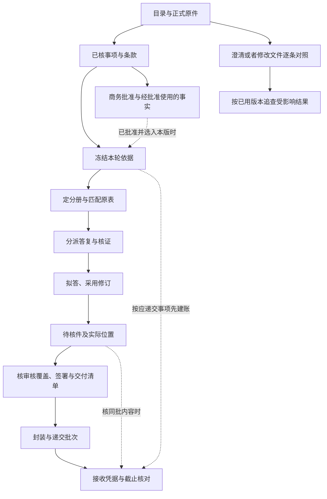

# 资源、知识与模型合同

> 本文件由《投标文件编制与递交业务规格》按业务领域拆分；正文保留，实施状态和历史证据统一以[唯一迁移台账](../../../notes/data-space-retirement-ledger.md)为准。

## 5. 资源与知识

### 5.1 资源

```
BidSubject
  id, name, creditCode, status          // ACTIVE RETIRED

ProjectSubject
  projectId, subjectId, role            // SOLO 独立投标。联合体分 LEAD 牵头方和 MEMBER 成员

ResourceTypeVersion
  key, version, label
  usage                                 // EVIDENCE REFERENCE TEMPLATE RULESET
  fieldSchema, cardSchema
  subjectBound, validityField
  sensitiveFields, claimKinds
  defaultAdmission

Resource
  id, typeKey, subjectId
  currentVersion
  status                                // DRAFT ACTIVE RETIRED
  statusEventRefs[]                     // 发证或备案机关的变更、资料纠错、使用授权变动。分别记来源、涉及的证件或版本、对象及范围、生效时间和获知时间

ResourceVersion                         // 只插入。证据版本并入这里，不再单建 EvidenceVersion
  id, resourceId, version, typeVersion
  fields, body                          // body 是平铺节点。企业名和日期用 {{名字}}
  bodyText, files
  validFrom, validTo
  rights                                // EXTERNAL INTERNAL 默认披露类别；实际准用取原用途决定，标签本身不授予对外或AI使用权
  sourceTerms
  reviewedBy, createdBy, createdAt

ProjectResourcePin
  projectId, resourceId
  mode                                  // PIN EXCLUDE
  pinnedVersion                         // 空时按当前 ACTIVE 版本找备选。采纳举证时将实际版本和文件摘要固定到本次投标核验记录

Person
  id, displayName

PersonSensitive                         // 原受控字段的不可变版本，不进AI上下文和内容树
  personId, field, fieldVersion
  value, sourceRef, createdAt           // 原字段值及来源；当前值指针只供新候选选取
  retentionStatus                      // 按原保管规则留存或已删除，不改历史引用身份
```

**资料版本与受控值**

- 资源录入为 `DRAFT`，审核后为 `ACTIVE`。退役保留历史，被交付清单引用的版本继续保留。
- `sensitiveFields`中的人员字段值只进入`PersonSensitive`；其他受控字段沿原受控存储版本引用，不能塞入正文、事实字面或AI消息。

<a id="bid-controlled-field"></a>

**受控字段固定到修订**

资料负责人交字段身份、不可变版本和原据，内容负责人把`sensitiveRefs`及显示策略版固定进快照。只写对象和字段名不足以证明当时用了哪一值。

| 变动或用途 | 核验与交接 |
|---|---|
| 人员字段更正 | 原持有人追加字段版，不覆盖旧值。新修订显式选版；只换当前值指针不改旧修订，影响范围交23核。 |
| 按旧修订制作 | 制作函数只读该快照指定版及策略，另核本次解引用和出件许可。原字段已变也不自动替换；所制件由42核实栏并反查字段版。 |
| 权限或保管变化 | 失去解引用权限时停相应制作。原值依法不能留存时保留允许的版本与删除凭据，不由当前值或AI推断补齐。 |
| 历史反查 | 可用获准留存实件核签名、摘要及所见内容。缺原受控值的预览只给占位并标缺项，不能称逐字重建通过或直接放行成件。 |

上述字段版是原受控存储的交付合同，不另建人员库。节点12（资源版本与出处）交原版及留存状态，节点05交用途决定；节点10交固定解析与实件对应，节点15核访问。

`ownerRef`含原对象类型与身份，不能由AI改绑他人。旧引用按原合同回查，续编另建修订显式升级；缺原版不填当前值。

原存储无字段版本能力时列节点12待建；有留存件可核其内容，按原修订重新制作的能力仍待验。

**资料用途、依赖及许可分别判定**

| 用途 | 入场及依赖 | 证明资格与限制 |
|---|---|---|
| EVIDENCE | evidence槽；实际用于判断的字段为强依赖。 | 仅在本标认可的主体、对象、时点、原件和用途均满足时用于举证。类型标签不证明已合格或已递交。 |
| REFERENCE | reference槽；按[实际用途](generation-ai.md#bid-input-strength)判强弱，检索命中不自动标弱。 | 内部成本等可作已核业务依据，不能因此冒作对外证明。需要举证时回原件按本标条件核验。 |
| TEMPLATE | 来源RESOURCE；套入文字、事实和引用逐项校验，所用版本固定。 | 不因未经生成而免核数据来源、许可和证据；模板不批准其中承诺。 |
| RULESET | 原规则及适用范围为强依赖；背景说明可分开标记。 | 企业规则不能冒作招标要求，不能关闭必需检查。 |

17按来源企业的原用途决定，分别核查阅、内部加工、指定AI处理、对外出件及分发的接收方、字段、范围和期间。可读不等于可发送给模型，可出件不等于可公开分发。

`rights`只作默认披露分类，不能代替56的原决定。内部成本可强依赖并在获准范围供核价；来源方另准对外用途时引用该决定，不重造原材料或把它改称合格证明。

03固定准用引用，04派发时重核实际接收的模型档位及处理范围。`dataPolicy`只能收紧，不能扩大来源许可；分类或接收方不明交来源企业和模型负责人补核。

39及出件分别核所采文字、字段和原附件是否可用于目标成果。派生、摘要或AI改写不自动解除原限制；不能证明输出在获准范围时停该部分，其他独立内容可继续。

**同一证件发生变化**

| 触发条件 | 核验与放行 |
|---|---|
| 新增清晰扫描件 | 可供新任务选用，已采纳实例继续引用原件。 |
| 登记或效力变化 | 按出具机关正式凭据的生效范围、时间和条款规定时点追查引用。企业纠正资料错误时，按所涉材料及其证明事项重核。 |
| 仅撤包一授权 | 包一停止以该件新递交，包二另核自身授权。影响未明暂停受影响事项放行。 |
| 已发批次 | 保留当时材料及回执，另记核查结果和按项目规则需要办理的事项。 |

检索策略是槽位参数：过滤类型、主体、标签、截止日、`rights`、分册规则；召回用关键词或相似度；可有一次重排；上限是条数和字数。结果冻结进清单。

<a id="model-registry"></a>

### 5.2 知识目录、业务模型注册与查询

| 模型种类 | 身份及职责 | 如何关联 |
|---|---|---|
| 业务 ClassModel | 本规格 47 个模型定义业务对象及可调用方法，61 个动作对应同版方法。 | 目录指向类型，宿主绑定业务实例；方法复用所属能力节点的函数，不对应 47 张表或 61 个服务接口。 |
| SPARK 数据资源模型 | `scenarioId + metaName` 标识实际资源；字段合同和权限来自当前 SPARK API。 | 一个业务模型可组合多个资源，也可只做纯计算；资源登记不能代替 ClassModel 方法绑定。 |
| AI 推理模型 | 由现有 Agent 配置选择，负责理解和提出调用。 | 轮次关联 Agent 配置与业务试次；更换推理模型不改业务对象、批准事实或方法权限。 |

业务模型、函数、资源及推理模型分别记录版本。运行负责人凭同一次绑定交接，不能用其中一个“模型版本”覆盖其余对象。

| 跨节点共用的业务模型 | 类型定义与原记录责任 | 方法实现及交接 |
|---|---|---|
| `TenderFileVersion` | 12 资源版本与出处维护原件身份、版本及位置合同，17 登记同一定义。 | 动作 11 固定原件，动作 12 由 08 招标依据读取同版位置；不另建第二份原件或同名类型。 |
| `GenerationRun` | 18 动作执行维护试次标识、实际调用及原返回合同，17 登记同一定义。 | 动作 04 执行；动作 07 由 20 验证与退回出返工决定。需重调时交 18，不能覆盖旧试次或先等重调完成才开返工。 |

每个类型由一个定义责任方维护，主办方法按61个动作的主责节点实现；辅助方法按第9节逐行归属，不按界面按钮另造动作。

跨节点调用只传同版标识和引用，不复制类型定义、业务批准或原办理记录。


| AI 的操作 | 本步可取得的内容 |
|---|---|
| 绑定范围 | 宿主先绑定项目、投标主体、标段、阶段和访问权限。 |
| 逐层查目录 | 当前层只给子目录、主题摘要和模型引用。例如“报价”可进入“编制核价”或“评审修正”。 |
| 选模型、实例 | 在“评审修正”查询实交报价、修正通知或确认记录。模型标识确定定义，实例标识确定本次对象。 |
| 按需读指南 | 按模型引用进入同版指南。类指南说明对象，属性指南说明字段，动作指南给出参数及返回。全局索引只承担导航。 |
| 执行 | 宿主执行已声明且获准的实例方法；业务访问走 `createSparkRuntime → runtime.api`。`runtime.ai.observeTask` 只观察 AI 事件。 |

#### 动作卡目录

| 办理时点 | 统一要求 |
|---|---|
| 查责任 | 47 个注册模型各有稳定标识。同一模型可有多个动作；每项交付结果只有一个主责节点。按目录查动作，按编号反查模型。[动作编号与归属](action-index.md#bid-action-sequence) |
| 查交接 | 动作表列出经办人、取证时点、办理输入、交付结果、接收方、独立核验与缺证接手人。跨阶段放行见[九项递交核验](action-index.md#bid-amendment-acceptance)。 |
| 查契约 | 粗体标明结果所属契约，其他契约按本次路径取用。“调用与验证”适用于受控调用；首期人工办理取已启用的五组。[七组契约反查表](../delivery/scope-blueprint.md#contract-register) |
| 核服务与权限 | 01–61 在企业空间读写前核[企业当前服务状态](../delivery/scope-blueprint.md#support-01)和[本次请求的权限判定](../delivery/scope-blueprint.md#support-15)。原记录保留当时范围，再用时核现行范围。[支撑记录](../delivery/scope-blueprint.md#support-records) |
| 绑定本次对象 | 调用固定采购项目、轮次、适用标段、主体和经办权限。首次查公告可从采购项目起步，确定主体和标段后再建编制范围。 |
| 引用与执行 | 引用带对象、版本、出处和核验时点。注册动作可绑定已有查询或 SPARK API 资源，如 `facts_get` 读取冻结基线。 |
| 办理权限 | 抽取、起草、比较按合同产生候选。人或授权AI调用原业务函数核定、批准、签署或递交；实际权能逐项核。先读同版ClassModel指南。 |
| 交接实物 | 指定工具和渠道允许接入且已获当次授权时调用函数；人工办理则收操作凭据并回读。待核件可先制供逐栏审查，取得批准及本阶段凭据后放行。 |
| 独立核验 | 逐项标示已证实、缺材料、冲突或有据不适用。验证人重读原件、独立复算或查外部凭据；缺口登记原文位置、影响对象和接手人。 |
| 公开反查 | 限定只读的项目、包、投标人及披露件。企业决定、批准、原件和渠道操作另凭授权。文本不可辨时查渲染页的表头、行列和单位；仍不可读则停在该字段。 |

<a id="bid-reference-timing"></a>

**按取用时点开工。** 08 凭公告、09 凭企业身份原件，各自独立开始。其他动作按下表取证；没有“首次办理”输入的，仍须取得指定外部输入或等对应事件发生。

| 输入所标时点 | 使用条件与缺证停点 |
|---|---|
| 首次办理（89 处） | 发起本步或首次确认该项结论时取用的共同输入。处理公开原件可从公告和目录开始。首轮无历史版本；前一步已交的部分事实可以先接。 |
| 条件分支（110 处） | 按本行标明的条文、选项或业务记录判断。相同对象可同时触发多项，缺项停在所影响的结论。[分支的判定与换版](resources-models.md#bid-branch-rules) |
| 退回重验（21 处） | 已有问题、正式修改、补件或旧结果需要复核时才取。按[逐项退回表](resources-models.md#bid-recheck)定位原目标、可沿用的凭据及接手人。 |
| 事后反查（18 处） | 凭已形成的实物、文件、批次、提交态或渠道事件核历史事实。查不到同批对应时，只暂停所主张的归属；仍可查原操作或登记待配对凭据。 |

- **逐项归类**　61 个动作有 238 处上游引用。44 取 54 新查得的批次结论复验问题；54 取 42 的同批观察反查截止实报价。
- **缺证移交**　主责人只将受影响结论列为待核，交“缺证接手”所指人员。未单列的交上游负责人；记录对象、缺项、接手人及下次核查时间。
- **延后办理**　未到取证时点的事项随原对象移交，其他已有凭据的范围可续办。必要凭据齐全后才作该范围的结论。

**一条依赖只维护一处定义**

238处“上游取证”定义动作间的取用条件；“接收方”列主办交接和责任人，不是全部下游的穷举表。反向取用清单从前者生成，不要求两边手工重复登记。

运行时沿原请求固定实际取用的对象、字段和版本，结果形成后关联原引用。首次办理不等待尚未产生的下游结果；未触发的条件只保留判定，不能补造消费记录。

23从实际引用追受影响成果，再按动作定义和新旧义务检查新增分支。只查“接收方”文字或只查已有引用均不完整；引用缺失交原责任人排查，不能判无影响。

<a id="bid-branch-rules"></a>

**条件取证。** 45 个动作含 107 处条件引用。核当前标段有效原文的版本、条号、页栏、表注或附件。涉及企业选择或 AI 调用时，另记当次决定、委托、任务或试次。

| 判断事项 | 由谁据何判定 | 缺证或变动时 |
|---|---|---|
| 义务适用 | 招标分析负责人核条文、正式修改及例外，财务或资格责任人核企业事实；项目负责人据两者在本轮基线登记结论。 | 触发事实不明记“适用性待核实”；已经触发但缺材料记“适用、缺证”，保留应办项。 |
| 例外与通知 | 企业按原文范围确认“有据不适用”。新增豁免须有权方按本标规则出具正式依据。 | 等待正式通知的列“待触发”，登记接手人及通知后的办理期限。 |
| 允许择一 | 分析负责人核原文允许的替代范围和共同前提。有权业务负责人登记实际选项和时点，其他允许路径记“未选”。 | 已选路径缺证，停该结论。改选须核期限、授权、新路径全部条件；共同前提始终核验。 |
| 必须并办 | 要求并交、分件签署、逐成员举证或同时填报时，项目负责人逐项列入。 | 资料部分可见时保留已证范围，剩余事项继续取证。 |
| 作业方式 | 主责人依任务、对象和形成记录区分人工或 AI、审稿或制作、内部办理或公开查证。记录实选路径及输入，混合来源逐部分核。 | AI 提议由业务责任人判定。来源不明，找原作者、运行负责人或持证人；公开件未披露的审批、授权、办理仍待核。 |

**换版后重判分支**

1. 正式修改、选项、事实版本、代表授权、材料授权或 ClassModel 绑定变化，原判定人按新依据核范围、条件。
2. 对照已用结果、旧清单“未选”“待触发”“有据不适用”和新版新增项。项目负责人把新增、重新适用项交当前承办人。
3. 留前后选择与时点，退最早受影响动作。已签、已发部分查原操作效力。
4. 验收定位到原文具体条项。SX 工期查第 1 号补遗第一部分第 2 项（2）；古雷 A2 工伤保险费分两次核费率和计取范围。[SX 标段原文与补遗](action-index.md#source-12) · [古雷 A2 两次正式文件](action-index.md#source-14)



| 交接事项 | 可以先做什么 | 下一步凭什么接 |
|---|---|---|
| 商务核价 | 商务按已核来源试算。需先冻结需求时，先建只含已定事项的依据版本。 | 取得商务批准后选入新基线。 |
| 册、表、答复 | 32 据招标组成建册，33 定位原表，先交 34 应填位置。34 才分派作答人和栏位。 | 审阅人核拟交答复语义；制件后 42 读实际值，后续核验引用本次观察。 |
| 资格和技术证明 | 35 对所选资格证明下结论，单份资格原件可作独立附件。 | 技术证明按实际技术条款随答复核验。 |
| 成员和材料授权 | 18 可先交拟议成员。19、20 按企业决定登记可先行的项目范围，17 据此办理材料授权。 | 18 核实成员组合。组合变更交 19 复核。 |
| 盘点和待核件 | 首轮盘点可以先记缺项，后续盘点取上次取得版本。待核件可先于内容批准制成。 | 45 核实际审定对象，47 核签署效力，50 核最终成员。每项绑定所查版本。 |
| 签包或签文件 | 包上签署先由 48 冻结成员、49 制待签包。文件先签时由 41 留存签后版本。 | 前者由 46、47 办签验签，50 清点签后包；后者由 47 核签署覆盖后交 48。 |
| 回执和实交内容 | 54 按 24 义务开账并核截止批次；早到的纸质签收单先登记待配对。提交后才有的平台栏从该批补记。 | 42 补同批观察以核实际内容。迟到事件改变有效批次时，对账人重核新批成员及实填值。 |
| 人工和受控 AI | 人工按业务凭据办理。AI 查目录和同版动作定义，按试次固定入参，派发后核实发与返回。 | 01–07 留编排记录；实际业务成果由相应动作的负责人交付。 |
| 澄清或者修改 | 人工、导入、AI 已用结果均留实用字段、位置、来源版本和时点。纸件另配封装标识与记录。 | 项目负责人既查旧引用，也比对新旧义务清单；无下游的新增项须派人。引用不全，按标段、对象、条款及责任册排查，沿用须有凭据。 |

<a id="bid-recheck"></a>

**21 处退回重验。** 箭头由凭据出具方指向复验方。07 依执行错误、变更或验证冲突开返工要求。44 按原问题选证；涉及多类对象时同时核各行。首次办理仍按各动作的输入开工。

| 凭据由谁交给谁 | 本次复验对象、可沿用的结果 | 重办范围、停点与接手人 |
|---|---|---|
| [07 退回一步](actions/knowledge-ai.md#bid-action-07) → [01 查指南](actions/knowledge-ai.md#bid-action-01) | 业务问题落错目录或选错 ClassModel 类型。保留仍适用的招标原文和业务任务。 | 运行负责人用 `model_query` 从当前根实例重查业务目录和可达类型，交 02 读同版指南、核绑定。无适用条目交知识维护人，注册类型缺失交模型负责人。 |
| [07 退回一步](actions/knowledge-ai.md#bid-action-07) → [02 读动作指南](actions/knowledge-ai.md#bid-action-02) | 类型正确，但企业、项目、对象实例或函数不符。仍可引用当前有权使用的同版类型指南。 | 运行负责人核宿主给出的 `moduleInstanceId`、可达对象、`kind`、`actionName` 及同版动作指南。<br>绑定唯一才交 03，错实例的取值和返回停止采用。<br>函数未绑定或签名不符交模型负责人。 |
| [07 退回一步](actions/knowledge-ai.md#bid-action-07) → [03 冻结本步输入](actions/knowledge-ai.md#bid-action-03) | 绑定正确，但实值、单位、取材范围、实际使用的原件位置或版本、发给 AI 的片段有变。其余独立输入保留来源。 | 输入记录负责人向字段提供人核新值及出处，建关联试次，固定本步实际入参再交 04。仅缺旧试次已发内容时先由 05 查原记录。 |
| [07 退回一步](actions/knowledge-ai.md#bid-action-07) → [04 执行一步](actions/knowledge-ai.md#bid-action-04) | 重调限于已纠正且确需重新求值的函数。原输入完整、绑定有效时，可据其另建试次并核当前权限。 | 运行负责人按同版动作指南重调受影响的计算或候选生成函数，05 回读、06 独立核返。脚本含多次调用时逐项查已执行部分；已登记的决定查原记录。签署、递交或撤回未决时只查原操作。 |
| [06 验证返回](actions/knowledge-ai.md#bid-action-06) → [07 退回一步](actions/knowledge-ai.md#bid-action-07) | 区分证据不足、返回有误和业务条件确实未满足。原输入、返回、冲突凭据和已证范围随原试次保留。 | 缺实际输入交 05，缺独立凭据由持有人补到 06。<br>仅判据改变且原对象、实参和返回完整，可重验原返回。<br>函数有误交模型负责人验证修正版，再经02核绑定；重调先按[状态归属](implementation-interfaces.md#bid-state-ownership)核逐笔效果，已办或未知不重放；<br>真实业务不满足交业务责任人整改。<br>相同输入反复生成直到出现通过结果，不能销项。 |
| [23 追查变更引用](actions/project-source.md#bid-action-23) → [07 退回一步](actions/knowledge-ai.md#bid-action-07) | 正式修改命中已使用的字段、指南片段或结论适用条件。未命中且能证明仍适用的结果可沿用。 | 验证负责人按 23 的受影响清单退首个取错模型、动作或输入的步骤。完全相同的实参和执行条件可在新依据下另记复核；缺实际引用交调用域负责人，相关结论待核。 |
| [04 执行一步](actions/knowledge-ai.md#bid-action-04) → [07 退回一步](actions/knowledge-ai.md#bid-action-07) | 执行报错、中断或只有部分调用返回。运行负责人交原试次、实际调用顺序、最后已证步骤及可能已办事项。 | 验证负责人依错误及恢复提示定位退点。已完成部分凭原返回分别核验；结果未知先查原试次。签署交 46，递交或撤回交 52，其他已发起的办理交其经办人。仅续办已核清且仍获准的步骤。 |
| [11 固定原件](actions/project-source.md#bid-action-11) → [10 核领取清单](actions/project-source.md#bid-action-10) | 已盘点的目录项收到补件或替换件。其他目录项仍保留原取得记录。 | 资料登记人按发布目录的项目、版本及附件位置核原件和领取凭据，只销已补齐的项。来源或版本未明，保留缺项，继续向指定渠道补取。 |
| [14 对照变更](actions/project-source.md#bid-action-14) → [23 追查变更引用](actions/project-source.md#bid-action-23) | 正式修改已定位到原条项。保留未变原文及已知旧引用，按新增、删除、替换逐项定位受影响成果。 | 招标分析负责人可先分派影响排查。变动原位不明退 14；新义务尚无引用的，项目负责人指定承办人；无法排除影响的成果留待核。 |
| [22 冻结依据](actions/project-source.md#bid-action-22) → [23 追查变更引用](actions/project-source.md#bid-action-23) | 核企业实际采用的旧基线和本轮选版。对照值、单位、用途、授权时点、附件和新增义务。 | 项目负责人补选版，原成果责任人补实际引用。新基线未定可先查旧链；只有已证不受影响的部分可沿用，受影响的计算、制件或审批回到首次使用处。 |
| [43 登记问题](actions/response-authoring.md#bid-action-43) → [44 复验问题](actions/response-authoring.md#bid-action-44) | 按原问题编号接目标版本、位置、阻断范围和整改人。仅改派时，保留同一目标的有效证据。 | 业务复核人核改后证据再销项。问题目标不明退提出人；未指派交业务域负责人。影响未消除的对象继续停在其放行步骤。 |
| [41 登记制作完成的文件](actions/delivery-lifecycle.md#bid-action-41) → [44 复验问题](actions/response-authoring.md#bid-action-44) | 问题涉及制成文件。取改后实际文件、版本及问题所指位置；历史文件保留原复验记录。 | 业务复核人从保存处重开新件。制作人补实际输出，文件登记人补版本对应；有版名但缺实物时保持原问题未决。 |
| [39 采用变更](actions/response-authoring.md#bid-action-39) → [44 复验问题](actions/response-authoring.md#bid-action-44) | 问题涉及内容。取有权人已采用的修订和变动范围，原批准只保留其确实覆盖的内容。 | 业务复核人比对原问题与已采用文字。缺采用决定交有权的内容采用人；问题还涉及交付页栏时，同时取 41、42 的改后证据。 |
| [42 回读填报内容](actions/delivery-lifecycle.md#bid-action-42) → [44 复验问题](actions/response-authoring.md#bid-action-44) | 问题涉及实际填报位置。核同版文件页栏或同次平台提交态、实值和单位。其他位置的观察可继续使用。 | 填报内容复核人补读改后位置；仅提交后可查的字段由对账人补查原批次。缺同版、同批对应时停在该位置的复验。 |
| [06 验证返回](actions/knowledge-ai.md#bid-action-06) → [44 复验问题](actions/response-authoring.md#bid-action-44) | 问题涉及函数候选。取 06 对正确实例、实参和返回的验证结论，可为原试次补证后的复验或新试次的验证。 | 业务复核人将已验证字段与原问题对齐。缺独立依据退验证负责人；问题还涉及采用、成件或实填时，同时核相应证据再销项。 |
| [50 核对包内文件](actions/delivery-lifecycle.md#bid-action-50) → [44 复验问题](actions/response-authoring.md#bid-action-44) | 问题涉及封装。只错装时沿用仍有效的获准成员，49 可先重封，50 先交新包清点及差异。 | 交付复核人补新包与实际成员的对应，业务复核人据此销项后再核能否放行。若成员或已签对象本身有变，先复核 45、47、48 中相应范围。 |
| [54 核截止组合](actions/delivery-lifecycle.md#bid-action-54) → [44 复验问题](actions/response-authoring.md#bid-action-44) | 问题涉及截止批次。对账人可先查渠道、核有效范围，再交新取得的证据及对应截止结论。 | 业务复核人仅处置新增证据已解决的部分。缺同批或效力证据交对账人续查；项目负责人接未决项，保留已证发送或接收事实。 |
| [44 复验问题](actions/response-authoring.md#bid-action-44) → [45 核审核覆盖](actions/response-authoring.md#bid-action-45) | 问题复验通过后，由授权审核人比较本次对象、修订、依赖与原审定范围。 | 内容、范围或所据关键值变化，须重审受影响部分。同一审定仍覆盖时记录沿用理由。缺复验证据退 44，缺适用的业务批准停在 45。 |
| [44 复验问题](actions/response-authoring.md#bid-action-44) → [48 冻结交付清单](actions/delivery-lifecycle.md#bid-action-48) | 交付负责人核销项所指目标与拟交清单。仅处置阻断且清单、成员及有关批准均适用时，保留原冻结版本及解除阻断的凭据。 | 成员、签后件或清单变化，重冻受影响清单并交 49、50 核新包。缺销项退 44，缺审核或签署覆盖分别交 45、47。 |
| [44 复验问题](actions/response-authoring.md#bid-action-44) → [51 办理递交或撤回](actions/delivery-lifecycle.md#bid-action-51) | 销项只解除该问题的阻断。获授权经办人仍核当前权限、渠道、窗口、拟发对象及在途记录。 | 原操作可能已发先交 52，只查原笔。允许另办时再核本标规则、目标批次和本次放行，关联新旧操作。逾期停发；仅缺回执交对账人跟查。 |
| [23 追查变更引用](actions/project-source.md#bid-action-23) → [54 核截止组合](actions/delivery-lifecycle.md#bid-action-54) | 修改影响截止时应交义务或实交内容的解释。保留独立已证的渠道事件、原判定及原获知时间。 | 对账人按生效时点重核受影响义务、有效批次及同批内容。缺规则交招标分析负责人，缺渠道对应查 52、53，缺成员或实值查 50、42。仅有内部换版不能推定新包已送达。 |

- **沿用凭据**　复核人在本轮引用原试次或业务记录，核相同的对象、实参、规则、权限，并列新旧依据位置和时点。版本、原文片段或位置属于实参的，一并比较。
- **分别处理**　新增义务另派，整包仍核全部成员。已采用文字由有权人办理修订，已签或已递交部分查原操作。

<a id="bid-original-operation"></a>

**逐笔查原操作。** 中断、撤回候选或恢复时，运行负责人从原试次逐项交实际调用、目标、发起时点、本地或渠道操作号及最后已证状态。一笔调用含多个对象时分别核对。

| 已发起的操作 | 谁查、怎样唯一对应 | 查明后怎样接续 |
|---|---|---|
| 签署 | 46 的有查询权签署经办人从原签署工具记录或纸件交接簿查签署人、签前对象、签后件及签署时点。缺号时以工具记录与可验签文件，或有标识的纸页及签交记录，唯一对应到原任务。 | 47 逐人、逐位置核当时委托和实际覆盖。<br>相同对象已签部分保留；<br>改件需签的范围交 45 核批准、46 核当次委托再办，47 验新件。<br>某项结果未知只补查该笔，暂停该项再签；<br>其余确证未办的项按依赖及授权接续。 |
| 递交、撤回或替换 | 52 的查询经办人按原操作号查指定渠道。缺号时用主体、轮次、标段、渠道、动作和时段检索，再凭渠道明确指认或与实发对象的唯一对应配批。53 的对账人核接收、拒收或撤回凭据及生效时点。 | 54 按本标规则认定截止时的有效范围。旧包确已接收的事实保留；补办或替换需另核窗口、当次授权、新包放行及所指旧批。只有回执时，实际成员、实填值分别待 50、42 取得同批凭据。 |

- **结果未知**　先检索原记录。仅本地超时或查不到唯一对应时留线索及未决状态，有权经办人向原工具、纸件保管人或指定渠道续查。
- **人员、时间**　经办人已失权，由企业指定接手人，项目负责人跟踪下次核查。截止后补到凭据，分记事件时间与获知时间。

**连续修改的复核顺序**

1. 对照原文件差异、当时有效的规则、企业本次实际输入和拟交件。
2. 分别核计算结果、原批准范围、所用证明或说明版本，以及答复是否覆盖各次正式补充文件。
3. 输入未变的计算可引用原结果，留本次重验记录。金额相同仍须分别证明文件、批准和批次身份。


动作卡按业务域分为四组，动作编号与锚点保持不变：

- [立项、来源与授权动作](./actions/project-source.md)
- [响应与编制动作](./actions/response-authoring.md)
- [制作、递交与生命周期动作](./actions/delivery-lifecycle.md)
- [知识与 AI 动作](./actions/knowledge-ai.md)

#### SPARK AI 的 ClassModel 怎样注册、查询和调用

| 步骤 | 输入与操作 | 交付与验证 |
|---|---|---|
| 登记模型 | 47 个业务模型各有稳定身份。61 个动作取所属类型的方法名、参数和返回约定。项目、依据、响应、编制、递交各目录指向模型标识、版本及权威定义。 | 从同一定义生成类、属性、关系、方法签名和返回索引。只读类型可只发布属性；可执行动作须有宿主实例绑定和执行入口。 |
| 重复或换版 | 同标识同版本重用原定义。冲突交模型负责人；定义变化发布新版，目录迁移保留模型身份。 | 运行时从所选目录定位同版定义。 |
| 查目录与实例 | 宿主绑定企业、项目、标段、主体和经办权限。AI 用 `model_query` 查根实例可达类型，已知类型用 `kind` 定位。 | 读 `model_class_guide`，仅沿本问所需关系钻取。相同类型多个批次，运行负责人用业务标识核唯一实例；切企业、标段、批次或模型版本重核权限和绑定。 |
| 查字段 | 读 `model_attribute_guide` 核含义、单位、类型、读写范围及关系。项目实际值和适用性取指定原件或业务决定。 | 01–03 固定当步必需的字段、条文位置、片段和已用前序结果。 |
| 查函数 | 读`model_action_guide`核签名、必填项、返回、失败、验证及[授权执行与审计](implementation-interfaces.md#bid-decision-audit)。 | 业务输出声明字段与单位。答复引用字段；制件另取模板和指定栏位映射。[数据与格式分离](delivery-interfaces.md#bid-data-format) |
| 执行、回读 | AI 提议动作；04 用宿主 `model_script` 执行已声明、已授权的实例方法，05 按试次回读实际输入。 | 04 留调用，业务动作交实际业务结果，两者指向同一笔办理。 |
| 验收、采用 | 06按[返回用途](implementation-interfaces.md#bid-result-handoff)逐字段核验；16接抽取、37接拟答，38、39仅处理实际候选。 | 已办凭据直接查原业务记录，不能再走采用。授权AI按本步条件续办，审计错误回原责任域纠正。 |
| 退回 | 07 定位最早错用模型、实例、动作或输入的步骤。须重调的函数和只需补证的结论分别交接。 | 已写入、已签署、已发出或结果未知的操作先查原结果。[逐项退回表](resources-models.md#bid-recheck) |

<a id="bid-classmodel-implementation"></a>

通用模块及包职责见[AI 底层通用模块](../delivery/pages-scenarios.md#ai-common-foundation)。本节定义其必须遵守的投标业务合同，页面接入见[页面开发交付卡](../delivery/pages-scenarios.md#page-contract)。

**ClassModel 接入的实现验收**

| 开发交付 | 输入、执行与交付人 | 接收条件和断点 |
|---|---|---|
| 声明与业务目录 | 模型负责人维护类型、属性、方法签名及 JSDoc；知识维护人将业务目录绑定类型标识。 | 目录只负责定位。47 个业务模型逐个对应真实类型和用途，不能将目录名直接当成可调用类名。 |
| 生成索引 | 用正式编译链从权威声明产出 manifest 与分片，固定来源版本和摘要；指南从同版生成定义及注释渲染。 | 同次发布的声明、索引、指南和实现可对应。缺成员先查生成时效与继承关系，再判定是否缺能力。 |
| 绑定实例 | 应用宿主按企业、项目及当前权限提供根实例和解析器，固定 `moduleInstanceId` 与类型版本。 | `model_query` 查类型与成员，业务实例由宿主解析。模型负责人验方法确已实现，不能只验索引存在。 |
| 执行一次方法 | 宿主按同版元数据校验参数、解析真实对象并调用方法；访问数据时仍核 canonical `queryContext`。 | 多方法脚本逐次留调用及结果。前一次成功、后一次失败时已成事实保留，恢复先查原操作，不重放整段脚本。 |
| 校验返回结构 | 模型负责人交返回校验器；运行负责人对实际原返回执行，并将失败字段交验证负责人。 | 工具 `ok` 或静态返回类型只证明各自范围。未知字段、错单位、缺必填项与错误业务对象均须单独拦截。 |
| 验证与交接 | 验证负责人查原件、独立复算、授权及业务原记录，按[返回用途](implementation-interfaces.md#bid-result-handoff)分字段交接。 | 拟稿另经采用；已办凭据回原业务页。结构、核验与实际效果分别留据，已批准或采用的事项不再办理。 |
| AI 会话接线 | 现有 `ai.turn` 所属 Agent 编排模型轮次；ClassModel 宿主执行工具，应用记录业务试次。 | 按[工具往返合同](resources-models.md#bid-classmodel-session)逐笔验收；不并行启动另一套模型循环，不把索引生成视为接入完成。 |
| 事件与最终结果 | `runtime.ai.observeTask` 提供事件观察；运行负责人按原轮次查保存的 `ai.message` 和工具执行记录。 | 流式预览不作正式结果。缺原返回或工具调用对应时停在 05、06，由运行负责人查原记录。 |

核对依据：[生成与索引](<D:/SPARK_AppWorks/packages/spark-ai/docs/class-model-knowledge-system-zh-cn.md>)、[宿主绑定](<D:/SPARK_AppWorks/packages/spark-ai/src/agent/business/class-model-agent-adapter.ts>)、[参数执行与返回封装](<D:/SPARK_AppWorks/packages/spark-ai/src/agent/native-runtime/native-script-context.ts>)、[本仓 AI 资源合同](E:/r/sparkproject/packages/data/spark-api/README.md)。

本仓接入须复用正式包出口及既有 AI 能力责任层。跨项目物理路径仅用于研读依据，不能成为产品运行时依赖；本轮不修改或生成 AppWorks 代码。

<a id="bid-call-value-boundary"></a>

**脚本实参、方法原返回与工具回传怎样对证**

同一方法调用沿用原试次及父工具调用号。模型负责人把下列映射、校验和编码规则登记在同版动作合同，运行负责人留实际执行凭据，不另建一套模型目录。

调用凭据关联原试次，不新增七工具参数；model_script 仍按登记合同接 script，绑定版本由宿主核。

| 对证位置 | 出具人交什么 | 接收、停点及退回 |
|---|---|---|
| 03 待发业务输入 | 输入记录人交命名字段、实值、单位、来源版本和缺项；按同版签名声明参数顺序、缺省值与转换。 | 宿主接完整输入；不能把 AI 脚本文本本身当成已核实参。 |
| 04 方法入口 | 宿主在进入方法前固定方法调用号，留原参数、归一化参数及实际调用顺序，核企业、项目与实例。 | 无法对应、未声明补值、交换或丢弃参数，停该方法；输入问题退 03，签名或绑定问题退 02。 |
| 05 实参回读 | 执行端交同笔方法实际收到的值、转换依据及参数校验结果；内层 AI 另交实发消息。 | 输入记录人核与 03 的差异。只留脚本、待发摘要或工具受理，均不能证明实参一致。 |
| 方法返回 | 宿主在交回脚本前固定原返回及方法调用身份；按允许留存范围保留可独立回读的版本。 | 06 验该原返回；业务完成但缺原返回时查原操作，不能因取证失败重办。 |
| 脚本整理 | 宿主交实际返回字段到原方法字段/片段的映射，注明选取、改写和派生项。 | 原样选取核身份与值；脚本改出的数字、承诺或状态是新候选，不能冒充原方法结论。 |
| 编码与回传 | 回传执行人交结构校验后的业务数据、编码版本、实际字符串及摘要，反解后再核同版结构与值。 | 序列化成功不等于数据未变；必需字段、单位、身份或来源丢失时停业务转交，交模型/运行负责人修映射。 |
| 06 到业务交接 | 验证人交原返回、整理字段、回传值及可用范围的对应，保留每类字段用途。 | 拟稿交37、39；已办凭据交原记录查询，不再采用。后续改述为新候选，不改变已经发生的业务事实。 |

原参数或返回受权限、保留期限限制而无法完整留存时，按原试次标出不可核字段并交有权人查证；摘要不能补成缺失实值。

| 转交规则 | 必须核对 | 不满足时 |
|---|---|---|
| 原始类型 | 缺省、null、空串、0、false 按合同区分；金额用十进制字符串并记单位与来源。只有获准值才关联批准版本。 | 不以空值填零、真假值折叠或转为普通浮点数消除差异；退该字段的出具人。 |
| 原生对象 | 实例、代理、函数、Date 等只按已声明映射转为数据或受控版本引用。 | 不把可调用对象当持久结果；无法无损表示的字段停在映射，不由默认 JSON 转换代办。 |
| 工具与业务结果 | 外层工具状态、业务 data、字段验证和业务采用分别解释；同名 ok 字段不能跨层替代。 | 不从任意对象的 ok、HTTP 成功或 accepted 推断业务通过；核实际业务记录。 |
| 脚本派生 | 报价等计算须交已登记、验证过的业务函数；文字整理仍标明原句与修改。 | 脚本自行改数或删除限定时停下游核价/采用，退原业务函数或作答人。 |
| 回传限额 | 当前 result 用 JavaScript 字符串 length 核 20,000；按最终序列化字符串计算，另核接收与模型上下文限制。 | 不按字节、可见字数或 token 替代该计量；超限不截断 JSON、原句或出处。 |
| 大结果按需读取 | 先按原版本保存完整结果；仅在已登记的引用回读合同下，交必要片段、精确版本及字段定位。 | 下游在当前权限内回读原版；引用不可达或无此合同则停转交，摘要不能冒充完整字段。 |
| 回传丢回执 | 按原轮次、工具调用和已保存回传摘要查受理；允许重报时只用原结果并重核当前权限。 | 不重新调用业务函数，也不读最新业务对象重造旧回传；无法证明原值则继续待核。 |

转交失败可按已登记的失败合同回报缺项及原调用，并注明未进入方法、方法已返回或业务效果待核。回报失败不授予重办权；没有失败回报合同则由运行负责人接手原待办。

以上是接线验收要求，不是现有参考运行时已经提供的保证。

| 当前源码证据 | 对方案的影响 |
|---|---|
| 参考运行时按签名把位置参数归一化；多余位置参数可能不进入命名参数。 | 投标宿主必须在方法前拦未声明的参数损失，05 取方法边界凭据。 |
| 参考运行时允许脚本编辑返回的数据副本，普通原返回可包装为工具成功。 | 方法原返回、脚本最终返回分别留证，输出校验不得只看工具 ok。 |
| 本仓工具回传接字符串并返回 accepted。 | 编码前后须对证；平台受理不验证字段业务含义。 |

源码定位：[参数归一化与数据副本](<D:/SPARK_AppWorks/packages/spark-ai/src/agent/native-runtime/native-script-context.ts>)、[工具结果封装](<D:/SPARK_AppWorks/packages/spark-ai/src/class-model/runtime/class-model-runtime.ts>)、[回传表示与限额](E:/r/sparkproject/packages/data/spark-api/src/application/application-ai-resources.ts)。

<a id="bid-classmodel-session"></a>

**现有 AI 会话怎样接 ClassModel**

| 已核接口 | 当前证据与边界 | 接线责任 |
|---|---|---|
| 发起轮次 | `ai.turn.create` 接 Agent、消息、请求键及可选会话和附件；没有逐轮注册工具的入参。 | AI 配置负责人核现有 Agent 的工具配置和版本，交运行负责人；不能把工具定义塞进消息充当注册。 |
| 待办工具 | `ai.client-tool.query` 取当前用户待办，现有适配没有按轮次传递筛选。返回归一只保证轮次及调用身份。 | 运行负责人将待办对应原试次；另核工具名、实参结构及实例绑定，不将整张列表交当前项目执行。 |
| 工具回传 | `ai.client-tool.update` 接 `turnId`、`toolCallId` 及字符串 `result`，长度上限 20,000。回执另含 `accepted`。 | 按[调用值对证](resources-models.md#bid-call-value-boundary)核结构、实际字符串与受理；原结果超限走已登记的回读合同，否则停转交。 |
| 当前产品入口 | [任务观察器](E:/r/sparkproject/apps/smart-bid-demo/src/features/ai/task-client.ts)遇等待工具或审批会暂停；严格纯文本路径要求无工具执行。 | ClassModel 接线仍待验。保留纯文本路径原判据，为工具路径单独核调用链；不能直接放宽原检查。 |

接口依据：[AI 资源适配](E:/r/sparkproject/packages/data/spark-api/src/application/application-ai-resources.ts)及[映射回归](E:/r/sparkproject/packages/data/spark-api/tests/ai-runtime-resources.test.ts)。这些代码证明调用表示，未证明部署端已配置七工具。

| 办理环节 | 交付人 → 接收人 | 输入、执行与停点 |
|---|---|---|
| 注册工具 | AI 配置、模型负责人 → 运行负责人 | 交同版七工具、参数和返回合同，以及 Agent 配置、包出口和宿主入口的对应。缺任一绑定停 02，由原交付人补证。 |
| 固定会话绑定 | 运行负责人 → 工具宿主 | 在原试次关联 Agent、会话、轮次、企业、项目、根实例及模型版本。工具请求按轮次和调用号归属，不从 AI 正文猜身份。 |
| 领取与核权 | 工具宿主 → 已注册实例方法 | 当前身份重核用途、对象和允许的方法；错企业、未知工具或找不到实参合同停 04。多标签同时恢复须由权威办理约束防重。 |
| 执行与留证 | 工具宿主 → 输入记录及验证负责人 | 复用调用与办理记录，逐方法记真实实参、原返回及业务操作号。执行完成与业务核验分开；工具调用号不能替代业务请求键。 |
| 保存原返回 | 输入记录人 → 回传执行人 | 回传前原结果须可恢复，摘要关联原试次。超限只用已登记的结果引用合同；模型无法读取该引用时停回传，不能假报成功。 |
| 回传与对账 | 回传执行人 → 运行负责人 | 同一工具调用提交已保存的结果，另记 `accepted` 与观察时点。未受理或响应丢失，按下表查原记录，禁止因此重跑业务函数。 |
| 完成轮次 | 运行负责人 → 验证及原业务负责人 | 查原轮次及工具记录，按返回用途交接。正文终稿须完整匹配后交06、37；已办事实取原业务凭据，不等终稿或重复办理。 |
| 候选采用 | 响应负责人 → 原业务责任方 | 人或授权AI经38、39采用并留记录。调用已实际完成采用时直接查原结果；聊天回答或工具完成不单独证明业务效果。 |

**恢复与验收复用原记录**

| 观察到的状态 | 恢复负责人怎样处理 | 验收凭据 |
|---|---|---|
| 业务已完成，工具回传未知 | 运行负责人查原 `ai.tool-execution`、轮次与办理记录。确证原结果未受理且允许重报时，只重报同一结果。 | 原业务操作唯一，结果摘要一致；回传已受理与业务成功各有凭据。无法区分时停恢复，由平台配置负责人核协议。 |
| 工具从待办消失或 `accepted=false` | 运行负责人查询原调用处置及轮次状态，交原经办人核业务事实。 | 待办消失、`success=true` 或 `affected=0` 均不能证明业务未执行，不据此新建调用。 |
| 刷新、换实例或切企业 | 宿主重新解析原业务对象，核当前权限、类型及函数版本；运行负责人查已执行范围。 | 会话内实例号不当作永久业务身份。不能重建原绑定时停 02；已办理的方法先查原操作。 |
| 原经办人退出 | 项目负责人指定接手人，平台配置负责人核既有待办移交或查询权限；运行负责人核原轮次及调用绑定。 | 当前用户待办列表不能证明他人的办理状态。未获准移交时留原事项待核，不以转发消息或换登录人代办。 |
| 已取消或撤权后返回 | 迟回归原试次，按[恢复合同](implementation-interfaces.md#bid-operation-recovery)分别核取消、原业务效果和旧执行许可。 | 取消申请不证明未办；缺当前权限不能回传受限内容，采用另核当前基线及授权。 |
| 脚本部分执行后中断 | 逐方法按[恢复合同](implementation-interfaces.md#bid-operation-recovery)查原结果；未派发或已终结未生效者再核当前条件。 | 同键不重办；旧执行者不能迟写，部分外部效果仍单独续查，未知不随整段脚本重放。 |
| 工具成功但输出错版或缺字段 | 06拦对应字段，07定位；缺实发回05，输入或绑定变回02、03，先按[状态归属](implementation-interfaces.md#bid-state-ownership)核效果。 | 候选与已办事实分别查。已办或未知先查原结果；修映射只重验或重回传，业务更正另获准办理。 |

本表是第三阶段工具路径的验收条件。首期人工保存与出件不等待它；调用与验证记录也不另建一份业务授权或采用事实。

平台的 ClassModel 索引、指南与实例调用参照 SPARK_AppWorks。[ClassModel 知识体系](<D:/SPARK_AppWorks/packages/spark-ai/docs/class-model-knowledge-system-zh-cn.md>) · [原生运行时与工具调用](<D:/SPARK_AppWorks/packages/spark-ai/docs/native-runtime-and-agent-flow-zh-cn.md>)

| 注册示例 | 运行与核验 |
|---|---|
| 资格／证明 | “资格核验”注册一次。资格经办人按包建实例，读该包条款版本、成员和已获授权的固定证明，逐成员交举证、共同覆盖条件、缺项及出处。 |
| 资格换版 | 包一条款变动只重核受影响实例；企业换证沿实际引用查影响。复核人从本包协议、制成附件反查。只有模型定义或动作契约改变才发布新版。 |
| 资格取证 | 郫都实例可核跨包误用，综合档案室项目可核技术证明、纸质递交及变更后沿用范围。[相邻标段与联合体](action-index.md#source-10) · [综合档案室采购更正](action-index.md#source-13) |
| 报价／评审修正 | “报价修正记录”引用本批实交报价，供有权人确认和复核。只读版本查原值、评委通知版和回复状态。注册后按权限可发现。 |
| 执行复算 | 发布复算动作并完成执行绑定后，输入实交表栏、数量、单位及适用条款，输出逐步计算、拟修正值或缺项。复核人从同一行原数独立复算。 |
| 采用修正 | 完成正式确认程序才依其效力采用修正值。业务材料按下表逐层取材，动作指南管函数签名和取用方式，执行由宿主在获准实例上完成。 |

| 层 | 内容 | 强度 | 证据 |
|---|---|---|---|
| 目录 | 分类、一句话、服务的类、条目数。概要自底向上 | 导航 | 否 |
| 指南 | 当前问题的核验步骤、所需事实与适用的例外，兼载编写要点 | 指导查阅和编写 | 否 |
| 卡片 | 候选材料的场景、要点、条件、来源及有效期。按需逐层取阅 | 定位可弱；判断依据须回源核定 | 否 |
| 原文 | 知识资料的原文片段，可沿引用回到对应来源 | 取决于用途与获准范围 | 参考资料按 5.1 使用。本次投标正式原件或获准证明按其独立身份、版本和出处举证 |

| 知识取用环节 | 取用或交付要求 |
|---|---|
| 定位和换版 | 分册内容类以 `guideKey` 定位业务指南。`KnowledgeDigest` 绑定来源版本与摘要配方哈希。换版只重建受影响摘要和目录引用，原运行仍可查原版本。 |
| 入库 | 导入节点候选 → 按标题切片抽卡 → 建议目录、类和 `sourceTerms` → 审核至 `ACTIVE` → 更新概要与索引。仅已审材料进入生成；历史项目按 5.3。 |
| 提供材料 | 依业务问题查指南、候选卡片和原件。优先分配上下文给必需事实与证明，其余给素材、位置和背景；限制调用次数与字数。 |
| 核证据 | 证明须核本次有效招标原件、获准事实、授权证明，以及相关澄清或者修改、表注和附件。知识资料原文依 5.1 判断可用范围。 |
| 停止取材 | 按 3.4 核全项目文件目录，决定结论的字段可回到有效原文，并已处理跨条款、表注和附件引用。只证实规则时交规则与缺件位置，企业符合性待核。 |
| 只读操作 | 知识检索提供 `kb_catalog`、`kb_search`、`kb_card`、`kb_guide`、`kb_read`。按当前根实例可达范围及权限公开，先查同版动作指南。 |
| 历史查询 | `history_query` 只返 5.3 的记录和卡片，同一来源每次预检索最多 2 张。 |
| 基线查询 | `facts_get`、`tender_query` 只读本次固定输入快照的基线。已有修订取其快照，空项目按 2.3 固定首稿输入。 |
| 运行查询 | `memory_query`、`findings_get`、`computed_get` 与上述操作均属只读业务合同。 |
| 实现 | 只读取材映射到注册资源的 `query`。调用留证另按已登记写入合同办理，不以保存或采用充当查询副作用。 |
| 运行与降级 | 模型不能直接调函数时，由运行时依同一指南分步取材、执行、验证。缺必需结果的项目待核，证据归入[逐次调用记录](generation-ai.md#bid-ai-io)。 |
| 回写出处 | 逐条记已核、待查和不适用理由，按覆盖情况形成整册结论。输出按本轮短名标出处，采纳时关联所选片段、节点版本、原调用和资源版本。 |
| 交付显示 | 一个节点可有多个来源；按分册要求决定正文是否列出处。V12 核对来源已列入清单。 |

### 5.3 历史项目

历史项目是企业资源，不是当前投标的事实。一条历史项目有三类材料，分开存放：

| 材料 | 资源类型 | 用途 | 能否当证据 |
|---|---|---|---|
| 项目记录 | `history.project` | `REFERENCE` | 不能。合同额、工期、业主只供编写时查阅 |
| 旧投标文件 | `history.bid` | `REFERENCE` | 不能。正文供借鉴，不能当作本项目已经承诺 |
| 业绩证明 | 证书、合同、竣工文件，走第 5.1 节的 `EVIDENCE` | `EVIDENCE` | 能。定位到所申报的历史项目，核实承担主体、角色、原文认可的业绩期间及所需证明组合 |

项目记录放在 `ResourceVersion.fields`，按该类型的 `fieldSchema`：

| 字段 | 规则 |
|---|---|
| `name`、`ownerName`、`location` | 文本。同时写入 `sourceTerms` |
| `subjectId` | 承担该项目的投标主体 |
| `role` | 按该次投标材料核实独立投标（`SOLO`）、联合体牵头（`LEAD`）或成员（`MEMBER`）。另记有证明的历史合同分工及实际承担范围，旧记录未区分身份时回查原件 |
| `projectKind` | 工程类型，取该资源类型的词表 |
| `contractAmount` | 取已签合同及适用变更的金额，保留币种、版本和出处。只有投标价或中标公告金额时，本栏待核 |
| `durationValue`、`durationUnit` | 规范数字和单位 |
| `startedOn`、`endedOn` | `YYYY-MM-DD`，可空 |
| `result` | 按本主体、采购包及采购轮次登记中标（`WON`）、未中标（`LOST`）、该轮已确定无有效中标或成交结果（`NO_AWARD`）、待核（`UNKNOWN`）。关联相应决定和日期，后续变更另存一版 |
| `personIds` | 参与人员。不含身份证号和手机号 |
| `evidenceIds` | 已审核的业绩证明资源版本 |
| `bidResourceId` | 旧投标文件资源。可空 |

结果待核时仍可作编写参考。没有 `evidenceIds` 时，正文不得把该项目写成已具备的业绩。V4 只认业绩证明，不认项目记录和旧投标文件。

| 历史资料的办理事项 | 可用证据与限制 |
|---|---|
| 认定实际递交件 | 从该包该轮的有效批次回到交付清单、修订、随附原件和送达依据。仅有内部定稿或存量案例缺递交凭据，标“企业定稿，实际递交待核”。 |
| 派生检索文本 | 按实际投标件所用修订基线展开占位，保存实件位置。平台另填价格、谈判最后报价分别配对应送达记录。 |
| 区分后续记录 | 后续答复、定标文件、合同分别归档。撤回、替换或结果更正留前一版状态和出处。 |
| 建档 | 合同及验收原件按字段登记来源。缺旧投标件或中标记录，只确认原件能支持的事项，按本次条款列缺证。 |
| 发布与更新 | 本次交付可生成 `history.project` 草稿，结果先待核。审核至 `ACTIVE` 才供编写和 `history_query` 读取。 |
| 结果换版 | 取得主管机关、采购人或平台有效结果后，负责人核对包号、主体和轮次，形成新结果版本。 |
| 查询 | `history_query` 按主体、工程类型、角色、合同额区间、完工日期及 `result` 过滤。一次预检索同一来源至多取两张卡；旧册某章用 `kb_read` 并限字数。 |
| 使用 | “本次招标人为甲方 A”须核本次事实。申报旧项目向甲方 A 履约，另核主体、角色、可对外证明和本册声明位置；缺证明列缺口。暗标册排除可识别身份的卡片、图片和附件。 |

---
