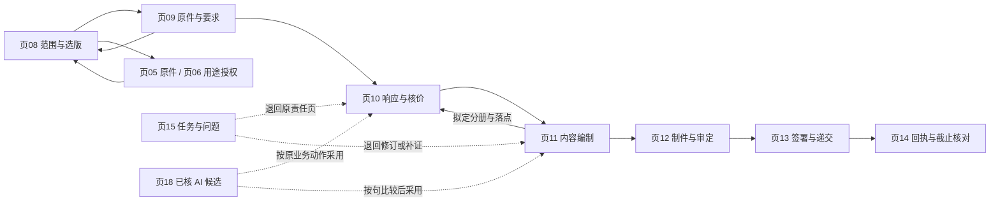

# 场景、页面与动作归属

> 本文件由分层建设方案按职责拆分；实施状态与实服证据只以[唯一迁移台账](../../../notes/data-space-retirement-ledger.md)为准。

## 四、场景与运行层 · 组织可执行、可验证的工作

| 场景责任方 | 怎样组合上层契约 | 向建设与验收团队交什么 |
|---|---|---|
| 平台运营负责人 | 以租户范围查看发布状态、服务记录、待对账的办理引用 | 平台发布与运行场景、租户隔离检查、恢复后交还业务经办人的清单 |
| 企业工作区负责人 | 结合身份与授权、来源与选用、项目与成果，向各有权人提供所需依据 | 代表授权、资源使用授权和跨项目资源协调三个场景，明确各自的决定人和接收项目 |
| 项目工作区负责人 | 以项目身份串联依据、成果、协作复验和外部办理记录 | 五个项目域的交接路径，以及应递交清单、企业批准的版本及实际递交记录之间的核对路径 |
| AI 作业负责人 | 在已授权调用域按目录选实例和函数，固定输入、执行并回读。规则函数独立复算，AI 候选按契约逐项核验。 | 交可回放的调用记录、候选及可核范围。未决结果附退回点及业务接手人。 |

| 场景交付项 | 实施约束 |
|---|---|
| 场景合同 | 需数据、输入或动作的节点列企业资源、必要输入、允许动作及返回。纯导航节点可不设数据空间。 |
| 资源解析 | 消费公共 owner 已核的场景绑定与 metaName；应用级资源由 runtime 解析。不从路由、标题或模型名猜测身份。 |
| 数据访问 | 业务通过根 `createSparkRuntime` 使用 SPARK API。 |
| 权限与菜单 | 前端消费 canonical `queryContext`，运行入口取当前会话菜单。 |

场景负责人交入口、资源、动作、接手人，以及正常、无权、缺证三种预期。实施和验收负责人按[动作引用的四种时点](../contracts/resources-models.md#bid-reference-timing)核开工与放行。

| 样本变化 | 验收人核什么 |
|---|---|
| 拿掉凭据 | 分别移去择一路径的已选凭据、同时必交项中的一项。核缺项能否保留并指派补证。 |
| 改动正式依据 | 激活原未选或不适用的分支，按新条件重核。参见[条件分支的判定与换版](../contracts/resources-models.md#bid-branch-rules)。 |
| 现场条件缺失 | 实施负责人登记缺绑定或外部条件的受影响范围，按第五节凭据判定是否放行。 |

### 蓝图与动作如何扩展

当前 6 个模块、21 个能力子模块、47 个 ClassModel、61 个动作及 19 个页面是本版基线，不是产品数量上限。

按实际业务扩展，不能为保持数量把独立职责塞进不相干节点。

优先复用职责相同的函数和记录。新增页面或通用技术端口不自动新增业务动作；确有新的业务决定、权威事实或独立交付时，再增补相应节点与动作。

| 变化 | 由谁判断与交付 | 本版放行前必须核什么 |
|---|---|---|
| 同职责的新入口或呈现 | 页面负责人复用原业务函数，登记页面形态和读写范围。 | 多入口引用同一事实；不复制审批、核价或办理记录。 |
| 新业务动作或方法 | 业务负责人交触发、输入、效果、输出、校验及接手；模型负责人补源声明。 | 存在真实需求且原动作无法准确承接；补原结果查询、当前权限及失败分支。 |
| 新能力子模块或模块 | 产品负责人界定独立责任、事实归属及上下游，交场景与页面负责人。 | 新输出有人接、开工无循环；不把事后凭据当首次输入，不以页面数量造资源。 |
| 新模型或字段合同 | 原 owner 修改源声明和版本，通过编译生成定义、指南及验证映射。 | 新旧调用分别绑定各自版本；旧记录缺字段留待核，不补造历史依据。 |
| 契约归属变化 | 原事实责任方及接收方明确迁移、引用、状态含义与停用旧入口。 | 既有七组优先复用；需要新组时说明独立事实边界，防重复登记和双重判定。 |
| 拆分、合并或退役 | 产品负责人交旧新标识对应、引用迁移和历史查询方案。 | 不重用旧标识或按数组下标定位；原试次、修订及回执继续可解释。 |
| 目录和验收更新 | 交付负责人同步节点、动作、模型、契约、阶段、页面及用例覆盖。 | 按本次目录核覆盖；不得在产品实现硬编码 20／54 上限，也不靠维持旧数量宣称零回归。 |

每次变更留本版范围及依据。原有有效要求继续验证；被业务变更替代的预期说明原因并留历史版本，新增项补正常、缺证、换版及恢复条件后才进入交付。

### 模块、子模块与页面

六个蓝图分支作为模块，21 个能力节点作为子模块。页面是面向办理人的工作入口；同一子模块可分屏，多个子模块可在一页协作。

本节定 19 个逻辑页面，编号只用于设计和验收。实际路由、菜单和嵌入方式由当前授权入口交付，不新增运行时页面目录或按页造数据空间。

| 模块 | 子模块仍用原能力节点 | 页面组合 |
|---|---|---|
| 平台运营 | 01 租户生命周期、02 公共能力发布、03 服务运行与恢复 | 页01、页02、页03；平台宿主承接，投标应用按权引用结果。 |
| 企业资源与授权 | 04 投标主体与代表授权、05 资源使用授权、06 跨项目资源协调 | 页04、页06、页07；资料原版从页05引用。 |
| 项目执行 | 07 项目与投标决策、08 招标依据、09 响应与承诺、10 编制与审定、11 交付、递交与对账 | 页08至页14；10 分编制、制件审定两页，11 分签署递交、回执核对两页。 |
| 资源与知识 | 12 资源版本与出处、13 知识目录与指南、21 配置编审与启用 | 页05、页16、页19；页09嵌原件登记，同用12的版本记录。 |
| 协作与控制 | 14 任务与成果交接、15 权限消费、16 问题复验与审计关联 | 页15分任务、问题两个视图；15 嵌入各页，不新建另一套授权管理页。 |
| AI 编排与验证 | 17 模型注册与发现、18 动作执行、19 输入回读、20 验证与退回 | 页17检查并登记编译产物；页18串联发现、输入、执行和核验，业务采用仍回原业务页。 |

**页面清单与实施位置**

下列均为目标页面合同。现有入口仅证明可复用的页面或组件位置；本表的新增业务区域、字段及命令仍须按各自条件实施、验收。

| 页面与主要使用人 | 子模块／阶段 | 页面内部区域 | 复用位置与待建交付 |
|---|---|---|---|
| 页01 企业服务 · 平台运营人 | 01／一期，四期扩展 | 企业列表、服务范围、生效历史、退出交接 | 平台宿主交服务状态与退出办理入口；本应用只接获准状态和未决事项链接。 |
| 页02 公共能力发布 · 发布人 | 02／二期 | 来源版本、目标企业、分发许可、生效及撤下记录 | 由平台发布区承接；不把工艺库“发布”直接解释为跨企业分发。 |
| 页03 服务与未决办理 · 运维及经办人 | 03／一期，四期扩展 | 故障范围、原操作索引、查询进展、接手与恢复 | 平台运行区交恢复入口；只展示权限内的操作摘要，业务核实回页13、14、18。 |
| 页04 企业身份与代表授权 · 企业有权人 | 04／一期 | 法人依据、代表委托、事项范围、期限与撤销 | 企业工作区补业务授权区。现有[企业组织页](E:/r/sparkproject/apps/smart-bid-demo/src/pages/EnterpriseOrganizationPage.vue)为 AI 组织，不代替法定主体或代表委托。 |
| 页05 企业资料与版本 · 资料登记人 | 12／一期 | 资料目录、原件预览、版本历史、出处及有效期 | 复用[企业资料页](E:/r/sparkproject/apps/smart-bid-demo/src/pages/EnterpriseAssetsPage.vue)；补不可混淆的原件版本与容量回读。用途决定交页06。 |
| 页06 资料用途授权 · 来源企业有权人 | 05／一期 | 申请队列、资源版本、接收企业与用途、期限及撤销 | 在企业资料功能内交独立授权区；项目入口只发申请、查本项目获准范围。 |
| 页07 跨项目资源协调 · 企业主管 | 06／二期 | 本企业资源、时段及限额、占用冲突、调配与释放 | 企业工作区新增协调视图，复用原授权和版本记录，不重建资源副本。 |
| 页08 项目目录与投标策划 · 项目负责人 | 07／一期 | 项目列表、主体轮次标段、阶段前置、决策分工、依据选版、移交范围 | 复用[项目目录](E:/r/sparkproject/apps/smart-bid-demo/src/pages/ProjectCenterPage.vue)与[工作台](E:/r/sparkproject/apps/smart-bid-demo/src/pages/BidProjectWorkbenchPage.vue)；列表、详情同属本页合同。 |
| 页09 招标原件与要求 · 招标分析人 | 08、12／一期 | 领取清单、原件页栏、要求列表、修改对照、阶段义务及后续来件 | 复用[分析页](E:/r/sparkproject/apps/smart-bid-demo/src/pages/TenderAnalysisCenterPage.vue)，嵌原件登记组件；补正式修改与适用范围判定。 |
| 页10 响应与商务核价 · 作答及商务人员 | 09／一期 | 资格技术响应、证明、报价复算、批准事实、担保办理 | 复用[证明页](E:/r/sparkproject/apps/smart-bid-demo/src/pages/ProjectEvidencePage.vue)的资格区；技术、商务按对象独立取数，不能靠整项目快照判齐。 |
| 页11 内容编制 · 编制人与采用人 | 10／一期 | 项目内容树、正文编辑、字段绑定、原文侧栏、候选差异 | 复用[编制入口](E:/r/sparkproject/apps/smart-bid-demo/src/pages/AuthoringStudioPage.vue)与当前内容工作区；补项目级修订、按句预演及采用查询。 |
| 页12 制件与审定 · 制作及审核人 | 10／一期 | 制作指令、模板版本、实件列表、实填反查、审核覆盖 | 复用[审核入口](E:/r/sparkproject/apps/smart-bid-demo/src/pages/ReviewCenterPage.vue)和制件能力；现有当前文档审核尚未接通，不能把旧项目快照移作审定。 |
| 页13 签署与递交 · 交付及经办人 | 11／一期，四期扩展 | 递交义务、审定实件、签署覆盖、封装清单、办理窗口 | 在交付功能分出办理区，接原操作查询。人工外部办理也登记同样的文件与凭据身份。 |
| 页14 回执与截止核对 · 对账人 | 11／一期，四期扩展 | 应交清单、批次与事件、有效组合、开标评审引用、正式结果 | 在交付功能分出只读核对与结论登记区；沿原批次补证，不复制一套递交队列。 |
| 页15 任务与问题 · 承办及复核人 | 14、16／一期 | 待办、目标版本、签收改派、问题证据、复验覆盖 | 复用[任务面板](E:/r/sparkproject/apps/smart-bid-demo/src/widgets/project/TaskRecordPanel.vue)；任务完成与问题复验分别由原职责出具。 |
| 页16 知识目录与指南 · 知识维护人 | 13／二期 | 目录树、适用条件、原文引用、指南版本及换版影响 | 复用[企业知识页](E:/r/sparkproject/apps/smart-bid-demo/src/pages/EnterpriseKnowledgePage.vue)；检索结果、编审指南及分发许可分别留据。 |
| 页17 ClassModel 登记 · 模型负责人 | 17／三期 | 编译产物版本、只读签名与指南、校验器、真实实例绑定 | 可复用[工艺目录](E:/r/sparkproject/apps/smart-bid-demo/src/pages/ProcessTemplateCatalogPage.vue)展示能力；工艺定义不能代替 ClassModel 定义，登记写回原 owner。 |
| 页18 AI 作业与核验 · 运行及验证人 | 17、18、19、20／三期 | 目录选用、固定输入、逐笔调用、实发比对、返回核验 | 复用[项目工单页](E:/r/sparkproject/apps/smart-bid-demo/src/pages/ProjectAiProcessPage.vue)；补ClassModel工具往返及字段验证，按返回用途交原业务页。 |
| 页19 配置编审与启用 · 配置发布人 | 21／二期 | 配置种类、作用域、候选差异、闭包与审阅、启停指针、原发布查询 | 待建配置编审区，复用原配置版本及指针；不把工艺候选或编译类型登记当作配置已启用。 |

**每页读什么、办什么、交给谁**

“动作”均引用本版 61 个动作卡。本表为每个动作指定一个主办页面；原动作卡给同一操作的输入、输出、权限和换版停点。其他页引用结果或跳转，不重复登记。

支撑命令按下表及[函数合同](pages-scenarios.md#page-support-functions)交付。人工直调与AI工具调用按[接线标准](../contracts/implementation-interfaces.md#bid-operation-binding)共用函数；定义管理另走页17的管理端口。

| 页面 | 进入输入与必须看见的字段 | 主办动作或支撑命令 | 结果接收人与停点 |
|---|---|---|---|
| 页01 | 企业身份、服务约定；范围、生效时点、状态及退出接收人。 | 支撑命令：开通、停用、恢复、登记退出交接。 | 企业管理员与页03接状态；退出未决必须有人签收，停用不抹除历史。 |
| 页02 | 来源版本、分发许可、目标企业服务状态；有效期及撤下范围。 | 支撑命令：发布、调整范围、撤下。 | 页16、17及接收企业接发布引用；缺分发许可停发布，交来源方决定。 |
| 页03 | 原操作或试次、故障范围、最后可证步骤；当前权限及接手人。 | 支撑命令：挂起、查询移交、核恢复条件。 | 原业务经办人接未决；未知不重发，缺原标识继续查证，不生成替代操作。 |
| 页04 | 企业身份、原件版本、代表和办理事项、期限；当前经办权限。 | 动作：[09](../contracts/actions/project-source.md#bid-action-09)、[27](../contracts/actions/project-source.md#bid-action-27)、[55](../contracts/actions/delivery-lifecycle.md#bid-action-55)。 | 页08、13接身份及委托核验；缺证交企业授权人，不因能登录而视为有代表权。 |
| 页05 | 当前企业、资料目录与原件；版本、出处、有效期、保存与回读状态。 | 支撑命令：登记企业原件、补出处、查询历史。 | 页06、07、10引用原版；保存失败保留待核，不能用预览或解析成功代替归档。 |
| 页06 | 页08申请范围、页05资源版本；来源及接收企业、项目、用途、期限。 | 动作：[17](../contracts/actions/project-source.md#bid-action-17)、[56](../contracts/actions/delivery-lifecycle.md#bid-action-56)。 | 页08选版、页10用证；撤销后通知实际引用方，已发材料转页14查原批次。 |
| 页07 | 本企业资源、既有授权、项目需求、时段限额及占用。 | 支撑命令：分配、调整、释放。 | 各项目仅接本方调配结果；冲突交主管，未证明义务结束不得释放。 |
| 页08 | 当前企业及项目；投标主体、成员、轮次、标段、阶段及适用前置结果、决定、分工、依据版本。 | 动作：[08](../contracts/actions/project-source.md#bid-action-08)、[18](../contracts/actions/project-source.md#bid-action-18)、[19](../contracts/actions/project-source.md#bid-action-19)、[20](../contracts/actions/project-source.md#bid-action-20)、[22](../contracts/actions/project-source.md#bid-action-22)、[59](../contracts/actions/delivery-lifecycle.md#bid-action-59)。| 页06先接范围，页10、11接基线；移交时各责任人接实据与未决。无未来结果不阻断先行准备。 |
| 页09 | 来源目录、原件版本、页栏、修改发布与生效时间；要求及递交条件。 | 动作：[10](../contracts/actions/project-source.md#bid-action-10)、[11](../contracts/actions/project-source.md#bid-action-11)、[12](../contracts/actions/project-source.md#bid-action-12)、[13](../contracts/actions/project-source.md#bid-action-13)、[14](../contracts/actions/project-source.md#bid-action-14)、[15](../contracts/actions/project-source.md#bid-action-15)、[16](../contracts/actions/project-source.md#bid-action-16)、[21](../contracts/actions/project-source.md#bid-action-21)、[23](../contracts/actions/project-source.md#bid-action-23)、[24](../contracts/actions/project-source.md#bid-action-24)、[57](../contracts/actions/delivery-lifecycle.md#bid-action-57)。| 页08选依据，页10接响应，页13、14接规则。后续通知可先收件计时，缺原包只停依赖该包的结论。 |
| 页10 | 本轮基线、原要求、册件或独立分工及落点；答复、证明、规范值、单位、规则与批准。 | 动作：[25](../contracts/actions/project-source.md#bid-action-25)、[26](../contracts/actions/response-authoring.md#bid-action-26)、[28](../contracts/actions/response-authoring.md#bid-action-28)、[29](../contracts/actions/response-authoring.md#bid-action-29)、[30](../contracts/actions/response-authoring.md#bid-action-30)、[31](../contracts/actions/response-authoring.md#bid-action-31)、[34](../contracts/actions/response-authoring.md#bid-action-34)、[35](../contracts/actions/project-source.md#bid-action-35)、[36](../contracts/actions/response-authoring.md#bid-action-36)、[37](../contracts/actions/response-authoring.md#bid-action-37)。 | 页11接已核响应，页08选事实版；无批准保留试算，事实缺项交原责任人。 |
| 页11 | 策划接阶段及格式；采用接统一目标、固定头、基线、草稿或候选和已核答复。独立响应不要求册节点。 | 动作：[32](../contracts/actions/response-authoring.md#bid-action-32)、[33](../contracts/actions/response-authoring.md#bid-action-33)、[38](../contracts/actions/response-authoring.md#bid-action-38)、[39](../contracts/actions/response-authoring.md#bid-action-39)。 | 页12接已采用修订；预演后换头退38，采用未知交页03补查，不能按草稿出正式件。 |
| 页12 | 文件接原制作请求、修订、模板或原生件版、实件与沿用依据；独立栏接响应版、字段规则、拟填值及批准。 | 动作：[40](../contracts/actions/delivery-lifecycle.md#bid-action-40)、[41](../contracts/actions/delivery-lifecycle.md#bid-action-41)、[42](../contracts/actions/delivery-lifecycle.md#bid-action-42)、[45](../contracts/actions/response-authoring.md#bid-action-45)。 | 页13接指定实件或获准拟填值；迟回归原请求，不改选件或字段。实填差异交页15，内容修订回页11。 |
| 页13 | 本轮义务、选件或独立栏响应版、拟填值与规则、目标依据、适用签署、当前委托、窗口与在途操作。 | 动作：[46](../contracts/actions/delivery-lifecycle.md#bid-action-46)、[47](../contracts/actions/delivery-lifecycle.md#bid-action-47)、[48](../contracts/actions/delivery-lifecycle.md#bid-action-48)、[49](../contracts/actions/delivery-lifecycle.md#bid-action-49)、[50](../contracts/actions/delivery-lifecycle.md#bid-action-50)、[51](../contracts/actions/delivery-lifecycle.md#bid-action-51)。 | 文件先固定选件再封包；独立栏接45放行，不等成件；混合渠道核齐两项。页14接同次实发及凭据，未知查原操作。 |
| 页14 | 应交义务、原批次及事件；接收时间、取得时间、替换范围、有效组合及证据。 | 动作：[52](../contracts/actions/delivery-lifecycle.md#bid-action-52)、[53](../contracts/actions/delivery-lifecycle.md#bid-action-53)、[54](../contracts/actions/delivery-lifecycle.md#bid-action-54)、[58](../contracts/actions/delivery-lifecycle.md#bid-action-58)。| 页08、15接阶段结果和待办；已开启不推定实际评分，正式结果不补齐缺失包证。 |
| 页15 | 原任务或问题、目标版本、责任人、期限、证据及复验覆盖。 | 动作：[43](../contracts/actions/response-authoring.md#bid-action-43)、[44](../contracts/actions/response-authoring.md#bid-action-44)。支撑命令：签收、改派、移交。 | 原业务页接处理或复验结果；关任务不替代复验，改派不授权再次发送。 |
| 页16 | 准用来源及版本、目录路径、指南适用条件和编审依据。 | 支撑命令：编审目录、发布指南原版、登记换版影响。 | 页10、17、18接同版指南；跨企业发布另到页02，检索命中不等于事实获准。 |
| 页17 | 类型及版本、方法签名、验证规则、目录条目、实例绑定及注册证据。 | 支撑命令：登记编译产物、核绑定、换版、停用定义。 | 页18接可调用范围；缺真实绑定只可查定义，不能显示“可执行”。 |
| 页18 | 企业与业务目标、目录指南、实例及方法版、输入引用、原试次、实发及原返回。 | 动作：[01](../contracts/actions/knowledge-ai.md#bid-action-01)、[02](../contracts/actions/knowledge-ai.md#bid-action-02)、[03](../contracts/actions/knowledge-ai.md#bid-action-03)、[04](../contracts/actions/knowledge-ai.md#bid-action-04)、[05](../contracts/actions/knowledge-ai.md#bid-action-05)、[06](../contracts/actions/knowledge-ai.md#bid-action-06)、[07](../contracts/actions/knowledge-ai.md#bid-action-07)。 | 页09、10、11接已验证候选；页15接缺证任务。错类回选类、错绑定回指南、换输入重准备。 |
| 页19 | 配置候选及类型、引用闭包、原责任域审阅、作用域、预期指针版和原请求。 | 动作：[60](../contracts/actions/delivery-lifecycle.md#bid-action-60)、[61](../contracts/actions/delivery-lifecycle.md#bid-action-61)。 | 原消费页接同版配置及影响；旧锁另核现行许可。失败留候选，丢回执查原启停，不自动回退。 |

第9节其余接口按[逐行归属](../contracts/implementation-interfaces.md#bid-interface-register)和[辅助合同](../contracts/implementation-interfaces.md#bid-auxiliary-operations)交付。重复入口共用原动作，参数说明不生成独立函数。

输入契约、必填性和状态含义以[七组契约](scope-blueprint.md#contract-register)、原动作卡及[动作实现标准](../contracts/implementation-interfaces.md#bid-action-implementation)为准。页面表不另定义“已批准”“已送达”等业务状态。

页11由节点10查原采用及实核凭据，分别显示原办理结论、依据待核项和当前保留范围；页03只提供恢复入口。页09交勘误登记与影响，页15接问题，不另复制采用状态。

页12按实际文件查制作版及原采用，页13接本轮放行结论。原结果未知时，页11对该请求仅提供续查及移交；成功待复核也不能显示为“可交付”。统一见[采用恢复](../contracts/content-contract.md#bid-adoption-recovery)。

原业务页与页18共用业务函数，授权AI可自主批准和采用。页15按[审计接续](../contracts/implementation-interfaces.md#bid-audit-continuation)显示历史目标、当前影响、纠正及复验；待审计不自动卡流程。

**支撑页的业务函数合同**

下列是原节点应交的语义函数，不是已存在的导出符号或新服务接口。开发人按[接线标准](../contracts/implementation-interfaces.md#bid-operation-binding)落实绑定。动作页输入输出仍取原动作卡，不重复登记同一事实。

所有查询交目标、版本及投影，返回获准范围内的完整性和出处；受控办理记录区分无权、空集、未读到和失败。

对无权者不区分对象不存在与不可读，不暴露原件或实例身份。历史查询不写当前状态，页面不把读取失败降为成功空表。

所有变更交原版及请求键，返回原记录和可回读版本；并发失配回读比较，未知只查原请求。权限、材料及用途由可信上下文核，不能由表单声明为通过。

| 页面／函数及 owner | 输入 → 输出及接收方 | 权限、换版与缺证退回 |
|---|---|---|
| 页01 · `登记服务决定`／节点01 | 服务约定、企业、开通或停用或恢复意图、生效时间 → 服务决定版，交企业管理员及03。 | 平台服务管理权；恢复另核当前条件。缺约定交运营负责人，停用不撤销历史事实。 |
| 页01 · `登记退出交接`／节点01 | 退出决定、留存范围、在途索引及接收人 → 原退出记录，交03与14跟踪签收。 | 退出办理权与导出权限分别核。未决无人签收停退出办结，交运营负责人；不删除在途记录。 |
| 页02 · `登记公共发布`／节点02 | 原版、来源方分发许可、目标企业、发布或调范围或撤下 → 发布事件，交16、17及使用方。 | 平台发布权；不能代来源企业许可。许可变版重核范围，缺据交来源方及发布负责人。 |
| 页03 · `登记运行中断`／节点03 | 故障范围、原请求和最后可证步骤 → 运行事件与受影响队列，交原经办人。 | 运维处置权只影响执行调度。缺操作号仍可登记故障，业务结果留未知。 |
| 页03 · `查询原办理`／节点03编排 | 原请求或匹配线索、查询范围 → 原业务查询函数的结果，交39、46、52或AI原试次负责人。 | 核本次查询权；不得把运维访问扩大成企业正文读取。错配退原经办人，不重发。 |
| 页03 · `核恢复条件`／节点03 | 当前服务和权限、故障恢复凭据、原结果与接手人 → 可恢复范围，交原业务函数续办。 | 运维恢复不替代业务放行。未知已发事项仅恢复查询；缺据交经办人，改派走节点14。 |
| 页05 · `登记资源原版`／节点12 | 原文件、来源及摘要、取得时间 → 固定原版，交06、07、10。 | 资料登记权；换件新增版本。缺实际保存或回读停归档，交资料登记人；不得登记为空原件。 |
| 页05 · `登记出处更正`／节点12 | 原记录、补充出处及更正依据 → 更正事件与影响引用，交实际取用方。 | 原记录维护权；更正不改变原件字节。内容变更回登记原版，缺依据交来源登记人。 |
| 页06 · `提交资料申请`／节点05 | 页08项目范围、所需证明或获准可见的资料引用、用途 → 申请记录，交来源企业56。 | 申请权不要求先获原件读取权。申请变更另留版本；来源或用途不明退申请人。 |
| 页07 · `登记资源调配`／节点06 | 资源、限额时段、原占用、分配或调整或释放及依据 → 调配版，交17、25、22。 | 宿主企业调配权；调整核冲突，释放须核义务终止。缺据交主管，不能放宽用途授权。 |
| 页15 · `办理任务交接`／节点14 | 原事项、目标版、承办人及签收或退回或改派意图 → 交接事件，交原责任域。 | 签收由接收人，改派由分派人；新承办人核权和在途记录。无人接手仍由分派人跟踪。 |
| 页15 · `查询核查覆盖`／节点16 | 原记录集合边界、检查目的、规则版和续查位置 → 已核、未核、不可取证范围；43接补核，节点14接未决。 | 核当前读取权；不派发纠正。缺枚举保证列未证范围，通知丢失可补查，待审计不转人工阻塞。 |
| 页10 · `办理报价批准`／节点09 | 范围、计价或费率版本、依据、预期批准版及请求键 → 原商务批准，29、30接读值与事实登记。 | 人或AI均核报价批准权。并发或换版回商务，未知查原请求；不借45内容审定或页面写字段代替。 |
| 页10 · `查询原批准`／节点09 | 原业务请求、摘要及可得的批准号 → 原批准结果；29另交本次用途，页18关联原调用，页15接问题。 | 查询权与批准权分开。原批准已办不代表当前可用；错配或未知交商务查原清单，不调用批准重试。 |
| 页12 · `查询原制作`／节点10 | 原制作请求、摘要及册→逐输出结果、进展与缺项，40、41接；页18查原调用。 | 只读权；迟回不换当前选件，未知不重新制作。定义及绑定按[查询合同](../contracts/delivery-interfaces.md#bid-production-selection)交付。 |
| 页13 · `查询原冻结`／节点11 | 原范围、请求键及摘要→当时冻结结果，48–50接；当前选择另读。 | 只读权；原成功不等于当前放行。缺证交交付负责人，不能从现有文件反推原选件。 |
| 页16 · `编审目录指南`／节点13 | 准用来源、目录路径、适用条件及编审依据 → 指南原版和绑定，交01及业务取用人。 | 知识编审权；函数签名从编译定义渲染，不手工维护。目录或来源变重核，缺据交知识维护人。 |
| 页16 · `登记指南变更影响`／节点13 | 新旧指南及实际引用 → 受影响条目和接手人，交01–03及业务责任人。 | 可查引用范围；不改原调用。跨企业分发仍交页02，旧用途未核清停受影响取用。 |
| 页17 · `检查编译产物`／节点17 | manifest、分片、schema、源码构建及校验器引用 → 差异与缺项，交模型负责人。 | 定义读取权；检查不激活。引用缺失或摘要不符退构建责任人。 |
| 页17 · `登记执行绑定`／节点17 | 获准定义、真实导出、实现构建、宿主绑定办法及验证凭据 → 绑定版，交02、04。 | 模型登记权；实例解析由可信宿主执行。签名相同也核实现摘要，缺真实出口只留待建。 |
| 页17 · `启停注册版本`／节点17 | 已检查定义和绑定、范围、生效时间及启用或停用决定 → 注册事件，交01、02及原试次负责人。 | 发布与停用权；不得由待审AI脚本自启用。停用阻断新调用，原结果查询保留获准渠道。 |

业务函数的具体状态与恢复条件继续引用[七个支撑节点](scope-blueprint.md#support-records)。页03的移交复用页15任务交接；页05的历史查询、页17的定义预览只读原记录，不另造状态。

代表委托改由动作55登记，27只核本事项有效性；资料准用改由56登记，17只取获准材料。两项直接复用企业已有决定链，外部已有有效原据可直接核验，不要求重新授予。

47 个投标 ClassModel 只统计业务注册表。

平台服务、发布、任务等支撑函数先由原 owner 交付；以后开放给 AI 时另按编译和注册合同逐项登记，未登记的命令不由模型猜调用。

**页面开发交付卡**

| 每页必须交的内容 | 前端、业务函数和验收的边界 |
|---|---|
| 身份及入口 | 蓝图模块、子模块及授权入口；企业、项目、轮次、标段固定。后续工作另取57阶段引用；路由仅定位，不传授权结论或重建项目根。 |
| 查询与主对象 | 列读端口、对象版本、字段投影、分页及完整性；空结果、无权、未读到、读取失败分别显示。不能把未加载记录算入覆盖率。 |
| 区域与表单 | 主列表、详情或原件、输入表单、状态区、操作区分别注明数据来源。显示规范值、单位、版本，格式只做投影。 |
| 命令与责任 | 每个按钮映射原动作或支撑命令、输入校验器、写入范围、前置条件和输出 owner；页面仅编排；函数真实导出、编译成员及执行构建按[接线合同](../contracts/implementation-interfaces.md#bid-operation-binding)逐项验。 |
| 提交与回读 | 区分个人草稿、候选、正式采用和外部办理。保存提示须说明对象及已证状态；未知保留原请求，只给查询、补证或移交入口。 |
| 页面间移交 | 交对象标识、固定版本、原记录和目标用途。接收页重新核范围及读取权限；返回时保留原页筛选和位置，不重复执行原命令。 |
| 表单与批量范围 | 校验必填、单位、范围及变更字段；只读字段不进写请求。批量列明确选中身份与版本，全选不得悄悄扩成全部项目。 |
| 历史与当前 | 历史只按原修订展示，当前头单独回读。转入现稿须显式选定；页面刷新不把旧批次、旧批准或旧候选改成当前。 |
| 配置与维护 | 配置统一从页19启停；其他页只选获准版本。页03可提供投影维护入口，结果仍由内容节点出具，不能替代业务放行。 |
| 异步与离页 | 请求关联发起时企业、项目、目标及版本；切换后迟回归原请求，不填入新页。离页停止观察不等于撤销已发操作。 |
| 权限与缺证 | 未知权限不放行写入；服务端仍最终核权。只阻断缺项影响的操作，提供可理解的原因、接手人及原记录查询。 |
| 复用与待建 | 列实际页面、widgets、feature 端口及公共 owner；尚无实现的标待建。菜单注册、资源绑定、业务能力分别验，不用页面存在代替。 |
| 逐页验收 | 交正常、空集、无权、换版、丢回执及跨页迟回等结果。错误定位到字段或办理事项，不在业务页要求用户理解底层实现。 |

页11的个人稿按[草稿保存合同](../contracts/implementation-interfaces.md#bid-draft-save)核原版、请求和迟回。保存、离页与正式采用分别办理。

**页面之间的正常交接**

箭头表示具体成果的接收，不是整页完成门禁。页09可先处理公开原件；页08先登记范围供页06办授权，再选材料基线。

页11凭格式和范围先交拟定分册与落点给页10，不等答复完成。正文采用再核已核答复；页14凭应交清单建账，无须等回执。

后续通知由页09动作57接原响应及递交链，页14动作58核正式结果，页08动作59核移交。页15继续负责签收；合同、财务、资源各接本项，未决不随归档消失。

从页14反查原批次成员，定位页12实件、页11修订、页10批准及页09原文。AI文字只追实际采用片段；AI办理的正式结果按原操作回查页18调用，不要求再走候选采用。

**页面回归与验收**

以下14项是页面交付条件，补充业务规格第10节的验收定义。设计验收核合同是否明确；实现验收须再取得对应页面操作和实际回读证据。

| 编号与覆盖页 | 改变的条件 | 必须得到的结果 |
|---|---|---|
| 页验01 · 全部 | 菜单改名、直接打开链接、缺本页绑定或无关域未开通。 | 身份不按路径猜测；缺本页绑定停对应调用，无关域缺失不拦本页独立工作。 |
| 页验02 · 列表页 | 空结果、读失败、无权和部分页未加载。 | 四种情况可区分；未读全不报“全部已办”，筛选条件及统计范围可查看。 |
| 页验03 · 全部 | 发起后切企业、项目、标段、轮次或当前修订，再返回旧响应。 | 不串页、不沿用旧权限；结果归原请求，原记录在现行查询权内恢复。 |
| 页验04 · 写入页 | 打开后撤权，或显示可写但提交端拒绝。 | 不登记成功；保留原结果或未知状态，字段写范围仍受原函数核验。 |
| 页验05 · 页08至14 | 首次未建册尚无答复，或一个材料缺证，其他条件独立齐备。 | 可先定拟册落点；缺证只停受影响范围并交责任人，不记为不适用，不扩大为全页失败。 |
| 页验06 · 页11 | 保存个人稿、预演候选、采用成功与采用回执丢失。 | 分别显示对应状态；仅采用成功可交正式制件。未知查原请求，不能点击重试生成新采用。 |
| 页验07 · 页11、18 | 重复句、特殊字符、半个占位、候选迟回及预演后换头。 | 按 P3.6–P3.7 核固定片段；回38重比，不把整旧节点或旧价写回。 |
| 页验08 · 页10至12 | 两册共用报价，只换模板或两版批准碰巧同额。 | 两册按事实版反查批准，显示变化不改数据；不以同额确认同版。 |
| 页验09 · 页12 | 制作期间当前头变化，或仅一册需重出。 | 实件保留指定制作修订；沿用另一册有原件及审定覆盖依据，不把旧实件改标新版本。 |
| 页验10 · 页03、13、14 | 发送后离页、断线、重开、双击或改派，原结果未知。 | 查询原操作，不新增发送；已证范围与缺证范围分开，下一次查询有人接手。 |
| 页验11 · 页15 | 任务关闭而问题未复验；旧审计迟回、漏通知或两人同时更正审计结论。 | 展示原对象与当前影响，按OP30–OP32补查和复验；问题版冲突重读，待审计不自动阻塞，其他适用问题不随本项关闭。 |
| 页验12 · 页17、18 | 定义可查但实例缺失、实发缺证或返回仅部分可核。 | 无绑定不派发；缺实发不能报输入一致；可独立验证部分与被阻断字段分别交接。 |
| 页验13 · 列表与表单 | 翻页后批量操作、筛选变更、只读字段被改或选中项换版。 | 显式核所选身份、版本及写入字段；冲突项停止，其他项是否独立办理按原命令合同。 |
| 页验14 · 页01、02、06、07、16 | 企业退出、分发撤下、材料撤权、占用冲突或指南换版。 | 按原生效时间通知实际引用方；历史留据，待办停在受影响动作，恢复有当前依据。 |

本节验收由页面负责人交操作证据，原业务负责人判业务结果，产品交付负责人核覆盖。页面号不替代动作编号，页面检查通过也不替代四阶段业务放行。

页10、11按[统一目标](../contracts/content-contract.md#bid-content-target)交节点或独立响应；页18与ClassModel使用同版目标和V2片段，不另设页面专用字段。采用和出件按4.4统一判据。

