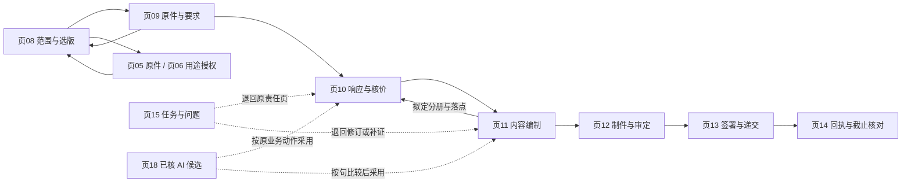

# 智能投标平台分层建设方案

**目标建设方案 · 待实施、待分阶段验收**

产品边界和能力名称见[完整解决方案](./overall-solution.md)。项目立项时，从[四阶段交付与放行总表](#stage-acceptance)查本期依赖、接收人及放行凭据。

## 一、产品层 · 工作入口与验收目标

| 事项 | 归属及适用范围 |
|---|---|
| 租户 | 一个租户就是一家企业。平台按租户提供服务，隔离该企业的数据。 |
| 企业资源 | 宿主企业管理原件、版本及用途授权。跨企业取用须指定接收企业、项目及用途。 |
| 项目 | 项目负责人记录本轮实际选用的版本、资源占用和投标成果。 |

| 工作入口 | 主要使用者与产品结果 | 交给能力层的边界 |
|---|---|---|
| 平台运营工作区 | 运营负责人按租户交付公共能力、定位任务和服务异常 | 平台管理租户状态、公共版本的发布范围及服务记录。企业内容由来源企业决定使用范围 |
| 企业工作区 | 企业有权人指定谁能代表企业投标、哪版企业资源可供谁使用，企业主管协调本企业跨项目的占用 | 代表授权交经办人，资源使用授权和协调决定交项目负责人。企业有权人作出投标决策，由“项目与投标决策”按轮次登记 |
| 项目工作区 | 项目负责人逐项对照应递交清单、企业批准的版本及实际递交记录，追到差异及接手人 | 项目引用正式来源和企业决定，形成自己的基线、响应与制成的文件。文件接收事实取自接收方 |

产品负责人把使用者、结果和外部事实来源交六个分支。每项结果由一个节点主责，多入口引用同一决定。归属冲突或无人接手时，由产品负责人裁定。

责任人用于明确企业责任，不把每个动作限定为人工。授权AI可作业务决定并执行；节点16承担事后审计及纠正关联，审计待办不自动阻断后续。

### 蓝图交付标准

沿用[平台蓝图](./overall-solution.md#bid-project-blueprint)的六分支和 21 个节点。每项交付只在原节点登记，下面的交接字段不另建运行时资源目录。

| 交付项 | 唯一出具方及最低内容 | 接收与验收 |
|---|---|---|
| 能力身份 | 产品负责人交本方案节点号、蓝图真实节点引用、能力含义及主责。 | 场景负责人核对应；可细分交付子节点，仍归原能力验收。不把节点号当 scenarioId。 |
| 交付形态 | 蓝图维护人依 metadata 合同选 module、page、embedded、service 或 content。 | UI-only 不造模型；input/action-only 不伪造记录集；service 表示无页面能力，不指新增服务进程。 |
| 场景与资源 | 配置负责人交公共 owner 已核的场景绑定、已注册资源及字段合同。 | 数据开发人只消费本动作所需绑定；无关节点未交不阻断它。所需绑定缺失，停对应资源调用。 |
| 业务对象 | 原事实主责交企业资源、投标主体、标段轮次、内容修订或原操作的适用身份。 | 函数按对象种类核范围；蓝图节点、菜单项、内容节点和 ClassModel 实例互不替代。 |
| 动作与代码 | 业务负责人交动作定义，开发人交实现符号、输入输出校验器、注册绑定及代码版本。 | 按[动作实现标准](./authoring-submission-specification.md#bid-action-implementation)接收；类型声明、已有函数与实际可调用分别留据。 |
| 流程与退回 | 场景负责人交触发、开工输入、可并行项、条件项、原结果查询及接手人。 | 沿 61 个动作引用判本次路径。事后凭据不成为首次开工条件，缺证不能变成不适用。 |
| 验收与状态 | 原责任人交用例、代码范围、运行环境、实得结果和仍缺的凭据。 | 产品交付负责人按范围登记待建、待验或已验；设计态交付状态不等于业务批准或蓝图发布。 |

蓝图配置复用 [metadata owner](E:/r/sparkproject/packages/data/metadata/src/api/ApplicationFunMan/project-blueprint.ts)。新增或调整设计节点先核既有载体，不由投标应用猜测资源身份。

不可变发布、归档及并发发布属于[可选生命周期能力](E:/r/sparkproject/docs/spark-project-blueprint-lifecycle-handoff.md)。未验证真实端口时保留设计结果，不宣称已发布，也不阻断无此依赖的设计与只读验证。

**从蓝图走到一次实际调用**

| 步骤 | 交接及检查 |
|---|---|
| 设计交接 | 蓝图维护人 → 场景负责人：真实节点引用、能力和必要绑定。运行入口另取授权菜单，前端不从蓝图生成菜单或补权限。 |
| 运行绑定 | 可信宿主 → 业务函数：当前场景绑定及本次业务对象。路径或标题变化不改变资源身份；缺当前绑定不得复用另一页或旧会话的绑定。 |
| 执行交接 | 业务函数 → SPARK API 或已注册函数：确定输入与当前权限，原结果按原请求回读。跨功能由 app/widgets 组装或注入端口。 |
| 结果交接 | 验证人 → 下一业务动作：原结果、验证范围及缺项。采用交编制域，外部办理交原经办人，AI 不另写一套正式状态。 |

注册核验是设计与实施交接，不是给每个页面新增一套元数据就绪查询。运行时继续由原公共 owner 和后端核绑定及权限。

支撑节点按原支撑记录交服务函数；没有对应动作的，不补造编号。输入、结果、权限、执行效果和恢复证据仍按同一交接标准核验。

## 二、能力层 · 21 个节点逐项交接

**节点号**对应[平台蓝图](./overall-solution.md#bid-project-blueprint)的六个分支。**阶段**表示节点首次交付。同一注册模型的不同动作可以由不同节点主办。

本文件的节点 01–21 表示能力归属；动作 01–61 查业务规格，任务 01–15 查第一阶段任务书。交接时同时注明编号种类、具体事项和版本。

**输出与取用**按节点列契约，粗体为输出。一个节点可出具多组事实，每个注册动作的结果只归一组。所有受限读写均核当前请求权限。

**主办动作**链接[业务规格的注册动作](./authoring-submission-specification.md#bid-action-sequence)，**支撑**链接出具人、消费时点与恢复条件。接手方引用原对象及版本，只登记本方决定。

| 编号 · 蓝图分支／能力节点 | 主责人与输入 | 交付物、接收人与核验 | 输出契约及直接取用 | 首次交付阶段 | 主办动作或支撑记录 |
|---|---|---|---|---|---|
| 01 · 平台运营／租户生命周期 | 租户运营负责人依据服务约定及企业身份开通、停用或办理退出 | 企业管理员、运维按生效时点核可用范围。退出时指定接收人按清单接走在途事项 | **身份与授权**。退出交接取协作与复验、办理与运行记录。按批准的范围导出时取来源与选用、项目与成果 | 1 | 支撑 · [支撑记录与恢复条件](#support-01) |
| 02 · 平台运营／公共能力发布 | 平台发布负责人核来源方准予发布的版本、范围和目标企业的服务状态 | 目标企业管理员接发布、换版或撤下记录，按时点查适用范围 | **目录与发布**、来源与选用、身份与授权 | 2 | 支撑 · [支撑记录与恢复条件](#support-02) |
| 03 · 平台运营／服务运行与恢复 | 运维负责人提供原操作查询入口，中断后核恢复点、企业当前服务状态与权限 | 运营接服务恢复记录，有查询权限的经办人接在途清单并按原批次查证 | **办理与运行记录**。恢复取身份与授权、协作与复验。涉及材料用途取来源与选用 | 1 | 支撑 · [支撑记录与恢复条件](#support-03) |
| 04 · 企业资源与授权／投标主体与代表授权 | 企业有权人确认投标法人、代表、委托事项、范围和期限 | 项目负责人接主体依据，经办人接代表授权，按办理时点核人与事项 | **身份与授权**。核主体原件和委托材料取来源与选用，核本项目代表事项取项目与成果 | 1 | 主办 · [09](./authoring-submission-specification.md#bid-action-09)、[27](./authoring-submission-specification.md#bid-action-27)、[55](./authoring-submission-specification.md#bid-action-55) |
| 05 · 企业资源与授权／资源使用授权 | 来源企业的有权人取已登记的资源版本，指定可用方、项目、用途和期限 | 项目负责人接使用决定，用资源版本和办理时点核准用范围或撤销授权记录 | **来源与选用**。核取用人取身份与授权，查申请项目或受限资源调配取项目与成果 | 1 | 主办 · [17](./authoring-submission-specification.md#bid-action-17)、[56](./authoring-submission-specification.md#bid-action-56) |
| 06 · 企业资源与授权／跨项目资源协调 | 宿主企业主管核本企业资源的需求、可用范围和有效占用 | 各项目负责人按各自获准范围接收调配结果，冲突交主管重核 | **项目与成果**、来源与选用、身份与授权 | 2 | 支撑 · [支撑记录与恢复条件](#support-06) |
| 07 · 项目执行／项目与投标决策 | 项目负责人先登记本轮标段、主体及企业投标决策，再引用已核要求和获准资源确定基线 | 编制团队接范围、分工及基线；移交各方接实据与未决，按原任务签收 | **项目与成果**；取身份与授权、来源与选用，移交另取协作与复验、办理与运行记录 | 1 | 主办 · [08](./authoring-submission-specification.md#bid-action-08)、[18](./authoring-submission-specification.md#bid-action-18)、[19](./authoring-submission-specification.md#bid-action-19)、[20](./authoring-submission-specification.md#bid-action-20)、[22](./authoring-submission-specification.md#bid-action-22)、[59](./authoring-submission-specification.md#bid-action-59) |
| 08 · 项目执行／招标依据 | 分析负责人核正式原件、变更及原位；后续通知另核所指事项、允许范围和期限 | 响应人接逐项要求，交付人接阶段义务；后续来件沿原原件和选版链核据 | **来源与选用**。取项目与成果。 查变更影响取协作与复验、办理与运行记录。采用 AI 抽取或查原试次取调用与验证。 | 1 | 主办 · [12](./authoring-submission-specification.md#bid-action-12)、[13](./authoring-submission-specification.md#bid-action-13)、[14](./authoring-submission-specification.md#bid-action-14)、[15](./authoring-submission-specification.md#bid-action-15)、[16](./authoring-submission-specification.md#bid-action-16)、[21](./authoring-submission-specification.md#bid-action-21)、[23](./authoring-submission-specification.md#bid-action-23)、[24](./authoring-submission-specification.md#bid-action-24)、[57](./authoring-submission-specification.md#bid-action-57) |
| 09 · 项目执行／响应与承诺 | 响应负责人按基线逐项组织答复，引用可用证明和有权方的批准 | 编制人按项目内册节点或独立响应接已核答复、规范值、单位、来源及批准范围，再映射本版表栏。 | **项目与成果**。取来源与选用、身份与授权。 分派取协作与复验，担保取办理与运行记录，指南取目录与发布，AI 拟答取调用与验证。 | 1 | 主办 · [25](./authoring-submission-specification.md#bid-action-25)、[26](./authoring-submission-specification.md#bid-action-26)、[28](./authoring-submission-specification.md#bid-action-28)、[29](./authoring-submission-specification.md#bid-action-29)、[30](./authoring-submission-specification.md#bid-action-30)、[31](./authoring-submission-specification.md#bid-action-31)、[34](./authoring-submission-specification.md#bid-action-34)、[35](./authoring-submission-specification.md#bid-action-35)、[36](./authoring-submission-specification.md#bid-action-36)、[37](./authoring-submission-specification.md#bid-action-37) |
| 10 · 项目执行／编制与审定 | 编制负责人把已采用答复映射到同一项目修订的实际页栏，独立附件或平台栏按义务定位。审核人审定该版实件或批准字段。 | 交付负责人接审定范围、版本和填报位置。 同一报价跨册时逐册核实填值及批准版本，单册换模板重核成件，独立平台栏核字段位置及批准值。 | **项目与成果**。取来源与选用、身份与授权。 核阻断取协作与复验，核制作原请求、签后件或提交态取办理与运行记录，公共版本或受控候选取目录与发布、调用与验证。 | 1 | 主办 · [32](./authoring-submission-specification.md#bid-action-32)、[33](./authoring-submission-specification.md#bid-action-33)、[38](./authoring-submission-specification.md#bid-action-38)、[39](./authoring-submission-specification.md#bid-action-39)、[40](./authoring-submission-specification.md#bid-action-40)、[41](./authoring-submission-specification.md#bid-action-41)、[42](./authoring-submission-specification.md#bid-action-42)、[45](./authoring-submission-specification.md#bid-action-45) |
| 11 · 项目执行／交付、递交与对账 | 交付负责人核经审定的文件或独立栏、代表权及阻断项，经办人登记原操作、实发包或字段与渠道凭据 | 项目负责人及归档人分接放行、送达、截止及阶段结果；结果与包内证据分别可查 | **办理与运行记录**，冻结交付清单另归 **项目与成果**。取来源与选用、身份与授权、协作与复验 | 1 | 主办 · [46](./authoring-submission-specification.md#bid-action-46)、[47](./authoring-submission-specification.md#bid-action-47)、[48](./authoring-submission-specification.md#bid-action-48)、[49](./authoring-submission-specification.md#bid-action-49)、[50](./authoring-submission-specification.md#bid-action-50)、[51](./authoring-submission-specification.md#bid-action-51)、[52](./authoring-submission-specification.md#bid-action-52)、[53](./authoring-submission-specification.md#bid-action-53)、[54](./authoring-submission-specification.md#bid-action-54)、[58](./authoring-submission-specification.md#bid-action-58) |
| 12 · 资源与知识／资源版本与出处 | 登记人接来源方交出的原件、出处和版本 | 分析人、企业资源持有人及项目团队共用同一引用，能重开原版或定位缺件 | **来源与选用**。按标段核目录及领取范围取项目与成果 | 1 | 主办 · [10](./authoring-submission-specification.md#bid-action-10)、[11](./authoring-submission-specification.md#bid-action-11) |
| 13 · 资源与知识／知识目录与指南 | 知识维护人按业务问题编排路径，引用准用来源、适用条件和取材方法 | 获准人员按同版指南查到原件，模型负责人接可绑定动作的业务位置 | **目录与发布**、来源与选用、身份与授权 | 2 | 支撑 · [支撑记录与恢复条件](#support-13) |
| 14 · 协作与控制／任务与成果交接 | 域负责人指定任务、责任人、期限和预期成果，交回时引用实际版本 | 下一责任人核目标和成果版本，登记接收或退回，批准引用由业务域提供 | **协作与复验**、项目与成果 | 1 | 支撑 · [支撑记录与恢复条件](#support-14) |
| 15 · 协作与控制／权限消费 | 场景负责人按服务端对当前请求的最终权限落实访问范围 | 各工作区和动作执行方取得本次允许的读写范围及判定依据。代表企业办理仍引用企业出具的具体委托 | **身份与授权** | 1 | 支撑 · [支撑记录与恢复条件](#support-15) |
| 16 · 协作与控制／问题复验与审计关联 | 业务复核人按问题指向的原件、成果或办理事实核修订与新增证据 | 原责任人接退回项，放行人接复验结论。记录可回查目标版本、处置人和销项依据 | **协作与复验**。按问题对象取来源与选用、项目与成果、办理与运行记录、调用与验证。改派复核人时取身份与授权 | 1 | 主办 · [43](./authoring-submission-specification.md#bid-action-43)、[44](./authoring-submission-specification.md#bid-action-44) |
| 17 · AI 编排与验证／模型注册与发现 | 模型负责人交注册定义，知识维护人绑定目录条目，AI 按业务问题查指南并提议选用 | 运行负责人接唯一匹配的实例和函数版本，能反查目录与适用条件 | **目录与发布**，单次选择另归 **调用与验证**。取身份与授权、项目与成果 | 3 | 主办 · [01](./authoring-submission-specification.md#bid-action-01)、[02](./authoring-submission-specification.md#bid-action-02) |
| 18 · AI 编排与验证／动作执行 | 运行负责人收固定输入，核实例、函数版本及派发时有效的授权 | 输入记录负责人接实际发送记录，验证负责人接同一试次的实际返回或未决记录 | **调用与验证**。取目录与发布、身份与授权、来源与选用。 核业务对象取项目与成果，核承办人取协作与复验，核原操作取办理与运行记录。 | 3 | 主办 · [04](./authoring-submission-specification.md#bid-action-04) |
| 19 · AI 编排与验证／输入回读 | 输入记录负责人按已选动作在派发前固定输入，派发后核实际送入函数的值 | 运行负责人接固定输入，验证负责人接同一试次的回读结果及可核范围 | **调用与验证**。取目录与发布、来源与选用、项目与成果、身份与授权，中断后定位取办理与运行记录 | 3 | 主办 · [03](./authoring-submission-specification.md#bid-action-03)、[05](./authoring-submission-specification.md#bid-action-05) |
| 20 · AI 编排与验证／验证与退回 | 验证负责人按动作判据、实际发送的输入、返回与独立依据核验 | 调用域负责人接可采用范围或退回点。采用时将试次引用写入原业务成果，缺证项交原责任域补证复验 | **调用与验证**、目录与发布、身份与授权、来源与选用、项目与成果、协作与复验，核办理事实时取办理与运行记录 | 3 | 主办 · [06](./authoring-submission-specification.md#bid-action-06)、[07](./authoring-submission-specification.md#bid-action-07) |
| 21 · 资源与知识／配置编审与启用 | 配置发布负责人接各责任域的候选、审阅及闭包，核本作用域启停权限 | 运行、解析、制件及复核人接同版配置和影响记录；公共分发另交02，函数定义另交17 | **目录与发布**；取身份与授权、来源与选用、项目与成果、协作与复验；影响已办事项及AI时才取其运行、验证记录 | 2 | 主办 · [60](./authoring-submission-specification.md#bid-action-60)、[61](./authoring-submission-specification.md#bid-action-61) |

各节点负责人向领域架构师交输入出处、输出、接收人及核验方法。消费者各试一笔正常返回与缺项返回，指出下一步和补证人。

跨域记录的凭据及决定人见[七组契约反查表](#contract-register)。缺来源、决定人或接收人的节点，退原主责人补齐。

### 七个支撑节点的记录取用与恢复

消费动作引用出具人的记录、版本、对象、用途和办理时点。迟回凭据另记获知时间，已签署或发送的对象保留原办理事实。

发生变更时沿实际引用找到待办及已用成果。旧版仍有效时留核对依据，效力未查清时暂停受影响部分放行。

| 支撑节点／出具人 | 记录及交接 | 消费动作及使用时点 | 停办、接手及恢复依据 |
|---|---|---|---|
| [租户生命周期](#bid-node-01) 租户运营负责人 | 出具企业服务状态、范围和生效时间，交管理员、权限消费节点和运维。项目负责人在原任务登记退出接收人。 | [20](./authoring-submission-specification.md#bid-action-20) 建立范围时取服务状态。[01](./authoring-submission-specification.md#bid-action-01) 至 [61](./authoring-submission-specification.md#bid-action-61) 的受限请求按当时服务范围验权。 [04](./authoring-submission-specification.md#bid-action-04) 派发、[51](./authoring-submission-specification.md#bid-action-51) 发送及 [52](./authoring-submission-specification.md#bid-action-52) 恢复查询各查当时状态。 | 停用时运行负责人停新作业、挂起未发队列。项目负责人跟踪原批次至企业接收人签收。 恢复凭现行服务状态及本次权限。退出后凭留存件或获准渠道补查，迟回凭据交 [53](./authoring-submission-specification.md#bid-action-53)、[54](./authoring-submission-specification.md#bid-action-54)。 |
| [公共能力发布](#bid-node-02) 平台发布负责人 | 引用来源方准予分发的版本，登记企业范围及生效、撤下时间。企业管理员核范围，知识维护人负责指南原版。 | [01](./authoring-submission-specification.md#bid-action-01) 展示及 [02](./authoring-submission-specification.md#bid-action-02) 按注册名读同版动作指南时核企业。[03](./authoring-submission-specification.md#bid-action-03) 取片段留发布引用，[04](./authoring-submission-specification.md#bid-action-04) 派发前复核。 [33](./authoring-submission-specification.md#bid-action-33) 取公共模板、[36](./authoring-submission-specification.md#bid-action-36) 取公共指南均核分发范围。企业自有资料查企业记录。 | 范围收窄时管理员通知编制、响应及运行负责人，暂停相应取用和待发试次。[39](./authoring-submission-specification.md#bid-action-39) 采用前复核已派发结果。 仅停新分发的，已准用结果可留据沿用。用途已终止的暂停采用。发布重新有效或获准替代后回 [01](./authoring-submission-specification.md#bid-action-01)、[02](./authoring-submission-specification.md#bid-action-02)，输入改变再办 [03](./authoring-submission-specification.md#bid-action-03)。 |
| [服务运行与恢复](#bid-node-03) 运维负责人 | 出具中断范围、最后可证步骤、原试次或原操作线索及恢复时间。经办人留办理记录，签署工具、纸件或接收方提供原凭据。 | [04](./authoring-submission-specification.md#bid-action-04) 派发、[46](./authoring-submission-specification.md#bid-action-46) 签署、[51](./authoring-submission-specification.md#bid-action-51) 发送前核任务状态。恢复时 [05](./authoring-submission-specification.md#bid-action-05)、[06](./authoring-submission-specification.md#bid-action-06) 查原试次，[46](./authoring-submission-specification.md#bid-action-46) 查原签署。 [52](./authoring-submission-specification.md#bid-action-52) 查原递交或撤回，[53](./authoring-submission-specification.md#bid-action-53)、[54](./authoring-submission-specification.md#bid-action-54) 收渠道补证。 | 运维挂起作业，凭独立于故障备份的现行服务状态、权限及所需委托或用途授权交还。 签署经办人查工具或纸件，交 [47](./authoring-submission-specification.md#bid-action-47) 核签后对象。渠道证据交对账人。确证未发且当次条件满足才续发，未决由项目负责人跟踪。 |
| [跨项目资源协调](#bid-node-06) 宿主企业主管 | 出具分配、调整或释放决定，记录资源、限额、时段、项目及生效时间。来源企业授权用途，项目只接本项目决定。 | [17](./authoring-submission-specification.md#bid-action-17) 取受限资源核分配，[25](./authoring-submission-specification.md#bid-action-25) 核拟任时段，[22](./authoring-submission-specification.md#bid-action-22) 纳入基线。[19](./authoring-submission-specification.md#bid-action-19) 退出列待释放占用，由主管核义务和释放时点。 无占用限制的材料凭原用途授权取用。 | 主管将变更分别通知占用及接收项目。冲突范围暂停 [35](./authoring-submission-specification.md#bid-action-35) 资格确认、[45](./authoring-submission-specification.md#bid-action-45) 审定和 [51](./authoring-submission-specification.md#bid-action-51) 递交，已发交 [52](./authoring-submission-specification.md#bid-action-52)、[54](./authoring-submission-specification.md#bid-action-54) 查原批次。 项目负责人核现行分配或释放决定及本项目用途授权，从首次受影响的 [17](./authoring-submission-specification.md#bid-action-17)、[25](./authoring-submission-specification.md#bid-action-25) 或 [22](./authoring-submission-specification.md#bid-action-22) 重核，再复验依赖成果。 |
| [知识目录与指南](#bid-node-13) 知识维护人 | 编审路径、指南、来源与条件，登记条目和注册定义的绑定。模型负责人出具函数定义、版本和验证规则。 | [01](./authoring-submission-specification.md#bid-action-01) 定位指南，[02](./authoring-submission-specification.md#bid-action-02) 核定义与实例，[03](./authoring-submission-specification.md#bid-action-03) 记材料版本，[04](./authoring-submission-specification.md#bid-action-04) 核绑定，[06](./authoring-submission-specification.md#bid-action-06) 凭规则及独立证据验返回，[07](./authoring-submission-specification.md#bid-action-07) 定退回点。 [36](./authoring-submission-specification.md#bid-action-36) 人工据指南起草，登记所用指南和实际来源。 | 换版按旧引用通知使用者和运行负责人。知识维护人修路径或引用，模型负责人补定义或规则，来源企业核用途。 运行负责人核有效指南、可重开的准用来源及绑定。路径或绑定变化回 [01](./authoring-submission-specification.md#bid-action-01)、[02](./authoring-submission-specification.md#bid-action-02)，入参变化回 [03](./authoring-submission-specification.md#bid-action-03)，仅判据变且原试次完整交 [06](./authoring-submission-specification.md#bid-action-06)。 |
| [任务与成果交接](#bid-node-14) 域负责人、协作负责人 | 域负责人分派，协作负责人在原事项登记目标版本、承办人、期限及改派。接收人签收或退回。整改引 43，查询引原操作或待核义务。 | [34](./authoring-submission-specification.md#bid-action-34) 分派后领任务。[36](./authoring-submission-specification.md#bid-action-36) 作答、[44](./authoring-submission-specification.md#bid-action-44) 复验及 [52](./authoring-submission-specification.md#bid-action-52) 补查均核目标。[51](./authoring-submission-specification.md#bid-action-51) 发前核承办人和原发起权。 [54](./authoring-submission-specification.md#bid-action-54) 移交未决清单时登记责任人及下次查询时间。 | 退回、逾期、换版或失权时挂起受影响任务。分派人跟踪新承办人核目标、权限及在途记录并签收，停发旧指令。 已有或疑有外部操作先查原结果。[44](./authoring-submission-specification.md#bid-action-44) 凭整改证据复验同一问题，由业务审核人另行决定放行范围。 |
| [权限消费](#bid-node-15) 场景负责人 | 落实服务端当前请求的权限决定并留可追溯引用。企业有权人另出代表委托，来源企业另出材料用途授权。 | [01](./authoring-submission-specification.md#bid-action-01) 至 [61](./authoring-submission-specification.md#bid-action-61) 的受限读写核本人、企业、对象和用途。[03](./authoring-submission-specification.md#bid-action-03) 固定、[04](./authoring-submission-specification.md#bid-action-04) 派发、[05](./authoring-submission-specification.md#bid-action-05) 回读、[39](./authoring-submission-specification.md#bid-action-39) 采用各查当次权限。 [45](./authoring-submission-specification.md#bid-action-45) 审定、[46](./authoring-submission-specification.md#bid-action-46) 签署、[51](./authoring-submission-specification.md#bid-action-51) 发送、[52](./authoring-submission-specification.md#bid-action-52) 查询各查当次权限。[27](./authoring-submission-specification.md#bid-action-27) 独立确认具体代表事项。 | 收权后停在下一次受影响的读写或派发。项目负责人可改派，场景负责人核实际经办人的当前权限及所需委托、用途授权。 历史动作核当时凭据，现时查阅核本次权限。 |

**支撑验收**逐节点取一笔变动或中断记录，正查引用动作及在途事项。再从恢复动作反查原记录、现行依据与接手人。

旧版沿用须核所问时点的效力，缺证须核受影响动作已暂停。原任务留责任人、下次查询或升级时间及交接状态。

签收查任务交接，服务恢复查运维观察，销项查业务复验，送达查指定接收方。各方只对自己出具的事实负责。

## 三、对象与契约层 · 固定各节点交换的事实

| 判定步骤 | 经办要求 |
|---|---|
| 登记 | 有权方登记事实。银行、商务审批或交易平台已有原始记录时，经办人留原件或可回查凭据。 |
| 引用 | 接手人保留原记录、版本及适用范围，只登记本环节的决定或独立观察。 |
| 比对 | 对齐企业、标段、对象或操作、事项和所问时点。分别记事件生效及本方获知时间。 |
| 裁定 | 同一事项凭据相斥时，由下表的事实责任人核生效、撤销或替代关系。未核清的范围暂停放行。 |

| 契约组／首次启用 | 记录及出具人 | 消费时点和冲突裁定 | 沿用、退回及未决责任 |
|---|---|---|---|
| **身份与授权**／一 | 平台记服务状态，企业有权人出代表委托，服务端判本次访问。[09](./authoring-submission-specification.md#bid-action-09) 核主体，[27](./authoring-submission-specification.md#bid-action-27) 按事项、对象及时点核委托。 | 读取、派发核访问，签署、递交、撤回另核代表权。可读但无委托时暂停代办，由企业授权负责人向委托方核实。 | 先后不明时，授权负责人补生效依据，经办人补办理时间。已办核当时凭据，撤权停新动作。 项目负责人向有权接手人交接，重核访问、委托和办理窗口。 |
| **来源与选用**／一 | 登记人固定原版和出处，分析人核正式条项与变更。来源企业出用途决定，[56](./authoring-submission-specification.md#bid-action-56)登记，[17](./authoring-submission-specification.md#bid-action-17)核取用；[22](./authoring-submission-specification.md#bid-action-22)记项目选版。 | 确定条款、取材或选版时核范围。指南或基线与原文相抵触，分析人核正式原件、替换关系和生效条件。用途争议交来源企业。 | [23](./authoring-submission-specification.md#bid-action-23) 查旧字段依赖及新增义务。旧版适用可沿用，新依据同值须记比对结论。改变取值或授权退首次使用处。 项目负责人收影响清单，已发送的交对账人核原批次。 |
| **项目与成果**／一 | [22](./authoring-submission-specification.md#bid-action-22) 记项目基线与选版。商务有权人原处批准报价，[29](./authoring-submission-specification.md#bid-action-29) 读取、[30](./authoring-submission-specification.md#bid-action-30) 记准用事实版本。 [39](./authoring-submission-specification.md#bid-action-39) 由有权人采用修订，[45](./authoring-submission-specification.md#bid-action-45) 由审核人审定，[48](./authoring-submission-specification.md#bid-action-48) 由交付负责人冻结清单。 | 编制取批准值，[42](./authoring-submission-specification.md#bid-action-42) 读实际位置。不符时商务核原批准，编制核所制文件，审核人判重审范围。已提交的同批值由对账人据实件或提交态核实。 | 范围、输入、用途及批准均适用可沿用。换版由项目负责人定基线，内容或关键字段变更交编制修订、审核人重审。 仅改派且成果未变，接手人核权限和版本后续办。 |
| **协作与复验**／一 | [34](./authoring-submission-specification.md#bid-action-34) 分到条款及责任位置，协作负责人记签收、改派。[43](./authoring-submission-specification.md#bid-action-43) 在同一目标立问题，[44](./authoring-submission-specification.md#bid-action-44) 凭改后版本及独立证据复验。 | 领任务核现承办人。[45](./authoring-submission-specification.md#bid-action-45) 审定、[48](./authoring-submission-specification.md#bid-action-48) 冻结及 [51](./authoring-submission-specification.md#bid-action-51) 发送各查适用阻断项。旧版已销项而新版有差异，由复核人重核受影响位置。 | 仅改派沿用原问题、目标及获准结果，停发旧指令。目标变化在原事项记新目标，退受影响部分复验。 分派人跟到签收。跨域无人接，项目负责人指派并定下次升级时间。 |
| **办理与运行记录**／一 | 签署、封装、发送各记原操作与实际对象。[52](./authoring-submission-specification.md#bid-action-52) 查原操作，[53](./authoring-submission-specification.md#bid-action-53) 归集接收方事件，[54](./authoring-submission-specification.md#bid-action-54) 按本标规则记截止组合。运维登记中断、恢复观察。 | 文件核冻结清单及同批成员，独立栏核获准值及同次实际字段。已发但渠道未确认，分别记发送事实与接收待核。 接收核指定渠道凭据，截止核规则及事件生效时间。渠道凭据冲突交指定接收方。 | 原批次保留供查历史，迟回凭据注明获知时间。有查询权的经办人查原操作，未决停重发。对账人仅修订有新证据的结论，项目负责人跟踪未决义务。 |
| **目录与发布**／二 | 知识维护人编审指南、登记绑定，模型负责人登记定义、版本和验证规则。发布负责人据来源方准许的分发范围登记发布版本；节点21登记业务配置的启停与作用域指针。 | 查目录、直接选函数、取公共模板均核分发范围，派发前核绑定。目录可见而原件未授权时暂停取材，知识维护人核路径，来源企业定用途。 | 仅停新分发，业务域可核据沿用已获准成果。用途失效停采用。路径或绑定退 [01](./authoring-submission-specification.md#bid-action-01)、[02](./authoring-submission-specification.md#bid-action-02)，输入改变退 [03](./authoring-submission-specification.md#bid-action-03)。发布范围不明交发布负责人。 |
| **调用与验证**／三 | 运行负责人记试次和函数版本，输入记录负责人固定待发值并回读实发。原返回归对应试次，验证人逐字段核来源、依赖与范围。 业务有权人把采用决定记入业务成果。签署及送达归办理记录。 | [06](./authoring-submission-specification.md#bid-action-06) 验原调用。AI 抽取交 16 核定，混编交 [37](./authoring-submission-specification.md#bid-action-37) 核选用内容，38 复用对应证据，[39](./authoring-submission-specification.md#bid-action-39) 采用另核权限与业务选择。 缺业务批准交业务有权人，工具成功而渠道未决由经办人查原操作。 | 输入、返回及判据仍适用可沿用验证。仅判据变且原试次完整，验证人重做 [06](./authoring-submission-specification.md#bid-action-06)。入参或绑定变化另开关联试次。 迟回归原试次。[07](./authoring-submission-specification.md#bid-action-07) 指出退回点，调用域负责人跟踪受影响成果。 |

事实准用统一按[原版本与本次使用](./authoring-submission-specification.md#bid-source-use)核范围、依赖和时限。材料许可、举证资格与AI依赖分别判断；历史已办不等于当前可用。

节点12交[受控字段原版](./authoring-submission-specification.md#bid-controlled-field)，05交用途决定，09交事实及原核定引用，10接固定解析。页05、06、10–13及18复用同一记录。

**契约反查**分“出”和“取”。“出”含原件核读产生的结果，“取”列其余直接引用。组内再次取用见动作输入，连续编号含两端。

“身份与授权”适用于全部受限请求。表内只列直接引用。“目录与发布”“调用与验证”按实际启用的分支取用。

动作输入条件是依赖定义的原处，反向清单据此生成；实际变更影响另核原请求所用版本。接收方摘要不作完整消费者清单，避免重复维护和漏派，见[引用规则](./authoring-submission-specification.md#bid-reference-timing)。

| 契约组 | 能力节点（第二节编号） | 注册动作（业务规格编号） |
|---|---|---|
| [身份与授权](#bid-contract-01) | 出 [01](#bid-node-01)、[04](#bid-node-04)、[15](#bid-node-15) 取 [02](#bid-node-02)–[03](#bid-node-03)、[05](#bid-node-05)–[07](#bid-node-07)、[09](#bid-node-09)–[11](#bid-node-11)、[13](#bid-node-13)、[16](#bid-node-16)–[21](#bid-node-21) | 出 [09](./authoring-submission-specification.md#bid-action-09)、[27](./authoring-submission-specification.md#bid-action-27)、[55](./authoring-submission-specification.md#bid-action-55) 取 [01](./authoring-submission-specification.md#bid-action-01)–[05](./authoring-submission-specification.md#bid-action-05)、[17](./authoring-submission-specification.md#bid-action-17)–[20](./authoring-submission-specification.md#bid-action-20)、[22](./authoring-submission-specification.md#bid-action-22)、[25](./authoring-submission-specification.md#bid-action-25)、[29](./authoring-submission-specification.md#bid-action-29)–[31](./authoring-submission-specification.md#bid-action-31)、[35](./authoring-submission-specification.md#bid-action-35)、[39](./authoring-submission-specification.md#bid-action-39)、[44](./authoring-submission-specification.md#bid-action-44)–[47](./authoring-submission-specification.md#bid-action-47)、[51](./authoring-submission-specification.md#bid-action-51)–[52](./authoring-submission-specification.md#bid-action-52)、[56](./authoring-submission-specification.md#bid-action-56)–[61](./authoring-submission-specification.md#bid-action-61) |
| [来源与选用](#bid-contract-02) | 出 [05](#bid-node-05)、[08](#bid-node-08)、[12](#bid-node-12) 取 [01](#bid-node-01)–[04](#bid-node-04)、[06](#bid-node-06)–[07](#bid-node-07)、[09](#bid-node-09)–[11](#bid-node-11)、[13](#bid-node-13)、[16](#bid-node-16)、[18](#bid-node-18)–[21](#bid-node-21) | 出 [10](./authoring-submission-specification.md#bid-action-10)–[17](./authoring-submission-specification.md#bid-action-17)、[21](./authoring-submission-specification.md#bid-action-21)、[23](./authoring-submission-specification.md#bid-action-23)–[24](./authoring-submission-specification.md#bid-action-24)、[56](./authoring-submission-specification.md#bid-action-56)–[57](./authoring-submission-specification.md#bid-action-57) 取 [03](./authoring-submission-specification.md#bid-action-03)–[04](./authoring-submission-specification.md#bid-action-04)、[06](./authoring-submission-specification.md#bid-action-06)–[09](./authoring-submission-specification.md#bid-action-09)、[18](./authoring-submission-specification.md#bid-action-18)–[19](./authoring-submission-specification.md#bid-action-19)、[22](./authoring-submission-specification.md#bid-action-22)、[25](./authoring-submission-specification.md#bid-action-25)–[28](./authoring-submission-specification.md#bid-action-28)、[30](./authoring-submission-specification.md#bid-action-30)–[51](./authoring-submission-specification.md#bid-action-51)、[54](./authoring-submission-specification.md#bid-action-54)–[55](./authoring-submission-specification.md#bid-action-55)、[58](./authoring-submission-specification.md#bid-action-58)–[61](./authoring-submission-specification.md#bid-action-61) |
| [项目与成果](#bid-contract-03) | 出 [06](#bid-node-06)–[07](#bid-node-07)、[09](#bid-node-09)–[11](#bid-node-11) 取 [01](#bid-node-01)、[04](#bid-node-04)–[05](#bid-node-05)、[08](#bid-node-08)、[12](#bid-node-12)、[14](#bid-node-14)、[16](#bid-node-16)–[21](#bid-node-21) | 出 [08](./authoring-submission-specification.md#bid-action-08)、[18](./authoring-submission-specification.md#bid-action-18)–[20](./authoring-submission-specification.md#bid-action-20)、[22](./authoring-submission-specification.md#bid-action-22)、[25](./authoring-submission-specification.md#bid-action-25)–[26](./authoring-submission-specification.md#bid-action-26)、[28](./authoring-submission-specification.md#bid-action-28)–[42](./authoring-submission-specification.md#bid-action-42)、[45](./authoring-submission-specification.md#bid-action-45)、[48](./authoring-submission-specification.md#bid-action-48)、[59](./authoring-submission-specification.md#bid-action-59) 取 [02](./authoring-submission-specification.md#bid-action-02)–[04](./authoring-submission-specification.md#bid-action-04)、[06](./authoring-submission-specification.md#bid-action-06)–[07](./authoring-submission-specification.md#bid-action-07)、[10](./authoring-submission-specification.md#bid-action-10)、[13](./authoring-submission-specification.md#bid-action-13)、[17](./authoring-submission-specification.md#bid-action-17)、[23](./authoring-submission-specification.md#bid-action-23)–[24](./authoring-submission-specification.md#bid-action-24)、[27](./authoring-submission-specification.md#bid-action-27)、[43](./authoring-submission-specification.md#bid-action-43)–[44](./authoring-submission-specification.md#bid-action-44)、[46](./authoring-submission-specification.md#bid-action-46)–[47](./authoring-submission-specification.md#bid-action-47)、[49](./authoring-submission-specification.md#bid-action-49)–[58](./authoring-submission-specification.md#bid-action-58)、[60](./authoring-submission-specification.md#bid-action-60)–[61](./authoring-submission-specification.md#bid-action-61) |
| [协作与复验](#bid-contract-04) | 出 [14](#bid-node-14)、[16](#bid-node-16) 取 [01](#bid-node-01)、[03](#bid-node-03)、[07](#bid-node-07)–[11](#bid-node-11)、[18](#bid-node-18)、[20](#bid-node-20)–[21](#bid-node-21) | 出 [43](./authoring-submission-specification.md#bid-action-43)–[44](./authoring-submission-specification.md#bid-action-44) 取 [04](./authoring-submission-specification.md#bid-action-04)、[07](./authoring-submission-specification.md#bid-action-07)、[23](./authoring-submission-specification.md#bid-action-23)、[29](./authoring-submission-specification.md#bid-action-29)、[34](./authoring-submission-specification.md#bid-action-34)、[36](./authoring-submission-specification.md#bid-action-36)、[45](./authoring-submission-specification.md#bid-action-45)–[46](./authoring-submission-specification.md#bid-action-46)、[48](./authoring-submission-specification.md#bid-action-48)、[51](./authoring-submission-specification.md#bid-action-51)–[54](./authoring-submission-specification.md#bid-action-54)、[59](./authoring-submission-specification.md#bid-action-59)–[61](./authoring-submission-specification.md#bid-action-61) |
| [办理与运行记录](#bid-contract-05) | 出 [03](#bid-node-03)、[11](#bid-node-11) 取 [01](#bid-node-01)、[07](#bid-node-07)–[10](#bid-node-10)、[16](#bid-node-16)、[18](#bid-node-18)–[21](#bid-node-21) | 出 [46](./authoring-submission-specification.md#bid-action-46)–[47](./authoring-submission-specification.md#bid-action-47)、[49](./authoring-submission-specification.md#bid-action-49)–[54](./authoring-submission-specification.md#bid-action-54)、[58](./authoring-submission-specification.md#bid-action-58) 取 [04](./authoring-submission-specification.md#bid-action-04)–[07](./authoring-submission-specification.md#bid-action-07)、[13](./authoring-submission-specification.md#bid-action-13)、[20](./authoring-submission-specification.md#bid-action-20)、[23](./authoring-submission-specification.md#bid-action-23)、[26](./authoring-submission-specification.md#bid-action-26)、[40](./authoring-submission-specification.md#bid-action-40)–[44](./authoring-submission-specification.md#bid-action-44)、[48](./authoring-submission-specification.md#bid-action-48)、[57](./authoring-submission-specification.md#bid-action-57)、[59](./authoring-submission-specification.md#bid-action-59)、[61](./authoring-submission-specification.md#bid-action-61) |
| [目录与发布](#bid-contract-06) | 出 [02](#bid-node-02)、[13](#bid-node-13)、[17](#bid-node-17)、[21](#bid-node-21) 取 [08](#bid-node-08)–[10](#bid-node-10)、[16](#bid-node-16)、[18](#bid-node-18)–[20](#bid-node-20) | 出 [60](./authoring-submission-specification.md#bid-action-60)–[61](./authoring-submission-specification.md#bid-action-61) 取 [01](./authoring-submission-specification.md#bid-action-01)–[04](./authoring-submission-specification.md#bid-action-04)、[06](./authoring-submission-specification.md#bid-action-06)、[15](./authoring-submission-specification.md#bid-action-15)–[16](./authoring-submission-specification.md#bid-action-16)、[33](./authoring-submission-specification.md#bid-action-33)、[36](./authoring-submission-specification.md#bid-action-36)–[37](./authoring-submission-specification.md#bid-action-37)、[39](./authoring-submission-specification.md#bid-action-39)–[40](./authoring-submission-specification.md#bid-action-40)、[43](./authoring-submission-specification.md#bid-action-43)–[44](./authoring-submission-specification.md#bid-action-44) |
| [调用与验证](#bid-contract-07) | 出 [17](#bid-node-17)–[20](#bid-node-20) 取 [08](#bid-node-08)–[10](#bid-node-10)、[16](#bid-node-16)、[21](#bid-node-21) | 出 [01](./authoring-submission-specification.md#bid-action-01)–[07](./authoring-submission-specification.md#bid-action-07) 取 [15](./authoring-submission-specification.md#bid-action-15)–[16](./authoring-submission-specification.md#bid-action-16)、[23](./authoring-submission-specification.md#bid-action-23)、[36](./authoring-submission-specification.md#bid-action-36)–[39](./authoring-submission-specification.md#bid-action-39)、[43](./authoring-submission-specification.md#bid-action-43)–[44](./authoring-submission-specification.md#bid-action-44)、[60](./authoring-submission-specification.md#bid-action-60)–[61](./authoring-submission-specification.md#bid-action-61) |

| 交给场景负责人 | 可核结果 |
|---|---|
| 沿用与冲突 | 每组各取一笔沿用及冲突或缺证样本。原记录正查引用成果，当前结论反查决定人、原据、范围及生效和获知时间。 |
| 未决交接 | 保留已证事实。缺证部分挂回原义务、问题或操作，记缺项、取证人及下次查询或升级时间，由原有权人定案。 |
| 跟踪签收 | 项目负责人跟踪放行事项。仅涉公共发布、资源调配或模型定义的，由相应节点负责人跟踪。 |

## 四、场景与运行层 · 组织可执行、可验证的工作

| 场景责任方 | 怎样组合上层契约 | 向建设与验收团队交什么 |
|---|---|---|
| 平台运营负责人 | 以租户范围查看发布状态、服务记录、待对账的办理引用 | 平台发布与运行场景、租户隔离检查、恢复后交还业务经办人的清单 |
| 企业工作区负责人 | 结合身份与授权、来源与选用、项目与成果，向各有权人提供所需依据 | 代表授权、资源使用授权和跨项目资源协调三个场景，明确各自的决定人和接收项目 |
| 项目工作区负责人 | 以项目身份串联依据、成果、协作复验和外部办理记录 | 五个项目域的交接路径，以及应递交清单、企业批准的版本及实际递交记录之间的核对路径 |
| AI 作业负责人 | 在已授权调用域按目录选实例和函数，固定输入、执行并回读。规则函数独立复算，AI 候选按契约逐项核验。 | 交可回放的调用记录、候选及可核范围。未决结果附退回点及业务接手人。 |

| 场景交付项 | 实施约束 |
|---|---|
| 场景合同 | 需数据、输入或动作的节点列企业资源、必要输入、允许动作及返回。纯导航节点可不设数据空间。 |
| 资源解析 | 消费公共 owner 已核的场景绑定与 metaName；应用级资源由 runtime 解析。不从路由、标题或模型名猜测身份。 |
| 数据访问 | 业务通过根 `createSparkRuntime` 使用 SPARK API。 |
| 权限与菜单 | 前端消费 canonical `queryContext`，运行入口取当前会话菜单。 |

场景负责人交入口、资源、动作、接手人，以及正常、无权、缺证三种预期。实施和验收负责人按[动作引用的四种时点](./authoring-submission-specification.md#bid-reference-timing)核开工与放行。

| 样本变化 | 验收人核什么 |
|---|---|
| 拿掉凭据 | 分别移去择一路径的已选凭据、同时必交项中的一项。核缺项能否保留并指派补证。 |
| 改动正式依据 | 激活原未选或不适用的分支，按新条件重核。参见[条件分支的判定与换版](./authoring-submission-specification.md#bid-branch-rules)。 |
| 现场条件缺失 | 实施负责人登记缺绑定或外部条件的受影响范围，按第五节凭据判定是否放行。 |

### 蓝图与动作如何扩展

当前 6 个模块、21 个能力子模块、47 个 ClassModel、61 个动作及 19 个页面是本版基线，不是产品数量上限。

按实际业务扩展，不能为保持数量把独立职责塞进不相干节点。

优先复用职责相同的函数和记录。新增页面或通用技术端口不自动新增业务动作；确有新的业务决定、权威事实或独立交付时，再增补相应节点与动作。

| 变化 | 由谁判断与交付 | 本版放行前必须核什么 |
|---|---|---|
| 同职责的新入口或呈现 | 页面负责人复用原业务函数，登记页面形态和读写范围。 | 多入口引用同一事实；不复制审批、核价或办理记录。 |
| 新业务动作或方法 | 业务负责人交触发、输入、效果、输出、校验及接手；模型负责人补源声明。 | 存在真实需求且原动作无法准确承接；补原结果查询、当前权限及失败分支。 |
| 新能力子模块或模块 | 产品负责人界定独立责任、事实归属及上下游，交场景与页面负责人。 | 新输出有人接、开工无循环；不把事后凭据当首次输入，不以页面数量造资源。 |
| 新模型或字段合同 | 原 owner 修改源声明和版本，通过编译生成定义、指南及验证映射。 | 新旧调用分别绑定各自版本；旧记录缺字段留待核，不补造历史依据。 |
| 契约归属变化 | 原事实责任方及接收方明确迁移、引用、状态含义与停用旧入口。 | 既有七组优先复用；需要新组时说明独立事实边界，防重复登记和双重判定。 |
| 拆分、合并或退役 | 产品负责人交旧新标识对应、引用迁移和历史查询方案。 | 不重用旧标识或按数组下标定位；原试次、修订及回执继续可解释。 |
| 目录和验收更新 | 交付负责人同步节点、动作、模型、契约、阶段、页面及用例覆盖。 | 按本次目录核覆盖；不得在产品实现硬编码 20／54 上限，也不靠维持旧数量宣称零回归。 |

每次变更留本版范围及依据。原有有效要求继续验证；被业务变更替代的预期说明原因并留历史版本，新增项补正常、缺证、换版及恢复条件后才进入交付。

### 模块、子模块与页面

六个蓝图分支作为模块，21 个能力节点作为子模块。页面是面向办理人的工作入口；同一子模块可分屏，多个子模块可在一页协作。

本节定 19 个逻辑页面，编号只用于设计和验收。实际路由、菜单和嵌入方式由当前授权入口交付，不新增运行时页面目录或按页造数据空间。

| 模块 | 子模块仍用原能力节点 | 页面组合 |
|---|---|---|
| 平台运营 | 01 租户生命周期、02 公共能力发布、03 服务运行与恢复 | 页01、页02、页03；平台宿主承接，投标应用按权引用结果。 |
| 企业资源与授权 | 04 投标主体与代表授权、05 资源使用授权、06 跨项目资源协调 | 页04、页06、页07；资料原版从页05引用。 |
| 项目执行 | 07 项目与投标决策、08 招标依据、09 响应与承诺、10 编制与审定、11 交付、递交与对账 | 页08至页14；10 分编制、制件审定两页，11 分签署递交、回执核对两页。 |
| 资源与知识 | 12 资源版本与出处、13 知识目录与指南、21 配置编审与启用 | 页05、页16、页19；页09嵌原件登记，同用12的版本记录。 |
| 协作与控制 | 14 任务与成果交接、15 权限消费、16 问题复验与审计关联 | 页15分任务、问题两个视图；15 嵌入各页，不新建另一套授权管理页。 |
| AI 编排与验证 | 17 模型注册与发现、18 动作执行、19 输入回读、20 验证与退回 | 页17检查并登记编译产物；页18串联发现、输入、执行和核验，业务采用仍回原业务页。 |

**页面清单与实施位置**

下列均为目标页面合同。现有入口仅证明可复用的页面或组件位置；本表的新增业务区域、字段及命令仍须按各自条件实施、验收。

| 页面与主要使用人 | 子模块／阶段 | 页面内部区域 | 复用位置与待建交付 |
|---|---|---|---|
| 页01 企业服务 · 平台运营人 | 01／一期，四期扩展 | 企业列表、服务范围、生效历史、退出交接 | 平台宿主交服务状态与退出办理入口；本应用只接获准状态和未决事项链接。 |
| 页02 公共能力发布 · 发布人 | 02／二期 | 来源版本、目标企业、分发许可、生效及撤下记录 | 由平台发布区承接；不把工艺库“发布”直接解释为跨企业分发。 |
| 页03 服务与未决办理 · 运维及经办人 | 03／一期，四期扩展 | 故障范围、原操作索引、查询进展、接手与恢复 | 平台运行区交恢复入口；只展示权限内的操作摘要，业务核实回页13、14、18。 |
| 页04 企业身份与代表授权 · 企业有权人 | 04／一期 | 法人依据、代表委托、事项范围、期限与撤销 | 企业工作区补业务授权区。现有[企业组织页](E:/r/sparkproject/apps/smart-bid-demo/src/pages/EnterpriseOrganizationPage.vue)为 AI 组织，不代替法定主体或代表委托。 |
| 页05 企业资料与版本 · 资料登记人 | 12／一期 | 资料目录、原件预览、版本历史、出处及有效期 | 复用[企业资料页](E:/r/sparkproject/apps/smart-bid-demo/src/pages/EnterpriseAssetsPage.vue)；补不可混淆的原件版本与容量回读。用途决定交页06。 |
| 页06 资料用途授权 · 来源企业有权人 | 05／一期 | 申请队列、资源版本、接收企业与用途、期限及撤销 | 在企业资料功能内交独立授权区；项目入口只发申请、查本项目获准范围。 |
| 页07 跨项目资源协调 · 企业主管 | 06／二期 | 本企业资源、时段及限额、占用冲突、调配与释放 | 企业工作区新增协调视图，复用原授权和版本记录，不重建资源副本。 |
| 页08 项目目录与投标策划 · 项目负责人 | 07／一期 | 项目列表、主体轮次标段、阶段前置、决策分工、依据选版、移交范围 | 复用[项目目录](E:/r/sparkproject/apps/smart-bid-demo/src/pages/ProjectCenterPage.vue)与[工作台](E:/r/sparkproject/apps/smart-bid-demo/src/pages/BidProjectWorkbenchPage.vue)；列表、详情同属本页合同。 |
| 页09 招标原件与要求 · 招标分析人 | 08、12／一期 | 领取清单、原件页栏、要求列表、修改对照、阶段义务及后续来件 | 复用[分析页](E:/r/sparkproject/apps/smart-bid-demo/src/pages/TenderAnalysisCenterPage.vue)，嵌原件登记组件；补正式修改与适用范围判定。 |
| 页10 响应与商务核价 · 作答及商务人员 | 09／一期 | 资格技术响应、证明、报价复算、批准事实、担保办理 | 复用[证明页](E:/r/sparkproject/apps/smart-bid-demo/src/pages/ProjectEvidencePage.vue)的资格区；技术、商务按对象独立取数，不能靠整项目快照判齐。 |
| 页11 内容编制 · 编制人与采用人 | 10／一期 | 项目内容树、正文编辑、字段绑定、原文侧栏、候选差异 | 复用[编制入口](E:/r/sparkproject/apps/smart-bid-demo/src/pages/AuthoringStudioPage.vue)与当前内容工作区；补项目级修订、按句预演及采用查询。 |
| 页12 制件与审定 · 制作及审核人 | 10／一期 | 制作指令、模板版本、实件列表、实填反查、审核覆盖 | 复用[审核入口](E:/r/sparkproject/apps/smart-bid-demo/src/pages/ReviewCenterPage.vue)和制件能力；现有当前文档审核尚未接通，不能把旧项目快照移作审定。 |
| 页13 签署与递交 · 交付及经办人 | 11／一期，四期扩展 | 递交义务、审定实件、签署覆盖、封装清单、办理窗口 | 在交付功能分出办理区，接原操作查询。人工外部办理也登记同样的文件与凭据身份。 |
| 页14 回执与截止核对 · 对账人 | 11／一期，四期扩展 | 应交清单、批次与事件、有效组合、开标评审引用、正式结果 | 在交付功能分出只读核对与结论登记区；沿原批次补证，不复制一套递交队列。 |
| 页15 任务与问题 · 承办及复核人 | 14、16／一期 | 待办、目标版本、签收改派、问题证据、复验覆盖 | 复用[任务面板](E:/r/sparkproject/apps/smart-bid-demo/src/widgets/project/TaskRecordPanel.vue)；任务完成与问题复验分别由原职责出具。 |
| 页16 知识目录与指南 · 知识维护人 | 13／二期 | 目录树、适用条件、原文引用、指南版本及换版影响 | 复用[企业知识页](E:/r/sparkproject/apps/smart-bid-demo/src/pages/EnterpriseKnowledgePage.vue)；检索结果、编审指南及分发许可分别留据。 |
| 页17 ClassModel 登记 · 模型负责人 | 17／三期 | 编译产物版本、只读签名与指南、校验器、真实实例绑定 | 可复用[工艺目录](E:/r/sparkproject/apps/smart-bid-demo/src/pages/ProcessTemplateCatalogPage.vue)展示能力；工艺定义不能代替 ClassModel 定义，登记写回原 owner。 |
| 页18 AI 作业与核验 · 运行及验证人 | 17、18、19、20／三期 | 目录选用、固定输入、逐笔调用、实发比对、返回核验 | 复用[项目工单页](E:/r/sparkproject/apps/smart-bid-demo/src/pages/ProjectAiProcessPage.vue)；补ClassModel工具往返及字段验证，按返回用途交原业务页。 |
| 页19 配置编审与启用 · 配置发布人 | 21／二期 | 配置种类、作用域、候选差异、闭包与审阅、启停指针、原发布查询 | 待建配置编审区，复用原配置版本及指针；不把工艺候选或编译类型登记当作配置已启用。 |

**每页读什么、办什么、交给谁**

“动作”均引用本版 61 个动作卡。本表为每个动作指定一个主办页面；原动作卡给同一操作的输入、输出、权限和换版停点。其他页引用结果或跳转，不重复登记。

支撑命令按下表及[函数合同](#page-support-functions)交付。人工直调与AI工具调用按[接线标准](./authoring-submission-specification.md#bid-operation-binding)共用函数；定义管理另走页17的管理端口。

| 页面 | 进入输入与必须看见的字段 | 主办动作或支撑命令 | 结果接收人与停点 |
|---|---|---|---|
| 页01 | 企业身份、服务约定；范围、生效时点、状态及退出接收人。 | 支撑命令：开通、停用、恢复、登记退出交接。 | 企业管理员与页03接状态；退出未决必须有人签收，停用不抹除历史。 |
| 页02 | 来源版本、分发许可、目标企业服务状态；有效期及撤下范围。 | 支撑命令：发布、调整范围、撤下。 | 页16、17及接收企业接发布引用；缺分发许可停发布，交来源方决定。 |
| 页03 | 原操作或试次、故障范围、最后可证步骤；当前权限及接手人。 | 支撑命令：挂起、查询移交、核恢复条件。 | 原业务经办人接未决；未知不重发，缺原标识继续查证，不生成替代操作。 |
| 页04 | 企业身份、原件版本、代表和办理事项、期限；当前经办权限。 | 动作：[09](./authoring-submission-specification.md#bid-action-09)、[27](./authoring-submission-specification.md#bid-action-27)、[55](./authoring-submission-specification.md#bid-action-55)。 | 页08、13接身份及委托核验；缺证交企业授权人，不因能登录而视为有代表权。 |
| 页05 | 当前企业、资料目录与原件；版本、出处、有效期、保存与回读状态。 | 支撑命令：登记企业原件、补出处、查询历史。 | 页06、07、10引用原版；保存失败保留待核，不能用预览或解析成功代替归档。 |
| 页06 | 页08申请范围、页05资源版本；来源及接收企业、项目、用途、期限。 | 动作：[17](./authoring-submission-specification.md#bid-action-17)、[56](./authoring-submission-specification.md#bid-action-56)。 | 页08选版、页10用证；撤销后通知实际引用方，已发材料转页14查原批次。 |
| 页07 | 本企业资源、既有授权、项目需求、时段限额及占用。 | 支撑命令：分配、调整、释放。 | 各项目仅接本方调配结果；冲突交主管，未证明义务结束不得释放。 |
| 页08 | 当前企业及项目；投标主体、成员、轮次、标段、阶段及适用前置结果、决定、分工、依据版本。 | 动作：[08](./authoring-submission-specification.md#bid-action-08)、[18](./authoring-submission-specification.md#bid-action-18)、[19](./authoring-submission-specification.md#bid-action-19)、[20](./authoring-submission-specification.md#bid-action-20)、[22](./authoring-submission-specification.md#bid-action-22)、[59](./authoring-submission-specification.md#bid-action-59)。| 页06先接范围，页10、11接基线；移交时各责任人接实据与未决。无未来结果不阻断先行准备。 |
| 页09 | 来源目录、原件版本、页栏、修改发布与生效时间；要求及递交条件。 | 动作：[10](./authoring-submission-specification.md#bid-action-10)、[11](./authoring-submission-specification.md#bid-action-11)、[12](./authoring-submission-specification.md#bid-action-12)、[13](./authoring-submission-specification.md#bid-action-13)、[14](./authoring-submission-specification.md#bid-action-14)、[15](./authoring-submission-specification.md#bid-action-15)、[16](./authoring-submission-specification.md#bid-action-16)、[21](./authoring-submission-specification.md#bid-action-21)、[23](./authoring-submission-specification.md#bid-action-23)、[24](./authoring-submission-specification.md#bid-action-24)、[57](./authoring-submission-specification.md#bid-action-57)。| 页08选依据，页10接响应，页13、14接规则。后续通知可先收件计时，缺原包只停依赖该包的结论。 |
| 页10 | 本轮基线、原要求、册件或独立分工及落点；答复、证明、规范值、单位、规则与批准。 | 动作：[25](./authoring-submission-specification.md#bid-action-25)、[26](./authoring-submission-specification.md#bid-action-26)、[28](./authoring-submission-specification.md#bid-action-28)、[29](./authoring-submission-specification.md#bid-action-29)、[30](./authoring-submission-specification.md#bid-action-30)、[31](./authoring-submission-specification.md#bid-action-31)、[34](./authoring-submission-specification.md#bid-action-34)、[35](./authoring-submission-specification.md#bid-action-35)、[36](./authoring-submission-specification.md#bid-action-36)、[37](./authoring-submission-specification.md#bid-action-37)。 | 页11接已核响应，页08选事实版；无批准保留试算，事实缺项交原责任人。 |
| 页11 | 策划接阶段及格式；采用接统一目标、固定头、基线、草稿或候选和已核答复。独立响应不要求册节点。 | 动作：[32](./authoring-submission-specification.md#bid-action-32)、[33](./authoring-submission-specification.md#bid-action-33)、[38](./authoring-submission-specification.md#bid-action-38)、[39](./authoring-submission-specification.md#bid-action-39)。 | 页12接已采用修订；预演后换头退38，采用未知交页03补查，不能按草稿出正式件。 |
| 页12 | 文件接原制作请求、修订、模板或原生件版、实件与沿用依据；独立栏接响应版、字段规则、拟填值及批准。 | 动作：[40](./authoring-submission-specification.md#bid-action-40)、[41](./authoring-submission-specification.md#bid-action-41)、[42](./authoring-submission-specification.md#bid-action-42)、[45](./authoring-submission-specification.md#bid-action-45)。 | 页13接指定实件或获准拟填值；迟回归原请求，不改选件或字段。实填差异交页15，内容修订回页11。 |
| 页13 | 本轮义务、选件或独立栏响应版、拟填值与规则、目标依据、适用签署、当前委托、窗口与在途操作。 | 动作：[46](./authoring-submission-specification.md#bid-action-46)、[47](./authoring-submission-specification.md#bid-action-47)、[48](./authoring-submission-specification.md#bid-action-48)、[49](./authoring-submission-specification.md#bid-action-49)、[50](./authoring-submission-specification.md#bid-action-50)、[51](./authoring-submission-specification.md#bid-action-51)。 | 文件先固定选件再封包；独立栏接45放行，不等成件；混合渠道核齐两项。页14接同次实发及凭据，未知查原操作。 |
| 页14 | 应交义务、原批次及事件；接收时间、取得时间、替换范围、有效组合及证据。 | 动作：[52](./authoring-submission-specification.md#bid-action-52)、[53](./authoring-submission-specification.md#bid-action-53)、[54](./authoring-submission-specification.md#bid-action-54)、[58](./authoring-submission-specification.md#bid-action-58)。| 页08、15接阶段结果和待办；已开启不推定实际评分，正式结果不补齐缺失包证。 |
| 页15 | 原任务或问题、目标版本、责任人、期限、证据及复验覆盖。 | 动作：[43](./authoring-submission-specification.md#bid-action-43)、[44](./authoring-submission-specification.md#bid-action-44)。支撑命令：签收、改派、移交。 | 原业务页接处理或复验结果；关任务不替代复验，改派不授权再次发送。 |
| 页16 | 准用来源及版本、目录路径、指南适用条件和编审依据。 | 支撑命令：编审目录、发布指南原版、登记换版影响。 | 页10、17、18接同版指南；跨企业发布另到页02，检索命中不等于事实获准。 |
| 页17 | 类型及版本、方法签名、验证规则、目录条目、实例绑定及注册证据。 | 支撑命令：登记编译产物、核绑定、换版、停用定义。 | 页18接可调用范围；缺真实绑定只可查定义，不能显示“可执行”。 |
| 页18 | 企业与业务目标、目录指南、实例及方法版、输入引用、原试次、实发及原返回。 | 动作：[01](./authoring-submission-specification.md#bid-action-01)、[02](./authoring-submission-specification.md#bid-action-02)、[03](./authoring-submission-specification.md#bid-action-03)、[04](./authoring-submission-specification.md#bid-action-04)、[05](./authoring-submission-specification.md#bid-action-05)、[06](./authoring-submission-specification.md#bid-action-06)、[07](./authoring-submission-specification.md#bid-action-07)。 | 页09、10、11接已验证候选；页15接缺证任务。错类回选类、错绑定回指南、换输入重准备。 |
| 页19 | 配置候选及类型、引用闭包、原责任域审阅、作用域、预期指针版和原请求。 | 动作：[60](./authoring-submission-specification.md#bid-action-60)、[61](./authoring-submission-specification.md#bid-action-61)。 | 原消费页接同版配置及影响；旧锁另核现行许可。失败留候选，丢回执查原启停，不自动回退。 |

第9节其余接口按[逐行归属](./authoring-submission-specification.md#bid-interface-register)和[辅助合同](./authoring-submission-specification.md#bid-auxiliary-operations)交付。重复入口共用原动作，参数说明不生成独立函数。

输入契约、必填性和状态含义以[七组契约](#contract-register)、原动作卡及[动作实现标准](./authoring-submission-specification.md#bid-action-implementation)为准。页面表不另定义“已批准”“已送达”等业务状态。

页11由节点10查原采用及实核凭据，分别显示原办理结论、依据待核项和当前保留范围；页03只提供恢复入口。页09交勘误登记与影响，页15接问题，不另复制采用状态。

页12按实际文件查制作版及原采用，页13接本轮放行结论。原结果未知时，页11对该请求仅提供续查及移交；成功待复核也不能显示为“可交付”。统一见[采用恢复](./authoring-submission-specification.md#bid-adoption-recovery)。

原业务页与页18共用业务函数，授权AI可自主批准和采用。页15按[审计接续](./authoring-submission-specification.md#bid-audit-continuation)显示历史目标、当前影响、纠正及复验；待审计不自动卡流程。

**支撑页的业务函数合同**

下列是原节点应交的语义函数，不是已存在的导出符号或新服务接口。开发人按[接线标准](./authoring-submission-specification.md#bid-operation-binding)落实绑定。动作页输入输出仍取原动作卡，不重复登记同一事实。

所有查询交目标、版本及投影，返回获准范围内的完整性和出处；受控办理记录区分无权、空集、未读到和失败。

对无权者不区分对象不存在与不可读，不暴露原件或实例身份。历史查询不写当前状态，页面不把读取失败降为成功空表。

所有变更交原版及请求键，返回原记录和可回读版本；并发失配回读比较，未知只查原请求。权限、材料及用途由可信上下文核，不能由表单声明为通过。

| 页面／函数及 owner | 输入 → 输出及接收方 | 权限、换版与缺证退回 |
|---|---|---|
| 页01 · `登记服务决定`／节点01 | 服务约定、企业、开通或停用或恢复意图、生效时间 → 服务决定版，交企业管理员及03。 | 平台服务管理权；恢复另核当前条件。缺约定交运营负责人，停用不撤销历史事实。 |
| 页01 · `登记退出交接`／节点01 | 退出决定、留存范围、在途索引及接收人 → 原退出记录，交03与14跟踪签收。 | 退出办理权与导出权限分别核。未决无人签收停退出办结，交运营负责人；不删除在途记录。 |
| 页02 · `登记公共发布`／节点02 | 原版、来源方分发许可、目标企业、发布或调范围或撤下 → 发布事件，交16、17及使用方。 | 平台发布权；不能代来源企业许可。许可变版重核范围，缺据交来源方及发布负责人。 |
| 页03 · `登记运行中断`／节点03 | 故障范围、原请求和最后可证步骤 → 运行事件与受影响队列，交原经办人。 | 运维处置权只影响执行调度。缺操作号仍可登记故障，业务结果留未知。 |
| 页03 · `查询原办理`／节点03编排 | 原请求或匹配线索、查询范围 → 原业务查询函数的结果，交39、46、52或AI原试次负责人。 | 核本次查询权；不得把运维访问扩大成企业正文读取。错配退原经办人，不重发。 |
| 页03 · `核恢复条件`／节点03 | 当前服务和权限、故障恢复凭据、原结果与接手人 → 可恢复范围，交原业务函数续办。 | 运维恢复不替代业务放行。未知已发事项仅恢复查询；缺据交经办人，改派走节点14。 |
| 页05 · `登记资源原版`／节点12 | 原文件、来源及摘要、取得时间 → 固定原版，交06、07、10。 | 资料登记权；换件新增版本。缺实际保存或回读停归档，交资料登记人；不得登记为空原件。 |
| 页05 · `登记出处更正`／节点12 | 原记录、补充出处及更正依据 → 更正事件与影响引用，交实际取用方。 | 原记录维护权；更正不改变原件字节。内容变更回登记原版，缺依据交来源登记人。 |
| 页06 · `提交资料申请`／节点05 | 页08项目范围、所需证明或获准可见的资料引用、用途 → 申请记录，交来源企业56。 | 申请权不要求先获原件读取权。申请变更另留版本；来源或用途不明退申请人。 |
| 页07 · `登记资源调配`／节点06 | 资源、限额时段、原占用、分配或调整或释放及依据 → 调配版，交17、25、22。 | 宿主企业调配权；调整核冲突，释放须核义务终止。缺据交主管，不能放宽用途授权。 |
| 页15 · `办理任务交接`／节点14 | 原事项、目标版、承办人及签收或退回或改派意图 → 交接事件，交原责任域。 | 签收由接收人，改派由分派人；新承办人核权和在途记录。无人接手仍由分派人跟踪。 |
| 页15 · `查询核查覆盖`／节点16 | 原记录集合边界、检查目的、规则版和续查位置 → 已核、未核、不可取证范围；43接补核，节点14接未决。 | 核当前读取权；不派发纠正。缺枚举保证列未证范围，通知丢失可补查，待审计不转人工阻塞。 |
| 页10 · `办理报价批准`／节点09 | 范围、计价或费率版本、依据、预期批准版及请求键 → 原商务批准，29、30接读值与事实登记。 | 人或AI均核报价批准权。并发或换版回商务，未知查原请求；不借45内容审定或页面写字段代替。 |
| 页10 · `查询原批准`／节点09 | 原业务请求、摘要及可得的批准号 → 原批准结果；29另交本次用途，页18关联原调用，页15接问题。 | 查询权与批准权分开。原批准已办不代表当前可用；错配或未知交商务查原清单，不调用批准重试。 |
| 页12 · `查询原制作`／节点10 | 原制作请求、摘要及册→逐输出结果、进展与缺项，40、41接；页18查原调用。 | 只读权；迟回不换当前选件，未知不重新制作。定义及绑定按[查询合同](./authoring-submission-specification.md#bid-production-selection)交付。 |
| 页13 · `查询原冻结`／节点11 | 原范围、请求键及摘要→当时冻结结果，48–50接；当前选择另读。 | 只读权；原成功不等于当前放行。缺证交交付负责人，不能从现有文件反推原选件。 |
| 页16 · `编审目录指南`／节点13 | 准用来源、目录路径、适用条件及编审依据 → 指南原版和绑定，交01及业务取用人。 | 知识编审权；函数签名从编译定义渲染，不手工维护。目录或来源变重核，缺据交知识维护人。 |
| 页16 · `登记指南变更影响`／节点13 | 新旧指南及实际引用 → 受影响条目和接手人，交01–03及业务责任人。 | 可查引用范围；不改原调用。跨企业分发仍交页02，旧用途未核清停受影响取用。 |
| 页17 · `检查编译产物`／节点17 | manifest、分片、schema、源码构建及校验器引用 → 差异与缺项，交模型负责人。 | 定义读取权；检查不激活。引用缺失或摘要不符退构建责任人。 |
| 页17 · `登记执行绑定`／节点17 | 获准定义、真实导出、实现构建、宿主绑定办法及验证凭据 → 绑定版，交02、04。 | 模型登记权；实例解析由可信宿主执行。签名相同也核实现摘要，缺真实出口只留待建。 |
| 页17 · `启停注册版本`／节点17 | 已检查定义和绑定、范围、生效时间及启用或停用决定 → 注册事件，交01、02及原试次负责人。 | 发布与停用权；不得由待审AI脚本自启用。停用阻断新调用，原结果查询保留获准渠道。 |

业务函数的具体状态与恢复条件继续引用[七个支撑节点](#support-records)。页03的移交复用页15任务交接；页05的历史查询、页17的定义预览只读原记录，不另造状态。

代表委托改由动作55登记，27只核本事项有效性；资料准用改由56登记，17只取获准材料。两项直接复用企业已有决定链，外部已有有效原据可直接核验，不要求重新授予。

47 个投标 ClassModel 只统计业务注册表。

平台服务、发布、任务等支撑函数先由原 owner 交付；以后开放给 AI 时另按编译和注册合同逐项登记，未登记的命令不由模型猜调用。

**页面开发交付卡**

| 每页必须交的内容 | 前端、业务函数和验收的边界 |
|---|---|
| 身份及入口 | 蓝图模块、子模块及授权入口；企业、项目、轮次、标段固定。后续工作另取57阶段引用；路由仅定位，不传授权结论或重建项目根。 |
| 查询与主对象 | 列读端口、对象版本、字段投影、分页及完整性；空结果、无权、未读到、读取失败分别显示。不能把未加载记录算入覆盖率。 |
| 区域与表单 | 主列表、详情或原件、输入表单、状态区、操作区分别注明数据来源。显示规范值、单位、版本，格式只做投影。 |
| 命令与责任 | 每个按钮映射原动作或支撑命令、输入校验器、写入范围、前置条件和输出 owner；页面仅编排；函数真实导出、编译成员及执行构建按[接线合同](./authoring-submission-specification.md#bid-operation-binding)逐项验。 |
| 提交与回读 | 区分个人草稿、候选、正式采用和外部办理。保存提示须说明对象及已证状态；未知保留原请求，只给查询、补证或移交入口。 |
| 页面间移交 | 交对象标识、固定版本、原记录和目标用途。接收页重新核范围及读取权限；返回时保留原页筛选和位置，不重复执行原命令。 |
| 表单与批量范围 | 校验必填、单位、范围及变更字段；只读字段不进写请求。批量列明确选中身份与版本，全选不得悄悄扩成全部项目。 |
| 历史与当前 | 历史只按原修订展示，当前头单独回读。转入现稿须显式选定；页面刷新不把旧批次、旧批准或旧候选改成当前。 |
| 配置与维护 | 配置统一从页19启停；其他页只选获准版本。页03可提供投影维护入口，结果仍由内容节点出具，不能替代业务放行。 |
| 异步与离页 | 请求关联发起时企业、项目、目标及版本；切换后迟回归原请求，不填入新页。离页停止观察不等于撤销已发操作。 |
| 权限与缺证 | 未知权限不放行写入；服务端仍最终核权。只阻断缺项影响的操作，提供可理解的原因、接手人及原记录查询。 |
| 复用与待建 | 列实际页面、widgets、feature 端口及公共 owner；尚无实现的标待建。菜单注册、资源绑定、业务能力分别验，不用页面存在代替。 |
| 逐页验收 | 交正常、空集、无权、换版、丢回执及跨页迟回等结果。错误定位到字段或办理事项，不在业务页要求用户理解底层实现。 |

页11的个人稿按[草稿保存合同](./authoring-submission-specification.md#bid-draft-save)核原版、请求和迟回。保存、离页与正式采用分别办理。

**页面之间的正常交接**

箭头表示具体成果的接收，不是整页完成门禁。页09可先处理公开原件；页08先登记范围供页06办授权，再选材料基线。

页11凭格式和范围先交拟定分册与落点给页10，不等答复完成。正文采用再核已核答复；页14凭应交清单建账，无须等回执。

后续通知由页09动作57接原响应及递交链，页14动作58核正式结果，页08动作59核移交。页15继续负责签收；合同、财务、资源各接本项，未决不随归档消失。

从页14反查原批次成员，定位页12实件、页11修订、页10批准及页09原文。AI文字只追实际采用片段；AI办理的正式结果按原操作回查页18调用，不要求再走候选采用。

**页面回归与验收**

以下14项是页面交付条件，补充业务规格第10节的验收定义。设计验收核合同是否明确；实现验收须再取得对应页面操作和实际回读证据。

| 编号与覆盖页 | 改变的条件 | 必须得到的结果 |
|---|---|---|
| 页验01 · 全部 | 菜单改名、直接打开链接、缺本页绑定或无关域未开通。 | 身份不按路径猜测；缺本页绑定停对应调用，无关域缺失不拦本页独立工作。 |
| 页验02 · 列表页 | 空结果、读失败、无权和部分页未加载。 | 四种情况可区分；未读全不报“全部已办”，筛选条件及统计范围可查看。 |
| 页验03 · 全部 | 发起后切企业、项目、标段、轮次或当前修订，再返回旧响应。 | 不串页、不沿用旧权限；结果归原请求，原记录在现行查询权内恢复。 |
| 页验04 · 写入页 | 打开后撤权，或显示可写但提交端拒绝。 | 不登记成功；保留原结果或未知状态，字段写范围仍受原函数核验。 |
| 页验05 · 页08至14 | 首次未建册尚无答复，或一个材料缺证，其他条件独立齐备。 | 可先定拟册落点；缺证只停受影响范围并交责任人，不记为不适用，不扩大为全页失败。 |
| 页验06 · 页11 | 保存个人稿、预演候选、采用成功与采用回执丢失。 | 分别显示对应状态；仅采用成功可交正式制件。未知查原请求，不能点击重试生成新采用。 |
| 页验07 · 页11、18 | 重复句、特殊字符、半个占位、候选迟回及预演后换头。 | 按 P3.6–P3.7 核固定片段；回38重比，不把整旧节点或旧价写回。 |
| 页验08 · 页10至12 | 两册共用报价，只换模板或两版批准碰巧同额。 | 两册按事实版反查批准，显示变化不改数据；不以同额确认同版。 |
| 页验09 · 页12 | 制作期间当前头变化，或仅一册需重出。 | 实件保留指定制作修订；沿用另一册有原件及审定覆盖依据，不把旧实件改标新版本。 |
| 页验10 · 页03、13、14 | 发送后离页、断线、重开、双击或改派，原结果未知。 | 查询原操作，不新增发送；已证范围与缺证范围分开，下一次查询有人接手。 |
| 页验11 · 页15 | 任务关闭而问题未复验；旧审计迟回、漏通知或两人同时更正审计结论。 | 展示原对象与当前影响，按OP30–OP32补查和复验；问题版冲突重读，待审计不自动阻塞，其他适用问题不随本项关闭。 |
| 页验12 · 页17、18 | 定义可查但实例缺失、实发缺证或返回仅部分可核。 | 无绑定不派发；缺实发不能报输入一致；可独立验证部分与被阻断字段分别交接。 |
| 页验13 · 列表与表单 | 翻页后批量操作、筛选变更、只读字段被改或选中项换版。 | 显式核所选身份、版本及写入字段；冲突项停止，其他项是否独立办理按原命令合同。 |
| 页验14 · 页01、02、06、07、16 | 企业退出、分发撤下、材料撤权、占用冲突或指南换版。 | 按原生效时间通知实际引用方；历史留据，待办停在受影响动作，恢复有当前依据。 |

本节验收由页面负责人交操作证据，原业务负责人判业务结果，产品交付负责人核覆盖。页面号不替代动作编号，页面检查通过也不替代四阶段业务放行。

页10、11按[统一目标](./authoring-submission-specification.md#bid-content-target)交节点或独立响应；页18与ClassModel使用同版目标和V2片段，不另设页面专用字段。采用和出件按4.4统一判据。

### AI 底层通用模块

AI 按底层通用能力建设，由业务模块接入，再由页面提供人工操作。底层负责 ClassModel 协议、调用及留证；业务模块仍负责本域事实、规则和批准。

[公共目录](E:/r/sparkproject/workspace.catalog.json)中，SPARK API 拥有 AI 资源与观察协议，`ai-ui` 拥有会话展示。

`@spark-template/ai-runtime` 已登记在 `packages/data/ai-runtime`，提供以下基础出口：

- `createClassModelSessionHost`：同版七工具宿主与实例核验。
- `encodeClassModelToolResult`：固定回传原文、限额及摘要。
- `reconcileClassModelToolResult`：按原轮次只读核对工具交接，不重执行或重发。
- `createClassModelToolJournal`：固定工具执行与回传屏障，保留原结果、摘要及受理观察。

当前交付为通用宿主基础：复用同版正式七工具及 schema，固定实例和版本，执行知识查询，核人工答复及领域完成记录，固定工具回传原文。

离线依赖保留原包出口、许可及制品摘要，不依赖跨仓源码路径。

基础测试覆盖参数、实例、版本、回读身份、浏览器打包和结果限额，不代表第三阶段放行。

工具恢复按 `ai.tool-execution` 读取原轮次，再核原调用、版本、参数和结果原串。`SUCCESS` 只证明字符串已交接，不等于业务完成。

回执丢失后查原记录；缺记录不证明未提交，同串重复回传也不是幂等查询。缺证交原经办人续查，跨用户接手另核获准读取渠道。

应用适配接根 SPARK API，事务实现归公共 `ai-runtime`；应用只保留存储标识。新 ClassModel 链不依赖旧工艺和工单实现。

通用恢复视图归 `ui/optional/ai` 的 `./class-model` 出口，通过注入状态和事件交接；应用只接项目身份、范围及原业务办理端口。

恢复清单先核原轮次读取权，再按服务端调用逐笔核本浏览器的企业、用户、项目和原参数。未列出不证明未执行；读取失败不显示为空集，选择后仍重核原记录。

原在途记录和键不随责任移交清零。人工等待保留原问题，只读原答复后续办；执行、回传和读取分别核权。

同一浏览器内的并发屏障不代替跨设备业务防重。项目工单已接原工具恢复入口，每次先核原轮次读取权，再核本地原记录。

入口不重执行原工具。仅原结果已保存且尚无发送屏障时，核原轮次及同版、同参工具仍在等待，再争取首次回传资格。

已有发送屏障或已收结果只查询，不重新回传。预检查不代替服务端条件裁决；正常凭据续期保留上下文，身份变化清空展示。

原人工通道已接正式宿主与恢复读取。问题按同版工具原参生成，问题摘要进入答复摘要，记录原实例、答复人及时间。

问题已保存而等待日志未保存时，只读接回原问题；查不到仍未知。不同答复不覆盖原记录，人工输入不等于业务批准。

人工输入与首次回传页面已接原记录。原用户输入策略与读取权分开，录入前核原问题仍在等待；已存答复按原证据查回，不覆盖。

问题的待补信息、候选选项和答复原值、类型、人员、时间及证据均须显示完整。离页只阻止新动作和迟写新页面，不抹除原办理留证。

实际 Agent 往返和完整浏览器故障验收仍待完成。待办须与原轮次等待状态合核，取消后残留待办不能作为许可。

47 个业务模型制品、真实根实例、Agent 工具配置、持久调用现场对账及受控脚本方法边界仍须逐项接通。

`model_script` 当前返回执行入口未交，不执行传入脚本。

新包职责独立于协议访问及 UI。复用 SPARK_AppWorks 的[ClassModel 设计与正式生成链](<D:/SPARK_AppWorks/packages/spark-ai/docs/class-model-knowledge-system-zh-cn.md>)，接正式包出口；不以跨仓物理路径作为依赖，不复制另一个模型循环。

**实现分层与依赖**

| 代码责任层 | 交付与依赖 | 明确不归本层的业务决定 |
|---|---|---|
| `platform` | 复用身份基础、事件及通用摘要等已有能力；不反向依赖数据层。 | 不识别标段、报价、投标承诺或内容采用。 |
| `data/spark-api` | 保留根 runtime、AI 资源、事件观察及工具回传协议。 | 不解释 ClassModel 业务结果，不因 accepted 就批准内容。 |
| `data/ai-runtime` | 依赖公共 SPARK API 与平台能力，接注册包、宿主根实例及注入端口。 | 不依赖 Vue 或应用实现，不保存第二份企业授权、报价或采用事实。 |
| `ui/optional/ai` | 接通用状态及事件，提供指南、输入、调用、核验与恢复组件，按需加载。 | 不直接写业务资源，不按聊天终稿决定采用，不拥有另一套调度器。 |
| 应用业务模块 | 实现模型声明、实例解析、取材与业务函数、独立验证及采用端口。通过 app/widgets 组合。 | 不重写七工具协议、公共调用日志及恢复状态机，不在每页另起 AI 循环。 |
| 页面 | 页17检查编译产物及绑定；页18办作业与核验。页09、10、11可嵌同一作业入口。 | 页面选择目标与显示结果，写入仍交原业务命令；隐藏页面不改变后台办理事实。 |

**已有实现怎样迁入通用层**

| 当前责任与证据 | 迁移时的代码交付 | 接收及验收 |
|---|---|---|
| [任务客户端](E:/r/sparkproject/apps/smart-bid-demo/src/features/ai/task-client.ts)混合公共轮次观察与投标运行记录。 | 通用轮次、工具对账及恢复交 `ai-runtime`；Agent 选用、投标目标和业务运行记录留应用，通过端口注入。 | 不让公共包导入应用。旧入口改为调用同一底座，完成切换后移除被替代的重复编排。 |
| [输入准备](E:/r/sparkproject/apps/smart-bid-demo/src/features/ai/process/work-context-preparation.ts)固定本业务材料与工单。 | 材料选择及业务范围留投标适配；通用层只接规范清单、版本引用、预算和当前性检查。 | 招标事项抽取、正文改写可共用协议，不共用彼此的批准事实或上下文。 |
| SPARK API 已提供轮次资源和事件观察。 | 原协议与传输继续归 SPARK API；通用包组合公开能力，不复制请求、认证和事件连接。 | `runtime.ai.observeTask` 的观察结果与原轮次对应；停止观察不冒充取消任务。 |
| `ai-ui` 已有会话和助手展示。 | 扩展为注入式指南、输入、调用、验证与恢复视图；业务页面只接回调及已核范围。 | 同一试次在独立页和嵌入区打开仍是原试次，不能因多组件挂载重复派发。 |
| 既有纯文本与待接工具路径 | 两种调用方式共用底座，分别执行各自完整性及工具审计合同。 | 不放宽纯文本路径的零工具判据；工具路径按原七工具合同接线，不保留两个模型调度循环。 |

**六个通用子模块及输入输出**

下列六组端口仍是完整交付目标，不由上述两个基础出口推定已交；本版对应动作 01–07。出现独立业务职责时按[扩展规则](#blueprint-extension)登记，不从端口数量推导动作或契约数量。

| 通用子模块／目标端口 | 输入与输出 | 复用节点、交接及验证 |
|---|---|---|
| 定义与发现／`definitions` | 输入目录引用、根实例与版本；输出可达类型、属性、方法指南及同版定义引用。 | 17 → 输入模块。核目录、声明、索引、指南及实现一致；实例由宿主解析，索引只用于发现。 |
| 输入装配／`inputs` | 输入目标、签名、取材和预算；输出固定字段、用途、原依赖及实发计划。前序结果按实际用途核强弱。 | 19 → 执行模块。按需钻取；额度不足报必需缺项，不裁掉条件、单位或出处后冒充齐备。 |
| 轮次与观察／`turns` | 输入已核准备记录、Agent 及原请求键；输出原会话、轮次、预览与终态观察。 | 18 → 工具及回读模块。复用 `ai.turn` 和 `runtime.ai.observeTask`；现有 Agent 负责模型轮次编排。 |
| 工具与方法执行／`tools` | 输入同轮工具请求、七工具合同及已绑定实例；输出逐方法实参、原返回、效果与工具回传记录。 | 18 → 19、20。校验参数与当前权限，查询原操作；业务函数由应用提供，不执行任意未注册能力。 |
| 回读与验证／`verification` | 输入原试次、实发、原返回、字段映射及注入判据；输出逐字段验证、可用范围和退回原因。 | 19、20 → 业务响应模块。通用层核结构与对证；业务层核原文、单位、复算及批准，AI 自评不作独立凭据。 |
| 恢复与退回／`recovery` | 输入原请求、调用身份、当前权限及原结果查询端口；输出已办、未办、未知与下一步责任。 | 18、20 → 原调用或业务经办人。反悔保留原试次；已成事实不撤销，未知不重放。新调用先核效果及本次授权，另留试次。 |

**ClassModel 按编译生成**

ClassModel 定义的真源是业务模块的 TypeScript／Vue 源声明、类型及 JSDoc。

编译器取完整类型语义生成索引和分片，指南从生成定义渲染；AI 和页面不另写一份方法签名。

人工维护业务目录、用途说明及目录到类型的绑定。参数、返回结构需要变化时先改源声明，经编译与校验生成新版本，再登记；实例绑定仍由可信宿主在运行时完成。

| 编译与登记步骤 | 交付人、输入及输出 | 校验与退回 |
|---|---|---|
| 源声明 | 业务开发人交类型、方法、注释及动作合同，声明单位、缺值、效果、授权范围、留证及纠正端口。 | 类型只证明结构；业务函数按授权执行并记录实际决定。自主批准、采用须有真实结果，不增加逐笔人工确认。 |
| 编译语义 | 构建负责人接确定源码及依赖版本，用正式生成链取得 TypeScript／Vue 编译语义。 | 解析继承、引用及实际导出；未解析类型、冲突标识或不支持的签名回源声明修正，不跳过失败成员。 |
| 产物生成 | 同次构建交 manifest、索引、模型分片及 schema 引用，记录源版本和摘要。指南从同版生成定义及 JSDoc 渲染。 | 引用闭合、成员完整、指南与签名一致；展示用目录可另编审，不能改写生成结构。 |
| 登记发布 | 模型负责人在页17检查编译结果、差异及验证证据，登记获准产物版本。 | 投标适配核本版目录到实际方法的映射，当前为 47 类、61 动作。缺实现、缺校验或旧索引不得标可执行。 |
| 运行加载 | 通用定义模块按注册版本读薄索引，再按需读模型与指南；宿主提供根实例。 | 固定定义版、执行构建及实例绑定。签名未变也核实现摘要；缺对应停AI调用，不阻断已接通的人工函数。 |
| 换版与恢复 | 原试次保留编译产物及绑定版本；新运行选择新版本，旧运行按影响复核。 | 签名、返回结构或绑定变化先回02，再核03；仅实参值或材料变化回03。仅判据变且原证齐全可回06，不覆盖旧记录。 |

生成链复用 [SPARK_AppWorks 的编译与索引设计](<D:/SPARK_AppWorks/packages/spark-ai/docs/class-model-knowledge-system-zh-cn.md>)；先核正式生成器和宿主的发布出口，再确定包依赖。跨仓路径仅是设计依据。

通用包的待建编译能力须置于独立构建出口，浏览器根出口只交加载、查询与执行合同。构建可使用开发工具链，不部署 Node 业务服务；页面不装入编译器或启动编译进程。

| 编译验收 | 输入变化 | 必须得到的结果 |
|---|---|---|
| 编验01 | 方法参数或返回字段改版，仍配旧索引或旧指南。 | 登记及加载均拦不匹配；签名或返回结构变化先回02核定义与绑定，再核03，不依旧指南调新版实现。 |
| 编验02 | 继承成员、同名类型、schema 引用或方法绑定缺失。 | 明确报告缺项及源位置，失败产物不发布；不得静默少生成一个业务动作。 |
| 编验03 | 两个企业加载同版定义，再请求不同项目实例。 | 编译产物可按准用范围复用；实例、材料及权限不共享，未知范围停止绑定。 |
| 编验04 | 源结构未变，只编辑目录说明，或直接改生成文件。 | 目录说明按原职责发布；结构产物仅接受可追溯构建，手改产物不得替代源声明。 |

**业务模块接入合同**

| 接入方必须交什么 | 通用模块必须怎样使用 |
|---|---|
| 注册定义包 | 固定声明、索引、指南、方法与校验器的同版引用。47 个业务类型属于投标适配层，不硬编码进通用模块。 |
| 可信范围提供方 | 每次查询、派发、回读和采用前取得当前范围；实例按企业及业务对象解析。缓存定义可复用，旧会话权限不能沿用。 |
| 取材端口 | 接精确对象与版本，返回原值、单位、原位和准用范围。通用输入清单引用它，不复制企业资源库或内容树。 |
| 方法与原结果端口 | 按[统一恢复合同](./authoring-submission-specification.md#bid-operation-recovery)交逐笔效果、原查询、终结、防迟写及保留保证；自主办理与人工共用。 |
| 验证端口 | 按[返回用途](./authoring-submission-specification.md#bid-result-handoff)交字段与原依赖；弱参考转依据先核来源。建议与授权决定分开，已办不重复采用。 |
| 采用与状态接收端口 | 用原动作及原记录办理响应、采用、签署或递交；回传实际业务凭据。通用模块关联原凭据；AI批准由原业务函数形成，保留实际AI、授权和依据。 |

页17登记与启停走原管理端口；授权AI可调用，结果交审计。编译或绑定缺证按原合同处理，不把聊天或索引存在记为发布成功。人工页先接同一业务函数，三期再以编译成员接入通用工具宿主。

输入、执行、回读及回传的数据表示沿[逐次调用对证](./authoring-submission-specification.md#bid-call-value-boundary)。原始值与摘要、调用号与业务请求键、工具受理与业务结果分别保存。

待办领取、防重、终结、防迟写及结果保留由原权威能力证明。缺保证交原业务开发人与平台配置负责人；只列相应写入待验，查询及准备继续，不用浏览器日志代证。

**建设顺序与验收**

| 顺序 | 先交什么、谁接 | 放行条件 |
|---|---|---|
| 一期留接口 | 原业务模块先交固定修订、事实读取、纯计算、验证及原操作查询合同。 | 人工编制闭环可独立验收；不等待模型、工具或通用 AI 包上线。 |
| 二期交知识 | 知识、发布负责人交目录指南、准用来源及版本，复用已有授权。 | 三期定义模块只接已验范围；企业自有知识不强求公共分发。 |
| 三期建通用层 | 公共能力负责人交六个子模块；投标开发人接事项提取、正文改写及原商务批准方法，按注册清单逐项交绑定。 | 同一宿主验查询、候选和已办结果的发现、取材、执行及恢复；报价批准按OP33–OP35查原笔，领域规则不进入公共包。 |
| 三期接页面 | UI 负责人交共享组件，页17、18及嵌入入口接同一运行状态。 | 通过页验03、06、07、12及OP25；候选回原业务入口，已办凭据回读原结果，刷新不重复办理。 |
| 三四期联办 | AI 调用域与渠道负责人分别交动作能力和外部办理验收。 | 两方通过且本次授权有效才可由 AI 发起该业务动作；页面可用或工具成功均不替代。 |

通用模块回归还须覆盖：两个业务适配器互不串对象、同一工具多次恢复不重办、原返回与回传可对证、换版按影响退回，以及输入超限明确停点。

本节明确待建责任和接口，不宣称通用包、七工具配置或跨终端防重已经存在。旧纯文本路径继续按原合同验收，工具路径独立接线后再放行。

### 实现责任与平台能力前置

业务三层决定谁能作出决定；代码层按 `apps → ui → data → platform` 分责，两种层次各有用途。

| 实现责任方 | 交付范围 | 接收人与验收边界 |
|---|---|---|
| 应用开发负责人 | 在既有内容功能内实现草稿、候选、采用及制作编排；共享合同只放类型和纯校验。 | 项目工作区接收业务入口，内容负责人验唯一项目头、片段范围及实件反查。 |
| 公共 UI 负责人 | 复用目录中编辑器、Word 和预览能力，按需加载；接收内容及格式投影。 | 应用接收编辑事件和文件结果。业务批准、正式保存和放行仍由原业务职责处理。 |
| SPARK API 负责人 | 沿根 `createSparkRuntime`、五方法及 canonical `queryContext` 提供资源访问和权限投影。 | 应用只取注册身份及规范结果；通过实际能力核对原子执行和原操作查询，不能从一次请求自行推定。 |
| 平台配置负责人 | 在现有平台核资源、动作绑定及执行约束。不改 Java，不使用 Node 业务服务；既有 Node 业务服务清理按业务规格验收。 | 内容负责人接权威注册与运行证据；能力不足则对应正式写入待建，其他可独立验收部分继续。 |
| AI 运行与验证负责人 | 复用目录、ClassModel及原业务查询；交实发、原返回、效果及独立验证。 | 候选交采用，已办凭据交原业务页；恢复按逐笔效果核，不将所有返回转为候选。 |

详细的已读代码证据、目标转换和提交条件统一见[实现交接](./authoring-submission-specification.md#bid-implementation-handoff)。

### 21 个节点的实现交接

本表只记录代码核对范围和后续交付，不声明部署完成。节点职责、动作编号及契约沿用前表；实施时复用原资源和记录。

| 能力节点 | 可复用入口及证据边界 | 增补交付 → 接收与验收 |
|---|---|---|
| [01 租户生命周期](#bid-node-01) | 根运行时[企业目录](E:/r/sparkproject/packages/data/spark-api/src/runtime/tenants/index.ts)已有查询、选择、注册及门户能力。 | 平台配置负责人交服务开停和退出办理的实际合同 → 运营核生效时点、在途清单及接收人；不能把退出登录当企业退出。 |
| [02 公共能力发布](#bid-node-02) | [发布资源观察](E:/r/sparkproject/apps/smart-bid-demo/src/features/ai/process/work-publication-resources.ts)核注册与读取权限，明确不授予发布或审核权。 | 发布负责人交来源准用、批准和目标企业接收 → 目标管理员验可见版本及撤下；工艺可读不等于可向外发布。 |
| [03 服务运行与恢复](#bid-node-03) | [保存意图日志](E:/r/sparkproject/apps/smart-bid-demo/src/features/ai/process/work-run-journal.ts)可保留本地未发、已尝试及恢复线索。 | 运行开发人交原操作查询、现行服务状态和接手入口 → 运维验跨终端恢复；本地日志不作跨人排他执行保证。 |
| [04 投标主体与代表授权](#bid-node-04) | [作用域捕获](E:/r/sparkproject/apps/smart-bid-demo/src/shared/api/action-scope.ts)核登录人与企业变化；不包含代表事项。 | 企业业务负责人交投标主体、成员和委托引用的存取合同 → 项目及经办人按事项、期限验授权，不能用账号代替主体。 |
| [05 资源使用授权](#bid-node-05) | [材料原件](E:/r/sparkproject/apps/smart-bid-demo/src/features/assets/original-files.ts)核材料、原件和访问权限，不能独立证明本次用途准用。 | 来源企业交材料版本、用途、接收企业和撤权记录 → 项目负责人验实际引用；权限与用途各核其原记录。 |
| [06 跨项目资源协调](#bid-node-06) | 可复用[资源目录](E:/r/sparkproject/apps/smart-bid-demo/src/features/spark-backend/resource-catalog.ts)和企业材料读取；目录本身无占用判定。 | 企业资源负责人交需求、有效占用及调配决定 → 各项目按获准范围签收；并发占用约束须核平台能力。 |
| [07 项目与投标决策](#bid-node-07) | 项目、标段资源可定位范围；[文档基线](E:/r/sparkproject/apps/smart-bid-demo/src/features/documents/document-baseline.ts)只固定结构和样式。 | 项目负责人交主体与选版→编制人验依据；另交59移交核验→接收人查原任务签收。格式基线不作投标依据。 |
| [08 招标依据](#bid-node-08) | [原件接入](E:/r/sparkproject/apps/smart-bid-demo/src/features/spark-backend/source-intake.ts)有固定意图和文本回读；[业务义务](E:/r/sparkproject/apps/smart-bid-demo/src/shared/contracts/business-obligation.ts)仍为待启用记录。 | 分析开发人交原件、变更、条款及57通知→响应和递交人验范围、原位与期限；未配旧包可收件，只停依赖该包的答复或结论。 |
| [09 响应与承诺](#bid-node-09) | [资格自审](E:/r/sparkproject/apps/smart-bid-demo/src/features/assets/qualification-self-check.ts)和[十进制运算](E:/r/sparkproject/packages/platform/core/src/money.ts)可复用各自局部能力。 | 商务及响应负责人交计价、批准原件和绑定 → 编制人核版本。商务数据负责人另交原批准写入及结果查询 → 页10与AI共用；29只读，30登记。 |
| [10 编制与审定](#bid-node-10) | 逻辑编辑、样张与当前审核入口的差距见[首期交接](./authoring-submission-specification.md#bid-implementation-handoff)。 | 内容、制作开发人交项目树、原制作请求、实件及当前核验 → 交付负责人按[六步](./phase-one-taskbook.md#manual-implementation)验反查；迟回不得改选件。 |
| [11 交付、递交与对账](#bid-node-11) | [交付摘要](E:/r/sparkproject/apps/smart-bid-demo/src/features/documents/delivery-ssot-summary.ts)按已存状态和时间选展示项，未判本标截止有效包。 | 交付开发人交[固定选件](./authoring-submission-specification.md#bid-production-selection)、原冻结查询及并发核验→页13接；另交实包、回执与撤换→对账人，58结果→项目负责人。 |
| [12 资源版本与出处](#bid-node-12) | [原件清单](E:/r/sparkproject/apps/smart-bid-demo/src/features/assets/original-files.ts)记录版本、附件与摘要，可沿权限回读。 | 资源开发人交原件和受控字段版、留存状态及固定引用 → 05核用途，08、10、13接原版；当前指针不改历史。 |
| [13 知识目录与指南](#bid-node-13) | [工艺库](E:/r/sparkproject/apps/smart-bid-demo/src/features/ai/process/method-library-store.ts)可精确取定义、版本和摘要，来源归档不作为可执行定义。 | 知识维护人交业务目录到同版指南、ClassModel 和来源的关系 → 17、19 按需钻取；不复制出另一份事实或授权。 |
| [14 任务与成果交接](#bid-node-14) | [工序交接](E:/r/sparkproject/apps/smart-bid-demo/src/features/ai/process/service.ts)核已采用工单及成果，覆盖其现有工序范围。 | 协作开发人交责任人、目标版本、签收和改派 → 下游任务接手；工单状态不能代替跨人签收，改派保留原事项。 |
| [15 权限消费](#bid-node-15) | [canonical 查询上下文](E:/r/sparkproject/packages/data/spark-api/src/resource/query-context.ts)和根运行时使过期身份失效。 | 场景负责人交各步资源及字段权限消费 → 全部节点核当次访问；代表委托、材料准用及批准另取业务凭据。 |
| [16 问题复验与审计关联](#bid-node-16) | [问题来源](E:/r/sparkproject/apps/smart-bid-demo/src/features/ai/process/review-findings.ts)可从位置文字解析工序与草稿；既有关闭动作记录状态和说明。 | 复核开发人交目标、覆盖查询、问题版本及纠正引用 → 页15、43、44及原业务页共用。数据负责人交原记录枚举与续查保证；缺项明确待建。 |
| [17 模型注册与发现](#bid-node-17) | ClassModel 声明、索引与宿主绑定的已有模式见[实现验收](./authoring-submission-specification.md#bid-classmodel-implementation)。 | 模型负责人交47个业务类型、61个主办方法及获准辅助方法的同版登记与真实绑定 → 18 核可调用范围；不按模型数新增表或服务。 |
| [18 动作执行](#bid-node-18) | 现有 AI 轮次可发起、观察和查询；产品遇等待工具暂停，尚须按[工具合同](./authoring-submission-specification.md#bid-classmodel-session)接线。 | AI 运行负责人交唯一编排、逐方法执行及原操作查询 → 19、20 接原试次；本轮不启动第二模型循环或新服务。 |
| [19 输入回读](#bid-node-19) | [输入准备](E:/r/sparkproject/apps/smart-bid-demo/src/features/ai/process/work-context-preparation.ts)固定上下文，来源新鲜度仍有调用方义务。 | 输入开发人与执行端交待发、实发及版本对应 → 20 比对；只存准备清单不能证明模型实际收到同一材料。 |
| [20 验证与退回](#bid-node-20) | 工单解码、规则检查和原轮次回读可复用；正式采用仍由业务入口决定。 | 模型负责人交返回校验器，验证人交独立证据和退回位置 → 原调用域接手；输出通过结构校验不等于业务正确。 |
| [21 配置编审与启用](#bid-node-21) | [配置合同](./authoring-submission-specification.md#bid-config-release)已定18种kind；真实资源及启停保证待核。 | 配置开发人交种类路由、纯预检、作用域校验及原发布查询→各业务域核内容，平台负责人验原子启停与显式停用。 |

七组契约的状态交接统一取[现有记录转换规则](./authoring-submission-specification.md#bid-existing-state-mapping)。下游只接本节点已证明的范围，缺口写明接手人，禁止把整张表标成“已实现”。

当前[场景解析](E:/r/sparkproject/apps/smart-bid-demo/src/shared/api/data-spaces.ts)按五条路由汇总绑定，任一缺失整组失败。它未实现按实际依赖独立开工，实施时由可信宿主交本次所需绑定。

[资源适配](E:/r/sparkproject/apps/smart-bid-demo/src/features/spark-backend/resource-catalog.ts)继续复用现有资源，停用路由反查和全组就绪前置；注册元数据校验不下放成页面私有目录。

### 建设合同与运行证据分开验收

沿既有21节点及61动作交付，不另建一套状态台账。每项在原交付记录中分别填写下表，空白、历史通过或页面可见均不能推导当前可执行。

| 验收层 | 本层须交的内容 | 接收人及未完成时的处理 |
|---|---|---|
| 方案明确 | 动作与阶段、owner、输入输出及单位、状态边界、前置、接收方、异常及用例。 | 产品负责人核语义完整；设计缺口退原责任域。字段和判据不能留给页面自行解释。 |
| 实现绑定 | 模块位置、真实导出、合同与实现构建版、校验器及调用方式；拟建出口明确标待建。 | 开发负责人核可复用范围。编译定义存在只证明声明可读，不证明该构建可执行。 |
| 平台保证 | 实际资源身份、当前权限、原子与防重边界、原结果查询，以及对应环境和运行凭据。 | 平台负责人交实际保证；缺证只停依赖它的正式写入，不用普通save或本地日志代证。 |
| 运行验收 | 固定输入、运行环境、版本、原返回、实件或渠道凭据、验证范围及未决。 | 消费方回读后签收。本地测试、模拟与现场结果分列；换版后按影响重验，不复制旧“已验”。 |

**本轮新增合同交给哪些建设任务**

| 交付链 | 原职责及接收方 | 开工与验收 |
|---|---|---|
| 阶段范围与前置结果 | 节点07、08、11；一期任务04、06、11、15，页08、09、14。 | 06先交阶段范围，15交正式阶段结果，11选对应基线；筹备不等预审结果，正式放行核适用前置。验LC7、LC9。 |
| 解析核定到冻结来源 | 节点08出具，07选版，09、10消费；任务04→11→12、13。 | 原记录版和摘要随条款、基线传递；同序号勘误不追最新值。验OP22，缺旧版本交分析负责人。 |
| 已办事实与返回验证 | 原业务节点出具，03协助恢复、18–20核调用；一期各写入口、三期公共AI层。 | 先验原查询及终结防迟写，再验失败回传和组合效果。验OP19–OP21、OP39–OP41，逐写入口覆盖。 |
| 退出、撤回及跨轮移交 | 节点07登记决定，11查外部事实，14签收；任务06、07、08、14、15。 | 退出不代撤回，未知原笔继续跟踪；新轮不清旧义务。验LC8，未接手仍由原分派人负责。 |

方案、实现、平台保证和运行验收各留核验时点及版本。采用已有源码核对结果时标明原核对范围；本轮未重新读取产品代码，不把旧观察标作本轮新验证。

### 从蓝图到代码的回归范围

测试负责人按本次变更的节点、动作、契约及调用方确定范围，再执行下表；失败后不得缩小范围重算“通过率”。

| 核验层 | 当前入口或证据 | 能证明什么、还缺什么 |
|---|---|---|
| 蓝图合同 | [节点及生命周期测试](E:/r/sparkproject/packages/data/metadata/tests/api/project-blueprint.test.ts)、[既有载体测试](E:/r/sparkproject/packages/data/metadata/tests/api/application-fun-project-blueprint-owner.test.ts) | 结构、归一及端口返回可核；真实发布、归档与菜单各按各自权威合同取证。 |
| 场景及输入 | [场景绑定测试](E:/r/sparkproject/apps/smart-bid-demo/tests/navigation-data-spaces.test.ts)、[业务输入测试](E:/r/sparkproject/apps/smart-bid-demo/tests/business-input-binding.test.ts) | 当前测试覆盖旧解析与快照边界。实施时增加 BP1–BP3，不能以旧路由预期证明新版方案已完成。 |
| 内容与保存 | [修订测试](E:/r/sparkproject/apps/smart-bid-demo/tests/content-data-revision.test.ts)、[人工保存测试](E:/r/sparkproject/apps/smart-bid-demo/tests/manual-editor-execution.test.ts) | 可核编解码和分步恢复。项目头原子采用、跨终端恢复及正式审定另验 P3、K2。 |
| AI 调用 | [任务客户端测试](E:/r/sparkproject/apps/smart-bid-demo/tests/ai-task-client.test.ts)、[实参准备测试](E:/r/sparkproject/apps/smart-bid-demo/tests/work-context-preparation.test.ts) | 已有轮次与准备边界可复用；ClassModel 实例、七工具往返及实际采用按 AI 系列另验。 |
| 全量与架构 | SmartBid 现有完整测试、类型检查及根结构、架构、术语门禁。 | 记录命令、代码范围和失败数；本地通过不代表正式制件、送达、开标或评分已实测。 |
| 联合验收 | 首期人工六步及四阶段适用用例，从当前授权入口读取实际原件和办理记录。 | 模拟、缺证、未覆盖分别记录。全部目标交付均有相应凭据后，才能宣称总体完成。 |

本方案的“零回归”指约定范围内旧要求保持、新要求验证、失败已复验关闭。待建、待验或缺证不能计为通过，也不能从总体目标中删除。

### 整体方案完善与零回归验收计划

本节是全方案实施的总目标与迭代主计划：严格按四份正式文件完成智能投标平台，按系统蓝图、模块与子模块、页面、业务函数逐层交付，直至固定最终版本的全部适用验收通过。

正式方案决定职责、数据、流程和验收。原有代码只能提供经核验的可复用能力，不能决定建设范围、模块划分或先后顺序。

内容树和内部业务合同与文件格式无关。只有导入、导出适配处理文件格式；编辑、修订、核价、审核及AI接统一内容模型，不围绕既有格式适配器安排建设。

人工及AI正文编辑共用多行文本框和纯文字变更合同。富文本编辑链不作为新编辑能力的复用依据；段落文字、节点结构、事实绑定和呈现配置分别办理。

不改 Java、不建 Node 业务服务；真实缺失能力交原平台责任层承接。

#### 一次性全量收敛执行方案

本节把“方案、蓝图、场景、页面、命令、发布、实服验收”合并为同一次交付，不再分别结案。一次只关闭一个完整业务页，但同一轮内必须同时完成它的正式数据、四文件、运行入口、原结果和恢复；禁止只完成 UI、只发布文件或只通过本地测试后宣称该页完成。

**唯一控制对象**

| 层级 | 唯一来源 | 本轮必须核对 |
|---|---|---|
| 业务能力 | [六模块、21节点、19页](#page-design) | 每页归属唯一节点；节点主责动作、输入、输出及下游接手均能反查。 |
| 业务合同 | [61个主动作和47类](./authoring-submission-specification.md#bid-action-sequence) | 每个可见操作有固定 `operationId`、模型、版本、权限、原请求键和原结果查询。 |
| 数据空间 | 实际应用 `D8490EC99436A8B9AFDE205BE3153802` 的正式数据库模型 + 共享 `pagedata.json` | 模型只登记一份真源；多个 DataView、关系、级联和命令只引用正式模型，不复制结构。 |
| 页面 | 当前仓 `src/views/features/application/smart-bid/**` 的四文件 | 结构在 `rule.json`，流程在 `script.js`，样式在 `style.css`，数据视图在共享 `pagedata.json`。 |
| 发布身份 | 原蓝图节点 `nodeId`、`NavigationUrl`、`VersionId`、publication manifest | 三文件、pagedata、manifest 和节点指针同版读回；不能只上传工作文件。 |
| 运行实例 | `PageRuntime → DataSet → DataView` | 一次调用只消费显式场景、项目、草稿或业务对象，切换后旧查询和写回失效。 |
| 验收 | 当前正式 DataView + 实服蓝图/文件/业务回读 + 独立重开 | HTTP 200、预览、DOM 可见或本地对象变化均不单独证明完成。 |

**单页 Definition of Done**

每个逻辑页必须同时满足以下六项，缺任一项继续保留 `未开始 / 实施中 / 待服务合同 / 待实服 / 复验中`，不得改成已验。

1. **业务合同**：原动作、输入输出、权限、数据版本、状态及异常、下游消费者均列入正式页面合同。
2. **数据合同**：模型、columns、多个命名 DataView、过滤、分页、关系、级联、命令和回执均通过同一 SPARK data 实例装配。
3. **页面合同**：标准组件绑定 `场景ID@模型名称@视图ID`；页面配置与脚本只编排业务，不复制查询、权限、草稿或保存 owner。
4. **写入合同**：Agent 按前端 SSE `turn → tool_call → frontend tool → append tool result → original result` 办理；工具执行原 PageRuntime/DataView/file owner，并采用原请求键、版本前提和原结果核验。未知只查原试次，后续编辑不被迟回覆盖。
5. **发布合同**：蓝图节点的 `cfg:` 目标、主空间、三文件、pagedata 和 manifest 全部精确回读；菜单只消费正式授权。
6. **运行合同**：独立窗口 cold-open 后完成正常、空、无权、失败、未知、取消、离页、切换和恢复场景；数据库、pagedata、文件和下游消费者分别核实。
7. **人类可读呈现**：UUID、主键、内部 modelName、版本指针和机读节点类型不得作为业务可见主文案；树、列表、表单和提示显示标题、编号或中文类型。内部身份只留在数据属性、调试诊断和精确错误回执中。

**逐批清场硬门禁**

清理不是留到 C8 的“最后一次活动”。每一批只有在源码、发布和真实服务三处同时恢复到可交接状态后才可提交或进入下一批；C8 只做最终完整性复核，不接收前批遗留垃圾。

| 时点 | 强制动作 | 失败时处理 |
|---|---|---|
| 批次开始 | 记录工作树、HEAD、应用/场景/页面身份、已知未决原请求及现存 smoke 记录；仅在主仓路径工作。 | 有未归属改动、未知写入或旧临时数据时先核清，不建新批。 |
| 创建 smoke 数据前 | 为每个临时项目、草稿、节点、文件、pagedata、日志和浏览器任务登记明确 owner、目标身份及删除/保留裁决。 | 不能精确删除或正式业务史必须保留时，不创建该 smoke；改用隔离夹具或只读验证。 |
| 每组写入后 | 真实回读并区分正式产物、可恢复原请求、待清理数据、明确失败和结果未知；未知只核原请求，不换身份重发。 | 未核明前不得继续创建同类数据，原请求保留原日志和接手人。 |
| 每组验证后 | 删除已确认的临时节点、草稿、文件和仅用于烟测的数据；精确回读不存在。测试必须使用的记录改名并提升为正式夹具，不以 `test/new/temp/smoke` 留在业务数据中。 | 删除失败则该批标 `blocked`，修复原 owner；不得把失败记录改名为正式数据掩盖。 |
| 批次编码收尾 | 删除未使用组件、旧 owner、替代分支、临时脚本、调试输出、截图导出脚本和一次性文档；不创建隐藏兼容入口。 | 只保留正式源码、正式四文件、必需测试和唯一台账；任何 `cache/dist/log/tmp` 都不入 commit。 |
| 发布收尾 | 对照工作文件、不可变快照、manifest、节点指针和运行菜单；失效的工作页、草稿和测试导航移除，正式历史快照保留。 | 发布错版先恢复原指针；不得通过叠加新版本绕过未确认旧指针。 |
| 提交前 | `git status --short` 为空白以外必须只有本批白名单文件；`git diff --check`、生成物校验和敏感数据扫描均通过。 | 有未登记文件、过程产物、额外 worktree 或未关闭进程时禁止提交。 |
| 批次结束 | 工作树无改动；仓内无新增临时目录、无悬挂开发服务；真实服务无待清理 smoke 记录；唯一台账写明保留的正式产物与无法删除的原请求。 | 任何一项不成立，下一批不得开工，也不得用 C8 “以后再清”放行。 |

版本快照、已确认原请求、正式历史、恢复台账和用户要求保留的文件不是垃圾；它们必须保留并可回查。垃圾是没有业务身份、没有 owner、没有测试/运行消费者、没有保留裁决或仅用于一次调试的本地与实服产物。清理动作只能删除精确身份，禁止通配、递归清理根目录、猜测批量删除、覆盖后重建或用隐藏记录伪造删除。

**按依赖的一次性收敛顺序**

| 批次 | 收敛范围 | 这一批不能留下什么 |
|---|---|---|
| C0 入口与蓝图冻结 | D849 的 6 模块、21 能力、当前授权导航、`PageId`、`NavigationUrl`、`VersionId` | 不允许同名旧应用、错误能力号或无 proof 的菜单绑定。 |
| C1 平台共同底座 | 页01–03对应的企业状态、公共发布、原操作与恢复；SPARK data 统一身份、权限、unknown 与冷重开 | 不允许平台页仍直调业务接口、复制凭据或仅返回本地成功。 |
| C2 企业资源底座 | 页04–07的主体委托、资源版本、用途授权、跨项目占用及引用查询 | 不允许授权作为角色、用户名或缓存标记；来源与用途分开持久化。 |
| C3 项目执行底座 | 页08–10的项目/阶段/依据/要求/响应/事实/批准；固定版本、基线、递交义务 | 不允许最新记录冒充当次选版、空查询冒充无依赖或前端聚合代替服务聚合。 |
| C4 编制主链 | 页11–12的 WorkingDraft、候选、三版比对、采用、模板、制件及实件反查 | 不允许草稿保存代替正式采用，也不允许 `ValueFun`、本地 JSON 或预览冒充权威制件。 |
| C5 递交与协作 | 页13–16的原操作、签署/封装/递交/接收、任务、问题、指南 | 不允许重复队列、只按 HTTP 200 标成功，或关闭问题后丢失原办理和后续复验。 |
| C6 AI 与配置 | 页17–19的 ClassModel、执行证据、原返回、验证、配置编审/启停 | 不允许类声明冒充可执行函数、编译产物冒充已发布配置，或以当前结果覆盖原试次。 |
| C7 全生命周期联合验收 | 从公开原件到结果、移交、知识复用，贯通正常、撤权、换版、并发、迟回、部分成功及恢复 | 不允许只验某页；必须从最上游来源反查每个下游结果，并从实件/回执反查到原决策。 |
| C8 最终完整性复核 | 复核前七批已经逐批清场后的源码、服务数据、发布及文档闭包；只删除最终审查新发现的精确残项 | 不接收前批垃圾；任何可归因临时数据、过程文件、旧入口或悬挂进程都将对应批次退回重做。 |

**19 页一次性收敛矩阵**

本矩阵是执行时的唯一缺口总表。`源存在`只表示三文件或 host/reader 已存在；`已发布`必须同时有正式节点、scenario、manifest 和 cold-open 证据；`已验`只允许满足前述单页 Definition of Done。

| 页 | 当前源码事实 | 当前不可关闭项 | 一次接入后才可关闭的完整闭环 |
|---|---|---|---|
| 01 企业服务 | SmartBid 无独立三文件，正式归平台宿主 | 企业状态、服务范围、生效历史和退出交接无 SmartBid 可证入口 | 平台正式页 + 服务状态/范围/退出模型 + 授权读取/写入/撤权 + 原结果回读。 |
| 02 公共能力发布 | SmartBid 无独立三文件，正式归平台宿主 | 来源方分发许可、目标企业、发布/撤下及有效时点没有平台闭环 | 来源版本 + 分发许可 + 目标企业范围 + 发布/撤下命令 + 影响与原结果。 |
| 03 服务与未决办理 | SmartBid 无独立三文件，正式归平台宿主 | 原操作索引、接手、恢复与业务页回查未统一 | 原请求查询 + unknown/明确失败分流 + 接手人 + 业务页原办理证明。 |
| 04 主体与代表授权 | page04 三文件和原登记回读存在 | 只有 `readRegistration`；授权登记、变更、撤销写命令未接 | 代表决定版本 + 原依据/事项/期限 + 保存回执 + 撤权后现场权限消费。 |
| 05 企业资料与版本 | page05 三文件、历史/版本读取存在 | 原件登记、补出处、保存回读、容量和版本历史写入未接 | 原件/版本持久化 + 附件/摘要/出处 + 保存/恢复 + 跨页选版引用。 |
| 06 资料用途授权 | page06 三文件和原登记回读存在 | 申请队列、来源方审批、撤销及下游权限传播未接 | 申请 → 原资源版 → 来源方决定 → 当前许可查询 → 撤权影响回读。 |
| 07 跨项目资源协调 | page07 三文件、冲突/释放预检存在 | 只读预检；分配、调整、释放命令和占用 ledger 未接 | 占用范围 + 并发限额命令 + 调整/释放命令 + 义务完成证据。 |
| 08 项目目录与策划 | page08 三文件、移交/基线读取比较存在 | 项目/轮次/标段/阶段/决定/分工/基线选择写链缺失 | 项目定义和阶段命令 + 基线选版 + 移交记录 + 正式查询/回读。 |
| 09 招标依据与要求 | page09 三文件、义务/修改/通知/追踪读取存在 | 原件接入、要求判定、修改适用和义务登记写链缺失 | 原件/页栏/修改/要求/义务模型 + 判定命令 + 影响追踪 + 下游基线消费。 |
| 10 响应与商务 | page10 三文件、响应/事实/批准/担保读取存在 | 作答、复算、批准、分工、担保办理写链和原回执缺失 | 要求响应 + 事实/证据 + 计价/批准 + 担保/人员承诺命令 + 同版回读。 |
| 11 内容编制 | page11 已发布 `cfg`；JSON 文本 staged 编辑、候选读取已存在；通用 Agent SSE 路由已在仓内 | 保存/候选/采用模块尚未把公开方法声明完整编译进 ClassModel；`SubmissionObligation`、基线/事实和原试次结果视图未装配到该入口 | 模块公开声明 → ClassModel 编译工具 → 本次 PageRuntime 实例绑定 + 版本/请求/摘要原查询 + 基线义务 + 三版候选 + 原结果回读。 |
| 12 制件与审定 | page12 三文件、覆盖/制作/登记/恢复读取存在 | 现有链主要核验，实际制作、审定登记、实件摘要和批准写链未证 | 制作请求 + 模板版 + 制件结果 + 审定决定 + 实件文件/摘要原结果。 |
| 13 签署与递交 | page13 三文件、冻结/封装/签署/请求准备存在 | `prepare*` 不等实际签署、封包、发送或登记；外部效力未接 | 明确实件 + 代表权 + 签署 + 封包 + 幂等实发命令 + 原办理查询。 |
| 14 回执与截止核对 | page14 三文件、办理/回执/截止/结果读取存在 | 只读核验，正式接收事件、矛盾回执和阶段结果来源未统一 | 原请求/批次 + 事件回执 + 截止有效组合 + 正式结果与更正查询。 |
| 15 任务与问题 | page15 三文件、发现准备/登记回查/复验读取存在 | 检查执行、问题登记、复验决定和任务签收/改派写链未闭环 | 目标版本 + 证据 + 登记命令 + 复验命令 + 任务签收/改派原结果。 |
| 16 知识目录与指南 | page16 三文件、目录/指南读取存在 | 维护、编审、发布和换版影响命令未接 | 目录/指南版本 + 来源权限 + 编审发布记录 + 消费者换版影响。 |
| 17 ClassModel 登记 | page17 三文件、目录/guide 查询存在 | 只读；编译产物、签名、验证器、实例绑定与停用模块方法未完整公开 | 业务模块公开方法 → 正式生成 → validator/guide 绑定 + 实例绑定 + 换版/停用方法 + 原回执。 |
| 18 AI 作业与核验 | page18 三文件、指南/原试次/核验/恢复读取及 `dispatchOperationRouteAgentTask` 存在 | 四文件已可进入 dispatch 宿主；应用启动仍未把生成的模块实例、工具运行时和 claim owner 一次注入 | 编译产物选用 + 输入冻结 + ClassModel 实例绑定 + claimOriginalTurn + SSE per-call + 原 owner 工具执行/回读。 |
| 19 配置编审与启用 | page19 三文件、候选/当前/影响/准备决策存在 | 只有 prepare；启停公开模块方法与生成工具未绑定，指针切换和原发布回查未串到同一 turn/toolCallId | 候选闭包 + 审阅 + 预期指针 + 编译后的启停公开方法 + 真实指针回读 + 回滚/影响。 |

**一次性关闭顺序**

1. 同步补齐各页缺少的正式模型/视图/命令和原结果查询；不先把 16 个已有三文件逐一发布。
2. 先关闭 C1–C3，因为页04–10 是页11–19 的数据与权限前提；发布入口放在对应模型/命令可真实回读之后。
3. 以页11、页12、页13/14为主业务纵向闭环逐页验，页15–19只消费其已证明结果。
4. 每关闭一页立即更新该页五列证据，并同步删除同一页的旧 host、重复 reader、过程 fixture 和临时服务记录。
5. 只有 19 行都达到单页 DoD 后，才从全生命周期入口复做正查与反查，不允许以“多数页面已做”收口。

**页面当前执行顺序**

1. 先把 C1–C3 的平台、企业、项目共享数据与命令冻结，因为它们决定 Page11 的项目、基线、义务、事实和授权。
2. Page11 先完成现有 staged 编辑和候选预演；正式 `WorkingDraft` 保存、`SubmissionObligation`、基线/事实、原保存回执按服务合同一次接入，不逐按钮宣布完成。
3. Page11 通过正式候选/采用后，再接 Page12 制件；没有已采用修订不得用草稿生成正式件。
4. Page13–14 必须复用 Page12 的明确实件，不能重新查询当前头冒充当次发出件。
5. Page15–16 只消费上游原结果和版本；Page17–19 按实际实现绑定收口，不为页面数量伪造执行函数或服务。
6. 只有 C0–C8 全部满足单页 DoD，才可声明完整解决方案已收敛。

**服务合同缺口的处理**

- **不以“后端无接口”为结论。** 业务 Agent 的执行入口固定使用 `/api/ai/turns`，模型事件、`FRONTEND` 工具调用和结果通过 APP SSE `/api/sse/connect` 传输；前端把结果追加到 `/api/ai/sessions/{sessionId}/turn/append`。
- AppWorks 的待做项是补齐业务模块公开方法与同一 ClassModel 编译产物、装配当前 PageRuntime 实例、固定输入、执行正式 owner 和回传工具结果。不得另写人工 registration/tool schema；模块与生成物才是真源。
- 所有动作共用 `dispatchOperationRouteAgentTask` 的原试次身份、指南摘要、配置锁、输入摘要和 claim；当前页只能消费本次明确的 `registrationId/businessInstanceId/runtimeInstanceId`。
- 前端工具实际执行仍是 SPARK data、正式文件 owner 或原业务命令，不能为了 Agent 直调私有 HTTP、读取凭据、绕过字段权限或另建内存真源。
- 真实模型不存在：先查页面所属正式数据空间、模型资源及 Agent 指南；只在确认资源身份和字段合同后新增绑定，不凭 `modelName` 猜表名。
- 现有模型但缺视图：在共享 `pagedata.json` 增命名视图，供前端工具读取、校验、编辑、保存与回读。
- 现有查询但页面没有命令：先补对应模块公开方法、JSDoc/schema 和原结果视图，再运行正式 ClassModel 生成；不得把“模块方法未暴露”误写为“后端不支持”。
- 现有命令但缺原结果查询：只保留发出前的固定捕获与 SSE 原试次，不标 READY，不允许重复发送。
- 现有回执但缺部分回读：只确认能证明的部分工具结果，其他修改、行、文件及后续步骤继续待核。
- SSE 中断、工具未执行或回传未知：状态为 unknown，先查原 Agent turn/toolCallId；原请求可核验、可移交、不可重放。

**一次性控制看板**

同一控制看板只保留五列：`业务项 / 正式数据与命令 / 四文件与发布 / 自动验证 / 实服与恢复`。只有五列全部指向当前唯一证据时将项置为 `已验`。任一列缺口自动把依赖项标为 `待闭环`，不能另建“页面已完成”“数据未完成”的并行完成度。

正式蓝图、四文件和运行菜单是同一组发布证据；源码测试、分页、权限夹具和真实服务是不同证明，不互相替代。最终收口以 21 节点、19 页、47 类、61 动作及其当前补充分支的闭包为准，而不是按已修改文件数或测试数量结项。

#### 全方案代码迭代计划

最终目标覆盖本节全部目录对象、辅助方法和验收变体。首期最小闭环是首个联合验收里程碑；其后继续完成四阶段，不以一个页面、一个测试集或一个里程碑结束总体目标。

工具持久日志、恢复入口和配置联调归对应能力节点的子任务，不替代总体目标，也不使第三阶段先于首期业务闭环成为主线。

| 迭代与依赖 | 代码及配置交付 | 接收与验收 |
|---|---|---|
| I0 方案基线与实施映射，所有迭代的入口 | 先从四份正式文件逐项确定生命周期、模块、节点、页面、ClassModel、函数、契约及验收，再按能力目录查原有实现；逐项记直接复用、原责任层补齐、替换或退出。 | 产品交付负责人核输入来源、唯一主责、输出接收及缺证接手。新流程不套旧工单结构；不满足合同的旧实现不得成为验收基准，新增和合并同步映射。 |
| I1 权威保存与恢复，接 I0 | 平台配置负责人交真实注册及现有执行绑定；内容开发人接项目头、依据版本、权限、请求键与摘要、同次提交及原结果查询。 | 同头竞争只生效一笔；同键异内容拒绝；丢回执后查原笔且不覆盖后续头。不能承接时保留明确待建项，查其他已有能力；不得前端先查后写冒充通过。 |
| I2 人工编制闭环，正式采用接 I1 | 接通页11编辑、个人草稿、共用事实、候选预演、正式修订；页12按冻结模板制作两册并登记来源；接实件反查。 | 按首期任务书六步联合验收。独立重开两册，核正文、三栏报价、同版批准及修订；验文字改写、换模板、改口径、同额异版、丢回执与他人改稿。 |
| I3 第一阶段全部任务，接 I2及各自上游 | 完成首期15任务与13必交节点，覆盖来源、主体、范围、用途授权、基线、响应、审定、递交和对账。 | 各任务接收人核输入充分、输出有人接；首办无循环，结果未知有原操作与续查责任。按首期全部变体验收后交第二阶段。 |
| I4 第二阶段，接首期对应契约 | 完成企业资源协调、知识目录与指南、公共配置发布；复用已有企业授权、版本和办理记录。 | 资源归来源企业；竞争企业隔离，联合投标按用途授权；换版撤权通知真实消费者，已办事实仍可反查。 |
| I5 第三阶段，接前两期相关能力 | 按正式源声明接ClassModel编译、注册发现、可信实例、输入装配、工具执行、原返回验证、反悔恢复及审计纠正。 | 全部模型及方法从生成物对应实际函数；验错类错实例、迟回、换版、坏回传、部分成功。授权AI自主办理留实际记录，未知不重办。 |
| I6 第四阶段，接首期及本阶段条件 | 完成外部渠道、授权件、签署封装、递交对账、故障恢复、服务保障及企业退出；补齐评审、结果、后续履责及移交。 | 第三、四阶段按自身条件独立放行；AI外办另验双方条件。从截止有效包、实际评审材料及后续移交反查原文与原操作。 |
| I7 全量交付，接全部实现 | 清理已替代入口、重复逻辑及过时配置；补全所有页面、辅助方法和异常分支的证据。按同一最终版本完成正向与反向验收。 | 全部需求逐项有实现和实测依据，已知缺陷归零；相关测试、构建及仓库必需门禁通过。未证、跳过和待建不能计入通过。 |

I1核验期间，可并行建设不依赖正式采用的编辑、解析和制件准备模块，并明确其可用边界；正式修订及正式件仍接权威执行保证，不以演示记录代替验收。

**实施优先级**：先完成或复核I0的方案映射，主线依次推进I1、I2、I3。I1缺平台保证时，继续I2中不受阻的业务建设。

公共能力研究只服务明确的依赖，不用反复联调已知缺口挤占主线。I4–I6按各自前置条件推进，最终统一进入I7。

**原有代码的取舍**：合同、权限、版本和原结果查询均吻合的直接复用；职责一致但能力不足的回原owner补齐；业务对象或流程不同的按新方案重做。

已被替代的入口和重复状态在消费者切换、原在途记录可查后退出，不增兼容层，不搬旧目录充当新模块。

**每轮执行流程**

1. 从正式方案选定交付项，核蓝图、模块、页面及业务函数的对应。
2. 定输入、输出、权限、版本、退回与验收，再按能力目录核可复用实现。
3. 编写有意义的反例并复现，在正确责任层编码或配置。
4. 验专项及受影响消费者，再验页面与实际回读，登记证据和下一项。

失败回原责任层；业务效果未知先查原操作。

**逐项状态**：未开始、实施中、待平台承接、待现场验收、已验收、复验中。

每项保存正式要求位置、代码位置、依赖、实际输入输出、权限与版本、检查命令及结果、现场记录和未决接手人。过程证据使用外部任务制品通道，正式文件保留当前交付状态。

**完成判据**：零回归指固定最终版本中，全部适用验收已执行、预期成立且已知缺陷为零；不承诺未来不会发现问题。

最终变更后专项复验不足以支持全量结论，须补足受影响范围及完整联合验收。平台缺口不解除原要求，也不能因受阻把总体目标改为文档完成。

**当前状态：2026-11-16已调整全方案实施主计划。** 旧版语义审查结论保留为历史依据；本版先复核I0映射，再按I1–I7实施。

代码和现场证据尚未覆盖全部目标，不据此宣布零回归或总体完成。

#### 固定验收范围

| 范围入口 | 全量核验对象 | 合格证据 |
|---|---|---|
| [完整方案生命周期](./overall-solution.md#bid-lifecycle-closure) | 机会、决策、资格申请、响应批准、编制、签署递交、截止评审、后续事项、结果退出、移交及知识复用。 | 每阶段均能正向交接、反向取证，允许并行和有据不适用；不能因暂缺样例漏掉阶段。 |
| [模块与页面](#page-design) | 六模块、21节点、19页，以及47类、61主动作和原接口表的全部辅助方法。 | 每项唯一主责；每个输入有来源、输出有接收、缺证有接手。页面、函数和模型定义能逐层对上。 |
| [契约归属](#contract-register) | 七组契约及238处首次、条件、退回、反查引用；实际新增分支另纳入。 | 核原事实拥有者、版本及时点；无重复登记、循环开工、把事后凭据提前作条件。 |
| [验收定义](./authoring-submission-specification.md#bid-ai-acceptance) | 当前201项业务定义及各自变体，另含14项页面、4项编译验收；首期15任务的全部交接。 | 逐变体比较预期、合法写入、禁止副作用及退回人。编号保留或哈希相同只证明未删文，不能证明无退化。 |
| [实现交接](#capability-implementation) | 每个真实执行绑定、存取约束、并发与原结果查询保证、通用AI层及四阶段依赖。 | 明确谁建设、交谁、凭何验收；当前能力未证列待建待验。第三、四阶段分别放行，交叉调用另验共同条件。 |

数量是当前清单，不是上限。扩展或合并须同步主责、引用和验收；第9节当前46条含参数说明，不将条数当作独立方法数。

#### 按依赖推进

| 步骤 | 本步交付 | 验收及下一步 |
|---|---|---|
| 1．锁定范围与证据 | 用上述原目录固定对象、分支、既有验收和代码待建边界；纠正此前局部通过被记成整体完成。 | 入口盘点完成；范围和原验收均保留。首查结论与最终全审分开，不能凭数量认定无退化。 |
| 2．统一共性规则 | 核主体权限、原据版本、批准事实、内容格式、执行恢复、审计纠正、制作选件和对外效力的唯一归属。 | 共性规则首查及修正完成，其他章节引用原责任规则；最终全审继续核所有消费者。 |
| 3．逐层正反核验 | 生命周期→模块→页面→ClassModel→函数→输入输出，再从最终实件、回执及移交记录反查。 | 按全量清单逐项留语义判据，查输出无人接、跨层错权和时点倒置；不得仅验证最近改动。 |
| 4．覆盖异常组合 | 换版、撤权、改派、同额异版、并发、迟回、缺证、重复、部分成功及恢复，核各适用边界及相互组合。 | 每个适用分支给正反条件；不适用注明规则。发现共性问题后复查全部消费者和受影响验收。 |
| 5．核实现与建设顺序 | 逐项核页面参数、业务函数、编译定义、宿主实例、原对象及七组契约；按依赖补任务交接。 | 已有、待建、待验分别列证；不靠前端状态模拟权威保证，不新增重复内核。首期输出足够后期按自身条件开工。 |
| 6．完整回归与收口 | 最近一次修订后，正向与反向两轮完整复查，覆盖全部既有及新增要求，再核文件和静态门禁。 | 两轮均无新增断链、冲突、遗漏或退化，全部已知方案问题有复验证据，才可宣称方案收口。 |

#### 共性规则怎样验

| 规则组 | 必须同时成立的判据 | 反例检查 |
|---|---|---|
| 主体、企业与权限 | 租户即企业；资源归来源企业；平台访问、代表权、材料用途及AI执行权各查原记录。 | 同标竞争、跨企业共用、撤权与改派后不串权；有授权的自主办理不被强制转人工。 |
| 原据、版本与批准 | 原始来源不可被当前指针覆盖；批准已办、当前可用、实际采用分别取证。 | 同额不代同版；迟回不写旧值；更正不改原批准历史，恢复不重复批准。 |
| 内容、数据与格式 | 一棵内容树；事实存业务值，模板作映射；采用只写明确范围并核当前头与依赖。 | 换模板不改价，跨阶段不偷换依据，旧AI片段不带回旧字段或覆盖他人编辑。 |
| 函数、执行与审计 | ClassModel定义、编译、实例、实参、效果及返回可对应；授权内自主执行，审计与纠正留原链。 | 已办坏回传不变成未办；未知先查原请求；部分成功不重跑整组，待审计不挡无问题范围。 |
| 实件、选件与外部效力 | 原制作与本轮适用分开；具体成员、签署、实发、接收、截止、开启、准入和实际评分各查原据。 | 合法沿用不改来源；清单混版不能靠哈希相符放行；当前选件不反推旧包实际成员。 |
| 问题、移交与退出 | 问题有原对象、影响范围、接手与复验；已发、未决和后续义务延续原业务记录。 | 不能把关闭问题当成撤销实发；企业退出或投标结项不丢迟回、查询和后续履责责任。 |

每组规则反查全部适用节点、页面、动作及辅助方法，不能只给一个代表案例。既有分支的合法通过路径与错误阻断路径一起核，防止以多拦截代替正确办理。

**最终修订与两轮验收依据**

首查修正已归入各原责任规则及OP39–OP51。最后统一内容、工序节点的摘要输入和JCS排序，补强K1；片段原串摘要与实件字节摘要仍用各自规则。

下表记录同一最终业务版本的两轮语义审查。第一轮按开工和输入正查，第二轮按成果、原效果及异常逆查；逐项使用既有201项及变体，不以检查脚本代替推演。

| 全量范围及验收入口 | 第一轮：输入怎样交到结果 | 第二轮：结果凭什么成立及恢复 |
|---|---|---|
| 生命周期／LC1–LC18 | 机会、资格申请、正式投标、后续答复、结果和移交均有阶段范围、接手及期限。 | 旧阶段成果不直接写新头；退出不代撤回，归档不代履约，缺旧包仍收通知并跟踪期限。 |
| 21节点、七支撑与七契约／BP1–BP6 | 原件、授权、选版、批准、采用及办理各有唯一事实责任人；238处引用分时点交接。 | 变更沿实际依赖追消费者；事件生效与获知时间分记，冲突归原有权方，未决有签收和续查责任。 |
| 61主动作、47类及全部辅助方法 | 每项输入出处、写入范围、输出接收及缺证接手已逐卡核对；首办依赖无循环。 | 从原结果逐项核对象、合同版、权限及实际效果；组合函数不因外层失败重放，查询不暗办业务。 |
| 19页、46条接口说明／页验01–14 | 页面复用原业务函数；统一目标支持节点及独立响应；空表、缺证与无权不冒作完成。 | 切企业、离页和迟回不串对象；当前头与原请求分读，参数说明不重复建函数或状态。 |
| 共性内容／P、K、S全部定义及变体 | 一棵树固定修订，业务值与模板分离；首稿、V2选句、基线和哈希有确定合同。 | 同额异版、预演后变动、采用回执丢失及后续编辑均查原据；只写核准差异，旧候选不带回旧价。 |
| 资格与响应／H1–H15及OP48–OP51 | 明示择一、并交、条件及独立栏分别核；声明型先核事实再制声明，证件型保留材料要求。 | 缺证不改为免办；共用证明逐项核覆盖。实际未装入与库中有件分判，人工、AI及导入同用正式关卡。 |
| ClassModel、通用AI／AI1–AI35及编验01–04 | 源声明→编译索引指南→可信实例→固定实参→函数原返回→工具回传逐层对证。 | 错类回01、错绑定回02、换输入回03、补独立判据回06；已办或未知先查原笔，坏回传不重办。 |
| 自主办理与审计／OP19–OP35 | 授权AI可自主批准、采用和续办，决定留在原业务域；未审计不增加逐笔人工门禁。 | 漏审按原集合补查；旧审计核当前影响。纠正另留新请求，原批准、错误及后续修订均保留。 |
| 制作至评分／D1–D37及OP36–OP38 | 文件、独立栏与混合渠道各按适用条件放行；共用报价核同一目标批准，签署封装核具体成员。 | 从实际评分材料追实件、制作、采用及批准；送达、截止有效、解密、开启、准入和评分不互相代证。 |
| 辅助写入与恢复／OP1–OP18、OP39–OP47 | 草稿、配置、调配、权限、投影和工序提交均有原版、请求及原结果合同。 | 空查询、租约到期、取消申请不证终结；重办须排除原效果及迟写，权限到期按实际使用时点拦截。 |
| 15任务与四阶段全部交接 | 06先交范围，09接原件办用途，11汇合依据；13先给落点，12再交响应；15可先建账。 | 首期人工闭环不等AI；二期复用原授权，三、四期分别放行，AI外办再合验两方条件。未决交原任务续查。 |
| 21节点实现交付及平台保证 | 每项列开发责任、真实绑定、同次校验、防重与原查询的待建待验证据，公共层不复制业务事实。 | 无实现或平台证据只保持对应待验；本轮设计通过不改写历史测试失败，也不宣称产品能力已接通。 |

两轮均未发现新增方案问题。201项定义完整保留；本次K1补强规范载荷判据，S2、D11在首查中明确适用前提，原阻断、合法通过与证据边界均保留。

本结论是固定范围的方案语义验收，未执行201项产品业务测试。两轮后只登记验收记录，不再改变业务规则；后续需求或规则变化须重新评估覆盖并复验，不能沿用本次结论宣称永无新问题。

#### 问题关闭与完整轮次

发现项记录原规则位置、触发条件、错误结果、全部受影响引用、责任人、修正和复验依据。只修改正式文件原责任章节；验收结论并入原检查项，不生成过程稿。

先按原反例复验，再查影响清单，最后重做完整轮次。新问题使此前完整轮次不再支持当前版本；不能把“仅重验修改项”记成一轮全审。

两轮使用同一最终版本：第一轮从原文和开工条件正查，第二轮从实际成果和异常恢复反查。两次机械运行同一个文档脚本不构成两轮语义审核。

| 收口条件 | 当前判定 |
|---|---|
| 四份方案及全部目录对象纳入 | 已覆盖；两轮判据见上表，逐层对应原目录及建设任务。 |
| 已知方案问题、冲突与遗漏归零 | 已知设计项为0；修正归原责任规则，两轮正反审查无新增。产品待建能力不计作已实现。 |
| 原验收要求无退化、新分支验清 | 201项及变体、14页面与4编译条件逐项语义复核，无已知退化；未冒作产品实测通过。 |
| 连续两轮完整审核无新增问题 | 2轮；正向开工交接、反向取证恢复，基于同一最终业务规则。 |
| 文件、引用、结构、架构和术语检查 | 按本版重新运行并记录下述结果；不替代两轮语义审查或产品运行验收。 |
| 待建待验交接完整 | 21节点、15任务及四阶段均有接收与验收条件；真实绑定、平台保证及现场证据继续按原处待建待验。 |

**2026-11-15 本版静态验证记录**

| 核验入口 | 本次结果及证据边界 |
|---|---|
| 文档、镜像及定义清点 | 15份相关文档的链接、锚点、表格及文本检查通过，四份正式文件与仓内副本一致；201项业务定义、14页面及4编译条件保留。 |
| 责任及引用反查 | 61动作对应47类、21节点和19页，46条接口说明均有归属；七契约出具与消费清单一致。 |
| 引用时点与开工依赖 | 238处＝89首次、110条件、21退回、18反查；引用均可定位，首次依赖无环。语义合法性另据上文两轮审查。 |
| `pnpm check:structure` | 退出码0：10个应用、42个公共包、3个能力域。 |
| `pnpm check:architecture` | 退出码0：52个工作区包及能力owner，引用警告0。 |
| `pnpm check:no-retired-backend-identifiers` | 退出码0，违规0。 |
| 独立核对与未执行范围 | K1的UTF-16键序、NFC等价与重名、P3.6字符坐标已核；未运行产品业务测试或外部渠道办理。 |

上述记录只登记验收结果，不改业务规则。下列历史失败、局部通过和待查原因继续保留，不能据本版方案通过关闭产品问题。

**2026-11-14 既有验证记录与证据边界**

下表保留此前的局部文档和代码核验。它们不能证明本次整体语义复核完成；代码测试本轮不重跑，既有失败及根因待查继续保留。

| 验证范围与入口 | 记录结果 | 证据边界或接手 |
|---|---|---|
| 正式文件及仓内副本 | 四份正文逐字节一致；15份文档链接、表格、锚点和文本检查通过。蓝图未改，Mermaid解析沿用前轮。 | 61 动作、47 模型、21 节点及 7 组契约对应完整；记录时237处引用逐项归类。 |
| 验收定义保留 | 既有编号保留；AI9及OP23–OP26按用户要求改版，新增项后共188项定义。 | 接线核OP1–OP38，后续移交核[LC1–LC18](./authoring-submission-specification.md#bid-lifecycle-acceptance)。规格覆盖不等于188项业务实测通过。 |
| metadata 蓝图合同 | 两份测试文件、9 项通过。 | 按上表测试路径执行；仍未证明真实发布和注册。 |
| SmartBid 类型及根门禁 | 既有类型检查、结构、架构和术语门禁通过记录保留；当前修订另核文档适用范围。 | 退出码均为零；只证明本工作树相应静态范围。 |
| SmartBid 首次全量 | 625 文件中 624 通过；8026 项中 8025 通过，导入恢复用例 60 秒超时。 | 保留首次失败。应用测试负责人接手，不用后续通过改写本次结果。 |
| 同项单文件复核 | 保持原超时和断言，1 项通过，测试耗时约 4 秒。 | 未稳定单独复现；根因仍待查，不据此归因于环境或产品逻辑。 |
| SmartBid 再次全量 | 同版源码、原断言及超时不变；625 文件、8026 项全通过，耗时 1871.24 秒。 | 加诊断记录，不改测试规则。前后清单零变化；导入恢复本次约 3.2 秒通过，原超时原因仍待查。 |

全量命令：`pnpm --filter @spark-template/smart-bid-demo test`。

单文件复核仅追加：`-- tests/work-authoring-import-recovery.test.ts`。

再次全量附加默认报告器及外部诊断报告器。原入口、线程数和超时不变；[本次诊断记录](E:/SPARKSkillset/.data/tasks/01a1cd9a-1fb8-7f10-9f98-6a536f886648/regression-20261114/run-2026-11-14T07-52-44-988Z/report.json)留逐文件时序、慢项及运行前后变化。

应用测试负责人保留三次结果。再次全量通过只证明本次运行零失败；原超时继续核运行顺序、输入规模与耗时，原因明确并复验后才关闭。

以上是本次观察，不是后续版本的永久通过证明。正式采用、制件、ClassModel 接线和实际递交继续按各自验收条件取证。

## 五、建设阶段 · 依赖、产物和放行凭据

**四阶段交付与放行总表**

| 阶段／首次交付节点数 | 入场条件 | 出具人与交付物 | 接收人与放行凭据 |
|---|---|---|---|
| 一 · 单项目最小闭环／13 | 四层设计已交接，可按出处取得原版并通过指定渠道人工办理。 | 产品交付负责人交同一轮次的证据索引，串起主体授权、来源选用、审定文件、交接复验和原操作。 | 企业工作区负责人接收。5.2五组契约及后续移交均能正查、反查并复现缺项停点，由产品交付负责人记首期结论。 |
| 二 · 资源协调、知识共享与配置管理／4 | 首期相应业务范围已放行，所用项目、资源版本及用途授权可回查。 | 企业主管交调配决定，知识维护人交可人工取材的目录和指南，平台发布负责人交公共版本的分发范围、有效期。 | 项目负责人核授权和占用，业务人员重开原件，企业管理员核获准版本；配置负责人交启停和原发布回读。企业工作区负责人汇集四项结论，按实际引用交付。 |
| 三 · 受控 AI／4 | 取首期业务凭据、已验目录与指南及现行取材范围。使用公共能力或受调配资源时加核相应发布或调配记录。 | 模型负责人交函数定义，知识维护人交绑定，运行及验证负责人交试次、实发值、返回、验证结论及独立依据。 | 调用域负责人验查询、生成、自主批准采用及审计纠正，按返回用途核原结果；从实际片段或业务凭据查调用、实发和授权。 换版、撤权、缺证能定位退回。本阶段可在外部渠道接入前独立放行。 |
| 四 · 外部办理与服务保障／扩展首期 3 个，新增 0 | 取首期企业授权、审定文件或拟填值及原操作查询依据，核现场渠道。涉及调配、指南或公共能力时才取对应二期凭据。 | 交付负责人交实发批次及渠道对账，运维交恢复和容量实测，项目负责人交退出清单及在途事项。 | 项目负责人凭回执反查实发及截止依据，运营负责人验恢复、防重发和服务指标，企业接收人验退出后可续办。 人工路径凭本渠道证据独立放行。 |

第三、四阶段**独立放行**，各记结论。每份记录列企业、项目或服务范围、版本、核验时点、接收人和未决项。

| 进入下一阶段时 | 谁核、核到哪里 |
|---|---|
| 交已有成果 | 上游负责人交获准对象及版本、验收结果和原始凭据位置。接收人从自己的权限入口回读，缺版本或缺凭据退原出具人。 |
| 核本阶段依赖 | 产品交付负责人对照本行入场条件列实际取用范围。某部分尚未通过验收，只暂停依赖该部分的工作，并登记接手人。 |
| 准备与放行 | 可先准备待验对象供接收人核对。正式放行须满足该范围全部必需条件，未决项交原问题记录跟踪。 |
| 依赖后来变化 | 上游责任人通知实际引用方。接收人复核所用版本、授权及结果是否仍适用，产品交付负责人更新受影响范围的放行结论。 |

| 使用条件 | 执行与取证 |
|---|---|
| AI 发起外部办理前 | 同时核该动作版本的第三阶段验证和第四阶段渠道放行依据。缺一项，只暂停该动作。 |
| AI 发起外部办理后 | 查本试次实际返回及接收方凭据。结果未知交原经办人查询，保留对应原操作。 |
| 现场凭据不足 | 必经环节仅有设计或模拟证据时，该范围保持待验，由原责任人补证。核验样本见[企业协作验收](./authoring-submission-specification.md#acceptance-sources)和[项目级验收依据](./authoring-submission-specification.md#bid-amendment-acceptance)。 |

### 5.1 第一阶段交付顺序

| 先后及必交节点 | 最小可交付范围 | 谁接到什么才可往下办 |
|---|---|---|
| ① 开通工作范围 · 租户生命周期、权限消费、投标主体与代表授权 | 平台给出租户有效范围，场景按当前请求验权。企业有权人确认投标主体，代表授权按需核具体事项 | 企业管理员核本租户可用，项目负责人取得主体依据。经办人到具体办理时再核当时的代表权 |
| ② 形成依据 · 资源版本与出处、招标依据、资源使用授权、项目与投标决策 | 登记原件后，分析人核公开要求。项目负责人按投标决定建本轮范围，来源企业确认指定版本的用途授权，项目负责人汇合已核要求与获准资源确定基线。 | 响应负责人接基线、要求及获准资源，交付负责人接递交义务和时限。依据变化由项目负责人更新基线，保留上版引用 |
| ③ 形成经审定的交付内容 · 响应与承诺、编制与审定 | 编制负责人按基线交册件或独立栏落点，响应负责人据此分派；业务有权人批准承诺。须交文件才制件，审核人审定实件或拟填字段。 | 交付负责人取得递交义务、可打开的批准版本和阻断项处置结果，能对照应递交事项逐项定位 |
| ④ 办理及对账 · 交付、递交与对账 | 放行时复核当前权限、版本和阻断项。有权经办人将实际送出的包或字段关联原操作，接收方事件关联实际批次 | 项目负责人分别核接收情况、同批文件或字段内容及截止结论。运维将中断未决项交原经办人查证，按原批次补记结果 |
| 与①至④并行 · 任务与成果交接、问题复验与审计关联、服务运行与恢复 | 从首次分工起登记任务、预期成果与接手人，发现缺口即挂到原对象。首次对外办理前具备操作标识、原件定位及恢复查询入口 | 任务接手人凭目标领取，复核人凭目标版本复验，经办人凭原操作查询。三项按各自首次使用点交付 |

### 5.2 进入第二阶段的验收

接收方从自己的入口回查同一轮次的对象、版本、决定人与原凭据。历史办理可使用获准查阅的原始记录。

| 接收方／契约 | 核到什么才通过 | 缺项或冲突怎样处理 |
|---|---|---|
| 企业管理员、企业授权经办人／身份与授权 | 用两个隔离租户核可见范围，同一经办人可读材料时，仍能独立核其代表事项和办理时点 | 越界读取应被拒绝。代表权缺失或到期，停在代办前，交企业有权人处理 |
| 企业资源持有人、项目负责人／来源与选用 | 从采用记录重开原版和原文位置，查到当时对该项目、用途的使用决定。换版或撤销授权后可查历史，并核本次准用范围 | 用途或版本失配，停用受影响引用，交资源持有人确认，再由项目负责人决定是否换版 |
| 项目负责人／项目与成果 | 从要求查答复、批准及实件位置，再由实件反查基线、审核人、批准版次和范围。 | 把一册换成同额旧批准件。交付负责人保留两册实读值、暂停整套放行。商务查批准版本，登记人查出件来源，审核人复核受影响范围。 |
| 域负责人、业务复核人／协作与复验 | 能从退回项查到责任人、修订版本、复验依据及结论。接收任务、销项、批准各有出处 | 缺复验证据时问题保持未决，由原责任域接手，相关阻断项继续约束放行 |
| 项目交付负责人、运维负责人／办理与运行记录 | 接收方原凭据配实际批次，从同批文件位置或同次平台栏反查原文，依规则核截止。中断项交有查询权的经办人。 | 移去全部接收凭据，送达待核。仅移去同批成员或字段关联，保留接收事实、相应内容归属待核。原操作无法定位时停重发，向渠道查证。 |

首期同时交57–59的人工登记与移交核验能力，分别复用任务04、15、06和原任务签收。未触发的后续事项不阻断当前投标；能力演练与真实结果分开，不能伪造业务发生。

### 5.3 第二阶段 · 资源协调、知识共享与配置管理

四个节点沿用首期“协作与复验”登记签收、退回及复验。企业管理员提供“身份与授权”的当前权限查询入口。

| 节点 | 首期输入及出具人 | 本期决定及接收人 | 验收与退回 |
|---|---|---|---|
| 跨项目资源协调 | 项目交范围、需求、时段及已有基线或占用。登记人及宿主企业交原版、用途授权，已选用项目带原引用。 | 企业主管按限额和时段决定调配或释放。项目负责人在本项目基线引用选入版本及调配决定。 | 同一资源并发申请，核总量未超限、排他时段无重叠。超权退宿主企业有权人，占用冲突退主管。 |
| 知识目录与指南 | 登记人交来源版本及位置，宿主企业交用途授权，业务域给待解问题和适用条件。 | 知识维护人交已编审路径、指南版本和来源引用。业务人员可先据指南取材。第三阶段模型负责人提供注册定义，知识维护人再绑定。 | 范围内人员按指南重开指定原版，范围外人员看不到受限条目、来源信息。错误引用退知识维护人。 |
| 公共能力发布 | 来源负责人交确定版本和准予分发的范围，租户运营负责人交目标企业服务状态及当前发布权限查询依据。 | 平台发布负责人交目标企业管理员分发范围、版本及时效。发布指南引用知识维护人已编审的版本。 | 用范围内、外两家企业核分发边界。撤下保留原记录及时点。缺分发依据退来源负责人，企业或时点错误退发布负责人。 |
| 配置编审与启用 | 首期交固定配置、原资料和作用域，原责任域交候选、检查与审阅；目录与发布沿用同一版本记录。 | 配置负责人经60、61启停，消费方按闭包读版。发布记录归目录与发布，公共分发仍由02办理。 | 同时更新指针只生效一笔；显式停用不继承上级。丢回执查原发布，缺方法定义或执行保证停相应启用。 |

资源调配和企业内部目录可在首期授权内独立交付。项目使用授权只覆盖约定用途，公共指南的读者须另有宿主企业的资料准用依据。

公开分发指南须先取得已编审的指南版本及来源方的分发许可，再由平台向准许的企业发布。

三个原支撑节点按[取用与恢复](#support-records)验收，新增21按[配置启停](./authoring-submission-specification.md#bid-config-release)验收。使用下列样本检查各次消费的先后关系。

| 样本 | 接收方核什么 |
|---|---|
| 项目基线尚未冻结 | 用新项目申请受限资源，先取得调配结果，再引用本期准用版本选入基线。 |
| 撤下公共指南 | 从目录、已知函数两个入口各查一次，均核当前发布范围。只知类型、缺同版动作指南或绑定时，运行负责人停在派发前。 |

二期只管理配置，不接管三期实例与运行验证。首期已核固定配置可继续人工使用；缺证的动态配置保留候选，不阻断其他已验范围。

### 5.4 第三阶段 · 受控 AI

SPARK AI 在当前会话根实例及可达类型内按目录发现 ClassModel。[注册、查询与调用](./authoring-submission-specification.md#bid-classmodel)

模型负责人先交同版声明、索引、指南、真实方法绑定及返回校验器。运行负责人再核会话与工具的往返接线，按[实现验收](./authoring-submission-specification.md#bid-classmodel-implementation)分别留证。

运行负责人按[工具往返](./authoring-submission-specification.md#bid-classmodel-session)交实例绑定，按[调用值对证](./authoring-submission-specification.md#bid-call-value-boundary)交实参、方法原返回、脚本结果及实际回传。验证负责人核独立依据。

| 能力节点 | 输入与准入 | 主责作业 | 交给谁、凭什么接 |
|---|---|---|---|
| 模型注册与发现 | 知识维护人交业务路径、指南版本与适用条件。项目负责人交本轮范围与对象，企业管理员供权限核查。 | 模型负责人按版本登记模型、函数、输入输出、单位、缺项返回和验证规则。知识维护人绑定目录条目。 | AI 经 `model_query` 查类型，读同版类、所需属性及动作指南。已知类型也核同版动作指南。 运行负责人核企业、项目、实例唯一后交输入记录人固定。 |
| 输入回读 | 取所选实例、绑定指南、来源原版及用途授权，按项目基线或已核成果确定所用字段，核当前可读范围。 | 派发前输入记录负责人按试次固定必需实值、单位、来源位置和版本，交运行负责人。 | 从执行端取归一化后的方法实参、内层 AI 实发及转换依据，与待发清单比对。交验证人差异及不可核字段，不以脚本替代实参。 |
| 动作执行 | 运行负责人核所选函数版本、试次、必填参数、类型、单位及派发时权限和用途。涉在途办理时，经办人交原操作及状态。 | 宿主在方法前核实参映射，再用 `model_script` 调绑定实例；各方法、内层 AI 留独立调用号和父调用，原返回先固定再交脚本。 | 实发凭据交输入记录人。各笔原返回、失败或未知交验证人。规则或 AI 函数均按契约交字段、单位、依据，编制人按原表位置映射，42 核实际出件。 |
| 验证与退回 | 取所选动作的验证规则，按当前权限读取独立原文、项目基线或批准记录。核办理事实时取渠道凭据，退回补证沿原问题记录。 | 验证人核同笔实参、方法原返回、脚本整理及回传值；规则独立复算，AI 候选回原位核含义、单位和限定。编码通过不代替业务核验。 | 验证人交可用范围和缺项，调用域负责人跟踪退回。人或授权AI经原函数登记采用、批准及结果版本，调用记录引用原决定；审计发现问题交43、44纠正。 |

**第三阶段退回验收**使用业务动作编号。混编稿只沿实际采用的 AI 句段或字段反查实例、实发与原返回，商务批准数据沿原批准链核实。

用[两册总报价](./authoring-submission-specification.md#bid-two-volume-price)把另一册的试次错配给本册。验收人须能指出所涉原句、实际调用与接手人。

待发与实发、混编、分支缺证及取消交错，按[AI 验收条件](./authoring-submission-specification.md#bid-ai-acceptance)逐变体核验；零问题须有当前核验覆盖记录。

以下退回均先区分纯查询计算、候选生成和实际业务效果；原记录已办或未知时，不因切换实例、换版或返回错误自动新办。

各动作的接手人及退回引用见[21 处退回重验](./authoring-submission-specification.md#bid-recheck)。取消后原操作按[取消与迟回](./authoring-submission-specification.md#bid-run-cancel)接手。

| 变化或缺口 | 停止位置、恢复路径 | 由谁取证及怎样验收 |
|---|---|---|
| 目录或类型选错 | 07 退 01，从当前根实例经 `model_query` 重选可达类型。 02 按 `kind` 读类及所需属性指南，按 `kind`、`actionName` 读动作指南。 | 运行负责人核路径、类型、实例。停用错类型返回，仍适用的原文可沿用。缺条目交知识维护人，缺定义交模型负责人。 |
| 类型正确，实例、函数或绑定错 | 07 退 02。运行负责人核宿主根实例标识 `moduleInstanceId`、企业、项目、目标对象及同版函数签名。仍适用的类型指南可沿用。 | 以同类型同值的不同实例核验。错实例已执行的先查效果并交原经办人；正确实例的新调用另核权限及必要性，再03–06。旧返回只归原试次。 |
| 仅未用附件换版 | 原成果责任人比对实际使用的字段、单位、原文片段、版本和动作条件。 | 余下依赖和授权仍适用时，记比对依据，允许引用原结果。 |
| 所用条款、定义或签名改变 | 定义或签名变回02，输入变回03。派发新试次前先核逐笔效果，已办或未知写入查原结果，不随换版重放。 | 原成果责任人交依赖差异。纯查询、计算或候选生成按获准范围另调；业务更正交原责任域办理。 |
| 仅独立判据改变 | 原试次完整时，06 按新判据重新核同一组实参及返回。 | 分别保留两次结论。只补证复验时，核新增执行次数为零。 |
| 缺输入、返回或独立证据 | 派发前缺项停 03，派发后缺实发回 05 查原试次。缺返回由运行负责人查原调用，缺独立证据停 06，由持有人补证。 | 缺原始发送证据，保留原试次待核范围。新试次的凭据只证明本次。 |
| 函数返回冲突或业务条件不满足 | 07定位缺陷，按[状态归属](./authoring-submission-specification.md#bid-state-ownership)先核效果；已办或未知查原结果，真实条件不满足交业务整改。 | 映射修复只重验或重回传。需重新计算或生成的另留试次；不得借纠正返回重办原业务。 |
| 撤权、改派或部分执行后中断 | 运行负责人停受影响的取材、派发或采用。企业有权人核用途及委托，场景负责人核现权限。逐笔查原试次、实调及办理时授权。 | 迟回归原试次。已签、已发或结果未知的按[原操作取证](./authoring-submission-specification.md#bid-original-operation)交有权经办人。未决期间同笔新增签署、发送次数均为零。 |

### 5.5 第四阶段 · 外部办理与服务保障

本阶段扩展“交付、递交与对账”“服务运行与恢复”“租户生命周期”。人工与自动办理共用原操作记录，按实际获准的渠道分别取证。

| 办理步骤 | 复用契约 | 出具人、接收人与办理记录 | 放行、停点及接手条件 |
|---|---|---|---|
| ① 核渠道与窗口 | 来源与选用、项目与成果 | 分析负责人交本轮有效原文、澄清或修改文件及递交要求，经办人核指定入口可用。 | 核标段、义务、方式、截止时点及认定口径。撤回、替换另核目标批次与生效条件。入口不可用向渠道核实，替代途径须有正式依据。 |
| ② 核权、核件、放行 | 身份与授权、来源与选用、项目与成果、协作与复验 | 企业交当次委托，来源企业交用途决定，审核人交审定范围、版本及平台栏批准值。交付负责人把已核包、清单或字段填报任务交有权经办人。 | 发出时核权限与用途，核签署、封装前后文件及成员，复验阻断项。独立栏可核时比拟填值，提交态在④回读。 内容或关键值改变退编制与审定，缺权限交相应企业有权人。 |
| ③ 登记原操作，再递交 | 办理与运行记录、身份与授权、项目与成果 | 发送前跨入口按企业、轮次、标段、义务、动作查在途。经办人记本地操作标识、拟发版本、渠道及经办人。 发送后交实发文件或平台提交记录、发送凭据及渠道标识。尚缺提交态字段时列待查位置。 | 同一义务同次放行只由一个经办人或任务取得发送权。双击、并发或人工接管先查原操作。能回查实发版本才记已发，只有准备记录或超时按下表查证。 |
| ④ 核回执及截止结论 | 办理与运行记录、来源与选用、项目与成果 | 对账人把接收方原凭据配回原操作及实发批次。交付负责人把各项结论与依据交项目负责人、归档人。 | 同批文件核实发成员、实值，平台栏核同次提交态，对照审定版本或批准值，再反查原文。 按截止时完整渠道事件或接收方正式认定，核补充、修改、撤回的范围及有效组合。重复事件归并，迟回记获知时间。 整包回执仅证接收时，内容和截止效力分别待核。 |
| ⑤ 故障恢复 | 办理与运行记录、身份与授权、来源与选用、协作与复验 | 运维挂起队列、列可能已发操作。运营交现行服务状态，企业交现行委托或材料授权，场景核当前权限。未决项交有查询权的经办人。 | 凭独立于故障备份的记录核到当前时点。运维记可恢复范围、时间，经办人查渠道并将原凭据交业务复核或对账。失去查询权由企业指定接手人。 |
| ⑥ 企业退出 | 身份与授权、办理与运行记录、协作与复验、项目与成果、来源与选用 | 退出生效时运营停派新任务。项目负责人交企业接收人在途批次、原凭据索引、待核项、查询途径。运维按授权和服务约定导出、保留或清理。 | 接收人核导出数量、摘要及可读范围，逐项定未决责任人、下次查询和迟回接收方式。 未签收由项目负责人跟办，企业有权人补指定接收人。运营分别登记停用、移交及到期处置结果。 |

结果未知时，切换人工渠道、服务重启或取得新授权后，经办人均在获准范围内查同一笔原操作。项目负责人记未决项、责任人及下次查询或升级时间。

经办人补证后，由业务复核人凭原批次和渠道依据销项。运维登记服务恢复，交接人登记签收。

签署经办人和验签复核人按[签署原操作及其覆盖范围](./authoring-submission-specification.md#bid-original-operation)接手。递交和撤回按下表判断。

| 递交或撤回的现有证据 | 接手与处置 |
|---|---|
| 有渠道操作标识 | 有查询权的经办人优先按原标识查。多笔不能唯一配对时由渠道核实，暂停同笔发送。 |
| 缺标识，有渠道办理清单 | 按主体、轮次、标段、渠道及动作缩小范围，以渠道记录和实发文件的可核对应或接收方明确指认配对。仅同名、时间相近或查询无记录，仍待核。 |
| 确证止于发出前 | 经办人交原任务止于发出前的证据，重核允许窗口、当前权限及审定文件后，可续办原任务。 |
| 有明确拒收凭据 | 经办人记原批次拒收。另办须符合本次投标规则，重核当次授权和放行条件。 |
| 已接收 | 交对账人。撤回或替换另核允许窗口、动作授权及目标批次。替换还须放行新包并关联新旧操作。 |
| 接收结果未知或窗口已关 | 未知时只补查。窗口已关闭即停发，迟回凭据仍可用于核实截止状态。 |
| 退出或撤权后收到补证 | 运营按约定交有权接收人，由对账人补入原批次，分记事件与获知时间，复核受影响结论。 退出后凭约定留存件或渠道补查，缺权限交企业有权人安排，原事项保留待核。 |

| 服务保障验收 | 现场证据 |
|---|---|
| 未知结果与重复触发 | 运营负责人比对原操作及渠道记录，核中断、重复触发、恢复后，同笔未决办理的新增发送次数为零。 |
| 容量与隔离 | 按约定负载和窗口记录每家企业的办理量、排队时间、完成时间和失败量，同时核相邻企业隔离与服务表现。 |
| 恢复与退出 | 将实测恢复耗时、最后可恢复记录时点对照服务约定。渠道、恢复、容量、退出分别登记现场证据。 |
