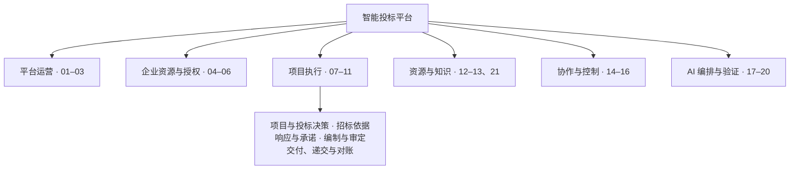

# 智能投标平台完整解决方案

按投标人、轮次和标段建档。项目负责人逐项核清本次应交什么、企业批准哪一版、截止时指定接收方实际收到什么。

每项结论关联原件、办理时间和判定人。凭据只覆盖部分事项时，保留已核结果，另列待核事项、接手人和下次查询时间。

**建设约束**：不改 Java，不使用 Node 业务服务；已有 Node 业务服务须清理。严格按正式方案实施，原有代码只作符合合同的能力复用。

实施按[全方案迭代计划](./layered-delivery-plan.md#design-acceptance)逐项交付和取证。旧版语义审查结论不代替当前代码及现场验收，不据此宣布总体完成。

目标能力与已上线能力分别验收；代码分层见[实现责任](./layered-delivery-plan.md#implementation-owners)，逐节点交付见[21 个节点实现交接](./layered-delivery-plan.md#capability-implementation)。

文中负责人、审核人表示企业责任归属，授权AI可承担其范围内的判定和执行，不要求逐步人工点击。原决定、执行、审计与纠正分别留据；有明确人工要求的事项按原规则办理。

项目只有一棵内容树，分册是树内组成部分。多个来源文件的内容汇入该树，来源文件与分册不必一一对应；原文件保留来源关系，不作为独立编辑根。

人工和AI统一编辑节点内的多行纯文本。文件格式只在导入、导出边界处理，内部流程使用项目、分册、节点和修订定位。

**平台蓝图与建设入口**

三层决定谁有权办理，五个业务域串联一次投标。蓝图按下列六个分支组织 21 个能力节点；节点号是本方案索引，不是运行时身份。

六个分支落为模块，21 个能力节点落为子模块，按职责组织 19 个逻辑页面。逐页输入、命令、结果和验收见[模块至页面策划](./layered-delivery-plan.md#page-design)。

| 策划顺序 | 上一步交什么、下一步凭什么开工 |
|---|---|
| 蓝图 → 场景 | 产品负责人确定能力、主责、成果与入口。场景负责人区分页面、嵌入、无页面能力及纯展示，交节点与实际场景的对应。 |
| 场景 → 资源与契约 | 企业资源持有人交原资源；平台配置负责人核真实绑定和约束。七组契约固定事实归属，不能按节点数量造表或服务。 |
| 契约 → 函数 | 业务负责人交输入、结果、状态变动和退回条件；开发人按[动作实现标准](./authoring-submission-specification.md#bid-action-implementation)绑定现有责任模块。 |
| 函数 → 工作流程 | 人工、AI、导入调用同一业务内核。编排只决定下一步；批准、采用和外部办理各取本步权威结果。 |
| 流程 → 页面 | 按[页面交付卡](./layered-delivery-plan.md#page-contract)定主对象、查询、表单、命令、回读与异常。页面只编排本次工作，业务结果仍由原节点出具。 |
| 流程 → 回归与放行 | 按[建设交接标准](./layered-delivery-plan.md#blueprint-delivery)验身份、依赖、代码及现场凭据。问题退原责任层修正，沿实际引用复验。 |

五域按实际依赖交接，公开原件分析和投标准备可并行；蓝图分支及图中顺序均不构成全域就绪门禁。

本版 47 个 ClassModel 负责语义发现和调用，61 个动作负责办理；它们不能替代企业资源、数据空间或内容树。

代表委托与资料准用分别由55、56登记，27、17只负责核权和取用。配置编审与启停由节点21、页19和动作60–61负责，公共分发仍归节点02。数量可按[扩展规则](./layered-delivery-plan.md#blueprint-extension)增补。

建设蓝图由配置态 owner 管理，运行菜单只从 `runtime.menu` 取得。蓝图配置项目与本次投标项目分别编号，不按同名、页面路径或编号相同推定关系。

## 一、平台、企业与项目如何分工

| 层级与主责 | 可以决定什么 | 向下一方交付什么 |
|---|---|---|
| 平台运营层 · 运营负责人 | 按服务约定开通企业空间、发布公共能力、办理服务停用与恢复。接触企业私有资料须取得相应授权。 | 向企业管理员交付服务范围、公共版本及运行记录。企业退出时移交未决业务及查询途径。 |
| 企业管理层 · 企业有权人 | 一个租户对应一家企业。企业决定是否投标、谁可代表企业、哪些材料可用于本轮投标，以及哪版报价和承诺可对外使用。 | 向项目负责人交付投标决定、代表权限及材料使用决定。商务、财务部门分别交批准记录和已办担保凭据。 |
| 项目执行层 · 项目负责人 | 按投标决定登记主体、轮次、标段和分工，确定本轮依据。给每项义务指定办理人、复核人和期限。 | 向企业移交逐项核验的档案。中标后，合同负责人签收实际递交的承诺、后续澄清和待履行事项。 |

**企业授权如何落实**

- 联合投标按本轮成员组合、分工和协议版本办理。来源企业明确接收企业、项目、材料版本、用途和期限，项目负责人核对授权后选用。
- 牵头企业按分工汇总，各成员可取得本方任务的采用与送达记录。签署、递交或撤回前，经办人另核法定代表人身份或相应委托。
- 对独立竞争同一标段的企业，企业管理员分别核项目权限。搜索、统计、AI 取材及导出均按同一授权范围验收。

## 二、五个业务域如何交接

| 业务域 | 主责人凭什么办理 | 哪项结果允许下游开工 |
|---|---|---|
| 项目与投标决策（任务 06、09、11） | 企业有权人决定参加、暂缓或退出。项目负责人凭已核身份和决定登记本轮范围，联合投标还须核准协议及分工。 | 资料所属企业凭申请、用途和项目范围核准材料版本。项目负责人凭已核要求列出本轮依据，注明已选、并交、待触发或缺证。 |
| 招标依据（任务 02、04） | 登记人按发布目录取原件及附件。分析人核对条款、表行、脚注与历次正式澄清或修改，公开文件可与投标决策并行分析。 | 响应人员接须响应事项及评分条件，编制人员接格式及签署要求，经办与对账人员接渠道、期限及生效规则。缺件可能影响强制要求时暂停该项。 |
| 响应与承诺（任务 12） | 资格、技术和商务人员按清单作答，列证明、偏离和原文位置。商务复核人按原表数量、单位与计价规则复算，核批准价和承诺。 | 先交册件或独立栏的作答落点。响应负责人分派，将已核答复、证明及批准范围交回编制域。独立栏不等分册；条款或选版存疑退原责任人。 |
| 编制与审定（任务 13） | 编制人员将答复落实到原表、分册、独立附件或平台字段。授权审核人按交付方式核实际文件或独立栏拟填值，审定版本、位置及适用附件。 | 交付负责人按义务核包内实件、签署或独立栏放行记录及阻断项。内容或关键值有变，退编制人修订并重审。业务复核人确认阻断项已消除，方可放行。 |
| 交付、递交与对账（任务 14、15） | 有权经办人核放行范围、办理窗口和各入口在途记录，同一事项的同次放行只发起一次。对账人凭渠道规则和应递交清单先行建账。 | 经办人交实际文件或同次平台填报记录、发送凭据及可得的渠道编号。对账人逐项核接收和截止效力，到期查无办理记录也要跟办。 |

- 项目负责人登记不适用时，须同时取得分析人核实的条文和业务责任人核实的项目事实。承诺缺批准时交有权人决定。
- 财务负责人按项目要求办理保证金或保函，核标段、受益人、金额、期限及递交位置。项目退出或未中标时继续跟办应退资金。
- 电子递交凭交易平台确认回执核接收，纸质独立件核指定地点、期限及签收凭据。开标与评审各取相应办理记录。[《电子招标投标办法》第二十七条](https://zfxxgk.ndrc.gov.cn/web/iteminfo.jsp?id=18458)
- 政府采购采用非招标采购方式时，按本项目采购文件使用采购人、供应商、响应文件等用语。[《政府采购非招标采购方式管理办法》第十一条](https://www.mof.gov.cn/gp/xxgkml/tfs/201401/t20140102_2510302.htm)

**全生命周期怎样接到结束**

投标生命周期包含正式后续事项和移交，不能以“已递交”替代办结。合同履行、资金办理仍由原业务负责人承担，平台保存可回查的交接与续办引用。

| 到达的阶段 | 谁接哪项结果 | 可以结束什么、还要留下什么 |
|---|---|---|
| 机会与领取 | 08定位采购轮次标段，10–16核原件、条件与期限，19接决策依据。 | 原件不齐列缺项；公开核读可先做，取得文件不代表已获准参与。 |
| 参与与阶段策划 | 19交适用阶段及准许工作，20固定主体、轮次、标段和阶段，22接选版。 | 附条件准备只放行允许范围；退出仍须清点已发生义务。 |
| 资格申请 | 适用时用申请阶段基线编制、递交，58核正式预审结果，20核下一阶段前置。 | 申请已收不等于资格通过；结果缺证可筹备，依赖它的正式投标放行待核。 |
| 响应与商务批准 | 21、24交条款及应交义务，34–37交答复与证明，28–31交计价和批准。 | 缺批准留试算，缺证明留待核；正文与数据分别交编制域。 |
| 内容采用与交付审定 | 38、39按当前修订采用；文件按40–42制作核实，独立栏按固定响应核拟填值，45审定。 | 一棵树、数据与格式分离；审核绑定实际版本，样张不能替代获准件。 |
| 签署与递交 | 46–50按文件义务核签署与包；51分别或同时接可交包、获准栏值，52、53接原操作与凭据。 | 已发送、已接收及截止有效分别留据；未知先查原操作，不能直接重交。 |
| 截止、开启与评审 | 54分别交截止组合、开启和准入；实际评分定位所用材料。 | 缺包、缺评分来源继续待核，不从中标公告反推各环节通过。 |
| 后续通知与争议事项 | 57交原通知、范围、期限和渠道，原责任域接答复；企业主张另交有权经办人。 | 答复另留阶段、修订及批次；主张不代正式处理结果，已交原件不覆盖。 |
| 结果、退出与重新采购 | 58核正式结果及更正，19记企业决定；新轮回08、20，旧轮交59。 | 内部退出不代外部撤回；新轮不抹旧轮实件、担保、占用与未决。 |
| 移交及投标阶段结项 | 59核合同、财务、资源、档案接收人，签收复用原任务记录。 | 已办交实据，未决交期限和续查权；签收不证明履约或退保完成。 |
| 企业知识复用 | 页05保留原版，页16编审目录，页02办获准公共分发。 | 项目专属承诺另审用途；中标、归档不自动授予复用或AI取材权。 |

阶段身份和开工条件统一见[阶段范围](./authoring-submission-specification.md#bid-stage-scope)，状态分责见[业务状态归属](./authoring-submission-specification.md#bid-state-ownership)。

跨阶段复用只把获准片段选入当前阶段候选，原AI来源与本次适用批准分别核验；新勘误未定影响时暂停相关采用，见[阶段交接规则](./authoring-submission-specification.md#bid-stage-late)。

恢复时分别判断原采用是否生效、提交时实核了哪版依据、当前成果能否使用；后续改头不替代原结果，见[采用恢复](./authoring-submission-specification.md#bid-adoption-recovery)。

后续与移交合同见[57–59](./authoring-submission-specification.md#bid-lifecycle-actions)。原来源、批准、实件、后续答复与合同各保留版本，沿接手记录双向追溯。

## 三、企业资料怎样成为本轮投标文件

| 设计决定 | 办理及放行条件 |
|---|---|
| 资料归来源企业，具体选版归项目负责人 | 资料负责人登记原件、出处、版本、有效期及使用决定。企业主管核人员设备占用，项目退出后查明尚待履行的义务再确认释放。 |
| 同一项目共用一棵内容树和一个已采用的修订头 | 分册挂项目根，独立作答随同一修订固定，允许无正文。按[统一目标](./authoring-submission-specification.md#bid-content-target)保存、采用与追溯；各来源共用放行条件。 |
| 业务字段保存含义，模板负责映射原表 | 记录规范值、单位、口径、版本及出处，保留指定原表和原生报价格式。制件人核树节点、实件页栏及平台提交字段。[数据与格式的交接](./authoring-submission-specification.md#bid-data-format) |
| 正式修改触发受影响项复核 | 分析人交新旧条款及字段，项目负责人据此更新依据和义务，指派新增事项。商务、技术和编制人员复核报价、证明与实件。 |
| 原件沿用与对外放行分别留据 | 按[本次使用](./authoring-submission-specification.md#bid-source-use)核原范围、版本和时限。资料强弱依赖、能否举证及处理许可分别判断；历史原件不改标当前版。 |
| 项目答复经审阅后进入企业知识库 | 资料负责人审用途、去除项目专属承诺后发布。跨企业分发须来源方准许，发布人限定版本、接收企业和有效期。[Loopio 项目建议审阅](https://support.loopio.com/hc/en-us/articles/360055300673-How-Can-I-View-All-Library-Changes-Suggested-in-Projects) |

一期以身份与授权、来源与选用、项目与成果、协作与复验、办理与运行记录五组契约交接业务。

二期以目录与发布记录共享范围和版本，三期以调用与验证记录 AI 的实际执行、核验及审计纠正。[七组契约的事实归属](./layered-delivery-plan.md#contract-register)

应用经根 `createSparkRuntime` 接入 SPARK API，按服务端返回的 canonical `queryContext` 核当前权限。

## 四、凭一份回执如何查到实际报价

| 起点 | 谁核什么 | 可登记的结果 |
|---|---|---|
| 接收凭据 → 原操作 | 对账人核出具方、事件类型、主体、轮次、标段、接收时间及可得的渠道标识，将回执配到唯一操作及实际批次。 | 仅有整包回执时记录已证接收范围。包内对应关系缺失，交经办人补取文件清单或可识别包内成员的凭据。 |
| 实际批次 → 同次报价行 | 文件从该批封装清单取实件，定位表头、行、单位和值。平台独立栏凭同次报价标识回读，纸件从签收单所列文件或封装标识定位。 | 平台独立栏在提交前核拟填值及填报人。对账人在提交后记录查到的同次实填值，将查不到的栏位列为待核。 |
| 报价行 → 批准与原文 | 商务复核人对照企业批准价及本轮有效条款，定位正式修改位置，复算区分新旧口径的字段。多份实件各追原制作批准及本轮适用依据，沿用不改来源。[两册报价反查](./authoring-submission-specification.md#bid-two-volume-price) | 区分字段唯一匹配，可确认填报口径。多版相容时保留候选。认定制作时实际选版须有采用或导入记录，批准缺证时单列实填值与复算结果。 |
| 同次报价行 → 截止结论 | 对账人核该批次在截止时是否有效及其覆盖范围。已收旧版仍记送达，内容差异由原责任人整改，交业务复核人复验。 | 同批报价行与截止效力均有凭据，才能确认截止时的实际报价。晚到凭据改变有效批次时保留原观察，重查受影响行并交归档人。[九项递交核验](./authoring-submission-specification.md#bid-amendment-acceptance) |

## 五、SPARK AI 在什么条件下可用

业务人员与 AI 从同一目录查指南。ClassModel 由源声明编译生成，模型负责人登记产物版本，宿主绑定获准的企业、项目及真实业务实例。

AI 按[底层通用模块](./layered-delivery-plan.md#ai-common-foundation)建设，统一发现、装配、执行、验证与恢复。投标业务模块提供原规则和采用端口，各页面共用同一运行能力。

AI在授权范围内自主判定、批准和采用，执行留痕，审计发现错误再纠正。节点16补查漏审、定位当前影响，原业务域纠正并复验；待审计不作前置审批。[审计与接续](./authoring-submission-specification.md#bid-audit-continuation)

场景负责人可按政策所列投标策划、合规自查场景选择试点，再按下列步骤验收本次调用。[投标策划与合规自查应用场景](https://zfxxgk.ndrc.gov.cn/web/iteminfo.jsp?id=20604)

| 步骤 | 办理人、输入与输出 | 缺项或错配时从哪里恢复 |
|---|---|---|
| 查询能力 | 从根实例用 `model_query` 查注册类型、类指南、属性与动作指南。运行负责人确认实例、函数和材料版本。 | 类型错误回业务目录重新选类。类型正确但实例或函数有误，回动作指南核绑定，再核输入范围。 |
| 固定输入并调用 | 固定原文片段、字段、版本和单位。宿主核权限与签名，经 `model_script` 调绑定函数，分别留方法执行与内层 AI 调用记录。 | 实际入参有变，仅重调受影响函数。仅缺凭据时，由输入记录负责人回原试次补取执行端实发内容。[AI 输入输出取证](./authoring-submission-specification.md#bid-ai-io) |
| 回读、验证和采用 | 验证负责人用有效原文或独立复算核返回。从实际句段或表栏查试次；人或授权AI作出采用及业务批准，记录依据，审计发现错误再纠正。 | 已签署或递交的事项，交有查询权的经办人核原工具、实际文件或原批次，沿受影响步骤重新复验。[退回重验与原操作接手](./authoring-submission-specification.md#bid-recheck) |

## 六、异常发生后由谁接手

| 触发条件 | 当班责任人的动作 | 继续办理的条件 |
|---|---|---|
| 材料授权撤销 | 交付负责人暂停未发材料。已发起的，由经办人核原批次发出时间，来源企业核撤销生效时间。 | 来源企业交有效使用决定，按适用版本、用途和时点复核。未发材料按实际改动重审、重签或重新封装。 |
| 发送中断、操作号缺失或多笔匹配 | 运维交原操作线索，项目负责人指派有查询权的经办人和下次查询时间。结果未知暂停重发，逾期向指定接收方核实。 | 渠道记录或接收方指认须能唯一配对。按[统一恢复合同](./authoring-submission-specification.md#bid-operation-recovery)核原效果与终结，再核授权、版本和窗口。明确拒收保留原批次，另办放行。 |
| 经办人失去查询权 | 项目负责人改派有权人员，停用旧队列的发送任务。新经办人签收原操作、已有查询记录及下次核实时间。 | 接到迟回凭据仍配回原批次。根据原操作已证状态决定补录、续办或重新放行。 |
| 回执迟到、乱序或矛盾 | 对账人按事件生效时间排序，同一事件登记一次，另记凭据取得时间。冲突交指定接收方核实，需开标确认的先列待核。 | 按完整渠道记录或正式认定核截止组合。部分修改只更新覆盖项，旧件撤回后新件拒收，旧件仍为已撤回。截止后另办须有正式窗口。 |
| 服务故障恢复 | 运维先挂起受影响作业，从备份以外的来源核服务状态、当前请求权限、企业委托和材料授权。 | 按已核范围恢复作业。签署未决由签署经办人查原工具或纸件，递交未决由渠道经办人查原操作。 |
| 企业退出服务 | 运营按生效时点停派新作业。项目负责人移交未决批次、原凭据索引、迟回凭据接收途径、查询期限并取得签收。 | 企业指定人员核实能续查原事项。运营负责人按服务约定登记导出、保留和到期处置。 |

电子递交的文件清单、接收回执和撤回凭据分别保留。具体时限、事件效力和接收方以本项目文件及实际渠道记录为准。[欧委会电子递交操作指南](https://webgate.ec.europa.eu/digit/opsys/esubmission-fo-ui/assets/documents/manual/quickGuide_en.pdf)

## 七、四个建设阶段如何放行

| 阶段与交付范围 | 上一步交来的输入 | 谁接收、凭什么放行 |
|---|---|---|
| 一期 · 单项目投标。15 项任务交付 13 个节点 | 产品、能力、对象与契约、场景与运行四层设计已交接。选同一轮次有效原文及获准查阅的真实办理记录，可用历史原件。 | 企业工作区负责人接收五组契约的联合验收记录。正查全部适用要求，抽回执反查实件或平台栏、响应、授权和原文，并核企业隔离。 |
| 二期 · 资源协调、知识共享与配置管理。新增4个节点 | 一期相应范围已放行，接资源、用途、占用、已核要求及固定配置。 | 企业主管交调配，知识维护人交指南，发布人交获准分发，配置负责人交启停与原发布回读；各消费方验收，企业工作区负责人汇集签收。 |
| 三期 · 受控 AI。新增 4 个节点 | 场景负责人提供一期业务凭据、二期已验目录和指南，确认当前取材范围后先验只读查询，再验生成、自主采用及审计纠正。 | 调用域负责人从采用结果查到试次、实发输入、原返回及独立依据。换版、撤权与缺证样本均能定位办理步骤和接手人。 |
| 四期 · 外部办理与服务保障。扩展 3 个一期节点 | 项目负责人提供有效授权、审定文件或拟填值及原操作查询依据，逐一确认现场渠道。使用二期成果时核相应凭据。 | 项目负责人凭渠道实测核批次、送达及截止状态。运营核同笔未知办理新增发送次数为零，实测容量与恢复。企业指定人员验退出后续办。 |

- 一期联合验收须复现两种缺证。移去全部接收凭据，送达待核。只移去包内对应关系，保留已证送达，文件版本待核。
- 三期与四期可按各自已验范围放行。若由 AI 发起外部办理，须先通过动作版本和渠道两项验收，再核本次实际办理结果。
- 产品交付负责人按检查项记录通过、不通过、待核实或有据不适用，列范围、时点、接收人和未决事项。正查或反查样本缺原始凭据，该范围待验。

**每轮验收后的整改**

业务复核人把失败或缺证项登记到原检查项，列出受影响范围、原件、责任人及复验时点。责任人提交修订或补取凭据，交回原复核人。

复核人用同一组输入复验，再查受变更影响的上下游交接。产品交付负责人据结果更新该范围的放行结论，保留原判定及未决事项。

## 八、企业怎样读递交结论与指标

按同一投标人、轮次、标段及核验时点统计。项目负责人先核到期应递交清单，单列内容与批准版本的一致性、开标结果及准入结果。

| 项目递交结论 | 判定条件 |
|---|---|
| 未按要求递交 | 已证实至少一项到期义务未按要求递交。登记所涉事项和依据，其他待核项继续跟踪。 |
| 递交情况待核实 | 暂无已证缺项，但义务适用性、送达或截止效力仍有缺证。对账人列出下一项所需凭据及接手人。 |
| 已按要求递交 | 已核清适用范围，且每项到期义务均有证据表明按规定方式及时送达，并在截止时仍然有效。 |

| 指标或边界 | 计算及登记方法 |
|---|---|
| 响应覆盖率 | 在实际文件或平台栏核到答复的事项数 ÷ 当期应响应事项数。缺证的适用事项留在分母，能定位到实际答复才进分子。 |
| 按时送达比例 | 有接收方记录证明按时送达的事项数 ÷ 当期应递交事项数。按时送达后撤回的，保留送达记录，另判截止效力。 |
| 待触发与适用性未明 | 须接通知才办理的，列触发条件、跟踪人和期限。获正式通知后按新期限核验，保留原截止记录。适用性未明的列数量和出处。 |
| 不适用及联合体义务 | 有据不适用的注明条文和已核事实，不计入应办数。联合体成员共同承担同一义务时，项目汇总一次。 |
| 分母为零或范围待核 | 已核清且无应办项时显示“无适用项”及依据。适用性尚待核实的，展示已核范围和待核数量，整标完成结论继续待核。 |

## 配套文件

| 要落实的工作 | 由谁查哪份依据 | 应交出的结果 |
|---|---|---|
| 确定建设责任和阶段 | 产品负责人查 21 个节点、七组契约。支撑节点负责人核记录取用与恢复。[分层建设方案](./layered-delivery-plan.md) · [支撑节点](./layered-delivery-plan.md#support-records) | 本期能力、依赖、接收人及放行范围。 |
| 派工并验首期 | 项目负责人按 15 项任务派工，产品交付负责人组织联合验收。[第一阶段建设任务书](./phase-one-taskbook.md) | 上游输入、下游签收、验收记录及待办。 |
| 实现并核业务动作 | 各域负责人查 47 个模型、61 个动作及业务规则。[业务规格](./authoring-submission-specification.md) · [动作编号](./authoring-submission-specification.md#bid-action-sequence) | 按规定输入取得结果，再交指定接手人核验。 |

引用时写明“节点”“任务”或“动作”。例如任务 13 交付节点 10，其采用变更由动作 39 办理。各文件分别维护分工、建设交接和动作规则，以链接引用对应定义。
