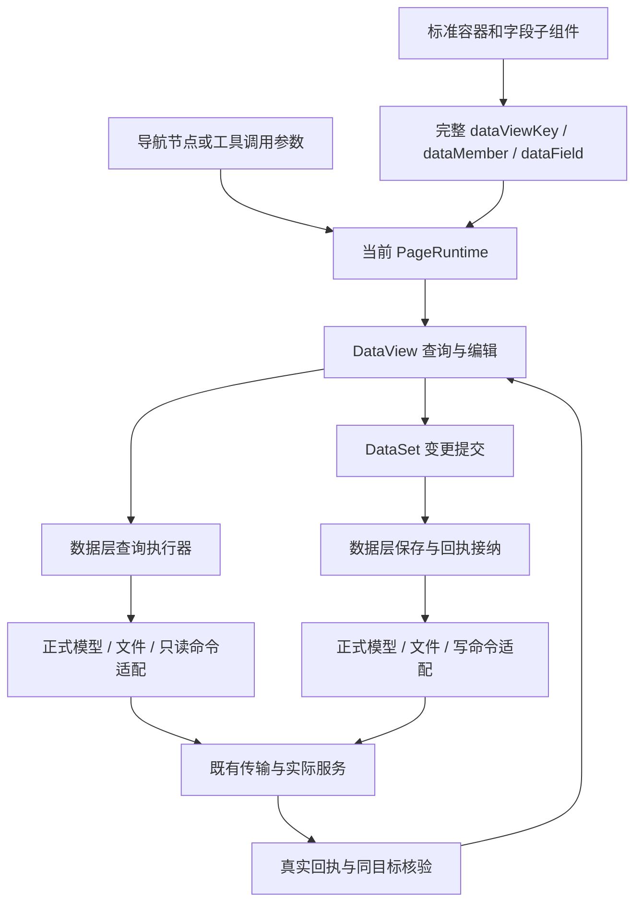

# 数据空间旧方案删除记录

> **当前入口（2026-10-24）**：已有修改与完整计划已本地提交 `c88bff078`、`5297c9b37`。用户已批准按 [SPARK data 元数据平台完整整合计划](#2026-10-24-spark-data-元数据平台完整整合计划) 实施，要求低价模型实施、主控派工/验证/烟测/更新状态；当前阶段A implementing。旧总体与外部API/I6/I7子计划保持 superseded。下方历史记录保留原时间、范围及证据，不作为当前开工指令或完成证明。

## 2026-10-21 一页一循环：服务器管理（service-management-page）

- **节奏**：用户要求以页面为单位逐页闭环；本轮只做服务器管理页。
- **实页修复**：列表与注册表单此前无字段（未传 `autoColumns`，Vue 布尔缺省 false）→ 页面显式 `:auto-columns="true"`；新增只预置视图实有列（`Password` 正式模型 output=false，原预置触发 `SPARK_MODEL_SAVE_FIELD`）；编辑目标改按主键核对（保存被拒后数据层以新对象恢复同主键行，原对象相等判断使取消失败）；保存后回读无该主键时报错，不再误报「已保存」。夹具 `Password` 对齐线上 output=false。
- **实页结果**：列表、刷新、编辑取消通过；注册回执 `Code 200` 并回显 rowid，但回读 `Count 5` 不含新行，既有行均带 `entID`、新增无 `entID`（疑后端按企业过滤，未证实）。服务端疑似留有两条不可见 `i5-pilot-discard`（`4490A9FA…`、`4D4FC71D…`），页面无法删除。删除与测试连接未测。
- **差距**：列表列为模型全部字段原序（含系统字段），未按参考页取舍；密码无法录入（视图无该列）；矩阵实页列保持「部分」。
- **验证**：`tests/runtime/page/database` 41/41；typecheck；eslint 改动文件。证据 `notes/evidence/database-management-i5/live-pilot-browser-20261021-tier.json` → `serverPageCycle20261021`。
- **续（16:50）根因**：参考页及后端源码确认注册是 `POST /api/Db/registerServer` 业务命令（测连接、补企业、加密密码），本页直接插表语义错误。spark-data 仅有只读命令视图，缺写命令能力；用户要求走 spark-data 统一链。方案 [`plan-database-server-register-command.md`](plan-database-server-register-command.md)（已并入 v3，superseded）。
- **续（17:45）v3 实施**：总方案改为 [plan-appworks-integration.md](plan-appworks-integration.md) v3（单页流程、调用分类表、流程改进记录）。spark-data 新增 `bindDataSetCommandSubmit`（写命令：命令视图新增行 → `DataSet.saveChanges` → 回执；结果未知保留待核验，核验不重放；单测 5 例）；服务器页注册改走 `DatabaseServerRegister` 命令视图，**删除**原经 `Base_serverInfo` 插表的注册分支（`createFields`、新增行预置/密码过滤）；连接测试改读命令行；`r-text` 标准组件补 `showPassword`；ClassModel 已刷新。实页反向通过（`127.0.0.1:1` 被后端以连接拒绝驳回、无记录、无插表请求），正向待测试库。证据 `evidence/database-management-i5/live-pilot-browser-20261021-tier.json#serverRegisterCommand20261021`。
- **仍待**：正向注册（需可达未登记测试库）；删除实页未测；目录列表显示全部 16 列，参考页只列 ServerName/ip_address/Port/Type/createuser/createtime/description（下一轮按参考补列子组件）；两条不可见遗留行待后端清理。
- **续（11:35）复制表**：`database-catalog-copy-view-ops.ts`（_Base_TblList + Base_TblField 一次 saveChanges）；`copy-table-dialog.vue` + 工具栏「复制」；夹具 maplistadd 按请求分段回执。database 页测 51 例。
- **续（11:36）**：`compareName` 入参改为 `unknown`（与 `scalar` 一致），typecheck 通过；矩阵/遗留项同步复制与删除接线；表和视图页测补「复制表」对话框闭环（database 页测 52 例）。
- **续（13:50）统一 DataSet**：表/视图 `loadCatalog` 在同 FormKey 上可选装配 `Base_Desensitization_Rule`（不参与 hub 五表 full 判定）；字段网格 `FieldSelect.optionDataViewKey` 消费规则 DataView，禁止页面直查 HTTP。
- **续（14:06）**：同 DataSet 可选装配 `Dict_encryption_rule`、`TblField_type`；表/视图设计头（Expression/IsVisible 等）绑定 `_Base_TblList`/`_Base_ViewList` 当前行；`databaseCatalogDesignSavePending` 一次 saveChanges 提交表头+字段。database 页测 55 例。
- **续（14:12）Base_TblRln**：可选装配 `Base_TblRln@forTable`；`databaseCatalogRelationRefreshForTable` 用 OR 过滤 pktbid/fktbid；表设计对话框「关系」页签 + 删除走 `saveChanges`（非 HTTP remove）。database 页测 57 例。
- **续（14:16）v3 表设计周期**：按单页七步补语义卡 [`research-database-management-i5-table-design.md`](research-database-management-i5-table-design.md)；`saveTableRelation` 归类为模型保存 → `database-catalog-relation-form-ops` + `table-relation-dialog.vue`（增/编/删均 saveChanges）。database 页测 58 例。下一周期按分类表 #6 数据预览。
- **续（14:30）hub 布局 + 预览**：表和视图 hub 左侧仅数据库列表，服务器隐式绑定；表设计「数据」页签走 `DatabaseTablePreviewRows`→`POST /api/DataOperation/GetData`（物理表 Type=数据库表，scenarioId=FormKey）。database 页测 59 例。下一周期 #8 工作流。
- **续（14:55）表设计 #8 工作流**：可选 `Base_WorkflowDefinition@forTable` + `workflowStatus` 字典；`database-catalog-workflow-view-ops`（tblid + 可选 name/key/description/status 过滤）；表设计「数据流」页签；参考「设计」仍为 stub 未接。database 页测 60 例。下一周期 #9 AI 或 view-design parity。
- **续（15:00）table-design 收束**：数据流顶栏筛选 + 「设计」提示暂未实现；#9 AI 登记 I5 能力缺口（不挂空按钮）。下一页 view-design-dialog v3 周期。
- **续（15:10）view-design-dialog**：三页签（设计/输出/数据）；`_Base_ViewList` 扩展 sql/modid 等；`DatabaseViewPreviewRows` GetData；`Base_AppSystemList` 可选 + 应用选择对话框。database 页测 62 例。
- **续（15:30）v3 续做**：add-table 语义卡 `research-database-management-i5-add-table.md`；修复 relation addRow `CrudResult` 与夹具 Filter 索引 typecheck；矩阵/遗留项指向 hub 收束或 register-dialog。
- **续（16:10）hub + register**：`research-database-management-i5-hub.md`、`research-database-management-i5-register-dialog.md`；page test 注册确认→`registerTable`。database 页测 63 例。
- **续（16:15）copy/register-db/关系/服务器**：copy-table、register-database v3 research；夹具 T3 同库从表；page 关系保存 + 库注册；service-management 注册确认 vitest。database 页测 66 例。
- **续（16:30）删除**：delete-v3 research；hub 删表/删视图 + 服务器删确认 vitest（69 例）；修复 hub 删除确认未 import `RendererButton`。
- **续（16:55）表设计/组合 hub**：SyncMetaData、关系删除 page vitest；management-hub v3 research + hub 默认 catalog 面板测。
- **续（17:00）表设计关系列表**：补 `on-row-click` 选中行（编辑/删除依赖）；SyncMetaData + 关系删除 page vitest；database 页测 72 例。
- **续（21:50）设计 save/预览/应用**：表头 save、表/视图预览页签、视图应用选择 page vitest；应用列表补 row-click；database 页测 76 例。
- **续（22:05）add-table + 服务器编辑**：目录插表确认、服务器编辑 save、注册对话框测连；service-management-v3 research；database 页测 79 例。
- **续（22:40）表设计字段网格**：cnname 行内编辑 + 设计「保存」；字段元数据 `showCellControl`/`editOnDblclick`；设计对话框字段表 highlight-current-row。
- **续（23:00）I5 DB v3 一次性收束**：视图输出字段 save、注册视图、工作流「设计」stub vitest；AI 缺口卡；field-view-ops viewFields；database 页测 **84** 例。实页 formal-model-gap、add-table 参考字段批仍登记开放。
- **续（23:05）I5→I6 交接**：刷新 `research-database-management-i5-entry.md`；gap JSON 附 vitest 84 基线；新建 `research-structured-config-dictionary-i6.md`；字典 vitest **54** 例已绿。
- **续（23:10）字典目录→数据页**：修复无 tenant 路径时「打开数据维护」静默无效；catalog page vitest（设计对话框、双路径导航）；字典 vitest **57** 例。
- **续（23:15）字典 I6 布局**：目录/数据页页头（对齐 `vue-pages.json`）、表格 stripe+当前行高亮、设计对话框 footer；三页 list/setting/data v3 语义卡；矩阵行改为 `dictionary-data-page.vue`。
- **续（00:40）I6 structured-config 全量 MVP**：data-code（8 Vue）+ logic-view（2）+ workflow-definition（3）接通 lowcode catalog 与 design 客户端；`vue-pages.json` 注册；vitest **40**（structured-config）+ 字典 **58**；`live-pilot-dictionary.json` blocked；Code/Workflow 专用 HTTP 见 `api-gaps.json`。
- **续（11:10）表/视图列表**：显式列（表名/中文名/创建人/创建时间）；工具栏删除走 `databaseCatalogDeleteRow`（remove + saveChanges）；注册对话框增加「为选中项添加默认字段」。database 页测 50 例。
- **续（00:15）register-dialog 语义对齐**：`register-dialog.vue` 改为登记表/视图（RendererTable 绑定未登记只读命令视图 + confirm 走 `databaseCatalogRegisterTables/Views`）；原登记库 UI 迁至 `register-database-dialog.vue`；主页面工具栏「注册」/「新增」分离（新增仍走 _Base_TblList 模型保存）。database 页测 49 例。
- **续（00:02）registerTable/registerView**：`DatabaseTableRegister` / `DatabaseViewRegister` 命令视图（`bindDataSetCommandSubmit`）；编排 `database-catalog-register-view-ops.ts`（批量按项提交、回读 _Base_TblList/_Base_ViewList）。未改 register-dialog（语义待决）。catalog-table-view-ops 测 6 例。
- **续（22:50）I5 能力补齐**：`attachTableSyncMetaDataView`（`bindDataSetCommandSubmit` → `/api/Table/SyncMetaData/{dbid}/{tableid}`）；`GET /api/View/getUnregisteredView/{dbId}` 只读命令视图；表设计对话框工具栏「同步元数据」；`attachCatalogCommandViews` 改为分片幂等 attach。服务器列表改用 `DATABASE_SERVER_LIST_FIELDS`（7 列，不含账号/密码）。database 页测 46 例、typecheck 通过。
- **续（18:00）表和视图按 v3 开工**：清单 2 命中——页面五个 `RendererTable` 与登记/新增表两表单都缺 `:auto-columns="true"`，网格无字段列；已补，页面测试改为断言表头 `ServerName` 与行值（补前红、补后绿），database 页测 14 文件 44 例与 typecheck 通过。调用分类对照参考 `application-builtin-capabilities.ts`：本仓缺写命令 `POST /Table/SyncMetaData/{dbid}/{tableid}`、只读命令 `GET /View/getUnregisteredView/{dbId}`、表数据编辑（动态模型）、`Base_TblRln` 删除、脱敏规则；实页受 `_base_dbInfo/_Base_TblList/_Base_ViewList/Base_TblField` 未登记正式模型阻塞（`live-pilot-formal-model-gap.json`）。下一断点：后端登记上述模型后实页走查；同步元数据按 `bindDataSetCommandSubmit` 接入。
- **续（20:10）调用分类纠偏**：读参考 `register-dialog.vue`/`TableAndViewRegister.ts`/`AddTable.ts` 发现：参考「注册」是对选中库登记未注册表/视图（内置能力 `spark.table-register`→`POST /Table/registerTable`、`spark.view-register`→`POST /View/registerView`），「新增」是 `_Base_TblList`+`Base_TblField` 一次模型保存；参考页左侧只有库列表。本仓页额外有服务器列表，`register-dialog` 登记的是数据库（参考在旧 `views/DataBaseManage/DataBaseManage/index.vue`，`POST /Db/OperateDBData`，不在 96 页矩阵）。方案 v3 第 3 步「注册库是写命令」前提不成立，页面结构去留待用户决定，未改代码。

## 2026-10-21 工作区收敛（Git / 证据 / stash）

- **证据删除**：本地删除 `notes/evidence/data-space-config-storage/`（约 **13196** 文件、**85** 顶层 `e62-*-before` / `i7-*` 快照树）；删前 manifest [`research-evidence-deletion-manifest-20261021.json`](research-evidence-deletion-manifest-20261021.json)。I4 回归 log 副本：`notes/evidence/database-management-i5/native-design-regression-i4-convergence.log`。**DATAFLOW 内链该目录者暂为死链**，结论以台账/正文为准。
- **stash**：drop **12** 条 `lint-staged automatic backup`；剩余 **21** 条见 [`research-git-stash-inventory.md`](research-git-stash-inventory.md)。
- **验证（commit 前）**：`typecheck`；`tests/runtime/page/database` **39/39**；`verify:page-thin`；`verify:lowcode-contracts`；`generate:class-model-surface`。
- **提交（`10-17`，本批）**：`0b1b39d23` I5 hub/catalog/dialogs；`e37527425` spark-data/command + column-auto-field；`8ec5bc9b4` ClassModel + consumer ledgers；`ef65ec535` 台账 + 小 evidence + git 研读。
- **常态**：禁止 `git add notes/evidence/data-space-config-storage/**`；见 [`research-git-staging-evidence-cleanup.md`](research-git-staging-evidence-cleanup.md)。

## 2026-10-19 I4 设计器其余（关系/级联/参数/命令类删除）— §4.3 删类完成（2026-10-20）

- **前置**：I3 页签与 `DataSpaceModelRequest`、预览/数组懒加载修补已完成；`data-space-design-page.test.ts` 329/329 + 根 `typecheck` 通过（见 I3 节证据）。
- **I4 退出条件（§4.3 删类，范围 A）**：`src/lowcode/data-space` 下 **11/11** 命令 FSM 类文件已删除，逻辑落在对应 `*-session.ts`（+ `create*Handle`）；`lowcode-data-space-view-design.ts` 仍保留 `#sourceInputs` / `#fieldEdits` 等 Map 缓存与既有 `get*()` 签名；**不含** view-design 统一 pending registry 或 ~5–7k 行终态瘦身（留 I5+）。
- **Vue/会话**：各编辑器仍经 `session.get*Edit` / `getModelRename` / `getFieldRemove` 等 **Handle 门面**（非已删命令类）；保留 `*-references` / `model-dependencies` / `definition-save` 等领域辅助类。关系/级联仍走 `DataSpaceRelationEditor` / `DataSpaceCascadeEditor` + 定义 DataView。
- **清点与台账**：`notes/research-data-space-i4-command-inventory.md`（11/11 已 session 化）；收敛实施见 Cursor plan `i4_command_class_convergence`（仓内 `notes/plan-data-space-i4-convergence.md` 已按 AGENTS 阶段 7 删除）。**P1b / `flowStatus` / `ModelEdit.save` 请求方案分区 / 预览链** 行为未改。
- **回归（2026-10-20 收敛验收）**：`typecheck` + `verify:page-thin`；metadata+chain **107/107**；auth-nav data-space **798/798**；native 设计 **1584/1584**（log 副本见 `notes/evidence/database-management-i5/native-design-regression-i4-convergence.log`）；`generate:class-model-surface`（879 DTS，manifest 指向 `*-session.ts`）。**测试修补**：模型工作区 lazy 页签下 `field-removal` 页测 `page()` 需打开「3 字段呈现」/保存前回字段页签。`**-session.ts` ESLint 清零**；全仓 `pnpm run lint` 仍有存量项（非本次删类引入）。
- **提交（2026-10-20）**：`5b09bab85` on `10-17`（含 I2 列表/P1b、I3 设计页签、`DataSpaceModelRequest`、I4 全量 session 化 + ClassModel/测试）；已 push `origin/10-17`。
- **下一断点（整合计划）**：阶段 1 仍缺 `data-set-auth-page.vue`；阶段 2 **I5** 单链 hub + 连接测试 + 只读级联 vitest 已推进（见下节）；四 dialog UI 与实页 CRUD 证据仍待。

## 2026-10-20 I5 服务器管理首屏（service-management-page，`bbc254aba`）

- **导航**：`vue-pages.json` 将 hidden「服务器管理」`source` 指向 `src/views/features/data-platform/database-management/ui/service-management-page.vue`；`/dbms` 与 table-and-view 仍 `DBMS.vue`。
- **数据链**：`LowcodeDatabaseServer.loadCatalog` 动态装配 `Base_serverInfo@default`；页面持有 DataView/DataSet，编排见 `database-server-view-ops`（非业务 owner）；CRUD 经 `saveChanges`。连接测试待 DataView 命令合同，UI 提示缺口。
- **原则**：spark-data 唯一后端桥梁；DataView 为组件交互层；已删 `LowcodeDatabaseServerCatalog` 与 `LowcodeApi.databaseConnection`。
- **UI（工作区，未提交）**：列表/编辑表单去掉页面级字段 `children` 与 `:auto-columns="false"`；`RendererTable`/`RendererForm` 默认 **autoColumns**，列元信息只来自父 **DataTable.columns**，行数据经绑定 **DataView** 查询；筛选区手写字段 children 已删。
- **验证（2026-10-20）**：根 `typecheck`；`tests/runtime/page/database/*`（8 项，含页面挂载）；`verify:page-thin`。实页/在线 CRUD 未验。
- **提交**：`bbc254aba` on `10-17`，已 push `origin/10-17`。
- **文档**：`notes/plan-database-management-i5.md`（implementing）、`notes/research-database-management-i5.md` §0 owner 替代；`test:foundation:run`（utils→json-document vitest 别名）。
- **矩阵**：`plan-appworks-integration.md` service-management 行语义/合同/页面 **部分**。
- **下一切片**：连接测试 DataView 命令；实页 CRUD；table-and-view 四 dialog。

## 2026-10-20 I5 表和视图只读首切片（table-and-view-page，`bf66dd39e`）

- **导航**：hidden「表和视图管理」`source` → `table-and-view-page.vue`；`/dbms` 与 `/DataBaseManage/.../index` 仍 `DBMS.vue`。
- **数据链**：`LowcodeDatabaseTableView.loadCatalog` 装配库/表/视图/字段 + query 级联（`dbid`、`tblid`）；字段视图分 `tableFields`/`viewFields`，只读，不经 `getDatabaseCatalog`。
- **UI（工作区，未提交）**：四表及字段区均 **autoColumns**；已删 `dbFields`/`tableFields`/`viewFields`/`fieldColumns` 等页面列配置（违反「列只在 DataTable.columns」）。
- **验证**：`tests/runtime/page/database/*` 8 项 + `typecheck`；夹具补齐查询 `lingma_sys_params.r/e` 以匹配正式权限消费。
- **提交**：`bf66dd39e`（首切片）、`1295394af`（字段目录） on `10-17`；autoColumns 统一见 `1a5219e99`。

## 2026-10-20 I5 DataSet 命令 SSOT + 矩阵 6 页（工作区）

- **spark-data**：[`packages/spark-data/src/data-set-command/data-set-command-view.ts`](../../packages/spark-data/src/data-set-command/data-set-command-view.ts) — `ensureDataSetStaticInputTable` / `ensureDataSetFileCommandView` / `bindDataSetReadonlyCommandQuery`；Db HTTP 仍只在 `lowcode-database-dataset-extensions` executor。
- **页面**：`register-dialog.vue` 路径对齐参考；新增 `add-table-dialog`、`table-design-dialog`、`view-design-dialog`；`table-and-view-page` 接线。
- **删除**：`src/views/app/DBMS.vue`（导航已直链 hub/feature）。
- **验证**：`tests/runtime/page/database/*`（含 hub / 页面挂载 / 字段 save）；根 `typecheck` + `verify:page-thin`。
- **证据 stub**：`notes/evidence/database-management-i5/live-pilot-*.json`（单独 commit 策略不变）。

## 2026-10-20 I5 继续收敛（Type/筛选/字段保存/台账，工作区）

- **服务器 Type**：`database-server-catalog-metadata` 补丁 DataColumn + `fieldProjection`；`DataColumn.enumOptions` + autoColumns → `r-select`（非 ScenarioViewConfig `type`）。
- **筛选**：`listFilter` / `catalogListFilter`；**spark-data** `differsOnlyInAutoQuery` 修复 r-filter 覆盖 `autoQuery` 误 stale。
- **页面 vitest**：hub 切换；`table-and-view` 注册库/表设计/未登记表名/add-table 对话框；`service-management` 注册对话框；`tests/runtime/page/database` **22** 项。
- **实页（2026-10-20，领码/wangtao）**：元数据管理 `D99A…` 下 hidden「服务器管理」可加载列表+注册对话框；根 `/dbms` 仍 legacy blueprint 阻断；「表和视图」待同一 **Base_DataSet.rowid** 五表 `readModelBatch` → `live-pilot-formal-model-gap.json`。**代码（2026-10-21）**：`dataSpaceId`=DataSet ID；`database-catalog-context` hub provide + 子页 inject；`getDatabaseCatalog` 仅 FormKey 探测；研读 `notes/research-database-catalog-dataset-identity.md`。
- **字段设计写链**：`database-catalog-field-view-ops` + 设计 dialog 工具栏「保存字段/刷新」；vitest `database-catalog-field-view-ops.test.ts`。
- **治理产物**：`generate:class-model-surface`（manifest 无 `DBMS.vue`）；`generate:lowcode-contracts`（consumer ledger 无页面级 `/api/Db`）。

## 2026-10-21 I5 持续迭代 II 复验（工作区）

- **代码**：tiered resolve、Hub KeepAlive、表和视图 blocked 复用 `DATABASE_CATALOG_SERVER_ONLY_NOTICE`；Hub `serverOnly` 下服务器 Tab 单测。
- **验证**：`tests/runtime/page/database` **39/39**；`vue-page-registry` 8/8；`typecheck`、`verify:page-thin`、`verify:lowcode-contracts`。
- **实页**：dev `5273` 直链 hub 无会话 → 平台首页；登录后按 `live-pilot-browser-20261021-tier.json` 三态复验；五表元数据仍见 `live-pilot-formal-model-gap.json` operatorActions。

## 2026-10-20 I5 架构收敛（hub / 连接测试 / DBMS 删除，工作区）

- **导航**：`/dbms`、`/DataBaseManage/DataBaseManage/index` → `database-management-hub.vue`（服务器 + 表和视图 tab）；`DBMS.vue` 已删，无 re-export。
- **服务器/目录**：CRUD 仅 `DataView` + `DataSet.saveChanges`；连接测试与未登记库名经 `database-spark-data-auxiliary` 辅助 DataView（file executor），页面只持有 DataSet。
- **2b**：`register-database-dialog.vue` + `database-catalog-db-view-ops`（注册 `_base_dbInfo`）。
- **验证**：`tests/runtime/page/database/*`（含 mount 级联、未登记库查询）；`vue-page-registry` 更新 hub source；实页 CRUD `livePilot: pending`（evidence 单独 commit）。
- **文档**：`plan-database-management-i5-dialogs-slice.md`（2b/2c draft）；`plan-data-space-i4-input-parameters.md` 已删除（superseded）。

## 2026-10-19 I3 设计器页签拆分 + 请求方案分区（工作区已验证，待与 I2 同批提交）

- **页签**：模型工作区按设计书 §4.1 拆为 `1 模型结构` / `2 请求方案` / `3 字段呈现` / `4 数据处理` / `5 数据视图`；新增 `DataSpaceModelRequest.vue`（OutputType、Filter、树参、cacheType、RequestComplete），字段表与 `DataSpaceFieldCreate` 迁至 lazy `3 字段呈现`。
- **运行**：离开字段新增工作区时 `releaseFieldCreate` 在查询上下文已切换时不再因 `getState()` 断言抛错阻断卸载（已撤回选中模型时的 `loadModelFields` 预取，避免破坏「字段未加载」懒加载语义）。
- **测试**：`data-space-design-page.test.ts` 增加 `openModelFieldsTab`（限定 `.node-panel-tabs`）；字段/合并保存用例先打开 `3 字段呈现` 再编辑或保存，避免 `DATA_VIEW_RESULT_STALE`；来源绑定标签在 `DbName` 不可读时仍展示可读 `MetaName`。
- **运行（补充）**：`DataSpaceArrayEditor.show` 打开前按需 `loadModelFields`；`capturePreview` 仅在已绑定 `modelFields` 工作区时校验字段视图稳定性；`openModelPreview` 先 `ensureDefaultFieldCatalogForPreview`，默认目录字段投影延后到 `readPreview` 之后；模型改名 `completed` 丢弃已无保存意义的目录编辑覆盖；`DataSpaceQueryPreview` 不再对纯模型预览重复 `readPreview`。
- **验证**：`data-space-design-page.test.ts` 329/329 通过（`design-page-vitest-20261019e.log`）。I2+I3 工作区修改仍未提交。

## 2026-10-19 I2 目录 + P1b 数据库未确认保存（工作区已验证，待提交）

- **I2 语义**：数据空间目录保留参考操作（新增/编辑/删除/设计/复制API/查询绑定）；设计入口改为列表页全屏 `RendererDialog` 传入 `:target-id`，不再依赖 `/data-space-design` 短路径或 `route.query.scenarioId`；隐藏蓝图路径 `data-set-design-page` 仅保留文件落点，不作为独立导航身份。
- **删除**：`config/navigation/vue-pages.json` 中自建 `/data-space-design` 路由已移除；`LowcodeDataSpaceCatalog` 去掉目录编辑私有 `#edit.status` 状态机，未确认/回读失败改读 `DataView.hasUnconfirmedSave` 与 `loadingError`；新增 `canDelete`/`deleteSelected`（先查 `Base_DataModel` 计数，再经 `saveChanges` 删空间）。
- **P1b**：`DataSpaceRuntimeApi` 实现 `hasUnconfirmedSave` / `verifyUnconfirmed`（主键 IN 回读核验）；传输失败包装为 `DataSpaceSaveUnconfirmedError`，禁止静默重放。`DataView`/`DataSet` 增加 `abandonUnconfirmedSave(s)`，设计器旧命令类在自定义 `readback()` 前调用，避免 `assertResultReplacementAllowed` 与未确认提交冲突（过渡桥接，I4 删除命令类后移除）。
- **验证（2026-10-19 本地）**：`lowcode-data-space-catalog.test.ts` 63 项通过；`data-space-design-page.test.ts` 整文件通过（约 378s）；`data-space-runtime-api.test.ts` 8 项；`vue-page-registry.test.ts` 8 项；根 `pnpm run typecheck` 通过。实页矩阵「实页」列仍待隔离 T 走查，不替代 I2 退出条件中的在线验收。
- 35 路径工作区修改未提交；无 Java 修改。下一断点 **I3**：设计器元模型/请求设置页签按 §4.1 对照参考，逐步去掉平行命令 FSM（I4 成组删除 `src/lowcode/data-space/model-source/*` 命令类）。

## 2026-10-19 基线与数组表头本地收口

- 工作区分组提交为基线 04dcaf178..91f0a6580（10-17 分支，未推送；notes/evidence 未入库）；提交前清除 10-17 遗留的空 index.lock，无运行中的 git/测试进程。
- 数组表头（下节）本地验证完成：根 typecheck 无错误；数组相关 4 生产/5 测试路径 lint 通过；数组 5 文件 113 项通过；原生设计页 38 文件 1585 项全部通过（252 秒，2 worker，30000ms）。真实保存/独立重开并入整合计划阶段 1 的实页验收，不单独开轮。

## 2026-10-19 数组表头回归原DataView（本地已收口，实页待阶段 1）

- 继续上节已证实缺陷，原ArrayEdit.#headers已删除；确认表头直接使用原字段DataView的编辑覆盖、addRow/removeRow和变更追踪。只保留命令涉及的ID与不可变提交核验信息。原模型items/PrimaryKeyFields仍归模型DataView，未另建保存器或字段真源。
- 新增反例先证实正式视图不可见、原取消无效，修复后增改删及取消通过。回归发现删除回读后的旧ID仍被当作当前工作区，已限定为仍有原生待提交变更的ID。未改表头的空值/数字字符串误标修改也已用失败反例定位并修复。
- 异步预检期间继续输入的反例失败：旧失败恢复覆盖了后来字段与模型输入。现仅恢复本次已应用且未被后续操作改变的目标，尚未应用的草稿保留。3个数组领域文件102项通过；原生窗口等待、锁定、失败保留、再次确认及原DataView取消2项通过。调用方转为等待异步确认，包括既有引用和改名测试；整组8文件回归尚在运行，不重复累计定向计数。
- 用户再次强调DataView已有数据属性、须按语义对齐。当前核对rows、columns、currentRow、selectedRows、editingRows与value合同；目标DataTable.columns及DataView数据成员与元数据记录的存储表达分别核定，不把字段元表自身columns误作被设计模型columns，也不因改成DataView存放副本就宣称SSOT。正式ClassModel已刷新，语义对照和指南查询继续进行。
- 已保留12份改前快照（含未改ArrayDraft），4生产、4测试路径当前有修改；架构2.5.327同步。类型中检通过，最终类型、lint、构建及真实保存重开待完成。新浏览器会话已重新进入授权登录：旧企业标签直接登录返回1003，重新选择服务给出的领码科技项后提交；未输出凭据、未更改服务或安全设置。当前远程数据保存0。

## 2026-10-19 数组表头平行草稿根因核查

- 上轮为有效进展：预览宽表公共字段修复、128项回归和实页证据已完成。本轮回到模型来源、字段操作及取消合同，目标继续是完整SSOT与参考页业务语义，未把展示修复当作整体完成。
- 实页隔离T的SourceScope_20261018打开“从来源更新字段”：来源ContentType，已有普通字段保持原ID/输出/配置，RetirementProbe_20261018保留为派生字段，显示新增0/删除0。取消后来源更新入口重新可用，保存及放弃本地修改均禁用，配置已关闭。仅只读查询和取消，远程写入动作0；未采集独立HTTP记录，不把此观察扩大为所有来源已验收。
- 发现明确未统一入口：LowcodeDataSpaceArrayEdit.applyHeaders先将items/PrimaryKeyFields交原模型DataView，但将确认后的字段名称/标题/顺序/主键留在私有可编辑#headers；headers/getState/plan/save/discard另行消费或清除此数组，保存时才向Base_DataModel_Field写入。此状态不是不可变提交快照，也不只是尚未确认的窄窗口输入，构成正式列变更的平行草稿。先前“最后通过DataSet保存”的证据不能证明整条编辑/取消链统一，不能保留此方向作为例外。
- 已用现有dataSpacePageFixture在缓存中复现：表头F2标题确认成“已确认的新标题”后，owner.pending=true，owner.headers为新值；正式字段DataView.getEditingRow仍“名称”，hasEditingChanges与dirtyTracking.hasPendingChanges均false。原DataView取消后新值仍存在，只有owner.discard才恢复。夹具写入0。见array-ssot-diagnostic-20261019.json；这是缺陷特征确认，不是目标验收通过。
- 诊断程序/配置位于node_modules/.cache/data-space-array-ssot-20261019，8份当前脏工作区快照已保留。第一次临时mergeConfig把include数组与根配置合并而意外扩大测试发现范围，已通过原会话中断（exit1），未将该结果计入验证；随后改为明确覆盖include并指定文件，单文件单worker诊断1项通过（5.66秒），进程已终止，无存活测试任务。正式生产/测试源码本轮尚未修改。
- 当前实施边界：删除ArrayEdit.#headers及其独立状态/取消责任，确认表头后由原Base_DataModel_Field DataView跟踪字段增改删；正式模型items/PrimaryKeyFields继续在原模型视图。窄表头窗口的未确认输入仍可由其原输入视图承载，确认写回后不得留下第二份定义。只保留必要的操作身份、不可变派发快照与确认流程，不把#headers搬入另一临时表冒充统一。
- 实施前继续核原DataView的编辑覆盖、新增/删除追踪与取消/失败恢复合同：已加载但未改字段不提交；新字段ID须由原DataView产生；旧字段ID及未改属性保留；字段/模型改名引用和文件迁移保持原责任方；预检失败须保留原DataView草稿可修复，未知派发不能重放。DataView脏更新的getOriginal是弱引用快照，不能未经核对就把它定为持久真源。applyHeaders若因原addRow/removeRow转为异步，表头对话框须等待并锁定确认/取消，失败保留输入，相关回调声明和既有调用方一起调整。
- 预期成组范围为原ArrayEdit、ArrayEditor、ArrayHeaders及其props、既有array-headers/页面测试、主合同与本台账/度量；需要补原公共能力时先证明缺口。验证须覆盖改名/标题/排序/主键/增删、同一DataView可见性、原取消、失败保留、真实保存回读/独立重开以及模型身份和权限守卫。当前只完成根因诊断，修复尚未实施；此项优先于继续补视觉细节，目标保持active，无Java或Git暂存/提交/推送。

## 2026-10-19 查询预览宽表呈现

- 继续完整模型工作区及参考页对照。参考源码现位于E:/r/sparkproject/packages/ui/domain/metadata/src/features/data-platform/data-set-management/design/ui，HEAD为471ecb8b77356d288912878e778c191c14c0d8ac。旧目标模型addApi/updateApi/deleteApi仍只证实定义投影，未确认执行消费者，继续保留旧记录只读，不恢复第二套提交器。
- 已证实参考预览标量列具有180px最小宽度和溢出提示，本仓FieldText未配置宽度且标准字段链缺少提示属性，导致宽表长标识折行。当前方案沿标准字段语义属性、字段上下文、公共表格字段渲染补可选showOverflowTooltip，预览声明minWidth=180及该属性；不新增页面列模型、查询/草稿或提交逻辑。底层提示读取已渲染文本，核验隐藏/脱敏、动态开关及原DataView无编辑副作用。
- 范围为6生产路径、1既有标准字段测试、台账及度量；9份改前快照位于node_modules/.cache/data-space-preview-table-20261019。已查ClassModel目录/概要及minWidth/dataViewKey/dataMember指南5项。先通过类型基线、补行为反例，再成组修改、刷新ClassModel并查询新指南，执行相关字段/预览回归、类型/lint/构建及实际自身宽表只读核验。保留现有工作区，无委派、Java修改或Git提交。
- 类型基线通过；新增提示行为反例初次失败。修复后一次失败定位为测试误选选择列，纠正为每行数据列后原7项通过，临时诊断输出已删除。最终相关字段、上下文和查询预览7文件128项一次全通过（默认时限、2 worker），其中新增1项，不累计定向结果。覆盖提示读取格式化文本、隐藏/脱敏、开关变化及无编辑副作用。最终类型与7路径lint通过。
- 公开属性及JSDoc由正式生成链刷新：878文件、1810符号、1450索引，既有2128语义缺口保留；生成后目录/概要/指南6项含新属性通过。生产构建698本仓源码、543资源引用，仓外/退休/缺失引用及构建中源码变化均0。本人按改前快照核对6生产与既有测试；未新增页面状态或底层控件旁路。
- 真实C的Base_DataModel@default显式输入自身dataSpaceId，原查询返回17行/总数17/每页500/Loaded。39个标量展示字段均180px，17行各约41.89px，7072px宽表在1070px视口实际横向滚动3840px；长空间ID省略后提示显示完整值。截图preview-table-tooltip-20261019.png已目检，原输出JSON仍保留37个实际返回字段。展示结构字段与实际返回字段不等同；参考预览同样按定义标量列建表，本轮不擅改输出边界。
- 关闭预览后保存/取消均禁用，配置已关闭并返回隔离T；远程配置保存与业务数据写入0，无独立网络捕获。证据preview-table-browser-20261019.json。本轮仅关闭宽表呈现差距，完整SSOT/整页1:1及既有服务差距继续开放；下一断点仍沿模型工作区的来源、字段配置和操作/取消路径逐项对照，优先处理实际功能和数据归属差距，不因展示修复推断整体完成。最终快照/构建哈希/文档及暂存核对见preview-table-verification-20261019.json。无Java修改、Git暂存/提交/推送，目标保持active。

## 2026-10-19 元数据空间自身保存及运行消费

- 上轮为有效进展：重复首用例超时按完整场景拆分后12文件791项通过，自身只读查询取得实页证据。本轮核自身配置保存，不重复跑无新风险的广覆盖回归。源码确认T=C仍由正式C装配，定义视图记录变更，DataSet.saveChanges交ScenarioDefinitionResource，原文件owner仅在适配内部提交及回读；现有chain用例已经覆盖自身保存后对另一目标重新装配，但在线尚无该证据。
- 本轮实测范围：真实C中Base_DataModel@default已配置pageSize=500，拟通过原界面临时改为501，保存回读、独立重开并核预览实际消费，再恢复500并独立重开。此属性已有明确正式值，恢复无需删除配置；不改模型/字段/关系、权限、调用参数或业务行。若遇未知结果，先核验、不重放写入。生产代码暂不修改，证据与实际结果续记本节。
- 保存前实页发现SPARK_MODEL_FIELD_UNRESOLVED: multiTenancy，尚无远程写入。根因沿正式读取定位到captureDataSpaceViewQuery：无fieldProjection时把view.columns完整结构列作为全部输出；上轮保留完整非输出列后，正式查询清除工作区显示投影便触发此误用。已有queryColumns才是原owner的可查询字段合同。修复在同一查询捕获函数复用它，不删正式列、不改IsOutput、不绕过DataView、不放宽未知字段守卫。
- 范围为1生产函数文件、2既有测试和主合同/台账/度量共6文件，改前快照在node_modules/.cache/data-space-self-query-20261019；8次现有ClassModel目录/概要/指南查询通过。首轮4项含3个实际查询失败及1项新增权限断言不符合原夹具（该夹具故意返回非输出字段e，原测试验证保存守卫）；已移除该无关断言并恢复原保存断言，补无显示投影下显式请求非输出列仍拒绝。按别名查询、两个来源元模型及原保存/重开链验证后再继续线上自身保存。
- 校正夹具后3个反例按相同字段错误失败、原配置场景通过。生产修复仅以queryColumns替换完整columns回退；中间一次测试在拒绝查询后继续编辑，被既有DATA_VIEW_RESULT_STALE正确阻止，已将新增无投影查询分支与原编辑分支分开，未改该生产守卫。最终定向4项通过；运行查询/权限/保存9文件、贯穿链、预览和原生整页合计12文件922项一次全通过，定向不累计。最终typecheck及3路径lint/后改测试lint通过。
- 正式ClassModel生成878文件/1810符号/1450索引，2128既有语义缺口保持，生成前后各8次目录/概要/指南查询成功。生产构建698本仓模块、543静态引用，仓外源码/退休模块/缺失引用/构建中变化均0；修复仍在本仓原SPARK查询链，无新接口或查询副本。
- 真实C首次独立重开后原multiTenancy错误消失。Base_DataModel@default的pageSize从500改501，经原保存入口显示“视图配置已保存并回读确认”；重新装载整个页面后501保留，预览明确传入同一C的dataSpaceId，实际返回17行/总数17/第1页501条/Loaded。随后同一入口恢复500并确认，第二次整页重新装载后预览采用500，再查同一C仍17行/17总数/Loaded。配置保存动作共2次，数据库模型/字段/业务行修改及删除0；没有独立网络捕获，不把UI动作数等同HTTP请求数。
- 关闭预览时保存/取消均禁用，配置窗口已关闭，返回原隔离T。self-query-consumed-20261019.png可见同一C参数及501；self-query-restored-20261019.png可见恢复后17条/500/Loaded，均已目检。较早self-query-reopened截图未覆盖底部501，不用它单独证明该数值。浏览器证据见[self-query-browser-20261019.json](evidence/data-space-config-storage/self-query-browser-20261019.json)。本轮证明自身已有视图属性保存与重新消费，不等同于所有自身模型/字段/级联结构操作均已验收。
- 本轮为有效进展：删除查询捕获中把完整结构列当作可查询列的错误回退，保留原列真源、权限与保存守卫。完整SSOT、参考页1:1及字典计算、非输出排序、逻辑来源主键、旧数据处理执行等既有缺口仍开放。下一轮回到完整模型工作区与参考操作对照，不把本次自身保存属性用例缩成整页完成。主合同2.5.326，最终文档/6文件快照/构建哈希与暂存对账见[self-query-verification-20261019.json](evidence/data-space-config-storage/self-query-verification-20261019.json)。无Java修改、Git暂存/提交/推送，目标保持active。

## 2026-10-19 首个整页回归重复超时诊断

- 上轮有实际修复及页面证据。本轮先核重复发生的首个原生页面5000ms超时，不改超时、不恢复旧聚合执行、不将单独通过作为稳定性结论。当前只在node_modules/.cache/data-space-first-page-timing-20261019用Vite临时transform插入时间点，正式测试/生产源码尚未修改，原断言全部执行。
- 首次单进程测得总4290ms：打开/选中1370ms，撤销277ms，pageSize编辑399ms，两次保存1036/976ms，独立重开33/17ms；节点数约800—1076。证据first-page-timing-isolated-20261019.log。接近测试上限与组合超时相关，但尚不能据此断言所有耗时都是渲染或不存在重复查询；继续核保存CPU及请求次数，按证据决定实现/测试责任，不先提高上限。
- 首次保存CPU采样见first-page-save-profile-20261019.json：本次fixture数据库请求0、文件写入1，Vue更新调用栈占主要业务段，Profiler启动自身约373ms单列，不混为业务耗时。未发现请求重放；这些是测试环境事实，不推断远程服务性能。当前修复范围仅原测试及本台账/度量3文件：把取消后保留旧聚合及无关属性保存、明确删除旧聚合保存分为两个独立用例，后者仍从已保存pageSize=19与旧聚合开始。保留全部行为断言、真实页面组件、原5秒限制和2个worker，不删除重开或改为浅挂载。先在同一12文件组验证稳定性；不改生产逻辑或增设性能框架。
- 已完成测试拆分：15行原行为断言全部保留，新增用例从相同已保存状态开始，并验证删除后独立重开仍保留pageSize=19。两个完整用例定向分别2926/1472ms通过；同一12文件组一次791项全通过，仍为2个worker、默认5000ms，定向结果不叠加。基线与最终typecheck、测试文件lint通过；生产代码与超时配置未修改。一次整组通过说明本次拆分得到验证，不保证所有未来时序变化。
- 实际元数据空间8D1AB14DD8277F3E7017CD38F77B09FD自身读取已补验：原单目标入口显示25个模型/1条关系；打开DataViewDefinition@default，在查询预览的本次调用参数显式传入同一dataSpaceId，返回50行/总数50/Loaded。只读查询，保存/取消均禁用，配置窗口已关闭，返回隔离T；本轮远程保存、业务数据删除均0。截图self-metadata-read-20261019.png已目检；见[self-metadata-read-20261019.json](evidence/data-space-config-storage/self-metadata-read-20261019.json)。此证据只证明自身读取和查询，不代表自身配置保存或完整参考页1:1通过。
- 当前修复关闭重复首个用例超时的已证实测试组织问题，保留生产链。完整SSOT、参考页1:1、自身配置保存及既有真实服务缺口继续开放；后续沿本台账继续完整业务验收，不回到旧方案或另起项目。本轮无Java修改、Git暂存/提交/推送，目标保持active。最终文档与698个生产模块哈希对账结果见[first-page-timing-verification-20261019.json](evidence/data-space-config-storage/first-page-timing-verification-20261019.json)。
- 最终362份文档检查通过，3份改前快照完整、15行原断言缺失0、698个生产模块哈希漂移0、暂存为空。隔离T返回完成，保存布局/取消布局修改均禁用；自身查询结果及概览截图均已目检。本轮为有效进展，下一断点为自身配置保存与完整业务入口对照；不以本次自描述读取代替持久化验收。

## 2026-10-18 原生JSON包裹结构与真实值编辑

- 上轮为有效进展，当前源码及证据已复核。继续同一请求/值函数配置业务：FieldJson的native树通过固定value承载对象、数组及标量，不能增加根属性、删除/改名value；value自身类型和内部内容仍须可编辑。当前策略仅限制键名，新增无策略、删除value未保护，导致UI主动提供原字段必然拒绝的操作。过滤值函数同样包裹value，已有删除保护但新增仍有相同缺口。普通文档与rule编辑应保持原新增能力。
- 统一在spark-json-document原JsonTreePolicy补容器新增约束，新增子项和同级项都核其实际父容器；显示行从同一策略派生按钮能力，组件不再仅按类型/深度放行。FieldJson与过滤值函数各自声明原有包裹边界，原字段完整性校验继续保留，不新建业务数据/提交通道。公共新增默认允许，不扩大isProtected的既有“不可删除”语义；禁止操作应保持原树且不发出虚假修改。
- 范围：原树types/policy/mutation/build、JsonTreeEditor、FieldJson及声明、FilterValueFunctionDialog、原字段/过滤测试与3合同记录；13份改前工作区快照在node_modules/.cache/data-space-native-tree-20261018，新增纯树策略测试纳入本组。先反例后修复，覆盖根/同级/删除/改名保护、value类型与深层编辑、普通文档行为、原DataView取消及原请求保存/重开/查询；正式ClassModel、类型/lint、关联回归、构建和实际页面分层核验。未开始将策略声明当作实际行为通过。

- 首轮9项定向中7项结构行为失败、1项普通文档通过、1项值函数夹具缺少实际宿主提供的常量JSON定义；补齐定义后明确复现根新增错误。纯树数组参数的it.each展开展示错误同时纠正。最终10项定向通过，覆盖包裹保护、内部数组增删及类型转换、valuePath保留兄弟字段、普通文档新增、值函数确认、策略变更后旧新增事件不得发出假变更。没有通过放宽字段校验消除错误。
- 最终代码有8生产文件修改、2既有测试修改及1新增纯树测试，连同3合同/记录共14路径。类型初检因可选policy显式传undefined违反exactOptionalPropertyTypes失败，已改为按需传入，最终类型（含新增旧事件测试）与11路径lint/2路径复验通过。正式ClassModel重新生成878文件/1810符号/1450索引，2128既有语义缺口保留；实施前9次、最终11次合同查询通过，含canAddChild动作及childAddable/valueFormat指南。生产构建698本仓源码/543静态引用，仓外、退休和缺失引用0。
- 关联12文件初跑788通过、1项5000ms超时；该首个原生页用例“keeps legacy local aggregates read-only...”在原超时限制下单独4313ms通过。超时在前后轮组合运行重复出现，尚未定位其完整根因；不能称整批一次全绿或性能问题已修复。最终定向10项包含后来新增的旧事件保护用例，和广覆盖结果不叠加计算唯一总数；原保存、独立重开及查询消费由整页/链路传输夹具覆盖。
- 真实隔离T的SourceScope默认视图已复验：包裹根无新增；value只有内部新增，没有同级新增/删除；内部nativeTreeCheck成员新增、改名、赋值accepted、删除均正常，完成后进入原定义视图草稿。原DataView取消后queryContext未配置、保存/取消禁用；最终代码再次打开核对并关闭干净配置窗口。本阶段远程配置保存/业务行/模型删除均0；不复用上轮2次远程保存当作本轮证据。根保护、内部编辑及最终未配置截图已目检，较早cancelled截图处于渲染过渡，不用于最终状态证明。
- 本轮属有效进展，原生树结构错误入口已按同一公共策略关闭；完整SSOT、参考页1:1、既有真实服务缺口及重复组合运行超时仍开放。10月19日跨日收口：362文档检查通过，13份快照及1新增测试核验完成，698构建源码哈希漂移0，暂存路径为空。最终核验见[native-tree-verification-20261018.json](evidence/data-space-config-storage/native-tree-verification-20261018.json)，浏览器见[native-tree-browser-20261018.json](evidence/data-space-config-storage/native-tree-browser-20261018.json)。无Java修改、Git暂存/提交/推送，目标继续active；后续先核重复超时的实际耗时链，再继续完整页面验收，不将单独复验成功当成整批稳定。

## 2026-10-18 完整JSON编辑与原字段接纳状态

- 上轮为有效进展，已核对当前台账、源码与最终证据。本阶段沿同一请求编辑用例继续检查完整JSON树/文本/table：树内部keyInputDrafts/stringInputDrafts不报告输入状态；两个编辑器只发update事件，FieldJson未将等待原字段接纳及拒绝状态纳入onEditingChange，现有宿主守卫因此无从判断。沿当前公共组件补齐，不引入第二份业务JSON或保存器。
- 范围为JsonTreeEditor、SparkJsonEditor、FieldJson/声明、既有字段与整页测试及3合同/记录，9份当前脏工作区快照已保存在node_modules/.cache/data-space-json-editor-state-20261018。原解析、树编辑及底层文档模型保留；原始输入只报告状态，原字段异步写入由FieldJson统一确认；被拒文本/树保留供纠正或明确取消，取消复用已存在的编辑器上下文释放及DataView取消。旧上下文晚到回调不能清掉新编辑状态或写入新目标。
- 验证按完整请求编辑组实施：先复现输入中、非法原生JSON、异步接纳/拒绝及旧上下文事件，再核原命名视图完成、保存、独立重开和查询消费；相关组件/整页回归、类型/lint、正式ClassModel、生产构建与浏览器按本轮实际范围记录。原权限守卫及SSOT不变，未证明的完整JSON内部行为不提前宣称完成。

- 首轮9项RED含5项实际行为失败及4项组件夹具问题：树节点需先展开，禁用ResizeObserver须在VXE树挂载后再切文本回退。纠正夹具后4项按预期编辑状态失败；修复后9项通过，补入2项旧异步写入结束不得清除新上下文输入的反例，最终11项定向通过。树/文本/table统一报告输入中、等待接纳和拒绝；取消输入防止先失焦提交，仍复用原DataView及字段校验，不复制业务JSON。
- 关联9文件初跑448通过、1项原生页测试5000ms超时；同一测试按原超时限制单独复验通过，去重449项。11项定向与复验均为重叠，不累计。最终类型、6路径lint通过；正式ClassModel878文件/1810符号/1450索引，2128既有语义缺口保留，前后各9次目录/概要/指南查询通过。生产构建698本仓源码/543静态引用，仓外源码、退休模块、缺失引用均0。
- 真实浏览器在隔离T的SourceScope_20261018@default复现并复验：原生JSON根节点误加属性后原字段拒绝，输入与错误保留，模式/完成被保护，明确取消恢复；通过value内正确输入sourceDatabaseProbe=JSONEditorProbe_20261018，完成后沿原保存入口得到“保存并回读确认”，关闭并重新装载整个空间后仍可见该值。原查询预览实际返回4行/Total 4。随后移除此次默认调用值、再次保存回读，并第二次重新装载整个空间确认queryContext未配置、保存/取消禁用，已关闭配置且无草稿。本阶段真实远程配置保存共2次（临时值及恢复各1次），业务行/模型删除0；无独立网络捕获，不宣称已记录线级请求内容。文本/table及异步拒绝仍以组件/传输夹具为证，线上覆盖树。
- 浏览器自动化fill未触发change的输入仅算未确认输入证据；改用原生setValue后按新状态重新定位。一次旧索引错误发生在值已接纳之后，未重放保存。最终查询结果及原配置恢复截图已目检；较早restored截图仅证明本地取消，不用于证明远程恢复。原生包裹根节点仍暴露会被拒绝的结构操作，是后续交互合同缺口；本阶段只关闭状态丢失和错误清除问题，不扩大为所有JSON交互已完成。
- 核验汇总：[json-editor-state-verification-20261018.json](evidence/data-space-config-storage/json-editor-state-verification-20261018.json)；浏览器：[json-editor-state-browser-20261018.json](evidence/data-space-config-storage/json-editor-state-browser-20261018.json)。最终362文档检查通过，9份改前快照完整，698构建源码哈希无漂移，Git暂存路径为空。本轮属有效进展；完整SSOT、参考页1:1及既有真实服务缺口仍开放，后续按原生JSON结构操作合同继续核对，不沿旧E62编号续做。无Git暂存/提交/推送或Java修改，目标继续active。

## 2026-10-18 命名视图请求编辑的完整输入状态

- 上轮为有效进展。本轮沿同一JSON组件的真实消费者核到两处遗漏：命名视图queryConfig完整表单没有订阅编辑通知，非法filterLookups仍可“完成本项编辑”或切换JSON模式；queryContext的properties组件也未报告拒绝/输入中状态。真实隔离T已复现前者错误输入完成后丢失，后者1e998被拒绝后切换JSON/参数表即丢失输入和错误，远程保存0。浏览器fill未触发change的第一次观察不作反例，原生输入及Tab后已见正式错误。改前截图view-request-draft-before-20261018.png。
- 本阶段范围：原JsonObjectProperties/FieldJson声明与桥接、DataSpaceViewEditor、2既有测试及3合同/记录共9份文件，改前脏工作区快照在node_modules/.cache/data-space-view-request-draft-20261018。给properties补原编辑通知与明确取消输入；请求配置分组、完整配置和默认参数统一接入按编辑器汇总的状态，避免一个编辑器false覆盖另一个未完成输入；纠正和取消仍沿原字段/DataView，保存继续DataSet。仅未确认输入需要阻止切换模式、完成及保存；明确取消整个工作区应清理文本和原草稿。
- 验证先在实际组件与挂载整页复现，覆盖错误输入、多个编辑器、明确取消、纠正后原保存/重开与原命名视图查询，再做相关回归、类型/lint、ClassModel正式生成与构建、真实浏览器复验。沿同一台账实施，不新增业务草稿、查询器、配置真源或Java协议。Tree/text编辑器自身未确认交互能力不凭名称推定已完成；此次覆盖当前已证实的form/properties请求流程。

- 原9项RED中7项为实际行为失败，2项为直接挂载测试未还原真实表格；已改为真实表格并等待挂载。首次修复另复现原DataView取消无字段变化时只发editingDiscarded、FieldJson未订阅，取消后文本仍在。沿公共字段链订阅该事件，按当前主键或全量取消释放，不影响其他行；新增form/properties两项取消身份测试。静态组件夹具改用其原discardEditingRows，正式整页继续discardPendingChanges；取消后的断言重新定位已重建控件。
- 最终15项定向通过（11新增、4既有生命周期加强），含queryConfig/queryContext纠正保存、独立重开和原命名视图查询。参数表逐成员保留被拒文本与错误；宿主按编辑器身份汇总，不因兄弟状态false而清除其他pending。查看远端/加载目录等异步入口、移除配置与删除视图在未确认输入期间同样保护，原保存通道不变。
- 浏览器已在隔离T的SourceScope默认视图复验：1e999参数拒绝后模式切换/保存禁用，单项取消恢复；filterLookups的[{错误保留且完成/切换禁用，取消输入恢复。纠正[]后原视图显示filterLookups配置且保存可用，随后原DataView整项取消恢复未配置。本轮无远程保存/删除；保存重开为传输夹具证据。最终相关回归、生成/构建对账及完整取消浏览器复验仍在进行。
- 全量7文件初跑411通过/8失败；失败均为取消后仍持有已释放控件的旧断言。补入field-json.test.ts改前快照，范围共10文件；断言从当前页面重新定位，并验证取消前旧text/tree事件不重写原DataView。最终受影响2文件59项通过，其他5文件360项沿用初跑通过结果，去重共419项；最终15项入口守卫复验为重叠项，不叠加计数。未为通过测试恢复旧输入或另建草稿。
- 最终类型、7路径lint及变更后的复验通过；正式ClassModel878文件/1810符号/1450索引，2128既有语义缺口保留；9次最终目录/概要/指南查询通过。生产构建698本仓源码/543静态引用，仓外源码、退休模块及缺失引用均0。浏览器最终代码补验整项取消无接纳字段修改的1e999输入，原值恢复空、保存与取消禁用，关闭配置成功；截图已按新DOM重取并目检。
- 核验汇总：[view-request-draft-verification-20261018.json](evidence/data-space-config-storage/view-request-draft-verification-20261018.json)；浏览器：[view-request-draft-browser-20261018.json](evidence/data-space-config-storage/view-request-draft-browser-20261018.json)。本轮属有效进展，完整SSOT/参考页1:1及既有真实服务缺口仍未关闭；后续继续核对完整JSON树/文本内部未确认状态与请求上下文切换，不能将form/properties覆盖扩大为所有入口已完成。不沿旧E62编号续做，无Git暂存/提交/推送或Java修改，目标继续active。
## 2026-10-18 数据处理未确认JSON输入与工作区切换

- 继续沿完整数据处理用例核对：参考前端crudTargets仅投影旧目标模型名，参考Java检索仅见BaseDataModel属性，未核到完整运行消费；不将其等同本仓HTTP端点，不恢复目标模型/字段副本。真实浏览器在隔离T当前模型的固定参数输入不完整JSON后显示错误，但操作切换仍可执行；切回后输入和错误均丢失，保存/取消一直禁用。未发生远程写入，改前截图process-json-draft-before-20261018.png。
- 根因在公共JsonObjectForm：已有输入中暂存文本未向FieldJson/宿主报告编辑状态，嵌套Schema切换会清除文本；页面只订阅rows模式编辑。当前阶段按原公共组件补form编辑通知与明确取消输入，嵌套输入状态向上传递，纠正后写回同一DataView；数据处理工作区消费状态，未确认输入期间阻止操作/模型/URL/工作区切换和保存，不阻止原输入纠正。不得再建业务草稿或保存入口。
- 范围为4生产、2既有测试及主合同/本台账/度量共9份文件，改前脏工作区快照保存在node_modules/.cache/data-space-process-json-draft-20261018。先做实际组件及整页反例，覆盖纠正、明确取消、嵌套、异步写入、失权/释放，再执行关联回归、ClassModel生成、类型/lint、原页面浏览器核验。正在实施；同一台账承接，不另起计划或修改Java。
- 4项反例先RED；首轮修复后组件2项和页面取消项通过，页面纠正/保存仍失败。追到整页页签只保留组件、没有消费其interactionLocked，切换后顶部保存指向另一工作区。将同组原生页面接线纳入范围，复用已有RTabPaneProps.disabled禁止未确认输入时离开数据处理；新增该页改前快照，合计10份。无新增页签协议或通用保存器。基线类型通过；正式ClassModel已刷新，回调按action指南、继承绑定按SparkFieldSemanticProps指南查询。
- 最终定向10项通过，含新增6项、原4项生命周期补充检查；覆盖嵌套、兄弟成员、异步接纳/拒绝、取消及实际页面纠正后的原DataSet保存/独立重开。类型初检的getComponent.exists及异步测试参数缺类型已纠正，最终复验进行中。真实浏览器已确认错误保留及操作/页签锁定，兄弟请求头编辑未丢失错误输入；明确取消、纠正后原DataView取消均恢复原配置，窗口已关闭、无草稿。无远程保存或删除、无独立网络捕获；在线证据process-json-draft-browser-20261018.json，保存重开仍属原传输夹具证据，不混称线上验收。
- 最终7文件419项全部通过（422.04秒），包括原生整页320项及标准JSON/页签；类型修正后的10项定向再次通过，不累计。最终类型、7路径lint与2测试路径复验通过；正式ClassModel878文件/1810符号/1450索引，2128既有缺口不变，前后9次目录/概要/指南查询通过。生产构建698本仓模块/543引用，仓外、退休模块、缺失引用及构建中变化均0；文档362文件通过。10份改前快照、生产差异和构建哈希自审记录于process-json-draft-verification-20261018.json。
- 本阶段删除了未确认JSON输入未上报、兄弟更新清空全部输入及页签忽略交互锁的错误行为；没有另造配置真源或提交通道。整体目标继续active，完整SSOT/参考页1:1、旧目标模型执行与既有实际服务缺口仍开放。下一断点沿同一标准form的命名视图queryConfig等实际消费者核通知接线与取消/保存边界，不能因组件已具备通知便认定所有宿主已接通，也不再重复把旧CRUD目标名检索当作新进展。无Java修改、Git暂存/提交/推送。

## 2026-10-18 设计会话正式模型读取归回元数据视图

- 沿当前生产入口确认旁路：会话已持有元数据DataSet，七处正式模型/字段读取仍由options.readModel直接调用runtime.query，绕过该实例的DataTable/DataView。初始化元空间前的正式结构读取另有必要，不能与活动设计会话混删；字段目录缓存是可失效的派生结果，不是新增持久真源。
- 本阶段在原DataSpaceDesignApi复用投影和来源主键/入参校验，用当前元DataTable的独立查询DataView承接会话读取，读完释放；七个调用点统一传入当前实例。保留初始化读取、正式权限和查询身份校验，不复制模型定义、不覆盖原工作区草稿、不另造提交器。验证覆盖真实生产桥接、模型/字段/来源读取、缺失视图拒绝、迟到结果与释放、原编辑保留及现有模型操作回归。
- 根类型基线通过。3生产、1既有贯穿测试、主合同及2记录共7份改前脏工作区快照在node_modules/.cache/data-space-formal-read-owner-20261018；在同一台账承接已授权整合与删除，不新建并行计划。本项正在实施，尚未据此宣称整条数据链统一。
- 首批3项均先RED：活动元DataView零调用，移除必需字段/来源视图后仍经HTTP成功。改后生产贯穿23项及原API153项通过；两条原默认投影空数组断言用改前3生产文件快照复跑亦失败，已改为实际查询默认视图的4行/原值验证。快照回放结束恢复本轮实现；未用HEAD覆盖脏工作区。类型初验的可选参数与测试误用getter、lint局部变量遮蔽已纠正。
- 线上原命名视图正式字段目录可读，9项输出草稿已取消，真实查询4行/总数4/Loaded。继续API复制入口证实它先要求全字段default加载，与按需页面冲突；原代码尚未进入正式逐模型读取就拒绝。将此同组残留纳入本阶段：删除该全量前提，字段编辑/未决状态仍检查原DataTable各视图，正式读取继续逐模型核权；2项反例确认原错误。原生测试中基于已加载字段缓存拒绝的断言由生产桥接的正式查询权限反例替代，不放宽读取授权。快照增至8份，未进行线上保存。
- API复制补充13项定向通过，包含正式字段脱敏拒绝、编辑保留、缺文件及模型/绑定身份；13项属于后续整页结果，不累计。真实浏览器整页重开后直接复制成功，原页面仍为按需加载、3模型、无草稿；字段输出草稿未保存，原Verification视图查询4行。证据formal-read-owner-browser-20261018.json及columns/query/api三张截图；无独立网络捕获，不宣称报文数量或剪贴板正文审计。
- 最终类型复验、5路径lint及正式ClassModel生成878文件/1810符号/1450索引通过，2128既有语义缺口不变。初轮53文件2169项中2168通过，原生整页一项5000ms超时；补充API调整影响的链与整页两个文件正在按最终代码完整复验，不把中间结果写成最终全绿。最终生产构建与同一快照差异自审继续进行。
- 最终2文件342项全部通过（401.79秒），包含完整原生整页318项及生产贯穿24项；先前超时未重现。其他51文件沿初轮通过结果，原API153项独立通过，13项定向与初轮重叠部分不累计。删除了会话七处直接读取接线及API复制的全字段目录前置条件，权限、身份、原编辑与未决提交守卫保留；只读模型投影继续共用原映射，没有另造模型/字段真源。
- 最终生产构建698本仓模块/543静态引用，仓外源码、退休模块、缺失引用、构建中变化均0；9次正式目录/概要/指南复验与文档362文件检查通过。8份改前快照及当前改动本人自审完成，汇总formal-read-owner-verification-20261018.json。线上9项输出草稿已取消，原查询4行、独立重开首屏API复制成功；无远程保存、删除、Java变更、Git暂存/提交/推送。
- 本阶段关闭活动设计读取旁路与API复制的冗余全量前提，整体目标仍active；完整SSOT/参考页1:1及已登记的字典计算、非输出排序、逻辑来源主键和旧数据处理执行差距继续开放。下一断点仍沿同一主合同核对完整设计流程及剩余实际入口，不恢复旧实施编号，不把本轮查询边界修复称为整页已完成。

## 2026-10-18 数组结构回读与目录分页核查

- 上轮查询字段修复为有效进展。本轮回到参考页数据处理和数组完整编辑流程：参考addApi/updateApi/deleteApi维护目标模型及字段ValueFun，当前DataTable HTTP端点不是同一合同；有限源码检索仍未核到其完整执行链，继续保留差距，未复制该方向或把只读原值当作恢复完成。
- 数组普通修改已仅提交本次patch；结构修改及未知结果核验仍重读绑定模型目录。既有用例只证明第一页M1保留，尚不足以证明第二页或受过滤的目标身份不会丢失。本轮先沿原DataView分页、实际传输和保存重开建立反例；若证明共享目录被核验替换，在原查询/回读责任方修复，不另造权限、结果合并或保存通道。
- 范围1既有数组owner、1既有数组测试及3合同/记录文件，5份当前脏工作区快照在node_modules/.cache/data-space-array-readback-scope-20261018。类型基线及6次DataView/ArrayEdit概要、loadFromServer/createQueryView/setPage/setPageSize指南查询通过。首次2项中第二页通过，受筛选的M2失败：结构写入已成功，回读显式空间过滤覆盖原视图筛选后接纳M1，随后字段视图身份守卫拒绝。修复限定为删除模型回读的重复filter覆盖，沿原DataView配置重读；本模型字段完整性及其他身份、权限和未知结果守卫保留，不新增公共API或结果合并器。补验结构与普通数组修改回执丢失后的显式核验，不扩大为并发重排或所有来源回读都已解决。
- 4项补充场景初跑2个实际身份回读失败、1项未知结构提交被正确拒绝但文案断言过窄、1项分页通过；修复后4项全绿。5文件112项通过；最终类型检查将测试对夹具未声明items属性的读取改为独立新实例DataView验证，表头51项复验通过，去重仍为112项。最终typecheck和2路径lint及测试路径lint复验通过，未修改生产守卫来满足测试。
- 正式ClassModel生成878文件/1810符号/1450索引，2128既有缺口不变；生成后6次合同查询通过。生产构建698个本仓模块、543静态引用，仓外、退休模块、缺失引用及构建中源码变化均0。本次真实数组label表头说明已修改并保存，整页刷新后保持新说明；随后通过同一路径恢复原说明，再次整页刷新仍为“验收值（已核验）”。原模型预览读到1行/总数1/Loaded，probe-1及after原值保留。窗口已关闭、保存禁用、无草稿。页面“引用数据需要数据库表或数据库视图来源”经源码定位为GetRefData来源限制，未放宽或当作新缺陷。
- 两次线上保存动作及两次独立重开见[浏览器记录](evidence/data-space-config-storage/array-readback-scope-browser-20261018.json)，最终截图array-readback-scope-restored-20261018.png；没有独立网络捕获，不把保存动作数当作HTTP请求数。目录筛选反例和丢失回执仍明确为原传输夹具证据。文档治理362项通过，最终5文件快照与构建/回归对账见[本轮核验](evidence/data-space-config-storage/array-readback-scope-verification-20261018.json)。无Java修改、Git暂存/提交/推送，目标继续active。
- 本轮关闭已证实的数组回读过滤覆盖；不据此宣称目标自行退出筛选、并发目录重排或其他来源都已完成核验。后续仍须按整页要求核保留入口、来源执行和参考差距，数据处理目标模型映射、已有真实服务限制及完整1:1尚未闭合；继续使用本台账，不恢复旧方案。

## 2026-10-18 查询字段目录与完整模型列分离

- 上轮来源校验修复为有效进展。先核上轮尾部疑点：LowcodeDataSpaceViewFields.project返回DataView.columns，已有输出投影，非输出正式列不进入其中；assembler也明确按computeExpression识别本地计算列，原假设不成立，保留这两段。转查实际消费者发现loadPreviewFilterContext、预览参数候选和query预检仍直接消费DataTable.columns；readFilterContext读取的本模型/上游模型目录亦未按正式输出过滤，与实际executeQuery的resolveOutputFields合同不一致。
- 本轮按同一查询责任方补DataView的可查询字段只读目录：正式适配器从当前绑定模型派生，数组按原查询字段集合，其他资源保留原字段语义；预览界面、函数候选与参数预检共用，结构和模型关系仍保留完整columns。目录不是数据权限，也不生成保存能力；原scope、模型身份与销毁检查继续生效。不增加字段真源、请求或全空间加载。
- 范围为6生产、4既有测试、3合同/记录文件，13份当前脏工作区快照在node_modules/.cache/data-space-query-columns-20261018；类型基线通过。12项已确认RED，其中8项实际消费者误露非输出列或失败前清空旧结果，4项缺公共字段目录合同；修复后全绿，再补2项作用域/销毁变体。测试设置错误已纠正，readonly modelBinding赋值失败不是产品缺陷，未放宽身份不可变合同。
- 最终4文件236项、关联4文件118项全部通过，共354项；覆盖正式/数组来源、派生视图、文件回退、命名/独立预览、函数上游及原查询/保存重开，定向结果不重复累计。最终类型与10路径lint、后改3路径lint复验通过。正式ClassModel刷新878文件/1810符号/1450索引，2128既有语义缺口保持；改前11次、改后13次目录/概要/指南查询成功。
- 生产构建698本仓源码/543静态引用，仓外源码、退休模块、缺失引用及构建中源码变化均0。浏览器隔离T原模型读取4行、9个输出字段候选显示正常；切回单表后仍为4行/总数4/Loaded，关闭预览后保存禁用，模型窗口已关闭。当前在线样本没有非输出字段，不把候选排除与错误状态保留的夹具结果冒充线上验收。本轮未保存正式记录，无独立网络捕获，见[浏览器记录](evidence/data-space-config-storage/query-columns-browser-20261018.json)及query-columns-browser-results-20261018.png。
- 文档治理362项通过；13文件与改前脏工作区快照核对，最终证据集中在[本轮核验](evidence/data-space-config-storage/query-columns-verification-20261018.json)。保留完整模型列与原生关系合同，已删除预览把完整列等同可查询列的错误分支。无Java修改、Git暂存/提交/推送。完整SSOT、参考页1:1及既有真实服务缺口仍开放，目标继续active；下一轮回到已登记的完整业务入口与参考差距，不把本轮字段目录修复当作整页验收或转成另一套计划。

## 2026-10-18 来源同步与替换的完整模型校验

- 上轮保存链修复为有效进展。本轮沿来源操作找到旁路：needsSourceContract只覆盖类型/主键，普通列新增、移除与同合同替换不必经过完整候选校验；validateSourceOutputs又仅检查新增输出名，本地计算列与非输出列冲突可能被正式提交。预览内还有独立的输出名Set，与同一模型列合同重复。
- 在原ModelSourceEdit与DesignSession内收敛：数据列结构变化及来源替换复用已有完整候选模型/命名视图检查，输入参数保持其独立语义；删除输出名集合与仅按新增输出查重的分支，保留文件基线检查、原权限与各来源真实回执。范围为2生产文件、1既有来源测试和3合同/记录文件，6份改前工作区快照已保留在node_modules/.cache/data-space-source-schema-20261018。根类型基线已启动，先补普通非输出来源列的预览/拒绝及有效同步保存重开反例，再实施和关联回归。
- 基线类型与9次ClassModel查询通过。新增6项中4项先RED；软断言继续执行保存后确认3种冲突实际提交成功，并非仅缺预览提示。修复后6项全绿。来源全量初跑165通过/7失败：4项为前移校验产生的错误文案/检查次序，2项为无固定投影的字典/JSON修复被旧来源投影误挡，1项为旧测试将复合键写入当成运行支持。已将旧合同解析限定在固定投影迁移/删除对照，保留候选完整校验；复合键按现有正式运行合同拒绝，验证原记录及配置零写入、取消及重开保留。没有添加复合键协议或放宽主键守卫。
- 最终来源172项、关联来源目录/参数编辑/字段删除/视图元数据4文件178项，共5文件350项通过，定向6项不累计。最终类型与3路径lint通过；正式ClassModel刷新及生产构建、浏览器核验继续进行。新来源字段的真实数据库结构未在线制造，保存/独立重开及零写入断言的范围为原DataSet/传输夹具。
- 正式ClassModel生成878文件/1810符号/1450索引，2128既有语义缺口保持；最终9次目录/概要/指南查询通过。生产构建698本仓源码/543静态引用，仓外源码、退休模块、缺失引用、构建中源码变化均0。源码始终在本仓，未改Java或另起项目。
- 浏览器隔离T真实同步预览新增0/删除0、保留计算字段；原ContentType来源替换完整候选预览可用，取消后独立重开仍为原来源、9输出字段和RetirementProbe_20261018，保存禁用，窗口关闭。本轮线上未触发保存，无独立网络捕获；见[source-schema-browser-20261018.json](evidence/data-space-config-storage/source-schema-browser-20261018.json)及对应同步/替换/重开截图，不把夹具保存冒充线上成功。
- 当前候选模型检查与原来源提交保持一条数据链；旧输出名旁路已删除。完整SSOT、参考页1:1及已记录真实服务缺口仍开放，下一断点继续核对实际消费者与保留业务入口，不沿旧E62编号续做。6文件最终快照对账及构建/测试证据集中在[source-schema-verification-20261018.json](evidence/data-space-config-storage/source-schema-verification-20261018.json)；无Git暂存/提交/推送，目标继续active。
- 文档治理362项通过，最终核验报告已生成；本轮为有效进展。自审尾部发现下一核对点：validateModelViewConfiguration把projected.columns中非输出字段集合传作local，而columns现已包含完整正式非输出列；须核对validateReferences的树显示字段/聚合等消费者是否误认成计算列，先建立实际反例，不把残余outputs Set一律删除。本轮未修改这段视图引用逻辑。

## 2026-10-18 完整模型列的保存校验与关系引用

- 上轮已恢复完整DataTable.columns；续查发现字段编辑、暂存新增、独立新增及数组结构候选仍只按输出集合校验唯一性，非输出别名可与正式列或本地计算列冲突。FieldOutput还将关闭输出与列改名/删除混为一个条件，既漏检非输出列改名，又误挡只涉及原生模型关系的关闭输出。
- 沿4处原责任方修正：field-output、field-create、array-edit及view-design；复用DataSpaceDesignApi.resolveFields，不另造字段状态、保存入口或全空间扫描。原生resourceRelations按列身份检查，视图查询/计算/级联及旧后端关系继续按各自输出合同保护。普通说明修改保持原快速提交；不将结构检查扩到所有保存。
- 11份当前脏工作区快照在node_modules/.cache/data-space-model-schema-edit-20261018；数组测试路径已纠正为data-space-array-headers.test.ts，原误记的不存在路径已移除。类型基线已确认exit 0，正在建立既有字段/新增/数组的反例，之后执行取消、保存重开及关联回归。未修改Java或正式数据，不预记测试结果。
- 首批13项中12项先RED、1项原正向合同已通过，修复后13项全绿；再补清空非输出别名的两种视图引用保护。清空别名须回退正式Name，原引用判断误用旧canonicalName，一并纠正。新增校验仍由原FieldOutput/Create/ArrayEdit及DesignSession承担，原DataSet保存和权限算法未改。
- 8文件关联初跑421项，418通过、3项失败：一项仍要求关闭输出后删除DataTable列，另两项依赖旧“输出名称”错误文案。按正式合同纠正断言后，4文件403项通过，覆盖上述两文件及原模型来源/字段工作区。自审又用历史冲突记录复现数组普通说明保存被过度拦截；将完整列校验限于结构变更，整个数组表头47项通过。最终去重为10文件603项：初跑中未重跑的5文件153项＋最终4文件403项＋最终数组47项，中间定向检查不累计。
- 类型与8路径lint通过；后续修改的4路径lint及最终typecheck复验通过。ClassModel正式生成前后均878文件/1810符号/1450索引，2128既有语义缺口仍在；前9项目录/概要/指南查询通过，最终生成后的查询和构建结果见后续记录。
- 在线隔离T已验证：RetirementProbe_20261018同时暂改IsOutput=0、AsName=val，通过原顶部保存得到“正式模型字段重复: SourceScope_20261018”，草稿可取消。已放弃全部测试修改并独立重开，输出1、别名及值函数仍空、保存禁用，窗口关闭。定位别名时曾误填值函数，立即在任何保存前取消；核源码及实际双击后确认别名采用editOnDblclick，未把正常交互记为接线缺陷。没有成功的线上保存；本轮没有独立网络捕获，零写入保证由夹具另证，不能将UI证据冒充HTTP核验。见[在线记录](evidence/data-space-config-storage/model-schema-edit-browser-20261018.json)及model-schema-edit-rejected/restored-20261018.png。
- 原生模型关系保留、非输出别名改名/清空的引用保护、未使用别名保存重开、新增冲突与取消均在原数据链夹具验证；没有在线创建关系。完整SSOT、参考页1:1和已记录服务缺口仍开放。本轮仅修正完整模型列在保存链的判断，下一断点继续核对残余输出集合与模型结构混用及实际消费者，不沿旧方案扩建第二套实现。
- 最终正式合同9次查询通过；最终生产构建698本仓源码、543静态引用，仓外源码、退休模块、缺失引用及构建中源码变化均0，文档362项通过。4生产/4测试/3合同记录共11文件与改前快照核对，生成产物由正式链刷新；无Git暂存/提交/推送。最终文件哈希与验证对账见[本轮验证](evidence/data-space-config-storage/model-schema-edit-verification-20261018.json)，目标继续active。

## 2026-10-18 完整模型列与视图输出的归属纠正

- 已核当前错误：LowcodeDataSpaceViewFields.columns以resolveOutputFields代替完整字段定义，非输出modelFields从DataTable.columns消失；同一输出筛选还允许本地计算列占用非输出正式字段名。原DataView.fieldProjection已有输出选择能力，不需另造列状态或隐藏标志。
- 本轮沿原装配/字段目录/模型绑定链恢复完整正式列，默认输出由正式定义派生为原生fieldProjection，显式命名投影保留。正式查询、编辑和提交仍受已核输出合同与原权限守卫限制；模型关系字段目录可引用完整结构，视图选项/树/查询目录继续核可用输出。派生及动态绑定视图须验证同一边界，全部无输出不得退回全列。
- 修改范围为5处既有生产文件及既有测试、合同记录；11份当前脏工作区快照在node_modules/.cache/data-space-model-schema-20261018。根类型基线通过，正式ClassModel生成已执行；先建立模型列丢失、计算重名和视图隔离反例，再验证查询封包、取消/保存、重开及关联回归。不修改Java、不把推导投影写入pagedata或复制DB定义，不进行全空间扫描。
- 9项字段归属/动态绑定用例中6项先RED、3项原保护已通过，修复后9项全部通过。复核原SPARK data合同后纠正测试：updateEditingValue可记录未声明字段覆盖，但视图保存不提交该字段；正式buildSaveRequest拒绝非输出字段。未借此修改原编辑或权限守卫。原整页持久化用例的默认投影断言改为运行派生投影，并追加文件默认视图未写入投影的断言；计算冲突回归扩到非输出正式字段，13份改前快照保留。
- 根typecheck、9路径lint、包内正式设计API153项通过。ClassModel前后878文件/1810符号/1450索引，2128既有语义缺口不变；前6后9次目录/概要/指南查询通过。生产构建包含698本仓源码、543静态引用，仓外/退休模块/缺失引用/构建中源码变化均0；原生页及关联回归仍在运行，不预写全绿。
- 实际隔离T的SourceScope_20261018.RetirementProbe_20261018已通过原页面暂存IsOutput=0并保存，界面确认“本次字段配置已批量保存”。当前已独立重开，正核正式模型仍保留字段及命名视图输出；尚待沿同一链恢复IsOutput=1，不结束在临时状态。本轮未启用网络捕获，因此不能将UI证据表述为独立HTTP封包核验。
- 最终关联回归14文件819项全部通过（286.39秒），覆盖完整原生设计页、字段工作区、原生定义资源、元数据保存重开、查询别名及原数据层保存校验。包内设计API153项为独立目录，与819不重复；9项中间反例不累计。文档362项通过，自审只比较本轮脏工作区快照，保留其他现有修改。
- 在线独立重开确认测试字段仍在正式模型，输出为0；default及Verification_20261018均返回4行/总数4/Loaded、每行8字段。已恢复IsOutput=1，界面再次确认保存，正在最后独立重开确认9字段；未改命名视图配置或业务行。恢复时Playwright复选框check未改变状态，核实际AX后通过标准复选框点击成功，没有重复保存。
- 恢复验收已完成：再次独立重开，模型字段输出开关为1，default实际查询4行/总数4/Loaded、每行9字段，测试字段重新出现。两次字段保存均有页面成功确认；未保存视图配置或业务行，配置保存按钮禁用，窗口均已关闭。浏览器事实与范围见[在线记录](evidence/data-space-config-storage/model-schema-browser-20261018.json)，恢复截图model-schema-restored-20261018.png。内存DataTable归属由源码及回归证明，浏览器证明保存后的定义保留与运行输出，二者不互相冒充。
- 本轮最终为5生产、4测试、3合同/记录改动；原spark-data实现、权限守卫及后端源码未改，正式ClassModel由生成链刷新。快照差异、698构建源码最终哈希及检查结果见[最终验证](evidence/data-space-config-storage/model-schema-verification-20261018.json)。没有Git暂存/提交/推送；目标继续active，不以本轮修复宣布完整整合完成。
- 下一断点继续沿modelFields和请求设置的实际消费者核对：当前非输出字段已保留结构，但已有服务查询/写入及前端校验扩展仍受正式输出合同限制，不能将列存在当成后端执行支持。参考数据处理目标模型CRUD、完整页面配置驱动与1:1仍待闭合，既有真实服务缺口继续保留；只续用本记录，不恢复退休方案。

## 2026-10-18 旧操作目标映射误隐藏正式模型

- 上轮共享计算列真实保存、双视图消费及清理构成有效进展。本轮沿数据处理追到仍活动的错误分支：DataSpaceWorkbench.hiddenModelKeys从旧addApi/updateApi/deleteApi推导“内部目标”，设计页传给标准RendererGraph隐藏正式模型；原运行查询/保存没有消费这些映射，参考页同样隐藏不构成本仓领域依据。互指可使两个正式模型全部退出画布，目录和模型定义仍存在。
- 当前实施范围：删除原工作台的推导方法和原页面接线，保留原正式模型、旧字段原值、布局与标准Graph通用隐藏能力。实际挂载页面先复现三种操作目标及互指反例，核对布局保存/重开和原记录保留，再做相关工作台/原生页/标准画布回归及浏览器确认。7份当前脏工作区快照在node_modules/.cache/data-space-visible-models-20261018，根类型基线已通过；不改Java、不新建项目或替代计划。
- 四项实际页面反例已复现并转绿：三种操作引用原来仅显示Orders，互指时节点为0；现在两个正式模型都可见，双击定位原DataView，布局保存/独立重开保留原模型目标字段，无DB写入。已删除hiddenModelKeys整段及原页面hiddenNodeKeys接线，删除4项把旧隐藏当作正确行为的工作台测试，页面原1项扩为3项并增加互指1项。正式ClassModel已重生成，目录/概要、hiddenNodeKeys、onSelect、继承dataViewKey合同共6项查询通过；onSelect是动作指南，初查属性失败后按生成声明纠正，不修改组件合同。
- 前后ClassModel生成均为878文件/1810符号/1450索引，2128既有语义缺口保留。根类型、4路径lint及生产构建通过；构建含698本仓源码、543静态引用，仓外/退休模块/缺失引用/构建中源码变化均0。实际隔离T画布显示原3模型，双击SourceScope进入原字段工作区，保存禁用，随后关闭；未执行线上保存。旧操作映射反例由原生页面和正式DataView夹具验证，没有在线制造旧映射。5文件整页/工作台/布局/标准画布回归正在执行，不提前记完成。
- 首轮5文件回归412项通过、1项失败，定位为布局重建用例仍要求普通画布只显示1模型；已更新为两个正式模型名称断言，保留该用例的预览取消、一次文件保存、坐标与独立重开检查。失败日志保留visible-models-initial-regression-20261018.log，生产源码未追加修改，最终复验续记。
- 最终5文件413项全部通过（279.58秒），包含完整原生设计页318项及工作台、布局、标准画布；定向4项和布局1项不累计。最后修改的测试lint复验通过，文档362项检查通过；7份快照差异与698构建源码最终哈希见visible-models-verification-20261018.json。无Java修改、Git暂存/提交/推送或线上保存，原SPARK data与标准组件保留。本轮核销错误隐藏分支，不等于目标模型CRUD执行或整页1:1完成。
- 目标继续active。下一断点回到modelFields完整语义：当前LowcodeDataSpaceViewFields.columns及原查询上下文均使用resolveOutputFields，须核非输出字段在模型schema、视图投影、编辑与正式提交中的归属，不能把输出集合直接当作完整模型语义，也不能未核权限/实际协议就扩大查询或提交字段。其余服务缺口仍保留，不另起方案或复制模型真源。

## 2026-10-18 模型共享计算列的真实消费核查

- 上轮重复绑定修复构成有效进展。本轮重新核当前参考节点数据处理：仍保存addApi/updateApi/deleteApi目标名与目标字段ValueFun；当前本仓DataTable.api是HTTP端点，不能冒充其完整恢复。已有差距继续保留，不因参考页面已有实现而绕过本仓SPARK data或引入未确认协议。
- 继续核字段归属与下游结果：正式字段由DB元字段定义，本地单行计算列由原DataTable.columns扩展，命名DataView共用。隔离T已通过原定义视图保存LocalDisplayProof_20261018（txt + " / " + val），界面确认保存并回读；新鲜且未截断的网络区间只有1次文件上传、无DB写入，最终文件Code200含该列。独立重开后的default预览已返回4行，正核对计算结果及另一命名视图，测试列尚待沿同一保存链清理。原文件没有columns属性，当前UI删除全部行会留下columns:[]，清理后须明确记录此差异，不称字节完全恢复。原文件基线、保存后文件及3份记录改前快照在node_modules/.cache/data-space-native-column-live-20261018，后续只续记本节。
- 实际验收已完成：独立重开后default及Verification_20261018均返回4行/总数4/Loaded，均显示表单 / multipart/form-data、json / application/json等4个正确组合值。第二视图实际GetData为HTTP200/Code200、原9正式字段，无测试计算列；原DataTable计算后UI为10字段，证明两个命名视图消费同一模型扩展。该证据只覆盖当前行计算，不替代后端聚合验收。
- 测试列已沿标准JSON字段删除、原DataSet保存并回读Code200，再次独立重开查询仍为4行/9字段，测试列消失。两次保存动作各1次文件上传，数据库定义及业务数据0写入；清理网络区间未截断且全部HTTP200。清理文件去掉唯一新增的空columns属性后与原解析基线严格一致，其他配置未变；保留columns:[]这一已说明差异。最终窗口已关闭、无草稿、网络监听已停，browser JSON和verification/restored截图在notes/evidence/data-space-config-storage/native-column-*。
- 本轮生产/测试源码修改0，不重复累计上轮404项。最终对账：3份合同/记录改动，698个生产模块与既有已验证构建哈希全部一致，文档362项通过，暂存路径0；证据native-column-verification-20261018.json。无Java修改、Git提交或额外项目。完整SSOT/整页还原仍未完成，目标继续active。参考数据处理的目标模型CRUD映射仍无已核完整执行合同，原API端点编辑不能抵充；既有真实服务缺口继续开放，不因本轮单行计算通过而核销。

## 2026-10-18 模型重复绑定与完整键消费冲突

- 继续核整页SSOT时确认：DataSpaceViewEditor给已有正式模型提供“新增模型绑定”，ScenarioDefinitionRecords也接受以新表键复制同一modelId/modelName；下游完整键按modelName唯一定位，重复配置无法消费。原生页面反例1项、原DataSet提交反例4项均已复现失败，历史重复记录仍可读/显式解除的保护用例通过。改前7文件快照在node_modules/.cache/data-space-model-binding-20261018。
- 本轮在原定义记录合并责任方阻止新增/改绑产生的模型身份冲突，并删除页面重复建表选项；不将构造器全局收紧而封死历史配置修复，不自动删并既有记录。正常多命名DataView、原字段/权限/保存owner保持。验证覆盖直接DataSet提交、页面新增/取消/保存/独立重开和历史解除，结果见下文。
- 修复已落在原ScenarioDefinitionRecords和原DataSpaceViewEditor两处生产文件；校验使用最终文件候选而非追加后台读取，覆盖modelId、公开modelName及正式/文件资源名称相撞。新增9项资源用例和1项原生页面用例；资源/运行绑定/数据处理3文件89项与页面绑定定向29项通过，当前整页4文件回归仍在运行，中间数不累计。新用例曾误对未查询视图调用discard，被原守卫正确拒绝，已只取消实际查询的视图，未放宽生产守卫。
- 正式ClassModel前后重生成878文件/1810符号/1450索引，2128既有语义缺口不变。目录、概要和addRow/saveChanges/字段绑定指南共7次成功查询；RSelectProps.field初查缺项，已沿交叉类型找到SparkFieldSemanticProps，不改造已有组件。根typecheck和4路径lint通过；生产构建698本仓源码、543静态引用，仓外/退休模块/缺失引用/构建中源码变化均0。
- 实际浏览器在隔离T核对绑定下拉仅有SourceScope_20261018；新增BindingProof_20261018草稿归入同一模型，取消后恢复原2视图且无远程写入。原Verification_20261018正式查询HTTP200/Code200，显示4行/总数4；观测仅5次GetData与一个data图片，未提交数据库或文件。新增视图持久化与独立重开由挂载原生页面及原DataSet夹具证明，未冒称在线写入验收。浏览器窗口已关闭、草稿已清、网络监听已停；截图和model-binding-browser-20261018.json留证。
- 最终关联回归4文件404项全部通过（389.31秒），包含新增10项，不与89/29中间数累计；整个原生设计页315项、定义资源72项及绑定/模型配置17项均在本次结果内。2生产、2测试、3合同/记录文件改动，以本轮7份脏工作区快照为比较基线；无Java修改、Git暂存/提交/推送或额外项目。model-binding-verification-20261018.json记录最终哈希与构建对账，文档362项检查通过。
- 当前完整目标仍active：本轮核销“新增重复绑定导致完整键歧义”，不等于整个SSOT、页面配置驱动或参考1:1完成。历史重复配置不自动迁移；完整modelFields/输出投影归属、数据处理合同和既有3类实际服务缺口继续留在本台账，不沿退休方案编号续做。

## 2026-10-18 当前整合审查与输入参数回读边界

- 回到完整整合要求核源码：正式模型列由modelFields维护，输出经原装配器生成DataTable.columns，命名DataView投影在所属模型内；文件定义查询和提交沿元数据DataView/DataSet进入ScenarioDefinitionResource，内部文件owner调用本身不是业务旁路。完整模型字段与运行输出的差异、页面配置驱动及参考1:1继续核查，不能因局部通过宣称完成。
- 确认另一处错误状态处理：输入参数通过原DataSet成功提交后，业务编排强制刷新共享Base_DataSet视图；保存期间或回执后新增编辑导致readback拒绝，将已确认提交误置为待回读。两项真实请求执行器反例均失败于DATA_SPACE_INPUT_PARAMETERS_PENDING，证据parameter-readback-red-20261018.log。
- 本轮保留参数声明的精确回读及未知结果核验，拟复用原DataView.createQueryView执行只读核验并释放，删除成功提交时刷新编辑视图的路径；明确恢复仍刷新原视图，不复制草稿或权限。不增加查询次数或全空间扫描。7份当前脏工作区快照在node_modules/.cache/data-space-parameter-readback-20261018；正式ClassModel已刷新，指南查询、修复和关联验收续记此处。尚未修复完成，无远程写入。
- 修复已落在原input-parameter-edit一处生产文件；原数据层不改。两项反例转绿，原元数据80项通过，实际挂载页面12项定向通过（含新增后续编辑取消/继续保存及独立重开2项）。追加异步目标变化和失败释放断言后，正在执行4文件关联回归、类型、lint及正式ClassModel重生成，不以中间通过数替代最终验证。原页面配套TS无需新逻辑，七份预防快照中页面源码保持未改。
- 实际浏览器完成隔离T的sourceDatabaseProbe说明修改、保存、独立重开、恢复原文并再次独立重开；共2次DB定义提交，未修改业务数据或pagedata。两次均观察到一次BatchTableOperateRequestByCRUD加一次Base_DataSet精确GetData，恢复写入及回读均HTTP200/Code200，界面明确回读确认；标题LivePilot_T_20261017、说明和3模型仍在。最终原说明“来源参数引用测试 20261018；共享行回读核验，隔离定义，勿用于业务”已恢复，窗口和网络监听关闭。证据parameter-readback-browser-20261018.json及parameter-readback-restored-20261018.png；并发后续编辑由原执行器与挂载页面夹具验证，未在线注入。
- 根typecheck、3路径lint通过；正式ClassModel重生成878/1810/1450，2128既有语义缺口保留，5次目录/概要/指南查询通过。生产构建698本仓源码、543静态引用无缺失，仓外/退休模块/构建中源码变化均0。4文件关联回归仍在执行，不提前标全绿。
- 最终关联回归4文件531项全部通过（392.62秒），涵盖整个原生设计页、元数据会话、DataView保存校验及实际保存协议适配；新增5项包含其中，不与中间80/12项累计。耗时期间单独定位新增目标切换用例通过，未发现该用例阻塞，也未改超时或放宽断言。成功、失败、目标变化均释放核验视图；取消/继续保存保留原DataSet实例，无原页面额外TS逻辑。
- 本轮最终范围为1生产文件、2既有测试文件和3合同/记录文件；7份改前快照中原页面源码未改。构建来源与最终源码哈希、差异和文档检查见parameter-readback-verification-20261018.json。无Java修改、Git暂存/提交/推送、额外项目或并行计划。目标继续active：本项核销不代表完整SSOT或参考页1:1完成；完整字段与输出投影归属、标准绑定/配置驱动、命名视图分组/聚合实际消费及已记录的3类服务缺口继续开放。

2026-10-18，旧方案及第一批重复状态已删除；续作已删除普通保存的重复确认，并将元数据归属校验前移至原DataView接纳边界；本轮本地回归已完成。完整语义整合和整页线上验收未完成。用户明确要求删除旧方案及其错误实现，保留原 SPARK data 和可复用成果。只有 D:\SPARK_AppWorks 一个项目。本文只记录删除事实、保留边界与验证，不是替代旧方案的新架构计划。

## 已核删除范围

- 已实际删除 notes/plan-data-space-metadata-dataset.md、notes/research-data-space-chain-reset.md、notes/plan-data-space-design-dialog-entry.md。旧 E62、B01—B25及入口草案退出活动入口，不继续以其既定实现反推需求。完整旧文件先保留在仓内 node_modules/.cache/data-space-retirement-20261018，仅供恢复。
- 旧 LowcodeDataSpaceDefinitionDraft 另存 baselineRows/baseline、合并增改删并用 JSON 比较判断干净；这是原 DataView 变更状态之外的重复判定。四项真实反例已证明其先销毁投影再被原 DataView 拒绝刷新。
- 已实际删除 src/lowcode/data-space/view-design/lowcode-data-space-definition-draft.ts 整层及三个消费者无人调用的 snapshot 接口；消费者直接使用原 DataView 的结果替换守卫和 refresh。守卫原实现保持，只开放组合操作调用；不新造状态类、缓存或提交入口。
- AGENTS入口、文档目录及既有归档指针改到本记录；旧交接退出活动指令。全量迁回研读仅保留来源调查，取消旧待办。产品合同删除旧L1—L10执行表及旧推进顺序，保留对象语义、来源边界与完整业务验收要求。
- 清除过时测试中“经模型owner写入旧Filter”的成功期望，验证原owner拒绝、零请求、编辑可取消、旧存储值保留；正式命名DataView过滤的文件保存/重开用例继续保留。没有恢复已删除的模型请求配置入口。

## 保留边界

- 原 packages/spark-data 的 DataSet/DataTable/DataView 及标准组件，正确的正式查询、变更跟踪、取消、保存和未知回执保护。
- 被运行页面、字典等消费的装配器、正式来源适配，以及已核可复用的布局、字段和业务组件。未证实错误的源码不按目录批量删除。
- modelFields 仍须按所属 DataTable.columns 的语义整合；存在于本仓、编译通过或旧测试通过，均不能证明整个方案方向正确。
- 首批源码退休未触及DB正式记录与远程pagedata。后续正式元空间的配置清理及验证范围分别记在同一记录中；所属DB模型与字段持续保留，不因删除旧配置自动删除正式记录。无Java修改或Git提交。

## 实际改动与正式合同查询

- 原 packages/spark-data/src/data-view.ts：仅将已有 assertResultReplacementAllowed 公开并补JSDoc；原变更跟踪及未确认回执算法不变。
- view-design 下 view/relation/cascade-metadata 三个消费者：直接持有原DataView，删除独立基线、行差异合并和JSON干净判定；原字段候选、两类关系和级联语义保留。
- 4个定义/会话测试文件及1个标准过滤绑定测试文件：四项真实反例、原生错误码和旧入口拒绝合同。
- 正式生成链刷新后，通过DataView目录、成员概要、assertResultReplacementAllowed及refresh指南共4次实际查询核对调用合同：[查询证据](evidence/data-space-config-storage/retirement-data-view-contract-20261018.json)。生成878文件/1810符号/1450索引；2128项既有语义缺口仍在，不宣称全量ClassModel无缺口。

## 验证结果

- 改前44文件快照及SHA256清单：node_modules/.cache/data-space-retirement-20261018/manifest.json；包含本次触及文件的原脏工作区内容，不是Git HEAD回滚。
- [四项反例RED](evidence/data-space-config-storage/retirement-native-state-red-20261018.log)均在原投影被错误销毁处失败；[GREEN](evidence/data-space-config-storage/retirement-native-state-green-20261018.log)4项通过。
- [定义/会话回归](evidence/data-space-config-storage/retirement-definition-regression-20261018.log)：4文件239项通过；[原数据链及装配器](evidence/data-space-config-storage/retirement-preserved-chain-20261018.log)：7文件165项通过。
- [原生页面全域](evidence/data-space-config-storage/retirement-native-page-20261018.log)：38文件1449项，1448通过、1项旧模型Filter成功写入期望失败。确认其与当前请求配置归DataView的合同矛盾后纠正断言，[同文件6项复验通过](evidence/data-space-config-storage/retirement-legacy-filter-green-20261018.log)；未重复运行无变的其余37文件，不把初跑记录改成全绿。
- 根typecheck、9文件定向lint、文档门禁通过；正式ClassModel编译与查询通过。源码/测试/配置/生成物内旧DefinitionDraft、frontModelFields、DataSpaceFrontendModel及旧mutation入口零命中；活动Markdown无已删方案引用。
- [生产构建及静态检查](evidence/data-space-config-storage/data-space-retirement-build-20261018.json)：698个项目源码模块均在本仓，仓外源码0；旧层未编入产物，543个静态引用无缺失，ClassModel产物完整。输出位于仓内缓存，不覆盖dist；这只证明构建和静态产物，不证明浏览器运行或远程保存。
- 汇总及当前文件哈希见 [本次验证记录](evidence/data-space-config-storage/retirement-verification-20261018.json)。

## 本次续作：普通列属性与来源入参消费原保存回执

- 已证实错误：DataSet/DataView已接受本次保存回执，字段/来源入参编排又强制重查本次编辑视图；请求期间新增的草稿使重查拒绝，外层便把已确认的写入标为回读失败。删除这一普通保存的重复确认；未另造提交器或数据状态。
- DataSpaceDefinitionSave删除按选中行数推算增改删回执的算法，直接消费原DataSet.saveChanges成功/失败；原查询资源仍核实际身份、字段及动作回执。范围组合、领域校验、失效目标拒绝、未知结果不重放均保留。
- FieldEdit中的description、Expression、allowAIAdd和SourceInputEdit的ValueFun普通修改消费原回执；其他未提交编辑覆盖和请求期间的新编辑保留。字段新增、改名、类型、输出、主键、查询结构等仍沿原领域核验；不借这次删除取消结构保护。
- 两个标准字段编辑页面区分“本次已保存”和“后续修改待保存”。实际挂载页面证明后续草稿保持显示，取消只撤后续草稿，独立重开恢复正式已保存值及DataTable.columns。
- 已加载字段目录的更新保留：未加载或有草稿/在途操作时跳过，干净目录仍沿自己的allPages查询读取。读取失败保留在目录原DataView的loadingError/Failed状态，不能把本次已确认写入再标为失败。未采用requestRefresh替换目录查询，因为现有完整读取范围来自调用参数，不能无声改成默认分页；未为此新造刷新状态。
- 实际改动为6个生产文件、11个既有测试文件及合同/本记录/度量3文档；20文件改前快照及SHA256在node_modules/.cache/data-space-native-receipt-20261018/manifest.json。原packages/spark-data及请求协议实现本轮未改。
- [普通保存四项反例](evidence/data-space-config-storage/native-receipt-green-20261018.log)通过；初始RED记录及来源请求等待修正后的RED分别保存在native-receipt-red-20261018.log和native-receipt-input-red-20261018.log。页面新增验证首次引用了保存期间卸载的旧控件，改为定位当前挂载控件后通过，没有改变产品代码来迁就该引用。
- 原数据层2文件42项、实际接口适配回执1文件114项通过，分别见[native data](evidence/data-space-config-storage/native-receipt-data-regression-20261018.log)、[wire receipt](evidence/data-space-config-storage/native-receipt-wire-regression-20261018.log)。新增/批量/目录相关4文件90项通过，见[目录回归](evidence/data-space-config-storage/native-receipt-directory-green-20261018.log)。这些数目与全域测试有重叠，不累计冒充更多覆盖。
- 第一次原生页全域38文件1455项：1443通过、12失败。11项属于旧强制读取次数、无关草稿拒绝或“保存并回读”文案预期；另1项暴露已加载目录没有更新的真实回归，已修复并补目录读取失败不影响本次回执的用例。原失败记录保留为[native-receipt-page-regression-20261018.log](evidence/data-space-config-storage/native-receipt-page-regression-20261018.log)。[最终全域复验](evidence/data-space-config-storage/native-receipt-page-final-20261018.log)38文件1458项全部通过；原数据层42项及接口适配114项为该目录外的独立回归，不重复累计此前90项与207项等中间批次。
- 最终根typecheck、17个Vue/TS文件定向lint通过。正式ClassModel编译生成878文件/1810符号/1450索引，2128项既有语义缺口未变；生成前后各6次DataSet/DataView目录、概要和saveChanges指南查询通过，见[最终查询](evidence/data-space-config-storage/native-receipt-contract-final-20261018.json)。
- [本次生产构建](evidence/data-space-config-storage/data-space-native-receipt-build-20261018.json)通过：698个项目源码模块均在本仓，6个生产改动均编入产物，仓外源码0、旧层模块0、543个静态引用无缺失。未运行浏览器、访问实际服务或验证远程保存，不把静态构建当作线上验收。

- 本轮最终文件哈希、快照校验和验证范围见[验证记录](evidence/data-space-config-storage/native-receipt-verification-20261018.json)，本轮差异相对改前脏工作区快照生成，未使用Git HEAD覆盖现有工作。

## 未闭合段与下一动作

2026-10-18继续诊断（标准工具栏与主题）：上一轮源码修复、47文件1802项回归及实际远程入口构成有效进展。本轮以现有隔离空间截图和实际DOM定位界面根因，不改变数据空间方向或另起计划。

- 标准RendererToolbar启用wrap后只有子区内部换行，根布局仍将尾区固定为auto列；在718px工作区，尾区占560px、主区只剩146px，工具栏高352px。已删除该wrap模式的固定两列限制，两个区及其子组件按可用宽度换行，尾区保持末端对齐；默认不换行模式仍使用原两列合同。错误提示保留整行，绑定、beforeRender和数据权限消费未改。
- 设计页原配色将primary固定为浅色蓝，并把weak颜色与白色混合92%；实际深色主题产生白底渐变和暗蓝小字。已改用当前主题的主色/危险色、文字色及弱色背景，保留参考页工作台、图例和操作分区，不另造页面皮肤。
- 修改前类型基线及9次正式ClassModel目录/概要/wrap/tail/gap/zoneGap/graph toolbar指南查询通过。5文件改前脏工作区快照位于node_modules/.cache/data-space-toolbar-theme-20261018，变更3生产文件及本记录/度量；不添加只复述CSS实现的测试，实际浏览器尺寸和同宽度截图作为布局反例及修复验证。
- 浏览器实测：718px工作区的工具栏降到116px，16个按钮均未横向越界；946px工作区为76px。新增模型产生待配置节点，双击进入来源面板，打开数组输入后输入临时名称并取消，再关闭配置、取消布局；没有点击正式保存，页面恢复无布局修改。重新打开完成正式读取后仍为模型0、无视图配置、保存布局禁用，见[浏览器证据](evidence/data-space-config-storage/toolbar-theme-browser-after-20261018.json)和[修复截图](evidence/data-space-config-storage/toolbar-theme-after-20261018.png)。
- [最终关联回归](evidence/data-space-config-storage/toolbar-theme-final-regression-20261018.log)：3文件66项通过，覆盖共享工具栏在9类容器中的绑定/尾区/默认行为、关系画布及实际设计工作台。首轮误写工作台测试文件名，实际仅运行2文件59项；已以正确路径复验3文件66项，不重复累计或冒充全域回归。
- 根类型、3生产文件lint通过；正式ClassModel生成878文件/1810符号/1450索引，保留2128既有语义缺口，前后各9次目录/概要/指南查询通过。wrap公开说明与生成指南均同步，未手改派生产物。
- [生产构建](evidence/data-space-config-storage/data-space-toolbar-theme-build-20261018.json)通过：698个项目源码模块全部在本仓，两个Vue改动均编入，543静态引用无缺失，仓外源码和旧层模块均为0。[最终范围与文件哈希](evidence/data-space-config-storage/toolbar-theme-verification-20261018.json)相对本轮改前脏工作区核对。
- 本轮线上仅验证当前深色主题、946/718px工作区及取消后重读，没有提交元数据或pagedata。真实列保存/独立重开、数组结构命令的全目录前置及完整参考页1:1仍须继续；不把本次界面修复当作整体整合完成。没有Java修改或Git暂存、提交、推送。

2026-10-18继续诊断（所属模型与完整目录）：上一轮有实际源码删除、47文件1797项回归及生产构建，判为有效进展。本轮沿modelFields→正式列定义→保存/重开核对，已修复按主键确认所属模型与读取整个模型目录混用的问题，最终本地回归通过；本仓前端与实际远程登录、目录及空空间设计入口也已复核。

- 字段普通编辑、来源入参、计算字段新增及本模型函数候选曾被无关模型是否加载阻断，5项实际分页反例已复现，见[编辑/新增RED](evidence/data-space-config-storage/model-scope-red-20261018.log)、[引用目录RED](evidence/data-space-config-storage/model-scope-reference-red-20261018.log)。
- 仅在明确模型ID查找及本模型输出快照处移除全目录前置，仍核唯一记录、查询身份、字段可读性、变更及失效。字段完整集合、模型名/资源名歧义与跨模型引用继续核其所需范围；缺失上游记录会明确失败，已加载根模型无上游时不额外查询。没有新建元模型、缓存、草稿或提交逻辑。
- [定向回归](evidence/data-space-config-storage/model-scope-green-20261018.log)4文件153项通过：列读取/取消/普通保存、来源入参保存、计算列新增及独立重开到DataTable.columns，均保留模型列表原分页；普通保存只有本次写请求，工作区新增不补查全空间字段，按名称解析和丢失所属模型的反向断言仍通过。6次DataView目录/概要/rows/total/getPkKey/loadFromServer合同查询已核。
- 影响5生产文件、4既有测试文件及本台账/合同/度量，12文件改前快照在node_modules/.cache/data-space-model-scope-20261018。数组结构命令另有全目录及回读依赖，已定位但尚未判定可删除范围，本轮不把它计作解决；不另起计划或扩大为前端聚合/权限专题。最终证据如下。
- [最终回归](evidence/data-space-config-storage/model-scope-final-regression-20261018.log)：47文件1802项通过，覆盖原生设计页、元数据及原DataView查询/保存校验；不叠加153等中间批次。根typecheck、9路径lint通过；正式ClassModel生成878文件/1810符号/1450索引，2128项既有语义缺口未变，前后各6次正式合同查询通过。
- [生产构建](evidence/data-space-config-storage/data-space-model-scope-build-20261018.json)：698个项目源码模块全部位于本仓，5个生产改动已编入，仓外源码0、旧层模块0、543个静态引用无缺失；[最终文件校验](evidence/data-space-config-storage/model-scope-verification-20261018.json)保留相对改前脏工作区的差异和哈希。
- [本轮实际浏览器证据](evidence/data-space-config-storage/model-scope-browser-20261018.json)：先得到ERR_CONNECTION_REFUSED并确认5273无监听，启动本仓既有pnpm dev后首页恢复；仍用已有远程网关和授权测试凭据。默认中文企业名返回1003，选择正式企业选项后登录成功；源码LoginView.vue默认值与shortName选项的差异已确认，本轮未改登录实现。
- 沿正式菜单成功进入元数据管理、数据空间目录（显示总数1201），再打开LivePilot_T_20261017（944DEE5A0E5170F903E0E008172C4CD2），实际渲染模型0、无视图配置提示及设计工作区，见[截图](evidence/data-space-config-storage/model-scope-browser-design-20261018.png)。截图另暴露工具栏纵向堆叠、多处文字对比度不足；页面可进入不等于布局通过，须按参考页语义和标准组件合同继续核对。应用切换最终成功，先前未变化的即时画面不记作应用缺陷；中途工具标签失效后在同一浏览器正常重建并登录，未绕过浏览器策略。
- 本轮线上没有修改正式元数据或pagedata；空测试空间不能证明列编辑、保存、独立重开或整页1:1已通过。后续沿同一现存隔离空间及原SPARK data补核真实列数据链，并核数组结构命令的读取/提交/回读范围；无Java修改、Git暂存、提交或推送。

2026-10-18继续诊断（查询接纳边界）：上一轮为有代码和回归证据的有效进展，目标保持active。本轮继续删除已证实的事后补救及重复校验，最终本地回归及静态构建通过，完整整合未完成。

- 根因：默认目录和三个字段工作区在DataView发布rowsChanged后才校验归属；直接重读原视图又绕过外围检查。默认目录10项反例、命名工作区6项反例分别复现了错误数据先发布/清空或直接接纳成功，见[默认目录RED](evidence/data-space-config-storage/query-admission-red-20261018.log)和[工作区RED](evidence/data-space-config-storage/query-admission-workspace-red-20261018.log)。
- 同一领域校验接入原DataView.validateQueryResult，未新增查询、草稿或权限状态。失败结果不发布，默认目录及直接工作区重读保留最后确认的行，由原Failed/loadingError/重试处理。删除默认加载器事后clearAll和字段目录更新的重复结果扫描。上游工作区的显式切换清空，以及合法结果接纳后上下文变化的撤下保护，仍按其原生命周期保留，不能与拒绝错误响应混为一谈。
- 纠正一次本轮真实回归：初版把完整目录条件也用于默认视图的直接分页查询，38文件1458项中1457通过、模型说明保存的分页前置测试失败。现拆开归属接纳与命令完整性：默认视图允许分页，metadata.load明确请求完整目录，普通模型保存不额外读取。未修改该既有测试来迁就实现。独立命名分页视图及错误目标owner对照也保留。
- 相关5文件199项通过（含新增工作区6项、默认元数据78项及原模型保存），见[定向回归](evidence/data-space-config-storage/query-admission-workspace-green-20261018.log)。元数据初次全域8文件311项中310通过、1项旧远程子表SUM断言失败；当前生产合同已拒绝前端远程聚合，测试改验保存/编辑/取消/删除、独立重开双向关系索引、完整过滤表达式与聚合拒绝，未恢复本地统计或修改生产聚合链。原失败记录保留为query-admission-metadata-regression-20261018.log。
- 8文件改前快照在node_modules/.cache/data-space-query-admission-20261018，均基于实际脏工作区。本轮仅改2生产文件、3既有测试文件和3文档，原SPARK data源码及实际接口协议未改。
- [最终回归](evidence/data-space-config-storage/query-admission-final-regression-20261018.log)：47文件1797项全部通过，覆盖原生设计页、元数据全域及原DataView查询接纳/保存校验；不重复累计199、58等中间批次。根typecheck、5路径lint通过；正式ClassModel生成878文件/1810符号/1450索引，2128项既有语义缺口保留，前后各4次实际合同查询通过。
- [生产构建](evidence/data-space-config-storage/data-space-query-admission-build-20261018.json)：698个项目源码模块全部在本仓，两个改动生产文件均编入产物；仓外源码0、旧层模块0、543个静态引用无缺失。最终文件哈希和快照校验见[验证记录](evidence/data-space-config-storage/query-admission-verification-20261018.json)。未访问实际服务或浏览器，不以这些本地结果代替线上验证。

- 本轮完成上述明确删除，不声称整个存量设计器已证明正确，也不以测试数量代替完整业务语义整合。保留的领域命令、资源适配及页面仍须按实际输入输出、DataTable.columns / DataView归属审查；不能因文件曾属于旧方案便整目录误删共用链。
- 后续从本仓DataSet/DataTable/DataColumn/DataView源码和实际页面消费者重核语义，再决定保留、合并或删除；不恢复旧E62或B01—B25顺序，不创建第二项目、第二份字段真源或另一套编辑/保存状态。
- 上述早期代码轮次未执行浏览器/远程后端验证；本轮已取得的实际登录、目录和空空间设计证据以本记录最新段落为准。未执行正式数据删除、Java修改、提交或推送；旧浏览器策略限制及旧线上证据不替代本轮结论。
- 实施发现已保留：值改回不等于原DataView待提交集合已清除；复合刷新必须先核原视图守卫，再释放展示。未另写知识库或用户记忆。

2026-10-18继续诊断（数组普通保存、结构命令及原会话复用）：目标保持active，当前同仓实施，不另起方案；本轮最终全域回归、构建及实际隔离数组验证已通过，整体语义整合与完整视觉验收仍未完成。

- 已复现三项反例：分页模型目录阻断数组取消/表头操作；普通items与说明保存额外执行两次预读和两次回读。[RED](evidence/data-space-config-storage/array-scope-red-20261018.log)。已删除普通修改的强制预读/回读及目标模型身份核验的全目录前置；结构字段集合、改名/删除引用、主键耦合与未知结果保护保留。结构核验读取当前模型分页及所需完整字段视图。
- 数组定向5文件101项通过，覆盖普通变更、取消、未修改的远端值、后续草稿、结构变更及未知回执不重放。全域首轮38文件1475项中19项均为默认5000ms超时；限制并发2、30000ms后同批38文件1475项通过。这是追加页面修复前的中间结果，不重复计入最终验证。
- 实际远程隔离空间LivePilot_T_20261017（944DEE5A0E5170F903E0E008172C4CD2）通过本仓页面创建ArrayScope_20261018：rowid/label两个正式字段、probe-1一行；布局保存自动完成并回读。随后将label值before改为after、说明改为“数组普通保存已验证 20261018”，整页重新加载后保留；取消另一次说明输入未落库。再将label标题改为“验收值（已核验）”，正式预览DataView查询返回1行、probe-1/after和新标题。仅新增/修改此验收数组及其布局，无远程删除或Java修改。见[浏览器记录](evidence/data-space-config-storage/array-scope-browser-20261018.json)及[查询结果](evidence/data-space-config-storage/array-scope-preview-result-20261018.png)。预览深色主题仍混用浅色背景，文字对比不足，未当作视觉通过。
- 实际保存又确认上层DataSpaceArrayEditor触发reopened→reopenChangedModel→load，销毁整个PageRuntime/DataSet并重查目录。已删除数组组件的reopened事件及页面接线，保存/核验/接受结果后沿原DataView更新。旧测试中“原实例销毁”为成功条件的断言已改为原实例保留；按实际页面连续保存证明不是仅删除事件。已有模型改名、来源更换等其他入口仍保留其reopenChangedModel调用，尚须分别按命令语义核查，不因本轮数组通过就宣称全部入口统一。
- 去掉重开后，连续编辑反例证实字段工作区computed缓存旧模型owner；现按原视图修订重新取得当前owner。普通回执不再因保存期间另一字段出现草稿而被判失败，后续编辑/暂存留在原DataView；数组对话框在仍有后续草稿时保持可操作，释放失败不先隐藏窗口。[页面及后续字段RED](evidence/data-space-config-storage/array-session-red-20261018.log)、[后续对话框RED](evidence/data-space-config-storage/array-session-later-draft-red-20261018.log)、[最终定向56项](evidence/data-space-config-storage/array-session-final-focused-20261018.log)保留。最终修改4生产文件、2既有测试文件及本台账/度量；8文件改前脏工作区快照在node_modules/.cache/data-space-array-scope-20261018。
- 最终代码的实际浏览器继续在ArrayScope_20261018内完成数组说明保存→原页面模型说明保存；整页重新加载后说明为“数组与模型连续保存已验证 20261018”，正式列label标题及probe-1/after均保留，DataView预览状态Loaded、行数/总数1，见[最终截图](evidence/data-space-config-storage/array-session-final-preview-20261018.png)。DOM字段控件在请求状态切换时重建，未拿DOM ID推断DataSet身份；同实例及精确请求范围由原生页面回归直接断言。未实施远程分页或断网模拟，其证明仍是回归夹具。
- 根typecheck、6路径lint通过；正式ClassModel重新编译生成878文件/1810符号/1450索引，既有2128语义缺口未扩展，最终7次DataView合同查询通过；已删除事件未留在对应生成产物。[生产构建](evidence/data-space-config-storage/data-space-array-scope-build-20261018.json)成功，4处生产改动编入本仓产物，仓外源码0、退休层模块0、543静态引用无缺失。没有新增数据真源、公共提交入口、后端协议或角色判断。
- [最终全域回归](evidence/data-space-config-storage/array-session-final-regression-20261018.log)：38文件1478项全部通过（并发2、单项/钩子超时30000ms），覆盖最终4生产文件后的原生页面保存、关系、字段、视图及数组链；不累计101、56或1475等中间批次。文档检查362文件通过，8文件改前快照、最终差异与SHA256记录完整，验证汇总为evidence/data-space-config-storage/array-session-verification-20261018.json。未暂存、提交或推送；后续继续按当前源码核其他保存重开入口与预览视觉差距。

2026-10-18继续诊断（模型改名后的整页重建）：沿现有删除授权实施。已核改名命令在原DataSet内完成正式引用回读、pagedata/工具引用接续及旧编辑owner失效；页面额外reopened→load销毁整个元数据DataSet。正常保存（完整/按需装载）及数据库/文件未知回执核验共4个反例均因创建第二会话失败，证据model-rename-session-red-20261018.log。当前删除该组件reopened事件和页面接线，验证原实例连续编辑、正式新名绑定与未知回执不重放；来源更换及字段删除仍单独核查，不机械删除其刷新。开工typecheck通过，5文件改前脏工作区快照位于node_modules/.cache/data-space-model-rename-session-20261018；仅在同一仓内修改2生产文件、既有页面测试和两份记录，不新增数据owner/API或计划。
- 同轮后续消费者反例：去掉整页重建后，来源组件computed仍缓存已从会话登记移除的旧owner；预览存在但hasPendingModelSourceEdits为false，两种加载模式均失败（model-rename-source-owner-red-20261018.log）。这属于改名连续操作生命周期的关联修复，纳入本条范围：来源组件依会话revision重新取得当前owner，不新增状态或提交入口；其当前版本已补入第6个改前快照。前次3文件378项回归与构建属于追加修复前中间结果，最终按新代码复验。
- 实际远程改名与连续说明保存成功，浏览器独立重开保留；但恢复原名后立即预览复现“模型字段查询已变化”。追根为getModelEdit重建owner时没有重新绑定仍属于当前模型的modelFields，退回未加载default字段视图。按需页面回归复现同错误（model-rename-preview-red-20261018.log）；修复当前会话owner取得时的原字段视图绑定，继续保留空间/模型身份及原查询守卫，不补查全量字段。第7个改前快照为lowcode-data-space-view-design.ts，本轮生产范围增至4文件。追加修复前378项通过仅作中间证据。
- 预览回归中按需路径复现真实字段绑定丢失；完整装载路径还暴露测试夹具未配置新注册名的业务返回，已为SalesOrders补充正式查询夹具行而非修改生产协议。修复后正常改名、连续说明保存、来源草稿登记/取消、命名视图切换、立即运行预览及两类未知回执、采用不一致正式结果共5项定向通过（model-rename-preview-green-20261018.log）。
- 最终代码根typecheck、5路径lint、ClassModel重新编译生成及7次DataView合同查询通过，生成对应组件已无reopened。最新生产构建data-space-model-rename-session-build-complete-20261018.json包含4处生产改动，698本仓源码、仓外0、退休层0，543静态引用无缺失。完整38文件回归仍在执行；早期378项结果不代表追加来源owner/字段绑定修复后的最终验证。
- 最终实际远程证据：[浏览器记录](evidence/data-space-config-storage/model-rename-session-browser-20261018.json)覆盖既有隔离模型E912160BC0FA9AE6448D209D4428DDBE由ArrayScope_20261018改为ArrayScope_Renamed_20261018、连续保存说明、浏览器独立重开、恢复原名及取消后续临时名称。修复后改名当次页面立即预览成功，见[当次查询](evidence/data-space-config-storage/model-rename-immediate-preview-20261018.png)；最终再次独立重开后原名、说明“模型改名后连续保存已验证 20261018”、label标题“验收值（已核验）”及probe-1/after仍在，DataView为Loaded、总数1，见[最终查询截图](evidence/data-space-config-storage/model-rename-session-final-preview-20261018.png)。无新增模型、远程删除或Java修改；未对远程注入丢失回执，未知/部分结果由回归夹具验证。原DataSet身份由页面回归断言，不通过DOM ID推断。
- [最终完整回归](evidence/data-space-config-storage/model-rename-session-final-regression-20261018.log)：38文件1479项全部通过，411.01秒，并发2、单项及钩子30000ms。最终4生产文件、1既有测试文件、2记录文件的7份改前快照/差异/哈希齐全；类型、5路径lint、正式生成及查询、生产构建、文档362文件均通过。最终核验汇总model-rename-session-verification-20261018.json，不与前轮1478或本轮中间378/57/5累计。Git仍为10-17 / c9b8acebc8241f0762c8b396939578da7d245f35，索引未暂存，无提交推送。
- 本轮模型改名连续操作链已修复，整体整合仍未结束。来源替换/同步的created→reopenChangedModel及字段删除恢复的reopenChangedModel仍须按真实命令语义审查；同一会话中来源身份改变后须处理捕获旧身份的编辑消费者，不能直接复制本轮事件删除。预览深色主题文字对比及完整参考页1:1仍未验收；继续使用本记录，不恢复旧计划或另起项目。

2026-10-18继续诊断（来源替换/同步原会话保留）：本轮沿唯一台账和现有修复授权推进。普通来源替换、丢失回执核验、字段同步两种加载模式及差异采用共5反例均确认created事件额外创建第二会话（model-source-session-red-20261018.log）。已核源命令由原DataSet保存/回读，按真实字段和关系变更使兄弟视图失效；计划删除已有模型完成后的created事件及页面重开接线，新增模型仍保留created语义。来源正式结果确认/采用后释放捕获旧身份的模型/字段/入参编辑对象；当前可见modelFields失效后按原查询重读，保留原DataSet与未受影响视图，不将复制数组或全空间重载作为替代。验证覆盖新增/替换区分、结构/主键及字段类型、命名投影、来源入参、连续编辑/预览和未知结果不重放。开工typecheck通过，8文件改前脏工作区快照位于node_modules/.cache/data-space-model-source-session-20261018；预计5生产文件、1既有测试和两份记录，无新计划/新项目、后端协议、角色模型或远程删除。
- 同轮实施已落地：既有模型来源替换/同步/核验/采用后不再发出新增模型created事件，原会话完成时使捕获旧身份的模型、字段及入参编辑对象失效；当前可见modelFields按原RequestState失效信号重读，失败保留既有手动重试且不重放保存。新模型创建事件保留。5生产文件与1既有测试修改，未引入新数据真源。
- 最终定向回归2文件221项通过（model-source-session-final-focused-20261018.log）。中间失败分别为旧测试要求全字段目录已加载、同步测试仅改标题未形成真实变更、独立重开夹具未显式加载定义；现改验默认字段目录Idle、真实新增来源字段和独立定义加载，未修改生产合同迁就测试。新增故障用例证明可见字段读取失败后仅重试读取，写入仍一次。
- 根typecheck、6路径lint、正式ClassModel生成及7次合同查询通过；新生产构建和静态引用检查通过。完整原生回归仍运行，尚不宣称全域完成。实际远程在既有隔离空间创建验收模型SourceScope_20261018（A7199374E11E24BB0FB6938407224304），初始字典shif有8个实际字段；当前已到ContentType来源替换预览，尚未确认该替换结果。浏览器记录model-source-session-browser-20261018.json持续保存；没有远程删除、Java修改、提交推送。
- 最终原生回归38文件1480项全部通过（294.57秒；并发2，单项/钩子30000ms），见model-source-session-final-regression-20261018.log；与221项定向结果不重复累计。最终测试代码的根typecheck和6路径lint复验通过。正式生成878文件/1810符号/1450索引，2128项既有语义缺口保留；最终7次DataView合同查询通过。生产构建包含本轮5处生产修改，698个本仓源码模块、仓外0、退休层0，543静态引用无缺失。
- 实际远程已确认SourceScope_20261018由shif替换为ContentType，8个已有字段预览均保留原记录/输出/配置；未进行字段删除。原页面连续保存说明“来源替换后连续保存已验证 20261018”后立即预览取得4行ContentType数据（含application/json），状态Loaded。再次打开来源同步仍指向ContentType，新增0/删除0，取消后原配置不变；已重新加载浏览器，正在核对独立重开与查询。原DataSet身份以原生页面回归断言为证，不用DOM标识推断；实际服务未注入丢失/部分回执。
- 独立浏览器重开与最终正式查询已通过：SourceScope_20261018仍绑定ContentType，说明恢复，8列返回4行，DataView为Loaded、总数4。见[浏览器完整记录](evidence/data-space-config-storage/model-source-session-browser-20261018.json)、[重开配置](evidence/data-space-config-storage/model-source-session-reopened-20261018.png)及[最终查询](evidence/data-space-config-storage/model-source-session-final-preview-20261018.png)。该隔离验收模型保留，不改动原数组模型或字典业务条目。
- 本轮删除及关联消费者修复已完成，最终8文件差异/哈希与构建来源核对汇总在model-source-session-verification-20261018.json。整体语义整合仍未完成：字段删除恢复入口尚保留reopenChangedModel，须独立核其命令语义；预览深色主题混用浅色面板及文字对比、完整参考页1:1仍待修复验收。保留唯一删除记录与原SPARK data，没有恢复旧方案、新建项目、暂存、提交或推送。

2026-10-18继续诊断（字段删除完整生命周期）：上一轮为有效进展，目标保持active。开工类型检查通过，当前仍为同一脏工作区。实际调用链显示普通删除确认只stage，顶部保存和未知结果恢复在DataSpaceFieldEditor中；旧弹窗仍保留verify/accept及ended→reopenChangedModel分支，不能据此声称正常删除仍重建会话。继续核对单字段目录入口在暂存后是否丢失保存/取消入口，以及正常/失败回读/丢失回执下的连续编辑与预览，再按证据删除冗余分支。当前预计页面、删除弹窗、既有删除测试及两份记录，5份改前快照在node_modules/.cache/data-space-field-removal-session-20261018；保留原SPARK data领域删除核验，不新增数据真源或后端协议，不远程删除数据。
- 已通过真实目录展开/字段按钮复现：单字段CALC暂存删除后，目录只投影rows导致选中节点及编辑器消失，原DataView仍有删除草稿，却没有保存/取消入口。两个反例均在控件存在性断言失败，见field-removal-directory-red-20261018.log；前两次反例脚本分别未展开树、误发标准组件事件，未作为产品缺陷证据。修复在原导航投影保留本次未决删除目标（仅命令已有身份/标题，不伪造正式记录/权限），原字段工作区继续保存、取消或核验；结果处理结束后转回所属模型并保留原会话。同步删除旧弹窗verify/accept和唯一reopenChangedModel支路，领域核验仍由字段工作区消费。当前范围仍为页面、删除弹窗、既有删除测试及两份记录。
- 首次修复后，原目录入口暂存后的保存/取消2项通过；新增丢失回执、回读失败、实际记录仍在3项恢复通过，均无重放。继续点击所属模型的反例证实DataSpaceFieldEditor只上报普通字段owner的pending，遗漏workspaceState中的删除状态，允许切走后无法保存/取消（field-removal-recovery-20261018.log）。将已有工作区pending/status纳入原pending事件，复用原宿主守卫；不新增状态容器。关联生产范围增至3文件，第6份改前快照已保存；本轮未修改领域删除/保存API。
- 实际浏览器在隔离SourceScope_20261018新增验收计算字段RetirementProbe_20261018（B65D0D55826587CFC571CD6967DC5E2C），经原工作区保存后从目录单字段入口预览/暂存删除；正式删除没有提交。暂存后保存/取消仍可达、关闭守卫有效，取消后原字段恢复。实际发现页面缓存的“已暂存”提示未清除，保存/取消两项反例复现（field-removal-notice-red-20261018.log）。已删除页面提示状态写入，改由原删除owner状态直接显示，同时未决提示消费既有workspaceState。上述最终提示修复后的58项定向与全域复验继续执行；早期全域和构建不是最终证据。
- 中间门禁发现删除旧恢复分支后残留未用导入，以及新增测试误写不存在的fixture选项；已删除两项，正式类型/4路径lint通过。正式生成878/1810/1450、既有语义缺口2128、7次合同查询通过；因后续实际提示修复，最终产物须再次刷新。全部6份快照、3生产文件/1既有测试/2记录范围保持，无新计划或远程删除。
- 中间全域38文件1485项中1481通过、4项失败（field-removal-session-final-regression-20261018.log）：来源未知回执3项被错误锁定，模型草稿1项落入字段守卫文案。根因为pending上报包含整个workspaceState，误把其他领域命令状态归到字段。现按原字段删除owner.pending上报，未决提示也仅增加字段删除unknown/readback/different；保留原模型及来源消费者的守卫，不修改既有4项断言。关联定向2文件复验正在执行，最终全域尚未通过；不拿此前58项或旧构建作完成证明。
- 最终关联复验2文件64项通过（field-removal-source-guards-20261018.log），包含58项删除合同及全部4项先前失败的来源/模型用例。最终根类型、4路径lint通过，ClassModel正式重生878/1810/1450，2128项既有语义缺口保留，7次指南查询通过。最新生产构建data-space-field-removal-session-build-complete-20261018.json包含3处生产改动，698本仓源码、仓外0、退休层0、543静态引用无缺失。完整38文件回归仍在执行，不提前宣称通过。
- 最终浏览器已在新代码下重复预览→仅暂存→取消：原字段工作区及保存/取消保留，关闭守卫生效；取消后待删除节点和“已暂存”提示消失，原字段恢复。独立重开后同一正式字段B65D0D55826587CFC571CD6967DC5E2C、来源ContentType及模型说明仍在。验收字段保留，未提交远程删除，也未修改既有数组模型或字典业务条目。浏览器完整证据为field-removal-session-browser-20261018.json，最终暂存/取消/重开截图分别为field-removal-session-final-staged-20261018.png、field-removal-session-final-cancelled-20261018.png、field-removal-session-reopened-20261018.png。
- 最终完整回归[38文件1485项全部通过](evidence/data-space-config-storage/field-removal-session-complete-regression-20261018.log)，321.69秒，并发2、单项/钩子30000ms；所有中间4项失败在原断言下恢复，不累计64或58项。最终根类型、4路径lint、正式生成与7次指南查询、最新生产构建及文档362文件检查通过；最终6文件快照/差异/哈希及3生产源产物对应关系由field-removal-session-verification-20261018.json核对。
- 独立重开后正式预览再次返回4行、总数4、Loaded，含application/json，见[最终运行查询](evidence/data-space-config-storage/field-removal-session-final-preview-20261018.png)；新增验收字段仍在。正式删除、未知回执、回读失败及记录仍在的采用路径由实际原生页面/数据链夹具验证，没有在远程提交删除或注入服务故障。最终[取消截图](evidence/data-space-config-storage/field-removal-session-final-cancelled-20261018.png)显示原字段恢复及“已放弃字段配置修改”，旧暂存提示已消失。
- 本轮已删除旧弹窗重复恢复支路、最后的reopenChangedModel函数与调用、activeFieldRemovalModelId重复状态，以及取消后过时的页面暂存提示；保存与核验继续走原SPARK data。修复了单字段目录删除丢失工作区和删除待处理状态未阻止切换两个真实问题。整体语义整合、标准组件复用及完整1:1页面/主题验收仍未全部证明；预览浅色面板与深色控件混用继续登记，下一轮先核标准RendererSection及实际主题消费，不把本轮功能通过当成视觉通过。未新增计划、项目、Java变更、暂存、提交或推送。

## 2026-10-18 预览标准组件主题修复

- 浏览器确认html.dark及正式Element Plus主题变量已生效，预览的4个标准分区仍为rgb(255,255,255)、表头文本rgb(31,45,61)。根因为RendererSection、RendererTable、RendererDialog的局部样式固定浅色；[修复前截图](evidence/data-space-config-storage/preview-theme-before-20261018.png)保留。并非远程服务或主题服务失效。
- 修改上述3个标准组件的样式及本记录/度量，共5份改前脏工作区快照保存在node_modules/.cache/data-space-preview-theme-20261018。删除固定浅色值，面板/表头/行态/标题消费已有Element Plus主题变量，删除无人消费的spark-table-sort-active变量；未新增主题状态、配置、公共API或业务页面补丁。
- 先核生成合同及源码继承：RSectionProps/RDialogProps经LayoutDataContextProps继承dataViewKey，RTableProps保留原分页合同；12次目录/概要/指南查询通过。初次直接查RSectionProps.dataViewKey未展开继承而失败，随后沿真实声明查询所属模型，未据此添加接口。正式重生后12次查询再次通过，不累计计数。
- 既有组件/表格/查询预览/主题回归11文件140项全部通过（50.21秒）；根类型、3路径lint、正式ClassModel生成878/1810/1450、既有语义缺口2128保持、生产构建和文档362文件检查通过。CSS修复以浏览器前后样式和截图验证，未增加镜像实现的测试，也未重复此前1485项全域回归。构建报告data-space-preview-theme-build-20261018.json核对3处生产源码及本仓依赖。
- 浏览器重新打开同一SourceScope_20261018/ContentType，深色及浅色正式查询均返回4行、总数4、Loaded。深色分区背景现为rgb(23,24,25)，标题/表头为rgb(237,242,247)；浅色为白色背景及rgb(48,49,51)标题/表头。[深色结果](evidence/data-space-config-storage/preview-theme-dark-20261018.png)、[浅色结果](evidence/data-space-config-storage/preview-theme-light-20261018.png)及preview-theme-browser-20261018.json保留。验证后已恢复原“跟随系统”偏好，未写入远程数据。
- 未决观察：预览表格复选框显示但check未保留选中；行点击只看到hover，未出现current-row类，不能用这次截图证明选中/当前行状态通过。RendererTable事件确实转交原DataView.selection，下一轮须继续核预览绑定、原选择配置/身份和事件运行链，不能直接在页面补数组或复制选择状态。当前记录为待诊断，尚未认定根因。完整语义整合及1:1整页验收仍未完成；无Git暂存、提交、推送或Java变更。

## 2026-10-18 预览选择链核实与误判排除

- 上轮为进展：3个标准组件主题修复及深浅色正式查询验证已完成。本轮从上条未决观察继续，原RendererTable事件仍交给DataView.selection；真实浏览器用原生可访问性点击，同一SourceScope_20261018/ContentType正式结果依次显示已选1、2、4，再清空为0，复选框、spark-selection-row及元数据栏一致。[真实选中截图](evidence/data-space-config-storage/preview-selection-native-20261018.png)和preview-selection-browser-20261018.json保留。
- 此前Playwright setChecked超时且未保留勾选，只能证明该次自动化操作失败；不能证明产品选择链失败。原生点击全过程无浏览器error/warn，未写远程数据。当前行是否高亮由highlightCurrentRow显式声明控制，未出现current-row类不证明DataView.currentRow未更新；本轮不扩大该结论。
- 新增2项真实预览集成回归，覆盖模型默认预览/命名视图、正式查询3行、原复选框操作→原DataView.selectedRows→已选提示/行样式、从原DataView清空→UI同步，以及零文件保存和零编辑草稿。只有1既有测试文件和2记录改动，3份改前脏工作区快照位于node_modules/.cache/data-space-preview-selection-20261018，没有生产代码变更。
- 中间测试失败已查明为测试条件不匹配：shared视图是树配置，默认以null/undefined为根，原通用fixture却给parentId空字符串，故行数3而树根0。曾在未读配置前误判为单选，已纠正。TreeConfig.rootParentValue支持显式空字符串/0，不能把孤立节点自动挂根；新增测试按合同使用null根，未改公共fixture或生产树规则。两次错误测试及真正树根诊断分别保留preview-selection-diagnostic、preview-selection-regression、preview-selection-tree-red日志，不作产品失败证据。
- 最终相关2文件80项通过（21.56秒），包括本次2项；类型/lint及文档检查结果归入preview-selection证据。生产源码未变，沿用上一轮已核698本仓源码/543引用的正式构建，不重复生成或构建冒充新增验证。
- 本条关闭上一条“选择链未决观察”，完整SSOT整合及1:1整页验收仍未完成。下一步回到命名视图配置的真实保存/独立重开/运行消费，核SPARK data→文件存储适配→pagedata链，继续按单一台账登记；不另建计划、保存入口或项目。

## 2026-10-18 首个命名视图草稿字段目录

- 在同一远程隔离模型SourceScope_20261018首次新增Verification_20261018草稿，过滤区立即显示“字段目录绑定与正式模型不一致”，尚未提交文件；取消正常，未创建远程视图。原生页面诊断及截图保存在named-view-draft-diagnostic-20261018.json/png。
- 源码根因为modelFieldSnapshot只读取已保存pagedata的tables，忽略原DataViewDefinition.pendingCreate携带的正式模型绑定；函数目录也只枚举已保存绑定。修复范围为原会话1个TS及既有模型字段测试，继续原DataView作为草稿真源，仅在文件尚无该表时从获准读取的新增记录即时解析一致绑定；正式空间/模型身份守卫不变。原文件已有错误绑定不会被新记录覆盖。
- 4份改前快照保存在node_modules/.cache/data-space-new-view-fields-20261018；2项红测复现同一字段目录错误及未发起正式模型读取。新增6项覆盖首次字段/函数目录、取消后的迟到结果、DataSet保存/重开且文件无columns副本，以及模型/空间/冲突身份拒绝。中间1项预期遗漏原生_pk、另1项跨空间已被更早的资源新增守卫拒绝，已修正测试，不修改原保护。相关初次77项中76通过，最终完整复验进行中；不提前宣称保存/远程重开通过。
- 最终原生页面与视图设计45文件1757项全部通过（377.19秒），不叠加前述77项；根类型、2路径lint、正式ClassModel生成及7次合同查询通过。生产构建包含本轮1处生产修改，698本仓源码/543静态引用，无仓外源码、退休层或缺失引用。
- 浏览器实际新增同一隔离模型的SourceScope_20261018绑定及Verification_20261018命名视图，未保存时字段目录和函数目录正常；沿原DataSet保存后提示已保存并回读确认。独立重开仍有default及Verification_20261018，后者正式查询4行、总数4、Loaded。证据new-view-fields-browser-20261018.json、named-view-saved-20261018.png及named-view-reopened-query-20261018.png；未复制模型/字段到文件，未修改业务字典数据或删除远程记录。
- 新发现另行诊断：已保存并独立重开确认autoSelectFirst=true，但正式查询没有自动选中。SelectionDelegate对无主键结果额外要求valueField，原手动选择却接受本次原始行；须以公共数据链反例判定后修复。请求完成区提示元数据未声明onRequestComplete，而本地正式配置已有声明，暂登记加载配置差异，不能推断本地能力缺失。整体SSOT整合和1:1整页未完成；未暂存/提交/推送。

## 2026-10-18 无主键结果自动首选

- 原始autoSelectFirst合同是请求成功后选择第一行；SelectionDelegate自动分支额外要求valueField，与已支持本次原始行指针的手动setSelectedRows不一致。2个数据层组合及1个真实命名预览反例均为期望1、实际0，见keyless-auto-select-red-20261018.log；关闭自动选择的3项原本通过。
- 删除原SelectionDelegate中该额外条件，仅1行生产修改；未产生主键、取值字段、写入权限或页面选择真源。新增4种自动当前行/自动选中组合及2种真实命名预览，验证重查替换引用、空结果清空、同值行不合并、无主键继续只读和标准表格勾选/高亮。5份改前快照在node_modules/.cache/data-space-keyless-auto-select-20261018。
- 相关2文件88项通过（35.45秒）；类型、3路径lint通过，正式ClassModel生成及最终指南查询/生产构建进行中。数据层与原生页面完整回归仍运行，不提前报通过。
- 实际浏览器重新加载当前代码、选择已保存Verification_20261018并正式查询，4行/总数4/Loaded/已选1，第一行复选框和高亮一致，无额外远程保存。证据keyless-auto-select-browser-20261018.json及keyless-auto-select-fixed-20261018.png；此结果关闭前条自动选择未决项。
- 请求完成配置继续待核：loadLowcodeDataSpaceMetadata实际从当前应用的远程DATA_SPACE_DESIGN_FORM_KEY场景文件读取；本地config模板不会自动覆盖该文件。尚未读取实际文件，故不能把提示直接归咎于本地缺声明，也不向页面补字段或静默覆盖远程配置。
- 同轮退休引用复查发现DATAFLOW_ARCHITECTURE.md仍把已删除LowcodeDataSpaceDefinitionDraft写作当前责任方；已按实际DataView/adoptSource调用链纠正这一处活动合同。该文件改前快照补入同一清单（共6份）；src/packages/config/docs对该类名、reopenChangedModel和旧方案路径的活跃引用现为零，历史台账保留删除证据。
- 最终数据层/原生页面/视图设计87文件2692项全部通过（334.35秒，并发2、单项/钩子30000ms），见keyless-auto-select-complete-regression-20261018.log，不累计88项或前一批1757项。根类型、3路径lint、正式ClassModel生成878/1810/1450（2128项既有语义缺口）、7次最终指南查询、新生产构建及文档362文件检查通过。构建698本仓源码/543引用，无仓外、退休层或缺失引用。
- 浏览器手动取消首行后再查询，仍恢复4行/Loaded/已选1，已记入同一浏览器JSON；没有远程保存。最终6文件快照/差异/哈希与单行生产修改、构建源码对应由keyless-auto-select-verification-20261018.json核对。当前轮为有效进展，整体目标继续active；下一断点为远程元数据配置请求完成字段差异及剩余SSOT/1:1语义核查，不恢复旧计划编号，不另建项目。

## 2026-10-18 正式元数据空间请求完成列补齐

- 上轮为有效进展。本轮在同一应用D99A1DCE9894698799101EFD70F8FC76的正式元数据空间C（8D1AB14DD8277F3E7017CD38F77B09FD）打开DataViewDefinition文件模型，实际columns为21列，缺少onRequestComplete。不是业务目标T的视图值丢失，也不是组件缺能力。仓内引导配置已有该列，离线fixture直接导入该配置；此前绿测未证明远程C已更新。正式读取始终消费远程C，不回退或自动覆盖为仓内模板。
- 通过原文件模型的标准FieldJson列工作区新增{name:onRequestComplete,type:string,label:请求完成函数}，经原DataTableBindingDefinition/DataSet保存。独立刷新后实际22列，前21列逐项与保存前JSON完全一致，resourceType/resourceId不变；不改数据库模型/字段、不增加业务保存入口。改前/后证据completion-config-before-20261018.json、completion-config-browser-20261018.json；只有正式C的这一列增量，其他未编辑配置由原存储适配保留。
- 返回隔离目标T的SourceScope_20261018/Verification_20261018，旧“尚未声明”提示消失，绑定输入出现。输入completionProbe()并保存，原DataSet校验拒绝调用表达式；取消后输入恢复空值，再独立重开仍为空且保存/取消禁用。截图completion-config-restored-20261018.png。没有将未定义函数名留在目标视图，也未把设计预览当成页面完成函数执行证明；页面说明明确预览只查询，回调由实际消费页面执行。
- 本轮没有生产代码变更，开工根类型通过；原文件列编辑/取消/保存重开与完成函数校验由上一轮87文件2692项已有用例覆盖，不重复累计。两份记录的改前快照在node_modules/.cache/data-space-completion-config-20261018。本次实际修复也验证了“元数据空间按同一SPARK data维护自身列”的链，不用本地模板直接上传或第二套接口补丁。
- 后续发现：命名视图字段目录modelFieldSnapshot仍要求模型目录rows.length===total；目标模型已经由当次查询唯一返回时，这一全目录前置条件是否必要须用正式分页查询反例核定。整体SSOT/1:1验收仍未完成，目标保持active。

## 2026-10-18 命名视图字段目录按目标身份读取

- 通过原Base_DataModel DataView.loadFromServer({page:1,pageSize:1})取得当前页1行、total大于1，M1身份与查询读取权限有效；已有视图/首次草稿两项均在modelFieldSnapshot报“字段目录模型身份不可确认”，见view-fields-scope-red-20261018.log。没有直接改rows或total模拟通过，反例沿正式分页请求及响应适配执行。
- 删除modelFieldSnapshot中的rows.length===total额外前提，生产仅1行修改；原Loaded、空间、元模型绑定、目标唯一性、名称、归属及四个身份字段读取守卫保留。只读取目标M1正式字段，不补读其他模型、全字段或业务数据；翻到第二页后M1离开当前结果，仍拒绝旧目录。4份改前脏工作区快照位于node_modules/.cache/data-space-view-fields-scope-20261018。
- 新增2项；首次修复后原77项通过，新2项因断言漏计原生_pk列失败，已按已有字段目录合同仅比较模型列，未再改生产代码。根类型和2路径lint初次通过；最终45文件回归、正式ClassModel生成、最终门禁仍运行，不能将中间结果报为全部通过。该分页条件由HTTP响应夹具验证，实际设计页概览仍按现有配置读取模型目录，不声称已在远程强制制造分页状态。
- 后续SSOT差距已定位且尚未修复：同一view-design.ts的refresh及openDesignSession仍直接调用workspace.loadScenarioViews（当前约2150/2443行）。缓存存在时该owner返回缓存，首次未缓存时直接读取存储；ScenarioDefinitionResource.executeQuery内部已经承接相同文件读取，而LowcodeDataSpaceViewMetadata.reset也已调用原DataView.refresh。须删除业务会话的这两处旁路并核初始化、缺文件、缓存重开、取消及过期异步语义；不能把后续reset走DataView当成入口已统一，也不能仅把旁路搬进另一层包装函数。原缓存/冲突/回读owner仍应留在存储适配内部。
- 最终45文件1761项全部通过（330.96秒），见view-fields-scope-complete-regression-20261018.log；包含本次2项及首个草稿、跨空间/隐藏身份、过期目录、关系与级联等现有消费者，不与此前2692项重复累计。最终根类型、2路径lint、ClassModel正式生成878/1810/1450、既有语义缺口2128、7次指南查询、生产构建和文档362文件检查通过。
- 浏览器当前代码重开同一Verification_20261018，字段目录装配及正式预览成功，4行/总数4/Loaded/已选1，见view-fields-scope-browser-20261018.json与view-fields-scope-final-query-20261018.png。这里验证正常远程链；部分模型目录的正反例仍明确归于HTTP夹具。构建698本仓源码/543引用，无仓外源码、退休层和缺失引用，4文件快照/单行生产差异及构建哈希汇总在view-fields-scope-verification-20261018.json。
- 本轮两项均为有效进展：实际C配置补列与公共目录全量前提删除。整体目标保持active；下轮从前述两处文件查询旁路开始，沿原DataView完成生命周期而非增加包装层。没有新项目、Java修改、远程删除、Git暂存、提交或推送。

## 2026-10-18 定义初始化与刷新统一查询入口

- 上轮为有效进展；开工根类型通过。4个反例确认两处旁路的实际后果：初始定义查询目标不合法时仍提前读取文件；刷新时查询目标不合法仍进入文件owner；首次缺文件和读取失败时，I/O发生在DataView请求生命周期之外。见definition-query-entry-red-20261018.log，全部4项失败于边界断言，而非构建错误。
- 当前修改仅原view-design.ts及既有view-design测试：删除openDesignSession的直接文件加载/并行预装配/候选结果交接分支；先取得正式元数据DataSet并绑定原资源适配，再由原会话刷新。refresh先接回已有缓存引用，随后调用已有定义DataView刷新，查询完成后读取存储适配持有的文件引用，再按需装配。没有新增包装类、草稿、缓存或查询入口；真正文件读取仍在ScenarioDefinitionResource.executeQuery内部。
- 4份改前快照位于node_modules/.cache/data-space-definition-query-entry-20261018。旧直接读取分支删除后，2文件关联回归仍运行，尚未证明缓存重开、异步失效及所有原页面消费者通过；必须完成这些验证后才报告本轮闭环。当前没有远程数据修改、Java变更或Git暂存/提交/推送。
- 2文件122项通过后扩大到60文件：首轮2258通过、6失败（definition-query-entry-first-regression-20261018.log）。其中5项仍断言元数据未就绪时提前读文件/预装配，现改为查询身份就绪后读取、失败或作用域过期不读取/不装配、释放已创建元数据，并保留一次装配及最新存储内容验证；没有为旧旁路恢复生产分支。
- 第6项在真正DataView刷新失败后仍要求立即保存。现核对原data-view.ts的setRequestState(Failed)与assertResultWritable：查询失效必须拒绝写入。修改该旧测试，验证并发编辑保留、保存被DATA_VIEW_RESULT_STALE拒绝且零写入、显式取消后重查再编辑可保存；不放松公共数据权限/身份守卫。上述2测试文件已另存改前快照，目前共6份；定向165项通过，最终60文件重跑中。
- 当前根类型、4路径lint、正式ClassModel生成与7次指南查询通过；构建698本仓源码/543引用，仓外源码、退休层、缺失引用均0。浏览器同一目标T完成缓存“重新打开”、Verification_20261018远程查询4行/总数4/Loaded/已选1，并独立刷新保持2模型，见definition-query-entry-browser-20261018.json及definition-query-entry-query-20261018.png。缺文件/失败/非法目标反例属于存储夹具，不冒充线上注入；本轮没有远程写入。
- 最终60文件2264项全部通过（351.53秒），见definition-query-entry-complete-regression-20261018.log；此前122/165项与首轮2258项均为其中重复覆盖，不累计。最终根类型、4路径lint、362文件文档检查通过；6文件差异相对各自改前脏工作区快照自审，唯一生产TS与构建源码哈希一致，汇总definition-query-entry-verification-20261018.json。ClassModel生成仍为878文件/1810符号/1450索引、2128既有语义缺口，未声称修复全部声明缺口。
- 关闭上一轮两处loadScenarioViews业务旁路：当前src仅剩操作守卫中的禁止方法名，实际调用只在ScenarioDefinitionResource；原ProjectWorkspace存储实现保留。活动src/packages/config/docs的旧plan-data-space-metadata-dataset、lowcode-data-space-definition-draft、data-space-design-mutation引用为0。此检索只证明这几个入口和退休名称，不证明所有业务链已统一。
- 本轮为有效进展，整体目标保持active。下一轮继续按原参考页完整用例核对标准组件绑定与页面数据状态：优先审查graph/data-space-layout-edit.ts及workbench/data-space-workbench.ts的派生展示行、交互草稿与正式定义DataView的责任，区分合法投影和重复真源，再做布局/操作顺序对照；尚未证实这些代码错误，不按replaceRows或文件长度机械删除。仍只在本仓实施，不恢复旧计划编号，不另建项目；无Java改动、Git暂存、提交或推送。

## 2026-10-18 工作台展示投影与原查询状态核对

- 上轮为有效进展；本轮当前源码确认画布节点/连线为DataSpaceLayoutDefinition编辑行的只读投影，setLayout写原DataView，save/verify沿原DataSet，取消使用discardPendingChanges。不能因存在replaceRows就删掉合法展示投影。未归类字段提示也明确“不据此判断模型不存在或没有读取权限”，不将其等同孤立记录删除。
- 工作台摘要存在待反例核定的状态差距：关系数直接采用graph.rows.length，无查询状态/目标核对；文件模型数在视图未就绪时记0，已加载分页时只数当前页。将沿原DataView刷新、失败、作用域切换、分页和已确认空结果验证，摘要不得自行补查完整业务数据。修改边界为原workbench.ts、既有workbench测试和两份记录；保留原SPARK data与布局提交责任，不新增保存入口或公开API。
- 开工根类型通过，正式ClassModel目录/概要及requestState、total、refresh、fieldAccess、previewSource共7次查询通过。4份改前快照位于node_modules/.cache/data-space-workbench-projection-20261018。当前先运行反例，尚未认定修复完成；本轮无远程写入。
- 原实现8项反例全部失败，见workbench-projection-red-20261018.log：Loading时仍显示旧数；未加载/已销毁变成模型2、关系0；失败/异目标仍显示旧关系2；原查询每页1行、total=2时分别少计一个文件模型或关系。另有已确认空查询与既有权限/绑定检查通过，问题不是所有空结果都应该隐藏。
- 当前工作台直接消费原DataView的Loaded、目标、资源/投影身份和total；文件记录的身份可读检查保留。未确认数量显示“—”，确认空查询显示0；不通过补查、拉全、重新计数页数组或建立缓存弥补。页面原requestStateChanged监听会刷新同一概览，布局编辑/保存链未改。2文件关联62项通过，原生设计页面全范围回归运行中。
- 首次类型检查只报本轮测试spy的this缺少注解，已补ScenarioDefinitionResource类型，无生产逻辑追加修改。正式ClassModel刷新878/1810/1450、2128既有语义缺口，当前生产构建及最终类型门禁待确认。浏览器实际目标T显示2模型/0关系；正式元空间C显示25模型（14数据库表、8文件资源、2数据库视图、1字典）/1关系，截图workbench-projection-metadata-20261018.png。错误/分页状态由原DataView存储夹具覆盖，未在线注入服务故障。
- 最终原生页面38文件1506项全部通过（337.48秒），见workbench-projection-complete-regression-20261018.log；62项定向覆盖已包含其中，不累计。最终根类型、2路径lint、7次正式指南查询、698本仓源码/543静态引用构建通过，无仓外源码、退休层或缺失引用。4文件改前快照及差异自审，当前生产哈希与构建对应；最终汇总为workbench-projection-verification-20261018.json。本轮没有修改布局提交、公共数据权限或后端协议，也没有远程保存、Java变更、Git暂存/提交/推送。
- 参考源码当前实际位于E:/r/sparkproject/packages/ui/domain/metadata/src/features/data-platform/data-set-management/design/ui/，旧apps/appworks路径已不存在。本轮只读页面及use-data-set-design-page.ts，参考HEAD为867ada1c4889490955bec4e6d27c6c0340e51760，两文件当前Git状态干净，哈希见workbench-projection-reference-20261018.json。概览/主业务/双数量/画布来源分区相符；参考modelTypeSummary明确slice(0,4)，本仓四个来源摘要槽不是新增误截断。参考数组计数不适用于本仓异步DataView，不能照抄旧读取语义。所有实施及构建仍在D:/SPARK_AppWorks。
- 本轮为有效进展，整体目标继续active。下轮沿同一参考目录的node-panel/data-set-design-node-panel.vue及use-data-set-design-node-panel.ts核模型/数据处理区的完整输入输出、字段联动、默认值、取消与保存，再对照本仓标准组件绑定及所属DataTable/DataView；只记录证实差距，不根据旧方案或已有验收反推完整1:1已经完成。

## 2026-10-18 节点配置文本输入的真实交互

- 当前参考节点数据处理维护目标模型名及其字段ValueFun；本仓DataTable.api维护HTTP端点，两者不是同一合同。旧目标名仍保留只读，跨目标执行未验收；不恢复旧目标副本和第二保存入口，也不把当前API配置等同参考全部功能完成。超时输入的AX值1经实际DOM核对为空，不能据此制造默认值缺陷。
- 实际浏览器在隔离T的SourceScope_20261018数据处理区输入接口地址，输入立即消失、保存仍禁用；独立刷新及原生键盘输入复现，无远程写入。证据node-panel-input-before-20261018.json/png。根因定位公共JsonObjectForm仅监听change，没有接纳底层ElInput的输入中字符串；既有setValue测试连续派发input/change，未覆盖两次交互之间的渲染。原JsonObjectProperties已有正确的短期输入文本处理，可按同一边界复用模式。
- 本轮范围为原JsonObjectForm、既有field-json-properties测试及两份记录；开工根类型通过，4份改前脏工作区快照位于node_modules/.cache/data-space-node-panel-input-20261018。先用逐字符input及独立change反例核定，再在公共组件修复；未提交文本不是正式配置真源，确认后仍写原DataView，取消、绑定切换及权限守卫不改。正式ClassModel刷新进行中，不提前报告修复或整页验收通过。
- 7个新反例全部失败于输入内容回退原值，见node-panel-input-red-20261018.log。原公共组件现按既有properties模式保留change前的短期字符串，提交仍使用原commit/DataView；非法JSON保留输入供纠正，实际Schema、原值或只读上下文变化清除未确认文本。没有新增页面草稿、DataSet、保存入口或权限规则。RJsonProps.schema补充这一输入合同，改前快照增至5份；2文件36项定向验证通过。
- 初次指南查询RJsonProps.readonly缺项，沿交叉声明定位SparkFieldSemanticProps后正式指南成功，未据此重建权限。最终8次目录/概要/指南查询通过；正式生成878/1810/1450，既有语义缺口2128。根类型、3路径lint、生产构建698本仓源码/543引用通过，修改后的JsonObjectForm已编入产物，无仓外/退休/缺失引用。关联回归仍运行，不提前声明全通过。
- 浏览器原生文本及JSON输入、查询/新增操作切换、原DataView取消已验证；临时JSON参数取消，随后只保存隔离T模型SourceScope_20261018的api.list.url=/api/DataOperation/GetData，与现有默认端点相同。原DataSet保存并回读确认，独立刷新仍保持该值，Verification_20261018正式查询4行/总数4/Loaded/已选1。一次保存动作，无数据库模型/字段/业务记录编辑；证据node-panel-input-browser-20261018.json、node-panel-input-reopened-20261018.png。Playwright连续fill/Tab对JSON未接纳时改用原生输入及逐步状态核对后成功，未为自动化时序增加产品分支。
- 参考节点两文件当前Git干净及哈希已记node-panel-input-reference-20261018.json。该核对不把参考目标模型名等同本仓端点，也不宣称跨目标执行或整页1:1已经恢复；完整整合仍开放。
- 自审发现knowledge/vue-frontend.md仍引用退休E62并将历史AI文件旁路写作当前状态，已纠正为核对本删除记录及实际调用链。此处只清理过时实施指令，不据此宣布所有来源统一；增加该文件改前快照，当前共6份（2生产、1测试、3记录）。
- 最终关联回归43文件1594项全部通过（338.09秒），见node-panel-input-complete-regression-20261018.log；覆盖原生设计全工作区、标准JSON字段及参数编辑，36项定向不重复累计。6文件相对改前脏工作区快照自审，原生产组件哈希与新构建一致；最终汇总node-panel-input-verification-20261018.json。此轮为有效进展，整体目标继续active；下一断点继续模型字段、来源入参及视图请求设置的连续交互核对，已证实的公共文本缺陷关闭，未核实用例不预先宣布恢复。无Java变更、Git暂存、提交或推送。

## 2026-10-18 来源参数按本次查询行编辑

- 完整链复核：loadModelInputFields按原生关系与正式绑定读取上游字段，不以装配整个目标为前提；来源参数ValueFun维护沿原DataView编辑覆盖及DataSet变更提交。现有ScenarioViewConfig投影、结构命令引用核查和存储适配内部文件读取不能仅因名称相似机械删除。
- 证实单条来源参数owner.row把字段目录total等于rows.length作为读取/编辑前提，导致正式分页已取得唯一目标行仍被拒绝。2个原DataView分页反例分别覆盖新建和已缓存owner，均失败于该守卫，见source-input-scope-red-20261018.log。预期同一流程覆盖取消、仅提交本行ValueFun、未加载行不删除、独立重开和翻页后旧行不可再写。
- 本轮限定原source-input-edit.ts、既有source-input-edit测试及两份记录；4份改前脏工作区快照在node_modules/.cache/data-space-source-input-scope-20261018。开工根类型通过；删除单行编辑中的全量前提，保留Loaded、唯一身份、归属、原查询及字段数据权限守卫。候选目录和来源参数批次读取仍按各自完整性合同执行，不为通过测试补查全空间。当前尚未完成验证，无远程写入。
- 最终关联5文件440项通过（325.32秒）；覆盖来源单行/批次、模型输入字段、模型编辑及设计整页既有用例，2文件32项定向结果包含其中，不累计。根类型、2路径lint、正式ClassModel生成878/1810/1450（2128项既有缺口）、7次指南查询及生产构建698本仓源码/543静态引用通过。相对改前快照自审确认生产仅删除该额外条件，构建源码哈希一致，汇总source-input-scope-verification-20261018.json；没有追加数据真源或保存入口。
- 在线核查有实际写入，须与分页夹具证据分开：隔离T来源选择器选择“查询客户案例视图”并点“确定”后，confirmOnSelection直接创建模型并保存布局，并非只读预览。随后仅为该新模型保存说明“来源参数链核查 20261018：隔离测试记录，当前来源无预设字段或参数，保留勿用于业务”。独立刷新确认3模型及说明保持，原ArrayScope/SourceScope未编辑；该新模型没有预设字段/来源参数，不构成来源参数分页在线保存证明。没有执行该逻辑视图的业务查询，也没有删除测试记录。证据source-input-scope-browser-20261018.json及source-input-scope-reopened-20261018.png。
- 远程旧实现残留已由实际C页面确认：Base_DataModel仍有processModels，Base_DataModel_Field仍有processFields和frontModelFields。本地src/packages/config生产路径对三者已无引用；这只能证明本仓当前消费者已退休，不能把线上配置也写成已删除。C本轮只读，未暂存或保存这些视图；完整键与实际tab证据见source-input-scope-retired-remote-views-20261018.json。下一断点先核三个远程定义的原配置、配置内引用及恢复边界，再从原DataView/DataSet清理并重开验证，不删除其所属正式模型/columns，也不启动Java或恢复旧目标执行器。
- 本轮为有效进展，整体目标仍active；完整SSOT和整页1:1未结束。未Git暂存、提交或推送。线上来源参数输入/保存的未覆盖状态明确保留，不用新建无参数模型的保存结果冒充本次缺陷的在线验收。

## 2026-10-18 正式元空间退休视图清理

- 上轮为有效进展。当前C实际读取再次确认Base_DataModel@processModels、Base_DataModel_Field@processFields及frontModelFields仍存在。本地src/packages/config生产消费者零引用；远程完整配置只有这三个定义键命中，无字符串引用或级联引用。已通过原页面“查看远端并处理草稿”读取并备份完整配置，见retired-remote-views-before-20261018.json（22个绑定表，25个工作台模型包含未绑定正式模型）。不能将这两个数量混为模型丢失。
- 本轮通过原定义DataView暂存移除、DataSet提交和原资源适配回读清理三个视图，保留所有模型、columns及其他配置；先按原文件差异核验，再独立重开C和隔离T验证现有消费者。当前只暂存processFields，尚未远程提交；其余两项未改。3份记录/主合同改前快照在node_modules/.cache/data-space-retired-remote-views-20261018。本轮不新增生产代码、协议或项目。
- 三次保存均由原DataView/DataSet执行。第一、二次及最终完整远程文件分别与改前文件按对象键规范化后精确对比，差异严格为已提交的1/2/3个旧视图定义；最终22个绑定表保持、命名视图53→50，其余配置逐项一致。证据retired-remote-views-after-one/after-two/after-20261018.json。为读取最终文件临时新增的InspectionOnly_20261018仅存在原DataView草稿，已用“取消未提交修改”丢弃，远程文件明确不存在；未提交核验草稿或修改DB模型/字段。
- 主合同中“线上同名声明尚未删除”的过时说明已按当前实际回读纠正，保留限定范围为本应用C，不宣称其他应用已同步。独立重开C与T消费者验证进行中，暂不据文件差异宣称整页验收完成。
- 独立刷新C后工作台仍为25模型/1关系；Base_DataModel的4个现行视图和Base_DataModel_Field的7个现行视图均可打开，三个旧视图已消失。再独立打开T，SourceScope_20261018的原列（含RetirementProbe_20261018）可读，Verification_20261018实际远程查询4行/总数4/Loaded/已选1。证据retired-remote-views-browser-20261018.json及fields/models/target-query截图。本轮只进行了3次C配置保存，没有T保存、DB模型/字段删除或业务数据写入。
- 本轮无生产代码修改；以完整远程文件差异、重开及实际消费者验收覆盖配置清理，不重跑无变化的大范围代码测试。当前生产源码与上轮698模块构建哈希逐项核对，文档362文件检查及3份改前快照自审，汇总retired-remote-views-verification-20261018.json。开头“远程pagedata不在本次删除范围”明确为首批历史范围，避免误作后续已开展配置整合的活动禁令；DB正式记录继续保留。
- 三个证实退休的远程声明已核销，整体目标继续active。下一轮沿来源定义核查隔离T新建逻辑视图无预设columns/入参的真实原因及来源→DataTable.columns/输入映射消费者，区分来源本身未声明与接入遗漏，不凭空补字段、不将旧参考分区恢复为第二份模型真源。完整SSOT与整页1:1仍须逐项验收，无Java变更、Git暂存、提交或推送。

## 2026-10-18 逻辑视图空字段与入参的正式来源诊断

- 本轮承接上一条来源疑点，先核当前D仓LowcodeDataSpaceModelSourceReader及E仓只读参考records.ts/source.ts：逻辑视图均以来源rowid读取Base_TblField.tblid和_Base_ParamList.pid。本仓读取原元数据DataSet的sourceDetails视图，并检查Loaded、查询身份及完整结果；空结果允许，返回的异常字段会报错，不存在按名称另查或静默跳过字段的已证实分支。参考仓不是实施或运行源码落点。
- 通过当前应用正式C的原生模型预览/DataView查询：Base_DataViewList按name等于“查询客户案例视图”得到唯一记录1908DEAAA3004BF18CF412EFFAEF56C6；再分别按tblid/pid精确查询，两者均为rows=[]、total=0、Loaded。完整结果树包含total=0，不把初始No Data或未加载视作空来源。当前授权查询下确无返回声明；此结果不推断其他身份或服务内部未经查询的数据。
- Base_DataModel按隔离T的dataSetId与Name联合查询，返回唯一模型87639E48BFD673CFAA2E6601FABD1467；其DbId准确等于上述来源ID，Type=视图、MetaName/Name=查询客户案例视图，原测试用途说明保持。因此本例没有证明来源字段在接入或持久化映射时丢失，不能为消除空白而伪造columns或参数。所有查询均经现有PageRuntime/DataView；没有执行该逻辑视图的业务查询、原始接口旁路或远程写入。
- 本轮证据为source-declarations-browser-20261018.json及source-declarations-empty-20261018.png。独立重开T仍有原三个模型，新模型来源名称、测试说明和空字段/入参保持，保存及放弃修改均禁用，没有遗留草稿。仅更新同一删除记录和度量，两份改前快照位于node_modules/.cache/data-space-source-declarations-20261018；698生产源码哈希与既有构建一致，文档362文件检查及查询证据校验通过，汇总source-declarations-verification-20261018.json。没有生产代码改动，不新增镜像测试或重复构建。参考两文件当前Git干净，HEAD=59f0180d6af7e78681d724ecc6a5c321e6a3f0ed及各自哈希保留在汇总中，未沿用旧参考提交作当前证据。
- 本项关闭“这个来源的字段或入参疑似接入丢失”的未决观察，不等于全部来源映射已验收。来源参数分页编辑仍只有既有真实DataView回归证据，尚无非空来源的在线编辑/取消/保存/重开证据；下一步从正式来源目录确认有参数的来源及输入语义，沿同一隔离空间和原SPARK data补验，不修改来源登记或业务数据来制造测试条件。完整SSOT与整页1:1目标继续active。

## 2026-10-18 非空来源参数的在线流程核查

- 上轮为有效进展，已排查空来源疑点。本轮通过C原DataView查询16个正式逻辑来源及这些ID所属的15条参数；来源目录有同名记录，继续按rowid区分。选定db_relation_show（1A927C754D924B218FCEA1A3B4AF97C6），正式参数为database（4881812187BD458D88DF342135AA9856）、sysid（DF4E50B434314AACB5DF39D2FD880102），不读取或修改参数测试值作为新默认值。
- 准备阶段沿原来源替换预览复用隔离T现有空模型87639E48BFD673CFAA2E6601FABD1467，核准差异后提交设计定义，以验证原DataView来源参数编辑、取消、仅改目标参数保存及独立重开。原来源登记与业务数据只读，不执行选定逻辑视图；预览涉及未预期删除或其他模型变化时不扩大写入。
- 两份记录改前快照位于node_modules/.cache/data-space-source-input-live-20261018，正式目录与参数名称/身份已保留source-input-live-browser-20261018.json；后续生产修改及实际提交证据续记如下，不以准备阶段目录读取充当通过证明。
- 后续实际通过原DataSet替换隔离模型来源，只新增rowid/Name两个输出列及database/sysid两条入参，两个参数分别使用source-input-baseline-20261018/source-input-control-20261018显式测试常量，未执行查询。原模型ID不变；再通过注册名专用预览确认只有此模型Name变化，保存为SourceInputScope_20261018并回读；第三次保存仅纠正测试说明。原另两个模型未编辑，无来源登记或业务数据写入。
- 证实新的实时消费缺陷：来源替换后输出列出现，来源入参表仍为空；独立重开立刻读到两条已保存参数及原测试常量。原来源命令invalidateChangedSiblings已正确clearAll受影响原DataView，面板却只watch模型ID/类型，并以sourceReady本地标记继续展示空表；同类型替换不触发读取。源码已有DataSpaceModelFields按原视图Idle状态在解锁后重读的正确模式。
- 开工类型通过；正式DataView目录/概要及requestState、clearAll等7次指南查询通过。扩充既有来源替换集成用例，去掉测试主动loadSourceInputFields掩盖缺陷的步骤，直接断言原视图Loaded及参数呈现，随后核取消、单条变更保存和独立重开；反例失败于实际Idle而非Loaded，见source-input-live-red-20261018.log。本轮只在原节点面板补5行失效状态监听，等待来源命令解锁后沿原loadSourceInputFields重读当前视图；没有新查询/缓存/保存入口、全空间读取或权限变化。快照增至4份（1生产Vue、1既有测试、2记录）。
- 最终关联6文件606项全部通过（257.51秒），见source-input-live-regression-20261018.log；2项定向用例包含其中，不重复累计。根类型、2路径lint、正式ClassModel生成878文件/1810符号/1450索引及7次指南查询通过，2128项既有语义缺口保持如实登记。生产构建698本仓源码/543静态引用，当前面板已进入产物，无仓外源码、退休模块、缺失引用或构建中源码变化。
- 在线修复验证继续复用同一模型ID，第四次保存通过原来源替换改为db_relation_sel（BF112400AD6E45EC8839CD961807C8E5）：预览保留rowid/Name输出列及database/sysid参数，只增加conidsArray={"Type":"GetConstValue","Value":[]}。同一面板不重开即显示三条参数，见afterFixedReplacement。第五次仅保存明确的隔离测试说明。随后将database改为临时值并放弃修改，原值恢复且保存禁用；再改为source-input-saved-20261018，第六次通过原工作区保存，独立刷新后仍为新值，sysid的source-input-control-20261018及conidsArray空数组保持。共六次明确保存动作，不等同于六个网络请求；精确Changed且无Added/Deleted的提交范围由原DataView集成用例验证，在线证据不冒充网络报文审计。
- 当前保留SourceInputScope_20261018及上述三项显式测试常量，来源为db_relation_sel，两个输出列不变，其他两个T模型未编辑；未执行逻辑视图业务查询。最终浏览器证据source-input-live-browser-20261018.json及source-input-live-reopened-20261018.png，保存/取消均无待提交草稿。正式来源登记、C配置及业务数据没有写入，本轮无Java修改、Git暂存/提交/推送。
- 本项为有效进展，关闭同类型来源替换后参数视图不重读的实证缺陷；非空参数编辑/取消/保存/独立重开已在线通过，分页状态仍只由既有正式DataView夹具证明。本轮4份快照差异、698源码构建哈希及浏览器证据校验通过，汇总source-input-live-verification-20261018.json；文档362文件门禁通过，日志同名前缀。复查活动src/packages/config/docs的三项退休名称仍为零引用，设计业务链未检出loadScenarioViews/saveScenarioViews直接调用；该有限检索不能证明全仓所有数据入口统一。整体SSOT与整页1:1仍未完成，目标保持active。下一断点核来源参数引用空间输入时的绑定身份、取消及实际消费，并继续核被替代入口；不能将本次常量保存扩大解释为全部值函数或来源运行合同已验收。

## 2026-10-18 来源参数引用空间输入的运行核查

- 上轮为有效进展；当前源码确认引用通过原Base_DataSet.inputParams声明校验、Base_DataModel_Field.ValueFun变更保存及DataSpaceSourceInput从本次查询上下文取值，声明/来源名/调用名分别有语义。本轮沿同一隔离T及SourceInputScope_20261018核声明新增、引用取消/保存、独立重开和实际查询，不改来源注册或另建请求协议。
- 准备阶段由原输入参数对话框确认正式声明为空。两份记录改前快照位于node_modules/.cache/data-space-source-input-reference-20261018；沿原链显式新增隔离测试声明并将database入参引用该声明，另两条入参和输出列保持。在线结果与请求夹具证据分别记录，不把已保存表达式等同运行已支持。
- 通过原输入参数对话框新增sourceDatabaseProbe，说明“来源参数引用测试 20261018，隔离定义，勿用于业务”，一次正式保存及回读成功。随后工作台原LivePilot_T_20261017名称及说明消失：原LowcodeDataSpaceInputParameterEdit.readback强制fields=[rowid,inputParams]替换共享Base_DataSet行，DataSpaceWorkbench按原DataView读取标题，因此只能回退默认。没有证明远程名称被改写，当前先核这一明确缺陷，引用值函数尚未编辑。
- 原页面HTTP夹具此前只对业务表执行字段投影，空间回读总返回全字段而掩盖缺陷。现补Base_DataSet实际REQUEST字段投影及description声明；两项普通保存/未知结果核验反例均先失败于缺少Name/description，见source-input-reference-red-20261018.log。生产仅删除原readback的两列覆盖，仍通过原DataView按唯一目标空间行查询；不缓存标题、不复制行、不补读全空间模型/字段。共5份改前快照（1生产、既有测试及夹具、2记录），开工类型与7次正式指南通过。
- 最终全部41个夹具消费者及参数组件/来源输入运行合同，共43文件1725项通过（316.92秒），5项定向含在其中，不累计；新增2项。根类型、3路径lint、正式ClassModel生成878/1810/1450（2128项既有语义缺口）及7次指南通过。生产构建698本仓源码/543静态引用，原参数owner进入产物，仓外源码/退休模块/缺失引用/构建中源码变化均0。
- 在线独立刷新恢复原空间名称和说明，证实此前是共享查询行被窄投影替换，不是远程名称丢失。修复后只更新同一参数说明为“来源参数引用测试 20261018；共享行回读核验，隔离定义，勿用于业务”，第二次保存回读后原标题/说明保持。随后原标准值函数选择已保存声明，将database设为{"Type":"GetInputParam","ParamName":"sourceDatabaseProbe"}；放弃修改恢复原常量，再设置并通过原模型工作区保存。sysid测试常量及conidsArray空数组保持；第三次保存仅提交该来源参数。
- 在同一模型下通过原定义DataView新增SourceInputScope_20261018绑定及Reference_20261018命名视图，明确sourceInputMode=mapped，经原DataSet第四次保存并回读（默认视图按现有结构约束形成）。命名视图预览缺少空间调用值时明确报SPARK_SOURCE_INPUT/database所需调用输入缺失；填写本次JSON {"sourceDatabaseProbe":"source-input-mapped-20261018"}触发原级联查询，实际远程结果19行/总数19/Loaded/已选1。调用值仅用于本次预览，没有保存为默认值或修改参数声明。
- 上述实际结果只显示Name，登记的rowid列为空；此时不能证明后端将database用作过滤，也不能根据本次表格空值认定后端漏数据。下一断点须核db_relation_sel的正式来源列与实际输出/权限合同，并区分本仓映射、远程执行及主键语义。这里不猜过滤结果、不造主键、不修改来源注册或Java，也不把查询成功等同完整来源合同验收。
- 第五次保存仅纠正隔离模型用途说明为“来源参数链核查 20261018：逻辑来源隔离设计与只读查询验收；参数为测试值及显式空间引用，保留勿用于业务”。独立重开确认空间标题/说明、sourceDatabaseProbe声明、三项来源值、Reference_20261018及mapped配置均保持，最后关闭无修改的声明弹窗，无未提交草稿。共五次保存动作（空间声明2、来源引用1、文件视图1、测试说明1），不等同五个网络请求；业务数据及来源登记写入0，其他T模型和正式C未编辑。
- 本轮实证关闭共享空间回读丢字段缺陷，并补齐非空空间引用的取消/保存/重开与真实查询证据；整体SSOT/整页1:1仍未完成，目标继续active。浏览器记录source-input-reference-browser-20261018.json，最终概览source-input-reference-final-20261018.png，声明及实际查询另有截图；最终快照、源码构建哈希、测试和证据校验汇总source-input-reference-verification-20261018.json，文档门禁日志同名前缀。本人自审无委派，无Java变更、Git暂存/提交/推送。

## 2026-10-18 逻辑来源输出与声明差异诊断

- 承接来源参数引用验证，正式C的Base_TblField通过原DataView按tblid=BF112400AD6E45EC8839CD961807C8E5查询，当前页10行、total=28、Loaded。rowid声明26644F8C36244769A0074D703CEDDD48为VARCHAR、IsPKey=0；Name声明29EF9C50A275417785EA637A5F2FC914为varchar、IsPKey=0。仅确认这两条实际返回声明，不把一页当成全部28条已核验。
- 本仓来源读取与替换按声明名称/类型映射；原查询响应适配不凭空补rowid。readSnapshot会省略不可读字段和JSON中undefined，界面空列不足以区分服务缺字段、读取权限或别名问题。当前未证明前端映射错误，不伪造主键或修改来源声明。来源声明证据保留source-output-browser-20261018.json。
- 本轮两份记录改前快照位于node_modules/.cache/data-space-source-output-20261018。当前仅诊断，无生产修改、远程写入或Java修改；Java仅只读定位逻辑视图定义的存储/执行合同，不能证明实际服务部署与本地源码一致。后续核验续记同一节。
- 实际网络证据补齐：复用当前已授权浏览器，通过原Reference_20261018命名视图及原级联查询发出GetData；请求模型为SourceInputScope_20261018，OutputFieldMode=REQUEST，Fields只有rowid/Name且均IsOutput=true，page=1/20。inputParams明确包含database=source-input-mapped-20261018、sysid原测试常量、conidsArray=[]及本次空间调用值，证明引用映射已送达请求边界，不能据此声称服务按database过滤。
- 同次HTTP 200/Code 200，服务原始Items共19行、Count=19；19行均无rowid及大小写变体，均含Name与Id，primaryKeyField=null。响应还含请求之外的字段，因此这一来源的实际输出与登记列/请求投影存在差距；空rowid在进入本仓响应适配及字段权限呈现前就已存在。不能自动把Id改成rowid，不能依据字段名设置主键，也不能把这一个来源的结果扩大为全部逻辑视图服务行为。
- 证据仅保留请求中的隔离测试值、状态/数量、响应字段名和存在性统计，不保存原始返回行、授权头或系统权限凭据；浏览器临时网络监听已关闭。原DataView可见结果仍为19行/总数19/Loaded，见source-output-query-20261018.png及source-output-browser-20261018.json；关闭只读预览和配置后无未提交设计变更，远程写入0。
- 只读Java参考HEAD=e84a1229deda13e784b3302d49c50be48097a99f，ViewDataServiceImpl与BasicFunServiceImpl当前Git干净。前者getView按登记名称读取viewdatapath文件，getViewData执行底层节点，mergeTableParams合并来源输入/过滤值但未在该函数合并外层Fields；这是定位线索，不是已部署服务或目标文件内容的证明。源码哈希随本轮汇总保留，无Java修改/启动/部署。
- 本轮关闭“是否前端映射丢掉返回rowid”的疑点，保留“目标逻辑来源定义、服务端输出投影及来源参数实际消费规则”的实证缺口；按后端边界不加入未经确认的协议或前端主键补丁。整体SSOT/整页1:1仍开放，继续沿原节点数据处理、值函数及剩余取消/保存/下游用例核查，服务差距不扩展成另一个本地项目。本轮仅记录和证据变更，不重复运行无变化的生产测试/构建；最终文档、改前快照、生产构建哈希和证据核对结果见source-output-verification-20261018.json。

## 2026-10-18 数据处理工作区的模型绑定定位

- 上轮实际网络定位构成有效进展；本轮核参考节点数据处理确实保存addApi/updateApi/deleteApi目标名及其字段ValueFun，而当前DataTable API配置不是同一合同。参考当前HEAD=5f32b9a828da9241f56db3d981b4c0195d714320，已读四文件Git干净；crudTargets在apps/packages生产TS/Vue检索仅发现定义/装配，未发现其执行消费者。这里仅排除直接照搬的依据，不以零命中证明完整目标语义无用或已恢复。
- 当前DataSpaceTableConfiguration.load从共享DataTableBindingDefinition/default的source.rows寻找模型绑定别名，再按tableName查询自己的工作区。共享目录为部分页/未加载时，可能把既有绑定误认成不存在；计划先以原DataView分页/失效查询验证。原数据操作/取消/保存仍保留，先不写修补分支。
- 本轮实施边界为这一原生工作区、同一文件语义资源的绑定身份投影、正式元空间声明及既有相关测试/合同；若反例确认，在原SPARK data查询中过滤目标模型身份，删除从共享页数组推导完整绑定目录的分支，不增加查询/草稿/保存真源，不恢复操作目标副本。验证包含部分目录、未加载目录、真实别名、取消、保存及独立重开、名称冲突和其他模型保留。开工根类型通过，初始三份改前快照在node_modules/.cache/data-space-table-binding-scope-20261018；后续触及文件先补快照，仍无Java修改或Git提交。
- 两个原生组件反例确认已有OrdersAlias被误读为空；第一轮分页用例未关闭配置allPages而停在夹具前置断言，改为明确allPages=false后两例均失败于目标绑定缺失，见table-binding-scope-red-confirmed-20261018.log。文件资源的身份查询反例先报dataModelId不存在，见table-binding-projection-red-20261018.log。
- 当前原文件资源参照既有DataViewDefinition语义，从modelBinding派生dataModelId/dataModelName；原权限适配使已有身份列只读，写回仍只采用configuration。元数据正式声明增两列；数据处理组件删除source.rows别名推导及创建前的共享目录判断，自己的DataView按模型ID与默认键冲突范围查询，并核正式ID/模型名/可读性。没有直接读取文件owner、全空间业务查询或新增草稿。8份改前快照，正式ClassModel生成878/1810/1450与7次指南通过；2128既有缺口未冒充已修复。
- 原生资源/组件初步2文件67项通过，根类型通过；关联4文件完整操作验证仍运行，后续扩大到元数据声明与文件资源消费者。本轮C通过原生文件模型字段编辑新增两列，一次DataSet保存，独立重开保留原四列及新两列，证据table-binding-scope-browser-20261018.json和table-binding-scope-metadata-20261018.png。未改C的DB模型/字段或T业务数据，实际部分目录反例仍属于原DataView夹具，未在线修改目录分页配置。
- 4文件首轮384项通过、2项新增冲突用例因夹具在首次open前尚无存储JSON而失败，已改为显式文件输入；6项组件复验通过，生产未因此追加修改。自审随后发现将目标ID与默认表键放在同一OR查询会把他模型的默认键混入已有合法别名；追加正例先失败（table-binding-alias-conflict-red-20261018.log），因此修正为先按ID查已有绑定，仅结果为空时检查默认表键。7项定向覆盖部分/未加载目录、已有别名、名称占用及首次新建保存均通过，见table-binding-alias-final-focused-20261018.log；最终广域验证须覆盖这版代码。
- 当前实际T的SourceScope_20261018数据处理区直接呈现既有绑定及/api/DataOperation/GetData，临时改值后取消恢复原值、保存禁用，未新增绑定或保存T配置；同一模型Verification_20261018真实查询4行/总数4/Loaded/已选1。截图table-binding-scope-query-20261018.png，浏览器JSON持续保存。实际C两列声明保存仍仅一次，无业务数据写入。早期57文件运行与构建对应OR查询中间版本，不作为最终代码通过证明，最终结果续记。
- 最终57文件2191项全部通过（316.74秒），见table-binding-scope-complete-regression-20261018.log；新增6项，定向7项、早期67/384/2190项均不累计。最终根类型、4路径lint、正式ClassModel生成878/1810/1450与7次指南通过，2128既有语义缺口仍保留。最终生产构建data-space-table-binding-scope-build-complete-20261018.json包含本轮两处生产源码，698本仓模块/543引用，无仓外源码、退休模块、缺失引用或构建中源码变化。
- 最终代码独立重开T仍找到原SourceScope_20261018绑定及接口配置；Verification_20261018实际查询仍为4行/总数4/Loaded/已选1，已保存最终截图及完整AX。关闭预览和配置，无未提交草稿；正式C仍仅一次两列声明保存，T配置保存0、业务数据写入0。8份改前快照与生产差异本人自审；同一元数据声明和原生资源完成接入，没有新增页面状态真源或跨来源事务承诺。
- 参考仓并发推进至aaa9fd5abbd064bad1e976309952dc79d5666c04；已读取四文件在两个参考提交间无差异且当前Git干净，当前哈希记录table-binding-scope-reference-20261018.json。仅作只读语义对照；全部实现、测试、构建仍在D:/SPARK_AppWorks。最终文档、快照、构建源码和浏览器证据核对汇总为table-binding-scope-verification-20261018.json。
- 本轮关闭共享绑定目录部分结果导致误判缺失的缺陷。整体完整SSOT/参考页1:1仍未全部核销，目标保持active；下一断点沿模型字段ValueFun的配置、原DataView保存、实际输出及下游消费核对，区分可编辑/可落库与来源真正执行，不恢复旧操作目标副本，也不凭参考crudTargets的有限检索宣称其语义已经替代。无Java修改、Git暂存、提交或推送。

## 2026-10-18 字段值函数的保存与实际执行核对

- 承接原字段链断点，复用隔离T的SourceScope_20261018及既有RetirementProbe_20261018计算字段，当前输出已勾选；先读取原值，再验证原字段DataView的取消、保存、重开及命名视图真实请求/输出。只读Java字典查询代码用于定位线索，不能代替实际远程能力证据。
- 本轮先诊断，尚无生产修改或远程写入。两份记录改前快照位于node_modules/.cache/data-space-field-execution-20261018。验证继续使用原SPARK data和标准组件；不改字典来源登记、业务条目、权限或Java，不建立第二份模型/字段真源。若证实前端缺陷，再于本节明确关联实施边界并验证。
- 已在原字段输入中暂存GetConstValue常量field-output-20261018，放弃修改恢复未配置；再次设置后从模型工作区保存，回执明确成功，整页独立刷新后同一字段仍有原JSON。该次真实写入只改隔离字段ValueFun，不涉及业务条目或场景文件，不能把保存/重开通过当成运行执行通过。
- 原Verification_20261018通过DataView发出GetData，REQUEST模式列出9个正式输出字段，包括RetirementProbe_20261018；响应HTTP200/Code200、4行/Count4，该字段在每行存在但值均为空字符串，标准表格同样为空。证据field-execution-browser-20261018.json及query截图只留结构、计数和隔离测试值，不保存授权头/权限凭据/原始数据行；监听已关闭。此证据排除表格丢失非空返回值，尚不能验证服务端缓存实际内容。
- 只读Java链核对：BasicFunController.GetData调用BasicFunServiceImpl.GetData，mergeFields以正式模型ValueFun为准，仅允许请求覆盖安全聚合；字典走DictServiceImpl.GetDictData，再由ParamUtils.convertFieldToField将计算字段映射为空字段投影。WorkflowExec.getCalcData另有值函数执行及合并，但普通GetData未因此获得同样能力。本仓不改用系统/工作流接口绕过现有合同，不把DB字段ValueFun复制到原生本地计算列。部署版本、服务缓存和修复方式仍须由实际服务证据核定。
- 为避免保留无执行效果的测试值，正通过原字段DataView/DataSet清空本次ValueFun，保留既有RetirementProbe字段。主合同补充这一已实证能力边界；快照增至3份。没有生产/测试代码修改，无需为已定位服务差距增加前端补丁；最终清空回读与独立重开结果续记。
- 清空已由第二次原DataSet保存完成，回执成功，独立整页重开确认同一计算字段仍在、值函数未配置、保存禁用；已关闭配置，没有未提交设计草稿。最终可见字段截图field-execution-final-fields-20261018.png；两次动作仅修改同一隔离字段定义，不等于两个网络请求，业务数据写入0。
- Java参考5文件当前干净，HEAD=e84a1229deda13e784b3302d49c50be48097a99f；参考Vue预览入口仍经metadataSparkApiClient.query，未发现可直接替代当前查询的计算执行合同，2文件当前干净，HEAD=9dfcfd4ed74a9937ef994d807b58536428d96dcf。哈希与范围分别记录field-execution-java-reference-20261018.json和ui-reference JSON，不把参考仓的新提交视作本仓变更。
- 最终文档362文件检查通过，698个当前生产源码与上一轮最终构建哈希一致，3份快照自审确认记录追加及主合同单段实证限制；汇总field-execution-verification-20261018.json。未重复构建或重跑无修改的生产测试，未把上一轮2191项计为本轮结果。无Java修改、Git暂存/提交/推送。
- 本轮明确了一个实际执行缺口，不能宣布值函数端到端已恢复：字典来源/计算字段/GetConstValue组合当前未得到期望值；服务部署与缓存状态尚未核实。整体目标继续active，完整SSOT/参考页1:1仍开放；下一断点继续核未核销的正式字段输出、别名与视图消费语义，服务缺口独立保留，不恢复旧方案或增加前端替代计算通道。

## 2026-10-18 正式字段别名与输出消费核对

- 上轮取得真实服务返回与组件一致的证据，属于有效进展；计算字段执行缺口继续保留。本轮沿同一隔离T模型的字典来源字段txt核查AsName、IsOutput与DataTable.columns/命名视图/标准表格的贯穿语义。当前正式字段类型varchar、描述显示文本、别名未配置、参与输出、非主键；来源登记及字典条目不修改。
- 当前先验证原字段DataView取消、保存、独立重开和真实查询，测试配置最终恢复；如证实前端缺陷再在本节界定修复与回归边界。两份记录改前快照位于node_modules/.cache/data-space-field-alias-output-20261018，当前无生产代码修改或远程写入，不新增草稿、别名映射或保存通道。
- 浏览器反例已确认：txt别名暂存/取消正常，但再次暂存后保存被tables.SourceScope_20261018自定义请求配置依赖拒绝；该模型仅有既有api.list.url=/api/DataOperation/GetData。未派发远程字段写入，已取消失败草稿。根因是FieldOutput.validateReferences把api/crudConfig是否存在直接当作字段引用，连普通端点和超时也一律阻断。
- 实施边界限定原field-output校验、既有data-space-field-edit测试及关联合同记录。FormalTableRequestConfig已由ScenarioViewConfig与运行查询共同校验：正式配置只接纳无模板站内端点、静态JSON参数/请求头及超时/禁止重试/强制校验，不含字段取值表达式或请求转换回调。删除重复的全量存在性拒绝，实际视图、列、关系、级联与计算表达式引用继续按原语义检查；不再造请求配置解析器。开工根类型通过，快照4份；先以原DataView保存/重开/查询及真实依赖反例验证，再修复并完成关联回归、生产构建和在线验证。
- 三项反例分别以api、crudConfig及两者组合复现同一拒绝；保留真实labelField引用的控制用例通过，见field-alias-output-red-20261018.log。生产只删除该一行存在性拒绝；4项定向全部通过，覆盖取消、别名保存重开、原查询装配、关闭输出重开、配置文件原文不变及真实依赖继续阻断。主合同说明正式静态参数内同名文本不自动解释为字段引用，快照5份。
- 正式ClassModel重生成后已完成11次目录/概要/指南查询，明确通用DataTable API与正式模型受限配置的区别；改后再次正式生成通过，既有2128项语义缺口未扩大宣称已修复。60文件关联回归、根类型/lint及包含该原模块的本仓生产构建运行中，尚未预先宣称通过。在线同一txt别名已从原模型工作区成功保存，正在独立重开核实际请求和结果。
- 在线别名保存后独立重开，原GetData按正式Name=txt请求，远端4行以displayText_20261018输出，标准表格显示原4个文本；关闭输出后请求与响应均不含该字段，仍返回4行。恢复原别名空串与IsOutput=1时又实证同一保存链缺陷：服务已落库并返回AsName=null，前端精确空串比较误报回读不一致；已通过原“重新核验字段配置”只读恢复，没有重复提交。浏览器证据field-alias-output-browser-20261018.json保留原始选定字段回读摘要。
- 当前阶段补入原lowcode-data-space-field-edit.ts的显式清空回读核验，快照6份。AsName既有解析中空串/null都表示未配置，仅扩展该字段的显式清空等价，缺项、不可读、空白、错误类型及其他字段仍严格核验。沿既有ValueFun/OrderType测试扩展默认/模型字段视图、失败及未知回执恢复，不新增保存通道。
- 第一轮60文件结果52通过/8失败、2422通过/21超时；与编译构建并发，不能当作全通过。8文件限制2 worker复跑为7通过/1失败、524通过/1超时，剩余data-space-design-page旧聚合取消用例须单独核查。首处修复后的根类型、两路径lint、ClassModel生成与698源码生产构建已通过；第二处修复后重新验证对应最终代码。
- AsName新增10项先得到2个明确回读不一致反例/8个控制通过；修复只扩展原prepareSave显式清空核验。相关34项定向全部通过，包含之前超时的旧聚合取消用例，未修改超时或该用例实现。线上再次设置并清空别名均经原DataSet保存，第二次服务返回AsName=null、IsOutput=1，界面明确“本次字段配置已批量保存”并解锁，没有错误未决状态。当前累计5次隔离字段定义保存动作，业务数据写入0；最终独立重开及查询进行中。
- 最终代码独立重开确认txt别名为空且输出启用；实际GetData恢复正式txt字段，HTTP200/Code200、4行/总数4，原4个文本值正确，响应不含测试别名，标准表格Loaded/已选1。已关闭预览及配置，无未提交草稿；字段定义保存累计5次动作，业务条目未写入。最终截图field-alias-output-final-query-20261018.png及final-fields截图，网络监听已关闭。
- 最终根类型、3路径lint、正式ClassModel生成878/1810/1450通过，2128项既有语义缺口保持；生产构建data-space-field-alias-output-build-complete-20261018.json验证698本仓源码/543引用，仓外源码、退休模块、缺失引用和构建中变化均0。文档362文件检查通过；60文件最终回归在编译结束后以2 worker独立运行，结果待续记。
- 最终60文件2453项全部通过（451.77秒），见field-alias-output-complete-regression-20261018.log；新增14项，定向34项及前两轮失败/复验结果不重复累计。最终生成后11次目录/概要/指南均通过。第一轮并发负载下的21项超时和第二轮1项超时保留原记录，未放宽测试时限，最终完整运行通过。
- 两处生产改动相对6份改前脏工作区快照自审：删除api/crudConfig存在性误拒一行；原字段保存确认只增加AsName显式清空可回读null。3份旧方案文件持续不存在；src/packages/config的DefinitionDraft、frontModelFields、processModels、processFields零生产引用。有限检索不代表全仓SSOT已经完成。
- 本轮关闭正式字段别名/输出在既有静态请求配置下不能保存，以及别名清空成功落库却误报未确认的两项缺陷。整体目标继续active，完整SSOT与参考页1:1仍开放；字典计算字段ValueFun未实际执行、逻辑来源登记rowid而实际响应缺失两项服务差距保留。下一断点沿正式列的排序/分组配置与命名DataView查询消费核对，以实际请求和响应区分配置保存、服务执行和展示效果，不自动迁移共享字段到视图聚合或恢复旧目标执行器。无Java修改、Git暂存/提交/推送。

## 2026-10-18 正式字段排序与分组消费核对

- 上轮两处原字段校验修复、60文件2453项及在线保存/独立重开/查询构成有效进展。本轮沿正式列OrderType/Order/Group与所属命名DataView查询配置核对，先区分模型默认、视图覆盖与实际来源执行，不将字段定义能保存当作执行有效。
- 当前源码表明字段工作区保留正式排序/分组，预览只允许标题、输出收窄与排序草稿；分组/聚合结构须保存。命名DataView的排序在原GetData请求覆盖字段中编码，视图聚合仅允许已确认的SQL来源。先验证隔离T已有SourceScope_20261018的原值、取消、排序保存/重开及返回顺序，所有临时定义最终恢复；分组不向不支持来源盲写。当前生产代码未修改，2份记录改前快照在node_modules/.cache/data-space-field-sort-group-20261018，服务与Java边界保持。
- 在线确认模型页签预览入口缺陷：从命名视图切回模型后，按钮置modelPreviewOpen=true，但模板要求viewContext.rowKey缺省，弹窗未渲染而关闭配置已锁定。取消字段草稿仍不能关闭；切换命名视图触发原身份watch后可解除。正式排序已暂存取消；随后降序真实保存并独立重开，命名视图REQUEST未带排序，返回ordIdx=2,3,4,1。该证据说明命名视图未继承模型排序，不据此自动追加继承；请求配置按DataView组织的合同继续保持。
- 另核原模型预览将字段Order按升序排列且将Order=0也作为有效排序，与实际后端正Order且大值优先合同相反。实施范围为同一模型预览入口、原会话字段预览排序、既有页面贯穿测试及正式合同；移除与当前模型身份无关的弹窗rowKey条件，按正式排序优先级构造原DataView.sortExpression，0保持不排序。不开新查询/状态通道，保留预览身份、草稿、权限与关闭释放守卫。根类型基线通过，6份改前快照；先运行真实入口与出站排序反例再修复。
- 三项反例均失败于预期位置：模型/数据处理页签从命名视图返回后找不到预览组件；多字段排序请求把0优先级放第一、正优先级反序，见field-sort-group-red-20261018.log。原模型预览入口去掉rowKey缺省条件，原字段排序改为正Order且大值优先，未新增状态/请求适配。正式DataView目录、概要、sortExpression/configure/loadFromServer共5次指南已核验。之前单元格下拉选择的自动化点击部分未生效，按当前可见选项点击后原升序已通过第二次DataSet保存恢复，后续以独立重开确认；不将工具交互失败直接作为产品缺陷。
- 首次修复后入口与优先级定向5项通过，新增取消后正式排序断言失败：captureModelFieldPreview仅有草稿时返回，干净模型预览漏掉已保存字段排序。这是同一配置—预览—取消闭环的缺陷，不通过删除断言掩盖。补入原字段readPreview对干净default读取的支持，会话优先使用本模型已加载modelFields，否则使用完整且干净的default；两者共用原字段权限/身份快照及一个排序算法，default草稿仍拒绝，不引入额外查询。快照增7份。
- 干净字段捕获初版使旧夹具的空modelFields也进入快照，7项/随后4项已有预览失败；已限定为有可用正式列的完整查询，空且无修改的目录保持原独立装配，未把旧type=field伪装为dataModel。原页面夹具排序模拟同样按Order升序，现依只读ParamUtils合同改为降序并验证两行真实次序；快照8份。最新10项定向通过，包含模型/数据处理入口、默认/当前字段视图、取消排序恢复、未绑定空间、模型身份及会话失效；新增4项，不累计中间运行。
- 最终源代码在线已从命名视图返回模型并正常打开模型查询预览；干净正式字段的原GetData带ordIdx/Order=1/ascending，实际HTTP200/Code200、4行/Count4，次序1、2、3、4，确认原升序已恢复。编译链ClassModel及类型检查通过，lint发现一处可选链写法要求，已作等价语法修正；构建尚未开始，后续完整回归以修正后代码为准。
- 最终线上降序草稿预览通过原GetData返回ordIdx=4、3、2、1；关闭预览保留草稿，原放弃操作恢复升序且关闭配置解锁，重新预览实际返回1、2、3、4/总数4/Loaded/已选1。累计仅此前两次隔离定义保存（设置降序、恢复升序），本次草稿预览和取消无提交，业务数据写入0。最终类型、5路径lint、正式ClassModel和698本仓源码/543引用构建通过，60文件回归已在编译结束后以2 worker运行；Java三参考文件当前Git干净，证据field-sort-group-java-reference-20261018.json。
- 本人按8份改前快照完成3处生产/2处测试/主合同差异自审；当前698源码哈希与最终构建一致，8份快照未变，3份撤回方案仍不存在，src/packages/config内指定数据空间退休名称零引用。通用DefinitionDraft字串在工作流设计中另有合法名称，未误删；主合同中的processModels等为明确删除说明。最终5次ClassModel目录/概要/指南及362文件文档检查通过。在线最终字段截图和查询截图已保存，预览及配置已关闭，网络监听关闭。
- 最终60文件2457项全部通过（453.40秒），终端退出0，见field-sort-group-regression-20261018.log；新增4项，10项定向及中间失败/复验不重复累计。3处生产源码相对改前快照18行新增/12行删除（含必要JSDoc），2个测试文件73行新增/1行删除。最终汇总为field-sort-group-verification-20261018.json；无Java修改、Git暂存、提交或推送。
- 本轮关闭命名视图返回模型后的隐藏预览锁定、正式排序优先级/零值错误以及取消后遗漏正式排序三项缺陷。整体目标继续active，完整SSOT/参考页1:1仍未全部核销；字典计算字段ValueFun未实际执行及逻辑来源返回缺失rowid两项服务差距保留。下一断点继续同一正式字段/视图查询阶段：核未输出字段的正式排序依赖、命名DataView显式排序与分组的实际消费；先核本仓输出/请求合同与现有服务，再确认可执行方案，不把本轮成功扩大成分组或全部排序已恢复，不盲写不支持来源。

## 2026-10-18 输出收窄与排序依赖诊断

- 上轮三项修复、60文件2457项和真实取消恢复构成有效进展，本轮沿其未核销边界继续同一阶段。当前源码显示模型预览从sortExpression排除output=false字段，ViewQuerySort也只接受当前输出；底层wire已有IsOutput=false排序依赖能力，但只读Java mergeFields在REQUEST模式按Fields中是否出现收窄，并非按请求IsOutput决定正式字段输出。须用实际接口区分前端丢排序和服务输出合同，不能仅凭底层wire测试宣称贯通。
- 当前先在隔离T模型原字段DataView暂存输出收窄及降序，使用原模型预览观察请求和返回，随后原取消恢复；尚无生产代码修改或远程定义写入。两份改前记录快照保存在node_modules/.cache/data-space-hidden-sort-20261018。若前端与服务合同均支持再实施；不另造投影、过滤/排序通道，不改Java，不把隐藏返回字段冒充服务未返回。
- 实际T在原modelFields暂存ordIdx降序并取消输出，模型预览原请求不含ordIdx，服务Code500/MySQL3065：字典SELECT DISTINCT未输出ordIdx但仍ORDER BY ordIdx ASC。这同时确认草稿降序丢失及当前来源非输出排序的服务限制；不把参考源码当实际结果替代。当前预览只有暂无数据、无持续错误信息，继续沿原请求状态/错误事件核查。远程定义和业务数据写入均0，原草稿尚在，完成诊断后取消。
- 补充DOM与截图核对纠正上一条：原role=alert实际可见且显示服务错误，原生AX文本遗漏了该节点；没有证实错误展示缺陷，不修改预览错误链。原取消已恢复ordIdx输出启用/升序，保存禁用。新增服务差距与前端排序依赖缺口仍保留，不用扩大输出或浏览器排序掩盖。
- 继续同一阶段核既有Verification_20261018的显式sortExpression：原值未配置；标准排序行编辑暂存ordIdx/desc，完成本项编辑后取消恢复未配置且保存禁用。后续沿原DataView/DataSet保存该隔离命名视图排序，独立重开、实际查询后恢复原未配置值；只改当前视图定义，原模型升序与业务条目保持。此验证不代表字典非输出排序已支持。
- 原Verification_20261018已通过保存视图配置完成一次正式文件提交，界面明确视图配置已保存并回读确认，sortExpression为ordIdx/desc；模型字段无提交。正在整页独立重开验证真实查询，随后移除该临时排序并再次回读。主合同补充已实证的非输出排序限制，改前快照增至3份，没有新增生产/测试代码。
- 命名视图独立重开保留ordIdx/desc，原GetData显式OrderType=descending/Order=1，Code200、4行/总数4，实际次序4、3、2、1/Loaded/已选1。随后移除sortExpression并第二次保存，回执确认成功；正在最终独立重开核原未配置状态。当前仅2次隔离命名视图配置提交，数据库字段与业务条目0写入。
- 只读Java参考进一步定位：DictServiceImpl.GetDictData将字段与排序交sysPageQuerys；CrudServiceImpl 5074/5075将isDistinct固定true传给pageQuerys，后者3206交configs.distinct，未消费本次请求DISTINCT=false。与线上返回SQL吻合，但未核部署提交。修复须在实际服务明确非输出排序/去重/投影语义，不能全局盲删DISTINCT或由前端改写响应；请求IsOutput=false依赖的真实返回边界仍未验证。4个参考文件当前Git干净，哈希已补同一reference证据。
- 最终独立重开核ordIdx输出1/升序/Order1/Group0，命名视图sortExpression未配置，保存和取消按钮均禁用。原查询可见4行/总数4/Loaded/已选1，恢复原无显式排序次序2、3、4、1；此次刷新后的CDP观察未取得匹配事件，仅以可见DataView/截图证明，不伪造最终原始请求。已有降序查询与3065失败均有各自原始请求/响应摘要。原预览及配置已关闭，网络监听关闭；2次文件定义保存动作完成设置和恢复，数据库定义与业务条目0写入。
- 本轮生产/测试代码无修改，698源码与上一轮最终构建逐项哈希一致，不重复执行旧2457项回归或将其计入本轮。3份快照本人自审；主合同只补实际限制，文档门禁及最终证据检查续记hidden-sort-verification-20261018.json。没有Java修改、Git暂存/提交/推送或新并行方案。
- 目标继续active：非输出字段排序仍包含已证实前端丢草稿与实际字典服务DISTINCT冲突，不能算修复；前两项ValueFun/rowid服务差距也保留。当前阶段的后续核对仍包括命名DataView分组/聚合实际消费，并需回到完整整合要求逐项检查未核销的业务页、标准绑定、DataTable.columns归属、旁路删除与参考布局，不能因已修复局部排序推断完整SSOT/1:1达成。

## 2026-10-24 外部API管理统一到SPARK data

- 待删除的旁路入口登记：外部API四个owner（ApiProviderDesign/ApiRequestHeaderDesign/ApiPublicParameterDesign/ApiInterfaceDesign）在DataView之外另持草稿状态与校验；LowcodeApiProvider用四份本地pagedata手工注入modelBinding并另行装配，loadHeaderTypes自行查询与断言，构成标准场景入口loadLowcodeRuntimeScenario之外的第二套装配。四项api-provider失败（DATA_VIEW_UNCONFIRMED_SAVE）即owner显式重读未放弃未确认提交所致。
- 方案：notes/plan-external-api-owner-removal.md。规则按A现有配置/B补spark-data通用能力/C删除重复守卫处理；页面只经标准入口装配、绑定DataView、事件只调DataView/DataSet API。typecheck基线通过。

## 2026-10-24 现有修改收敛提交与元数据平台完整整合分析

- 用户最新任务：先收敛仓内已有修改并提交，再深度分析 SPARK data 与参考 AppWorks 元数据平台的完整整合计划。本轮后续整合仅分析/计划，不自动实施新页面，不推送。
- 收敛基线：本仓分支 `10-17`，HEAD `4c87a4940`；初查181个已跟踪文件修改，另有未跟踪资源适配、页面、测试、证据。大量CRLF噪声须与实质差异分开审查，不丢弃任何原有工作。参考仓现HEAD `791c464b8c6b3c7049ea36ab57546c3481e4d889`，元数据平台已位于 `packages/ui/domain/metadata/src`、`packages/data/metadata/src`；旧 `apps/appworks/src` 已不存在。参考仓仅只读。
- 已验证类型基线通过。根lint初次10项失败，主要为新增保存规则的类型收窄/冗余条件；根全量vitest在运行。外部API显式重读4类旧owner未放弃DataView未确认保存，被正式守卫拒绝；接入现有 `DataView/DataSet.discardAndReload` 后三文件42项回归通过，未移除原查询守卫。
- 按 requesting-code-review 技能只读审查确认两组当前修改的提交阻断：①共享 `staged-design-file-view` 用提交行伪造成功回执，超时可重放，目标切换后旧行仍可提交，且新资源客户端未判旧Ajax业务失败；②`prepareQuerySave` 选项查询等待期间未核编辑变化，可用旧选项覆盖新编辑。限定收敛范围为既有公共链的异常/身份/回执修复及反例测试，不在页面补第二套状态。
- 后续完整计划必须合并进本节；`notes/plan-appworks-integration.md` 与子计划中的“implementing/已删”不能作为当前事实（例如11类session文件实际仍存在）。计划将覆盖源页面清单、资源/命令分类、唯一绑定与保存链、存量旁路删除、页面闭环阶段、服务缺口、回读/独立重开/下游/视觉验收。

- 收敛修复及复审：本轮上述四类反例均修复；独立复审进一步发现“本地JSON类型错误被当未知写入”和“多视图预检期间前一视图新编辑未复核”，已补红绿反例并修复。最终限定复审无新P1/P2。未删除仍承载业务的旧owner/session，不把修复当作已完成整合。
- 本地验证：根全量343文件6057项通过；API包24文件988项单列，不累计为唯一覆盖；最后保存链关联20文件95项通过。新增5项共享适配测试为遵循已有目录基线合并到design-clients.test.ts，合并后15项通过；未扩大目录例外。根类型/lint、正式ClassModel生成、包及前端生产构建通过；最终verify:rules检查结果续记。日志和范围见 [verification.json](evidence/integration-convergence-20261024/verification.json)。
- 生成器注意：lowcode合同扫描当前会包含packages/dist声明；并行构建导致检查时内容变化，已在构建完成后正式重生成并串行校验，不手改生成产物。此为工具限制，不是后端服务验证。
- 旧总体与外部API/I6/I7计划已统一标superseded并指向本台账；参考代码逐文件清单本次为102个Vue（含子组件）/77个API，只有32个Vue在本仓同路径存在。Excel/PDF/工作流部分端点仍未实服核定，原JSON编辑器不代表参考完整设计流程。无本轮线上验收或后端修改。
- 最终 `verify:rules` 全链exit 0（保留2条既有AI模型warning），`git diff --check`通过。现有修改达到本地收敛提交条件；完整产品验收仍按后续draft计划执行。
- 已本地提交 `c88bff078`（父提交 `4c87a494011f742b253b9d7b23fdd59a338b9fce`），Conventional Commit：`feat(spark-data): converge metadata resource editing and save recovery`，440文件。未推送；后续计划单独提交，便于分开审阅。

## 2026-10-24 SPARK data 元数据平台完整整合计划

**状态：approved → implementing（2026-10-24 用户批准）。** 用户指令：“你用低价模型实施，你负责派工，验证，烟测，更新计划状态”。当前执行阶段A，B/C/E pending、D中的权限专题 deferred。本文以当前源码为事实依据，参考源码与真实服务能力分别核验；不修改或启动 Java 后端，不推送。既有提交是本轮基线，不将旧 I 编号或历史验收当作新阶段完成。

### 1. 目标、边界与完成口径

把参考元数据平台的完整业务能力整合到本仓现有底座。页面全部通过标准组件绑定本次 PageRuntime 的 DataView；SPARK data 是唯一数据交互入口。正式模型、文件、查询命令、写命令均接入同一 DataSet/DataTable/DataView 链，传输与存储差异封装在数据层内部。只在末端调用 DataSet，而页面仍维护查询、草稿或保存 owner，不算统一。

本阶段先以原生 Vue 系统页恢复业务和参考布局，之后在同一数据合同上四文件化；四文件化不是另建一份状态，也不是用 rule.json 包装完整 Vue 页面。不得借本轮整合优先开发生成器或改 AI 提示词。

完成需同时满足：完整用例恢复、数据真源唯一、标准绑定实际生效、正式持久结果与下游正确、旧旁路同批删除、完整页面对照通过。代码存在、模型能查询、mock 测试通过、HTTP 200、JSON 能保存，都不能单独作为完成证据。

权限主题按 AGENTS 0.3 暂缓新增接入；现有守卫原样使用。功能标签、授权配置与参考治理业务留在范围清单，不能删除；前端角色、用户名放行和角色到数据权限算法不迁移。后续恢复该专题需明确进入范围，届时按数据权限合同实施，不自动恢复参考角色架构。

企业应用边界据参考 `enterprise-regist-manager-page.vue` 的实际调用进一步限定：阶段C可做企业注册主数据、应用目录与非授权的来源/导航配置；申请受理→审批→应用授权→批准后初始化，以及撤销/重新授权/模块授权，作为不可拆开的授权业务链整体归阶段D延后。只读展示既有申请状态不能称该业务链闭环，不能为完成企业页而提前接入授权，也不能删除这些完整范围内的待办。原表中“企业流程”均按此边界执行。

### 2. 当前源码基线与可复用能力

参考仓 `E:/r/sparkproject` 的本次读取 HEAD 为 `791c464b8c6b3c7049ea36ab57546c3481e4d889`。原 `apps/appworks/src` 已不存在，现业务页根为 `packages/ui/domain/metadata/src/features`，API 根为 `packages/data/metadata/src/api`。本次 [逐文件清单及哈希](evidence/integration-convergence-20261024/reference-inventory.json)记录 102 个 feature Vue（含子组件）和 77 个 API 文件，本仓同路径存在 32 个、缺少 70 个。数字不是完整业务页数或验收通过率。开工时重新核 HEAD 与相关文件哈希，只对发生变化的语义做差异分析。

| 事实依据（当前源码） | 已有能力 | 整合判断 |
| --- | --- | --- |
| `packages/spark-data/src/dataset.ts`、`data-view.ts` | DataSet 管理表/视图/关系/级联；视图查询上下文、编辑覆盖、脏追踪、校验、保存回执、未确认结果恢复 | 复用；禁止专题再建通用草稿、提交器和状态机 |
| `packages/spark-data/src/core/data-view-key.ts`、`packages/spark-project-model/src/page/runtime-page.ts` | 完整键按空间和正式模型名解析；运行实例持有独立 DataSet，校验声明空间与装配身份，释放时销毁 | 作为所有系统页和工具页的唯一绑定入口；不回退第一个空间/同名表 |
| `src/lowcode/data-space/lowcode-data-space-runtime.ts`、`lowcode-data-space-assembler.ts` | 场景文件配置结合正式模型定义装配原生 DataSet；元数据编辑另有单目标装配入口 | 统一装配责任；元数据目标 ID 与导航场景身份不能混淆，不能要求用户另传内部场景 |
| `packages/spark-project-model/src/scenario/scenario-definition-resource.ts`、`scenario-definition-records.ts` | pagedata 定义资源、定义记录与原文件 owner 衔接 | 文件 owner 留在适配内部；只合并本次捕获变更，保留未加载/未修改内容 |
| `packages/spark-component/src/components/containers/data-views/view-data-source.ts`、`containers/runtime/layout-data-context.ts`、`fields/context/useFieldContext.ts`、`fields/options/useFieldOptions.ts` | 容器解析 DataView、上下文继承、字段访问、选项链及释放 | 按组件职责核实 dataViewKey / dataMember / dataField；声明存在不等于实际消费 |
| `packages/spark-data/src/data-set-command/data-set-command-view.ts` | 只读命令视图、写命令提交与未知结果核验 | 可复用行为，但当前命令身份借用 resourceType=file；须在数据层核正命令语义，不能虚构文件或后端模型 |
| 参考 `runtime.ts`、`scenario-binding.ts` | API 使用 SPARK 语义资源；宿主注入 API，但绑定场景是模块全局变量 | 迁移业务语义，不复制 singleton 或参考宿主；本仓维持每次调用的身份隔离 |

本轮修复仅让已有修改可审查、可提交：恢复外部 API 显式重读；文件写入按真实回读确认、未知结果不重放、目标变化拒绝旧提交；拒绝 Ajax 业务失败；保存回填核对异步期间及多视图批次中的新编辑；隐藏编辑页不再作为缺少目标的全局工具入口。这不意味着下表待删除的架构旁路已经消失。

### 3. 唯一数据链与职责分配

1. **领域与真源**：空间=DataSet，统一模型=DataTable，字段=columns，视图属于模型。参考“元模型/前端模型”合并为同一个 DataTable；请求输出、过滤、排序、分页、树与调用参数归 DataView。数据库已有空间、模型、字段继续作为正式记录；pagedata 只保存其承接的视图/关系/级联/资源配置及正式身份引用，不复制整套元模型。
2. **关系分开**：resourceRelations 表达原生模型关系及完整 filterExpression；viewCascades 表达页面明确需要的查询/字段选项级联。后端 Base_DataModel_Relation 的 depType 不能自动充当两者。保留原后端记录，分别核读取映射、原生配置保存和运行消费。
3. **组件绑定**：新绑定统一 `数据空间ID@正式模型名@视图ID`。容器绑定视图，子字段绑定字段，选项绑定选项 DataView；布局按正式继承合同传递上下文。业务 Vue 不手传记录/候选数组代替绑定，不用底层表格列配置代替标准字段子组件。窄画布/结构编辑器写回原定义视图，不持有独立正式草稿。
4. **读取**：按当前工作区加载视图，展开/选择/打开下一工作区再查询。DataTable 保留默认视图结构约束，页面专用视图按实际消费创建；不得一次拉全空间才能进页面或保存。所有筛选、分页、排序、树、选择与请求状态沿公共链消费。
5. **编辑及保存**：编辑覆盖、增删改、通用校验归 DataView；DataSet 只提交有变更的指定视图/行。设计与业务数据使用独立界面、保存范围和结果；未加载记录不是删除，普通保存不为“核全依赖”额外查全空间。删除/重命名等领域命令的引用检查按具体命令执行。
6. **异步与失败**：每次请求捕获空间、模型、目标和配置；切换/释放后过期结果失效。明确失败保留可修正草稿；未知结果禁止自动重放，只核验原捕获；明确放弃核验再重读不等于撤销服务器写入。多来源分别确认，部分成功保留已确认结果，不伪造跨来源事务。
7. **权限与统计**：正式查询返回的表/行/字段权限是唯一依据；本地命令输入的可编辑性不等于业务数据授权。跨行聚合由实际后端执行并返回 DataView；不拉全数据、不用已加载页统计补后端缺口。单行计算与业务聚合分别核对。
8. **传输位置**：`spark-data` 保持框架与业务模型无关；`spark-lowcode-api` 及数据层装配/适配代码承接实际服务协议。页面不能直接调用 HTTP、SPARK API、专用客户端或文件 owner；也不能把网络调用搬到页面配套 TS 中绕过。

**未知提交的生命周期保证**：当前命令/文件适配保留的未确认捕获主要是实例内状态，只能证明同一实例不重放。本计划的目标另外覆盖关闭、刷新、重新登录：非幂等写命令必须在派发前具有可恢复的提交身份，优先复用服务已有操作ID/幂等键或可精确核验的稳定业务身份；重开后先恢复核验，不能把丢失内存当“未执行”。只允许保存最小操作凭据（身份、目标、时间和核验状态），不复制业务草稿或保存密码/token；具体承接须先核已有公共能力与服务合同，不在页面新增重试队列。不具备跨实例权威核验/去重能力时，该命令保持能力缺口，恢复入口不得自动或静默重新派发，需完成服务侧结果核定后才能继续；不承诺仅靠前端实现 exactly-once，也不能将实例内测试用于核销跨实例保证。阶段A核定公共合同，阶段B/C各命令逐项证明，缺口动作不计完成。

### 4. 调用分类及服务合同核验

| 来源/动作 | 唯一公开入口 | 数据层职责与验收 |
| --- | --- | --- |
| 正式模型查询与 CRUD | DataView 查询/编辑，DataSet/DataView 保存 | 正式 modelBinding、当次身份/权限、实际增删改回执及按主键回读；不能伪造模型 |
| 只读业务命令：测试连接、可注册库表、预览、缓存查找 | 命名 DataView 查询 | 参数和返回行明确，目标捕获与过期保护，禁止落入正式业务草稿；只读不代表可猜接口 |
| 写业务命令：服务器注册、建表/同步、工作流动作、恢复/清缓存 | SPARK data 的命令提交能力 | 每条命令定义输入、前置条件、输出和核验方式；未知结果不重放；无可核验结果则保持未知并提示 |
| pagedata 与设计文件/内容 | 定义或内容 DataView + DataSet 保存 | 原 owner 仅内部执行冲突检查/写入/回读，保留未修改内容；文件与数据库结果独立 |
| 上传、下载、模板、报表/流程设计 | 同一资源/命令 DataView，必要文件动作由标准组件消费 | 二进制载体不代表另开保存通道；记录和文件的创建/绑定/版本/删除需各自验收 |

已读参考 `DataBaseManage/ServiceManager.ts`：注册实际调用 serverRegister 能力，不等于 Base_serverInfo create。参考 `services/platform-file.ts` 表达 file/textFile 语义；`StructuredConfig/DataWorkFlowDesign.ts` 同时涉及节点/连线/模型/字段记录、设计文件和测试命令。把这些业务全部压成一个 JSON 文本保存会丢掉记录和下游语义，须完整恢复。

当前必须保留为缺口的项目：
- `ExcelImport/ReadDesign、WriteDesign`、`PdfInspect/ReadRule、WriteRule`、`DataWorkFlowDesign/read、write`：当前客户端及旧证据明确标注未核实真实服务；不能靠存在 mock 或低层 HTTP 封装认定有效。逐条对照参考 capability 映射与实际服务；不成立的路径及 UI 接线应在替代路径验证后删除，无正式承接时关闭该动作并明确标缺口。
- Codeing 设计写入、JSON 内容路径/参数、逻辑视图预览及工作流执行：分别确认实际合同。旧证据标记逻辑视图 GetView/SaveView verified，本轮未在线复验，不能升级为本次验收。
- 旧台账记录的 ValueFun、rowid 输出、非输出字段排序与 DISTINCT、后端聚合限制保留为历史已发现差距；部署版本和当前表现需真实服务复核。禁止前端兜底算值、改排序响应或伪造字段。
- 未证实的历史孤立字段/关系与正常删除链分别核查，不自动删除或猜测重挂。恢复/清理动作必须有精确目标、审查结果和真实回执。

### 5. 全部业务域覆盖与整合顺序

下表文件数来自同一清单，包含子组件。每组开工先将全部入口/弹窗/操作/取消/异常和下游列为用例行；旧矩阵可提供线索，不能继承完成标记。保留参考 URL 与相对目录，通过现有注册表解析，不改后端导航迁就文件落点。

| 业务组 | 参考Vue / 本仓同路径 | 必须恢复的完整结果 | 依赖/归属 |
| --- | --- | --- | --- |
| 数据空间目录与设计 | 5 / 4 | 目录对话框以单目标ID打开；统一模型/字段/视图/关系/输入/来源；保存、重开、运行查询与下游使用 | 先收敛底座与旁路；不依赖被设计空间已有业务视图 |
| 数据库平台 | 6 / 6 | 服务器测试/注册/维护，库表视图发现与登记，字段/关系/复制/同步/设计/预览及删除 | 查询/写命令分类，真实服务确认；6文件存在不表示闭环 |
| 结构化资源 | 18 / 11 | 字典原理/设计/六字段业务条目；编码规则及生成消费；逻辑视图来源/字段/关系/预览；数据工作流节点/连线/输入/执行 | 字典先作为通用模板；其余按各自资源语义，不复制CRUD |
| 半结构化资源 | 10 / 8 | JSON目录/上传/内容；Excel模板/Sheet/字段映射/转换/试运行；文件检测配置 | 需恢复专有交互及服务合同；本仓PDF扩展单列，不冒称参考同页 |
| 外部API | 3 / 3 | 服务商、鉴权方案、公共参数/头部、接口输入输出及运行消费；分层取消与未知结果恢复 | 先删除4 owner和专题装配器重复状态，保留必要领域校验 |
| 应用与上下文/菜单/企业 | 24 / 0 | 应用上下文、设计与来源关联、蓝图功能/导航、企业注册主数据；企业应用申请到授权/初始化的完整链保留待办 | 阶段C恢复非授权业务；申请/审批/授权/初始化/撤销/重新授权/模块授权整体延后阶段D |
| 报表 | 5 / 0 | 目录、模板/版本、数据空间绑定、预览/发布版本及运行消费 | 文件与数据库两来源；复用现有宿主，确认设计器依赖 |
| 流程模型、运行、加签与工作台 | 11 / 0 | 模型设计/版本、实例查询与动作、待办/加签/撤回的完整前后状态和后续办理 | 区分流程定义CRUD与执行命令，禁止用改状态字段代替业务动作 |
| 组织、岗位、人员与请假 | 9 / 0 | 组织树/人员岗位关联、请假录入/提交/取消及流程联动 | 正式业务模型 + 前一组执行能力；不引入前端角色 |
| 治理 | 6 / 0 | 脱敏、导航/功能授权、用户授权等业务配置的语义核定 | 权限专题延后；参考role相关页面不能原样迁移角色算法 |
| 系统支持 | 5 / 0 | 缺陷、缓存、恢复、流程监控与登录记录入口及结果 | 监控先只读；恢复/清缓存等写命令按实际服务逐项核验 |

### 6. 现有旁路的替换与删除账

| 当前实际存在 | 目标承接 | 同批删除条件 |
| --- | --- | --- |
| `model-source/**/lowcode-data-space-*-session.ts` 与 array draft 中通用状态、快照、回读/保存编排 | 原定义 DataView 编辑覆盖、公共保存/核验与窄领域校验 | 各业务读取/编辑/取消/失败/保存/重开等价后删除被替代状态及入口；模型删除/重命名引用检查保留领域归属 |
| 外部API四个 `api-*-design.ts` owner | 列/视图规则、选项视图、显式级联、DataView/DataSet API | 配置覆盖四类校验、未知恢复、保存隔离后删除类与导出，不能只删界面引用 |
| `LowcodeApiProvider` + 四份专题本地 pagedata 注入 | 宿主真实场景 + 标准场景装配 | 先核正式场景配置可读取/保存/重开，切换输入隔离通过，再删手工modelBinding/常量与专题查询 |
| `structured-config-catalog.ts` 动态JSON/作用域表/手工级联 | 正式场景配置 + scenarioInputs + 公共装配 | 正式配置生命周期与未加载保存验证后删动态模板、重复作用域和页面配置接线 |
| shared staged file view 与各 design/content ops | 唯一数据层资源适配 | 保留本轮修复的安全行为；将通用核验能力复用现有底座，仅保留资源协议与领域序列化差异；删除无真实合同的端点 |
| 页面直接数组/候选/局部表格列、底层控件绑定 | 标准容器/字段子组件及选项 DataView | 完整键、成员、字段、权限、切换和释放通过后删除旁路；窄图形组件不得成为第二草稿真源 |
| `directory-limits-baseline.json`、`page-thin-baseline.json` 新增例外 | 以真实重复消除逐步收紧 | 这些是现有技术债基线，不是统一完成证据；不能追加例外掩盖新旁路 |
| 旧总体/子计划与历史矩阵 | 本节唯一当前计划及同一台账用例 | 已标 superseded；逐项核实来源和删除结果，不保留多份 active 总计划 |

不为压缩行数移动 TS 或加包装类；以重复真源、重复算法、手工接线和旁路实际消失衡量。查到仅文件还在而已无调用的代码，先全链确认消费者再删；查到仍承载专有规则的部分，先明确落点再拆，不机械清空全部session。

### 7. 分阶段交付（每阶段是完整业务能力）

**阶段A：统一入口与数据空间设计完整闭环。**
- 开工前逐条完成“原语义→DataTable资源/字段→DataView消费→原生关系/显式级联→保存/下游”的映射，重点覆盖单目标对话框、缺视图空间、模型/字段生命周期及原生关系。
- 复核命令/文件身份、保存结果与参数隔离，补直接阻断本阶段的公共能力；保持 spark-data 不依赖具体业务模型。
- 按6节逐项替换设计器session中的通用状态；保留领域引用检查，删除旧入口和活动错误文档。
- 出口：真实目录打开、设计/取消/保存、独立重开、运行查询、双空间隔离、未加载记录保留全部有证据；原布局对照完成。未解决服务能力单列，不能用前端补偿核销。

**阶段B：资源平台整体闭环。**
- 先字典的独立“原理、方案设计、数据维护”作为样板，随后数据库、外部API、编码、逻辑视图、数据工作流、JSON/Excel/检测逐组恢复。
- 每组一起完成入口、列表、设计工作区、弹窗、选项、异常、真实写入及下游消费，不以单按钮或JSON文本编辑器结题。
- 删除专题装配器、四个API owner、手工级联和未经服务确认的路径；补齐标准图/树/结构编辑器实际缺口，并更新正式ClassModel。
- 出口：资源设计和业务数据保存互不夹带、命令真实执行、文件/DB分别确认；下一类资源沿同一流程复用公共链，不新增草稿/提交框架。

**阶段C：应用组织及运行消费。**
- 以A/B形成的数据空间资源恢复应用/上下文/菜单、企业注册主数据、报表版本与数据绑定、工作流及组织/请假；企业应用申请/审批/授权/初始化整链按第1节延后。
- 优先本仓已有宿主与流程运行责任方；参考全局场景、登录/token工具、角色算法不复制。每组领域命令与CRUD分别接入SPARK data。
- 出口：应用导航URL不变，模板/配置经正式保存后真实运行消费，工作流动作产生正确后续状态；未知不自动重放，并逐项验证第3节跨实例恢复保证。无权威核验能力的命令保持缺口，不宣称重复执行已防住。授权业务链仍为延后项。

**阶段D：系统支持与权限专题后续。**
- 先恢复监控、日志与缺陷查询，再按实际服务处理恢复/缓存等命令。
- 权限专题当前只保留业务清单和接口核定结果；获得恢复范围的明确指令后，接入功能标签/授权配置、企业应用申请/审批/授权/初始化及撤销/重新授权/模块授权整链，与服务端数据权限消费一起验收。无前端角色判断。
- 出口：每个声明已完成的支持用例均有真实结果；延后的权限项目不得计入本轮完成。

**阶段E：四文件化与整平台验收。**
- 在A/B形成可重复模式后，可与后续业务组交错推进四文件化；不等待全平台完成才验证配置驱动。每个场景共享pagedata，工具持rule/script/style。
- 先查ClassModel正式目录→概要→指南，再编排组件属性/事件/子节点和绑定；移除被替代整页Vue业务结构，保留宿主和必要窄组件。
- 出口：至少两个不同资源业务页面沿同一流程生成并复用同一数据/组件能力；102文件清单逐项归类为已整合、被语义合并、延后或不迁移（必须有依据），所有当前范围用例验收通过，所有替代旁路删除。不能把延后权限标成“平台全量完成”。

阶段间以证据门槛推进，不预设虚假工期或把一项局部测试当成阶段完成。遇到真实服务缺口保留该业务未完成状态，继续推进独立能力；不修改Java或增加猜测协议。

### 8. 每组实施、验证与入口切换步骤

1. 读取参考Vue及全部调用/下游，给每项用例记录：输入、前置、正式身份、读写字段、校验、可见/持久输出、下游、失败后状态；分清原事实、原缺陷、目标与待核项。记录在本台账对应业务组，不另起总计划。
2. 核正式数据模型与资源协议，指定元数据/业务数据/文件/命令的保存范围、数据关系和视图级联。需要真实服务证据时复用已授权会话，凭据不写入证据。
3. 源码/声明有变化先 `pnpm run generate:class-model-surface`；查询标准组件目录/概要/指南，记录所用模型、属性/动作与对应实现。缺项先判过期/投影遗漏/实际缺失；用生成器刷新，不手改产物。
4. 先补本组阻断的公共能力和反例，再按原相对路径/布局恢复页面。跨仓只读；原URL与导航节点身份保持。组件能力、元数据绑定、页面业务差异各有明确归属。
5. 回归以下矩阵，保存真实结果证据；关联修改一次收束，不逐控件开工结题。
6. 同一提交删除替代分支、无消费者旧owner、错误活动合同和测试旧预期；更新注册表与生成合同。切换前旧入口与新入口不能同时成为正式写通道。
7. 验收通过后再沿已授权范围提交；本计划不预授权未来推送/部署或修改实际服务。

| 验证维度 | 必须证明 |
| --- | --- |
| 身份与生命周期 | A/B同名模型不串；双实例输入不串；目标切换、慢请求/保存返回、关闭释放后不污染新实例 |
| 绑定 | 容器/字段/选项实际读写原DataView；完整键、数据成员、编辑覆盖、选择、权限、继承和释放一致；无数组兜底 |
| 编辑与校验 | 新增/编辑/删除/取消、必填/唯一/不可变/选项关联；等待期间新编辑不被旧校验覆盖；批次前后状态可解释 |
| 保存与恢复 | 明确成功、明确失败、部分成功、超时未知、回读失败分别测试；未知后在原实例、关闭重开、刷新、重新登录各测一次，记录提交身份、核验请求和实际写入次数；无核验能力保留缺口，不能当未执行重派；精确回读与独立重开一致 |
| 懒加载与来源边界 | 未加载/未修改视图不提交，不补查全空间；DB/文件各自确认；设计/业务数据互不夹带 |
| 删除与引用 | 正常级联、部分失败、历史孤立记录分开；不隐藏数据伪造删除完成，不猜测自动修复 |
| 服务与下游 | 使用真实接口与正式字段合同；写后按身份回读，独立重开，运行工具/报表/流程实际消费；后端聚合不由浏览器代算 |
| 参考页面对照 | 原入口、工作区、布局层级、文案、弹窗、默认值、联动、校验、取消与异常顺序逐项核对并留视觉证据 |
| 工程检查 | 类型→lint→相应测试→verify:rules→构建；公共合同变化刷新ClassModel/lowcode台账，整组交付运行完整影响面回归 |
| 删除核销 | 从入口反查到数据层，搜索残留调用与导出；文件不存在并且消费者已迁移，才记已删除 |

证据统一包含：源码HEAD/相关哈希、用例ID、当前目标及脱敏身份、操作、预期、实际回执摘要、回读、重开、下游、截图/日志位置和未通过原因。不留token/密码/权限凭据。历史证据只能说明其原时间/部署/目标；本轮本地结果不能覆盖线上验收列。

### 9. 接下来可以开工的具体范围

计划经审核后先执行阶段A，第一组是“单目标数据空间目录→设计对话框→原定义DataView编辑与取消→按变更保存→独立重开与运行消费”，连同其全部字段/视图/关系/输入与异常路径整体闭环。以6节现存session/装配/保存旁路为删除清单，公共能力缺口以真实用例证明，不先另造框架。

当前无须为制定计划增加账号、部署Java或创建后台协议。实施时若某项真实服务能力不成立，记录确切请求/响应与业务缺口，再调整该业务的承接方案；不能改用参考旧旁路，也不能将该能力静默移出完整范围。

计划可实施性复核已完成：独立只读审查提出企业授权链范围、未知提交跨生命周期保证两项方向性问题，已在第1/3/5/7/8节统一补齐；二次复核没有关键遗漏。该复核结束时为draft，随后用户批准实施，当前状态见下节；规划轮没有实施新业务域。

## 2026-10-24 低价模型实施与主控验收

- 授权与状态：用户在上节复核后明确批准实施；主控使用 gpt-6-luna 执行边界明确的实现，负责设计裁决、派工、独立审查、验证、真实烟测和本记录更新。当前基线 `5297c9b37`，工作区开始时干净、分支 `10-17`。
- Ruling：继续使用用户指定的当前工作区，单个实施代理串行写入；参考仓/Java只读。技能的独立工作台账要求由本唯一记录承接，临时brief/report/log置于 `node_modules/.cache/metadata-integration-20261024`，不另起活动总计划。代价：同仓并发变更须逐次核对、不得覆盖。
- 阶段A开工：先核当前目录/设计/输入参数/模型字段保存与恢复链；明确原定义DataView承接能力，删除已可替代的通用会话状态。主控同步复用授权登录态建立实际页面烟测基线。类型基线检查已通过（退出0，`typecheck-baseline.log`）。
- 派工前接口核对：定义DataView编辑由组件消费，页面生命周期来自宿主；领域引用/输入参数语义校验与通用保存/核验分别归属；DB与pagedata分别确认；切换目标不得复用旧视图。修改公共保存能力会影响模型/字段及参数消费者，必须先定义接口、串行接入并成组验证，不并行改同一链。
- A1派工：输入参数保存恢复与精确取消收敛，使用既有DataSet view+id selector、原查询owner核验和临时DataView独立回读；删除参数reload的全DataSet abandon行为。主控裁决保留冻结查询上下文、scope和字段守卫；状态标签维持消费合同，从原生dirty/unconfirmed与必要的异步/独立回读标记派生，不把FSM搬进页面。实施者`gpt-6-luna`，相关brief/report见上述cache；同模型只读核定下一组模型/字段链，禁止并行写入。
- 本轮浏览器基线：本地Vite连接真实服务，首次登录因页面默认企业值是中文名称返回`[1003] 企业信息不存在：领码科技`；从服务返回的同名企业项重新选择后正常登录`NewApp`。源码确认select value应为shortName而默认值是显示名，该既有登录差距登记待处理，本组不顺手修改。已沿应用目录进入元数据管理，再从原导航节点进入数据空间目录；没有使用隐藏设计路由或改蓝图URL。
- A1主控审查进行中：拒绝把原参数模块搬进大型view-design作为“收敛”；回到原窄模块，身份host可保留，删除重复恢复状态存储，以native dirty/unconfirmed派生。补验未知回执核验覆盖整个在途操作、命令开始前queryContext变化拒绝、已确认未生效后的UI放弃/重新读取闭环、核验等待期间后续编辑保护。330项整文件一次长跑异常终止，不能计为通过；最终代码完成后定向定位再成组验证。
- A2只读核定：模型、字段和来源入参readback同有全DataSet abandon差距；主键声明与字段标记需要全部领域预检后一次DataSet批量提交，不能用saveChangesInPhases拆成多次写入。DataSpaceDefinitionSave是领域预检协调而非另一个存储owner；pagedata兼容检查不等于写pagedata。下一组需覆盖完整模型工作区恢复目标，不能只修单字段而遗漏同批模型/来源入参/删除记录。
- 真实烟测阻断与用户裁决：C=`8D1AB14DD8277F3E7017CD38F77B09FD` 的pagedata含 `E62ResourceProbe`，绑定`6332CB93FEBF5C920957B5F02D1DCCFF / Base_DataSet（1）`及default/probeEmpty两视图，正式14名称查询仅返回其余13项。阻断发生在C自身引导，目标T会话尚未建立，不能误记为T画布局部降级。脱敏请求/响应与截图见 `notes/evidence/metadata-integration-20261024/design-model-binding-mismatch.json`、`design-load-blocked.png`。用户已明确确认该项为废弃测试配置。后续精确清理binding/所属视图和其modelPositions坐标，通过独立的既有file语义DataView/DataSet维护链完成，保持原装配守卫，不补造模型；原文已保存在cache。当前尚未写远端，须先模拟、审查，再按回执/回读/独立重开记录结果。
- Ruling（维护准备并行）：参数链仍只有A1实施者改生产/测试文件；废弃配置维护准备器只写独立cache脚本与dry-run报告，不改产品、不发在线请求。主控串行审查/执行远端维护，两个任务无写入路径交集；若出现交集立即串行。此安排避免只读验证期间空等，不放宽正式数据链及远端写入范围。
- A1代码冻结进入独立审查：仅参数session、参数按钮文案/动作及关联测试改动，未保留operations/view-design搬迁。实施者最终typecheck退出0，页面定向8项、metadata参数35项通过（覆盖范围不重叠求和为全仓结论）；主控另跑完整参数过滤回归、改动文件lint与verify:rules，并派独立只读审查。原330项整文件未通过记录继续保留，不标阶段A完成。
- A1独立审查：发现readback+后续pending草稿时UI只允许unsubmitted显式丢弃，导致核验/保存/取消均不可用；列为Important，进入修复轮1。裁决：为readback且pending提供明确放弃后续本地草稿并核验入口，仍未知capture绝不可直接丢弃；补实际UI反例。同时修lint的可变getter跨await收窄问题，不删除运行守卫，并用正式page-thin生成器收紧基线。主控完整参数UI过滤47项已通过，工程检查尚未核销。
- 废弃测试配置清理结果（2026-10-24 03:09）：本地维护脚本先经真实DataView/DataSet模拟，随后主控沿既有文件语义资源提交。首次认证激活失败发生于数据读写前，补足Node运行环境的内存会话存储后认证通过；正式保存调用在回执校验阶段返回LowcodeApiError code 0，结果按未知处理，停止写入，没有重试或回滚。主控另建只读workspace/DataSet独立回读，完整JSON精确等于仅删除E62ResourceProbe及其布局坐标的候选，其余配置未变，实际hash=`c9e34c935edf05f5ae5384ac5e61866399b57503cf96c477579afacb5834e5ba`。原文hash=`f89f57a0f030cf30ee8d5c94cab202eb090a0c9149ff32055f8aa3cef863f927`及时间戳备份保留于cache。证据`notes/evidence/metadata-integration-20261024/retired-probe-readback.json`仅证明远端已精确生效，不伪称原保存回执成功；未删除数据库模型。目录重新打开T设计器成功，原C引导阻断已解除。
- A1修复轮1复审通过：独立审查未发现残留Critical/Important/Minor。readback+pending提供明确放弃本地新修改后核验；unknown优先，仍先核验原capture；晚到编辑、冻结queryContext和精确selector守卫保留；删除reload的refresh回调且仓内消费者已核对。最终代码定向UI 10项、metadata 35项通过，typecheck和改动文件ESLint退出0。主控verify:rules及build:fe均退出0（规则检查保留既有2项AI模型warning；构建存在依赖注释/动态import警告）。page-thin仅收紧参数会话command-status 5→3，无新增例外。相关日志在同一cache的a1-round1-*，这些局部结果不构成阶段A或整平台完成。
- A1真实烟测完成：原目录打开T设计器→参数描述编辑取消→重开原值；再次编辑保存→页面确认保存及回读→关闭整个设计对话框→目录新建实例重开得到烟测值；随后恢复原描述并保存，再独立重开逐字核对原值。实际UI保存两次，不冒充底层请求计数；未改参数名称/主业务标志。过程、截图、范围限制见`notes/evidence/metadata-integration-20261024/a1-acceptance.md`。未知/部分失败当前是自动化反例，跨刷新/重新登录未知恢复和下游运行消费仍待阶段A验证。A1局部完成，阶段A继续；下一组是A2完整模型工作区的联合保存核验，不能据此跳到阶段B。
- A1提交已核实：`53a229cfbd04899c255e2e56574fc73473b43108`，父提交`5297c9b37`，14个明确暂存文件；提交后工作区干净、相对origin/10-17 ahead 3，未推送。A2已派工给同一低价实施者，任务边界为完整模型工作区精确恢复（模型/字段/来源入参/删除），保留全部预检后一次联合批次；原capture完整核验前不得discard。台账由主控更新，生产代码仍单写者；具体brief/report在同一cache，阶段A状态为进行中。
- 文件维护异常补证：主控使用cache脚本`--download-check`，只认证并调用既有LowcodeDesignApi.readFileBytes读取同一C pagedata，无DataSet save/upload；复现LowcodeApiError code 0，固定诊断`DOWNLOAD_BINARY_SHAPE`（文件下载响应不是ArrayBuffer）。这支持Node运行环境下载返回形状不匹配是原回执失败的原因，但原失败调用未记录具体message，不能把推断改写成已捕获的原错误。未修改产品以放宽合同；远端精确生效结论仍依据独立只读回读。
- A2红灯已证实：实际DataSet联合保存的夹具仅让模型与CODE字段生效、PK字段未生效，再丢响应；旧model.reload(true)却成功返回并清掉model/field两个native capture。此为真正的部分生效被全局abandon消费，必须修复。旧primary-workspace测试标记partial但用omitFieldProperties制造的是成功回执后的领域回读不一致，须与原capture级SPARK_SAVE_UNVERIFIABLE分开验证。实施中的恢复身份只保存原table/view/ids及queryContext等元信息，不保存第二份业务草稿；UI需先完整核验，再处理显式放弃和领域回读。
- A2首次冻结与影响验证：实施者定向UI 9/341、primary-workspace 20/20、标准typecheck与改动ESLint退出0；主控verify:rules和build:fe退出0，独立审查进行中。主控扩大11个直接影响文件回归得423通过、7失败（430总计），失败位于source-input-batch 1项、field-removal 6项，不能宣称A2完成。日志`a2-controller-affected.log`；单owner恢复入口变化与删除恢复真实缺陷须分别裁决，不一律改成旧预期。主控真实烟测仅完成模型说明本地编辑→字段工作区取消→原值核对，尚未向服务端写入A2烟测数据。
- A2独立审查进入修复轮1/5：1项Important。完整恢复仅看model会话capture，删除-only无model patch时漏掉removal owner capture，UI仍在核验前discard字段草稿；须识别全部实际参与者原批次，完整核验先于任何丢弃。7项失败中旧拆分核验辅助路径需迁移，未知时立即accept-current的旧预期需纠正，但不得掩盖这个删除-only真实漏洞。主控已保存初审报告，退回同一低价实施者；修复后定向复审与真实烟测仍待完成。
- 阶段A后续只读核定：其余模型新增/改名/删除/来源替换与数组结构编辑仍有全DataSet abandon 调用，原引用闭包、DB/文件分段结果及领域回读不能机械删除；这些入口继续列为未收敛。正式独立运行消费入口已定位为 loadLowcodeRuntimeScenario → loadScenarioDataSet → 原 DataView 查询，设计器候选预览不能替代保存后新运行实例的证据。下一验收须覆盖持久定义重开、双空间完整绑定和未加载视图保留；当前仅源码核定，未执行线上验证。cache报告 task-a-next-discovery-report.md 已由主控核正文件owner未知时跳过 persistRow 的事实。
- A2修复轮1/5复审：原删除-only提前discard已解决；新增1项Important，confirmed/already-confirmed目标只要有草稿便永久拒绝，不能区分点击前已明确授权丢弃与等待期间新编辑。主控旧UI影响回归14项得9通过/5失败，其中4项顺序恢复反例直接复现此问题；另1项mixed-native UI须单独核错误原因，不能丢断言。实施者field-removal 61、source-input-batch 15、primary-workspace 20及2项新UI通过；主控另外9文件357项与verify:rules通过，覆盖数不重复累计。进入修复轮2/5，限原helper及必要测试，保持生产单写者；未提交A2、未进行A2线上保存。正式运行消费只读脚本经离线接口预检，在线执行仍由主控在代码冻结后串行开展。
- A2修复轮2/5复审通过：原显式放弃死锁已解决，未新增Critical/Important。最终16项UI、3项迟到编辑反例、typecheck、scoped ESLint、verify:rules与build:fe通过。真实模型/字段联合取消及字段页签联合保存→关闭整个设计器→新实例重开均通过；但恢复烟测在模型结构页签点击同一顶栏保存，只保存模型、字段草稿仍pending且关闭被禁用。源码activeSave按页签选择modelEditor，而modelEditor.save([])未收集已加载字段，属于现存入口缺口。Ruling：完整模型工作区统一提交必须不依赖当前source/fields页签，范围内补齐该入口；请求方案/数据处理等不同保存边界不得合并。进入A2修复轮3/5，先加入真实标准组件跨页签反例，不通过重复保存或全空间补查掩盖。线上此时模型原值已恢复，字段恢复草稿另由字段页签提交，待独立重开确认；本段不宣称完整恢复完成。
- A2轮2烟测数据恢复已核实：UI保存总计3次（字段页签联合写入1次、模型页签仅恢复模型1次、字段页签补恢复字段1次），未冒称底层HTTP请求数。重新关闭整个设计器后新实例读取模型说明与ordIdx描述均等于原文，保存disabled、关闭enabled；截图a2-round2-smoke-restored.png。R3入口修复继续，不将分开恢复当作统一保存通过。独立正式运行消费只读验收已通过：loadLowcodeRuntimeScenario装配T→SourceScope_20261018@default查询4行，3个未查询视图的状态/行数/配置哈希前后一致，未调用保存；证据runtime-consumption-readonly.json。本证据仅为单空间正式运行DataView查询，不证明双空间组件绑定或设计保存前后未加载记录保留。
- 后续双空间验收只读核定：PageRuntimePool与完整键解析已有多空间合同；当前已核实样本C的Base_DataSet与T的SourceScope是不同模型，尚无证据证明已保存C/T双绑定工具页或同名模型第二样本。DevPreviewTab现有收集器仅识别带#前缀的dataViewKey，与正式未前缀完整键的解析能力存在待验证差距；后续须用反例核定，不凭源码声明线上绑定完成。参考cache/task-dual-space-readonly-report.md，下一步可使用现有宿主的隔离验收配置，但临时配置验证须与已有业务页验收区分；不改现存业务规则迁就烟测。
- A2修复轮3/5复审通过（1项跨页签遗漏已解决，0项open；基线53a229cfbd）：source页签按已加载字段工作区的实际草稿/未决状态选择原联合保存入口，不因canSave=false退回单模型保存；未加载字段不补查，request/dataProcess保存范围不合并。新增反例与相关UI共14项通过，标准typecheck、scoped及完整pnpm run lint、verify:rules、build:fe退出0。主控真实复测从source页签联合保存一次→关闭整个设计器→新实例确认模型/字段两个值；再从同一source入口联合恢复一次→另一个新实例确认两个原值、保存disabled、关闭enabled。共2次UI保存，未声明HTTP次数；截图、摘要与检查范围见notes/evidence/metadata-integration-20261024/a2-acceptance.md。A2本组完成，阶段A仍进行中；其余5个全局abandon入口、双空间真实组件绑定、跨刷新/重登录未知恢复、未加载保存与参考整页对照均未核销。
- A2提交前补验：第3轮fixture修改后，主控另跑不在14项中的原5项UI，5/5通过；最终不重叠筛选共19项，不冒充346项整文件通过。文档394文件门禁通过，所有代理已停止写入。按明确路径准备提交A2实现、反例、唯一台账与真实证据；其余阶段状态保持不变。
- A2提交已核实：`916cee478a5a3f5a70d7364ecef30c39a2806a28`，父提交`53a229cfb`，21个明确暂存文件；提交后工作区干净、相对origin/10-17 ahead 4，未推送。阶段A继续。
- A3实施准备：剩余模型新增、改名、删除、来源替换、数组编辑五处全DataSet abandon由同一低价实施者只读核定。先界定原DataView捕获、原批次selector、领域回读和DB/file分别完成的关系，再冻结具体子组；保留必要的引用闭包及领域状态，不以删session或搬代码代替统一。主控本轮再次核实原生DataSet恢复只处理未确认视图，不会派发其他草稿；新接入必须据此处理部分已确认目标，不能伪造全批回执。
- A3只读合同审查完成并收窄首个交付为A3.1数组原捕获恢复。正式数组定义批次的模型/字段/关系由同一DataSpaceRuntimeApi绑定，派生视图沿用executor；pagedata/tool迁移在DB确认后的独立file plan完成。先复用A2协调器原capture，补真实部分生效、纯删除丢响应、未生效、后续编辑及文件核验反例，其他四owner后续串行接入。唯一生产写者仍为gpt-6-luna，brief/report在同一cache。
- A3原生能力缺口登记：通用DataSet多query-owner串行批次异常时，不返回前组回执及后组未派发状态；后续只核验unknown子集，不能用该子集证明完整批次。当前A3.1的实际DB批次不含file owner，故本组不扩展公共API；该缺口保留待后续真实跨来源用例处理。部分生效原capture未闭合时，不开放采用当前状态绕过；没有权威核验的命令保持未完成，不由前端重放补偿。
- A3.1红灯已取得：原实现定向3项反例失败（a3-1-red-array-capture.log）。纯字段删除丢响应后仅领域读回无法确认；仍有原native capture时全局abandon允许进入different/采用当前状态，违背先完整核验约束。修复仍限定数组owner及关联测试，尚未核销。主控已通过原目录只读打开ArrayScope_20261018，记录原描述、两表头及probe-1/after行后取消并退出，无A3线上写入；烟测准备留在同一cache。
- A3.1局部合同修订：实施者用数组恢复反例证实共享batch的verified布尔缺乏结论来源，原capture消失不能推导already-confirmed。批准仅在现有capture元信息补明确的confirmed/not-applied/adopted-current来源，保留正常回执确认与核验后的晚到编辑保护；不复制业务行、不新增恢复FSM、不推断多owner逐组状态。共享helper改动纳入A2恢复影响复验，避免同一最终代码重复测试。
- 用户最新纠偏：标准组件本身已有工具栏。主控已核当前源码：RendererTable/Form/Tree/List/Detail等的toolbar及Table.actions复用RToolbarProps/children；FieldJson rows自带行新增、编辑、删除、确认与取消，并可追加标准toolbar。将“先核组件内建工具栏与动作，复用通用操作并删除重复页面接线”明确纳入当前阶段；属性存在不代表默认CRUD自动配置，须核实际运行消费。数组行确认写回items字段草稿与整个模型/字段/文件阶段提交是不同范围，不能把两者合并或冒称重复。只读审计当前模型工作区，待具体映射确认后由同一低价实施者调整，未新增第二写者。
- 工具栏窄审计裁决：当前Graph.toolbar、Tabs.toolbar、FieldJson rows内建行工具栏和数组Dialog footer的RendererToolbar均已复用标准能力；不把“设置表头”从FieldJson.toolbar搬到Form.toolbar当作收敛成果（仅位置变化）。字段列表仍有独立div/标准按钮与field-create Vue slot，后续应按标准toolbar/children承接并删除冗余接线；现slot不能直接装入RToolbarProps，须先核标准动作能力，不能换成默认行delete绕过领域引用校验。范围与实际证据见cache/task-standard-toolbar-audit.md；最终ClassModel查询待A3冻结后正式生成。
- ClassModel同步纠正：manifest实含array-session、definition-save和ArrayEditor投影，A1/A2后新增capture导出未刷新，不能仅以未改spark-component公开props判定无派生产物影响。主控将在A3冻结后运行正式生成链并纳入验证/提交，不手改产物。
- A3.1实施中裁决：4数组文件曾得110通过/2失败，失败是原确认后晚到草稿的第二次verify仍应拒绝。实施者将其改为二次verify自动丢弃后得112绿，主控拒绝把该中间结果作为验收：当前按钮仅授权“未生效时放弃本次草稿”，未授权已确认后丢弃新修改。必须保留默认核验保护，并通过明确“放弃本地新修改并核验”的动作/参数表达该意图；只有原native capture闭合后可按原selector丢点击前草稿，任何await期间新编辑继续保留。要求先给最小接口方案再继续，不以放宽测试掩盖行为退化；生产仍未冻结、未线上保存。
- A3.1窄接口方案批准：verify()默认保留已确认后新草稿；verify({discardLocalChanges:true})仅对应明确按钮“放弃本地新修改并核验”。额外动作从原DataView/批次结论派生，仅原捕获已闭合且存在原targets本地修改时出现，不另存草稿或开unknown旁路；显式动作仍按点击时签名保护await期间新输入。保留原两条默认verify拒绝断言，并新增显式动作与并发保护反例。
- A3.1首次冻结后主控正式生成ClassModel成功（963文件），同时补齐A1/A2新增公开声明；外围部分产物变化为编译符号编号派生变化，未手改。数组最终113项、UI定向2项由实施者通过；主控A2影响3文件96项得91通过/5失败，其中4项确认后恢复被旧verified守卫挡住、1项错误文案断言变化。verify:rules另报薄别名与4位置参数两项违反规则。独立初审进行中，未提交、未做A3线上写入；失败须修正后复验，不以数组局部绿灯替代联合验收。
- A3.1初审Spec未通过，进入修复轮1/5：2项Important（共享confirmed早返未同步verified，数组依赖刷新/文件完成await后缺少晚编辑与身份屏障）。主控裁决同轮修正2项强制代码门禁，去薄alias、合并具名options，维持原提示语义/断言；不弱化已验收A2用例。主控另跑A2真实组件6项均通过，但不能抵消owner级4项恢复失败。完整lint通过；review及首轮前快照均保存在同一cache。
- 工具栏正式合同查询已完成：正式生成后通过knowledge provider依次查组件目录、成员概要、模型及成员指南。RToolbarProps.children和dataViewKey沿交叉类型追到SparkNodeProps/SparkTableModelProps，RJsonProps.onEditingChange按methodGuide查询；首轮attribute缺项未误判为能力不存在。证据standard-toolbar-class-model.json及standard-toolbar-member-guides.json位于同一cache。字段列表工具栏最小接入继续只读准备，待A3.1冻结验收后交同一实施者，避免并行产品修改。
- A3.1修复轮1红灯补证：default原字段捕获F2/F3核验后，依赖读取await期间F2新增草稿，旧实现仍resolve true（a3-1-r1-red-late-await.log）。同测modelFields原实现已拒绝其他视图草稿，仅为既有保护，不能算第二个新行为失败；文件完成路径已有下游拒绝保护，保留闭环回归并补外层完成屏障。
- A3.1修复轮1/5复审通过：2项Important及3项门禁/文案项已解决，0 open，无新增Critical/Important。原批次confirmed同步verified，完整captured targets在模型/字段/依赖/文件完成await后校验身份与晚编辑；数组119、A2 owner96、数组UI2及主控A2 UI6通过，typecheck、scoped/full lint、ai-codegen通过。主控已再次正式生成ClassModel；真实烟测开始前只读取T数组原值，尚未写入。
- A3.1真实烟测通过：T ArrayScope说明/表头联合编辑取消→重开原值；一次数组保存两项烟测值→关闭整个设计器→新实例确认；同一入口一次恢复两项原值→另一个新实例确认原描述/两表头/probe-1与after行不变，保存disabled、关闭enabled。共2次数组对话框持久化动作，不当作HTTP或所有保存按钮计数。证据notes/evidence/metadata-integration-20261024/a3-acceptance.md及两截图/JSON。完整verify:rules和build:fe退出0；未知/部分生效仍为自动化反例。A3.1本组完成，阶段A继续，剩余四owner及跨实例等缺口保持登记。下一窄组为字段列表复用RendererTable.toolbar，待此组提交后由同一低价实施者执行。
