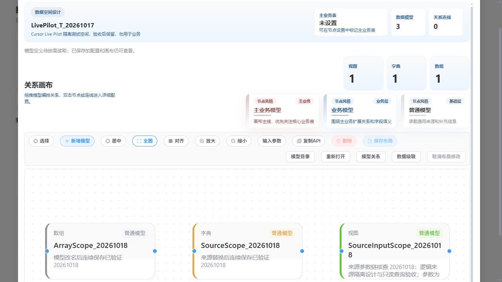
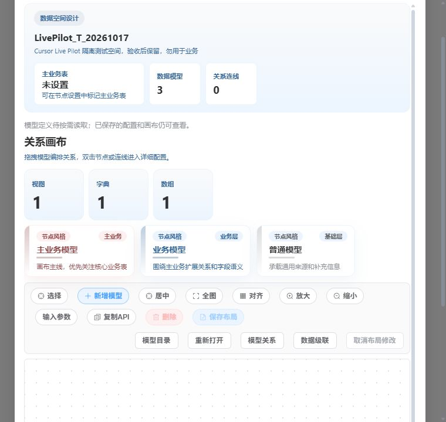

# A6 主画布与内建工具栏呈现验收（2026-10-24）

本组完成标准图组件的可选呈现与设计页消费，基线为 `3efece5ba67823a6ad645352e647c946b0f41258`。低价实施者负责代码，主控负责范围裁决、复审、门禁和真实烟测。只核销主画布呈现，不核销完整参考页 1:1。

## 改动与组件合同

- `RendererGraph` 增加公开 `backgroundPattern: none | dots`、`nodeAppearance: default | card`；默认值保持原行为。属性经 RendererGraph 传至 GraphCanvas 实际渲染。
- 设计页主图与布局预览选择 dots/card；模型卡片仍为 232×120，不修改布局坐标、投影、选中状态、DataView、权限或保存链。
- 操作入口继续使用图组件原有 toolbar children/tail 和标准 Button 属性，保留原顺序、文案、条件与事件；没有增加第二条页面工具栏。
- 先查正式 ClassModel 的目录、概要及属性指南；源码声明改动后运行正式生成器，再核公开属性指南。具体查询保存在 cache 的 `a6-class-model-query.json` 与 `a6-class-model-query-post.json`。

独立初审发现自有工具栏 class 同时作用于 wrapper/内层造成双重装饰，以及可连接卡片标题带露出方角。R1 只修两个 CSS 边界并通过复审。主控真实 DOM 命中检查又发现卡片内容遮住两个左端手柄；R2 仅提高 card 模式手柄层级，独立复审无剩余 P1/P2。最终六个端点中心均命中手柄本身。

## 验证

| 检查 | 结果与范围 |
| --- | --- |
| RendererGraph 完整文件 | 35 项通过；初始呈现反例 RED 1 项保留，不重复计入绿色总数 |
| 页面现有工具栏、画布、布局定向回归 | 分别 1、4、2 项通过；不是完整页面测试套件 |
| 最终源码检查 | 主控 typecheck、scoped/full lint、正式 ClassModel 生成、完整 verify:rules、build:fe 全部退出 0 |
| 生成物 | 963 个生成文件；实际 Git 差异 18 个，含 12 个外围包分片，仅编译器符号数字 ID 变化已规范化比对 |
| 独立复审 | R1 两原问题关闭；R2 手柄问题关闭；六文件 SHA-256 与冻结审查一致 |

R1/R2 后只改 CSS；以真实浏览器复验修复，不添加镜像 CSS 测试或重复运行此前已通过的行为测试。最终页面测试文件无提交差异，临时属性镜像断言已移除。完整日志与 `.exit` 位于 `node_modules/.cache/metadata-integration-20261024/a6-*`。保留既有规则 warning 和构建动态 import 提示，未将其写为本次新增失败。

## 真实页面

经正式目录新建 T（`944DEE5A0E5170F903E0E008172C4CD2`）设计实例，读取原 3 模型、0 关系。分别在 1280×720 与 760×720 验证：

- 全图、缩放、居中、目录开关、参数打开后取消、模型双击配置后关闭均正常。
- 760 视口页面 client/scroll width 均为 657，工具栏均为 655；16 个按钮边界全部在视口内。
- 工具栏 wrapper 边框为 0，内层为 1px；节点保持 232×120，标题带上圆角 15px。六个手柄中心实际 `elementFromPoint` 命中自身。
- 请求窗口 69959—70425 完整、未截断：11 条 API 均 Code 200，仅查询与文件读取，0 写入。请求/几何摘要见 [脱敏 JSON](a6-canvas-live.json)。

没有在真实服务创建关系，手柄证明限于命中及既有交互测试。参考比较使用已保存截图与源码，未重新打开会自动写入的参考真实页面。其他工作区布局、完整操作顺序与所有边界行为仍归阶段 A 后续验收。
