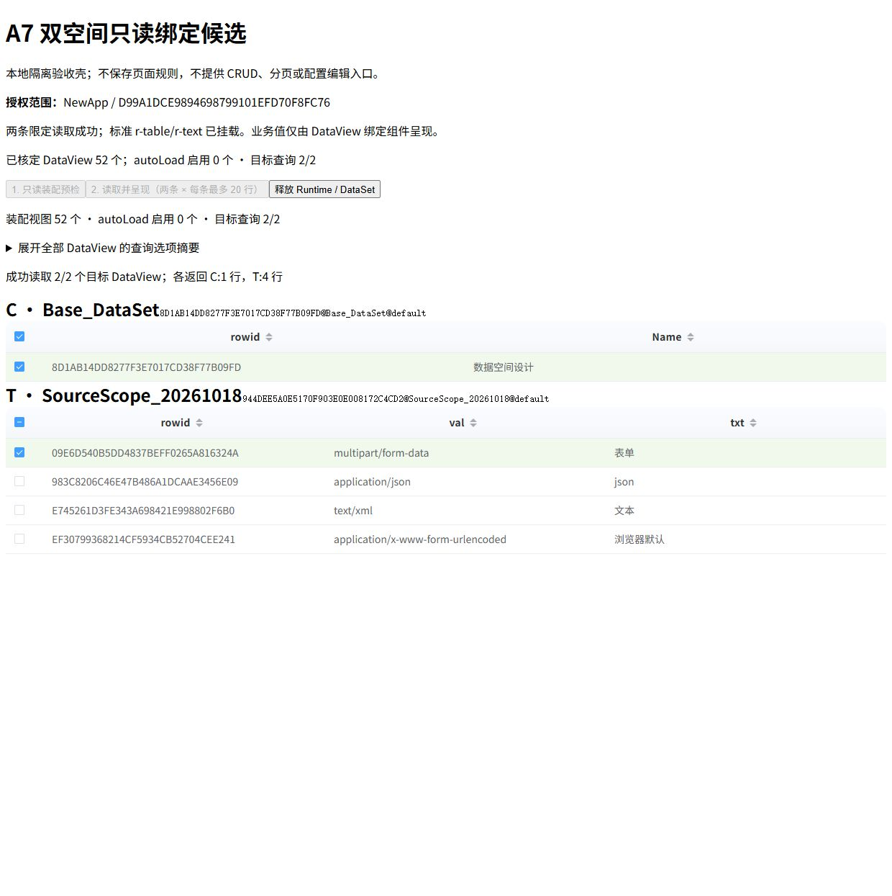
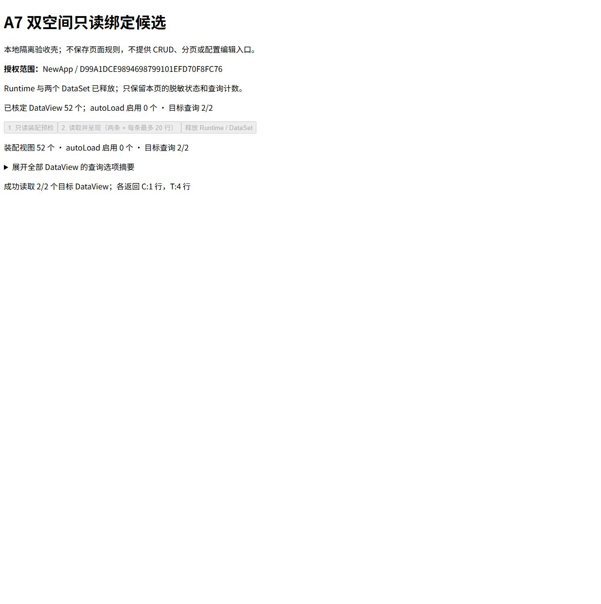

# A7 C/T 双空间标准组件只读绑定（2026-10-24）

主控在同一已授权 NewApp 浏览器标签内，使用现有 5273 Vite 服务运行 cache 隔离验收壳。没有另启服务、修改产品路由或保存业务页面规则。壳由低价助手准备，主控静态审查后操作真实服务。

本组确认两个不同正式模型按完整键独立定位，并由标准表格及字段子组件消费原 DataView。它不是生产业务页面迁移验收，也不证明真实同名模型、跨空间写入或切换后的写隔离。

## 合同及实际接线

| 空间 | 标准 r-table 完整绑定 | 标准 r-text 子字段 | 正式返回 |
| --- | --- | --- | --- |
| C | `8D1AB14DD8277F3E7017CD38F77B09FD@Base_DataSet@default` | rowid、Name | 1 行 |
| T | `944DEE5A0E5170F903E0E008172C4CD2@SourceScope_20261018@default` | rowid、val、txt | 4 行 |

`PageTool` 内存 rule → `PageRuntime` → `loadLowcodeRuntimeScenario` 装配两个独立 DataSet → 完整键 resolve/materialize → `SparkPageRenderer`。两个表格显式绑定视图，字段只配置 `field + readonly`，继承表格单元格行上下文；未手传业务 rows 或候选数组。C 只传已核定的 dataSpaceId 输入，T 不增加输入。数据读取仍调用 DataView.loadFromServer。

ClassModel 查询沿 r-table/r-text 目录、概要、继承成员指南核对完整键、字段与只读合同，随后对照实际容器/字段上下文消费。cache 的 `task-a7-dual-space-harness-preparation.md` 保留查询与源码定位；其中建议的另起 Vite root 没有执行，实际使用现有服务的 `/node_modules/.cache/metadata-integration-20261024/a7-dual-space-readonly.html`。

主控装配预检确认 C 48、T 4 个视图全部 autoLoad=false；两个目标没有 allPages、树、filterLookup 或父级输入级联。正常键校验通过；独立负例 Runtime 对 `C@SourceScope_20261018@default` 在 materialize 时拒绝“页面绑定的视图不存在”，随后释放，不跨到 T 兜底。

## 请求与界面证据

- 完整目标查询窗口 74647—74670，未截断：`9000.12721` 查询 Base_DataSet、`9000.12722` 查询 SourceScope_20261018，实际 PageParam 均为 `{index:1,size:20}`，HTTP 200 / Code 200，分别 Items/Count=1/1、4/4。
- 两次显式查询后挂载标准组件，两个表格均呈现正确列与返回内容，未再触发自动查询。
- 初始导航含大量模块请求，记录开头已被环形缓冲淘汰：保留窗口首序号 73734，首个保留 API 序号 74412。保留窗口内共 26 条 API（24 条正/负例元数据装配读取、2 条目标查询），均 Code 200、仅 GetData 与 File/content/text。不能将该截断窗口写为“整个导航零写入”的完整网络证明。
- 释放按钮执行后界面确认 Runtime 与两个 DataSet 已释放、标准表格移除；释放观察窗口未截断，新增 API 为 0。之后同标签回到正式数据空间目录。

[脱敏请求及视图摘要](a7-dual-space-live.json) 不含授权头、token、参数值或业务行正文。截图内仅显示本次标准组件的实际元数据及 MIME 字典值。

## 自动化及可复核范围

主控运行 `page-model-view-binding.test.ts` 与 `page-scenario-inputs.test.ts` 两个完整文件，42 项全部通过；包含同名模型、内部表键不同、完整键及调用输入隔离等夹具。日志为 cache 的 `a7-parent-binding-controls.log/.exit`。夹具的 signed save 不作为线上写入证明。

cache 入口 `a7-dual-space-readonly.ts` 最终 SHA-256 为 `B1B4036E152629BD1FE8685E62FB8B322A8775352985F10BD3E9016DC4A6E4C5`，实际运行后再次核对一致。助手报告候选独立 tsc 退出 0，但没有保存独立 log/exit，故不将它列为主控留证门禁。此次没有产品源码改动，不重复运行 A6 已通过的全仓构建。

本组核销真实 C/T 不同模型的只读绑定与错空间拒绝；同名真实样本、跨实例未知提交恢复、其他来源未加载保存及完整参考页对照继续留在唯一台账。
