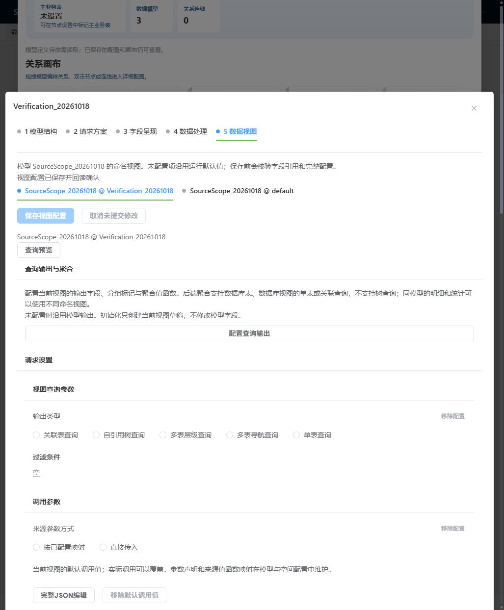
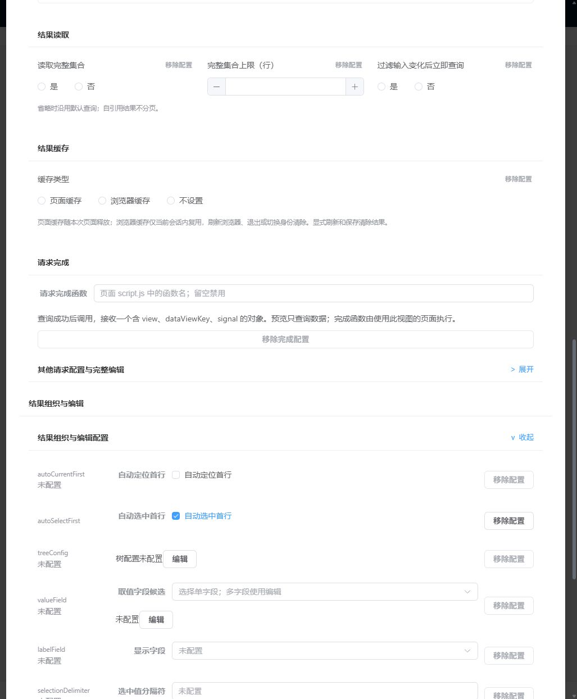

# A8 文件视图保存边界与回执提示（2026-10-24）

基线 `ce9c6a5c3606ed2d9c2920ef581ed5b3963d0e97`。本组沿原标准字段 → DataViewDefinition → DataSet 保存 → 文件资源适配验证单属性保存、完整文件保留和独立重开，并修正保存提示的过期计算。未增加第二套文件读写入口。

## 真实文件验证与操作纠正

目标为 T `944DEE5A0E5170F903E0E008172C4CD2` 的 `SourceScope_20261018@Verification_20261018.autoSelectFirst`。fresh 文件明确保存 true；原候选 autoCurrentFirst 不存在，未猜默认值或写入。标准 FieldCheckbox 绑定原定义视图，保存使用原 DataSet selector。

| 实际动作 | 上传 / 正式回读 | 结果 |
| --- | --- | --- |
| 验证视图 true → false | 13528 / 13531 | 整份 JSON 只有该字段变化；13542 新实例回读一致 |
| 首次恢复误操作 | 13551 / 13554 | 主控没有确认页签切换成功，实际仍在 default，误新增 default.autoSelectFirst=true；验证视图仍 false |
| 清理误加属性 | 13574 / 13577 | 逐步核 default 身份后用原“移除配置”入口，文件恢复到第一次临时态 |
| 正确恢复验证视图 true | 13583 / 13586 | 确认选中 tab、完整标题、属性存在性后保存；整份 JSON 精确恢复原基线 |
| 最后独立重开 | 无写入 / 13597 | 验证视图 true、default 无该属性；完整文件等于原基线，UI 保存禁用 |

请求 ID 表中均省略前缀 `9000.`。共 4 次 UI 保存、4 次文件上传（均 Code 200），包含一次主控误操作和两步纠正；不是原定两次流程全部一次通过。四个保存窗口均未截断，各有文件冲突读取、上传与下载回读，以及 T/目标模型的校验；没有数据库批量写入或全空间模型/字段补查。校验查询返回目标模型 1 行、其字段 9 行，不把这些必要查询说成“零查询”。

主控最初只过滤复选框值，过早推断产品绑定错位；完整 AX 实际记录了 default 标题和“未配置”。该推断已撤回，原始状态及纠正原因保留，不据此修改产品绑定。后续逐步核身份后正常保存。原文快照与 AX 保存在 cache；[脱敏网络、差异及恢复记录](a8-view-file-working.json)包含四次保存和独立重开。

全文件规范化 SHA-256：

- 原基线 / 最终恢复：`9c9351f320c1eeac9fa2b3efa45b0f4061bbd89c89265d94db31316bc2a4a5a9`
- 唯一字段临时 false：`851d256f7ff6ca329617be334f154a35bf82f41803e4dd59177c573e95db28db`
- default 误加属性态：`35783d26dd3479282c6f1fbd91cbe33f322934698c05a84cb6d0387c6a094624`

递归排序后精确比较全部 JSON，保留两表绑定、四视图、原列配置与布局；没有忽略字段来凑相等。截图证明本次标准编辑器可见结果，完整身份/持久结果以同次正式回读为准。

## 提示缺陷与窄修复

新测试揭示独立问题：DataSet 保存回执后，定义和绑定 DataView 已无 editing/pending/mutating，文件也为 idle，但页面 `viewInputDirty/localDirty` computed 仍缓存保存前的 true。`commitDefinitions` 先据此设置“仍有修改待保存”，`run` 的 finally 随后才递增 tick；缓存刷新后提示并未重算。

只在成功回执与可选结构回读完成后、选择提示前递增既有 tick。selector、保存调用、身份/权限守卫、unknown 核验及结构回读条件均未改变。没有以该修复掩盖上述主控误操作。

低价实施者交付两文件；独立审查 PASS、无 P1/P2，冻结 hash 审前审后相同。原始 RED 与诊断分别为 cache 的 `a8-r1-direct-message-red.log`、`a8-direct-save-boundary-diagnostic.log`。

## 验证范围

- 原测试文件完整 2 项通过：干净回执显示保存完成；正式整页选命名视图后延迟字段目录返回仍保持正确身份；单字段保存、全文件保留、独立重开/恢复；保存等待期间新 pageSize 草稿保留，仍提示待保存且不进入原回执文件。
- `fileModels` Idle/空行/无草稿证明仅来自直接挂载原编辑器的合成用例。正式整页在编辑前已将该视图加载，UI也没有其内部 RequestState 观察面；不能把这个样例说成线上 fileModels 一直 Idle。
- typecheck、两文件 scoped lint、主控完整 lint、`verify:rules`、`build:fe` 均退出 0。正式 `generate:class-model-surface` 生成 963 文件、1969 符号、1588 索引，实际仅 manifest 与本组件投影两份生成文件变化；未手改产物。
- 冻结代码只读重开：窗口 90269—90656 完整未截断，12 条 API 均 HTTP/Code 200、0 写入、0 网络失败。9000.15147 再次读取 T 全文件，规范化 hash 等于原基线；选中 Verification_20261018、autoSelectFirst=true、保存禁用。含宿主元数据装配与当前目标查询，不把整个重开描述成只查询目标模型。页面已回目录。

最终受审两文件 SHA-256（审查前后及门禁后相同）：

- `DataSpaceViewEditor.vue`：`C3F25836D6011891EFFA3917BBBD49F1E421376B3E64B459D8C5E8D8F06D2D77`
- `data-space-view-parameter-input.test.ts`：`C90F6BA217CB3932184F1E2258529EE8631E8FF6BA25B36733972A0604275F3F`

真实四次文件写入发生在提示修复之前；数据保存链未改，提示新行为由上述原生 DataSet 反例证明。跨实例未知恢复和完整参考页对照仍未核销，本组不代表阶段 A 完成。
