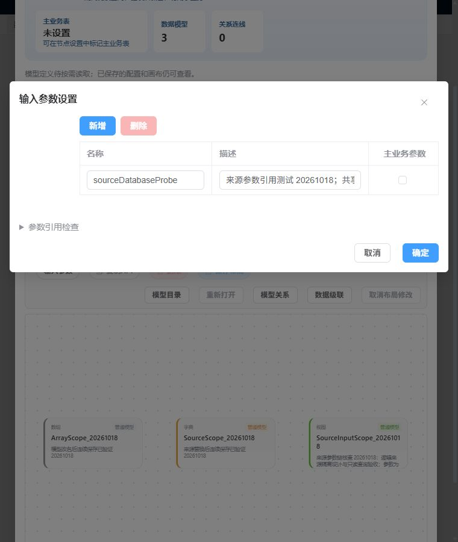
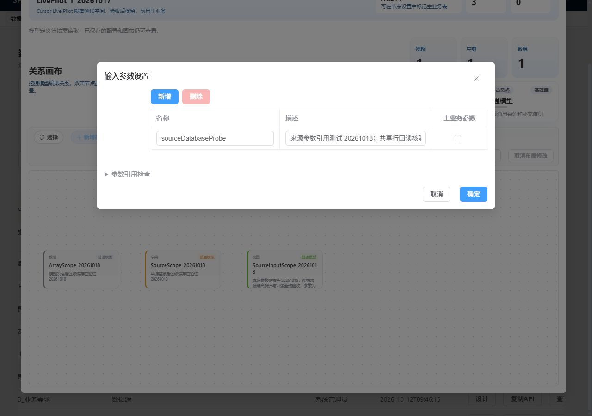
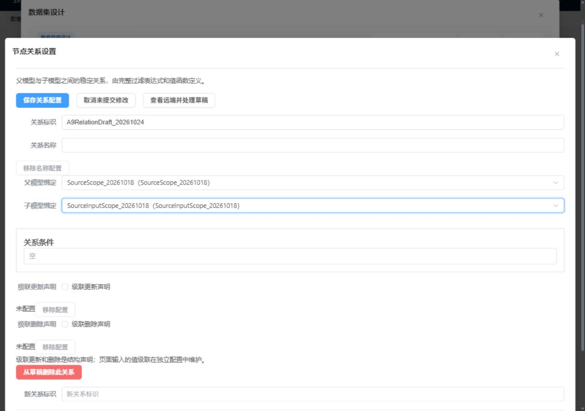
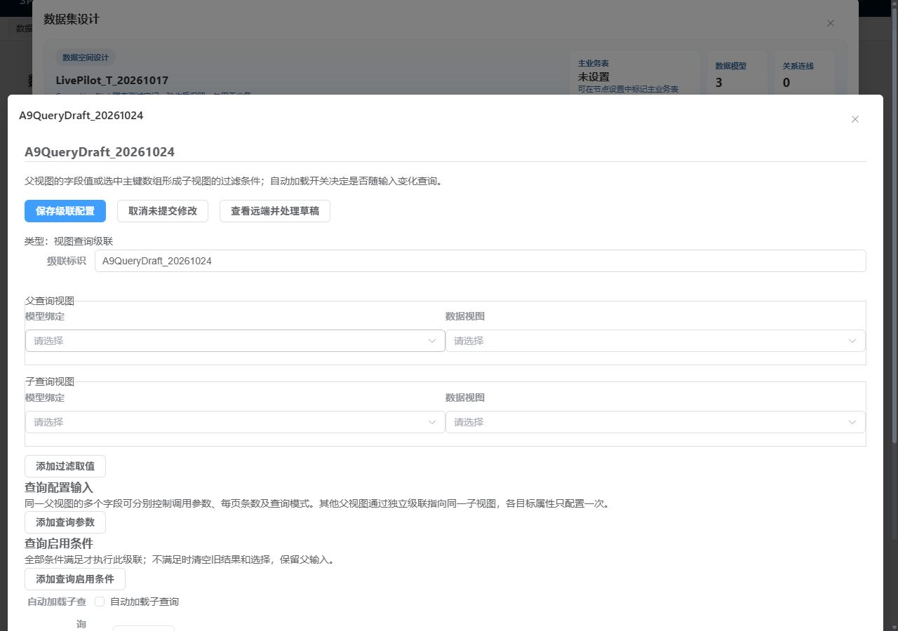
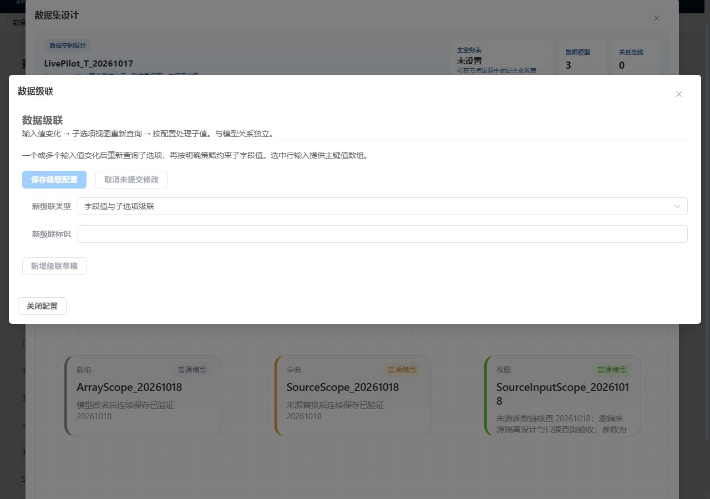

# A9 参数弹窗适配与工作区取消验收（2026-10-24）

基线 `c93668b44ad60df2bb6deebf952c64175aaac72d`。本组首先对照参考源码与既有画面，再检查当前正式页面；参考前端保持停止，未重新打开参考 T 空间，也不把历史截图当作本次完整对照。

## 修复及标准合同

760×900 实页中，“输入参数设置”固定宽 860px，右侧确定按钮超出视口。低价实施者只将该 `RendererDialog.width` 改为 `min(860px, calc(100vw - 32px))`，复用本页模型弹窗已有形式；保存、取消、绑定与守卫均未改变。

按正式 ClassModel 目录、RDialogProps 成员及 width 指南核对：width 接受 CSS 宽度表达式，沿 RendererDialog → FullscreenDialog → el-dialog 传递。A9 正式生成后主控又通过知识 provider 执行目录/概要/modelGuide/attributeGuide，记录在 cache/a9-dialog-knowledge.json。旧投影的2026-10-12时间与声明源码修改时间一致，不表示生成器没有刷新。

| 实际视口 | 修复后弹窗 | 取消／确定 |
| --- | --- | --- |
| 760×900 | 宽728px，x=16，无自身横向溢出 | 均在可视区，中心命中原按钮 |
| 1280×900 | 宽860px，x=210，保持原宽屏尺寸 | 均在可视区，中心命中原按钮 |

## 工作区与取消实页观察

- SourceScope 模型工作区、来源选择可打开；来源表格/筛选/分页可见，取消后返回原模型，关闭保护释放。只验证打开/取消，没有再次验证来源替换保存。
- 关系工作区建立本地 `A9RelationDraft_20261024`，父/子模型分别选择 SourceScope / SourceInputScope；正式字段目录返回后呈现条件编辑器。取消后显示已取消，保存禁用、关闭可用。
- 查询级联工作区建立本地 `A9QueryDraft_20261024`，呈现父/子视图、过滤、输入、启用条件和自动加载配置；取消后保存禁用、关闭可用。
- 关闭整个设计器后独立重开，两工作区都为空且无临时草稿。上述关系及级联没有提交，不证明实际关系保存或运行期级联执行。

三个明确观察窗口共39条 API，均为正式读取、无写入、无网络失败，窗口未截断；模块热更新间隔未纳入完整审计。修复后新实例初始文件22092.2302与最后独立重开22092.2320，全JSON规范化 SHA-256均为 `9c9351f320c1eeac9fa2b3efa45b0f4061bbd89c89265d94db31316bc2a4a5a9`，临时关系/级联均未持久化。见[脱敏网络与几何证据](a9-dialog-live.json)。浏览器已回目录、测试视口已恢复。

## 工程与范围

独立审查 Spec/Quality 均 PASS，无P1/P2；单产品文件冻结SHA-256为 `E0B6DAFCB97674DDD1D77C818D2DA03700E59E06832FF375C508F275B28EFA35`，审前审后与工程门禁后相同。typecheck、定向/完整lint、正式ClassModel生成、verify:rules、build:fe均退出0。生成实际仅manifest与页面投影两文件变化；不新增镜像宽度字符串的测试，布局由真实双视口验证。最初主控PowerShell数组传参使生成命令未执行，已修正命令后完整执行，原失败日志保留，不记为产品失败或通过。

本组修复已完成，整页所有步骤的1:1对照仍未完成。[跨实例未知保存合同缺口](cross-instance-save-contract-gap.md)继续保留。唯一计划和状态仍在[台账](../../data-space-retirement-ledger.md)。
