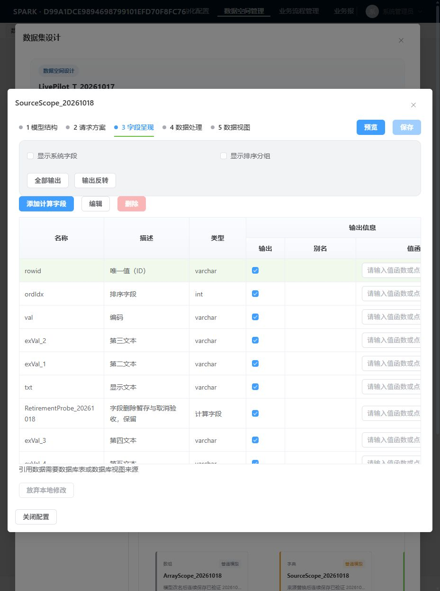

# 字段列表复用标准工具栏验收

日期：2026-10-24。实施基线：`a9d3a60931bf04be8818e6a0e684de398994557a`。

用户指出标准组件已有工具栏。本组将字段列表的添加计算字段、编辑、删除统一到绑定字段 DataView 的 `RendererTable.toolbar.children`，删除独立 `field-toolbar` 容器及 `field-create` 插槽转发。创建仍由原 `DataSpaceFieldCreate` 持有 owner、dialog、stage/cancel/verify 与释放；编辑和删除继续调用原领域流程。创建自身 pending 与外部禁用条件保持分离，避免弹窗自锁。未新增数据或保存通道，也未改用默认行删除取代领域引用检查。

## 合同与独立审查

实施前按正式 ClassModel 的组件目录、成员概要、模型及属性指南核对 Table/Toolbar/Button；工具栏 children 与绑定能力沿继承关系追到所属类型。实际 RendererButton 消费 `props.onClick`。实施后正式执行 `generate:class-model-surface` 成功，输出 963 个文件；包含新增公开 props 和已有交叉类型的正确派生，以及编译内部 symbol ID 变化，未手改产物。独立审查 Spec 通过、Quality approved，无 Critical/Important/Minor findings。

实施、查询、审查及命令原始日志保存在仓内缓存 `node_modules/.cache/metadata-integration-20261024/`，包括 `task-field-toolbar-report.md`、`task-field-toolbar-review.md` 和 `standard-toolbar-*.json`；缓存不是持久验收文档，本文件记录结果。

## 自动化检查

- 真实组件定向 UI 回归最终 12 passed、336 skipped：唯一按钮组及顺序、创建确认暂存/取消、字段延迟加载失败与重试、模型切换释放 owner、绑定及字段编辑/删除约束。早期 2 项聚焦绿灯与这 12 项重叠，不累加。
- 修改后的工具栏断言已在旧实现取得红灯，保存在 `field-toolbar-red-before.log`。
- `pnpm run typecheck`、改动文件 ESLint、`pnpm run verify:ai-codegen`、完整 `pnpm run lint`、`pnpm run verify:rules`、`pnpm run build:fe` 和 `git diff --check` 均通过。构建保留 CodeMirror 混合静态/动态导入提示，不影响退出码。

## 真实界面烟测

复用 NewApp 已授权登录，在 `http://127.0.0.1:5273` 打开隔离测试空间 `LivePilot_T_20261017`（`944DEE5A0E5170F903E0E008172C4CD2`），进入 `SourceScope_20261018 → 3 字段呈现`。

1. 按需加载完成后只出现一组添加计算字段、编辑、删除。普通字段删除保持禁用。
2. 点击添加计算字段，填写本地名称 `ToolbarLocalProbe_20261024` 与描述；确定及取消均可用。取消后工具栏恢复。再次打开弹窗，名称和描述为空，再次取消。
3. 选择 `ordIdx`，从工具栏打开原字段合同编辑器，描述原值为“排序字段”。修改为带测试后缀的本地草稿后取消，列表恢复原描述；模型保存禁用、关闭可用。
4. 关闭整个数据空间设计器，再从目录进入新设计实例与相同字段工作区，确认原字段描述、无新增测试字段、保存禁用、关闭可用。保存截图并视觉核对。

本轮未点击持久化保存，验证的是工具栏、绑定交互、取消与实例释放后的正式读取。新增确认暂存和切换模型 owner 释放由自动化组件用例覆盖；不能将本轮作为新增字段线上保存或未知结果核验的证据。前一组数组持久化验收单独见 `a3-acceptance.md`。

## 阶段状态

本工具栏纠偏完成。完整整合仍处于唯一台账的阶段 A；模型新增、改名、删除和来源替换的原捕获恢复等剩余项保持待实施。权限专题继续按用户范围暂缓。没有向参考仓或 Java 仓写入，没有推送。
