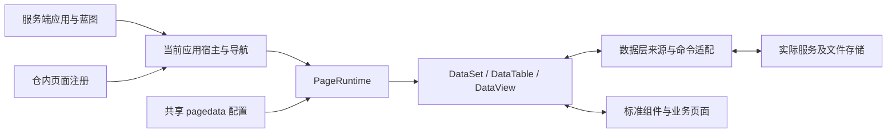

# 当前项目、服务端蓝图及 AppWorks 迁移差距核对

状态：本轮核对已完成，迁移规划稿已编制，尚未执行新计划。核查日期：2026-11-16。本文保存本轮事实与差距；实施任务只在[唯一台账](data-space-retirement-ledger.md#appworks-full-migration-20261116)维护。

## 1. 基线与核查方法

- 当前仓：`D:/SPARK_AppWorks`，分支 `codex/spark-data-s1-command-safety`，代码提交 `b9c14db6b10c52fcd8554b9eea319a4c979e633c`。
- 固定参考：`E:/r/sparkproject` 提交 `1147b00ee53a1476d4ee715c61368b453a215192` 的 `apps/appworks`。通过 `git ls-tree` / `git show` 读取，没有切换参考仓。
- 参考仓当前 HEAD 为 `4d19a0ac5644fe35c333119755c974ea57ff7fee`；该版本已无 `apps/appworks`，相对固定参考删除了该目录的473个文件。目录撤除不改变本次迁移分母。
- 先枚举参考文件、当前页面注册及场景，再核业务入口、调用链、禁用操作和现有测试；服务端身份与导航另外执行只读回查。文件存在、测试通过、授权菜单出现分别计证据，不混为业务验收。
- 当前代码基线的工程验证为 `pnpm run verify` 通过，根级565文件、9,973项测试通过；这些是上一提交收口的直接证据，不证明20业务包已完整迁移。

## 2. 当前项目是什么

本仓是可承载多个应用的 SPARK 应用工场前端，不是只运行 D99 的单业务应用。`src/services/application-scope.ts` 从 `/apps/<projectId>/...` 解析当前应用；目录执行作用域为 `homepage`。`src/lowcode/system-navigation.ts` 根据注册表投影平台、企业及应用设计菜单，业务导航则消费服务端授权结果。

| 层次 | 当前落点 | 责任 |
| --- | --- | --- |
| 应用壳与业务页面 | `src/`、`packages/spark-app` | 登录、应用切换、导航、宿主生命周期及原生业务页面 |
| 标准组件 | `packages/spark-component` | 绑定 DataView 的表格、表单、字段、树、图及交互 |
| 公共数据链 | `packages/spark-data` | DataSet / DataTable / DataView、查询、编辑、取消、保存和结果状态 |
| 后端适配 | `packages/spark-lowcode-api`、`src/lowcode/resources` | 正式服务协议、来源适配、命令与回执；现有旁路仍须逐项收敛 |
| 工具与运行模型 | `packages/spark-project-model` | 项目、工具三文件、场景配置及独立 PageRuntime |
| AI与基础能力 | `packages/spark-ai`、`spark-utils`、`spark-json-document` | AI工作流/ClassModel、通用工具及JSON文档编辑 |
| 工程辅助 | `packages/vite-plugin-spark-catalog` | 标准组件扫描构建 |

当前有8个 SPARK 功能包及1个 Vite 插件包；`config/navigation/vue-pages.json` 登记50个页面，其中34个非隐藏，层级为 public 2 / enterprise 24 / platform 1 / app 23。`config/pages/system-scenarios.json` 登记39个场景，仓内有39份已跟踪的 `pagedata.json`。

在已跟踪的 `config/` 内未发现业务 `rule.json` / `script.js` / `style.css`。这只能证明当前仓内业务配置尚未成套四文件化，不能推断服务器不存在工具文件。底座的三文件合同及运行能力已存在，源码入口是 `packages/spark-project-model/src/page/page-file.ts`、`runtime-page.ts` 以及 `src/services/project/page-tool-file-dataview.ts`。

以下是当前公共主链；仍存在的业务旁路与未接通消费者见差距及逐域证据，不以此图证明所有页面已遵守。

## 3. 服务端对应的项目蓝图

本轮在 `https://spark.lingmacn.com`、既有授权的 `NewApp` 会话内只读核对，认证资料未写入证据。原始业务字段白名单、请求过滤及完整性检查见[服务端快照](evidence/appworks-migration-blueprint-20261116.json)。

| 身份 | 本轮正式返回 |
| --- | --- |
| AppWorks迁移母应用 / 蓝图根 ID | `D99A1DCE9894698799101EFD70F8FC76` |
| 应用目录 `Base_AppSystemList.AppName` | `DataSchemaManage` |
| 应用目录 `AppDesc` | 元数据管理 |
| 蓝图根 `Base_NavigationInfo.FunName` | 软件工坊[AppWorks] |
| 蓝图根 `name` / `prowid` | `DataSchemaManage` / `000000` |
| 应用目录与蓝图查询场景 | `7AB874097A1E8711A42FD845939A6E05` |
| 元数据设计查询场景 | `8D1AB14DD8277F3E7017CD38F77B09FD` |

因此，“元数据管理”和“软件工坊[AppWorks]”不是两套项目：它们分别是同一个D99应用的目录描述和蓝图根标题。应用ID、蓝图节点ID、工具页面路径与数据空间ID仍是不同身份，不能因某些记录值相同就混用。

正式 `GetData` 以 `SysId=D99…` 查询并核验了91个唯一且归属一致的节点，返回数等于服务端总数：14个 `Model`、77个 `Navitem`。所有非根节点的父节点都在本次结果内。

授权导航 `GetNavigationMenus/D99…/D99…` 另返回58个唯一菜单节点（TopMenus 17、LeftMenus 41），45个有URL。它是当前会话的运行授权投影，不能替代91节点的设计蓝图库存。

91节点中47条有非空URL；37条与仓内已登记URL精确匹配，另10条对应9个未登记的唯一URL。31个 `Navitem` 的URL为空，其中包含已由目录对话框承接的设计页，不能全部计成缺失页面。非空URL匹配也不证明操作、保存及下游消费完整。

### 3.1 服务端已发布但本仓未登记的URL

| 业务 | URL尾部 | 归属与处理 |
| --- | --- | --- |
| 导航权限配置、权限配置（2节点同URL） | `features/governance/navigation-permission/ui/navigation-permission-page` | 第19包，权限专题按现有暂缓裁决单列 |
| 脱敏规则配置 | `features/governance/desensitization-rule/ui/desensitization-rule-page` | 第19包，独立配置能力，不能因角色专题暂缓而丢弃 |
| 角色分类管理 | `features/governance/role-management/ui/role-management-page` | 第19包，原角色实现不能直接搬入前端，须按数据权限合同重新裁决 |
| 角色人员管理 | `features/governance/role-management/ui/role-user-page` | 第19包，同上；不等同组织用户只读页 |
| 小程序管理 | `features/integration/mp-open/ui/my-miniapp-page` | 第14包服务端增量 |
| 模板管理 | `features/integration/mp-open/ui/catalog-page` | 第14包服务端增量 |
| 申请审批 | `features/integration/mp-open/ui/application-page` | 第14包服务端增量 |
| 直播挂载 | `features/integration/mp-open/ui/channels-page` | 第14包服务端增量 |
| 日志查看 | `features/system/log-viewer/ui/log-viewer-page` | 第18包服务端增量，节点 `conid` 当前为空 |

### 3.2 服务端增量不能遗漏

相对2026-10-29的85节点历史快照，新增“代开发管理”分组及上述5个页面，共6节点；未见原节点被删除。5个新页面均出现在本轮授权菜单中。固定参考及参考仓当前HEAD中未找到对应 `mp-open` / `log-viewer` 源码，不能将旧基线没有这些页面解释为用户不需要。

4个mp-open场景已正式回读到4条 `Base_DataSet` 和11条 `Base_DataModel`。模型涉及渠道企业账号、渠道操作账号、小程序模板、模板申请、账号申请、部署和应用目录。模型返回的 `PrimaryKeyFields` 均为空；本轮未核字段级主键及运行查询回执，不据此断言物理表缺主键，也不推断这些模型可安全写入。后续须取得部署前端或源仓、字段合同、真实调用与状态转换证据，再设计统一数据链。

## 4. “还没移植”的统计口径

固定参考共473文件：316源码（238 UI、78非UI）、154测试、3配置。UI含116个Vue，其中 `features/` 下93个业务页及子组件；本仓同相对路径已有77个，缺16个。**77/93不是功能完成率。**

16个缺路径里包含被本仓标准组件承接的列表组件，也包含尚未恢复的治理功能和报表、Excel细节。非features的旧通用组件和宿主需要映射到本仓组件/宿主责任，不应为了路径统计复制另一套平台。完整迁移范围维持唯一台账中的20包，PDF及本仓四文件工作台仍保留；5个服务端新增入口归入相应包的增量。

| 同路径缺失类别 | 数量 | 语义处置 |
| --- | ---: | --- |
| features内应用/租户列表子组件 | 6 | 当前标准宿主已承接列表职责，逐操作验等价，不复制第二列表 |
| features内报表列表/表单子组件 | 2 | 当前宿主已承接头/版本等管理，不据此核销设计/预览引擎 |
| features内授权相关 | 6 | 数据空间/导航/用户应用授权及原角色相关，按暂缓专题和无前端角色合同裁决 |
| features内独立脱敏设计 | 1 | 业务配置缺口，保留设计与运行消费任务 |
| features内Excel lookup布局选择 | 1 | 专用编辑细节缺失或部分实现，核真实引用/目标及可写合同 |
| 非features通用组件 | 7 | 映射当前标准组件与宿主责任，未证明所有语义等价 |
| 非features报表设计/预览页 | 2 | 真正业务能力缺口；当前目标为`src/views/ReportManage/...` |
| 非features原占位页/路由壳/图演示 | 6 / 3 / 3 | 参考自身非完整业务页，处置理由保留，不能按文件复制或计已有成熟功能 |

合计37个缺Vue路径，逐文件和当前承接者见[机器清单](evidence/appworks-migration-inventory-20261116.json)的`classification.dispositions`。固定参考全部473文件及哈希也已保存；154个参考测试已枚举，实施P0将逐项映射其业务断言。全文件枚举和关键调用链审计不等于逐行语义验收。

31个空URL功能节点另分为20个已有嵌入/隐藏消费者、4个授权暂缓、1个报表设计缺口、6个身份或消费者仍待关联。后6项为应用选择、项目蓝图、业务选择、应用设计与交付、我的流程相关、人员选择；已有组件只作为候选，不能推定旧节点身份已接通。

## 5. 当前已证实的主要差距

1. 治理配置入口仍有缺失；前端无角色原则、既有数据权限守卫和新增授权接线暂缓必须分别处理，不能照搬参考角色判断，也不能删掉功能标签和授权需求。
2. 报表已有报表头、版本和模型绑定，但设计、预览、模板上传及真实产物消费未闭合。
3. 审批流程已有列表、图与办理外壳；节点/连线/表单配置、选人通知、回调、嵌入业务页路由/参数及统一命令保存仍有缺口。R16已保存的6项实服主键缺口与4项SPA失败证据继续保留，未在本轮重新执行。
4. 数据工具的整对象删除、新增、复杂发布和执行存在明确阻断或未交付项；必须区分目录删除与配置子节点删除，不能拿局部编辑成功核销整页CRUD。
5. 项目蓝图和四文件工作台仍需验证实际挂载入口、需求导入、工具设计、预览、发布及版本消费。组件和服务文件存在不代表用户能进入。
6. 新增mp-open四页及日志查看已有服务端入口，本仓尚无相应页面/场景交付，需要补全来源与正式合同后迁入。

参考AppWorks还声明17个外部平台包，必须沿实际导入核依赖：报表实际使用ReportHost/Stimulsoft，当前缺设计/预览及资源接入；人员选择和源/字段选择已有本仓标准承接但语义尚未齐；workflow-ui仅声明未被固定AppWorks导入，不能据包名视为已接通审批引擎。细节见[源码证据附录](evidence/appworks-migration-domain-audit-20261116.md)。

逐包源文件证据、现有测试、剩余动作和交付条件已对应到[完整迁移计划](data-space-retirement-ledger.md#appworks-full-migration-20261116)。计划依次落实数据层、标准组件、宿主、20包业务闭环及四文件推广，并保留权限暂缓、服务缺口及未知结果。本轮没有修改产品代码、后端Java、正式业务记录或服务器导航。
