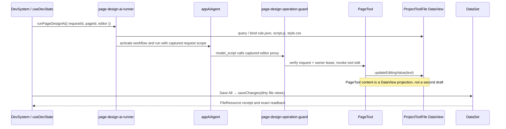

# pageDesign × DevSystem 消费方

本文描述当前 DevSystem inline runner 如何把页面工具编辑接入正式 `ProjectToolFile` DataView；Agent 内核见 [`native-runtime-and-agent-flow-zh-cn.md`](native-runtime-and-agent-flow-zh-cn.md)。不存在 headless Agent Run editor/provider。

## 数据流

`requestId` is the model instance identity. `pageId` selects the page inside the captured workspace; it is not the run identity. The runner captures workspace, active page, request scope, owner lease, and node selection revision. An old run cannot edit after a scope change, including leaving and returning to the same app/page. Async tree edits recheck the captured run guard before writing the DataView.

## File editing contract

The tool consists of `rule.json`, `script.js`, and `style.css`. `pagedata.json` is shared scenario DataSet configuration, not a fourth page tool file. DevSystem binds each file to its formal `ProjectToolFile` DataView before exposing the editor to AI.

- `PageTool.getFileText()` reads the bound row or editing overlay and checks the row's `fieldAccess(text).read` result.
- `setFileText()` checks field read/write access and the DataView edit action, then synchronously calls `updateEditingValue`. Invalid rule JSON is rejected before the row changes.
- `editNodeTree()` edits an isolated tree snapshot, verifies the source text and run scope after the callback, and writes only a semantic change to the same DataView.
- An unbound PageTool is a read-only projection. It has no local file draft, save baseline, or undo owner.
- Save All submits dirty ProjectToolFile views through `DataSet.saveChanges`. Unknown attempts stay on their original DataView and are verified without replaying the upload.
- If a user or AI edits again while a save is in flight, that newer overlay remains pending for the next Save All.

DataSet saves each file source independently; cross-source or multi-file atomic transactions are not promised. A receipt confirms only the captured file change and its readback.

## AI gates and lifecycle

`useDevState.runPageDesignAi()` loads and binds all three formal file views, then runs the inline runner in manual-save mode. The page-design operation guard enforces allowed operation domains, blocks host storage/binding methods, and rechecks the captured scope around asynchronous `editNodeTree` callbacks. Releasing a workspace retains views with dirty overlays or unknown attempts; clean views are unbound before the owner is disposed.

The UI approval bridge is `createAiToolApprovalBridge()`. Approval controls whether a model action may run; it does not replace DataView field access, action state, or save authorization.

## Key files

| Path | Responsibility |
|------|------|
| `src/services/page-design/page-design-ai-runner.ts` | Runs the active pageDesign session |
| `src/services/page-design/page-design-inline-delivery.ts` | Reports the inline runner's file/scenario delivery result |
| `src/services/page-design/page-design-operation-guard.ts` | Enforces operation domains and the captured run guard |
| `src/services/page-design/page-design-gates.ts` | Holds request-scoped page/run context and operation policy |
| `src/services/project/page-tool-file-dataview.ts` | Binds ProjectToolFile to the FileResource adapter |
| `src/views/app/dev-system/useDevState.ts` | Loads views, captures scope, and coordinates Save All |
| `packages/spark-app/src/ai/tool-approval-bridge.ts` | UI approval Promise bridge |
