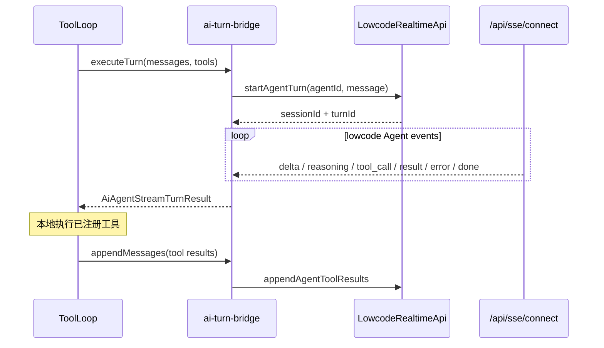

# 传输层与会话

> 状态：有效。类型见 [`transport-types.ts`](../src/agent/conversation/transport/transport-types.ts)；lowcode Agent 与实时消息端点由 [`LowcodeRealtimeApi`](../src/agent/conversation/transport/lowcode-realtime-api.ts) 持有。

## 分层职责

```text
spark-ai（框架无关）
  transport-types.ts       消息、工具、turn 输入输出与回调合同
  app-sse-events.ts        llm-frame 等应用事件结构
  turn-event-collector.ts  聚合事件为 AiAgentStreamTurnResult
  lowcode-realtime-api.ts  Agent turn / tool append、SSE、通知与下载回执

AppWorks 组合层
  src/services/ai/ai-turn-bridge.ts  本地 ToolLoop 与 lowcode Agent turn 的语义桥
  src/services/sse-events.ts         共享连接、事件分发
  src/platform-adapters/lowcode-runtime.ts     注入认证 HTTP 客户端、fetch 与当前会话读取器
```

ToolLoop 通过 `AiAgentTurnCallbacks` 与传输解耦。`LowcodeRealtimeApi` 发送 Agent turn 到 `POST /api/ai/turns`，从 `GET /api/sse/connect` 读取事件，向 `POST /api/ai/sessions/{id}/turn/append` 回传工具结果。Agent、持久会话和模型配置仍由 lowcode-jdk17 持有。

DataView 驱动的 Agent turn（目录、创建、状态、取消）、Agent 配置和 AI 录入也由 `@spark-appworks/spark-ai/agent` 提供。该 turn 合同与 ToolLoop 的 SSE 合同独立，不共享创建端点。

## 一轮 ToolLoop



关键约束：

- lowcode 返回的真实 `sessionId + turnId` 是事件归属和工具回传的唯一绑定。
- 前端本地业务 sessionId 不冒充或覆盖 lowcode 持久会话身份。
- 工具回传只接受真实 `toolCallId`、`toolName` 和序列化结果。
- SSE 事件必须同时匹配真实 session/turn；无法绑定的事件不进入当前 ToolLoop。
- 超时、畸形 envelope 和缺失 pending turn 都显式失败，不用本地假结果兜底。

## 关键文件

| 路径 | 职责 |
|------|------|
| `packages/spark-ai/src/agent/conversation/transport/transport-types.ts` | 框架无关 turn 契约 |
| `packages/spark-ai/src/agent/conversation/transport/app-sse-events.ts` | 应用 SSE 事件结构 |
| `packages/spark-ai/src/agent/tool-loop/turn-event-collector.ts` | llm-frame 聚合 |
| `src/services/ai/ai-turn-bridge.ts` | lowcode Agent turn 桥接与身份绑定 |
| `src/services/sse-events.ts` | lowcode SSE 单例连接与分发 |
| `packages/spark-ai/src/agent/conversation/transport/lowcode-realtime-api.ts` | 物理端点、wire envelope 与 SSE 解码 |
